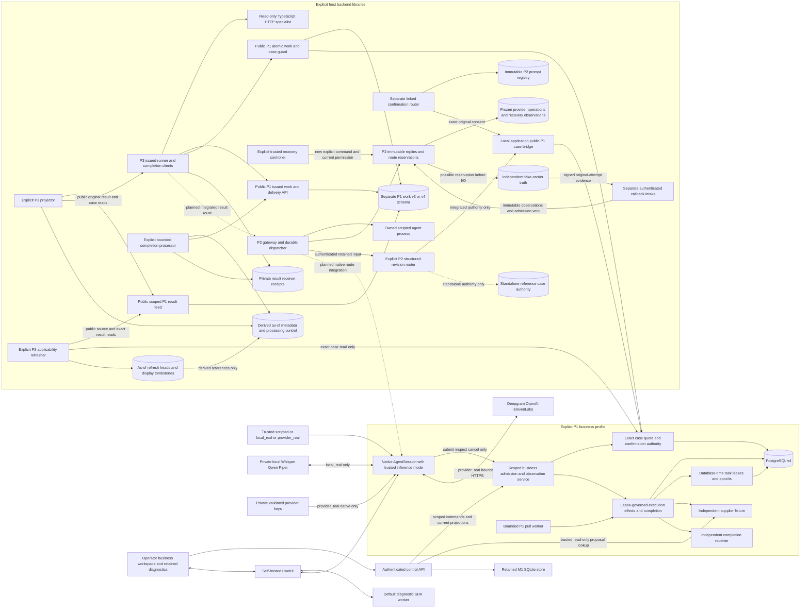
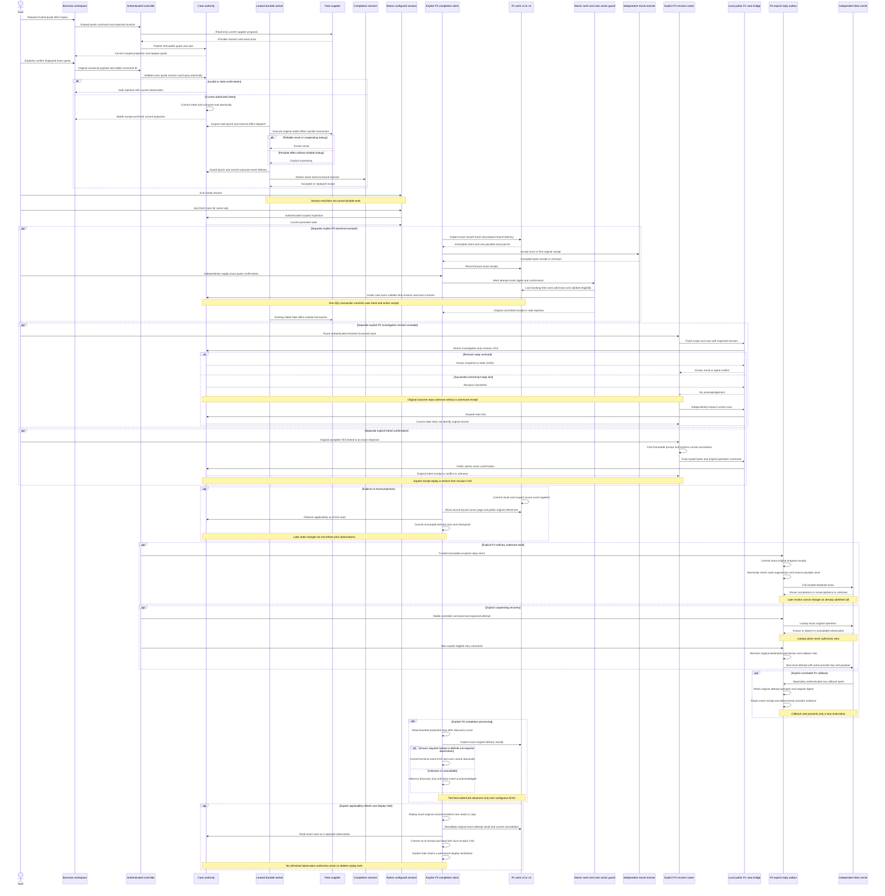

# LiveKit Agents portfolio design

| Field | Value |
| --- | --- |
| Status | Active |
| Purpose | Fix the data flow, state authority, interfaces and failure boundaries that P1, P2 and P3 share |
| Audience | Engineers changing a cross-project boundary or locating the owner of a fact; coding agents |
| Scope | Shared portfolio design and the selected gate record; excludes project-level contracts and executed evidence, which project documents own |
| Owns | Shared data flow, state authority, interfaces and failure boundaries |
| Related | [README](README.md) · [Portfolio scope](docs/portfolio-scope.md) · [Build plan](docs/build-plan.md) · [Validation plan](docs/validation-plan.md) · [Design template](docs/design-template.md) |

## Overview

This document is the shared design for the LiveKit Agents portfolio, which
consists of three libraries with one synthetic reference application. It fixes
the data flow, state authority, interfaces and failure boundaries that P1, P2
and P3 share.

Authority is divided between documents:

| Document | Owns |
| --- | --- |
| [Portfolio scope](docs/portfolio-scope.md) | The V1 requirements |
| Project charters, linked in the project table below | Acceptance IDs |
| This design | Shared authority and failure boundaries |
| Project designs, guides, decisions and work items | Concrete contracts and executed evidence; each section below links to the owner |
| [Harness catalog](harness/catalog.json) | Current runner registrations |

The three projects divide ownership as follows. [State ownership](#state-ownership)
is the authoritative table.

| Project | Charter | Owns |
| --- | --- | --- |
| P1 agent continuity | [Agent continuity charter](docs/projects/agent-continuity-scope.md) | Durable execution: jobs and steps, attempts, leases, signals, timers, effects and result events; P1 also implements the shared case authority |
| P2 channel continuity | [Channel continuity charter](docs/projects/channel-continuity-scope.md) | The inbox and outbox, provider identities, channel association and communication evidence |
| P3 delegation reliability | [Delegation reliability charter](docs/projects/delegation-reliability-scope.md) | Delegation input snapshots, result schemas, applicability and routing metadata |

### Contents

| Section | What it covers |
| --- | --- |
| [Objectives](#objectives), [Functional requirements](#functional-requirements) and [Non-functional requirements](#non-functional-requirements) | What the portfolio must achieve and how each goal is checked |
| [Back-of-the-envelope calculations](#back-of-the-envelope-calculations) | Configured resource ceilings and illustrative sizing |
| [High-level design](#high-level-design), [Sequence diagram](#sequence-diagram) and [Low-level design](#low-level-design) | Components, the main business sequence and the interface composition |
| [Components and related details](#components-and-related-details) | Component layout, state ownership, shared commitment rules, interfaces, identity, the local runtime and the design of P1, P2 and P3 |
| [Security and privacy](#security-and-privacy), [Observability](#observability), [Metrics](#metrics) and [Exception handling](#exception-handling) | Cross-cutting rules |
| [Design considerations and trade-offs](#design-considerations-and-trade-offs) | Recorded decisions and their revisit triggers |
| [Validation and acceptance gates](#validation-and-acceptance-gates) | Engineering gates and the selected qualification record for each checkpoint |

### Terms used in this document

| Term | Meaning |
| --- | --- |
| M1 | The existing confirmed-investigation intake, stored in SQLite and kept on the ordinary browser/API path |
| V1 | The fixed project scope defined by the portfolio scope |
| Acceptance ID | A charter acceptance row ID, such as P1-01 |
| Task ID | An implementation task ID, such as P2-I15, defined in the [granular roadmap](docs/implementation-plan.md) and its project task plans |
| Work package | A [build plan](docs/build-plan.md) ID, such as PLAN-02 |
| Checkpoint | A numbered work item under docs/work-items, such as 0035, that records a phase's scope and evidence |
| Selected qualification | A pass of the gate assertions selected for one task or checkpoint; it does not complete the related charter row or a release gate |
| Owner upgrade | A versioned schema upgrade that only the explicit owner (migration) role runs; serving roles never run data definition language (DDL) |
| DML | Data manipulation language: ordinary row reads and writes |
| ACK | Acknowledgement |
| CAS | Compare-and-set: a conditional write that succeeds only if the stored revision still equals the expected one |
| Epoch | The monotonically increasing lease generation retained for each task |
| Possible send | A reservation committed before an external call; once it exists the call may have happened, so the outcome stays unknown until a known result or matching receipt is recorded |
| As-of observation | A fact recorded together with the read that produced it; it is not refreshed automatically and grants no current permission |
| Inference modes | scripted (default), local_real and provider_real |
| HMAC | Hash-based message authentication code |
| OTLP | OpenTelemetry Protocol, used for trace export |
| RTC | Real-time communication |
| SFU | Selective forwarding unit; here, the self-hosted LiveKit server |
| STT, LLM and TTS | Speech-to-text, large language model and text-to-speech |
| ADR | Architecture decision record under docs/decisions |
| POC | Proof of concept |
| SLO | Service-level objective |
| RSS and WAL | Resident set size; write-ahead log |
| PCM, CRC and OCR | Pulse-code modulation audio; cyclic redundancy check; optical character recognition |
| RPC and UX | Remote procedure call; user experience |

### Current status

| Capability | Status | Evidence |
| --- | --- | --- |
| M1 intake and the local operational foundation | Implemented | [Foundation and P1 gate history](#foundation-and-p1-gate-history) |
| Explicit business profile: a separate PostgreSQL v4 workspace and native scripted conversation | Qualified: Phase G combined gate | [Phase G work item](docs/work-items/0013-p1-phase-g-conversation-and-showcase.md) |
| P1 local V1 acceptance and release gates | Qualified for the local POC using provider_real v2 | [Foundation and P1 gate history](#foundation-and-p1-gate-history) |
| `local_real` inference profile | Not qualified | [Local-real operations guide](docs/local-real-inference.md) |
| P2 and P3 backend libraries | Partial: qualified checkpoint by checkpoint; complete P2/P3 acceptance pending | [P2 and P3 checkpoints](#p2-and-p3-checkpoints) |
| P3-01, P3-03 and P3-11 | Qualified: registered fresh passing lab reports | [Routing and acceptance work item](docs/work-items/0031-revision-routing-and-delegation-acceptance.md) |
| All 17 P2 rows and the remaining 14 P3 rows | Planned | [Harness catalog](harness/catalog.json) |

These caveats apply to the table:

- The ordinary browser/API path retains M1 intake.
- P1-01 through P1-05 have actual SQLite acceptance/recovery evidence.
- Local scripted-media qualification remains distinct from physical microphone,
  real-inference, hosted CI and capacity claims.
- The ordinary Docker/UI does not compose these P2/P3 backend paths. Broader
  deadline/recovery, media, capacity and full release retain their own gates.

#### P1 phases

| Phase | Adds | Gate status | Owner documents |
| --- | --- | --- | --- |
| A | Explicit SQLite inquiry subset that preserves original M1 records | Historical completed evidence | [SQLite inquiry decision](docs/decisions/0002-sqlite-inquiry-subset.md), [work item](docs/work-items/0007-p1-phase-a-execution-foundation.md) |
| B | Independent read-only fake supplier and cooperative single-worker crash reconciliation | Historical completed evidence | [Work item](docs/work-items/0008-p1-phase-b-inquiry-recovery.md) |
| C | Standalone PostgreSQL inquiry adapter, controlled backed-up cutover and trusted synthetic actor scope | Historical completed evidence | [Cutover decision](docs/decisions/0003-postgres-cutover-and-scope.md), [work item](docs/work-items/0009-p1-phase-c-postgres-cutover.md) |
| D | Exact case/quote/confirmation and persisted continuation on v2 | Historical completed evidence | [Continuation guide](docs/case-and-continuation.md), [work item](docs/work-items/0010-p1-phase-d-authority-and-waits.md) |
| E | Supplier-bound v2 proposals, owner-only PostgreSQL v3 upgrade, mutation reconciliation/uncertainty, cancellation and durable completion delivery | Final combined gate passed | [Effects guide](docs/effects-and-completion.md), [work item](docs/work-items/0011-p1-phase-e-effects-and-completion.md) |
| F | P1-I19 through P1-I21 on PostgreSQL v4: per-task database-time leases, retained epochs, persisted admission limits and an opt-in bounded pull worker | Final gate passed | [Lease/worker guide](docs/leases-and-workers.md), [coordination decision](docs/decisions/0006-database-leases-and-bounded-worker.md), [work item](docs/work-items/0012-p1-phase-f-leases-and-deployment.md) |
| G | P1-I22 through P1-I25: the explicit business workspace and scripted native media through the separate opt-in business HTTP/native profile, without replacing M1 | Own combined gate; the work item records current validation | [Conversation guide](docs/conversation-and-showcase.md), [work item](docs/work-items/0013-p1-phase-g-conversation-and-showcase.md) |
| H | H1 local inquiry baseline (S-I06/P1-I27); H2 reliability; P1-I26 host/Linux isolated artifacts, API/failure review and genuine native consumer | H1 completed; H2 and P1-I26 passed | [H1 work item](docs/work-items/0014-p1-phase-h-workload-baseline.md) |

#### P2 and P3 checkpoints

| Checkpoint | Adds | IDs |
| --- | --- | --- |
| Earlier backend slices | P2 verified durable intake, standalone preview, persisted dispatch, a bounded gateway and an explicitly owned scripted-agent process adapter. P3 immutable input, a P1-issued read-only runner, first durable receiver acceptance and exact guarded action adapters | Includes P3-I07A and P3-I07B |
| [0031](docs/work-items/0031-revision-routing-and-delegation-acceptance.md) routing and acceptance | P2 explicit expected-revision routing; P3 concurrent replay and complete lab acceptance | P2-I10, P3-I08; P3-01, P3-03 and P3-11 lab runners |
| [0032](docs/work-items/0032-linked-confirmation-and-result-projections.md) linked confirmation and result projections | P2 linked exact confirmation; P3 as-of projection metadata over the explicit generic P1 work-profile v4 result feed | P2-I11, P3-I09 |
| [0033](docs/work-items/0033-outbound-replies-and-completion-processing.md) outbound replies and processing | P2 ordinary sends; P3 terminal-processing metadata | P2-I12, P3-I10 |
| [0034](docs/work-items/0034-callback-evidence-and-applicability-refresh.md) callback evidence and applicability refresh | P2 scoped callback evidence; P3 explicit refresh and display metadata | P2-I13, P3-I11 |
| [0035](docs/work-items/0035-send-policy-and-action-races.md) send policy and action races | P2 immutable-operation recovery policy; P3 races through unchanged P1/P3 guards | P2-I14, P3-I12 |
| [0036](docs/work-items/0036-native-input-and-deadline-cancellation.md) native input and deadline cancellation | P2 opt-in native text and voice input; P3 deadline and cancellation proof | P2-I15, P2-I16, P3-I13 |
| [0037](docs/work-items/0037-playback-evidence-and-process-recovery.md) playback evidence and process recovery | P2 playback and interruption evidence; P3 process recovery | P2-I17, P3-I14 |
| [0038](docs/work-items/0038-case-rehydration-and-standalone-release.md) case rehydration and standalone release | P2 current-case context and room continuation; P3 standalone consumption | P2-I18, P3-I15 |
| [0039](docs/work-items/0039-bounded-channel-workloads-and-image-evidence.md) bounded workloads and image evidence | P2 seeded workload study; P3 document image evidence over HTTP | P2-I19, P3-I16 |
| [0040](docs/work-items/0040-operations-ui-and-fixed-policy-evidence.md) operations UI and fixed policy | P2 read-only operations UI and telemetry; P3 fixed-policy v2 over standalone HTTP | P2-I20, P3-I17 |
| [0041](docs/work-items/0041-standalone-channel-and-durable-policy.md) standalone channel and durable policy | P2 installed standalone and public-P1 consumption; P3 durable v2 policy execution | P2-I21, P3-I18A |
| [0042](docs/work-items/0042-responsive-native-policy-and-compact-demo.md) responsive native policy | P3 native RTC text | P3-I18B |
| [0043](docs/work-items/0043-stable-result-delivery-and-return-context.md) stable result delivery | Backend v2 delivery and current-channel read seam | Selected backend part of P3-I19 |
| [0044](docs/work-items/0044-origin-bound-channel-policy.md) origin-bound channel policy | Original P2-input binding through typed schema3 policy facades, a narrow operation client and local application HTTP | Prerequisite for P2-I22 and integrated P3-I19 |

Each listed checkpoint is complete within its selected scope; none completes a
charter acceptance row. The
[selected qualification record](#selected-qualification-record) lists each
checkpoint's evidence and limits.

## Objectives

| Kind | Objective | Success measure | Status/evidence |
| --- | --- | --- | --- |
| Business | Demonstrate useful work across interrupted conversations | Normal and failure demonstrations for all three scoped projects | Planned product evidence |
| Business | Make the ecosystem reproducible and explainable locally | Clean setup, isolated package consumers and independently reproduced failure | Foundation partial; product gates planned |
| Technical | Preserve one authority for each durable concern | No competing case revision or execution scheduler; atomic authorized intent | P1 backend and selected P2/P3 backend paths implemented; full native integration planned |
| Technical | Keep conversation responsive while work continues | Actual browser media under held/slow dependencies plus durable completion | Diagnostic and opt-in scripted business-media paths implemented; declared workload/release evidence remains separate |
| Technical | Give people and coding agents precise feedback | Stable acceptance mapping, typed contracts, deterministic tests and inspected diagnostics | Foundation and all twenty P1 runners implemented; complete P2/P3 runners planned |

## Functional requirements

| ID/reference | Kind | Requirement | Acceptance assertion | Status |
| --- | --- | --- | --- | --- |
| M1 and BASE-01 | Business/technical | Accept a confirmed investigation under scoped replay/conflict rules | Same canonical request returns its original identity; altered payload conflicts; no purchase is authorized | Implemented |
| P1-01 through P1-20 | Business | Run independently persisted work through consent, effects and recovery | Accepted work survives required process/session boundaries; exact confirmation governs mutation | P1-01 through P1-05 retain SQLite evidence; the catalog owns current full-row runner registrations, and every registered row still requires its actual passing runtime evidence |
| P2-01 through P2-17 | Business | Resume the same scoped case across voice, text and fake SMS | Current revision/history and observed communication evidence survive room/channel changes | Planned |
| P3-01 through P3-17 | Business | Delegate read-only bounded analysis and use only applicable results | Late A cannot authorize revised B; a valid current result makes useful progress | P3-01, P3-03 and P3-11 have registered lab runners with fresh passing reports; the remaining 14 rows are planned |
| Shared ports/contracts | Technical | Version, validate and scope every public boundary | Both languages reject invalid/unsupported/forged input; canonical retries preserve identity | P1 contracts and P2/P3 typed intake, policy, dispatch and accepted-work boundaries implemented; full integration planned |
| Local topology | Technical | Run a self-hosted lab with explicit credentials and persistent volumes | Safe init/start/smoke/stop, retained M1 data, pinned images and no default paid-service dependency | Implemented foundation plus explicit P1 worker/business profiles; P2/P3 and full release integration planned |

These rows reference authoritative charters rather than introduce acceptance IDs.
Offline, deterministic self-hosted media and selected real-inference evidence have
separate prerequisites and completion claims.

## Non-functional requirements

| Concern | Bound or target | Verification | Status |
| --- | --- | --- | --- |
| Safety and useful progress | Zero unauthorized/stale action intents or lost accepted work in declared scenarios; expected eligible work completes | Store/supplier/route histories plus positive and failure schedules | Product requirement, not measured certification |
| Runtime resources | Finite active work, queues, bytes, deadlines, pools and shutdown budgets per owned component | Configuration boundary tests and saturation/slow-dependency experiments | Foundation and persisted P1 coordination caps implemented; workload SLOs remain unmeasured |
| Compatibility | Advertised Python versions and public Python/TS schemas match installed consumers | Interpreter matrix, shared fixtures and isolated wheel/npm-pack examples | Frozen foundation tested locally; full matrix/product artifacts planned |
| Latency and scale | Fix numeric workload budgets before each measurement; distinguish useful response, playback and durable completion | Raw samples, clock source, resources, sample counts and reviewed regressions | No production/global SLO established |
| Observability | Secret-safe diagnostics with finite dimensions; telemetry outages cannot block business/media indefinitely | Redaction, metric-cardinality and exporter-failure tests | API and filtered local native/application OTLP implemented; production observability qualification remains open |
| Recovery and operations | Normal restart preserves state; migrations are versioned and runtime cannot perform DDL | Preserved-volume, old-data, interrupted/repeated migration and process-kill tests | M1/P1 inquiry/cutover/continuation implemented; Phase E v3 gate passed; v4 lease/runtime gate passed |
| Accessibility | Keyboard operation, readable unknown/error states and reduced motion remain usable | Browser inspection and scenario evidence; native playback separately observed | M1 diagnostics and opt-in business/native controls implemented; full accessibility/platform release assessment remains open |

## Back-of-the-envelope calculations

The tables below keep configured ceilings and illustrative sizing apart. None of
the rows is a measured result; the
[H1 work item](docs/work-items/0014-p1-phase-h-workload-baseline.md) owns measured
H1 status. Configured values come from [Compose](local-setup/docker-compose.yaml)
and the [API implementation](services/control_api/app.py).

### Configured ceilings and retention allowances

| Quantity | Inputs and formula | Result | Interpretation |
| --- | --- | --- | --- |
| Foundation container memory limits | PostgreSQL 384 + LiveKit 384 + API 384 + worker 512 + console 128 MiB | 1,792 MiB = 1.75 GiB configured aggregate | Sum of container ceilings, not measured RSS or a host RAM recommendation; excludes Docker/OS/builds/models |
| Optional collector profile | Core 1,792 + Jaeger 256 MiB | 2,048 MiB = 2 GiB configured aggregate | Collector readiness is distinct from inspected exported application traces |
| Explicit business profile | Core 1,792 + worker 256 + native conversation 512 + Jaeger 256 MiB | 2,816 MiB = 2.75 GiB configured aggregate | Configured ceilings, excluding browser, Docker, builds and models; not measured host sizing |
| CPU ceilings | 1 + 1 + 1 + 1.5 + 0.5 core services | 5 CPU units; optional Jaeger adds 0.5 | Scheduling ceilings can exceed host cores; no throughput claim |
| Current request/body boundary | 16,384 bytes/request × C concurrently accumulating bodies | 16 KiB × C before copies/parser overhead | BoundedIO does not set C; the container separately configures Uvicorn --limit-concurrency 32, without a measured ingress-memory guarantee |
| P2 outbox attempt retention | 10000 maximum replies × 5 maximum attempts; default 1000 × 3 | At most 50000 attempt observations, 3000 by default | Row allowance only; excludes indexes, WAL, provider ledgers and measured send rate |
| P2 recovery receipt allowance | Default 10000 commands × 4096 bytes; maximum 100000 × 4096 bytes | About 39.1 MiB default, 390.6 MiB maximum raw allowance | Per-operation default eight, maximum 32; v5 policy is implemented; these are not measured storage or throughput |
| P2 callback retention | Default 10000 global and eight per attempt; maximum 100000/32 | At most the global retained callback cap | Immutable evidence and receipts; no identity cleanup or resend permission |
| P3 refresh receipt retention | Default 3000 commands × 4096 bytes; maximum 30000 × 4096 bytes | About 11.7 MiB default, 117.2 MiB maximum raw receipt allowance | Per-event default four, maximum eight; excludes heads/indexes/WAL/backups and is not measured storage |
| P3 processing ACK retention | One terminal ACK per retained projected event; projection cap at most 30000 | At most 30000 terminal metadata rows plus fixed control | Unknown events have no terminal ACK; no second result body or execution ledger |
| Optional read-only work v2 payload retention | 1,000 default accepted records × (16 KiB input + 3 × 8 KiB results); maximum configured records 10,000 | About 39.1 MiB default or 390.6 MiB maximum raw body allowance | Byte/row upper-bound arithmetic, excluding grant/cancel rows, indexes, WAL and backups; not measured disk use or a throughput claim |

### Illustrative sizing

| Quantity | Inputs and formula | Result | Interpretation |
| --- | --- | --- | --- |
| Illustrative event payload | 1,000 cases × 20 events/case × 1 KiB/event | 20,000 KiB, about 19.5 MiB raw payload | At illustrative 3× storage allowance, about 58.6 MiB; indexes/WAL/retention must be measured |
| Illustrative active work | Arrival rate 2 jobs/s × mean residence 5 s | 10 average jobs in system under stable conditions | Queue/worker sizing hypothesis only; burst, retry and tail behavior need experiments |

Product counts are illustrative inputs, not accepted defaults or tested capacity.
Fix retention, event sizes, connection budgets and workload before promoting any
estimate to a gate.

### P1 worker profile limits

The optional P1 worker profile has its own resource limits and does not change
these foundation totals:

| Limit | Value | Applies to | Notes |
| --- | --- | --- | --- |
| Active leases | Four by default | Persisted cap across the schema | Many parents cannot exceed four current leases |
| Children | At most one | Each worker parent | The parent has no local pending-job queue |
| Lease duration | 30 s by default | Each task lease | None |
| Child step | min(15 s, lease duration / 2) | One child step | None |
| Drain allowance | 5 s by default | Worker shutdown | Followed by bounded force-kill/reap |

These are configured bounds, not measured throughput, global provider concurrency
or latency SLOs.

## High-level design

The flowchart groups the system into three parts:

- The default diagnostic path: the browser, the authenticated control API,
  self-hosted LiveKit, the default diagnostic SDK worker and the retained M1
  SQLite store.
- The explicit P1 business profile: the native agent, the business service, the
  case authority, lease-governed execution, the pull worker and independent
  fixtures on PostgreSQL v4.
- The explicit host backend libraries: the P2 and P3 components, which are
  separate from default Compose.

Dotted arrows mark an alternative authority or a planned integration, as labelled.

The numbered notes explain the main boundaries:

1. The implemented diagnostic plane proves transport and M1 intake. It does not
   act as the product conversation or execution engine.
2. Native LiveKit controls media, session and turn behavior. Accepted business
   work crosses into P1 through a typed durable boundary and outlives that
   session.
3. The case authority validates exact consent and revision and commits the action
   intent atomically. P1 owns durable attempts. Specialists cannot authorize
   mutations.
4. The authenticated controller prepares a supplier-bound proposal. It accepts an
   explicit human command carrying the proposal's exact opaque canonical payload.
   Native model tools cannot prepare or confirm it. P1 reserves dispatch before
   supplier I/O. Outcome, event and pending delivery commit atomically and retain
   the receiver identity.
5. P2 owns channel acceptance and communication evidence. P3 owns immutable input
   and applicability. Stable delivery routes survive room and agent replacement.
6. On v4, the pull worker selects from current inquiry, wait, intent and delivery
   records and acquires a per-task lease in the same short transaction. Every
   worker write checks the current scope, owner and epoch, and the server-time
   expiry, after taking locks. A stale owner may still send an external request,
   so supplier cooperation or explicit uncertainty remains necessary.
7. The business projection returns current owned records plus bounded recent
   persisted observations. Cursor resets and truncation stay visible. SDK hints
   request an authenticated GET. UI events, logs and packets are not authority.
8. Native controls require actual RoomIO readiness and active SDK state. Explicit
   media End retires that invocation, and a later fresh-room native consumer
   rehydrates the same durable task. Unknown initial retries preserve the frozen
   invocation.
9. Explicit host backend libraries are separate from default Compose. P2 retains
   original accepted input while its owned scripted agent may be reprocessed. P3
   calls public P1 issued-work, delivery and guarded-action ports. Neither the
   specialist nor the result receiver owns execution or exact consent. Guarded
   action requires the work and booking schemas on the same supported PostgreSQL
   target.
10. P2's explicit revision router selects either the standalone reference
    authority or the public P1 bridge. Current retained inbox access and the
    expected revision govern this slice, and provider timestamps cannot pick a
    winner. No integrated case copy, automatic rebase, command receipt or
    association-revocation fence is introduced. A lost acknowledgement remains
    unknown even after a matching fresh read.

## Sequence diagram

The diagram shows the implemented P1 business path, followed by optional blocks
for separate explicit P2 and P3 backend examples. Exact human consent stays in the
authenticated controller, and the native agent receives no quote-confirmation
operation. This path is separate from the diagnostic echo and from planned P2
channel routing. Delivery does not establish human acknowledgement. A later case
revision cannot undo an already accepted supplier operation.

Each optional block is described in detail in these sections:

| Optional block | Design detail |
| --- | --- |
| Separate explicit P3 backend example | [Public work profile for delegated work](#public-work-profile-for-delegated-work) and [First delivery and guarded action](#first-delivery-and-guarded-action) |
| Separate explicit P2 investigation revision example | [Structured revision routing](#structured-revision-routing) |
| Separate explicit linked confirmation | [Linked exact confirmation](#linked-exact-confirmation) |
| Explicit v4 result projection | [Result projections](#result-projections) |
| Explicit P2 ordinary outbound send | [Outbound replies and route reservation](#outbound-replies-and-route-reservation) |
| Explicit cooperating recovery | [Send policy and recovery](#send-policy-and-recovery) |
| Explicit correlated P2 callback | [Callback evidence](#callback-evidence) |
| Explicit P3 completion processing | [Completion processing](#completion-processing) |
| Explicit applicability refresh and display hide | [Applicability refresh and display hide](#applicability-refresh-and-display-hide) |

## Low-level design

The class diagram describes the intended V1 interface composition. Dependency
arrows express calls, not shared ownership of another component's database
tables. [Components and related details](#components-and-related-details)
identifies the concrete current P1 ports. Read the diagram with these notes:

- P1's execution primitive is reusable independently of the booking example.
  TaskHandlerPort describes the future generic handler composition.
- The implemented work_api accepts immutable input and cancellation on
  work-profile v1–v4. On explicit v2–v4, execution_api issues scoped read-only
  attempts and stores opaque results.
- V3 adds DeliveryPort, ResultReceiver and ActionPort, without a generic worker or
  retry queue. V4 adds ResultFeedPort with scoped immutable references, and no
  scheduler or ACK.
- P3 invokes specialists and receivers outside SQL. P1 never imports P3 schemas.
- The ActionPort commits only through the existing exact case authority and the
  current work/result guard. The existing leased supplier worker is unchanged.

```mermaid
classDiagram
    class CaseAuthorityPort {
        <<interface>>
        +get(scope, caseId) Snapshot
        +revise(scope, caseId, expectedRevision, request) Snapshot
        +commitIntent(scope, confirmation) Intent
    }
    class TaskExecutionPort {
        <<interface>>
        +submit(scope, request) Handle
        +get(scope, id) Outcome
        +signal(scope, signal) Receipt
        +cancel(scope, id) Observation
    }
    class ResultDeliveryPort {
        <<interface>>
        +accept(scope, intent) Receipt
        +observe(scope, id) Evidence
    }
    class DeliveryPort {
        <<interface>>
        +prepare(exactResult, receiver, recipient) Intent
        +begin(intent) Start
        +record_receipt(intent, receipt) Receipt
    }
    class ActionPort {
        <<interface>>
        +authorize(exactResult, confirmation, command) Receipt
        +find_action(command) Receipt
    }
    class ResultFeedPort {
        <<interface>>
        +read(sourceScopeCursor, limit) Page
    }
    class ResultProjection {
        +checkpoint() Cursor
        +project_once(limit) Batch
        +get(workId, attemptId) AsOfObservation
    }
    class CompletionProcessor {
        +process_once(limit) Batch
        +status() ProcessingControl
    }
    class ProcessingControl {
        +scan_after
        +terminal_watermark
        +fixed_policy
    }
    class SendRecoveryController {
        +reconcile(command) Observation
        +retry(command) Receipt
        +recoveryCommand(commandId) Receipt
    }
    SendRecoveryController --> ReplyOutbox : frozen operation and guarded new call
    class ReplyOutbox {
        +enqueue(stableOutboundId, exactBody) Receipt
        +reserve(currentRouteVersion) PossibleAttempt
        +record_result(exactAttempt, evidence) Observation
    }
    class CallbackIntake {
        +acceptSigned(rawBytes, headers) Receipt
        +inspectOriginalAttempt() Evidence
    }
    class ApplicabilityRefresher {
        +refresh(commandId, expectedRevision) AsOfReceipt
    }
    class ApplicabilityMetadata {
        +latest(workId, attemptId) AsOfView
        +hide_display(workId, attemptId) Tombstone
    }
    CallbackIntake --> ReplyOutbox : original attempt evidence and veto
    ApplicabilityRefresher --> ResultFeedPort
    ApplicabilityRefresher --> CaseAuthorityPort : read only
    ApplicabilityRefresher --> ApplicabilityMetadata
    ApplicabilityMetadata --> ResultProjection : retains original references
    CompletionProcessor --> ResultProjection
    CompletionProcessor --> ProcessingControl
    CompletionProcessor --> DeliveryPort
    ReplyOutbox --> P2Channel : communication state only
    class ResultReceiver {
        +accept(intent) Receipt
        +find(intent) Receipt
    }
    class SupplierPort {
        <<interface>>
        +execute(effect) Outcome
        +reconcile(effectId) Outcome
    }
    class PostgresLeases {
        +acquire(scope, task, owner) LeaseGrant
        +renew(grant) LeaseGrant
        +release(grant)
        +guardCurrentEpoch(grant)
    }
    class DurablePullWorker
    class NativeAgentAdapter
    class AuthenticatedController
    class ConversationService
    class P1Execution
    class P2Channel
    class P3Coordinator
    class TaskHandlerPort {
        <<interface>>
        +runBoundedStep(input) Observation
    }
    class SupplierTaskHandler
    class SpecialistTaskHandler
    class SpecialistClient
    NativeAgentAdapter --> ConversationService
    AuthenticatedController --> ConversationService
    AuthenticatedController --> CaseAuthorityPort
    ConversationService --> TaskExecutionPort
    P1Execution ..|> TaskExecutionPort
    P1Execution --> SupplierPort
    P1Execution --> ResultDeliveryPort
    P2Channel ..|> ResultDeliveryPort
    P2Channel --> CaseAuthorityPort : one selected injected authority
    P3Coordinator --> TaskExecutionPort
    P3Coordinator --> CaseAuthorityPort
    P3Coordinator --> ResultDeliveryPort : planned route integration
    ResultProjection --> ResultFeedPort
    ResultProjection --> P3Coordinator : public original result and case reads
    P3Coordinator --> DeliveryPort : explicit first delivery
    P3Coordinator --> ResultReceiver : accepted bytes only
    P3Coordinator --> ActionPort : independent confirmation
    ActionPort --> CaseAuthorityPort : same transaction work guard
    ActionPort --> P1Execution : exact stored result eligibility
    P1Execution --> TaskHandlerPort
    SupplierTaskHandler ..|> TaskHandlerPort
    SupplierTaskHandler --> SupplierPort
    SpecialistTaskHandler ..|> TaskHandlerPort
    SpecialistTaskHandler --> SpecialistClient
    P3Coordinator --> SpecialistTaskHandler : supplies adapter
    DurablePullWorker --> P1Execution
    DurablePullWorker --> PostgresLeases
    P1Execution --> PostgresLeases
```

## Components and related details

This section records component responsibilities, invariants and boundaries. It
opens with the component layout and the rules every project shares, then
describes the local runtime, then P1, P2 and P3 in turn, and ends with the
implementation and engineering rules. Executed evidence for each checkpoint is
collected in the [selected qualification record](#selected-qualification-record).

| Component | Path | Responsibility | Status |
| --- | --- | --- | --- |
| P1 core source | `projects/agent-continuity/python/src/continuity_lab` | Canonical standalone source for M1 intake, its retained SQLite inquiry subset and the standalone PostgreSQL case/lifecycle/effect/delivery implementation | Qualified for the local POC as part of P1 V1 |
| P1 distribution | `projects/agent-continuity/python` | The agent-continuity distribution, typed public APIs and installed examples | Qualified: P1-I26 isolated artifacts passed |
| P2 channel continuity | `projects/channel-continuity`, with the codec in `projects/channel-continuity/python` | TypeScript intake/dispatch package and Python codec | Partial: selected checkpoints qualified; complete acceptance pending |
| P3 delegation reliability | `projects/delegation-reliability/python` and `projects/delegation-reliability/specialist-ts` | Python baseline/contracts/coordinator and TypeScript specialist HTTP | Partial: selected checkpoints qualified; complete acceptance pending |
| Control API | `services/control_api` | Authenticated M1/business HTTP adapters and scoped media grants | Implemented; the business profile is qualified by the Phase G gate |
| Diagnostic worker | `services/rtc_agent` | Transport diagnostics | Implemented |
| Conversation agent | `services/conversation_agent` | The separate native scripted business AgentSession | Qualified for scripted media and provider_real v2; local_real not qualified |
| Browser console | `apps/local-console` | The browser SDK console | Implemented; the P1 business workspace is qualified by the Phase G gate |
| Local setup | `local-setup` | Compose, pinned infrastructure, configuration and lifecycle tooling; its documentation owns operational commands | Implemented |
| Harness | `harness` | The code-level command and evidence interface; its catalog must report product scenarios lacking complete runners as incomplete | Implemented |

### State ownership

| Boundary | Authority |
| --- | --- |
| Native conversation adapters | Native conversation/media lifecycle and bounded submit/get/cancel tools, without exact quote authority |
| Shared case authority | Tenant/account case, current request revision, verified facts, quote/confirmation references and committed action intents |
| P1 execution | Durable jobs/steps, attempts, leases, signals, timers, effects and result events |
| P2 channel | Inbox/outbox, provider identities, channel association and communication evidence |
| P3 delegation | Capability/input snapshot, result schema, applicability and routing metadata |

The P1 native adapter is implemented, and the opt-in P2 native adapter has
selected qualification. Wider P2/P3 composition is planned.

The control API adapts local authenticated M1/business commands, observations and
media grants; it does not own durable scheduling. TaskStore owns the original M1
records. The opt-in P1 business service composes PostgreSQL v4
case/continuation/effect and lease authority. The integrated P2/P3 runtime remains
planned.

### Shared commitment and effect rules

In the integrated V1 deployment, current case revision validation and insertion
of an action intent share one PostgreSQL transaction or atomic conditional
operation at the case authority. Separate services must not implement a check
followed by an unprotected remote write. The action-intent record and its
dispatch event are committed together. This requires a narrow shared case
contract, not a fourth flagship framework.

The database cannot atomically commit a supplier's operation. Store the effect
identity before dispatch, reconcile uncertain acknowledgements and preserve the
supplier's actual idempotency/lookup limitations. A later request revision cannot
retroactively revoke a committed external operation.

### Interfaces and failure boundaries

| Interface | Required semantics |
| --- | --- |
| CaseAuthorityPort | Read a scoped revisioned snapshot; atomically accept an intent against that revision, actor, quote and exact confirmation |
| TaskExecutionPort | Accept typed allowlisted work under a stable identity; inspect, signal, cancel and publish durable outcomes |
| ResultDeliveryPort | Bind an immutable logical recipient and delivery identity; resolve a separately authorized current route; retain original send identities and attempt-qualified evidence |
| SupplierPort | Declare supported idempotency and outcome lookup; return success, definitive failure or an ambiguous external outcome |
| Clock and Failpoint controls | Persist absolute business deadlines; measure elapsed durations monotonically; expose deterministic test barriers |

These are application interfaces to implement, not LiveKit SDK names:

- P1's public booking API wraps a small reusable execution primitive.
- P3 supplies an allowlisted specialist handler through that primitive. It does
  not require P1's booking workflow or add its own durable scheduler.
- A bounded authenticated TypeScript HTTP invocation belongs to a P1-owned
  attempt. Remote status, result and cancel messages are correlated
  observations. P1 alone owns durable retry/deadline eligibility and persisted
  execution outcomes.
- Bind scope to a verified service principal before invocation, lookup,
  cancellation or evidence access.
- Allowlisted handlers and explicit steps do not imply arbitrary workflow or
  directed acyclic graph (DAG) support.

Standalone adapters implement these contracts with small local components.
Persisted process-recovery evidence must use a real store and independent
processes. An in-memory fake is valid only for the tests that explicitly use it.

### Identity, schemas and retention

| Topic | Rule |
| --- | --- |
| Scope | Every durable identity is scoped by the trusted tenant/account context |
| Distinct identities | Keep `session_id`, `conversation_id`, `case_id`, `request_revision`, `workflow_id`, `delegation_id`, `message_id`, `effect_id`, `attempt_id` and `delivery_id` distinct |
| Correlation and causation IDs | Carry them for diagnosis; they grant no authority |
| Recipient and route | P2's charter owns immutable recipient versus verified route semantics. A route change never changes account ownership or retargets a previous ambiguous send |
| JSON contracts | Versioned and runtime-validated in Python and TypeScript |
| Canonical payloads | Define same-ID replay and changed-payload conflicts |
| Models and documents | Models cannot invent confirmations, bypass schema validation or obtain new capabilities through documents |
| Case revisions | Change when accepted business intent changes; ordinary conversation and progress events do not silently rewrite that intent |
| Event union | Use a versioned event union for text, generation, native interruption progress, client playback reports, carrier delivery reports and explicit acknowledgements |
| Raw media | Remains in LiveKit tracks |
| Observations | Preserve each observation's source and unknown status. No playback event proves human comprehension |

Retention and cleanup follow these rules:

- V1 retains core identities and receipts indefinitely within finite fail-closed
  caps. Diagnostic pruning is supported; sustained core compaction is not.
- Any later capacity reclamation must first define durable replay/conflict
  protection, uncertainty retention and restore behavior. No timeout or display
  cleanup may turn an old effect into a new one.
- Before cleanup, define replay horizons and retained idempotency/effect
  tombstones. Business deadline expiry and display-history pruning cannot make
  accepted work new again or remove evidence needed for uncertain-effect
  reconciliation.
- Test late replay after pruning and document explicit expired-identity errors.

### Local foundation and runtime

#### Local setup and diagnostic worker

The [local setup](local-setup/README.md) composes self-hosted LiveKit,
PostgreSQL, a local control API, an SDK transport diagnostic worker and a browser
console. The control API authenticates a local operator token, issues
short-lived room-scoped credentials, dispatches the named diagnostic worker and
exposes M1 investigation intake.

SQLite remains authoritative for M1 records. PostgreSQL is the standalone P1
backend after explicit verified cutover and versioned authority/effect upgrades.
The live M1 API retains its existing SQLite authority; local tests use isolated
schemas/files.

The diagnostic worker uses native LiveKit text streams and bounded audio readers.
It echoes text and reports received fixture-audio frame counts without STT, LLM
or TTS. The control API provides bounded metrics, safe correlated JSON logs and
typed error envelopes under the [observability contract](docs/observability.md).
[Foundation and P1 gate history](#foundation-and-p1-gate-history) records the
smoke and browser evidence for this foundation.

#### Runtime topology and storage

The native M1 Python path remains available. The implemented
[local setup](local-setup/README.md) provides pinned Compose images, health
checks, readiness ordering, named PostgreSQL/application volumes and bounded
lifecycle commands. The explicit business profile adds native conversation, a
read-only proposal supplier mount and filtered OTLP application/SDK export to
optional Jaeger. Normal stop/start preserves named volumes; reset is a separate
explicit operation.

The current stack remains a deterministic lab foundation:

| Capability | Status | Evidence |
| --- | --- | --- |
| Offline P1 inquiry state, fake supplier and worker | Implemented; they run independently | [Inquiry foundation and PostgreSQL cutover](#inquiry-foundation-and-postgresql-cutover) |
| Standalone PostgreSQL v3 mutation, cancellation and completion | Qualified: Phase E final gate passed | [Phase E work item](docs/work-items/0011-p1-phase-e-effects-and-completion.md) |
| PostgreSQL v4 coordination and an opt-in product worker | Qualified: Phase F final combined gate passed | [Phase F work item](docs/work-items/0012-p1-phase-f-leases-and-deployment.md) |
| Explicit business workspace and scripted native media | Qualified: Phase G combined gate | [Phase G work item](docs/work-items/0013-p1-phase-g-conversation-and-showcase.md) |
| P2/P3 platform and workload qualification | Planned | None yet; see the [granular roadmap](docs/implementation-plan.md) |
| `local_real` inference | Not qualified: implemented; actual engine/model/media qualification pending | [Local-real operations guide](docs/local-real-inference.md), which owns that profile |

Fake SMS remains qualified for P1.

[Portfolio scope](docs/portfolio-scope.md) defines the eventual offline, lab and
live modes; their full product coverage must be added through the
[build plan](docs/build-plan.md). The
[technology baseline](docs/technology-baseline.md) records exact dependencies and
the limits of tested compatibility.

PLAN-02 fixes the SQLite M1/inquiry compatibility subset. The first SQLite crash
demonstration still precedes the early PostgreSQL single-worker adapter. Extend
the richer lifecycle on PostgreSQL and require the separate Phase F
multi-worker/lease gate. Do not implicitly build two complete schedulers.

#### Runtime rules

- Keep blocking I/O off the conversational event loop.
- Bound jobs, queues, context size, images, retry counts and deadlines.
- No network call is held inside a case transaction.
- Shutdown rejects new work, drains or leaves recoverable durable work, closes
  local resources and reports its outcome within a declared deadline.

#### Media plane boundary

PostgreSQL worker coordination is an application execution-plane property. The
V1 media plane remains one self-hosted LiveKit server, and no Redis is needed for
that topology. A future distributed multi-server LiveKit media deployment
requires its own Redis/topology and networking decision. It is outside the local
V1 scale claim and must not be inferred from two PostgreSQL workers. See
[Distributed media deployments](https://docs.livekit.io/transport/self-hosting/distributed/).

### P1 agent continuity

The [P1 phases](#p1-phases) table summarizes delivery status. The subsections
below describe the design of each part.

#### Inquiry foundation and PostgreSQL cutover

P1 Phase A adds the
[explicit SQLite inquiry subset](docs/decisions/0002-sqlite-inquiry-subset.md).
Migration preserves original M1 records. Explicit enrollment owns new
inquiry/effect identities and version-conditional attempts. Later M1 writes stay
intake-only until explicitly enrolled. Phase B supplies the independent read-only
fake supplier and cooperative single-worker crash reconciliation.

Phase C implements the explicit PostgreSQL inquiry boundary alongside the
retained SQLite proof:

- Owner-only source_transfer/cutover and postgres_migrations control staging and
  activation. Migration commands never run inside the serving API.
- PostgresExecutionStore and ExecutionStore implement WorkerExecutionPort.
- InquiryWorker owns only one cooperating slot, not a lease.
- ScopedInquiryService derives scope from the immutable trusted token directory.
- The live M1 database remains separate from isolated demonstration cutovers.

The [cutover decision](docs/decisions/0003-postgres-cutover-and-scope.md) fixes
source/target checkpoints, final activation verification and restricted roles.

#### Case authority, effects and completion

Phase D implements exact consent and durable continuation: CaseAuthorityPort and
the protected case/continuation transaction, authenticated ScopedCaseService,
bounded async access, immutable intent/dispatch and finite
waits/signals/retry/deadlines. The
[continuation guide](docs/case-and-continuation.md) owns concrete interfaces and
retention.

Phase E implements PostgresEffects, MutationWorker and separate mutation and
completion fixtures (an independent mutation supplier plus completion receiver)
on PostgreSQL v3. The [effects guide](docs/effects-and-completion.md) owns the
concrete boundary.

- New exact consent binds case ID, supplier identity and expected supplier
  revision in payload v2. Known v1 read/replay remains unchanged and cannot
  authorize a new mutation.
- Cancellation records its disposition independently of known supplier/inquiry
  truth.
- Outcome, completion event and pending delivery share one transaction. Delivery
  retries retain the original receiver identity.

The standalone backend investigates a change, persists an exact supplier-bound
quote, accepts explicit confirmation, commits a mutation intent and invokes the
fake supplier. Case authority validates revision and authority at commitment.

#### Lease coordination and the pull worker

Phase F adds v4 lease authority and the bounded pull worker. The
[lease/worker guide](docs/leases-and-workers.md) and
[coordination decision](docs/decisions/0006-database-leases-and-bounded-worker.md)
own the concrete contracts. Default lease, step and drain values are listed under
[Back-of-the-envelope calculations](#back-of-the-envelope-calculations).

**Leases and epochs.**

- PostgresLeases retains each task's owner observation and monotonically
  increasing epoch. Release clears owner/expiry without deleting the epoch.
- Acquisition, renewal and guarded writes sample clock_timestamp after the shared
  admission/row locks.
- A lost acquisition acknowledgement replays the same owner/epoch without
  extending expiry.
- Renewal is explicit and cannot revive expired authority.
- Generation/attempt IDs remain separate from the execution epoch.

**Guarded writes on schema v4.**

- Managed inquiry, effect reservation/outcome and outbox claim/finish require the
  explicit grant inside their existing short transaction. Old owners cannot write
  after takeover.
- The protected transaction is the local linearization boundary. It never
  contains supplier I/O.
- Authenticated case/read/controller commands retain their own actor/revision
  authority and are not business worker leases.
- Legacy unmanaged worker writes are rejected on v4. Finish a RUNNING unmanaged
  v3 inquiry before upgrading; managed state can recover under v4.

**Pull worker.**

- PostgresWorkQueue selects bounded eligible state from the existing authority,
  then acquires a lease atomically. It has no separate persisted queue or memory
  acknowledgement buffer.
- Valid current v2 proposal signals, due deadlines, committed intents and pending
  completion delivery determine the next step. Stale/legacy signals and exhausted
  epochs cannot starve otherwise eligible work.
- One parent supervises one POSIX child, caps bytes and time, and stops
  acquisition on shutdown. It drains for at most 5 s by default and
  force-kills/reaps the child before lease release.
- A stopped child leaves retained attempts/effects for a fresh owner.

**Admission limits.** The persisted policy bounds outstanding accepted work,
active leases and all retained task identities. Outstanding is not the count of
runnable jobs. It includes:

- accepted/running base inquiries without a final business outcome, including an
  uncertain inquiry needing manual review; and
- nonterminal managed controls such as wait/intent.

An effect's terminal UNCERTAIN business outcome releases outstanding capacity;
unresolved inquiry uncertainty does not. Reads/replays remain available, and
diagnostic pruning cannot release accepted identities or bypass the caps.

**Known supplier truth and stale owners.** Known supplier truth can be written
after business cancellation/deadline only by a current owner. An old owner losing
its epoch cannot bypass the write fence by claiming a known result. A fresh
cooperating lookup can reconcile eligible work. Terminal uncertainty remains
immutable pending a future adjudication contract.

**Worker deployment profile.** The opt-in p1-workers profile receives only
runtime credentials and checks ACTIVE v4 plus existing supplier/receiver
fixtures. It never performs serving DDL or fixture initialization. The same named
state survives normal restart.

#### Business workspace and media lifecycle

Phase G composes the v4 lease authority through the separate opt-in business
HTTP/native profile, without replacing M1. The opt-in business HTTP/native
composition is implemented as described in the
[conversation guide](docs/conversation-and-showcase.md), which owns composition
and demo boundaries. Ordinary M1 routes remain independent.

The native P1 AgentSession consumer loads a scoped case and invokes bounded
submit/get/cancel tools. Trusted quote preparation and exact confirmation remain
separate authenticated controller commands. The business workspace composes the
sequence with current persisted projections and native scripted media.
Interrupted output changes communication evidence, not supplier truth or accepted
work. The separate transport diagnostic worker does not establish these semantics
or perform scripted STT/LLM/TTS.

**Readiness and telemetry.** The business process uses current SDK session
metrics/reports and bounded filtered OpenTelemetry export. It awaits public
RoomIO readiness before greeting or enabling native controls. UI admission
additionally requires the selected agent's continuity.session_ready=true and
active SDK state. Exception translation retains stable failure categories and
secret-safe diagnostics. Observability failure must not create unbounded work or
block conversational progress.

**Workspace rendering.**

- The primary business panel renders current case, inquiry, attempt, effect,
  outcome and delivery separately through safe text nodes. The retained
  diagnostic panel and M1 fixture have independent controls.
- Tokens/task selection remain in memory. Hard reload requires an explicit
  authenticated task resume.
- A stale/missing read stays unavailable or unknown rather than inventing failure
  or progress.
- Full snapshots accompany bounded recent-history pages with reset/truncation
  disclosure.
- Canonical decimal strings and unchanged opaque proposal bytes preserve BIGINT
  quote authority across the browser boundary.
- Recent-history pages disclose the bounded retained window rather than claiming
  a complete audit log.

**Scripted media source and lifecycle.**

- The local scripted source is explicitly selected before publication. It owns a
  real WebAudio track from bundled PCM.
- Input operations have their own finite acknowledgement bounds, separate from
  the source budgets in the table below.
- Mute/End remains available if the native agent leaves.
- Unresolved capture/publication cleanup retains ownership and blocks another
  media context. Late real cleanup is stopped and drained.
- Explicit End or an established disconnect retires that
  room/participant/invocation. A later Join rehydrates the same durable task with
  a fresh native consumer. Unknown initial mint/connection retries retain the
  exact frozen binding instead.
- Reliable native hints only trigger an authenticated current-task GET.

The workspace and the scripted source use these limits:

| Limit | Value | Applies to | Notes |
| --- | --- | --- | --- |
| Business response size | 65,536 UTF-8 bytes | Business responses | None |
| Recent-history page size | Default 10 observations; at most 50 | Recent-history pages | None |
| Bundled PCM | At most 512 KiB, 16 kHz mono PCM16 and 12 seconds | Scripted WebAudio source | None |
| Source creation | 5-second budget | Scripted WebAudio source | None |
| AudioContext close | 1-second budget | Scripted WebAudio source | None |

#### Trusted inference and provider composition

The shared/native path accepts exactly scripted (default), local_real and
provider_real. The diagrams retain the shared authority path. Profile adapters
use the same session and bound task rather than creating another case authority.

provider_real composes these services:

| Stage | Provider and model | Mode |
| --- | --- | --- |
| Speech recognition | Deepgram `nova-3` | Batch recognition after manual flush |
| Tool selection | OpenAI `gpt-5.4-mini` | Streaming |
| Speech synthesis | ElevenLabs `eleven_v4_turbo` | Chunked HTTP PCM speech |

Only the native process receives provider keys, and real output cannot bypass
separate exact human consent.

The [provider operations guide](docs/provider-demo.md) owns strict key setup,
explicit lifecycle, fixed model/voice/transports, bounded execution and the fresh
P1-20 selector. The real profiles keep these limits:

| Limit | Value | Applies to | Notes |
| --- | --- | --- | --- |
| Commit | 12 seconds | Real profiles | None |
| Incoming transcription | 40 seconds | Real profiles | None |
| Other RPCs | 8 seconds | Real profiles | Remains at this value |
| Browser cleanup | 5 seconds | Real profiles | Remains at this value |

No silent fallback, provider resource-capacity result or blanket zero-retention
claim is made.

The selected provider_real v2 gate passed both actual browser cases with cleanup.
P1 V1 is qualified for the local POC using provider_real v2. A passing provider
scenario cannot qualify the separate local-engine declaration.

#### Declared local workload measurement

The H1 host controller reads a strict immutable dependency-free workload manifest
and drives installed authenticated API and leased-worker containers. Each of six
steady/burst/saturation experiments owns a fresh PostgreSQL schema and synthetic
supplier/receiver volumes, with verified limits and ownership before cleanup. It
reconciles every admitted key and result against independent durable truth.
There is no new product queue, scheduler, schema or model dependency. The
[H1 work item](docs/work-items/0014-p1-phase-h-workload-baseline.md) owns
measured status. A run does not establish production capacity, media or
inference quality.

#### Public work profile for delegated work

P1's separately installed, marked read-only work profile holds the delegated work
that P3 uses. Its versions are explicit upgrades that preserve earlier data, and
they are separate from the booking schema versions:

| Work profile | Adds |
| --- | --- |
| v1 | work_api accepts immutable input/cancellation; this remains available on v1–v4 |
| v2 (explicit upgrade) | execution_api issues scoped read-only attempts and stores opaque results |
| v3 (owner-only v2-to-v3 upgrade) | Four immutable tables: delivery intent, possible-send marker, receiver receipt and guarded action receipt |
| v4 (explicit v3-to-v4 migration) | result_feed_source, result_feed_heads and result_feed_events, forming the generic result feed |

P1 work-profile v3 preserves v1 accepted input and v2 issued results, adding
immutable delivery and action receipts. Work-profile v4 does not change booking
v4 or grant a new execution authority.

**Delivery and receiver (v3).**

- At most one of each v3 record exists per work, within its persisted WorkLimits.
- Existing possible sends perform lookup only. Reliable receiver absence remains
  unknown for a paused caller. No retry/outbox loop is introduced.
- The private receiver has fixed default bounds, listed in the table below.
- Accepted bytes never imply playback or human acknowledgement.

**Guarded action (v3).** Work eligibility and current exact case consent commit
with one intent atomically.

- The guarded action factory verifies work scope and case actor/scope/schema on
  the same PostgreSQL target/role.
- Its fixed lock order is booking admission, work admission, then case/control.
  Database time is sampled after the locks governing each validation.
- Current work cancellation/deadline/result eligibility and exact case
  confirmation validate before the action receipt and the existing case intent
  commit in one transaction.
- New receipts cannot attach an unrelated pre-existing intent.
- Original replay remains available after later cancellation/expiry. Changed
  work, result, command or confirmation cannot retarget it.
- Supplier I/O remains outside SQL under the existing case/effect/lease contract.

**Result feed (v4).**

- One stable source UUID binds every scoped cursor.
- Each live result and contiguous scope sequence commit together under the
  existing work admission lock.
- Owner adoption labels pre-existing rows adopted_history in a deterministic
  order, not fictional original commit order. Original result times and payloads
  remain unchanged.
- Reads return small references, including original issue command, result
  digest and stored disposition. Foreign/ahead cursors fail.
- Restored database branch/incarnation rotation is not qualified.

The work profile uses these limits:

| Limit | Value | Applies to | Notes |
| --- | --- | --- | --- |
| Retained receiver records | Default 1000; configurable 1–10000 | v3 private receiver | None |
| Scope/recipient bindings | 64 fixed bindings | v3 private receiver | None |
| Receiver I/O slots | Four actual slots | v3 private receiver | None |
| Feed page | At most 100 small references | v4 result feed reads | None |
| Retained source events | Bounded by 10000 accepted records × 3 attempts | Current v4 result feed | Sequence types are signed-int64 |

#### Operational extensions after the qualified P1 release

The selected provider-real P1 V1 scope remains qualified. Manual adjudication and
restored-database reconciliation are separate planned extensions in the
[operational follow-up](docs/work-items/0021-p1-operational-safety-extensions.md):

- An operator observation cannot rewrite terminal supplier truth, replay an
  uncertain mutation or supply new consent.
- A restored database cannot infer that external effects or old workers rolled
  back with it.
- Restore reconciliation must begin with dispatch disabled and old consumers
  isolated.
- Existing migration rollback and ordinary crash recovery do not establish this
  protocol.

### P2 channel continuity

P2 implements verified durable intake, standalone preview, persisted dispatch, a
bounded gateway and an explicitly owned scripted-agent process adapter. The
subsections below follow the checkpoint order in the
[P2 and P3 checkpoints](#p2-and-p3-checkpoints) table.

P2's inbox schema changes only through explicit owner upgrades; serving roles
never run them:

| Inbox version | Adds | Design detail |
| --- | --- | --- |
| v2 | Owner upgrade that preserves v1 receipts | [Dispatch, gateway and owned agent process](#dispatch-gateway-and-owned-agent-process) |
| v3 | Owner-installed communication intents, versioned route/suppression state, immutable attempts and known results | [Outbound replies and route reservation](#outbound-replies-and-route-reservation) |
| v4 | Immutable callback evidence and finite settings/admission | [Callback evidence](#callback-evidence) |
| v5 | Four bounded tables: policy settings/counter, immutable operations, recovery commands and observations | [Send policy and recovery](#send-policy-and-recovery) |
| v6 | Exactly the native binding/input tables, retaining v5 identities | [Native channel input](#native-channel-input) |
| v7 | Three communication evidence tables within existing admission | [Communication evidence and playback](#communication-evidence-and-playback) |
| v8 | One immutable receipt table linked atomically to the existing outbox notice | [Stable result delivery and current-channel reads](#stable-result-delivery-and-current-channel-reads) |

#### Dispatch, gateway and owned agent process

P2's public ChannelDispatcher performs one explicitly requested dispatch or
lookup-only reconciliation step under persisted database-time claims and epochs.

- Its original prepared investigation, operation key and account/case destination
  survive retries.
- A cooperating operation adapter owns acceptance and lookup outside P2
  transactions.
- Possible external acceptance remains uncertain until a matching receipt is
  reconciled. A database lease cannot fence an external call.
- The v2 owner upgrade preserves v1 receipts and does not run during serving.

ChannelGateway exposes a bounded loopback raw authenticated intake and polls the
existing durable eligible state.

- Acceptance commits before acknowledgement.
- Restart recovers a retained processing intent without a memory acknowledgement
  queue.
- Shutdown retains ignored work ownership and cannot claim remote stop.

AgentProcess composes a trusted executable/module and finite allowed scopes with
an explicit framed worker helper.

- A live gateway survives independent scripted worker death and replays the
  original input/case/operation after persisted claim expiry.
- Retained attempts show repeated processing. A cooperating operation receipt
  establishes one logical acceptance.
- The application closes its supplied process adapter explicitly.

#### Structured revision routing

Explicit structured revision routing uses the authenticated retained inbox input
and one selected authority:

- The standalone reference PostgreSQL store is owner-installed and finite.
- Integrated mode uses only public P1 case_control_api through the explicit
  loopback application bridge, never a case copy.

Requests carry canonical decimal expected revisions and strict investigation
consent. Provider timestamps remain diagnostic.

P1 CAS has no durable command receipt. A lost acknowledgement stays unknown. A
matching fresh read or old-revision conflict cannot prove which input committed,
and no automatic rebase/write retry occurs. Retained account access is not
current sender-association eligibility, so this slice supplies no cross-authority
revocation fence.

Linked exact confirmation is implemented separately, as described next. The
outbox and native media were future work when routing was completed; they are
described in later subsections.

#### Linked exact confirmation

P2 ConfirmationRouter reads the original accepted message, binds its explicit
linked response to one immutable trusted prompt, and rechecks the original
current sender association before calling the authority.

- Prompt registry v1 owns only response/case/conversation/revision/quote bytes and
  a digest. Its explicit owner installation and finite retained identities do not
  create a case copy.
- A bare unlinked YES, a conflicting digest or a stale exact quote requires
  clarification.
- The separate bridge capability preserves opaque canonical P1 quote-v2 bytes and
  integer literals, including UUID5 (name-based UUID) producer proposals. It
  validates the fixed mapped task/case and calls public commit_confirmation once.
- Existing P1 exact case authority atomically validates consent and retains the
  original command receipt.
- An unknown reply stays unknown until explicit same-command replay returns the
  original receipt. Matching current case state cannot substitute for that
  receipt.
- Current association preflight is not an atomic cross-store revocation fence.

#### Outbound replies and route reservation

The completed selected slice keeps P1 unchanged. P2 inbox v3 adds owner-installed
communication intents, versioned route/suppression state, immutable attempts and
known results.

- Distinct trusted publishers bind the logical tenant/account/case/conversation.
- Equal stable outbound identity returns the original enqueue receipt before
  caps. Changed content/recipient/response conflicts.
- Text is at most 4096 exact UTF-8 bytes. The intent digest is distinct from a P1
  result digest.
- P1 work-feed results are not booking business-completion events. Automatic
  booking handoff requires a separately published public adapter and is not
  implemented by this phase.

Reservation and the external call are separate steps:

- Current route/association/suppression checks and possible-send reservation
  share one P2 transaction. Reservation is the local permission commitment.
- Carrier I/O runs outside SQL. Later revocation cannot independently fence a
  paused admitted call.
- A new verified route may serve the same immutable recipient only when a new
  attempt is allowed. Old sent/possible attempts retain their original address,
  epoch, provider operation and uncertainty.
- No-result possible calls remain unknown. Only definitive known nonacceptance
  permits another explicit bounded attempt.
- Provider acceptance is not delivery, playback, human ACK or booking consent.

#### Callback evidence

P2 owner inbox v4 adds immutable callback evidence and finite settings/admission.

- A separate raw-byte HMAC capability authenticates at most 4096 bytes within a
  60-second signature window before semantic replay lookup. Database time
  rechecks that window after admission.
- Only the original provider scope, attempt UUID, operation key and request
  digest establish correlation. Recipient/case/route come from the persisted
  attempt. Delayed callbacks remain attached after reassignment.
- The provider-specific evidence reducer retains contradictions and stronger
  compatible reports without timestamp ordering. It does not rewrite
  send_results.
- Any callback on an old attempt vetoes a new reservation under the same
  admission guard. A callback cannot authorize retry or retract an admitted
  external call.

#### Send policy and recovery

The send-policy phase adds explicit P2 immutable-operation recovery policy and
tests unchanged P1/P3 guards, without automatic retries, new execution authority
or default native/UI composition. P2 owner inbox v5 adds four bounded tables:
policy settings/counter, immutable operations, recovery commands and
observations.

- Keep the old admission shape and all old row bytes. Adopt each old attempt as
  permanently ordinary.
- A composite attempt-to-operation identity and deferred first-attempt anchor
  bind stable provider key/namespace/capability/digest.
- A bounded immutable admission proof records the exact retained send/lookup
  nonacceptance witness for a new operation. Read historical validity from that
  proof. Later accepted or conflicted facts cannot rewrite it, but must veto NEW
  reservations across all retained operations of the same outbound.
- Runtime has no DDL, deletion or immutable-row update. Command receipts are at
  most 4096 bytes and lookup observations at most 2048. Retention is the profile
  lifetime.

Recovery follows these rules:

- Ordinary response loss remains unknown and cannot authorize resend.
- A new trusted controller command may reserve a cooperating idempotent retry
  after current original-recipient permission and the any-prior-callback veto. It
  uses a distinct local attempt identity and the same frozen provider
  payload/key.
- Lookup is separately timed evidence. Known acceptance holds new retry, and
  absent/unavailable lookup is not permission.
- Equal command replay performs zero provider I/O.
- Callback v1 still requires its exact original attempt/key/request digest.
- Mutable routes never retarget possible calls. Later revocation cannot retract
  already admitted I/O.

#### Native channel input

The [native/deadline handoff](docs/work-items/0036-native-input-and-deadline-cancellation.md)
adds no default Compose service or new execution authority.

- P2's optional host Python AgentSession connects to the existing Docker SFU. Its
  host channel gateway reuses PostgreSQL.
- An explicit quiescent owner v6 upgrade adds exactly native binding/input tables
  while retaining v5 inbox, outbox, attempt, callback and recovery identities.
  Serving roles never run DDL.
- New native accept/prepare/reservation validates current grant time and
  revocation under existing admission/binding locks. Retained original history
  and already admitted possible calls are separate facts.

Turn handling keeps one durable acceptance path:

- The native lk.chat reader replaces the automatic SDK consumer. SessionHost is
  disabled, turns are manual and preemptive generation is disabled.
- Only a genuine final recognition snapshot with the original caller-bound turn
  can enter the same durable acceptance path.
- StopResponse prevents an implicit SDK reply, including SDK-promoted interim
  text. The persisted dispatcher alone starts explicit SDK generation after
  acceptance.
- Stable input and operation IDs deduplicate logical acceptance while generation
  attempts remain separately observed.

The optional p2-native.html page/build preserves the default M1/P1 UI and
deployment.

- It accepts generation observations only from the selected reliable native
  AGENT and matches six fields to known accepted input/operation. At most
  sixty-four identities are retained.
- SDK completion never means browser playback, hearing or consent.
- The local profile uses scripted STT/LLM/TTS and an explicit audio fixture.
  Physical microphone and general recognition/inference quality are separate.

#### Communication evidence and playback

The opt-in P2 v7 owner migration adds three communication evidence tables within
existing admission. Original input/operation/room/speech identity binds generated
text, SDK settlement and browser reports independently; no source implies
consent. The optional page owns PCM/read/interruption lifetimes and
response-local recovery UX. The project designs and the
[playback/recovery handoff](docs/work-items/0037-playback-evidence-and-process-recovery.md)
own detailed component, observability, tradeoff and executed qualification
boundaries.

#### Current-case rehydration

The [rehydration/standalone handoff](docs/work-items/0038-case-rehydration-and-standalone-release.md)
adds current-grant read-only context and separately qualified room continuation
through an optional P2 ChannelRehydrator over the gateway's existing inbox/pool.
A load takes three separate steps:

1. Its first transaction reads a coherent authorized P2 window.
2. One narrow case port is called outside SQL.
3. A fresh protected current-grant check then admits disclosure.

The three observation times and source fingerprint do not form a cross-store
atomic snapshot. Current case data is stripped to bounded facts, without quotes,
confirmation payloads, command capabilities or tools. Old response references
retain original binding/generation/speech identity and stay inert in the new
room.

**SDK context loading.**

- The SDK loads a strict immutable context through public ChatContext before
  native readiness.
- Historical user text remains untrusted data.
- Idle refresh creates no input or generation, and request revision equality
  guards only that revision.
- P1 workflow/outcome can advance at revision 0. An explicit refresh observes the
  new source fingerprint.
- The legacy positive-revision native command contract remains in force, making a
  loaded revision-0 case read only until a versioned change.

**Two-room continuation.**

- The local two-room composition closes room A's actual SDK/RTC/I/O owners and
  observes both owned rooms absent during fixed fake SMS. It then creates room B
  with fresh media identity and the same case.
- One B reply must actually receive the restored public context.
- Two admitted 64 KiB contexts represent at most 128 KiB of serialized payload.
  This is a sizing assumption excluding copies, SDK and database memory, not a
  RAM ceiling or capacity result.
- Broader dormant-case/load qualification is separate.

#### Bounded channel workloads

The [workload/image handoff](docs/work-items/0039-bounded-channel-workloads-and-image-evidence.md)
preserves P1 ownership and P2 v7 storage.

- P2's deterministic study distinguishes retained inbox limits from active work
  and observes shared claim limits across two fixed gateways.
- Dormant cases are persisted rows, not one live agent/room each.
- Existing pools are per constructor. The live two-gateway configuration declares
  at most eight runtime SQL connections and sixteen retained SQL operations, plus
  one owner observer. Those are selected fixture bounds, not global deployment
  capacity.
- Ordinary observer callbacks reserve one of eight slots before invocation and
  remain visible until actual settlement. Communication keeps its separate
  eight-slot cap.
- SQL close does not imply external observer transport has drained.

#### Read-only operations adapter

The [operations/policy handoff](docs/work-items/0040-operations-ui-and-fixed-policy-evidence.md)
adds a read-only operations adapter and separate UI entry on P2's existing v7
inbox.

- A coherent P2 snapshot, one public case read and a fresh final grant check
  remain separate observations. Equal revision cannot establish atomic
  case/workflow freshness.
- Two actual reader slots retain work through waiter abandonment.
- HMAC cursors bind source, fixed scope/binding, section, current case
  observation and an immutable retained anchor. They page bounded history, not a
  complete status event feed. Current refresh starts a new as-of observation.

The adapter reuses the inbox transaction and owns no pool, queue, DDL or
authority. Its resources are bounded:

| Limit | Value | Applies to | Notes |
| --- | --- | --- | --- |
| Context framing | 8 KiB | Around the existing 64 KiB context | None |
| Cursor | 2 KiB each | Within the context frame | None |
| Telemetry | 16 KiB | Separate from the context frame | None |
| Two complete context responses | 144 KiB serialized upper bound | Sizing only | Excludes copies and JSON/object/runtime/pool memory; not observed RSS or capacity |
| Safe span ring | Thirty-two rows | Telemetry | Keeps telemetry finite |
| Observer/getter reservations | Eight | Telemetry | Keeps telemetry finite |

Actual process metrics cannot be synthesized for absent sources. The application
owns external telemetry transport; collector state is volatile.

### P3 delegation reliability

P3 implements immutable input, a P1-issued read-only runner, first durable
receiver acceptance and exact guarded action adapters. P3 owns no accepted-work
table, retry queue or scheduler. It calls the public P1 ports described in
[Public work profile for delegated work](#public-work-profile-for-delegated-work).

P3's derived projection metadata changes through versions that preserve earlier
rows:

| Projection version | Adds | Design detail |
| --- | --- | --- |
| v1 | Source-validated result references, validated or rejected P3 metadata, original semantic/result identity, immutable as-of applicability observations and an atomic checkpoint | [Result projections](#result-projections) |
| v2 | Fixed policy/control and terminal per-event acknowledgements, preserving v1 rows and source binding | [Completion processing](#completion-processing) |
| v3 (owner) | Refresh control, per-event heads and immutable refresh receipts, preserving all five v2 tables | [Applicability refresh and display hide](#applicability-refresh-and-display-hide) |

#### Coordinator and accepted input

P3's coordinator stores the complete canonical request and original deadline in
P1's separately installed marked read-only work profile before acknowledgement.

- It checks credential-bound scope before a write, reconciles ambiguous
  acceptance by the original key, and keeps requested cancellation separate from
  execution.
- Its case preflight is a read observation. The managed-case adapter fails closed
  when the existing public projection cannot establish post-intent cancellation.
- The accepted-input gate uses a labelled synthetic preflight. Independent socket
  probes remain transport-only.

#### Issued runner

The separate P3-I07A runner invokes only newly issued P1 grants.

- It maps a persisted UUID to deterministic `attempt_<uuidhex>` wire
  correlation, validates strict facts and persists bounded result bytes on the
  exact grant.
- Same-command or uncertain issuance never invokes again.
- Late/stale/cancelled results are retained as historical, and
  eligible_at_commit grants no current-case action authority.
- Applicability reads can report outdated, cancelled or unavailable. They are not
  atomic action authorization.

#### First delivery and guarded action

P3-I07B adds exact case reads through case_control_api, explicit first delivery
through delivery_api/receiver_api and a guarded action through action_api.
Public case control remains separate from native submit/get/cancel tools. P3
validates strict semantic facts and trusted case/result bindings before calling
the public guard. [Public work profile for delegated work](#public-work-profile-for-delegated-work)
describes the delivery records, receiver bounds and guarded-action lock order.

The selected P3-I12 races are qualified by the send-policy/action-race phase
([Protected action races](#protected-action-races)). Broader P3-I13/P3-I14
deadline, cancellation and delivery/event recovery still require their own gates;
the selected P3-I13 and P3-I14 scopes passed later, as described in
[Deadline, recovery and standalone consumption](#deadline-recovery-and-standalone-consumption).

#### Result projections

P3 projection v1 stores source-validated result references with validated or
rejected P3 metadata, original semantic/result identity, immutable as-of
applicability observations and its atomic checkpoint.

- It obtains source input/grants/results/case reads through public ports, never
  P1 private tables.
- Batches contain at most 8 observations. Unavailable dependencies leave the
  checkpoint unchanged; definite malformed P3 results can retain rejection
  metadata and advance.
- Duplicate batches return original observations.
- Later work cancellation, expiry, case revision or confirmation does not
  automatically refresh those facts. The projector has no execution, delivery,
  consent or mutation power.

#### Completion processing

P3 projection v2 preserves its v1 rows and source binding. Fixed policy/control
and terminal per-event acknowledgements are derived metadata, not execution or
retry scheduling.

- The discovery scan cursor can move past an unknown event; its separate
  terminal watermark cannot.
- Each explicit step examines at most eight rows total including one wrap, only
  within the projected prefix.
- Terminal ACKs and scan/control CAS commit together.
- Exact original receipt replay survives later cancellation/expiry. Wrong
  attempt/result/receiver/recipient cannot ACK.
- New delivery uses fresh public preflight and P1 eligibility. Cached as-of
  status is never permission.
- Existing possible-send/receiver absence stays lookup-only and unacknowledged.
- Definite not-required decisions are recorded as-of under the fixed policy, not
  a perpetual current-state classification.
- No automatic action, source ACK, recipient rebase or accept retry is
  introduced.

#### Applicability refresh and display hide

P3 owner projection v3 preserves all five v2 tables and adds refresh control,
per-event heads and immutable refresh receipts.

- Exact command replay precedes fresh reads/caps. Changed semantics conflict.
- New refresh revalidates public source/request/attempt/result identity, current
  work cancellation and exact case through the existing adapter.
- Local revision CAS orders metadata, while raw source/case/time observations
  remain non-atomic.
- Verified irreversible evidence cannot silently disappear under stale/unavailable
  reads.
- Historical grant expiry does not invalidate a result eligible at commit. Host
  expiry is local as-of evidence.

Display hide is separate from refresh:

- Display hide retains a permanent tombstone independently of refresh revision.
- Original projection/refresh/ACK/receipt reads and command identities remain
  valid. Hidden unresolved events still enter the existing processor.
- Retention is the profile lifetime, with no physical deletion, identity reuse or
  capacity reclaimed.
- Refresh receipts are at most 4096 bytes.
- The refresher owns its feed/execution/metadata clients; the application owns
  the case adapter.
- No refreshed view grants delivery, exact human confirmation or action
  permission. The positive B fake effect uses the existing separate P1
  guarded-action path and explicit confirmation.

#### Protected action races

P3 adds validation tooling only:

- In revision-first order, stale A rejects under the atomic guard and separately
  exact-confirmed B progresses.
- In intent-first order, B revision rejects with intent_committed. A committed
  intent is retained; pre-dispatch cancellation may prevent its apply, but
  revision cannot rewrite it.
- After reservation, cancellation is requested best effort. Known external
  success survives later cancellation/deadline.
- Actual SQL graphs and process-loss schedules must reconcile exact
  source/result/confirmation/intent/effect/supplier identities.

#### Deadline, recovery and standalone consumption

P3-I13 qualifies existing authority rather than new runtime.

- P1 database time after admission determines new eligibility. Late claimed
  producer completion cannot restore it.
- Actual I/O remains owned through waiter abandonment. Remote cancellation ACK
  cannot prove stop, and a known eligible result does not retroactively expire
  with its lease.
- Three bounded direct proofs bind source/work/attempt/result, peer observations
  and the database waiter. One post-late-commit process kill resumes by exact
  lookup.

That P3-I13 scope is preserved. Selected P3-I14 process recovery subsequently
passed in the
[playback/recovery handoff](docs/work-items/0037-playback-evidence-and-process-recovery.md).
P3 recovery composition exercises existing public authority without changing
P1/P3 production payloads.

P3-I15 supplies the maintained offline/explicit-lab standalone build and
installed public completion example. No source ACK, recovering queue or automatic
action is added. P3's standalone application composes installed public
work/result/case/delivery ports and an explicitly supplied exact Confirmation. It
adds no execution owner.

- The maintained package gate builds fresh P1/P3 artifacts and invokes the
  unadapted completion and metadata examples.
- It verifies fresh-process original replay with zero new
  write/invoke/accept/apply entries.
- Dependent cleanup tiers preserve shared readers after incomplete closure.
  Unreaped children block schema/temp removal.

#### Document image evidence

P3 adds a finite document request/result discriminator to the existing
authenticated HTTP boundary.

- One immutable PNG and four ordered fields return evidence or explicit
  clarification. A structural match cannot establish factual accuracy.
- Actual bytes, length/digest, dimensions, CRC, chunk framing and bounded
  decompression/filtering are checked before the configured provider.
- A fixed shipped worker runs without ambient environment/caller code. Normal
  results require actual exit 0, then a fresh original-deadline check before
  provider entry.
- Four owned handler calls and their workers/provider promises remain retained
  through abandonment and incomplete close.

The scripted provider is a controlled fixture mapping, not OCR. Independent
literal image facts reject schema-valid wrong values and swapped regions. Image
text grants no instructions, consent or mutation permission.

P1's public work operation remains policy-only, so this slice adds no durable
image acceptance, execution, projection, delivery or action. A separately
reviewed, versioned P1 public operation extension is a prerequisite for later
integration; durable image work still needs it.

#### Fixed policy v2

P3 adds an explicitly versioned fixed policy with two immutable JSON sources,
16 KiB requests, 8 KiB results and 4 KiB/source.

- Under notice_v1, exactly the notice_minimum_days rule and seven-day threshold
  are supported.
- Zero fact witnesses clarify missing, two distinct values clarify conflict, and
  agreeing witnesses all remain cited.
- Source record version and semantic policy version are independent.
- Strict structural parsing and source-grounded verification are separate
  layers. Full semantic verification precedes an expired observation.
- Instruction-like text is data. Existing HTTP
  principal/capacity/deadline/ownership rules still apply.
- The configured public example snapshots request and sources before awaiting
  I/O.

At 0040, v2 was standalone HTTP and the durable runner was v1-only. The 0041
prerequisite adds explicit typed v2 durable acceptance/execution over opaque P1
policy bytes while preserving v1 defaults. No second scheduler or authority is
introduced. Native background conversation and v2 projection/action remain
separately gated. v2 delivery was also separately gated at 0041; the selected
backend v2 delivery seam later qualified in 0043, as described below. The
optional UI and new policy fixtures do not qualify OCR, model accuracy, live
audio, production capacity, physical delivery or human acknowledgement.

### Cross-project result return and origin binding

#### Stable result delivery and current-channel reads

P3's explicit typed v2 delivery shares P1's existing immutable intent, possible
marker and receipt authority. P2's opt-in owner v7-to-v8 upgrade adds one
immutable receipt table linked atomically to the existing outbox notice.
Receiver acceptance is distinct from carrier delivery, client playback and human
acknowledgement. The original result digest and the different notice-body digest
remain separate.

The current-channel read works as follows:

1. A current native grant selects scope/case/conversation through trusted
   bindings.
2. The result reader captures P2 state and releases SQL for one public P1 case
   read.
3. It then rechecks disclosure permission under locks using fresh database time.

Returned original facts and current-case facts are separately timed
observations. There is no transaction across the external read or atomic P1/P2
revision fence. This read seam creates no new accepted-work queue, input,
generation, confirmation or supplier mutation. The
[0043 work item](docs/work-items/0043-stable-result-delivery-and-return-context.md)
records selected source, package, compatibility and shared outcomes.

#### Original channel-input binding

The [0044 work item](docs/work-items/0044-origin-bound-channel-policy.md)
implements original P2-input binding through typed schema3 policy facades, the
narrow operation client and bounded local application HTTP. The original message
stays in P2. The existing P1 work authority retains the accepted origin and
policy bytes. Joined native voice/text/SMS, autonomous discovery, whole-stack
restart, applicable provider runs and the final video retain their later gates.

### Planned integrated composition

The wider V1 composition will add channel continuity, specialists and
appropriate native handoffs. P2 channel integration remains planned, as do the
dotted native-route and integrated-result-route arrows in the high-level design.

- Use AgentTask/TaskGroup for suitable conversational subtasks. They do not
  replace P1's durable business execution across process/session lifetimes.
- Channel adapters will persist asynchronous input and route it into an active or
  newly created interaction.
- Durable execution and remote specialists will run independently of the media
  job. Committed results will return through a stable conversation/account route.

### Implementation layout and engineering

The [component table](#components-and-related-details) lists the implementation
layout. These layout rules also apply:

- Tests of the P1 core source keep original intake, typed boundaries and
  explicit real-PostgreSQL lanes separate.
- Root services consume the locked agent-continuity workspace member. No root
  core-source shadow exists.
- `docs/projects` contains the authoritative V1 charters.
  `docs/validation-plan.md` defines test lanes, load experiments and release
  evidence.

**Decisions and contracts.** Add ADRs under docs/decisions when an implementation
changes a contract, authority, failure boundary or dependency. Record context,
decision, alternatives, tradeoffs and affected acceptance IDs. A code change and
its contract update travel together.

**Package boundaries.**

- P1 exports are explicit in its standalone distribution. Preserve its isolated
  direct-wheel/sdist/rebuilt-wheel consumer gate.
- Extend the declared P2/P3 exports from actual consumers. Repeat isolated built
  wheel/npm-pack installation outside the checkout for each new boundary.
- A public narrow library dependency does not imply a full sibling service
  deployment.

**Python adapters.** New Python adapters follow
[Python engineering](docs/python-engineering.md): typed ports, runtime
validation, explicit resource ownership, cancellation propagation, finite I/O and
short transactions. Keep existing public M1 behavior stable. Expand maintained
lint/type/test discovery when a new package is introduced.

## Security and privacy

| Boundary or threat | Control | Test or evidence |
| --- | --- | --- |
| Identity and scope | Local operator admission; future tenant/account scope only from trusted verified adapters | Required tests: forged scope and cross-account lookup/cancel |
| Untrusted input | Bound body, context, evidence/image, output and history inputs before expensive work | Required evidence: no partial record or data reflection, per [Exception handling](#exception-handling) |
| Database privileges | Runtime database roles retain required DML only; a one-shot migration principal introduces product schemas | The [cutover decision](docs/decisions/0003-postgres-cutover-and-scope.md) fixes restricted roles |
| Credentials and fixtures | Synthetic fixtures, private generated credentials and loopback defaults | Required tests: invalid or missing credentials |
| Provider keys | Only the native process receives provider keys | Strict key setup is owned by the [provider operations guide](docs/provider-demo.md) |
| Carrier callbacks | A separate raw-byte HMAC capability authenticates before replay lookup | Required evidence: wrong-scope, reordered/contradictory reports and an actual admission-veto race, per [Exception handling](#exception-handling) |
| Diagnostics | Producer redaction and diagnostic access/retention apply to SDK logs and error chains as well as application responses | Verified by redaction, metric-cardinality and exporter-failure tests, per [Non-functional requirements](#non-functional-requirements) |

Local operator admission is implemented; it is not a deployed multi-user
identity system. Future tenant/account scope must come from trusted verified
adapters rather than caller/model supplied labels.

Resolve evidence through scoped allowlisted adapters, never arbitrary user URLs.
Untrusted document/model content grants no tool authority. Never pass
administrator credentials to serving processes or rotate preserved-volume
ownership silently. Restrict diagnostic data before export.

The [callback evidence](#callback-evidence) and
[trusted inference](#trusted-inference-and-provider-composition) subsections
give the full callback and provider-key boundaries.

## Observability

The [observability contract](docs/observability.md) owns names, safe fields,
units, labels and rollout. Follow it for exact names, units and bounds.

### Current producers

| Signal | Producer | Fields or labels | Status |
| --- | --- | --- | --- |
| Completion and error records | Control API | Safe JSON records with generated request IDs | Implemented |
| Protected metrics | Control API | Per-app registry | Implemented |
| Lifecycle, admission and task events | Diagnostic worker | Explicitly configured, payload-free JSON with fixed safe error categories | Implemented |
| SDK console output and traces | Separate conversation process | Console output contained to fixed safe codes; filtered native/application trace export | Implemented |
| Exported application traces | Explicit business profile | Filtered OTLP application/SDK export to optional Jaeger | Implemented; inspected in the Phase G gate |
| CaseTelemetry | Real authenticated P1 calls | Fixed operation/outcome labels, including cancellation and effect/completion/delivery reads | Implemented |
| Event and code records | Supplier, effect, mutation and delivery producers | Safe event/code records | Implemented |
| Lease events | Phase F lease authority | Fixed acquired, renewed and released events | Implemented |
| Worker step events, counters and gauges | Phase F worker process | Counters for claims, lease rejections and child outcomes; gauges for one owned child and scoped outstanding/active/recovery observations | Implemented |
| Worker outcome and resource observations | P2 owned agent process | Fixed observations with bounded observer delivery | Implemented |
| `delegation_completion` | P3 completion/action clients | Process-local counters and retained-call gauges | Implemented |
| `result_receiver_operation` and `guarded_action` | P1, alongside existing work operations | Process-local counters and retained-call gauges | Implemented |
| Operations adapter telemetry | P2 read-only operations adapter | Separate 16 KiB telemetry, thirty-two-row safe span ring and eight observer/getter reservations | Qualified: selected 0040 gate |
| Full distributed production observability | None yet | Not applicable | Planned: later qualification work, together with remote deployment |

These limits apply to the producers above:

- Native SDK logging remains separately configured.
- Local synchronous logging is not a nonblocking-export guarantee.
- Epochs, owner IDs and task IDs never become metric labels.
- Process completion is not a business success, receiver receipt or human
  acknowledgement.
- The P2 and P3 backend producers and the P1 result-receiver and guarded-action
  producers keep process-local counters and retained-call gauges that are
  distinct from persisted intent/receiver/effect truth. They add no exporter or
  joined browser producer.

### Rules for new instrumentation

- Add producer-owned acceptance/attempt/effect/route/applicability spans with
  actual implementation.
- Correlate validated identities in safe logs/traces, never metric labels.
- Define timestamp sources, sample/drop policy, retention and bounded
  export/retry/shutdown.
- Inspect actual traces. Exporter availability and a reachable viewer alone are
  insufficient.
- Event histories remain durable truth.

## Metrics

| Boundary | Measurement | Units, labels and interpretation | Status |
| --- | --- | --- | --- |
| Control API | Requests, errors, duration and inflight | Counters, seconds histogram and gauge; fixed operation/method/status vocabulary | Implemented; resets with process |
| P1 public boundary | Observed operations and operation duration | Count/seconds; fixed operation names and outcomes, private registry | Implemented; durable receipts remain truth |
| P1 operational runtime | Queue/recovery lag, attempts, uncertain effects and useful completion | Seconds/counts with bounded outcome/operation vocabulary | Partial: private worker observations implemented; production collection and broader workload baselines remain open |
| H1 local inquiry workload | Admission, first observed inquiry, queue/resource samples and reconciliation | Client-observed seconds including shared-slot/polling delay; cgroup accounted bytes/CPU use/pids with actual cadence and observer overhead; min/median/max only | Implemented: opt-in driver; observed status belongs to the H1 work item |
| P2 | Dispatch/gateway/owned-worker outcomes, retained resources and communication evidence | Fixed process-local counts/gauges; worker success is separate from caller acknowledgement or business acceptance | Implemented: backend counters; joined route/media/latency qualification remains planned |
| P3 | Issued invocation, completion/reconciliation, retained calls and applicability | Fixed process-local counts/gauges; result, receiver receipt, intent and fake effect remain separate | Implemented: backend producers; broader recovery, model/media and comparative latency evidence remains planned |
| Media | Native SDK state/usage and actual client-observed playback/interruption | Label timing/source; emission is not playback and playback is not hearing | Qualified for P1 V1 in the local POC using provider_real v2; local_real not qualified; complete P2/P3 acceptance pending |

Do not infer durable totals from process counters, compare unrelated clocks or
publish tail percentiles without useful sample counts. Hardware/workload budgets
are defined before measurements. No zero-only placeholder signals close a gate.

## Exception handling

| Failure | Owner and response | Retry/reconciliation | Required evidence |
| --- | --- | --- | --- |
| Validation/auth/scope | Boundary rejects with safe stable code before acceptance | Correct input/authority; no automatic mutation retry | No partial record or data reflection |
| Changed-payload identity | Authoritative store preserves original request | Same original semantics or deliberate new authorized identity | Concurrent replay/conflict histories |
| Capacity/storage/dependency | Safe classified failure; ambiguous acceptance stays unknown | Same logical identity and bounded policy | Admission/replay/inspection remain correct |
| Stale lease/revision | Authority rejects conditional write/intent | Refresh actual authority; never promote stale result | Controlled race plus useful current progression |
| External response lost | P1/P2 records confirmed/definitive/uncertain outcome | Use actual provider lookup/idempotency contract | Independent provider state survives caller crash |
| P2 possible send without known result | Immutable attempt remains unknown | Inspect original attempt; no automatic retry or route retarget | Paused admitted call, caller loss and fresh-process unknown |
| P3 processing CAS or ambiguous ACK write | Fixed checkpoint_conflict or acknowledgement_unknown | One exact reconciliation; no blind write replay or source ACK | Concurrent ACK race plus actual pre/postcommit loss |
| P2 callback authentication/correlation/conflict | Reject with fixed safe boundary code; preserve original attempt and evidence | No disclosure, route retarget or resend permission | Wrong-scope, reordered/contradictory reports and actual admission-veto race |
| P3 refresh CAS or ambiguous write | Preserve checkpoint_conflict or acknowledgement_unknown | One exact original-command lookup; no blind second write | Actual pre/postcommit loss, local CAS ordering and populated restore |
| Cancellation/timeout | Propagate Python cancellation; keep committed business/effect facts | Timeout/acknowledgement is not guaranteed remote stop | Postcommit boundary and cleanup tests |
| Unexpected failure | Outer process/HTTP containment returns sanitized failure and safe correlation | Inspect before retry; do not expose provider exception chains | Redaction and non-swallowing assertions |
| Telemetry failure | Operational diagnostic without changing business outcome | Finite queue/retry and shutdown policy | Collector failure cannot block acceptance/media indefinitely |

Existing API detail/code/retryable/retry_hint/request_id behavior remains
compatible. New domain exceptions stay transport-independent, and applications
translate once at their boundary. Follow the shared
[Python engineering](docs/python-engineering.md) and
[observability](docs/observability.md) guides.

## Design considerations and trade-offs

| Decision | Reason | Cost or alternative | Revisit trigger |
| --- | --- | --- | --- |
| Native conversation plus separate durable execution | Reuse SDK modalities while accepted work survives sessions | Two explicit lifecycles and adapters | A measured need that native conversational control does not cover |
| SQLite compatibility first, early PostgreSQL next | Preserve M1 and one crash proof without two rich schedulers | Controlled quiesced import and backend subset | Supported-store requirements change |
| Single case authority and P1 scheduler | One place for consent/revision and retry eligibility | Narrow shared contracts require coordination | New independently justified domain boundary |
| Bounded HTTP specialists after native baseline | Language/permission/process isolation with explicit overhead | Extra serialization, auth and network failure modes | Comparison no longer justifies remote boundary |
| Current TypeScript console and GET/cursor projection | Small honest live view using existing SDK ownership | Polling delay; official Agents UI remains optional | Actual feature/user needs justify another view/transport |
| Fake dependencies by default, selected real inference separately | Deterministic local testing without paid credentials | Does not prove real-model quality | Portfolio evaluation checkpoint |
| Server-time task leases plus bounded children | Multiple current workers without a second scheduler or hidden local queue | Database epochs fence local writes; supplier cooperation or uncertainty still governs external requests | Measured need for another durable execution topology |
| Single self-hosted media server | Reproducible local topology | No multi-region/global media capacity claim | Separate distributed-media deployment decision |

Record significant decisions, alternatives and unresolved risks in linked ADRs.
Do not add a framework, broker, model service or UI rewrite to fill a diagram.

## Validation and acceptance gates

Validation responsibilities are divided as follows:

| Document | Owns |
| --- | --- |
| [Project charters](docs/portfolio-scope.md) | Acceptance IDs |
| [Validation plan](docs/validation-plan.md) | Test lanes, evidence and the detailed gate definitions |
| [Build plan](docs/build-plan.md) | Dependency order |
| [Granular roadmap](docs/implementation-plan.md) | Implementation order |
| [Harness catalog](harness/catalog.json) | Current complete runner registrations; missing required rows are non-passing |

Validation follows these rules:

- Validate shared case and execution contracts before dependent
  channel/delegation features.
- Local media and live-model gates remain separate.
- Static architecture checks supplement process, database, cross-language and
  browser tests.
- Freeze workload inputs, hardware/mode, schedules and budgets before each
  broader restart/slow-provider/media measurement.

### Engineering gates

| Gate | Required evidence | Completion rule |
| --- | --- | --- |
| G-READY | Selected task/acceptance IDs, authority, schema/effect boundary, workload and failure schedule | Ready before coding; document unresolved assumptions |
| G-FAST | Existing Python/static/docs/type/format checks; affected frontend check/build/tests | Required executed checks pass; new packages enter discovery |
| G-CONTRACT | Cross-language version/trust/canonical replay fixtures and ordinary path | Both consumers agree on acceptance and rejection |
| G-DURABLE | Actual database/process faults, migration/restart and eventual progression | No lost accepted work or unsupported effect guarantee |
| G-OBS | Safe errors/logs, bounded labels and telemetry failure behavior | Inspected producer evidence, not merely an endpoint/viewer |
| G-MEDIA | Required actual browser audio/interrupt/reconnect/route observations | Permission/setup gaps stay non-passing for this lane |
| G-PACKAGE | Isolated installed consumer, declared exports/dependencies and supported runtime matrix | Source checkout import alone cannot pass |
| G-RELEASE | All applicable local requirements, measured load, platform proof and review; selected live evidence for portfolio | Missing/skipped/timed-out mandatory cases cannot pass |

These gate names are engineering checkpoints, not new product acceptance IDs.

### Foundation and P1 gate history

The implemented infrastructure smoke is partial foundation evidence for PLAN-09
through PLAN-11. It does not close those work packages, establish browser
conversation behavior, or complete P1/P2/P3 acceptance.

| Gate | Assertion or lane | Evidence | Status |
| --- | --- | --- | --- |
| Native SDK smoke | Runs from the host and a Docker container exercising actual text and fixture-audio transport | [Local foundation work item](docs/work-items/0003-local-project-foundation.md) | Passed; partial foundation evidence |
| Browser foundation | Authenticated browser room/text, explicit disconnect/reconnect and the real M1 intake/replay/conflict UI | [Plan and showcase audit](docs/work-items/0004-plan-and-showcase-audit.md) | Passed |
| Phases A through D | Backend gates | Work items in the [P1 phases](#p1-phases) table | Historical completed evidence |
| Phase E | Supplier effects, cancellation and completion | [Phase E work item](docs/work-items/0011-p1-phase-e-effects-and-completion.md), which records the final combined gate | Passed |
| Phase F | Leases, stale external-call safety and bounded deployment | [Phase F work item](docs/work-items/0012-p1-phase-f-leases-and-deployment.md), which records the final observed results | Passed |
| Phase G | Business tools, projections, trace export and browser voice: explicit scripted browser WebAudio input, actual returned audio and fresh-room same-task continuation | [Phase G work item](docs/work-items/0013-p1-phase-g-conversation-and-showcase.md), its own combined gate | Passed; positive physical microphone capture not qualified |
| H1 local inquiry baseline | S-I06/P1-I27 | [H1 work item](docs/work-items/0014-p1-phase-h-workload-baseline.md) | Completed |
| H2 reliability | Reliability workloads | [H2 work item](docs/work-items/0015-p1-reliability-workloads.md) | Passed |
| P1-I26 | Host/Linux isolated artifacts, API/failure review and genuine native consumer | [Standalone package work item](docs/work-items/0016-p1-standalone-package.md) | Passed |
| Selected provider_real v2 gate | Both actual browser cases with cleanup | [Trusted inference and provider composition](#trusted-inference-and-provider-composition) | Passed; P1 V1 is qualified for the local POC |

Real-inference quality is outside the Phase G gate. Full release, physical
capture and real-inference claims remain separate; hosted CI is outside scope.

### Selected qualification record

Each row records the selected local evidence for one P2/P3 task or checkpoint.
A selected pass does not complete a charter acceptance row. The limits recorded
for each checkpoint follow the table.

| Gate | Assertion or lane | Evidence | Status |
| --- | --- | --- | --- |
| P3-01, P3-03 and P3-11 | Registered lab runners | [0031 routing and acceptance](docs/work-items/0031-revision-routing-and-delegation-acceptance.md) | Passed: fresh lab reports |
| P2-I11 and P3-I09 | P2 linked exact confirmation and P3 as-of projection metadata, added under selected validation | [0032 linked confirmation and result projections](docs/work-items/0032-linked-confirmation-and-result-projections.md) | Passed |
| P2-I12 and P3-I10 | Selected gates locally qualifying ordinary P2 sends and P3 terminal-processing metadata | [0033 outbound replies and processing](docs/work-items/0033-outbound-replies-and-completion-processing.md) | Passed |
| P2-I13 and P3-I11 | Selected local phase gates: nonempty old/new metadata restore, exact source/policy/ACK/receiver joins and fresh process replay | [0034 callback evidence and applicability refresh](docs/work-items/0034-callback-evidence-and-applicability-refresh.md) | Passed, completing P2-I13 and P3-I11 |
| P2-I14 and P3-I12 | Local source, installed-consumer and regression gates | [0035 send policy and action races](docs/work-items/0035-send-policy-and-action-races.md) | Passed |
| P2-I15 and P2-I16 | Selected six-group actual native gate and both installed P2 package gates; final phase gates and the affected media rerun after the UI hint update | [0036 native input and deadline cancellation](docs/work-items/0036-native-input-and-deadline-cancellation.md) | Passed |
| P3-I13 | Source and isolated installed eighteen-case gates plus forty-six selected compatibility assertions | [0036 native input and deadline cancellation](docs/work-items/0036-native-input-and-deadline-cancellation.md) | Passed |
| P2-I17 | Selected playback/interruption evidence, qualified by the handoff | [0037 playback evidence and process recovery](docs/work-items/0037-playback-evidence-and-process-recovery.md) | Passed |
| P3-I14 | Selected process recovery | [0037 playback evidence and process recovery](docs/work-items/0037-playback-evidence-and-process-recovery.md) | Passed |
| P2-I18 | Eighteen actual storage assertions, three media groups in one Playwright case and isolated Python/npm consumers; 166 selected P2 compatibility assertions | [0038 case rehydration and standalone release](docs/work-items/0038-case-rehydration-and-standalone-release.md) | Passed |
| P3-I15 | Maintained offline/explicit-lab command with sixteen selected assertions | [0038 case rehydration and standalone release](docs/work-items/0038-case-rehydration-and-standalone-release.md) | Passed |
| P2-I19 and P3-I16 | Selected local gates, including selected source/installed image HTTP qualification | [0039 bounded workloads and image evidence](docs/work-items/0039-bounded-channel-workloads-and-image-evidence.md) | Passed |
| P2-I20 | Sixteen real P2 database/HTTP groups, three browser groups in one case, 105-payload isolated npm consumption and 187 affected compatibility assertions | [0040 operations UI and fixed policy](docs/work-items/0040-operations-ui-and-fixed-policy-evidence.md) | Passed |
| P3-I17 | Source/installed twenty-assertion fixed-policy gates, source/installed image regressions and 146 compatibility assertions | [0040 operations UI and fixed policy](docs/work-items/0040-operations-ui-and-fixed-policy-evidence.md) | Passed |
| P2-I21 | Installed standalone/public-P1 consumption, qualified by the completed handoff | [0041 standalone channel and durable policy](docs/work-items/0041-standalone-channel-and-durable-policy.md) | Passed |
| P3-I18A | Durable v2 execution, qualified by the completed handoff | [0041 standalone channel and durable policy](docs/work-items/0041-standalone-channel-and-durable-policy.md) | Passed |
| P3-I18B | Selected native RTC text in source and installed modes, qualified by the completed handoff | [0042 responsive native policy](docs/work-items/0042-responsive-native-policy-and-compact-demo.md) | Passed |
| Selected backend part of P3-I19 | v2 delivery/current-channel read seam: sixteen storage/four return actual source assertions and a separate twenty-five-stage offline package lane | [0043 stable result delivery](docs/work-items/0043-stable-result-delivery-and-return-context.md) | Passed |
| Origin binding, a prerequisite for P2-I22 and integrated P3-I19 | Focused unit/socket evidence, isolated package/fake-port qualification and fourteen selected actual source assertions | [0044 origin-bound channel policy](docs/work-items/0044-origin-bound-channel-policy.md) | Passed |

These limits were recorded for the checkpoints:

- **0034.** P3 uses validated versioned-profile-row restoration; P2 uses actual
  pg_dump/psql. A stale backup branch, production capacity, native UI
  composition and real providers remain outside this selected qualification.
- **0035.** At that checkpoint, P1's 77 and P3's 30 runtime payloads were
  unchanged. No expanded full charter, provider/native, physical-delivery or
  production-capacity qualification follows.
- **0036.** That P2-I15/P2-I16 scope did not complete playback or rehydration.
- **0038.** For P3-I15, broader release requirements remain separate. All
  source, archive and proof scope is recorded independently of full charter
  release. These observations qualify the selected local profiles. They do not
  complete remaining charter rows, broader release or physical
  hearing/recognition claims.
- **0040.** P2-I20/P3-I17 followed the 0039 checkpoint. Structural and
  literal-factual verdicts, as-of context, actual ownership and consent remain
  separate facts. At that 0040 checkpoint:
  - All eight complete owner snapshots retained all 29 inbox and two case tables,
    including catalog metadata.
  - Each snapshot has a bounded canonical file, hash, exact table counts and a
    small manifest. The original 1 MiB/file, 16 MiB aggregate and 32 KiB
    manifest/report budgets are preserved.
  - Independent source and artifact reviews bind actual public producers,
    original identities and physical files.
  - P1 runtime, legacy P2 runtime, default services/UI and image/dependency
    versions were preserved within that checkpoint. The reviewed workspace
    importer link was its sole lock metadata delta.
- **0042.** The handoff does not establish microphone, speech recognition,
  synthesis or joined P2 intake.
- **0043.** These assertions are separate from actual integrated media.
- **0044.** The work item implements the original-origin wire, typed v3 facades,
  narrow P2 client and local application HTTP. P2-I22, the complete P3-I19
  integrated handoff, joined voice/text/SMS, restart/discovery, applicable
  provider runs and video retain their later gates.

### Remaining acceptance status

| Gate | Assertion or lane | Evidence | Status |
| --- | --- | --- | --- |
| P1 local V1 acceptance and release | All twenty P1 rows | [Foundation and P1 gate history](#foundation-and-p1-gate-history) | Passed |
| Complete P2 acceptance | All seventeen complete P2 rows | [Channel continuity charter](docs/projects/channel-continuity-scope.md) | Planned |
| Complete P3 acceptance | Fourteen remaining complete P3 rows | [Delegation reliability charter](docs/projects/delegation-reliability-scope.md) | Planned |
| Acceptance catalog | Fifty-five definitions | [Harness catalog](harness/catalog.json) | Twenty-four registered runners |
