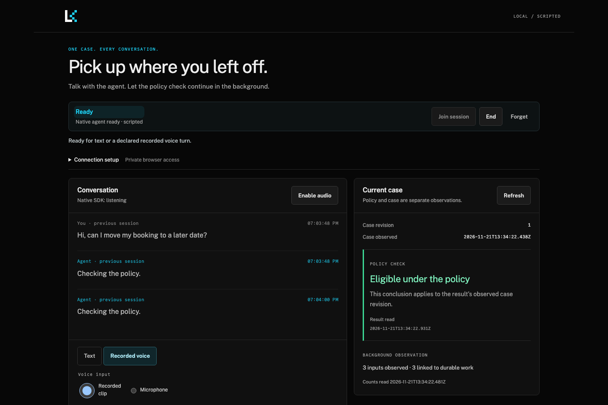

# Continuity for LiveKit Agents

**One case across voice, browser chat, and simulated SMS.** Follow a travel
booking request across two LiveKit rooms. A simulated SMS starts a background
policy check while the caller is between rooms. In a separate operator flow,
approve an exact quote and see the booking outcome and delivery receipt.

[](docs/media/demo.mp4)

[Watch the 90-second captioned demo](docs/media/demo.mp4) · [Run it locally](#run-it-locally) · [Architecture](docs/architecture.md) · [Walkthrough](docs/demo.md)

This independent, account-free proof of concept uses real LiveKit rooms and
WebRTC audio, scripted recognition and agent replies, and synthetic booking and
SMS services.

## Features

| Project | What it demonstrates |
| --- | --- |
| [Agent Continuity](projects/agent-continuity/python/README.md) | A PostgreSQL case outlives the room. A leased worker acts after the operator approves the exact date, amount, currency, and revision. The synthetic supplier outcome and receiver receipt are recorded separately. |
| [Channel Continuity](projects/channel-continuity/python/README.md) | Accept and track one text input, a recorded voice turn, and a simulated SMS against the same case. Retries preserve the original input identity. **Join again** opens a new room and reloads the case and its applicable policy result. |
| [Delegation Reliability](projects/delegation-reliability/python/README.md) | A TypeScript specialist evaluates a fixed policy in the background. The result is tied to the issued work and case revision. Booking authority stays with the authenticated operator. |

LiveKit owns room connections and media. The Python application and TypeScript
gateway keep scoped input receipts, case revisions, and work in PostgreSQL.
The architecture guide traces a turn from receipt to result and explains room
shutdown and effect ownership. [Architecture](docs/architecture.md)

## Run it locally

Use Docker Desktop or Docker Engine with Compose v2 and a POSIX shell. The first
start downloads pinned images and builds the application. Docker supplies the
Python and Node runtimes. The demo runs on loopback and uses a generated local
access key.

```sh
./demo up
./demo key
```

Open the local demo, choose **Open the showcase**, and enter the key under
**Connection setup**. Select **Use key**, **Join session**, then **Enable audio**
when the room shows **Ready**. Ask, “Hi, can I move my booking to a later date?”
[Open the local demo](http://127.0.0.1:5189/)

The walkthrough continues with the recorded voice turn, the simulated SMS while
the room is closed, rejoin, and the separate operator approval.
[Demo walkthrough](docs/demo.md)

```sh
./demo down
```

`./demo up` reuses the local case and work after a normal shutdown. Use
`./demo reset --yes` when you want to start over with empty demo volumes.

## Verify the walkthrough

Run `./demo verify` after completing both walkthroughs on a fresh profile. It
checks three original inputs, two closed rooms for the same case, three delivered
policy results, and one synthetic supplier effect with one receiver receipt.
The walkthrough gives the expected output and the exact demo steps.
[Verification details](docs/demo.md#verify-the-walkthrough)
