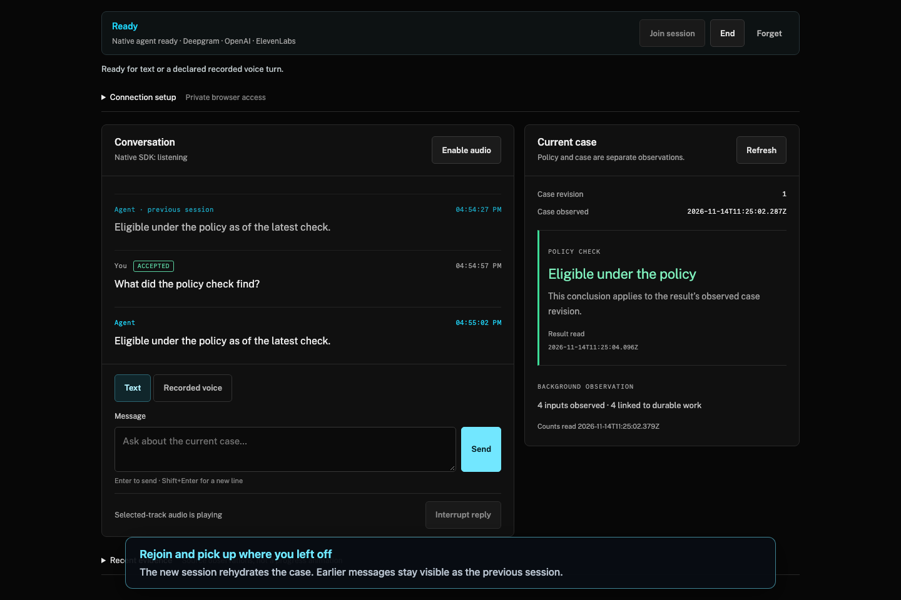
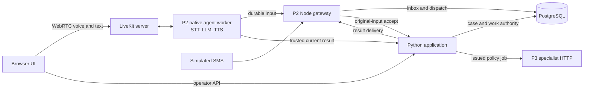

# LiveKit Agents ecosystem

Status: Active
Last reviewed: 14 November 2026

[](docs/media/ecosystem-demo.mp4)

Three reusable, local-first projects for building reliable LiveKit voice agents,
composed into one synthetic travel-support application. A caller asks by text
and by voice, a background policy check runs as durable work, the caller hangs up
and follows up by SMS, then rejoins and the agent picks up where they left off.
Everything runs on your machine; real speech and language providers are opt-in.

## Overview

### What the demo shows

The [two-minute demo video](docs/media/ecosystem-demo.mp4) was recorded in one
take from the running application with real Deepgram, OpenAI and ElevenLabs
calls. It opens on the local landing page, runs the joined showcase and then one
P1 business case in the operator console:

1. **Join** a LiveKit room. The P2 native agent reports readiness and the
   provider profile (`LOCAL / REAL PROVIDERS`).
2. **Ask by text.** P2 durably accepts the input, dispatches it to P1 as work and
   the counters move to "1 input observed · 1 linked to durable work". The agent
   answers with live captions while it speaks.
3. **The background check lands.** P3's specialist evaluates the policy and the
   case panel shows "Eligible under the policy" as of its read time.
4. **Speak instead.** A recorded clip plays into the real RTC track; Deepgram
   transcribes it and the agent answers from the trusted current result.
5. **Leave the call, follow up by SMS.** The room closes; a simulated SMS from
   the linked sender becomes new durable work on the same case with no room open.
6. **Rejoin.** A fresh session rehydrates the case; earlier messages remain as the
   previous session and the agent reports the latest policy result.
7. **Run one P1 business case.** In the operator console a confirmed
   investigation becomes a durable case on a leased worker. A trusted quote
   (USD 25.00, bound to its revision) waits for explicit approval of that exact
   quote; the worker then records the supplier outcome and the receiver delivery.
   Every state shown is read back from PostgreSQL.

Model replies never authorize business changes: exact quote confirmation stays in
an authenticated controller outside the conversation, as step 7 shows. The
earlier [80-second showcase-only clip](docs/media/channel-policy-demo.mp4)
covers steps 1–6.

### The three projects

| Project | What it provides | Code | Charter |
| --- | --- | --- | --- |
| P1 Agent Continuity | Durable case authority: idempotent intake, exact quote confirmation, supplier effects, cancellation, leases and work/result/delivery records on PostgreSQL | [projects/agent-continuity](projects/agent-continuity/README.md) | [P1](docs/projects/agent-continuity-scope.md) |
| P2 Channel Continuity | One conversation across voice, chat and SMS: verified durable input, dispatch, native LiveKit adapter, rehydration, outbound/callback evidence | [projects/channel-continuity](projects/channel-continuity/README.md) | [P2](docs/projects/channel-continuity-scope.md) |
| P3 Delegation Reliability | Bounded delegated work: typed specialist contracts, P1-issued execution, factual validation, result applicability and delivery | [projects/delegation-reliability](projects/delegation-reliability/README.md) | [P3](docs/projects/delegation-reliability-scope.md) |

Each project is independently usable and installable; the joined showcase only
composes their public APIs.

### How they fit together



1. The browser joins a room on the self-hosted LiveKit server; a native agent
   worker (P2 `NativeRuntime`) owns the SDK session for that room only.
2. Every text, voice or SMS input is durably accepted by P2 before any reply, then
   dispatched once to P1 as immutable work keyed by the original input.
3. The Python application's bounded executor issues the work through P1 and calls
   the P3 specialist; P3 validates facts and P1 records the result.
4. Results are delivered back to P2's receiver. The agent and the browser read
   the current result as a timed observation, never as action permission.

The [root Design.md](Design.md) explains authority, identities and failure
boundaries; each service and project has its own Design.md.

### Technology stack

| Layer | Technology |
| --- | --- |
| Realtime media | Self-hosted LiveKit server 1.13.11, LiveKit Agents 1.8.11 (Python), livekit 1.2.0 RTC, livekit-client 2.23.0 (browser) |
| Speech and language | Scripted fixtures by default; Deepgram nova-3 STT, OpenAI gpt-5.4-mini and ElevenLabs eleven_v4_turbo in provider_real; Whisper, Qwen and Piper in the unqualified local_real profile |
| Python services | Python 3.14.10 asyncio, psycopg 3.3.8, aiohttp 3.14.5, httpx2 2.16.0, pydantic 2.14.3 |
| Channel runtime | Node 24.22.2, TypeScript 7.0.2, node-postgres 8.23.1 |
| Storage | PostgreSQL 18.6 (P1 case/work, P2 inbox/dispatch); SQLite for the original M1 intake |
| Frontend | Vite 8.3.6 and framework-free TypeScript over WebRTC and WebAudio |
| Observability | OpenTelemetry SDK 1.45.2 with an optional local Jaeger 2.23.0 |
| Tooling | uv 0.13.7, pnpm 12.18.0 via Corepack, Ruff 0.17.4, mypy 2.4.1 (strict), unittest/pytest, Vitest 5.1.0, Playwright 1.65.0, Docker Compose |

The [technology baseline](docs/technology-baseline.md) owns exact pins, image
digests and upgrade policy.

## Implementation status

| Area | Current state |
| --- | --- |
| P1 Agent Continuity | Implemented through PostgreSQL v5 (persisted mutation retry pacing); all twenty P1 acceptance rows have registered runners and P1 V1 is qualified for the local POC with provider_real v2 |
| P2 Channel Continuity | Selected slices qualified locally: durable intake, dispatch, gateway recovery, revision routing, confirmation, outbound/callback evidence, native voice/text, rehydration and original-input binding; schema v9 adds operating indexes; seventeen charter rows remain planned |
| P3 Delegation Reliability | Contracts, P1-issued execution, receiver delivery, guarded action, applicability, deadlines, recovery and fixed-policy v2 qualified in selected slices; P3-01/P3-03/P3-11 registered, fourteen rows planned |
| Joined showcase | Runs locally in scripted and provider_real modes with live captions, durable SMS follow-up, rejoin rehydration and the recorded demo ([0046](docs/work-items/0046-joined-showcase-providers-and-demo.md)); a landing page links it with the P1 console ([0047](docs/work-items/0047-open-findings-schema-upgrades-and-landing.md)) |
| Local infrastructure | Isolated Docker Compose stack (LiveKit, PostgreSQL, control API, diagnostic worker, console, optional Jaeger) with a per-checkout project name |

Complete P2/P3 charter rows and the integrated release keep their own gates, so
the whole-ecosystem aggregate is intentionally incomplete. The
[checkpoint history](docs/checkpoint-history.md) summarizes each qualified slice
and links its work item.

## Documentation

| Read | For |
| --- | --- |
| [AGENTS.md](AGENTS.md) | Contribution and coding-agent rules |
| [Design.md](Design.md) | Shared architecture, authority and identities |
| [Portfolio scope](docs/portfolio-scope.md) and [build plan](docs/build-plan.md) | What V1 includes and the delivery sequence |
| [Local setup guide](local-setup/README.md) | Ports, credentials, lifecycle, isolation and reset |
| [Provider operations](docs/provider-demo.md) | Real-provider keys, trust and P1 provider gates |
| [Qualification gates](docs/qualification-gates.md) | Opt-in checks, optional profiles and acceptance runners |
| [Validation plan](docs/validation-plan.md) and [observability](docs/observability.md) | Evidence rules, signals and failure UX |
| [Python engineering](docs/python-engineering.md) and [documentation standards](docs/documentation-standards.md) | Engineering and writing conventions |

```text
apps/local-console/              Browser UIs, Playwright media tests and the demo recorder
services/channel_policy_demo/    Joined Python application: Parent, room owner, executor, workers
services/channel-policy-gateway/ Joined Node gateway: native/SMS intake, reads and result receipts
services/control_api/            Authenticated M1/business HTTP and media-invocation grants
services/conversation_agent/     P1 native AgentSession and scripted/local/provider inference adapters
services/rtc_agent/              Diagnostic LiveKit worker used by the smoke checks
projects/agent-continuity/       P1 package (continuity_lab), examples and design
projects/channel-continuity/     P2 TypeScript runtime and Python native adapter
projects/delegation-reliability/ P3 Python coordinator/runner and TypeScript specialist
contracts/                       Language-neutral producer/consumer fixtures
local-setup/                     Compose topology, pinned images, lifecycle and showcase scripts
harness/                         Structural checks, documentation rules and acceptance catalog
docs/                            Charters, plans, guides, decisions, work items and media
tests/                           Root Python unit, integration and PostgreSQL suites
```

## Requirements

- Docker Engine or Desktop with Compose 2+, about 2 GB of free Docker memory and
  internet access for the first image and dependency fetch.
- Python 3.14.10, Node 24.22.2 with Corepack (pnpm 12.18.0) and uv 0.13.7.
- Optional: Deepgram, OpenAI and ElevenLabs accounts for provider_real (paid
  calls), and ffmpeg to encode the recorded demo as MP4.

The default scripted profile needs no provider or carrier account. The optional
local_real profile needs a separate 2.709 GB model fetch; see the
[local-real guide](docs/local-real-inference.md).

## Commands

Run every command from the repository root.

### Bootstrap the toolchain

```sh
make bootstrap
corepack enable
corepack pnpm install --frozen-lockfile
```

### Start the local stack

```sh
python3.14 local-setup/stack.py init
python3.14 local-setup/stack.py start
python3.14 local-setup/stack.py prepare-postgres
python3.14 local-setup/stack.py smoke
```

Normal stop (`stack.py stop`) preserves volumes. Set `STACK_PROJECT` and the port
variables in `local-setup/.env` to run an isolated stack next to another checkout;
the [local setup guide](local-setup/README.md) documents ports, the M1 console and
the explicit destructive reset.

### Run the joined showcase

```sh
make channel-policy-demo-build
make channel-policy-demo-setup CHANNEL_POLICY_PROFILE=$PWD/.local/showcase-1
make channel-policy-demo-start CHANNEL_POLICY_PROFILE=$PWD/.local/showcase-1
```

Open http://127.0.0.1:5179/ for the landing page that links the showcase and the
P1 console, or go straight to http://127.0.0.1:5179/channel-policy.html. Expand
**Connection setup**,
paste the `bearer` value from `.local/showcase-1/.runtime/operator.json` and select
**Use key**, then **Join session**. Stop with Ctrl+C; the launcher reaps every
child. Each profile holds sixteen inputs, so prepare a new profile directory for
each fresh demonstration. If startup prints `"status":"unavailable"`, run the
start command once more.

### Use real providers

```sh
python3.14 local-setup/stack.py init-providers
python3.14 local-setup/stack.py check-providers
make channel-policy-demo-setup CHANNEL_POLICY_PROFILE=$PWD/.local/showcase-2
make channel-policy-demo-start-provider CHANNEL_POLICY_PROFILE=$PWD/.local/showcase-2
```

`init-providers` creates the owner-only `local-setup/.env.providers` with the
three key names (also shown in `local-setup/.env.providers.example`); fill them
in, then `check-providers` reports presence without printing values. The launcher
reads the file and hands the keys only to each room's native worker process; the
browser, logs and Node services never receive them. The page header then shows
`LOCAL / REAL PROVIDERS`. Every turn makes paid Deepgram, OpenAI and ElevenLabs
calls. The [provider guide](docs/provider-demo.md) covers certificate trust.

### Record the demo video

```sh
corepack pnpm --filter @livekit-ecosystem/local-console exec playwright install chromium
make channel-policy-demo-record CHANNEL_POLICY_PROFILE=$PWD/.local/showcase-2 FFMPEG=/path/to/ffmpeg
# The complete video: landing page, showcase, then one P1 business case.
make ecosystem-demo-record CHANNEL_POLICY_PROFILE=$PWD/.local/showcase-2 FFMPEG=/path/to/ffmpeg
```

Run it against a running showcase on a fresh profile. The recorder drives the
real UI, captures the agent and user audio in the page and writes a narrated MP4,
a poster PNG and step timings to `.local/demo-recording`. Without ffmpeg it keeps
the raw WebM video and audio. The complete recording also needs the P1 business
profile (`stack.py prepare-business`, `init-worker-fixtures`, `start-business`).
It reads the console token from `stack.py token` into memory only and enters it
off screen. On a busy host, the first Join after the launcher starts can exceed
the worker's 10-second startup budget. Join and End once before recording.

### Other profiles and gates

The P1 business workspace, worker profile, provider-backed P1 gates, phase demos
and every opt-in P2/P3 gate are listed in the
[qualification gates guide](docs/qualification-gates.md).

## Validation

```sh
make check
make frontend-check
.venv/bin/python -m harness validate
python3.14 local-setup/stack.py smoke
```

`make check` runs documentation and structural checks, all offline Python suites,
Ruff and broad/strict mypy. `make frontend-check` runs TypeScript, Vitest,
formatting and production builds for the console, P2 package, P3 specialist and
gateway. The smoke check verifies the running stack: dependency readiness,
authentication, M1 replay/conflict, named dispatch, text echo and fixture audio.
PostgreSQL and media lanes are opt-in; see the
[qualification gates guide](docs/qualification-gates.md). Missing, skipped or
timed-out assertions never count as passing.

## Next milestone

- Register complete P2 and P3 charter rows with full acceptance assertions, then
  qualify the integrated release ([build plan](docs/build-plan.md)).
- Broaden joined-showcase evidence: restart discovery, larger history windows and
  repeatable provider-mode qualification beyond the selected runs in
  [0046](docs/work-items/0046-joined-showcase-providers-and-demo.md).
- Address the performance backlog recorded in 0046: pooled per-job clients,
  cheaper current-result scans and code-splitting the browser bundle.
- Physical microphone capture, speech accuracy, production capacity and provider
  retention remain outside the measured local POC.
