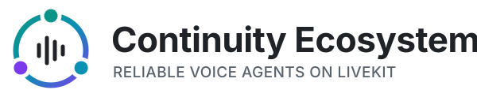
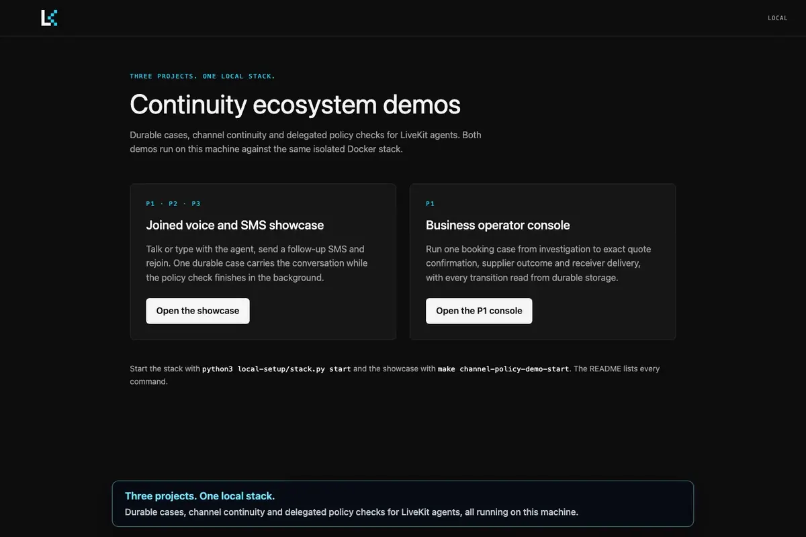
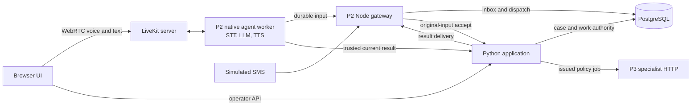

<div align="center">

<picture>
  <source media="(prefers-color-scheme: dark)" srcset="docs/media/branding/continuity-logo-dark.svg">
  
</picture>

# Continuity Ecosystem for LiveKit Agents

<p>
  <strong>Durable cases, one conversation across voice, chat and SMS, and delegated checks that survive restarts.</strong><br>
  Three reusable projects for reliable LiveKit voice agents, composed into one application that runs on your machine.
</p>

<p>
  <a href="#demo"><strong>Watch the demo</strong></a> ·
  <a href="#features">Features</a> ·
  <a href="#architecture">Architecture</a> ·
  <a href="#quickstart">Quickstart</a> ·
  <a href="#implementation-status">Status</a> ·
  <a href="#documentation">Documentation</a>
</p>

<p>
  <strong>Project status</strong><br>
  
  
  
  
</p>

<p>
  <strong>Agent and media runtime</strong><br>
  
  
  
  
  
  
  
  
  
  
</p>

<p>
  <strong>TypeScript and web</strong><br>
  
  
  
  
  
</p>

<p>
  <strong>Data, observability and platform</strong><br>
  
  
  
  
  
  
</p>

<p>
  <strong>Quality and tooling</strong><br>
  
  
  
  
  
  
  
</p>

<p>
  <strong>Inference profiles: scripted by default, hosted providers opt-in</strong><br>
  
  
  
  
  
</p>

</div>

| Field | Value |
| --- | --- |
| Status | Active |
| Purpose | Show what the ecosystem does, how to run it locally and where each deeper document lives |
| Audience | Engineers evaluating or extending reliable LiveKit voice agents, and coding agents working in this repository |
| Scope | The three projects, the joined showcase and the local stack; each linked document owns its own detail |
| Owns | Ecosystem purpose, supported features, current status, requirements, quickstart and navigation |
| Related | [Documentation map](docs/README.md) · [Shared design](Design.md) · [Agent rules](AGENTS.md) · [Contributing](CONTRIBUTING.md) |

## Overview

The Continuity Ecosystem keeps a LiveKit voice agent correct when real life
interrupts it: callers hang up and come back on another channel, workers crash
in the middle of a task, and specialists answer late. It is three independently
installable projects. A synthetic travel-support application composes them only
through their public APIs, and everything runs locally against an isolated Docker
stack.

### Why it exists

| Situation | What can go wrong | How the ecosystem handles it | Project |
| --- | --- | --- | --- |
| A caller hangs up mid-task and follows up by SMS | The context and the pending work are lost | Accepted input is retained before its dispatched reply and routed to the same case using its original operation identity; a new session rehydrates it | P2, P1 |
| A worker crashes during a supplier call | A duplicate booking, or one that is silently lost | Leased workers hold owner and epoch grants, and an uncertain external effect stays explicitly uncertain | P1 |
| A delegated check answers late | A stale answer is applied to a changed case | Each result carries its as-of applicability against the case revision, and deadlines never erase a known result | P3 |
| The model says "yes, go ahead" | Model text triggers a business change | Model output grants no authority; exact quote confirmation happens in an authenticated controller | P1 |
| A message or callback arrives twice | Duplicate work or a duplicate send | Stable identities, idempotent intake and changed-payload conflicts | P1, P2 |

### The three projects

| Project | What it provides | Code | Charter | Status |
| --- | --- | --- | --- | --- |
| P1 Agent Continuity | Durable case authority on PostgreSQL: idempotent intake, exact quote confirmation, supplier effects, cancellation, leases, and work, result and delivery records | [projects/agent-continuity](projects/agent-continuity/README.md) (Python `continuity_lab`) | [P1 charter](docs/projects/agent-continuity-scope.md) | Qualified (V1) |
| P2 Channel Continuity | One conversation across voice, chat and SMS: verified durable input, dispatch, the native LiveKit adapter, rehydration, and outbound and callback evidence | [projects/channel-continuity](projects/channel-continuity/README.md) (TypeScript, Python adapter) | [P2 charter](docs/projects/channel-continuity-scope.md) | Partial |
| P3 Delegation Reliability | Bounded delegated work: typed specialist contracts, P1-issued execution, factual validation, result applicability and delivery | [projects/delegation-reliability](projects/delegation-reliability/README.md) (Python, TypeScript specialist) | [P3 charter](docs/projects/delegation-reliability-scope.md) | Partial |

## Demo

<p align="center">
  <a href="docs/media/ecosystem-demo.mp4">
    
  </a>
</p>

<p align="center">
  <a href="docs/media/ecosystem-demo.mp4"><strong>Watch the full demo with audio (2:08 MP4)</strong></a> ·
  <a href="docs/media/channel-policy-demo.mp4">Showcase-only clip (80 s)</a> ·
  <a href="docs/media/ecosystem-demo.png">Poster frame</a>
</p>

The animated preview loops 31 seconds of highlights without sound. The full video
was recorded in one take from the running application, with real Deepgram, OpenAI
and ElevenLabs calls, on-screen captions and the agent's actual voice. It opens on
the local landing page, runs the joined showcase and then one P1 business case in
the operator console.

| Step | What you see | What happens underneath | Projects |
| --- | --- | --- | --- |
| 1. Join | The agent reports readiness and the provider profile, `LOCAL / REAL PROVIDERS` | A native agent worker owns the LiveKit session for this room only | P2 |
| 2. Ask by text | Live captions while the agent answers; the counters read "1 input observed · 1 linked to durable work" | P2 durably accepts the input and dispatches it to P1 under its original stable identity; replay reconciles the same work | P2, P1 |
| 3. The background check lands | "Eligible under the policy", as of its read time | P3's specialist evaluates the policy under a P1-issued grant, and P1 records the result | P3, P1 |
| 4. Speak instead | The agent answers a recorded voice clip | The clip plays into the real-time communication (RTC) track, Deepgram transcribes it and the agent answers from the trusted current result | P2 |
| 5. Leave and follow up by SMS | A simulated SMS arrives while no room is open | The verified SMS becomes new durable work on the same case | P2, P1 |
| 6. Rejoin | Earlier messages and the latest policy result reappear | A fresh session rehydrates the case from durable state | P2 |
| 7. Run one P1 business case | Investigation, quote approval, supplier outcome and delivery | A leased worker runs the case; the trusted USD 25.00 quote, bound to its revision, needs explicit approval of that exact quote; every state is read back from PostgreSQL | P1 |

Model replies never authorize business changes. Exact quote confirmation stays in
an authenticated controller outside the conversation, as step 7 shows.

## Features

| Feature | What it does | Project | Status | Learn more |
| --- | --- | --- | --- | --- |
| Durable case authority | Idempotent intake, case revisions and atomic intent commitment on PostgreSQL | P1 | Qualified | [Case and continuation](docs/case-and-continuation.md) |
| Exact quote confirmation | A trusted quote bound to its case revision needs explicit approval in an authenticated controller | P1 | Qualified | [Case and continuation](docs/case-and-continuation.md) |
| Supplier effects and cancellation | Effects preserve uncertainty at the external boundary; cancellation, business outcome, delivery and acknowledgement stay separate | P1 | Qualified | [Effects and completion](docs/effects-and-completion.md) |
| Leased workers and restart recovery | Database leases with owner and epoch grants; accepted work resumes after a crash with no in-memory queue | P1 | Qualified | [Leases and workers](docs/leases-and-workers.md) |
| Persisted retry pacing | A definite pre-dispatch dependency outage holds an effect until its persisted due time, from 1 s doubling to 30 s; post-reservation pacing remains an open audit finding | P1 | Implemented in the selected v5 scope | [0047](docs/work-items/0047-open-findings-schema-upgrades-and-landing.md) |
| Native voice and text conversation | A LiveKit Agents session whose business tools may only submit, inspect and request cancellation | P1 | Qualified | [Conversation and showcase](docs/conversation-and-showcase.md) |
| Operator console | Runs one business case from investigation to delivery, reading every state from storage | P1 | Qualified | [Local console](apps/local-console/README.md) |
| Verified durable channel intake | Text, voice and HMAC-verified SMS inputs are durably accepted once before any reply | P2 | Qualified | [P2 README](projects/channel-continuity/README.md) |
| Dispatch and gateway recovery | Bounded dispatch and reconciliation preserve the original input and work identity across retries and restarts; cooperating acceptance deduplicates logical work | P2 | Qualified | [P2 README](projects/channel-continuity/README.md) |
| Case rehydration on rejoin | A new session loads earlier messages and the latest result as timed observations | P2 | Qualified | [Rehydration guide](projects/channel-continuity/REHYDRATION.md) |
| Outbound replies and callback evidence | Guarded send reservations with immutable attempts; a callback is evidence, never permission to resend | P2 | Qualified | [P2 design](projects/channel-continuity/Design.md) |
| Revision routing and linked confirmation | Structured revisions route to the case, and a separate router binds the original input to an exact quote | P2 | Qualified | [0032](docs/work-items/0032-linked-confirmation-and-result-projections.md) |
| Typed specialist contracts | Language-neutral contracts and a bounded HTTP specialist bound to verified service principals | P3 | Qualified | [P3 README](projects/delegation-reliability/README.md) |
| P1-issued delegated execution | Delegated work runs only under P1-issued grants; explicit result delivery binds the original receiver | P3 | Qualified | [P3 README](projects/delegation-reliability/README.md) |
| Result applicability and deadlines | Results carry as-of applicability; deadlines and cancellation never erase a known result | P3 | Qualified | [P3 Design](projects/delegation-reliability/Design.md) |
| Fixed-policy checks with factual validation | Immutable, scoped policy and fact records; factual support is validated before a late result is kept | P3 | Qualified | [0041](docs/work-items/0041-standalone-channel-and-durable-policy.md) |
| Read-only operations page | Scoped, signed cursors over channel facts and separately observed current-case state, with no write path | P2 | Qualified | [0040](docs/work-items/0040-operations-ui-and-fixed-policy-evidence.md) |
| Joined voice, chat and SMS showcase | One durable case across text, voice, SMS follow-up and rejoin, with a background policy check | P1, P2, P3 | Implemented | [0046](docs/work-items/0046-joined-showcase-providers-and-demo.md) |
| Observability | OpenTelemetry traces with an optional local Jaeger, numeric usage reports and safe diagnostics | All | Implemented | [Observability](docs/observability.md) |
| Isolated local stack | Docker Compose with pinned image digests and a per-checkout project name; a normal restart keeps state | Platform | Implemented | [Local setup guide](local-setup/README.md) |

Qualified means the feature passed its selected local gate with retained evidence.
It does not mean that the project's full charter or the integrated release is
complete; [Implementation status](#implementation-status) names those gaps.

### Inference profiles

| Profile | Speech-to-text | Language model | Text-to-speech | Status |
| --- | --- | --- | --- | --- |
| `scripted` (default) | Deterministic fixtures | Deterministic fixtures | Fixture audio | Qualified; needs no accounts |
| `provider_real` (opt-in) | Deepgram nova-3 | OpenAI gpt-5.4-mini | ElevenLabs eleven_v4_turbo | Qualified for P1 V1; every turn makes paid calls |
| `local_real` (opt-in) | whisper.cpp 1.9.5, base.en | Ollama 0.40.15, qwen3:4b-instruct (Q4_K_M) | Piper 1.8.0, en_US-ljspeech-medium | Not qualified |

The selected mode is preserved through grants, readiness reports and traces, and
there is no silent fallback between modes. Every mode keeps the same bound tools
and the separate human confirmation.

## Architecture



STT is speech-to-text, LLM is the large language model and TTS is text-to-speech.

| Stage | Path | Guarantee |
| --- | --- | --- |
| Join | The browser joins a room on the self-hosted LiveKit server | One native agent worker (P2 `NativeRuntime`) owns the SDK session for that room only |
| Accept | A text, voice or SMS input enters P2 | It is durably accepted before any reply |
| Dispatch | P2 hands the input to P1 | Immutable work keyed by the original input; retries and reconciliation preserve that identity |
| Execute | The application's bounded executor issues the work through P1 and calls the P3 specialist | P3 validates the facts, and P1 records the result |
| Deliver and read | P1 delivers the result to P2's receiver; the agent and browser read the current result | The read is a timed observation, never permission to act |

The [shared design](Design.md) explains authority, identities and failure
boundaries. Each service and project has its own Design.md.

### Technology stack

| Layer | Technology | Version | Used for |
| --- | --- | --- | --- |
| Realtime media | LiveKit server, self-hosted | 1.13.11 | Rooms, WebRTC media and agent dispatch |
| Agent runtime | LiveKit Agents for Python, with the OpenAI, Deepgram and ElevenLabs plugins | 1.8.11 | Native voice sessions, turn handling and inference adapters |
| Agent runtime | LiveKit Python SDK (`livekit`) and server API (`livekit-api`) | 1.2.0 and 1.2.2 | RTC tracks, room administration and access tokens |
| Browser media | livekit-client | 2.23.0 | Browser WebRTC voice and text |
| Language runtime | Python | 3.14 (image 3.14.10) | Every Python distribution and service |
| HTTP services | FastAPI and Uvicorn | 0.162.2 and 0.54.0 | The authenticated control API |
| HTTP clients | aiohttp, httpx and httpx2 | 3.14.5, 0.28.1 and 2.16.0 | Loopback application calls, service clients and the inference extra |
| Validation | Pydantic | 2.14.3 | Runtime schema validation at external boundaries |
| Storage | PostgreSQL with psycopg (Python) and node-postgres (TypeScript) | 18.6, 3.3.8 and 8.23.1 | P1 cases, effects, leases and work; P2 inbox, dispatch and outbox |
| Storage | SQLite | Bundled with Python | The original M1 confirmed-investigation intake |
| Channel runtime | Node.js and TypeScript | 24.22.2 or 26.13, and 7.0.2 | The P2 runtime, the joined gateway and the P3 specialist |
| Frontend | Vite with framework-free TypeScript | 8.3.6 | Console, showcase and landing page over WebRTC and WebAudio |
| Edge | nginx, unprivileged image | stable-alpine3.24 | Console hosting and the control API proxy |
| Observability | OpenTelemetry SDK and an optional local Jaeger | 1.45.2 and 2.23.0 | Traces and numeric usage reports |
| Metrics | prometheus-client | 0.26.0 | P1 case telemetry and control API metrics |
| Packaging | uv, and pnpm through Corepack | 0.13.7 and 12.18.0 | Locked Python and Node workspaces |
| Python quality | Ruff, mypy (strict), pytest and unittest | 0.17.4, 2.4.1 and 9.2.0 | Lint, types and tests |
| TypeScript quality | Vitest, Playwright and Prettier | 5.1.0, 1.65.0 and 3.9.10 | Unit tests, browser media tests, the demo recorder and formatting |
| Platform | Docker Compose | v2 | The isolated local stack with pinned image digests |

The [technology baseline](docs/technology-baseline.md) owns exact pins, image
digests and the upgrade policy.

## Quickstart

Install the tools under [Requirements](#requirements) first, and run every command
from the repository root. These three steps start the default scripted showcase,
which needs no provider or carrier account.

### 1. Bootstrap the toolchain

```sh
make bootstrap
corepack enable
corepack pnpm install --frozen-lockfile
```

### 2. Start the local stack

```sh
python3.14 local-setup/stack.py init
python3.14 local-setup/stack.py start
python3.14 local-setup/stack.py prepare-postgres
python3.14 local-setup/stack.py smoke
```

A normal `stack.py stop` preserves volumes. To run an isolated stack next to
another checkout, set `STACK_PROJECT` and the port variables in
`local-setup/.env`. The [local setup guide](local-setup/README.md) documents ports,
the M1 console and the explicit destructive reset.

### 3. Run the joined showcase

```sh
make channel-policy-demo-build
make channel-policy-demo-setup CHANNEL_POLICY_PROFILE=$PWD/.local/showcase-1
make channel-policy-demo-start CHANNEL_POLICY_PROFILE=$PWD/.local/showcase-1
```

| Step | In the browser |
| --- | --- |
| 1 | Open http://127.0.0.1:5179/ for the landing page, which links the showcase and the P1 console, or go straight to http://127.0.0.1:5179/channel-policy.html |
| 2 | Expand **Connection setup**, paste the `bearer` value from `.local/showcase-1/.runtime/operator.json` and select **Use key** |
| 3 | Select **Join session**, then type or play a recorded voice turn |
| 4 | Stop with Ctrl+C; the launcher reaps every child process |

Each profile holds sixteen inputs, so prepare a new profile directory for each
fresh demonstration. If startup prints `"status":"unavailable"`, inspect its
safe failure code and let the owned cleanup finish before starting again. An
unresolved active marker must be investigated; it is not permission to reset
accepted state.

## Implementation status

| Capability | Status | Detail | Evidence |
| --- | --- | --- | --- |
| P1 Agent Continuity | Qualified (V1) | Implemented through PostgreSQL v5 (persisted retry pacing). All twenty acceptance rows have registered runners, and V1 is qualified for the local POC with provider_real v2. After the v5 upgrade, the provider row P1-20 waits on a local certificate bundle path for its rerun | [P1 charter](docs/projects/agent-continuity-scope.md) |
| P2 Channel Continuity | Partial | Qualified slices: durable intake, dispatch, gateway recovery, revision routing, confirmation, outbound and callback evidence, native voice and text, rehydration and original-input binding. Schema v9 adds operating indexes. Seventeen charter rows remain planned | [P2 README](projects/channel-continuity/README.md) |
| P3 Delegation Reliability | Partial | Qualified slices: contracts, P1-issued execution, receiver delivery, guarded action, applicability, deadlines, recovery and fixed-policy v2. P3-01, P3-03 and P3-11 are registered. Fourteen charter rows remain planned | [P3 README](projects/delegation-reliability/README.md) |
| Joined showcase | Implemented | Runs in scripted and provider_real modes with live captions, durable SMS follow-up, rejoin rehydration, a landing page and the recorded demo | [0046](docs/work-items/0046-joined-showcase-providers-and-demo.md), [0047](docs/work-items/0047-open-findings-schema-upgrades-and-landing.md) |
| Code audit fixes | Implemented | Verified fixes with regression tests across P1, P2, P3, services, the console and operations; remaining findings are listed by severity | [0048](docs/work-items/0048-code-audit-fixes-and-documentation-cleanup.md) |
| Local infrastructure | Implemented | Isolated Docker Compose stack with LiveKit, PostgreSQL, the control API, a diagnostic worker, the console and optional Jaeger | [Local setup guide](local-setup/README.md) |
| Integrated release | Planned | Complete P2 and P3 charter rows and the whole-ecosystem release keep their own gates, so the aggregate is intentionally incomplete | [Build plan](docs/build-plan.md) |

The [checkpoint history](docs/checkpoint-history.md) summarizes each qualified
slice and links its work item.

## Documentation

The [documentation map](docs/README.md) lists every document by audience and
purpose. These are the most common next reads.

| Document | Purpose |
| --- | --- |
| [Documentation map](docs/README.md) | Every document, grouped by audience and purpose |
| [AGENTS.md](AGENTS.md) | Contribution and coding-agent rules |
| [CONTRIBUTING.md](CONTRIBUTING.md) | Contributor workflow and quality gates |
| [Design.md](Design.md) | Shared architecture, authority and identities |
| [Portfolio scope](docs/portfolio-scope.md) | What V1 includes across the three projects |
| [Build plan](docs/build-plan.md) | The delivery sequence and its dependencies |
| [Local setup guide](local-setup/README.md) | Ports, credentials, lifecycle, isolation and reset |
| [Provider operations](docs/provider-demo.md) | Real-provider keys, certificate trust and the P1 provider gates |
| [Qualification gates](docs/qualification-gates.md) | Opt-in checks, optional profiles and acceptance runners |
| [Validation plan](docs/validation-plan.md) | Evidence rules and engineering gates |
| [Observability](docs/observability.md) | Signals, traces and failure user experience |
| [Python engineering](docs/python-engineering.md) | Python conventions for typed, bounded, cancellable code |
| [Documentation standards](docs/documentation-standards.md) | How every document is structured and checked |

### Repository layout

| Path | Contents |
| --- | --- |
| [apps/local-console](apps/local-console/README.md) | Browser UIs, Playwright media tests and the demo recorder |
| [services/channel_policy_demo](services/channel_policy_demo/README.md) | Joined Python application: Parent, room owner, executor and workers |
| [services/channel-policy-gateway](services/channel-policy-gateway/README.md) | Joined Node gateway: native and SMS intake, reads and result receipts |
| [services/control_api](services/control_api/README.md) | Authenticated M1 and business HTTP, plus media-invocation grants |
| [services/conversation_agent](services/conversation_agent/README.md) | P1 native AgentSession with scripted, local and provider inference adapters |
| [services/rtc_agent](services/rtc_agent/README.md) | Diagnostic LiveKit worker used by the smoke checks |
| [projects/agent-continuity](projects/agent-continuity/README.md) | P1 package (`continuity_lab`), examples and design |
| [projects/channel-continuity](projects/channel-continuity/README.md) | P2 TypeScript runtime and Python native adapter |
| [projects/delegation-reliability](projects/delegation-reliability/README.md) | P3 Python coordinator and runner, and the TypeScript specialist |
| [contracts](contracts/README.md) | Language-neutral producer and consumer fixtures |
| [local-setup](local-setup/README.md) | Compose topology, pinned images, lifecycle and showcase scripts |
| [harness](harness/README.md) | Structural checks, documentation rules and the acceptance catalog |
| [docs](docs/README.md) | Charters, plans, guides, decisions, work items and media |
| `tests/` | Root Python unit, integration and PostgreSQL suites |

## Requirements

| Requirement | Version or value | Notes |
| --- | --- | --- |
| Docker Engine or Docker Desktop | Compose v2 or later, about 2 GB of free Docker memory | Needs internet access for the first image and dependency fetch |
| Python | 3.14 (3.14.10 tested) | Every Python distribution supports 3.14 only |
| Node.js with Corepack | 24.22.2 validated host; accepted engine range also includes 26.13 up to 27 | Corepack provides pnpm 12.18.0; an accepted engine range is separate from an executed host qualification |
| uv | 0.13.7 | Creates the locked `.venv` during `make bootstrap` |
| Provider accounts (optional) | Deepgram, OpenAI and ElevenLabs | Only for provider_real; every turn makes paid calls |
| ffmpeg (optional) | Any recent build | Encodes the recorded demo as MP4; without it the recorder keeps raw WebM |
| local_real models (optional) | About 2.709 GB download | Not qualified; see the [local-real guide](docs/local-real-inference.md) |

## Commands

Run every command from the repository root. The [Quickstart](#quickstart) covers
bootstrap, the local stack and the scripted showcase.

| Task | Command | Notes |
| --- | --- | --- |
| Stop the stack | `python3.14 local-setup/stack.py stop` | Preserves volumes and state |
| Create the provider key file | `python3.14 local-setup/stack.py init-providers` | Creates the owner-only `local-setup/.env.providers` with three key names |
| Check provider keys | `python3.14 local-setup/stack.py check-providers` | Reports presence without printing values |
| Start with real providers | `make channel-policy-demo-start-provider` | Pass `CHANNEL_POLICY_PROFILE`; every turn makes paid calls |
| Record the showcase clip | `make channel-policy-demo-record` | Pass `CHANNEL_POLICY_PROFILE` and `FFMPEG` |
| Record the complete demo | `make ecosystem-demo-record` | Also needs the P1 business profile |
| Run other profiles and gates | See [qualification gates](docs/qualification-gates.md) | P1 business workspace, worker profile, provider gates, phase demos and opt-in P2 and P3 gates |

### Use real providers

```sh
python3.14 local-setup/stack.py init-providers
python3.14 local-setup/stack.py check-providers
make channel-policy-demo-setup CHANNEL_POLICY_PROFILE=$PWD/.local/showcase-2
make channel-policy-demo-start-provider CHANNEL_POLICY_PROFILE=$PWD/.local/showcase-2
```

| Step | What happens |
| --- | --- |
| Create the key file | `init-providers` creates the owner-only `local-setup/.env.providers` with the three key names that `local-setup/.env.providers.example` also shows |
| Add the keys | Fill in the Deepgram, OpenAI and ElevenLabs keys yourself |
| Check presence | `check-providers` reports which keys are present, never their values |
| Start | The launcher hands the keys only to each room's native worker process; the browser, logs and Node services never receive them |

The page header then shows `LOCAL / REAL PROVIDERS`. The
[provider guide](docs/provider-demo.md) covers certificate trust.

### Record the demo video

```sh
corepack pnpm --filter @livekit-ecosystem/local-console exec playwright install chromium
make channel-policy-demo-record CHANNEL_POLICY_PROFILE=$PWD/.local/showcase-2 FFMPEG=/path/to/ffmpeg
# The complete video: landing page, showcase, then one P1 business case.
make ecosystem-demo-record CHANNEL_POLICY_PROFILE=$PWD/.local/showcase-2 FFMPEG=/path/to/ffmpeg
```

Run the recorder against a running showcase on a fresh profile. It drives the real
UI, captures the agent and caller audio in the page and writes a captioned MP4, a
poster PNG and step timings to `.local/demo-recording`.

| Situation | Behavior |
| --- | --- |
| No ffmpeg | The recorder keeps the raw WebM video and audio |
| Complete recording | Also needs the P1 business profile (`stack.py prepare-business`, `init-worker-fixtures` and `start-business`) |
| Console token | Read from `stack.py token` into memory only and entered off screen |
| Busy host | The first Join after the launcher starts can exceed the worker's 10-second startup budget, so Join and End once before recording |

## Validation

```sh
make check
make frontend-check
.venv/bin/python -m harness validate
python3.14 local-setup/stack.py smoke
```

| Check | Command | What it proves |
| --- | --- | --- |
| Fast offline gate | `make check` | Documentation and structural checks, every offline Python suite, Ruff and broad and strict mypy |
| Frontend gate | `make frontend-check` | TypeScript, Vitest, formatting and production builds for the console, the P2 package, the P3 specialist and the gateway |
| Acceptance catalog | `.venv/bin/python -m harness validate` | The acceptance catalog, its registered runners and their assertions are consistent |
| Stack smoke | `python3.14 local-setup/stack.py smoke` | The running stack: dependency readiness, authentication, M1 replay and conflict, named dispatch, text echo and fixture audio |
| PostgreSQL lane (opt-in) | `make postgres-check` | Real PostgreSQL behavior after the documented restricted-role setup |
| P1 deep gate (opt-in) | `HARNESS_PYTHON=.venv/bin/python sh scripts/harness-deep.sh --module p1` | Real PostgreSQL, browser and inference lanes for P1 |

The [qualification gates guide](docs/qualification-gates.md) lists every opt-in
PostgreSQL and media lane. Missing, skipped or timed-out assertions never count as
passing.

## Next milestone

| Step | Outcome | Gate |
| --- | --- | --- |
| Rerun the P1 provider row | P1-20 passes again on PostgreSQL v5 | Needs the owner's local certificate bundle path ([provider guide](docs/provider-demo.md)) |
| Complete P2 and P3 charter rows | Every charter row registered with full acceptance assertions | Each project's acceptance gate |
| Qualify the integrated release | One qualified whole-ecosystem release | The integrated release gate in the [build plan](docs/build-plan.md) |
| Broaden joined-showcase evidence | Restart discovery, larger history windows and repeatable provider-mode runs | Showcase gates beyond [0046](docs/work-items/0046-joined-showcase-providers-and-demo.md) |
| Close the open audit findings | Fixes for the remaining findings, by severity | Regression tests per finding ([0048](docs/work-items/0048-code-audit-fixes-and-documentation-cleanup.md)) |
| Address the performance backlog | Pooled per-job clients, cheaper current-result scans and a code-split browser bundle | Workload measurements recorded in 0046 and 0047 |

Physical microphone capture, speech accuracy, production capacity and provider
retention remain outside the measured local POC.
