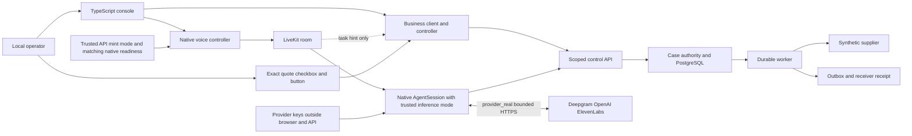
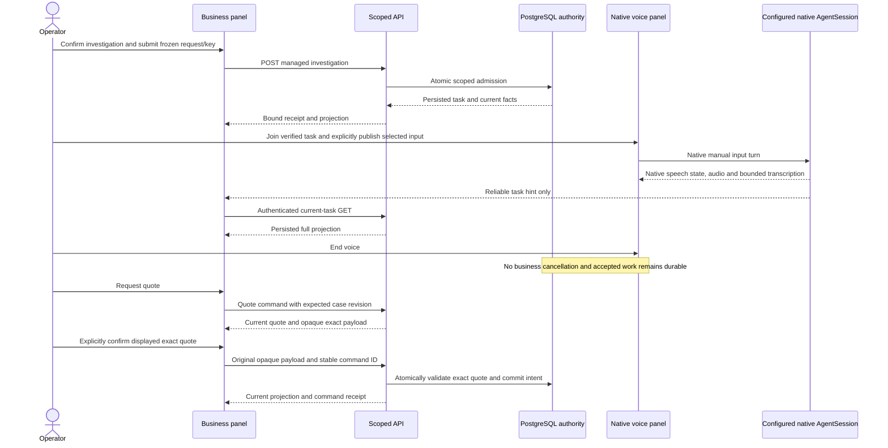
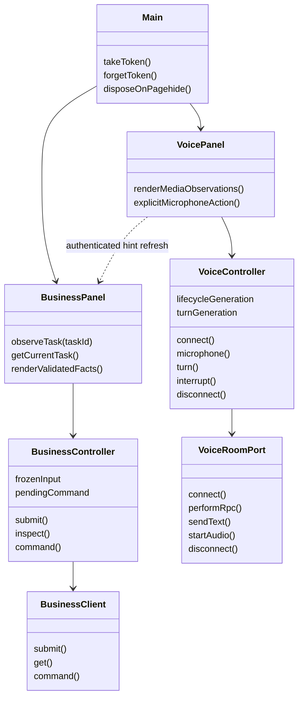

# Local continuity console design

Status: Active
Last reviewed: 14 November 2026

## Overview

The console makes P1 durable work visible through authenticated HTTP projections
and connects an already verified case to a native LiveKit AgentSession. It owns
client lifecycle, bounded observations and explicit user controls. It does not own
case authorization, durable workflow execution, consent validation or supplier
truth. The native voice profile defaults to deterministic local scripted speech.
The explicit local_real profile uses prepared local Whisper/Qwen/Piper engines;
actual model/media qualification remains separate. The optional P2 native page
has its own implemented profile; default integrated P2/P3 workspaces remain planned.

The primary layout contains a shared memory-only access bar, the managed business
workspace and native voice controls. Collapsed transport diagnostics and the
independent M1 SQLite intake/replay/conflict fixture remain accessible below it.
Backend design and acceptance scope remain authoritative in the
[root design](../../Design.md) and [P1 charter](../../docs/projects/agent-continuity-scope.md).

The diagrams describe the default P1 workspace/voice composition. The optional
P2 native page and P3 background text page are described separately under
Components and related details.

## Objectives

| Type | Objective | Evidence |
| --- | --- | --- |
| Business | Show a case surviving conversation end without implying cancellation or completion | Same authenticated task projection before/after native voice end |
| Business | Make investigation permission and exact mutation consent understandable | Separate explicit controls; displayed quote matches the original confirmation bytes |
| Business | Show outcome and receiver delivery independently | Distinct persisted outcome/delivery facts; no playback-derived business success |
| Technical | Preserve client identity and uncertainty across lost acknowledgements | Frozen original request/command replay and late-ack tests |
| Technical | Demonstrate native browser media against the real local stack | Native agent presence, manual input, real audio currentTime advancement and reconnect gate |
| Technical | Keep coding-agent changes reviewable and bounded | Separate pure controllers/native adapter, strict schema fixture and layered tests |

## Functional requirements

| ID | Type | Requirement | Implementation/evidence boundary |
| --- | --- | --- | --- |
| UI-01 | Business | Submit only an explicitly confirmed investigation | Managed HTTP controller; does not authorize a booking mutation |
| UI-02 | Technical | Preserve original request/key after unknown admission | Immutable client snapshot; matching original inquiry request resolves replay |
| UI-03 | Business | Resume a scoped current task after reload | Token/task re-entry and authenticated GET; no browser identity storage |
| UI-04 | Business | Prepare a read-only supplier quote and explicitly approve that exact proposal | Separate quote and signal commands with unchanged opaque confirmation bytes |
| UI-05 | Technical | Inspect current inquiry, lease, attempts, effects, outcome and delivery | Full validated snapshot on every page; bounded recent history with honest limits |
| UI-06 | Business | Request business cancellation independently of conversation controls | Explicit HTTP cancellation control; end/interrupt never cancel accepted work |
| UI-07 | Technical | Join a verified task using native RTC and user-selected scripted/physical audio input | Native SDK adapter and manual start/commit RPCs |
| UI-08 | Business | Distinguish native speech state, browser playback and durable progress | Separate status fields and actual observed output |
| UI-09 | Technical | Refresh on trusted native hints without trusting packet state | Selected native AGENT, reliable topic, strict task hint, authenticated GET |
| UI-10 | Technical | Preserve existing transport diagnostics and M1 intake | Separate legacy controls/tests; no shared workflow authority |
| UI-11 | Business and technical | Restore current-grant case context and bounded original history in a fresh room | Read-only optional profile; selected 18-group storage and three-group media gates passed |
| UI-12 | Business and technical | Read current context, immutable input/delivery history and volatile process diagnostics in an opt-in workspace | P2-I20 separate page; 40 client/controller tests and selected actual 16 PG/HTTP plus 3 browser groups passed in 0040 |
| UI-13 | Business | Keep talking while one accepted policy request runs, and show original result separately from applicability | Optional P3-I18B text page; source/installed twelve backend plus three browser groups each passed in 0042 |
| UI-14 | Technical | Preserve actual room/read ownership and clear private facts on Forget | One retained room and one read; cancellation, reentrancy and late-callback regressions |

These local UI identifiers document component behavior; product acceptance IDs
and runner ownership remain in the P1 charter and granular task plan.

## Non-functional requirements

| Property | Bound/target | Unit | Verification | Status |
| --- | --- | --- | --- | --- |
| Business response | At most 65,536 | UTF-8 bytes/response | Bounded streaming reader including cancellation | Configured; unit tested |
| Session grant response | At most 16,384 | UTF-8 bytes/response | Existing bounded local grant reader | Configured; unit tested |
| Incoming voice output | At most2 active readers; 16,384 bytes each; whole-stream 10 s scripted/40 s local_real or provider_real | readers/bytes/seconds | Selected-agent adapter and boundary tests; actual RTC gate separately | Configured |
| Display retention | At most 100 business events and 40 voice transcript entries | entries/page | Pure state/display bounds | Configured; unit tested |
| Recent history | Default 10 observations/page, server maximum 50 | entries/response | Scoped producer/consumer contract and paging tests | Configured |
| RTC command pressure | One ordinary turn RPC plus one concurrent interrupt | operations/session | Deferred-ack concurrency tests | Configured; unit tested |
| Native media acknowledgement | 5 seconds for capture/mute and disconnect, then explicitly unknown | seconds/operation | Deferred SDK operation tests; underlying ownership retained until settlement | Configured; unit tested |
| Secondary operations | One status send, playback gesture and hint refresh in flight each | operations/session | Deferred-operation tests | Configured; unit tested |
| Access storage | No credential or task persistence in browser storage | stored values | Reload/storage browser assertion | Implemented; real gate required |
| Accessibility | Keyboard labels, focus visibility and reduced-motion support | behavior | DOM controls/CSS; actual browser review | Implemented; visual gate required |
| Product truth | Missing facts remain unobserved; transport failures cannot become business failure | invariant | Negative schema/read/RPC tests and real local scenarios | Implemented boundaries |
| Optional context response | At most 65,536 UTF-8 bytes, including framing; history/work/responses/replies limits 8/8/4/4 | bytes/records | Closed DTO and independent scoped cursors; omit whole records | Implemented; selected actual 18-group storage and three-group media gates passed |
| Operations HTTP | Context 73,728 total with original context envelope ≤65,536 plus frame ≤8,192; process telemetry ≤16,384 | UTF-8 bytes | Raw bounded stream, closed schema, exact identity/request correlation | Implemented; selected actual 0040 gate passed |
| Operations ownership | One retained client, one context plus one telemetry request; waiter 4 s, close observer 1 s | owners/requests/seconds | Held-cancellation, timeout/cleanup retry, late-result and callback-failure tests | Unit tested; actual owners retained until settlement |
| Operations updates/display | Poll ≥2 s, ≤30 ticks per activation; ≤32 rows per each of four sections | ticks/rows | Fake-clock non-queue/ceiling and immutable paging tests | Unit tested; older reads pause polling |
| P3 observation/session | 4,096 / 8,192 UTF-8 bytes | bytes/response | Closed semantic decoders, stable binding and bounded body readers | Unit tested; selected source/installed actual gates passed |
| P3 local HTTP | 32 headers, 2 KiB each and request line; four admitted handlers, one retained observation | headers/bytes/handlers/reads | Actual normal Chromium POST and over-limit rejection; origin/auth/body checks remain separate | Chromium interoperability and selected source/installed journeys passed |
| P3 conversation | 32 displayed entries, 4,096-byte input, two 16-KiB output readers with 10-second whole-stream deadline | entries/bytes/readers/seconds | Actual selected-agent text stream ownership and capacity tests | Unit tested; no audio profile |
| P3 resource ownership | One retained room and one observation request | actual owners | Held cancellation, duplicate join and late-callback controls | Unit tested; selected source/installed RTC/browser gates passed |

## Back-of-the-envelope calculations

Configured bounds are memory/pressure limits, not measured latency claims.

| Input and formula | Result | Exclusions |
| --- | --- | --- |
| 40 transcript entries × 16,384 maximum UTF-8 bytes | 655,360 bytes, approximately 640 KiB of retained text | JavaScript string/DOM/object overhead and native SDK media buffers |
| 2 incoming readers × 16,384 maximum text bytes | 32,768 bytes of bounded in-flight text | Network/decoder/SDK overhead; each reader also has a 10-second deadline |
| 100 displayed business observations × bounded server event summaries | At most 100 displayed rows | Exact memory depends on bounded field lengths; complete history stays server-side |
| 1 periodic full GET / 1.5 seconds while visible and eligible | Approximately 0.67 requests/second/active page | Operator actions and bounded cursor pages; polling does not create progress |
| 10 simultaneous illustrative active pages × 0.67 GET/second | Approximately 6.7 GET/second | An illustrative input, not a benchmark or service throughput claim |
| 1 ordinary RPC + 1 interrupt + 1 status send + 1 hint refresh | At most 4 independent pending conversation/control actions | Native SDK internal tasks and explicit HTTP business command serialization |

## High-level design

1. The operator supplies a shared local token held only in page memory; business
   and session requests send it only in same-origin authorization headers.
2. Business HTTP responses contain the complete current scoped projection. The
   backend, case authority, supplier evidence and receiver receipts own their facts.
3. Native voice joins the already verified durable task. The explicitly published
   default input is a local WAV through WebAudio and a native WebRTC track; the
   physical microphone remains a separate permission-controlled source choice. The selected native agent
   can send a bounded hint; only authenticated HTTP can refresh business state.
4. Human exact-quote consent is a separate HTTP command. Native speech, a model
   statement and browser playback do not grant mutation authority.
5. Existing diagnostic and M1 fixtures remain separate from the managed path.

## Sequence diagram

## Low-level design

## Components and related details

### State ownership and implementation layout

| Component | Source | Owns |
| --- | --- | --- |
| Composition and shared access | src/main.ts and workspace.css | Page layout, memory-only token, panel composition, Forget/pagehide cleanup |
| Business transport and pure state | src/business.ts | Strict schemas, 64 KiB reads, exact quote comparison, frozen commands, current full snapshot and bounded event history |
| Business presentation | src/business-panel.ts and business.css | Explicit investigation/quote/cancel controls, scoped resume, actual observation rendering and eligible polling |
| Scripted audio source | src/scripted-input.ts and public/fixtures | Bounded fixed WAV fetch/validation, synchronous user-action AudioContext resume, owned raw track and context closure |
| Voice lifecycle and native adapter | src/voice.ts | Scoped session grant, generation fencing, native participant filtering, manual RPCs, bounded streams and audio element cleanup |
| Voice presentation | src/voice-panel.ts and voice.css | Explicit mic/playback actions, separate speech/playback/turn observations and bounded safe transcript display |
| Retained foundations | src/lab.ts, intake.ts and transport-policy.ts | Existing diagnostic transport and independent M1 investigation-only fixture |
| Optional current context | src/p2-context-policy.ts and p2-context-panel.ts | Closed read-only case/history view, exact session/read fences and inert old response facts |
| Real browser gate | e2e/business.pw.ts and playwright.config.ts | Actual local stack checks, sanitized observations, password-empty screenshots and coordinated native database wait |

### Contracts, identities and authority

`POST /api/business/investigations` takes an investigation request and stable key.
Replay binding uses the original `inquiry.request` plus `request_key`, since the
current case request can later change. `GET /api/business/cases/{task_id}` always
returns a full current snapshot plus a bounded history page. Cursor reset reflects
an aggregate projection change; displayed history never claims to be the full audit.

Quote, exact signal and cancellation POSTs use stable command IDs. The signal
sends `confirmation_payload` unchanged with `explicit: true`. BIGINT revision,
version, epoch and generation fields remain decimal strings. Presentation-to-byte
comparison uses validated decimal lexemes and Python-compatible canonical string
escaping without converting original JSON numbers. A replay receipt can refer to
an older command while its full projection is newer; the current projection wins.

`POST /api/business/session` binds a native media invocation to a verified task.
Its canonical UUID invocation ID stays frozen across mint/connection uncertainty.
Explicit End or a confirmed-session native disconnect retires the media invocation;
the durable task/case stay the same while room, participant and invocation identities
are recreated only on the next explicit Join after actual cleanup. The server
binds the signed grant to that invocation so a lost acknowledgement can replay the same
assigned job. A fresh media room introduces a genuine native-session memory boundary
and the new consumer rehydrates the existing PostgreSQL task/case. Session minting
reconciles up to three times under the existing 15-second connect deadline, with
100-millisecond abortable delays only after 503/504 or network-unknown failures.
Every attempt reuses the identical serialized invocation request; 4xx responses
are not retried. No browser Room adapter is created until a valid session grant is acknowledged.
Automatic SDK transport reconnect and unknown mint/initial-connection retries
preserve the exact current room/participant/invocation. Explicit End creates fresh
media identities after cleanup, without creating another durable task. Browser reload stores neither identity nor token. Native RPCs are
`business.start_turn`, `business.commit_turn` and `business.interrupt`, each with
schema-version-1 bounded payloads and exact acknowledgement validation. Speech-only interruption can run beside one pending ordinary RPC while preserving
the actual captured or pending input turn and its authoritative acknowledgement.

Input, turn RPC and native status controls require a connected selected AGENT whose
observed SDK state is idle, listening, thinking or speaking **and** its public
`continuity.session_ready` attribute is exactly `true`. The producer publishes this
only after public RoomIO subscription readiness; Listening alone does not prove
that audio output is subscribed. Initializing/unknown states do not establish
readiness. Mute and End
remain available if the agent becomes unready or leaves. Replacing the selected
agent clears the old speech state until the new participant supplies its own.

The selected native AGENT alone can supply `lk.agent.state`, `lk.transcription`
and reliable `continuity.observed` hints. A hint contains only version and task ID.
Foreign senders/topics, oversized inputs and mismatched tasks do not change state.
Native transcript receipt and actual browser audio playback remain separate facts.

### Lifecycle, recovery and retention

The default scripted source synchronously creates/resumes its AudioContext from
the explicit publication action, fetches the fixed local PCM WAV with size/format/
duration bounds, and owns its MediaStreamTrack/context. The adapter owns the
created LocalAudioTrack before awaiting native publish, so timeout/End can stop
it even while publication is pending. SDK publish/unpublish use the documented
raw MediaStreamTrack overload without relaxing strict TypeScript. Physical capture
uses the actual browser permission API and native SDK; known denial is rejected
before getUserMedia. No browser API is mocked or replaced.

Each room lifecycle has a generation; each input/interrupt sequence has a separate
turn generation. Late grants, device permissions, RPCs and old-room callbacks cannot
resurrect a disconnected session. A late microphone grant is muted and the adapter
closes owned tracks/readers/audio elements. Permission and cleanup uncertainty are
visible rather than silently converted into confirmed capture-off facts. Native microphone
and disconnect acknowledgements have a 5-second deadline. A timed-out microphone
operation retains its single reservation until the real SDK call settles; new
operations cannot accumulate behind it. Timeout/End stops owned published tracks,
and late capture completion is stopped and muted before that reservation clears.
Unresolved actual cleanup remains a controller barrier across End and unexpected
disconnect, preventing unbounded new rooms/sources; only actual settlement or a
page reload with explicit scoped resume permits another source.

Unknown admission or business command acknowledgement retains the frozen original
identity/body. Read timeouts leave the last validated projection visible with an
unavailable/unknown status. Explicit resume authenticates the current task again.
Normal voice end does not erase or cancel accepted work. Persistence migrations,
backup/restore, worker leases and supplier effect recovery belong to the backend
and [local setup](../../local-setup/README.md), not browser storage.

### Configured inference profile and readiness

POST /api/business/session returns only the trusted configured scripted/local_real/provider_real
mode. The browser cannot request another profile. It retains no verified mode
before that authenticated mint and clears it on End/failure; stale acknowledgements
are generation-fenced. Native controls require the selected AGENT, matching
continuity.inference_mode, exact continuity.session_ready=true and active SDK state.
The profile badge distinguishes configured from native matched readiness; this is
not actual engine/model qualification. Default fixture input is independent of
profile and does not prove microphone capture.

Real commit acknowledgement alone uses 12 s; scripted and other RPCs remain 8 s.
Capture/mute/disconnect remain 5 s. A transcription header opens before synchronized
speech finishes, so real output has a finite 40 s reader deadline while scripted
retains 10 s. Both retain the same byte/concurrency limits and room-lifetime abort;
the owned deadline is cleared on EOF or failure. See the
[operations guide](../../docs/local-real-inference.md) for actual qualification.

### Trusted provider composition

The shared/native path accepts exactly scripted (default), local_real and
provider_real. The diagrams retain the shared authority path; profile adapters use the same session and bound task rather than creating another
case authority. provider_real composes Deepgram nova-3 batch recognition after
manual flush, OpenAI gpt-5.4-mini streaming tool selection and ElevenLabs
eleven_v4_turbo chunked HTTP PCM speech. Only the native process receives provider
keys, and real output cannot bypass separate exact human consent.

The [provider operations guide](../../docs/provider-demo.md) owns strict key setup, explicit lifecycle,
fixed model/voice/transports, bounded execution and the fresh P1-20 selector.
Real profiles keep 12-second commit and 40-second incoming-transcription limits;
other RPCs remain 8 seconds and browser cleanup 5 seconds. No silent fallback,
provider resource-capacity result or blanket zero-retention claim is made.
The selected provider_real v2 gate passed both actual browser cases with cleanup. P1 V1 is qualified for the local POC using provider_real v2.

The prerecorded input track is prepared and published silently. After the native
start_turn response is strictly verified as turn_started, a new non-looping source
plays the unchanged WAV from sample zero. Closed, muted, replaced, superseded or
not-ready input cannot be restarted by a late reply. Physical microphone capture
is independent; fixture alignment does not force a model tool or establish ASR quality.
A passing provider scenario cannot qualify the separate local-engine declaration.

### Opt-in P2 native input page

The separate p2-native.html entry and vite.native.config.ts build target leave the
default P1 workspace/voice diagrams and Compose entry unchanged. Host SDK/gateway
code connects it to the existing Docker SFU/PostgreSQL. Selected actual six-group
native and installed Python/npm package gates passed; final selected phase checks and the
affected UI-hint media rerun passed in the [completed handoff](../../docs/work-items/0036-native-input-and-deadline-cancellation.md).

NativeInputs retains thirty-two stable text/voice input references. Reliable
six-key NativeGeneration messages must come from the selected native AGENT and
match known accepted input/operation; sixty-four attempt identities are retained.
Known terminal SDK observations survive stale messages. An expired/revoked retry
cannot erase an earlier unknown original acceptance. Input receipt, SDK generation,
returned transcription and actual browser playback remain separate facts; none
implies consent. Real I/O stays owned after waiter timeout/End, and incomplete
cleanup blocks a new room. The profile is explicitly scripted/fixture-driven;
I17 response evidence is implemented in the optional v7 profile, with exact measured
results in the [current handoff](../../docs/work-items/0037-playback-evidence-and-process-recovery.md).
I18 verified current-case rehydration passed its selected storage and media gates
in the [completed handoff](../../docs/work-items/0038-case-rehydration-and-standalone-release.md).

### Current-grant context and dormant continuation

The current native binding or exact accepted-SMS association authorizes a new
context read; the old retained-history credential keeps its original meaning.
The facade observes coherent P2 history, reads the external case outside SQL and
rechecks current permission under locks with fresh database time before disclosure.
The UI labels separately observed times and source fingerprint. It cannot turn
that non-atomic read into consent, a write fence or a current supplier guarantee.

An explicit idle refresh updates model context without creating input or generation.
Historical accepted messages keep original IDs and roles. Historical generated,
SDK and playback facts are inert data, never new-room speech controls. The public
P1 source can show revision 0; the native positive-revision contract remains closed
to new intake at 0. The standalone scenario uses actual revision 1 then explicit
SMS CAS to 2 rather than an automatic revision repair.

The application owns A/B SDK/RTC instances and HTTP reads. Actual A close precedes
parent room deletion and signed SMS; neither room exists during that SMS step.
The parent then creates B and publishes its exact owned readiness marker before
B mint. Failed close retains ownership and blocks continuation. Model-context
observations prove the trusted public ChatContext was supplied to scripted model
entry; they do not establish reasoning, recognition quality or hearing.
Selected 18-group storage and three-group media qualification passed in the [completed handoff](../../docs/work-items/0038-case-rehydration-and-standalone-release.md),
with actual owned cleanup and dormant A-to-SMS-to-B continuation. The 0038
installed consumer's 111 Python tests and
unit/type checks establish their narrower installed/boundary scope. Selected P2-I19 workload experiments passed in 0039; the separate P2-I20
operations view passed its selected 0040 gate. P2-I21 standalone and P3-I18A durable-v2 selected qualification passed in
[0041](../../docs/work-items/0041-standalone-channel-and-durable-policy.md).
Selected P3-I18B native RTC text qualification passed in
[0042](../../docs/work-items/0042-responsive-native-policy-and-compact-demo.md);
full charter registration remains planned.

### Operations workspace

The opt-in p2-operations.html page composes OperationsController,
BrowserOperationsClient and OperationsPanel over fixed same-origin read routes.
Its separate Vite and TypeScript profiles consume the public browser-safe P2
operations-types export. Default P1/M1 rendering, native media controls and default
Docker build inputs remain separate. The operations proxy accepts only a trusted
literal loopback port and rewrites the fixed prefix with the correct backend Host.

The first successful authenticated read pins account/case/conversation and native
binding/room/participant. The server still owns current grant checks; browser
pinning cannot create authority. Current refresh replaces the bounded page window;
older pages use independent signed cursors, retain original receipt identities and
stop automatic polling. Case source fingerprints can change without a new business
revision. All case and P2 observation times remain visible and explicitly non-atomic.

The client retains actual fetch/body-cancellation tasks beyond waiter or close
observation timeout. Forget immediately clears credential/facts, fences late
callbacks and retains the one retiring owner. Connect remains blocked until that
owner actually settles. Captured native or injected fetch is called without a
client-object receiver. Renderer failures cannot release ownership or prevent the
clear. Denial pauses context and telemetry polling, keeps prior facts historical
and requires explicit Forget/authentication for a new activation. Independent
privileged process diagnostics are not current context authorization.

The panel separates accepted input, processing, carrier send result, callback,
generated stream, SDK settled handle and browser report. Process snapshots show
finite volatile producer metrics and bounded actual read spans; pending/unavailable
sources have no fabricated numeric values. Closed public cause codes preserve
producer distinctions without exposing raw errors. A two-second poll or span
duration does
not invent business progress. Revision 0 has no execution controls. This surface
contains no mutation, quote, consent, cancel or send-retry operation.

The [0040 work item](../../docs/work-items/0040-operations-ui-and-fixed-policy-evidence.md)
records the selected P2-I20 pass: sixteen PG/HTTP assertions and three browser
groups, thirteen owned children, 13.779 seconds and complete cleanup. Forty UI
tests cover the client/controller boundary, including strict native-fetch receiver
and retiring-epoch ownership; empty static views establish their narrower visual scope.

The actual power-user captures after explicit paging are 6,540 and 5,824 pixels
high. This retained-data view is separate from the planned compact demo flow with
progressive disclosure, integrated portfolio comparison and video. Selected gate
success does not establish that the overall user experience is finished.

### Compact P3 background conversation

The optional page composes BackgroundController, the selected-agent room adapter,
closed wire decoder and BackgroundPanel. The controller owns one activation and
one retiring room/read lifecycle. It publishes only validated facts; presentation
callbacks cannot start a new operation after Forget or duplicate an in-flight
operation. Forget fences the activation and clears credentials before calling
presentation or cancellation callbacks. New Join waits for actual prior close.

The root HTTP host supplies cached session bytes and observations from the public
NativePolicyApplication. The session and card pin the same configured binding.
RTC grants do not authenticate privileged reads. Readiness requires the selected
AGENT identity, profile, session and scripted-mode attributes after public SDK
RoomIO readiness; a connected room alone does not enable composition. This is a
native RTC text profile with no audio controls.

The composer uses lk.chat; selected-agent output uses lk.transcription. The
application retains one background run independently of its SDK waiter. The card
shows actual work/result metadata, original commit disposition and non-atomic
applicability. The closed decoder validates immutable rule/fact references;
detailed historical policy conclusions and witness presentation remain a showcase
improvement rather than an existing card feature. Application read completion time is not
a fabricated case-observation timestamp. A failed or denied read preserves old
facts only as historical; recovery reads the same configured identity.

Connection setup and diagnostics are collapsed. Dynamic text uses textContent,
status changes use live regions, keyboard composition supports Enter/Shift+Enter,
and reduced-motion/narrow-layout behavior is explicit. Sanitized screenshots require
empty password inputs. The selected source/installed backend and three-group
RTC/browser journeys passed in
[0042](../../docs/work-items/0042-responsive-native-policy-and-compact-demo.md).
Those scripted text observations establish neither speech/model quality nor the
combined voice/SMS return route.

## Security and privacy

The token appears only in a private input or page closure and same-origin HTTP
headers. The input clears on use; Forget and pagehide release credentials and
media resources. Browser storage, URLs, DOM logs and diagnostic exports contain
no credentials. Dynamic server/agent text uses textContent. UI schema checks are
additional client validation; server scope/authority checks remain mandatory.

The native browser path requires an already authenticated current task. Native
participant kind establishes agent filtering, not a peer name or topic. The server
validates exact proposal authority before committing intent, regardless of client
presentation checks. Offline/unit tests call no remote providers. Browser evidence
uses isolated synthetic data and local endpoints, no trace/video/HAR, and images
only after every password input is empty.

## Observability

The business surface displays inquiry, lifecycle/lease, exact confirmation, effect
attempts, outcome and delivery separately. A bounded timeline identifies retained
observations and explicitly labels recent-window/display truncation. The voice
surface shows room state, selected native agent state, manual turn state and browser
media observations independently. It never treats spoken text as a delivery receipt.

The native room/controller expose bounded numeric page counters for transcription
stream arrival, actual chunks/received bytes, sender/capacity rejection, EOF
completion/read failure, completed
UTF-8 bytes (observed received bytes are capped at 16 KiB per stream), post-read rejection and accepted/rejected/stale callbacks. These are
transport observations, include aborted reads during End, and never update business
state. Current media connection/readiness and displayed transcript counts remain
separate facts. No raw text or credential enters these counters.

The browser gate writes allowlisted observation booleans, numeric counts and finite
state labels. It proves native database pressure using a helper-observed PostgreSQL
advisory waiter for the native container, then checks local mute while that wait
is held. A sleep or delayed fake response alone is insufficient evidence. Backend
logs, task metrics and safe error catalogs are owned by the
[observability guide](../../docs/observability.md).

## Metrics

| Signal | Producer | Meaning and limits |
| --- | --- | --- |
| Current persisted workflow/delivery states | Backend projection, displayed by browser | Scoped observed facts; not derived from elapsed time |
| Retained/displayed history counts | Backend and bounded client controller | Retained counts may exceed the recent loaded window |
| Native agent speech state | SDK participant attributes | Agent state, not proof that a browser played audio |
| Browser playback state/currentTime | Media element and real browser gate | Actual local playback observation, not human hearing acknowledgement |
| Browser gate booleans/counts/states | Playwright sanitized report | Scenario evidence only; not a production metrics exporter |
| Client error feedback | Controllers/panels | Safe finite categories/messages without raw provider or credential text |
| Current context/read phase | Optional context policy/panel | As-of source revision, independent observed times and unavailable/ready state; no generation or business progress signal |
| P3 connection/read/run observations | Native room adapter, policy controller and public application DTO | Finite local ownership/callback/read counters, original disposition and non-atomic applicability; no transcript or identifier metric labels |
| Operations process snapshot/read spans | Allowlisted producer getters and bounded telemetry observations | Volatile process-only source/time/numeric facts; unknown stays unknown; not case progress or a durable audit feed |

This console introduces no Prometheus exporter or remote telemetry. Performance
budgets are configured limits until real measured evidence is recorded separately.
Avoid case/task/room IDs as metric labels.

## Exception handling

| Boundary | Handling | Preserved fact |
| --- | --- | --- |
| Invalid request/response schema | Reject closed fields, identities, bounds and incoherent facts | Invalid responses cannot become observed progress |
| Admission/command acknowledgement lost | Retain frozen original identity/body and offer unchanged reconciliation | Potential earlier acceptance remains unresolved |
| Scoped GET fails or times out | Keep last snapshot, label unavailable/access required | A read outage is not workflow failure |
| Access denied | Forget shared credential and close owned native/diagnostic sessions | No state is adopted outside authenticated scope |
| Microphone denied/fails | Attempt mute cleanup; show capture uncertainty if cleanup is unconfirmed | No implicit business cancellation or success |
| Native RPC reply lost/malformed | Mark turn acknowledgement unknown; fence late replies | Conversation uncertainty does not alter durable state |
| Speech interruption | Separate concurrent RPC and generation fence | Accepted work continues unless an explicit business cancellation commits |
| Playback blocked | Offer explicit browser playback gesture | Native speaking does not imply local playback |
| Oversized/slow output stream | Abort/return reader and retain bounded output | No unbounded read tasks or text accumulation |
| Disconnect/pagehide | Abort owned readers/requests, detach audio, stop local tracks, ignore stale callbacks | Persistent backend work is unaffected |

Raw transport, provider and server bodies are not shown. Failed cleanup is reported
without inventing certainty. Backend exception taxonomy and retryability remain
server-owned.

## Design considerations and trade-offs

- Full snapshots with bounded observation pages simplify current-state correctness
  during cursor reset and concurrent worker/outbox updates. They cost more bytes
  than event-only deltas, within the explicit response cap.
- Polling complements reliable native hints and reload recovery. It adds bounded
  local reads and does not claim event streaming or manufacture UI transitions.
- The opaque exact quote avoids JavaScript precision loss. Its presentation must
  match the original canonical bytes; client reconstruction is comparison-only.
- Existing-task voice admission keeps native browser scope explicit. Unbound
  native admission is qualified separately by backend/SDK scenarios.
- An explicit local WAV/WebAudio source makes browser speech reproducible without
  claiming hardware capture; physical microphone is separately permission checked.
  Both paths use actual native WebRTC and the server business adapter.
- Manual deterministic audio turns provide reproducible local evidence without
  paid inference. They do not demonstrate ASR/model/TTS quality or P2 multimodal
  continuity; those remain separate milestones.
- Browser playback proves a media element advanced, not that a person heard or
  acknowledged content. Persisted outcome and receiver delivery stay distinct.
- Pure controllers make races testable, while actual browser/Docker gates remain
  necessary for media, permissions, proxy/networking and native event-loop behavior.

## Validation and acceptance gates

Run unit tests, strict TypeScript and the production build for any affected change.
Shared projection fixtures must preserve producer/consumer BIGINT and exact quote
compatibility. Root full fast validation applies to shared contracts or harness
changes. Preserve the M1 investigation-only fixture and diagnostic transport tests.

The isolated real browser gate requires the API, PostgreSQL, fake supplier, durable
worker, native business agent, LiveKit, console and packaged audio fixture. Its
required scenarios cover managed admission, native manual input/audio playback,
status/interruption/end, fresh-room same-task continuation with a new live status reply, reload with explicit scoped resume,
real physical-microphone denial separately from scripted input, positively observed native PostgreSQL wait with responsive native interrupt/local
mute, a held real supplier quote read with independently responsive media controls,
and exact human quote confirmation with separate outcome/delivery inspection.
Six listed cases or passing mocks alone are not execution evidence. Any missing,
skipped or timed-out case remains non-passing. The active work item records actual
commands/results and the remaining product acceptance gaps.

## Response evidence and playback ownership

The optional page renders generated text, SDK settlement and browser reports as
separate stable DOM lanes. Dynamic content uses textContent; reduced motion and
keyboard controls are preserved. Original response/input/operation/speech identity
is immutable. A stale response read cannot overwrite a newer observation count.

An AudioWorklet counts finite PCM energy windows from the selected native audio
track while its media element is playing. It writes silence in the observation
graph, so the original media element owns audible output. A continuous-track window
does not prove exact speech delivery or hearing. Worklet, port, source and context
remain owned through pending creation, failed close and End; a failed close is
visible and retryable. Client reports have bounded actual I/O and explicit stable
identities. The completion button reports a client observation; absence stays unknown.

The controlled local gate compares three actual response paths against independent
SQL and actual SDK-publication receipts. Its waveform and midpoint/quiet predicates
are frozen before measurement. Test diagnostics contain only finite stages, states,
counts and audio durations; raw errors, transcripts, access tokens and URLs are omitted.
The [handoff](../../docs/work-items/0037-playback-evidence-and-process-recovery.md)
owns pass/fail evidence and qualification limits.

## Joined channel-policy showcase

The optional channel-policy.html implementation composes a strict Parent wire,
retained HTTP client, pure activation controller, one lazy SDK room adapter and
compact panel. Its isolated source/build/responsive checks do not establish a
joined database, media or real-provider journey. The active 0045 work item owns
that qualification; 0046 records the selected provider journeys and the demo.

| Component | Responsibility | Authority |
| --- | --- | --- |
| JoinedController | Parent activation identity, original commands, stale callbacks and bounded display history | Observation and client ownership only |
| JoinedClient | Fixed operator routes, bounded bodies, actual reader/request cleanup | Separate explicit operator bearer in RAM |
| JoinedRoom | One actual selected-agent session, native text/recorded voice, interruption and output elements | RTC grant only; no backend or optional playback capability |
| JoinedApplication and panel | Real observed transitions, one case/result card, dormant synthetic SMS and accessible controls | Backend results remain independently validated observations |

The Parent lifecycle tuple is independent from the Node cursor. End retires media
and preserves the operator channel for dormancy. Forget hides private facts and
authorization immediately, retaining already admitted scoped cleanup owners.
Unknown Start/SMS commands keep their exact identity/body/time; no automatic new
identity is created. A case read, result read, dispatch count, generation and
media-element playback represent different facts. No timer manufactures progress.

The joined HTTP client retains three actual tickets, with two available to
ordinary operations and one reserved exclusively for End. Three bounded response
readers of 16,384 bytes give 49,152 bytes of bounded response payload, excluding
SDK, fetch, decoder and object overhead. Waiter cancellation does not release a
ticket. One original retirement owner retains only the exact End command and
captured key across Forget; one automatic post-Start cleanup replay is allowed,
with later explicit retries against the same owner. Repeated Forget coalesces.
Closed acknowledgement, reader drain and media closure remain separate facts;
all are required before the next room. General authorization is cleared
immediately on Forget, and the captured cleanup key is discarded at settlement.

The default first mode is explicitly scripted with a recorded WAV source. The
trusted authenticated grant selects a canonical loopback SFU endpoint, normally
host port 17880. The fixed local proxy exposes no credential and forwards only to
the Parent operator boundary. SDK loading occurs on Join, keeping the idle page
small.

The grant also names the inference mode (scripted or provider_real); readiness
requires the agent's `p2.inference_mode` attribute to match it, and the header
labels the configured profile without implying model quality. Provider commits
allow 12 s. The voice source is the declared recording or, after browser
permission, the live microphone; it is fixed once prepared.

JoinedRoom reads at most two selected-agent transcription streams. Streams from
any other sender, including the user transcript that the agents SDK publishes
on the browser's behalf, and streams beyond the reader cap are released without
changing state, as for the business console. Each admitted stream becomes one
message that grows in place while it stays open (a live caption) and is
finalized when it closes or fails; a rejected display update cannot leak a
reader slot. The transcript follows new text only while the reader is already at
its end. When another activation still holds the single room, the state reads
"Session in use" rather than offering a disabled Join. Recorded browser evidence
for these behaviors is in the [0046 work item](../../docs/work-items/0046-joined-showcase-providers-and-demo.md).

Each sent transcript entry shows its native input status (Sending, Accepted,
Outcome unknown or Rejected) from the same acknowledgement model as the evidence
panel, and a browser-local display time that is not a durable timestamp. The
showcase build is multi-page: `landing.html` is served at the origin root and
links the showcase and the P1 console, whose loopback URL is injected at build
time from the configured UI port and validated before use. The P1 business panel
stops polling once delivery is delivered or exhausted, or once a failed lifecycle
has no outcome, because no further server-side progress can appear without a new
command ([0047](../../docs/work-items/0047-open-findings-schema-upgrades-and-landing.md)).

The two ordinary tickets are often held by routine status and result polls. A
Join pressed while only those side-effect-free reads are in flight is deferred
and starts once they settle. Any other in-flight command still reports the
conflict, and End or Forget clears the deferred Join. The demo recorder
(`scripts/record-channel-policy-demo.mjs`) drives this same UI. With `--complete`
it opens the landing page first and finishes with one P1 business case in the
console. Its captions and title cards exist only in the recording, and the
console token is entered while a title card covers the page.
