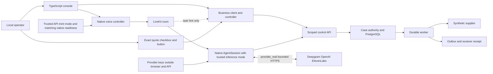
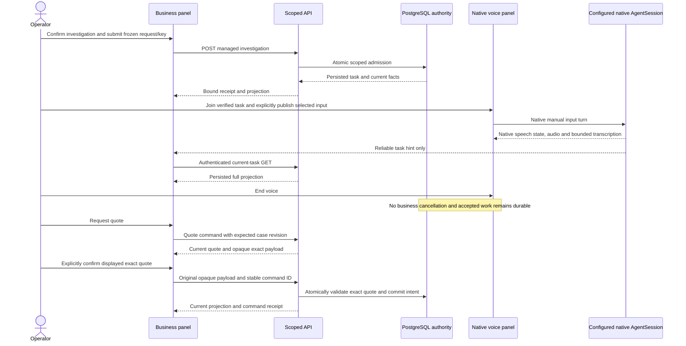
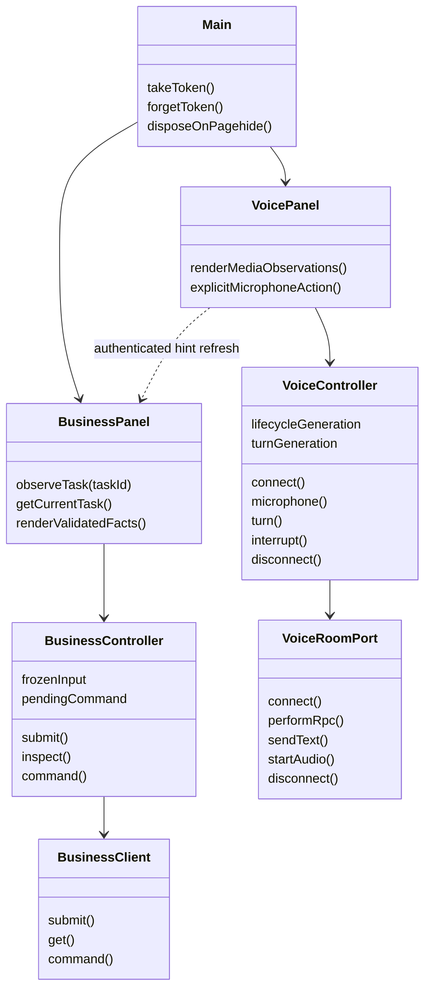

# Local continuity console design

| Field | Value |
| --- | --- |
| Status | Active |
| Purpose | Explain how the console pages are composed, bounded and kept honest about separately observed facts |
| Audience | Engineers who change console code or review its boundaries; coding agents |
| Scope | The default P1 console and the optional P2, P3 and joined showcase pages; excludes case authority, durable execution, consent validation and supplier truth |
| Owns | Console component design, owned interfaces, client limits, lifecycle ownership and failure handling |
| Related | [README](README.md) · [Agent instructions](AGENTS.md) · [Root design](../../Design.md) · [P1 charter](../../docs/projects/agent-continuity-scope.md) · [Observability](../../docs/observability.md) |

## Overview

This design covers the browser console in `apps/local-console`: the default P1
business console with native voice, and the optional P2, P3 and joined showcase
pages. It is for engineers who change console code or review its boundaries.
[README.md](README.md) gives each page's commands and evidence.

The console makes P1 durable work visible through authenticated HTTP
projections. It connects an already verified case to a native LiveKit
AgentSession. It owns client lifecycle, bounded observations and explicit user
controls. It does not own case authorization, durable workflow execution,
consent validation or supplier truth. Backend design and acceptance scope remain
authoritative in the [root design](../../Design.md) and
[P1 charter](../../docs/projects/agent-continuity-scope.md).

The default page's primary layout contains a shared memory-only access bar, the
managed business workspace and native voice controls. Collapsed transport
diagnostics and the independent M1 SQLite intake/replay/conflict fixture remain
accessible below it. M1 is the original confirmed-investigation intake.

The native voice profile defaults to deterministic local scripted speech. The
explicit local_real profile uses prepared local Whisper/Qwen/Piper engines. Its
actual model/media qualification remains separate. The optional P2 native page
has its own implemented profile. The default P1 page does not embed the optional
P2/P3 workspaces; those pages and the separate joined showcase have their own
builds and qualification boundaries.

### Pages and where this design describes them

| Page | Path | Main components | Section |
| --- | --- | --- | --- |
| Default P1 business console and native voice | `index.html` | Main, business panel/controller/client, voice panel/controller and VoiceRoomPort | The diagrams and the P1 subsections of [Components and related details](#components-and-related-details) |
| P2 native input and response playback | `p2-native.html` | NativeInputs, NativeGeneration, response lanes and playback meter | [Optional P2 native input page](#optional-p2-native-input-page) and [P2 response playback evidence](#p2-response-playback-evidence) |
| P2 current-case continuation | Profile on `p2-native.html` | Current context policy and panel | [P2 current-grant context and dormant continuation](#p2-current-grant-context-and-dormant-continuation) |
| P2 operations | `p2-operations.html` | OperationsController, BrowserOperationsClient and OperationsPanel | [P2 operations workspace](#p2-operations-workspace) |
| P3 background conversation | `p3-background.html` | BackgroundController, selected-agent room adapter, closed wire decoder and BackgroundPanel | [P3 background conversation](#p3-background-conversation) |
| Joined voice/SMS showcase | `channel-policy.html` and `landing.html` | JoinedController, JoinedClient, JoinedRoom, JoinedApplication and panel | [Joined voice/SMS showcase](#joined-voicesms-showcase) and [Landing page and demo recorder](#landing-page-and-demo-recorder) |

The diagrams describe the default P1 workspace and voice composition. The
optional pages are described separately under Components and related details.

Rules that every page shares are stated once: credentials under
[Security and privacy](#security-and-privacy), limits under
[Non-functional requirements](#non-functional-requirements) and as-of
observations under [Observability](#observability).

## Objectives

| Type | Objective | Evidence |
| --- | --- | --- |
| Business | Show a case surviving conversation end without implying cancellation or completion | Same authenticated task projection before/after native voice end |
| Business | Make investigation permission and exact mutation consent understandable | Separate explicit controls; displayed quote matches the original confirmation bytes |
| Business | Show outcome and receiver delivery independently | Distinct persisted outcome/delivery facts; no playback-derived business success |
| Technical | Preserve client identity and uncertainty across lost acknowledgements | Frozen original request/command replay and late-acknowledgement tests |
| Technical | Demonstrate native browser media against the real local stack | Native agent presence, manual input, real audio currentTime advancement and reconnect gate |
| Technical | Keep coding-agent changes reviewable and bounded | Separate pure controllers/native adapter, strict schema fixture and layered tests |

## Functional requirements

| ID | Type | Requirement | Implementation/evidence boundary |
| --- | --- | --- | --- |
| UI-01 | Business | Submit only an explicitly confirmed investigation | Managed HTTP controller; does not authorize a booking mutation |
| UI-02 | Technical | Preserve original request/key after unknown admission | Immutable client snapshot; matching original inquiry request resolves replay |
| UI-03 | Business | Resume a scoped current task after reload | Token/task re-entry and authenticated GET; no browser identity storage |
| UI-04 | Business | Prepare a read-only supplier quote and explicitly approve that exact proposal | Separate quote and signal commands with unchanged opaque confirmation bytes |
| UI-05 | Technical | Inspect current inquiry, lease, attempts, effects, outcome and delivery | Each business read returns a full validated snapshot plus bounded recent history |
| UI-06 | Business | Request business cancellation independently of conversation controls | Explicit HTTP cancellation control; end/interrupt never cancel accepted work |
| UI-07 | Technical | Join a verified task using native real-time communication (RTC) and user-selected scripted/physical audio input | Native software development kit (SDK) adapter and manual start/commit remote procedure calls (RPCs) |
| UI-08 | Business | Distinguish native speech state, browser playback and durable progress | Separate status fields and actual observed output |
| UI-09 | Technical | Refresh on trusted native hints without trusting packet state | Selected native AGENT, reliable topic, strict task hint, authenticated GET |
| UI-10 | Technical | Preserve existing transport diagnostics and M1 intake | Separate legacy controls/tests; no shared workflow authority |
| UI-11 | Business and technical | Restore current-grant case context and bounded original history in a fresh room | Read-only optional profile; selected 18-group storage and three-group media gates passed |
| UI-12 | Business and technical | Read current context, immutable input/delivery history and volatile process diagnostics in an opt-in workspace | P2-I20 separate page; 40 client/controller tests and selected actual 16 PostgreSQL/HTTP plus 3 browser groups passed in 0040 |
| UI-13 | Business | Keep talking while one accepted policy request runs, and show original result separately from applicability | Optional P3-I18B text page; source/installed twelve backend plus three browser groups each passed in 0042 |
| UI-14 | Technical | Preserve actual room/read ownership and clear private facts on Forget | One retained room and one read; cancellation, reentrancy and late-callback regressions |

These local UI identifiers document component behavior. Product acceptance IDs
and runner ownership remain in the
[P1 charter](../../docs/projects/agent-continuity-scope.md) and the
[granular task plan](../../docs/implementation-plan.md).

## Non-functional requirements

| Property | Bound/target | Unit | Verification | Status |
| --- | --- | --- | --- | --- |
| Business response | At most 65,536 | UTF-8 bytes/response | Bounded streaming reader including cancellation | Configured; unit tested |
| Session grant response | At most 16,384 | UTF-8 bytes/response | Existing bounded local grant reader | Configured; unit tested |
| Incoming voice output | At most 2 active readers; 16,384 bytes each; whole-stream 10 s scripted/40 s local_real or provider_real | readers/bytes/seconds | Selected-agent adapter and boundary tests; actual RTC gate separately | Configured |
| Display retention | At most 100 business events and 40 voice transcript entries | entries/page | Pure state/display bounds | Configured; unit tested |
| Recent history | Default 10 observations/page, server maximum 50 | entries/response | Scoped producer/consumer contract and paging tests | Configured |
| RTC command pressure | One ordinary turn RPC plus one concurrent interrupt | operations/session | Deferred-acknowledgement concurrency tests | Configured; unit tested |
| Native media acknowledgement | 5 seconds for capture/mute and disconnect, then explicitly unknown | seconds/operation | Deferred SDK operation tests; underlying ownership retained until settlement | Configured; unit tested |
| Secondary operations | One status send, playback gesture and hint refresh in flight each | operations/session | Deferred-operation tests | Configured; unit tested |
| Access storage | No credential or task persistence in browser storage | stored values | Reload/storage browser assertion | Implemented; real gate required |
| Accessibility | Keyboard labels, focus visibility and reduced-motion support | behavior | Document object model (DOM) controls/CSS; actual browser review | Implemented; visual gate required |
| Product truth | Missing facts remain unobserved; transport failures cannot become business failure | invariant | Negative schema/read/RPC tests and real local scenarios | Implemented boundaries |
| Optional context response | At most 65,536 UTF-8 bytes, including framing; history/work/responses/replies limits 8/8/4/4 | bytes/records | Closed data transfer object (DTO) and independent scoped cursors; omit whole records | Implemented; selected actual 18-group storage and three-group media gates passed |
| Operations HTTP | Context 73,728 total with original context envelope ≤65,536 plus frame ≤8,192; process telemetry ≤16,384 | UTF-8 bytes | Raw bounded stream, closed schema, exact identity/request correlation | Implemented; selected actual 0040 gate passed |
| Operations ownership | One retained client, one context plus one telemetry request; waiter 4 s, close observer 1 s | owners/requests/seconds | Held-cancellation, timeout/cleanup retry, late-result and callback-failure tests | Unit tested; actual owners retained until settlement |
| Operations updates/display | Poll ≥2 s, ≤30 ticks per activation; ≤32 rows per each of four sections | ticks/rows | Fake-clock non-queue/ceiling and immutable paging tests | Unit tested; older reads pause polling |
| P3 observation/session | 4,096 / 8,192 UTF-8 bytes | bytes/response | Closed semantic decoders, stable binding and bounded body readers | Unit tested; selected source/installed actual gates passed |
| P3 local HTTP | 32 headers, 2 KiB each and request line; four admitted handlers, one retained observation | headers/bytes/handlers/reads | Actual normal Chromium POST and over-limit rejection; origin/auth/body checks remain separate | Chromium interoperability and selected source/installed journeys passed |
| P3 conversation | 32 displayed entries, 4,096-byte input, two 16-KiB output readers with 10-second whole-stream deadline | entries/bytes/readers/seconds | Actual selected-agent text stream ownership and capacity tests | Unit tested; no audio profile |
| P3 resource ownership | One retained room and one observation request | actual owners | Held cancellation, duplicate join and late-callback controls | Unit tested; selected source/installed RTC/browser gates passed |

The joined showcase's ticket, reader and transcription-stream limits are
described under [Joined voice/SMS showcase](#joined-voicesms-showcase).

## Back-of-the-envelope calculations

Configured bounds are memory/pressure limits, not measured latency claims.

| Input and formula | Result | Exclusions |
| --- | --- | --- |
| 40 transcript entries × 16,384 maximum UTF-8 bytes | 655,360 bytes, approximately 640 KiB of retained text | JavaScript string/DOM/object overhead and native SDK media buffers |
| 2 incoming readers × 16,384 maximum text bytes | 32,768 bytes of bounded in-flight text | Network/decoder/SDK overhead; each reader also has a 10-second (scripted) or 40-second (local_real or provider_real) deadline |
| 100 displayed business observations × bounded server event summaries | At most 100 displayed rows | Exact memory depends on bounded field lengths; complete history stays server-side |
| 1 periodic full GET / 1.5 seconds while visible and eligible | Approximately 0.67 requests/second/active page | Operator actions and bounded cursor pages; polling does not create progress |
| 10 simultaneous illustrative active pages × 0.67 GET/second | Approximately 6.7 GET/second | An illustrative input, not a benchmark or service throughput claim |
| 1 ordinary RPC + 1 interrupt + 1 status send + 1 hint refresh | At most 4 independent pending conversation/control actions | Native SDK internal tasks and explicit HTTP business command serialization |
| 3 joined-showcase response readers × 16,384 bytes | 49,152 bytes of bounded response payload | SDK, fetch, decoder and object overhead |

## High-level design

1. The operator supplies a shared local token held only in page memory.
   Business and session requests send it only in same-origin authorization
   headers.
2. Business HTTP responses contain the complete current scoped projection. The
   backend, case authority, supplier evidence and receiver receipts own their
   facts.
3. Native voice joins the already verified durable task. The explicitly
   published default input is a local WAV played through WebAudio into a native
   WebRTC track. The physical microphone remains a separate,
   permission-controlled source choice.
4. The selected native agent can send a bounded hint. Only authenticated HTTP
   can refresh business state.
5. Human exact-quote consent is a separate HTTP command. Native speech, a model
   statement and browser playback do not grant mutation authority.
6. The voice controller uses the trusted API mint mode only with matching native
   readiness. Provider keys stay outside the browser and API. In provider_real,
   only the native AgentSession uses them, over bounded HTTPS to Deepgram, OpenAI
   and ElevenLabs.
7. Existing diagnostic and M1 fixtures remain separate from the managed path.

## Sequence diagram

The sequence shows one managed investigation, a native voice turn with a task
hint, End without cancellation and exact quote confirmation.

## Low-level design

Main composes both panels and owns the token and pagehide cleanup. Each panel
delegates to a pure controller. VoiceRoomPort keeps the native SDK adapter
outside pure state decisions. The dotted edge is the authenticated refresh that
a native hint triggers.

## Components and related details

This section covers the default P1 page first, then each optional page.

### Source layout and state ownership

| Component | Path | Responsibility | Status |
| --- | --- | --- | --- |
| Composition and shared access | `src/main.ts` and `workspace.css` | Page layout, memory-only token, panel composition, Forget/pagehide cleanup | Implemented |
| Business transport and pure state | `src/business.ts` | Strict schemas, 64 KiB reads, exact quote comparison, frozen commands, current full snapshot and bounded event history | Implemented |
| Business presentation | `src/business-panel.ts` and `business.css` | Explicit investigation/quote/cancel controls, scoped resume, actual observation rendering and eligible polling | Implemented |
| Scripted audio source | `src/scripted-input.ts` and `public/fixtures` | Bounded fixed WAV fetch/validation, synchronous user-action AudioContext resume, owned raw track and context closure | Implemented |
| Voice lifecycle and native adapter | `src/voice.ts` | Scoped session grant, generation fencing, native participant filtering, manual RPCs, bounded streams and audio element cleanup | Implemented |
| Voice presentation | `src/voice-panel.ts` and `voice.css` | Explicit mic/playback actions, separate speech/playback/turn observations and bounded safe transcript display | Implemented |
| Retained foundations | `src/lab.ts`, `intake.ts` and `transport-policy.ts` | Existing diagnostic transport and independent M1 investigation-only fixture | Implemented |
| Optional current context | `src/p2-context-policy.ts` and `p2-context-panel.ts` | Closed read-only case/history view, exact session/read fences and inert old response facts | Implemented |
| Real browser gate | `e2e/business.pw.ts` and `playwright.config.ts` | Actual local stack checks, sanitized observations, password-empty screenshots and coordinated native database wait | Implemented |

Status here records that each component is implemented. Selected
qualification belongs to pages and profiles: see the
[README capability table](README.md#implementation-status) and
[Validation and acceptance gates](#validation-and-acceptance-gates).

### P1 business contracts and authority

| Route | Use |
| --- | --- |
| `POST /api/business/investigations` | Submit an investigation request and stable key |
| `GET /api/business/cases/{task_id}` | Read a full current snapshot plus a bounded history page |
| Quote, exact signal and cancellation POSTs | Business commands, each with a stable command ID |
| `POST /api/business/session` | Bind a native media invocation to a verified task |

- Replay binding uses the original `inquiry.request` plus `request_key`,
  because the current case request can later change.
- The case GET always returns a full current snapshot. A cursor reset reflects
  an aggregate projection change. Displayed history never claims to be the full
  audit.
- The signal sends `confirmation_payload` unchanged with `explicit: true`.
- BIGINT revision, version, epoch and generation fields remain decimal strings.
- Presentation-to-byte comparison uses validated decimal lexemes and
  Python-compatible canonical string escaping, without converting original JSON
  numbers.
- A replay receipt can refer to an older command while its full projection is
  newer. The current projection wins.
- The business panel stops polling once delivery is delivered or exhausted, or
  once a failed lifecycle has no outcome, because no further server-side
  progress can appear without a new command
  ([0047](../../docs/work-items/0047-open-findings-schema-upgrades-and-landing.md)).
- Background polls and agent task hints use `heldToken()`, which returns only
  the in-memory token. They never read or clear the token field. Explicit
  commands use `takeToken()`, which reads and then clears that field.
- After a 401 or 403 (`unauthorized`), the panel forgets the token only after
  the failing command finishes. Forgetting during the command would mark it
  uncertain, so deferring the forget keeps a definitive rejection definitive.

### P1 native session, remote procedure calls and agent filtering

#### Session minting and media identity

`POST /api/business/session` binds a native media invocation to a verified task.
Minting is that request, which issues the signed session grant.

- The canonical UUID invocation ID stays frozen across mint and connection
  uncertainty. The server binds the signed grant to that invocation, so a lost
  acknowledgement can replay the same assigned job.
- Session minting reconciles up to three times under the existing 15-second
  connect deadline. Retries use 100-millisecond abortable delays and happen only
  after 503/504 or network-unknown failures. Every attempt reuses the identical
  serialized invocation request. 4xx responses are not retried.
- No browser Room adapter is created until a valid session grant is
  acknowledged.
- Automatic SDK transport reconnect and unknown mint or initial-connection
  retries preserve the exact current room, participant and invocation.
- Explicit End or a confirmed-session native disconnect retires the media
  invocation. The durable task and case stay the same. Room, participant and
  invocation identities are recreated only on the next explicit Join after
  actual cleanup, without creating another durable task.
- A fresh media room introduces a genuine native-session memory boundary. The
  new consumer rehydrates the existing PostgreSQL task and case.
- Browser reload stores neither identity nor token.

#### Native remote procedure calls

The native RPCs are `business.start_turn`, `business.commit_turn` and
`business.interrupt`. Each has a schema-version-1 bounded payload and exact
acknowledgement validation. Speech-only interruption can run beside one pending
ordinary RPC. It preserves the actual captured or pending input turn and its
authoritative acknowledgement.

#### Agent readiness

Input, turn RPC and native status controls require all of the following:

- a connected selected AGENT, meaning a participant of LiveKit kind AGENT;
- an observed SDK state of idle, listening, thinking or speaking;
- a public `continuity.session_ready` attribute that is exactly `true`; and
- a `continuity.inference_mode` attribute that matches the authenticated mint
  mode (see [P1 inference profiles and timeouts](#p1-inference-profiles-and-timeouts)).

The producer publishes `continuity.session_ready` only after public RoomIO
subscription readiness. RoomIO is the LiveKit Agents room input/output layer.
Listening alone does not prove that audio output is subscribed.
Initializing/unknown states do not establish readiness. Mute and End remain
available if the agent becomes unready or leaves. Replacing the selected agent
clears the old speech state until the new participant supplies its own.

#### Selected agent filtering

The selected native AGENT alone can supply `lk.agent.state`, `lk.transcription`
and reliable `continuity.observed` hints. A hint contains only version and task
ID. Foreign senders or topics, oversized inputs and mismatched tasks do not
change state. Native transcript receipt and actual browser audio playback remain
separate facts.

### P1 media lifecycle, recovery and retention

#### Input sources

- The default scripted source synchronously creates or resumes its AudioContext
  from the explicit publication action. It fetches the fixed local pulse-code
  modulation (PCM) WAV with size, format and duration bounds, and owns its
  MediaStreamTrack and context.
- The adapter owns the created LocalAudioTrack before awaiting native publish,
  so timeout or End can stop it even while publication is pending.
- SDK publish and unpublish use the documented raw MediaStreamTrack overload
  without relaxing strict TypeScript.
- Physical capture uses the actual browser permission API and native SDK. Known
  denial is rejected before getUserMedia.
- No browser API is mocked or replaced.

The prerecorded input track is prepared and published silently. After the
native `start_turn` response is strictly verified as `turn_started`, a new
non-looping source plays the unchanged WAV from sample zero. A late reply cannot
restart input that is closed, muted, replaced, superseded or not ready. Physical
microphone capture is independent. Fixture alignment does not force a model tool
or establish automatic speech recognition (ASR) quality.

#### Generation fencing

- Each room lifecycle has a generation. Each input/interrupt sequence has a
  separate turn generation.
- Late grants, device permissions, RPCs and old-room callbacks cannot resurrect
  a disconnected session.
- A late microphone grant is muted, and the adapter closes owned tracks, readers
  and audio elements.
- Permission and cleanup uncertainty are visible rather than silently converted
  into confirmed capture-off facts.

#### Media acknowledgement deadline and cleanup barrier

- Native microphone and disconnect acknowledgements have a 5-second deadline.
- That microphone deadline currently includes the permission prompt. A slow
  human response can therefore produce an unknown observation; it does not
  prove the capture operation stopped. UI-A4 in
  [0048](../../docs/work-items/0048-code-audit-fixes-and-documentation-cleanup.md)
  remains open.
- A timed-out microphone operation retains its single reservation until the
  real SDK call settles. New operations cannot accumulate behind it.
- Timeout or End stops owned published tracks. Late capture completion is
  stopped and muted before that reservation clears.
- Unresolved actual cleanup remains a controller barrier across End and
  unexpected disconnect, preventing unbounded new rooms and sources. Only actual
  settlement, or a page reload with explicit scoped resume, permits another
  source.

#### Recovery and retention

- An unknown admission or business command acknowledgement retains the frozen
  original identity and body.
- Read timeouts leave the last validated projection visible with an
  unavailable/unknown status.
- Explicit resume authenticates the current task again.
- Normal voice end does not erase or cancel accepted work.
- Persistence migrations, backup/restore, worker leases and supplier effect
  recovery belong to the backend and
  [local setup](../../local-setup/README.md), not browser storage.

### P1 inference profiles and timeouts

#### Trusted mode selection

- The shared native path accepts exactly scripted (default), local_real and
  provider_real.
- `POST /api/business/session` returns only the trusted configured mode. The
  browser cannot request another profile.
- The browser retains no verified mode before that authenticated mint and
  clears it on End or failure. Stale acknowledgements are generation-fenced.
- Native controls also require the matching mode (see
  [Agent readiness](#agent-readiness)).
- The profile badge distinguishes configured from native-matched readiness. This
  is not actual engine or model qualification.
- Default fixture input is independent of the profile and does not prove
  microphone capture.
- The diagrams retain the shared authority path. Profile adapters use the same
  session and bound task rather than creating another case authority.

#### Provider composition

provider_real composes:

- Deepgram nova-3 batch recognition after manual flush;
- OpenAI gpt-5.4-mini streaming tool selection; and
- ElevenLabs eleven_v4_turbo chunked HTTP PCM speech.

Only the native process receives provider keys. Real output cannot bypass
separate exact human consent. No silent fallback, provider resource-capacity
result or blanket zero-retention claim is made.

The [provider operations guide](../../docs/provider-demo.md) owns strict key
setup, explicit lifecycle, fixed model/voice/transports, bounded execution and
the fresh P1-20 selector. The recorded provider_real v2 gate passed both actual
browser cases with cleanup on its source snapshot. The post-v5 P1-20 rerun
remains open in
[0047](../../docs/work-items/0047-open-findings-schema-upgrades-and-landing.md).
A passing provider scenario cannot qualify the separate local-engine
declaration. See the
[local-real operations guide](../../docs/local-real-inference.md) for actual
local_real qualification.

#### Timeouts by profile

| Operation | scripted | local_real and provider_real |
| --- | --- | --- |
| Commit acknowledgement | 8 s | 12 s |
| Other RPCs | 8 s | 8 s |
| Capture, mute and disconnect acknowledgement (browser cleanup) | 5 s | 5 s |
| Incoming transcription reader, whole stream | 10 s | 40 s |

A transcription header opens before synchronized speech finishes, so real
output needs its finite 40 s reader deadline. Both profiles keep the same byte
and concurrency limits and the room-lifetime abort. The owned deadline is
cleared on EOF (end of stream) or failure.

### Optional P2 native input page

The separate `p2-native.html` entry and `vite.native.config.ts` build target
leave the default P1 workspace/voice diagrams and Compose entry unchanged. Host
SDK and gateway code connects the page to the existing Docker selective
forwarding unit (SFU) and PostgreSQL. Selected actual six-group native and
installed Python/npm package gates passed. Final selected phase checks and the
affected UI-hint media rerun passed in the
[completed handoff](../../docs/work-items/0036-native-input-and-deadline-cancellation.md).

- NativeInputs retains thirty-two stable text/voice input references.
- Reliable six-key NativeGeneration messages must come from the selected native
  AGENT and match a known accepted input/operation. Sixty-four attempt
  identities are retained.
- Known terminal SDK observations survive stale messages. An expired or revoked
  retry cannot erase an earlier unknown original acceptance.
- Input receipt, SDK generation, returned transcription and actual browser
  playback remain separate facts. None implies consent.
- Real I/O stays owned after waiter timeout or End, and incomplete cleanup
  blocks a new room.

The profile is explicitly scripted and fixture-driven. P2-I17 response evidence
is implemented in the optional v7 profile (see
[P2 response playback evidence](#p2-response-playback-evidence)), with exact
measured results in the
[playback handoff](../../docs/work-items/0037-playback-evidence-and-process-recovery.md).
P2-I18 verified current-case rehydration passed its selected storage and media
gates in the
[completed handoff](../../docs/work-items/0038-case-rehydration-and-standalone-release.md).

### P2 response playback evidence

The optional v7 communication profile (P2 schema version 7) adds these
response evidence controls to the P2 native page.

#### Response lanes

- The page renders generated text, SDK settlement and browser reports as
  separate stable DOM lanes.
- Dynamic content uses textContent. Reduced motion and keyboard controls are
  preserved.
- Original response, input, operation and speech identity is immutable.
- A stale response read cannot overwrite a newer observation count.

#### Playback meter

An AudioWorklet counts finite PCM energy windows from the selected native audio
track while its media element is playing. It writes silence in the observation
graph, so the original media element owns audible output. A continuous-track
window does not prove exact speech delivery or hearing.

Worklet, port, source and context remain owned through pending creation, failed
close and End. A failed close is visible and retryable. Client reports have
bounded actual I/O and explicit stable identities. The completion button reports
a client observation. Absence of a report stays unknown.

#### Playback gate

The controlled local gate compares three actual response paths against
independent SQL and actual SDK-publication receipts. Its waveform and
midpoint/quiet predicates are frozen before measurement. Test diagnostics
contain only finite stages, states, counts and audio durations. Raw errors,
transcripts, access tokens and URLs are omitted. The
[handoff](../../docs/work-items/0037-playback-evidence-and-process-recovery.md)
owns pass/fail evidence and qualification limits.

### P2 current-grant context and dormant continuation

#### Context read authority

- The current native binding or exact accepted-SMS association authorizes a new
  context read. The old retained-history credential keeps its original meaning.
- The facade observes coherent P2 history, reads the external case outside SQL,
  then rechecks current permission under locks with fresh database time before
  disclosure.
- The UI labels separately observed times and source fingerprint. It cannot turn
  that non-atomic read into consent, a write fence or a current supplier
  guarantee.

#### Refresh, history and revision 0

- An explicit idle refresh updates model context without creating input or
  generation.
- Historical accepted messages keep original IDs and roles. Historical
  generated, SDK and playback facts are inert data, never new-room speech
  controls.
- The public P1 source can show revision 0. The native positive-revision
  contract remains closed to new intake at 0.
- The standalone scenario uses actual revision 1, then an explicit SMS
  compare-and-set (CAS) to 2, rather than an automatic revision repair.

#### Room A, SMS and room B ownership

The application owns the SDK and RTC instances and the HTTP reads for room A
and room B.

1. Actual close of room A precedes the parent's deletion of that room and the
   signed SMS. Neither room exists during that SMS step.
2. The parent then creates room B and publishes its exact owned readiness marker
   before B's session mint.

A failed close retains ownership and blocks continuation. Model-context
observations prove that the trusted public ChatContext was supplied to scripted
model entry. They do not establish reasoning, recognition quality or hearing.

The `actualReads` value in the page's rehydration evidence counts only context
reads that are in progress. Response refreshes do not change it.

#### Continuation evidence

Selected 18-group storage and three-group media qualification passed in the
[completed handoff](../../docs/work-items/0038-case-rehydration-and-standalone-release.md),
with actual owned cleanup and dormant room A to SMS to room B continuation. The
0038 installed consumer's 111 Python tests and the unit/type checks establish
their narrower installed/boundary scope.

### P2 operations workspace

#### Composition and proxy

The opt-in `p2-operations.html` page composes OperationsController,
BrowserOperationsClient and OperationsPanel over fixed same-origin read routes.

- Its separate Vite and TypeScript profiles consume the public browser-safe P2
  operations-types export.
- Default P1/M1 rendering, native media controls and default Docker build inputs
  remain separate.
- The operations proxy accepts only a trusted literal loopback port and
  rewrites the fixed prefix with the correct backend Host.

#### Binding and paging

- The first successful authenticated read pins account, case and conversation,
  and native binding, room and participant.
- The server still owns current grant checks. Browser pinning cannot create
  authority.
- Current refresh replaces the bounded page window. Older pages use independent
  signed cursors, retain original receipt identities and stop automatic polling.
- Case source fingerprints can change without a new business revision.
- All case and P2 observation times remain visible and explicitly non-atomic.

#### Ownership, Forget and denial

- The client retains actual fetch/body-cancellation tasks beyond waiter or
  close-observation timeout.
- Forget immediately clears the credential and facts, fences late callbacks and
  retains the one retiring owner. Connect remains blocked until that owner
  actually settles.
- The captured native or injected fetch is called without a client-object
  receiver.
- Renderer failures cannot release ownership or prevent the clear.
- Denial pauses context and telemetry polling, keeps prior facts historical and
  requires explicit Forget/authentication for a new activation.
- Independent privileged process diagnostics are not current context
  authorization.

#### What the operations panel shows

- The panel separates accepted input, processing, carrier send result, callback,
  generated stream, SDK settled handle and browser report.
- Process snapshots show finite volatile producer metrics and bounded actual
  read spans. Pending or unavailable sources have no fabricated numeric values.
- Closed public cause codes preserve producer distinctions without exposing raw
  errors.
- A two-second poll or a span duration does not invent business progress.
- Revision 0 has no execution controls. This surface contains no mutation,
  quote, consent, cancel or send-retry operation.

#### Operations evidence

The [0040 work item](../../docs/work-items/0040-operations-ui-and-fixed-policy-evidence.md)
records the selected P2-I20 pass: sixteen PostgreSQL/HTTP assertions and three
browser groups, thirteen owned children, 13.779 seconds and complete cleanup.
Forty UI tests cover the client/controller boundary, including the strict
native-fetch receiver and retiring-epoch ownership. Empty static views establish
their narrower visual scope.

The actual power-user captures after explicit paging are 6,540 and 5,824 pixels
high. This retained-data view is separate from the compact demo flow with
progressive disclosure, the integrated portfolio comparison and the demo video.
Selected gate success does not establish that the overall user experience is
finished.

### P3 background conversation

#### Composition and ownership

The optional `p3-background.html` page composes BackgroundController, the
selected-agent room adapter, the closed wire decoder and BackgroundPanel.

- The controller owns one activation and one retiring room/read lifecycle.
- It publishes only validated facts. Presentation callbacks cannot start a new
  operation after Forget or duplicate an in-flight operation.
- Forget fences the activation and clears credentials before calling
  presentation or cancellation callbacks.
- A new Join waits for actual prior close.

#### Session, readiness and authority

- The root HTTP host supplies cached session bytes and observations from the
  public NativePolicyApplication.
- The session and card pin the same configured binding.
- RTC grants do not authenticate privileged reads.
- Readiness requires the selected AGENT identity, profile, session and
  scripted-mode attributes after public SDK RoomIO readiness. A connected room
  alone does not enable composition.
- This is a native RTC text profile with no audio controls.

#### Conversation and policy card

- The composer uses `lk.chat`. Selected-agent output uses `lk.transcription`.
- The application retains one background run independently of its SDK waiter.
- The card shows actual work/result metadata, original commit disposition and
  non-atomic applicability.
- The closed decoder validates immutable rule/fact references. Detailed
  historical policy conclusions and witness presentation remain a showcase
  improvement rather than an existing card feature.
- Application read completion time is not a fabricated case-observation
  timestamp.
- A failed or denied read preserves old facts only as historical. Recovery reads
  the same configured identity.

#### Accessibility and evidence

Connection setup and diagnostics are collapsed. Dynamic text uses textContent,
and status changes use live regions. Keyboard composition supports Enter and
Shift+Enter. Reduced-motion and narrow-layout behavior is explicit. Sanitized
screenshots require empty password inputs.

The selected source/installed backend and three-group RTC/browser journeys
passed in
[0042](../../docs/work-items/0042-responsive-native-policy-and-compact-demo.md).
Those scripted text observations establish neither speech/model quality nor the
combined voice/SMS return route.

### Joined voice/SMS showcase

The optional `channel-policy.html` implementation composes a strict Parent wire,
a retained HTTP client, a pure activation controller, one lazy SDK room adapter
and a compact panel. The Parent is the joined application's process that owns
room Start and End commands. Isolated source/build/responsive checks retain
their component scope. Selected joined provider journeys and recordings are
recorded separately; complete joined qualification remains with the active
[0045 work item](../../docs/work-items/0045-joined-native-channel-policy.md).
[0046](../../docs/work-items/0046-joined-showcase-providers-and-demo.md)
records the selected provider journeys and the demo.

| Component | Responsibility | Authority |
| --- | --- | --- |
| JoinedController | Parent activation identity, original commands, stale callbacks and bounded display history | Observation and client ownership only |
| JoinedClient | Fixed operator routes, bounded bodies, actual reader/request cleanup | Separate explicit operator bearer in RAM |
| JoinedRoom | One actual selected-agent session, native text/recorded voice, interruption and output elements | RTC grant only; no backend or optional playback capability |
| JoinedApplication and panel | Real observed transitions, one case/result card, dormant synthetic SMS and accessible controls | Backend results remain independently validated observations |

#### Joined showcase limits

| Limit | Value | Applies to | Notes |
| --- | --- | --- | --- |
| HTTP tickets | Three: two for ordinary operations, one reserved for End | JoinedClient | Waiter cancellation does not release a ticket |
| Response readers | Three readers of 16,384 bytes | JoinedClient response bodies | 49,152 bytes in total |
| Transcription streams | At most two selected-agent streams | JoinedRoom | Other senders' streams and streams beyond the cap are released without changing state |
| Provider commit | 12 s | Commits in provider_real mode | None |

The sections below explain each limit.

#### Parent lifecycle, End and Forget

- The Parent lifecycle tuple is independent of the observed Node room cursor.
- End retires media and preserves the operator channel for dormancy, when no
  room is open.
- Forget hides private facts and authorization immediately, while retaining
  already admitted scoped cleanup owners.
- Unknown Start/SMS commands keep their exact identity, body and time. No
  automatic new identity is created.
- A case read, result read, dispatch count, generation and media-element
  playback represent different facts. No timer manufactures progress.

#### HTTP tickets and End retirement

- The joined HTTP client retains three actual tickets. Two are available to
  ordinary operations and one is reserved exclusively for End.
- Three bounded response readers of 16,384 bytes bound the response payload (see
  [Back-of-the-envelope calculations](#back-of-the-envelope-calculations)).
- Waiter cancellation does not release a ticket.
- One original retirement owner retains only the exact End command and captured
  key across Forget. One automatic post-Start cleanup replay is allowed, with
  later explicit retries against the same owner. Repeated Forget coalesces.
- Closed acknowledgement, reader drain and media closure remain separate facts.
  All are required before the next room.
- General authorization is cleared immediately on Forget. The captured cleanup
  key is discarded at settlement.
- Browser page exit is best-effort cleanup, not an observed remote End receipt.
  The known page-exit abort limitation remains UI-A6 in
  [0048](../../docs/work-items/0048-code-audit-fixes-and-documentation-cleanup.md).

#### Join deferral behind routine reads

The two ordinary tickets are often held by routine status and result polls. A
Join pressed while only those side-effect-free reads are in flight is deferred
and starts once they settle. Any other in-flight command still reports the
conflict. End or Forget clears the deferred Join.

#### Endpoint, inference mode and voice source

- The default first mode is explicitly scripted with a recorded WAV source.
- The trusted authenticated grant selects a canonical loopback SFU endpoint,
  normally host port 17880.
- The fixed local proxy exposes no credential and forwards only to the Parent
  operator boundary.
- SDK loading occurs on Join, keeping the idle page small.
- The grant also names the inference mode (scripted or provider_real).
  Readiness requires the agent's `p2.inference_mode` attribute to match it. The
  header labels the configured profile without implying model quality.
- Provider commits allow 12 s.
- The voice source is the declared recording or, after browser permission, the
  live microphone. It is fixed once prepared.

#### Transcript display

- JoinedRoom reads at most two selected-agent transcription streams.
- Streams from any other sender, including the user transcript that the agents
  SDK publishes on the browser's behalf, and streams beyond the reader cap are
  released without changing state, as for the business console.
- Each admitted stream becomes one message that grows in place while it stays
  open (a live caption). It is finalized when it closes or fails. A rejected
  display update cannot leak a reader slot.
- The transcript follows new text only while the reader is already at its end.
- When another activation still holds the single room, the state reads
  "Session in use" rather than offering a disabled Join.

Recorded browser evidence for these behaviors is in the
[0046 work item](../../docs/work-items/0046-joined-showcase-providers-and-demo.md).

#### Sent input status

Each sent transcript entry shows its native input status (Sending, Accepted,
Outcome unknown or Rejected) from the same acknowledgement model as the evidence
panel. It also shows a browser-local display time that is not a durable
timestamp
([0047](../../docs/work-items/0047-open-findings-schema-upgrades-and-landing.md)).

#### Text input identity and retry

- JoinedApplication keeps one frozen text input id until that input is accepted,
  replayed or rejected.
- Edited text is refused while the original input is pending or unknown. The
  input model rejects a changed body under an existing input id.
- Enter sends only while Send is enabled and ignores key repeat.
- Retry resends the original unknown input. The controller adds no duplicate
  transcript entry for an input id it already holds.

### Landing page and demo recorder

- The showcase build is multi-page. `landing.html` is served at the origin root
  and links the showcase and the P1 console.
- The P1 console's loopback URL is injected at build time from the configured UI
  port and validated before use.
- The demo recorder (`scripts/record-channel-policy-demo.mjs`) drives this same
  UI. With `--complete`, it opens the landing page first and finishes with one
  P1 business case in the console.
- Its captions and title cards exist only in the recording. The console token is
  entered while a title card covers the page.

## Security and privacy

| Boundary or threat | Control | Test or evidence |
| --- | --- | --- |
| Operator token in the page | The token appears only in a private input or page closure and in same-origin HTTP headers; the input clears on use | Real browser gate scoped reload |
| Credential persistence and export | Browser storage, URLs, DOM logs and diagnostic exports contain no credentials; Forget and pagehide clear credentials and initiate owned-resource cleanup | Reload/storage browser assertion; explicit cleanup barriers remain separate |
| Optional page credentials | Kept in memory and out of builds, URLs and browser storage in the same way | Each page section and its selected gate |
| Untrusted server and agent text | Dynamic text uses textContent | Coding rule in [AGENTS.md](AGENTS.md) |
| Client-side validation | UI schema checks are additional client validation; server scope and authority checks remain mandatory | Strict wire-schema unit tests and negative schema/read/RPC tests |
| Native browser path | Requires an already authenticated current task | Real browser gate native voice scenarios on a verified task |
| Agent impersonation | Native participant kind establishes agent filtering, not a peer name or topic | Selected-agent adapter and boundary tests |
| Mutation authority | The server validates exact proposal authority before committing intent, regardless of client presentation checks | Real browser gate exact human quote confirmation |
| Remote providers in tests | Offline and unit tests call no remote providers | Scripted lanes need no provider credentials |
| Browser evidence | Isolated synthetic data and local endpoints, with no trace, video or HTTP Archive (HAR) capture | Browser gate evidence rules |
| Screenshots | Images are captured only after every password input is empty | The browser gate asserts empty password fields before capture |

The optional page sections note page-specific credentials, such as the
operations page's separate process-diagnostics permission and the joined page's
separate operator bearer.

## Observability

| Signal | Producer | Fields or labels | Status |
| --- | --- | --- | --- |
| Business surface | Business panel, from the backend projection | Inquiry, lifecycle/lease, exact confirmation, effect attempts, outcome and delivery; bounded timeline with truncation labels | Implemented |
| Voice surface | Voice panel | Room state, selected native agent state, manual turn state and browser media observations | Implemented |
| Native transcription counters | Native room and controller | Bounded numeric page counters; no raw text or credential | Implemented |
| Browser gate observations | Real browser gate | Allowlisted booleans, numeric counts and finite state labels | Implemented |
| Backend logs, task metrics and safe error catalogs | Backend, under the [observability guide](../../docs/observability.md) | Defined by that guide | Not owned by the console |

### As-of observations on every page

Each page displays facts from separate sources as separate observations, each
as of its own read. Cross-authority reads are not atomic. A failed read keeps
labelled previous observations. No elapsed time, counter or playback event is
presented as business progress. The page sections and the [Metrics](#metrics)
table describe page-specific signals.

### Default page surfaces

The business surface displays inquiry, lifecycle/lease, exact confirmation,
effect attempts, outcome and delivery separately. A bounded timeline identifies
retained observations and explicitly labels recent-window/display truncation.
The voice surface shows room state, selected native agent state, manual turn
state and browser media observations independently. It never treats spoken text
as a delivery receipt.

### Native transcription counters

The native room and controller expose bounded numeric page counters for:

- transcription stream arrival;
- actual chunks and received bytes;
- sender and capacity rejection;
- EOF completion and read failure;
- completed UTF-8 bytes (observed received bytes are capped at 16 KiB per
  stream);
- post-read rejection; and
- accepted, rejected and stale callbacks.

These are transport observations. They include aborted reads during End and
never update business state. Current media connection/readiness and displayed
transcript counts remain separate facts. No raw text or credential enters these
counters.

### Browser gate observations

The browser gate writes allowlisted observation booleans, numeric counts and
finite state labels. It proves native database pressure using a helper-observed
PostgreSQL advisory waiter for the native container. It then checks local mute
while that wait is held. A sleep or delayed fake response alone is insufficient
evidence. Backend logs, task metrics and safe error catalogs are owned by the
[observability guide](../../docs/observability.md).

## Metrics

| Signal | Producer | Meaning and limits |
| --- | --- | --- |
| Current persisted workflow/delivery states | Backend projection, displayed by browser | Scoped observed facts; not derived from elapsed time |
| Retained/displayed history counts | Backend and bounded client controller | Retained counts may exceed the recent loaded window |
| Native agent speech state | SDK participant attributes | Agent state, not proof that a browser played audio |
| Browser playback state/currentTime | Media element and real browser gate | Actual local playback observation, not human hearing acknowledgement |
| Browser gate booleans/counts/states | Playwright sanitized report | Scenario evidence only; not a production metrics exporter |
| Client error feedback | Controllers/panels | Safe finite categories/messages without raw provider or credential text |
| Current context/read phase | Optional context policy/panel | As-of source revision, independent observed times and unavailable/ready state; no generation or business progress signal |
| P3 connection/read/run observations | Native room adapter, policy controller and public application DTO | Finite local ownership/callback/read counters, original disposition and non-atomic applicability; no transcript or identifier metric labels |
| Operations process snapshot/read spans | Allowlisted producer getters and bounded telemetry observations | Volatile process-only source/time/numeric facts; unknown stays unknown; not case progress or a durable audit feed |

This console introduces no Prometheus exporter or remote telemetry. Performance
budgets are configured limits until real measured evidence is recorded
separately. Avoid case, task and room IDs as metric labels.

## Exception handling

| Boundary | Handling | Preserved fact |
| --- | --- | --- |
| Invalid request/response schema | Reject closed fields, identities, bounds and incoherent facts | Invalid responses cannot become observed progress |
| Admission/command acknowledgement lost | Retain frozen original identity/body and offer unchanged reconciliation | Potential earlier acceptance remains unresolved |
| Scoped GET fails or times out | Keep last snapshot, label unavailable/access required | A read outage is not workflow failure |
| Access denied | Forget shared credential and close owned native/diagnostic sessions | No state is adopted outside authenticated scope |
| Microphone denied/fails | Attempt mute cleanup; show capture uncertainty if cleanup is unconfirmed | No implicit business cancellation or success |
| Native RPC reply lost/malformed | Mark turn acknowledgement unknown; fence late replies | Conversation uncertainty does not alter durable state |
| Speech interruption | Separate concurrent RPC and generation fence | Accepted work continues unless an explicit business cancellation commits |
| Playback blocked | Offer explicit browser playback gesture | Native speaking does not imply local playback |
| Oversized/slow output stream | Abort/return reader and retain bounded output | No unbounded read tasks or text accumulation |
| Disconnect/pagehide | Abort owned readers/requests, detach audio, stop local tracks, ignore stale callbacks | Persistent backend work is unaffected |

Raw transport, provider and server bodies are not shown. Failed cleanup is
reported without inventing certainty. Backend exception taxonomy and
retryability remain server-owned.

## Design considerations and trade-offs

| Decision | Reason | Cost or alternative | Revisit trigger |
| --- | --- | --- | --- |
| Full snapshots with bounded observation pages | Simplify current-state correctness during cursor reset and concurrent worker/outbox updates | Cost more bytes than event-only deltas, within the explicit response cap | None recorded |
| Polling alongside reliable native hints | Complements those hints and reload recovery | Adds bounded local reads; does not claim event streaming or manufacture UI transitions | None recorded |
| Opaque exact quote | Avoids JavaScript precision loss | Presentation must match the original canonical bytes; client reconstruction is comparison-only | None recorded |
| Existing-task voice admission | Keeps native browser scope explicit | Unbound native admission is qualified separately by backend/SDK scenarios | None recorded |
| Explicit local WAV/WebAudio source | Makes browser speech reproducible without claiming hardware capture; both input paths use actual native WebRTC and the server business adapter | The physical microphone is separately permission checked | None recorded |
| Manual deterministic audio turns | Reproducible local evidence without paid inference | Do not demonstrate ASR/model/text-to-speech (TTS) quality or P2 multimodal continuity; those remain separate milestones | None recorded |
| Browser playback observation | Proves a media element advanced | Not proof that a person heard or acknowledged content; persisted outcome and receiver delivery stay distinct | None recorded |
| Pure controllers | Make races testable | Actual browser/Docker gates remain necessary for media, permissions, proxy/networking and native event-loop behavior | None recorded |

## Validation and acceptance gates

| Gate | Assertion or lane | Evidence | Status |
| --- | --- | --- | --- |
| Unit, strict TypeScript and production build | Run for any affected change | Console unit tests and production build | Required for every affected change |
| Shared projection fixtures | Preserve producer/consumer BIGINT and exact quote compatibility | [Case projection fixture](../../contracts/business/case-projection.json) | Required for every affected change |
| Root full fast validation | Applies to shared contracts or harness changes | Root full fast lane | Required for shared changes |
| M1 fixture and diagnostic transport | Preserve the M1 investigation-only fixture and diagnostic transport tests | Retained foundation tests | Required for every affected change |
| Default page real browser gate | The required scenarios listed below | `e2e/business.pw.ts`; [Phase H handoff](../../docs/work-items/0019-p1-phase-h-release-qualification.md) | Recorded in the completed Phase H handoff |
| Optional P2 native input page | Selected actual six-group native and installed Python/npm package gates | [0036](../../docs/work-items/0036-native-input-and-deadline-cancellation.md) | Passed |
| P2 response playback | Three actual response paths against independent SQL and actual SDK-publication receipts | [0037](../../docs/work-items/0037-playback-evidence-and-process-recovery.md) | Passed |
| P2 current-grant context | Selected 18-group storage and three-group media qualification | [0038](../../docs/work-items/0038-case-rehydration-and-standalone-release.md) | Passed |
| P2-I19 workload experiments | Selected workload experiments | [0039](../../docs/work-items/0039-bounded-channel-workloads-and-image-evidence.md) | Passed |
| P2-I20 operations view | Sixteen PostgreSQL/HTTP assertions and three browser groups | [0040](../../docs/work-items/0040-operations-ui-and-fixed-policy-evidence.md) | Passed |
| P2-I21 standalone and P3-I18A durable-v2 | Selected qualification | [0041](../../docs/work-items/0041-standalone-channel-and-durable-policy.md) | Passed |
| P3-I18B native RTC text | Source/installed backend and three-group RTC/browser journeys | [0042](../../docs/work-items/0042-responsive-native-policy-and-compact-demo.md) | Passed |
| Joined voice/SMS showcase | Joined database, media and real-provider journey | [0045](../../docs/work-items/0045-joined-native-channel-policy.md) | Pending |
| Full charter registration | Complete registered charter rows | Owning project charters | Planned |

Each optional page's section under Components and related details names its
selected gates and work item. [README.md](README.md) gives their commands.

### Default page real browser gate

The isolated real browser gate requires the API, PostgreSQL, fake supplier,
durable worker, native business agent, LiveKit, console and packaged audio
fixture. Its required scenarios cover:

- managed admission;
- native manual input and audio playback;
- status, interruption and end;
- fresh-room same-task continuation with a new live status reply;
- reload with explicit scoped resume;
- real physical-microphone denial, separately from scripted input;
- a positively observed native PostgreSQL wait with responsive native interrupt
  and local mute;
- a held real supplier quote read with independently responsive media controls;
  and
- exact human quote confirmation with separate outcome and delivery inspection.

Six listed cases or passing mocks alone are not execution evidence. Any missing,
skipped or timed-out case remains non-passing. The active work item records
actual commands and results and the remaining product acceptance gaps.
