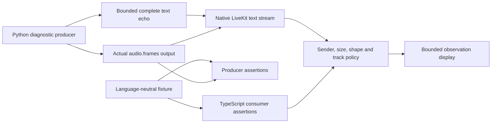
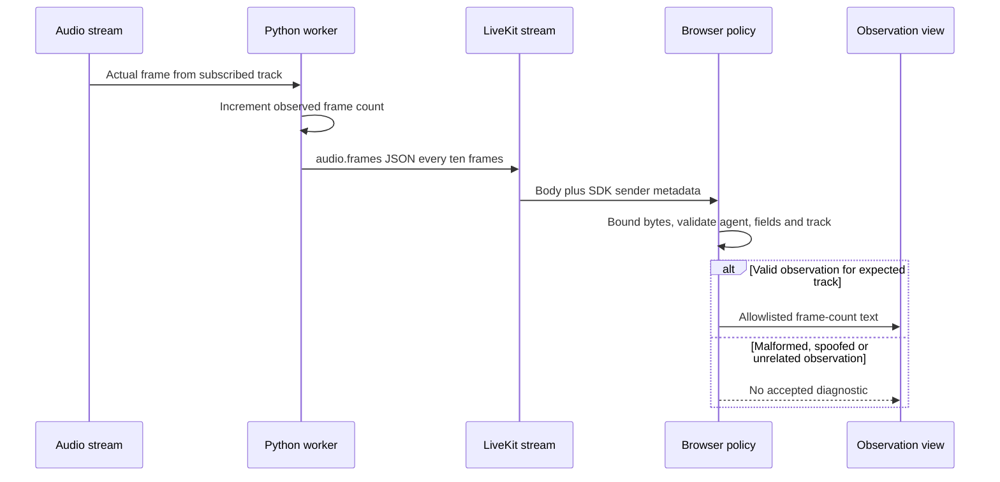
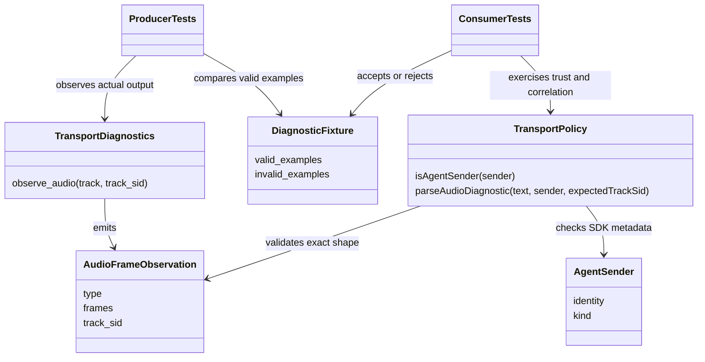

# Shared contract design

Status: Active
Last reviewed: 12 November 2026

## Overview

A small data boundary keeps independently implemented producers and consumers
compatible. This directory owns language-neutral protocol fixtures, not a
service, orchestration layer, state authority or fourth portfolio product. The
implemented fixtures cover local audio-frame JSON, UTF-8 text echo, business case
projection, channel messages and delegation policy/document boundaries. Native
policy observation/session DTOs and selected source/installed RTC text/browser
qualification passed in [0042](../docs/work-items/0042-responsive-native-policy-and-compact-demo.md). The result-intent/receipt seam in
[0043](../docs/work-items/0043-stable-result-delivery-and-return-context.md) is under implementation; its storage/installed qualification remains pending.

The [shared architecture](../Design.md) owns state and failure boundaries;
[validation](../docs/validation-plan.md) owns evidence sufficiency. This design
preserves the current producer/consumer contract and defines how later schemas
must be introduced without mistaking a fixture for runtime behavior.

## Objectives

| Type | Objective | Success criterion |
| --- | --- | --- |
| Business | Show an understandable, honest local diagnostic | The console displays only a verified agent's observation for the expected microphone track; it does not claim comprehension, playback or business completion. |
| Business | Keep project integration explainable | Each shared fixture has a named actual producer, consumer and scope; unrelated speculative common models stay outside this boundary. |
| Technical | Detect Python/TypeScript drift | Actual producer output matches valid fixtures; consumer tests reject malformed, incompatible and spoofed observations. |
| Technical | Preserve explicit trust boundaries | A payload cannot assign agent identity, confirmation authority or permission; runtime validation precedes display or product use. |

## Functional requirements

These rows describe this support boundary, not additional product acceptance IDs.

| Type | Requirement | Acceptance assertion | Status |
| --- | --- | --- | --- |
| Business | Render useful diagnostic evidence | A matching audio.frames observation renders a frame count; absent or rejected evidence remains unavailable. | Implemented consumer policy; actual browser microphone qualification remains open. |
| Business | Prevent misleading portfolio claims | Fixture success is never reported as network transport, browser playback, durability or model-quality evidence. | Current evidence policy. |
| Technical | Keep current diagnostic shape exact | The object has exactly type, frames and track_sid; type is audio.frames, frames is a nonnegative JavaScript-safe integer and track_sid matches the bounded SDK-style pattern. | Implemented. |
| Technical | Validate sender and correlation outside the payload | Accept only an SDK participant of kind AGENT with bounded nonempty identity; when an expected track is supplied, reject another track. | Implemented. |
| Technical | Exercise a real producer and consumer | Python tests compare emitted observations and exact-limit echo replies with shared fixtures; TypeScript tests consume accepted/rejected boundaries and separately reject spoofed sender/track inputs. | Implemented producer/consumer boundary checks; actual transport is separately qualified. |
| Technical | Preserve complete bounded echo replies | Accept at most 16,384 UTF-8 request bytes; echo the whole request with the fixed six-byte prefix and accept at most 16,390 reply bytes. Never truncate Unicode or enlarge the audio-diagnostic/API limits. | Implemented with shared Python/TypeScript boundary and actual transport checks. |
| Technical | Version product protocols | Add explicit schema versions, canonical identity rules, trusted scope and positive/negative compatibility fixtures with both language implementations. | Implemented for current case/channel/delegation protocols and the selected native text view; result-receiver storage/installed qualification remains pending. |

## Non-functional requirements

| Property | Bound or policy | Verification | Status |
| --- | --- | --- | --- |
| Input size | Current diagnostic UTF-8 body is at most 16,384 bytes. | Consumer boundary tests exercise accepted and excessive bodies. | Implemented. |
| Echo text size | Requests remain at most 16,384 bytes; authenticated agent-chat replies may add the six UTF-8 bytes of Echo: to reach 16,390 bytes. | Actual Python emitted output plus bounded browser-read/policy tests at exact limit and one byte over; audio diagnostic bound checked separately. | Implemented boundary checks; no transport throughput claim. |
| Numeric compatibility | frames is an integer in 0 through 9,007,199,254,740,991; booleans, fractions and strings are rejected. | Shared invalid rows and TypeScript runtime checks. | Implemented consumer validation. |
| Track identifier | track_sid matches TR_ followed by 1–128 ASCII letters, digits, underscores or hyphens. | Valid, empty and malformed track tests; expected-track mismatch test. | Implemented consumer validation. |
| Identity | SDK agent identity is nonempty and at most 256 characters; payload labels grant no trust. | Agent-sender policy tests. | Implemented. |
| Reproducibility | Fixture checks run with frozen local Python/pnpm dependencies and no external provider credentials. | Existing producer/consumer test lanes. | Implemented. |
| Performance | Reject oversized input before JSON parsing; keep fixture validation synchronous and finite. | Source-level size-first assertion and negative tests; record measured runtime only if profiling justifies a numeric target. | Implemented size-first policy; no throughput SLO claimed. |
| Compatibility | Breaking product changes update both implementations and rejection fixtures in one slice. | Cross-language contract review and version tests. | Implemented compatibility policy; each new producer/consumer requires its own passing evidence. |

## Back-of-the-envelope calculations

These are configuration-derived bounds and illustrative sizing, not measured
network throughput or browser performance.

| Quantity | Inputs and formula | Result | Interpretation |
| --- | --- | --- | --- |
| Current shared fixture population | 2 valid + 14 invalid diagnostic payloads | 16 examples | These cover selected schema boundaries, not every trust/media scenario; sender and track tests live beside the consumer. |
| Shared text boundary population | Three exact-limit request variants + two excessive request variants | 5 examples | ASCII, two-byte Unicode and mixed Unicode; actual producer and consumer assertions, not arbitrary generated sample counts. |
| Maximum echo reply | 16,384 request bytes + 6 prefix bytes | 16,390 bytes/reply | Separate chat reply bound; diagnostics and API stay at their original caps. |
| Maximum diagnostic text accepted per message | UTF-8 length <= 16,384 bytes | 16 KiB/message | A body cap, not a limit on all room traffic or a claim about heap allocation. |
| Illustrative observation rate | Four accepted audio readers × 50 frames/second ÷ one observation per 10 frames | 20 observations/second | Derived from the current worker's 20 ms frames and four-track cap; actual scheduling/network losses are separate observations. |
| Conservative payload-only ingress at that rate | 20 messages/second × 16,384 bytes/message | 327,680 bytes/second, about 320 KiB/second | Uses the full admission cap, far larger than ordinary frame-count JSON; excludes protocol overhead and cannot establish capacity. |

Native view configuration separately bounds observation/session JSON to 4,096/8,192
UTF-8 bytes. Those are planned wire caps, not measured memory/capacity or permission.
Source version, semantic policy version and wire version remain independent;
original request revision and application read time never substitute for current
case authority. Missing/conflicting policy facts retain null eligibility.

The fixture directory has no queue, connection pool or media buffers. Those
resources belong to the [transport worker](../services/rtc_agent/Design.md) and
[browser](../apps/local-console/Design.md). Do not infer their total memory from
JSON size or duplicate their limits here.

## High-level design

The diagrams show the representative diagnostic path. Product-specific state and
sequences live in the owning project designs; sharing fixture data creates no
shared runtime or business authority.

1. The worker owns the observation and emits a small JSON object from actual
   frame reception. The fixture cannot fabricate reception.
2. Producer tests compare emitted output to shared valid examples. Consumer
   tests check the same contract plus invalid cases and trusted SDK metadata.
3. The runtime consumer validates source, body size, exact fields, value ranges
   and track correlation before producing an allowlisted audio display string.
   Chat uses its separate request-plus-prefix reply bound; audio/API caps stay fixed.
4. Tests and runtime transport are distinct paths. A passing fixture suite does
   not establish that a browser microphone reached the worker.

## Sequence diagram

This sequence describes implemented policy and worker emission. Actual
browser-microphone correlation still needs its permission-qualified runtime test;
the diagram is not evidence that the check has passed.

## Low-level design

The diagram combines implemented functions and test responsibilities; it does not
introduce new runtime classes. AudioFrameObservation names the existing JSON shape.

## Components and related details

| Component | Owner and responsibility | Current location |
| --- | --- | --- |
| Audio examples | Data-only valid/invalid payloads; no executable instructions | local-transport/diagnostics.json |
| Text examples | Shared prefix, request/reply byte bounds and Unicode boundary parameters | local-transport/text-echo.json |
| Producer | Count actual frames and emit the diagnostic | services/rtc_agent/transport.py |
| Producer assertions | Observe emitted messages and compare valid fixture values | tests/test_rtc_agent.py |
| Consumer policy | Runtime shape, sender and expected-track validation | apps/local-console/src/transport-policy.ts |
| Consumer assertions | Shared rejection cases plus source/correlation checks | apps/local-console/src/transport-policy.test.ts |
| Business case projection | Versioned snapshot, decimal revisions and opaque consent | business/case-projection.json |
| Channel messages | Python/TypeScript canonical input, scope and message identities | channel/v1.json |
| Delegation policy/document | Bounded versioned context, sources, results and inert adversarial data | delegation/v1.json, document-v1.json and fixed-policy-v2.json |
| Native policy view | Closed observed-result/session schema and paired producer/browser checks; selected native text gates passed | 0042 native policy work item |

### State ownership

The emitting service owns observed frame counts. LiveKit owns authenticated
participant metadata and track identifiers. The browser owns bounded display
state. Fixtures establish shape and interpretation; they confer no business
permission, confirmation, accepted execution or delivery authority.

### Interfaces and failure boundaries

The current audio diagnostic is an exact three-field object. It deliberately has no
product schema version or business fields; do not retrofit case/delegation data
into it. The separate plaintext echo accepts a 16 KiB request and adds the fixed
six-byte Echo: prefix; its complete reply requires a 16,390-byte chat bound at
both stream read and final authenticated-text validation. There is no truncation.
Product contracts require an explicit version and their own
producer/consumer examples. An unsupported version must fail explicitly rather
than fall back to permissive interpretation.

Malformed, oversized or spoofed observations return no accepted diagnostic. The
caller retains unknown/unavailable status rather than turning rejection into a
business failure or a fabricated zero count. No adapter imports business stores
or runtime services from this directory.

## Security and privacy

Use synthetic fixture values only. Never include credentials, transcripts,
booking references or private image data. Treat fixture contents, documents and
provider output as inert data; they cannot change instructions, introduce tools
or authorize actions. Reject unknown fields and prototype-shaped injected keys.
Render only the policy's allowlisted string using safe text rendering.

Trust comes from SDK participant metadata and the application's verified scope,
not a display name, stream topic or JSON authority field. Product protocols
must separately authorize tenant/account/capability access before work or lookup.

## Observability

This data-only directory emits no runtime logs, spans or exporter traffic. The
producer and consumer own observations under the
[shared observability policy](../docs/observability.md). Their test failures name
the fixture/case and expected error category without dumping input bodies or
credentials. The runtime rejection path must remain cheap and must not create
one log entry for every untrusted payload.

Contract-version rejection signals belong to their actual producer/consumer,
with fixed reason codes and bounded dimensions. This directory emits none; link
the owning implementation instead of inventing a contract metrics service.

## Metrics

| Measurement | Producer | Units and dimensions | Status |
| --- | --- | --- | --- |
| Producer/consumer fixture result | Existing test runner | Passed/failed assertions and positive test count | Implemented test evidence; not a service metric. |
| Received frame count | Diagnostic worker | Frames for a track; track identifier is correlation data, not a metric label | Implemented text observation; not evidence of playback. |
| Contract rejection count | Owning product consumers | Events by fixed protocol/version-family/reason vocabulary; no sender, case or track labels | Per-project producer evidence; this data-only directory adds no counter. |

Do not create a standalone contract metrics server. Neither the number of fixture
rows nor a zero-only rejection counter establishes protocol coverage or scale.

## Exception handling

| Failure | Current or required behavior | Verification |
| --- | --- | --- |
| Excessive UTF-8 request or reply | Reject at the respective bound and close the owned reader; no truncated echo or partial accepted observation. | Exact ASCII/multibyte/mixed boundaries, one-byte overflow and stream cleanup tests. |
| Invalid JSON, unsupported field/type/range | Consumer returns null; no raw parser message or payload reaches the UI. | Existing malformed/shared invalid fixtures. |
| Wrong SDK sender or expected track | Ignore the observation; no accepted diagnostic or trust upgrade. | Sender/track negative tests. |
| Fixture missing, malformed or semantically incompatible | Test fails; do not skip, generate a replacement or silently accept a default. | Producer/consumer fixture load and comparison failures. |
| Actual transport failure or cancellation | Producer/consumer runtime owner handles cleanup and safe diagnostic status; contract data does not retry work. | Worker cancellation/cleanup and browser lifecycle tests, plus runtime media checks. |
| Unsupported product version | Typed stable version error, no fallback interpretation and no automatic logical resubmission. | Existing protocol and native-view version negatives; result-receiver compatibility is tracked in 0043. |

Python producer tests use explicit expected exception categories and resource
cleanup. Broad catches must not convert a failed comparison or cancellation into
a passing contract check. No exception in this boundary grants mutation authority.

## Design considerations and trade-offs

| Decision | Benefit | Cost or limit |
| --- | --- | --- |
| Small data-only boundary | Independent language implementations share evidence without a common runtime dependency. | Fixtures alone cannot validate all producer behavior; compare actual emitted output. |
| Exact field allowlist | Rejects accidental drift and injected authority fields. | Additive protocol changes need deliberate compatibility/version review. |
| Runtime validation plus static types | Received JSON is checked where trust changes. | Keep runtime validators and fixtures aligned rather than deriving confidence from types alone. |
| Preserve the diagnostic protocol separately | Keeps operational evidence distinct from business events. | Product protocols need new versioned definitions when real consumers exist. |
| Return no accepted diagnostic on invalid input | Avoids fabricated observations and noisy untrusted-error detail. | Operational rejection instrumentation, if needed, requires a bounded producer-owned signal. |

## Validation and acceptance gates

| Gate | Required evidence | Non-passing outcome |
| --- | --- | --- |
| Fixture/producer | Actual emitted valid values match the shared fixture; track/frame behavior and cleanup are asserted. | Missing fixture, mismatched output, required skip or zero tests. |
| Consumer boundary | Valid rows and complete exact-limit Unicode echo replies accepted; invalid rows, excessive requests/replies, spoofed sender, oversized diagnostics and wrong-track cases rejected. | Permissive parsing or reliance on TypeScript types without runtime checks. |
| Shared fast gate | Existing make check remains passing after a contract/rule change; frontend tests run for consumer changes. | Failed structural or language checks. |
| Runtime media | Actual local room and permission-qualified browser microphone reception are inspected separately. | Fixture-only evidence or unavailable browser capability labelled as passed. |
| New product protocol | Both implementations, explicit versions, canonical identity/trust rules and compatibility negatives land with the real slice. | A speculative schema or import-only check reported as product acceptance. |

Use the exact existing commands in [README.md](README.md). This support boundary
closes none of the 54 product scenarios by itself. Offline fixture, actual
transport, playback, durable processing and real-model quality remain separate
claims with their own evidence.
