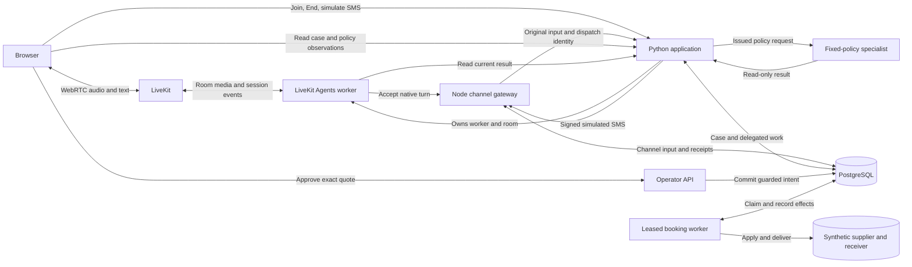
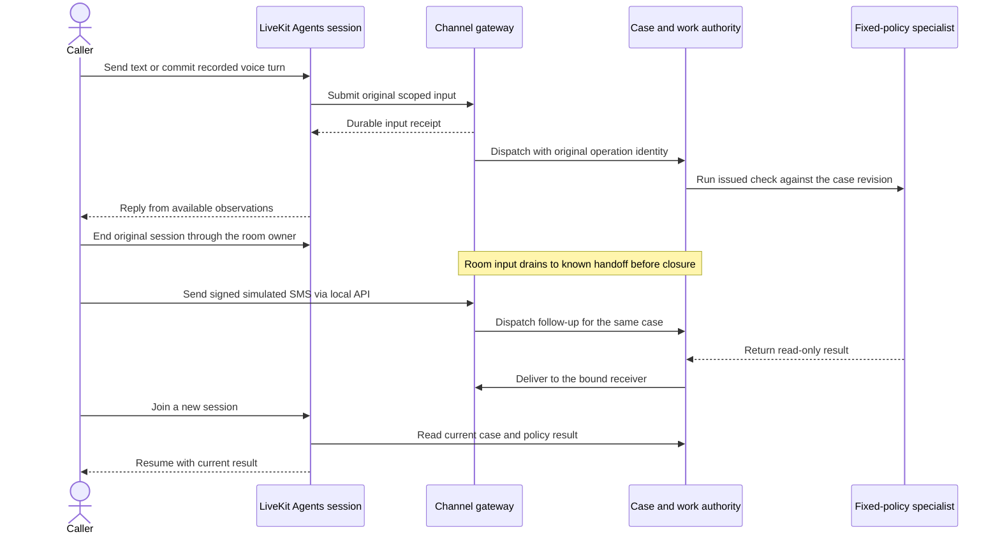
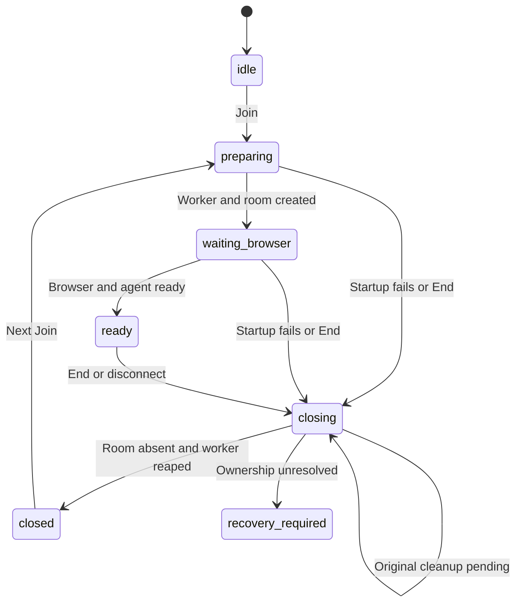

# Architecture

The application composes three continuity libraries around one LiveKit
deployment and one PostgreSQL service. The agent session handles the current
interaction. Persistent services own the case, input receipts, and policy work.

## Components and authority

| Data or process | Authority |
| --- | --- |
| Live session | LiveKit carries media and text. The Python room owner binds each activation to one room and worker. [Room owner](../services/channel_policy_demo/native_room.py) |
| Case and delegated work | The Agent Continuity library owns case revisions, accepted work, issued attempts, stored results, and result delivery intent. It also owns exact confirmation in the separate operator workflow. [Agent Continuity](../projects/agent-continuity/python/) |
| Channel inputs and receipts | The Channel Continuity library owns scoped native and simulated SMS input, dispatch state, and receiver receipts. [Channel Continuity](../projects/channel-continuity/) |
| Policy evaluation | The specialist evaluates fixed rules against the issued request and returns a read-only answer. The orchestration layer retains the work and result. [Delegation Reliability](../projects/delegation-reliability/) |

PostgreSQL separates booking, delegated work, and channel state into three
schemas installed by baseline `0001_initial`. A one-shot owner initializes the
schemas. Serving processes use a restricted role and validate the baseline.
The synthetic supplier and receiver keep independent receipts outside PostgreSQL.

| Schema | Durable records |
| --- | --- |
| Booking | Case and revision, investigation, exact confirmation, leases, effect intent and completion |
| Delegated work | Original work identity, issued attempt, result, result feed and receiver binding |
| Channel | Scoped input, dispatch, room binding and result delivery receipt |

Each accepted channel input has a stable, scoped identity and immutable payload.
Replaying the same payload can return its original receipt. A changed payload
with the same identity conflicts. Dispatch binds a work item to that original
input and its case revision. Room identifiers can change while the case and
work identifiers remain stable.

## End, continue, and rejoin

An input receipt proves that the input was accepted. A dispatch observation
reports its handoff to the work authority. A result read reports applicability
at the time of the read. The three can arrive at different times. Known results
remain available after the original media session ends.

## Room lifecycle

Closure fences native input, drains accepted handoffs, retires the room grant,
and reaps the owning worker. A closing or unresolved room blocks another Join.
Delegated work has an independent lifetime. Keep a missing acknowledgement
uncertain and reconcile it with the original operation identity.

In the operator flow, the browser explicitly confirms the current quote before
the authority commits booking intent. The fake supplier call runs outside that
transaction. Supplier outcome and receiver delivery remain separate from the
confirmation record.

## Source map

| Path | Responsibility |
| --- | --- |
| [Browser](../apps/local-console/) | LiveKit web client and the showcase and operator views |
| [Python application](../services/channel_policy_demo/) | Room ownership, origin-bound dispatch and background execution |
| [Node gateway](../services/channel-policy-gateway/) | Native and SMS intake and fixed-policy service entry point |
| [Local setup](../local-setup/) | Compose configuration, isolated initialization and lifecycle helpers |
