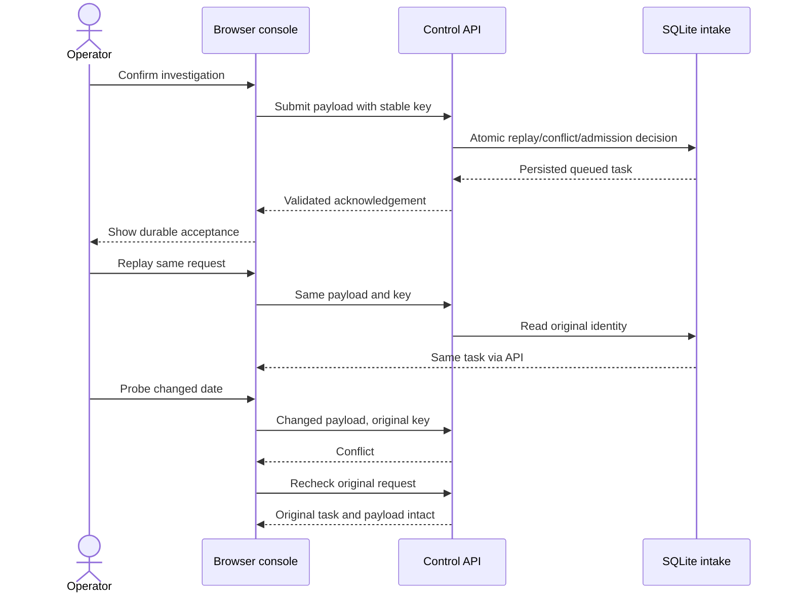

# Capability demonstrations and showcase UX

| Field | Value |
| --- | --- |
| Status | Active |
| Purpose | Plan how each capability is demonstrated and what evidence must back every visible UI transition |
| Audience | People who prepare, present or review a demonstration; coding agents changing showcase UX |
| Scope | The runnable console, P1, P2 and P3 demonstrations, and the integrated walkthrough and recording; scope and signals are owned elsewhere |
| Owns | Capability demonstrations and honest observable UI transitions |
| Related | [Build plan](build-plan.md) · [Observability](observability.md) · [Conversation guide](conversation-and-showcase.md) · [Provider operations](provider-demo.md) · [P1 charter](projects/agent-continuity-scope.md) |

## Overview

This document plans how the capabilities of the local proof of concept (POC)
are demonstrated, and what must back every visible UI transition. It is for
anyone who prepares, presents or reviews a demonstration. It covers the console
that runs today, each project's implemented and planned demonstrations, and the
integrated walkthrough and recording.

A complete two-minute demo video, recorded in `provider_real` mode, is at
[docs/media/ecosystem-demo.mp4](media/ecosystem-demo.mp4). See
[Recorded ecosystem demo video](#recorded-ecosystem-demo-video).

The three project charters ([P1](projects/agent-continuity-scope.md),
[P2](projects/channel-continuity-scope.md) and
[P3](projects/delegation-reliability-scope.md)) and the
[build plan](build-plan.md) own scope. The
[observability contract](observability.md) owns logs, metrics and traces.

Terms used throughout:

| Term | Meaning |
| --- | --- |
| M1 | The original confirmed-investigation intake, stored in SQLite |
| V1 | The fixed version 1 project scope |
| SDK | A software development kit, usually the LiveKit Agents SDK |
| ACK | An acknowledgement |

Contents:

| Section | Covers |
| --- | --- |
| [Demonstration inventory](#demonstration-inventory) | Every demonstration with its evidence and status, and the demonstration commands |
| [Demonstration rules](#demonstration-rules) | What must back every visible state |
| [Current runnable console](#current-runnable-console) | The console that runs today and its M1 intake proof |
| [P1 Agent Continuity Lab demonstrations](#p1-agent-continuity-lab-demonstrations) | Charter, Phase G, local_real and provider_real demonstrations |
| [P2 Channel Continuity Kit demonstrations](#p2-channel-continuity-kit-demonstrations) | The planned charter demonstration and implemented backend and browser proofs |
| [P3 Delegation Reliability Kit demonstrations](#p3-delegation-reliability-kit-demonstrations) | The planned charter demonstration and implemented backend and installed proofs |
| [Integrated presentation and recording](#integrated-presentation-and-recording) | Walkthrough, recorded video, remaining work and final recording rules |

## Demonstration inventory

Status uses the implementation vocabulary in the
[documentation standards](documentation-standards.md#implementation-status-vocabulary).
Qualified means the demonstrated capability passed its named selected gate; the
linked section states what the demonstration still does not prove.

| Demonstration | What it shows | Evidence | Status |
| --- | --- | --- | --- |
| [Diagnostic session and M1 intake](#diagnostic-session-and-m1-intake-steps) | Session setup, realtime text, optional microphone, investigation acceptance, replay and changed-payload conflict | Validated API acknowledgement, replay and 409 conflict; correlated `audio.frames` | Implemented |
| [P1 charter demonstration](#p1-charter-demonstration) | Accepted work outlives the conversation and survives an ambiguous effect boundary without repeating a booking change | P1-04 and P1-05, then P1-06 to P1-09, P1-15, P1-16, P1-19 and P1-20 | Qualified (P1 V1, local POC) |
| [Phase G operator showcase](#phase-g-operator-showcase) | Durable state, native scripted speech and exact UI approval through interruption, end and reconnect | [Phase G work item](work-items/0013-p1-phase-g-conversation-and-showcase.md) validation artifact | Qualified (scripted Phase G gate) |
| [Local real-inference demonstration](#local-real-inference-demonstration) | Prepared Whisper, Qwen and Piper instead of canned transcript or reply mappings | [Operations guide](local-real-inference.md); engine, model and browser qualification pending | Not qualified |
| [Provider-real profile](#provider-real-profile) | The fixed Deepgram, OpenAI and ElevenLabs pipeline | Selected provider_real v2 gate: both actual browser cases with cleanup | Qualified |
| [P2 charter demonstration](#p2-charter-demonstration-planned) | Voice, browser chat and fake SMS around one current case with honest delivery observations | P2-03 to P2-11 and P2-14 to P2-16 | Planned |
| [Committed intake and dispatch proofs](#committed-intake-and-dispatch-proofs) | Committed fake-carrier acceptance, original-receipt replay, bounded claims and lookup-only reconciliation | `make p2-demo` and `make p2-dispatch-check`; [acceptance handoff](work-items/0028-p2-dispatch-and-p3-coordinator.md) | Qualified (selected 0028 scope) |
| [Gateway restart proof](#gateway-restart-proof) | A retained signed receipt survives termination before dispatch and dispatches after restart | Actual HTTP and database observations; [0029](work-items/0029-p2-gateway-and-p3-issued-execution.md) | Qualified (selected 0029 gates) |
| [Worker death recovery](#worker-death-recovery) | A killed scripted agent's expired claim is reprocessed with one logical acceptance | Attempt history and cooperating operation receipt; [0030](work-items/0030-p2-agent-recovery-and-p3-completion.md) | Qualified (selected 0030 gates) |
| [Revision routing](#revision-routing) | Conflicting signed dates yield one revised case and one stale conflict; a lost ACK stays unknown | `make p2-routing-check`; [0031](work-items/0031-revision-routing-and-delegation-acceptance.md) | Qualified (selected 0031 gates) |
| [Linked exact confirmation](#linked-exact-confirmation) | Stale A asks for clarification, current B gets an exact intent receipt and a dropped ACK stays unknown | Backend slice of [0032](work-items/0032-linked-confirmation-and-result-projections.md) | Qualified (selected backend slice) |
| [Outbound replies and route reservation](#outbound-replies-and-route-reservation) | Queued reply, guarded route reservation and fake-provider acceptance as separate transitions | [0033](work-items/0033-outbound-replies-and-completion-processing.md) | Qualified (selected backend slice) |
| [Callback evidence](#callback-evidence) | Callbacks before the send response and after route reassignment; callback-first veto | [0034](work-items/0034-callback-evidence-and-applicability-refresh.md) | Qualified (selected backend rehearsal) |
| [Send uncertainty and explicit recovery](#send-uncertainty-and-explicit-recovery) | A lost send response stays unknown; a trusted retry reuses the frozen key; replay makes zero I/O | [0035](work-items/0035-send-policy-and-action-races.md) | Qualified (selected backend rehearsal) |
| [Opt-in native input](#opt-in-native-input) | Text and WAV voice through one durable input boundary, then generation and separate playback | [0036](work-items/0036-native-input-and-deadline-cancellation.md): six native groups and installed artifacts | Qualified (selected) |
| [Case continuity across rooms and SMS](#case-continuity-across-rooms-and-sms) | Room A, a signed SMS with no owned room, then fresh room B on the same verified case | [0038](work-items/0038-case-rehydration-and-standalone-release.md): eighteen storage assertions and three media groups | Qualified (selected) |
| [Bounded workload](#bounded-workload) | Overload before acceptance, retained receipts, useful second-scope work, stop and reopen | [0039](work-items/0039-bounded-channel-workloads-and-image-evidence.md) | Qualified (selected local) |
| [Read-only operations page](#read-only-operations-page) | Bounded paging, current and unavailable refresh, and Forget on the optional page | [0040](work-items/0040-operations-ui-and-fixed-policy-evidence.md) | Qualified (selected local) |
| [Installed starter journey](#installed-starter-journey) | Role-separated setup and routing, original history, fake carrier and recovery | [0041](work-items/0041-standalone-channel-and-durable-policy.md): twenty standalone assertions and a six-case public-P1 lane | Qualified (selected 0041 checkpoint) |
| [P3 charter demonstration](#p3-charter-demonstration-planned) | Responsive conversation while bounded specialists work; obsolete results cannot become actions | P3-02, P3-05, P3-06, P3-08, P3-10, P3-12, P3-13, P3-15, P3-16 and P3-17 | Planned |
| [Coordinator acceptance and cancellation](#coordinator-acceptance-and-cancellation) | P1-backed acceptance, replay, requested cancellation and fresh-process lookup after a kill | `make p3-coordinator-check`; [acceptance handoff](work-items/0028-p2-dispatch-and-p3-coordinator.md) | Qualified (selected 0028 scope) |
| [Issued runner and read-only applicability](#issued-runner-and-read-only-applicability) | A newly issued grant, validated policy bytes, durable result disposition and read-only applicability | [0029](work-items/0029-p2-gateway-and-p3-issued-execution.md) | Qualified (selected 0029 gates) |
| [First useful result](#first-useful-result) | Strict result bytes, a receiver-bound plan, a guarded intent and one fake supplier change | [0030](work-items/0030-p2-agent-recovery-and-p3-completion.md) | Qualified (selected 0030 gates) |
| [Registered lab cases](#registered-lab-cases) | One accepted work identity, changed-content conflict and useful policy output | P3-01, P3-03 and P3-11: 13, 8 and 12 assertions | Qualified (registered lab rows) |
| [Resumable as-of projection](#resumable-as-of-projection) | Stable cursor, historical result and immutable as-of row across reopen and replay | [0032](work-items/0032-linked-confirmation-and-result-projections.md) | Qualified (selected backend slice) |
| [Completion processing acknowledgements](#completion-processing-acknowledgements) | Unknown event A keeps no terminal ACK while later event B is accepted | [0033](work-items/0033-outbound-replies-and-completion-processing.md) | Qualified (selected backend slice) |
| [Refreshed applicability](#refreshed-applicability) | Work A becomes historical; B's refresh and a separately confirmed action | [0034](work-items/0034-callback-evidence-and-applicability-refresh.md) | Qualified (selected backend rehearsal) |
| [Protected action races](#protected-action-races) | Revision-first and intent-first races, and cancellation before and after reservation | [0035](work-items/0035-send-policy-and-action-races.md) | Qualified (selected backend protocol) |
| [Deadline and cancellation](#deadline-and-cancellation) | A late strict result retained but ineligible; separate cancel ACK facts | [0036](work-items/0036-native-input-and-deadline-cancellation.md): eighteen source, eighteen installed and forty-six compatibility assertions | Qualified (selected) |
| [Installed completion story](#installed-completion-story) | Specialist output, exact operator confirmation and one fake supplier change; replay after a kill | [0038](work-items/0038-case-rehydration-and-standalone-release.md): sixteen P3 package assertions | Qualified (selected) |
| [Document image extraction](#document-image-extraction) | Synthetic PNG fields and regions; a structural pass that fails the independent literal oracle | [0039](work-items/0039-bounded-channel-workloads-and-image-evidence.md) | Qualified (selected local) |
| [Grounded fixed-policy evaluation](#grounded-fixed-policy-evaluation) | A v2 request over scoped policy and fact records; the `notice_v1` seven-day rule | [0040](work-items/0040-operations-ui-and-fixed-policy-evidence.md) and [0041](work-items/0041-standalone-channel-and-durable-policy.md) | Qualified (selected local) |
| [Integrated walkthrough](#walkthrough-and-artifacts) | Setup, one normal path, one failure and recovery path, and evidence inspection | Applicable local and live gates before a public claim | Planned |
| [Recorded ecosystem demo video](#recorded-ecosystem-demo-video) | Landing page, joined showcase and one P1 business case in `provider_real` mode | [0047](work-items/0047-open-findings-schema-upgrades-and-landing.md): one 2 minute 8 second take with three open findings | Partial (final recording remains gated) |

### Demonstration commands

Run these make targets from the repository root. Each linked section states the
setup a target needs and what its output does and does not show.

| Task | Command | Notes |
| --- | --- | --- |
| Show committed fake-carrier acceptance and original-receipt replay | `make p2-demo` | Needs the documented frozen setup; pending/not_executed preview only |
| Exercise the explicit v2 upgrade, bounded claims and lookup-only reconciliation | `make p2-dispatch-check` | Against a cooperating operation fixture; see [Committed intake and dispatch proofs](#committed-intake-and-dispatch-proofs) |
| Show signed revision routing with conflicting dates | `make p2-routing-check` | See [Revision routing](#revision-routing) |
| Show P1-backed acceptance, replay, requested cancellation and fresh-process lookup | `make p3-coordinator-check` | Includes a separate Python-to-TypeScript probe; see [Coordinator acceptance and cancellation](#coordinator-acceptance-and-cancellation) |
| Record the ecosystem demo video | `make ecosystem-demo-record` | Capture command recorded in the [0047 work item](work-items/0047-open-findings-schema-upgrades-and-landing.md) |

## Demonstration rules

### Evidence behind every visible state

Show one synthetic travel-support case through three independently usable
libraries. Every visible state must come from an observed command response, a
persisted domain event or an explicitly labelled missing observation.

- A timeline is a read model, never case authority.
- Simulated suppliers, models and carriers are labelled at the point of use.
- Planned paths remain visibly planned.
- No timed fake progress, decorative success animation or generated transcript
  may stand in for actual operation.

### One success path and one controlled failure

Keep one short success path and one controlled failure per project. Show the
starting state, the action, the transition, the recovery and the final
evidence.

## Current runnable console

### Visual language

The browser console uses the official LiveKit dark and cyan visual language,
local fonts and assets, compact session controls and a readable event history.
It remains an independent portfolio project, labelled Built with LiveKit.
Sources and license notices accompany the assets. References:
[brand reference](https://livekit.com/brand) and
[Agents UI reference](https://livekit.com/products/agents-ui).

### Diagnostic session and M1 intake steps

| Step | Actual working behavior | Evidence and boundary |
| --- | --- | --- |
| Session setup | Operator token, scoped local room, named diagnostic worker | Invalid credentials produce a safe visible error. Credentials remain in memory. |
| Realtime text | The browser sends `lk.chat` and displays the SDK agent's echo | Agent-kind sender validation, bounded UTF-8 and finite display history |
| Optional microphone | An explicit operator action publishes microphone audio | Correlated `audio.frames` from the expected local track. Browser permission is required. |
| Investigation acceptance | Confirm an investigation and submit it to the real API | Acknowledged SQLite task with a scoped stable identity. No booking mutation. |
| Replay | Resubmit exactly the accepted payload and key | Same task identity and `created=false` before the UI marks the replay verified |
| Changed-payload conflict | Send a different date under the original key | 409, then a second original replay verifies the unchanged task and payload |

### Agent presence and startup

Message and microphone controls remain disabled until an actual SDK agent
participant joins. Room connectivity alone cannot make the first message safe.
Cold worker process startup can take several seconds under the one-room local
memory budget. Connect during presentation preflight and keep the observed
waiting and joined states. Do not add fake thinking indicators or promise
instant startup.

### Motion and accessibility

Motion is brief and follows observed state changes. Reduced-motion preferences
remove animation and smooth scrolling. Pending, unknown, error and success
states have text labels, because color alone is insufficient. Inputs remain
labelled, keyboard focus stays visible, and native details controls reveal each
planned V1 proof.

### Default and opt-in views

The default diagnostic UI shows the M1 intake and transport. The separate opt-in
P1 business workspace shows current persisted case and work state, exact human
approval, and native scripted or explicitly selected provider voice under its
recorded qualification. The default product view remains the P1 workspace.

An isolated P2 native input page passed its selected actual native gate and
installed-artifact checks. Final selected phase gates and the affected media
rerun passed. Complete cross-channel product behavior remains future scope.

A reload clears transient UI history and credentials; server state remains
persistent. When investigating an unacknowledged operation, copy the displayed
request identity rather than inventing a new logical attempt.

### Intake proof sequence

The current M1 intake proof follows this sequence:

## P1 Agent Continuity Lab demonstrations

### P1 charter demonstration

**Question:** Can accepted work outlive the conversation and survive an
ambiguous effect boundary without silently repeating a booking change?

The first demo runs these steps:

1. Accept an investigation and close the session.
2. Run an independent worker and terminate it at the supplier-success,
   before-acknowledgement barrier.
3. Restart and reconcile the same inquiry.
4. Show both persisted stores and the stable effect identity. The booking stays
   unchanged.

The later mutation demo requires a separate exact quote and revision
confirmation before a fake booking change.

The UI should display intake, execution attempt, external evidence and outcome
as separate columns or events. An ambiguous noncooperating supplier remains
uncertain. The success path still progresses; rejecting every action cannot pass
the demo.

Primary evidence: P1-04 and P1-05, then P1-06, P1-07, P1-08, P1-09, P1-15,
P1-16, P1-19 and P1-20 as implemented.

### Phase G operator showcase

Use the [conversation flow](conversation-and-showcase.md) to demonstrate current
durable state, native scripted speech and exact UI approval:

1. Begin with the business workspace and keep transport diagnostics collapsed
   until needed.
2. Expose request, inquiry, approval, effect, outcome and delivery as separate
   observed states. Use short, reduced-motion-compatible visual transitions only
   after real state changes.
3. Show voice interruption, end and reconnect while the same accepted work
   continues.
4. After the visible flow, inspect the independent provider and receiver and the
   filtered trace.

The validation artifact records the actual scripted and browser mode and the
remaining physical microphone and real-model qualification, without claiming a
complete release.

### Local real-inference demonstration

Keep the retained scripted demonstration reproducible. The separate
`local_real` implementation uses prepared Whisper, Qwen and Piper rather than
canned transcript or reply mappings. Its actual engine, model and browser
qualification remains pending. Use the [operations guide](local-real-inference.md)
for the explicit model fetch, private engine setup, resource headroom and
isolated gate. Present the configured profile, native readiness and measured
model and media success as distinct facts.

| UI transition | What the demonstration must establish | Evidence boundary |
| --- | --- | --- |
| Before Join | Generic local voice with no assumed inference profile | No client request selects a privileged alternate profile |
| Authenticated mint | The configured `scripted`, `local_real` or `provider_real` profile appears | Trusted expected configuration, not proof that a model ran |
| Selected native readiness | The matching mode, the exact ready attribute and active SDK state enable controls | Native-profile-matched badge. Real model quality still needs actual output. |
| Explicit WAV publication and manual turn | A prerecorded fixture reaches native WebRTC. Real mode produces automatic speech recognition (ASR), model and tool usage, and generated audio. | Advancing browser audio and safe usage and engine observations. No hardware capture or hearing claim. |
| Voice End with pending inquiries | Eight accepted inquiries remain persisted while the session ends | A separate owned worker later produces inspected results. This is one model session, not eight. |
| Fresh consumer and exact approval | The same original case rehydrates, and a person separately approves the exact quote and revision | Model speech never authorizes mutation. Independent supplier and receiver records establish outcome and delivery. |

Show actual failure and unknown states without timer-created progress. Retain
safe numeric, timing and resource reports, and screenshots with empty password
fields. Report a missing or failed model or media assertion as non-passing.
Neither the scripted nor the real P1 path qualifies P2 cross-channel delivery,
P3 specialist integration or production capacity.

### Provider-real profile

The trusted mode enum is `scripted` (the default), `local_real` or
`provider_real`. `provider_real` is a separately selected profile, never an
automatic fallback from a failed local engine. It uses
`livekit-plugins-deepgram`, `livekit-plugins-openai` and
`livekit-plugins-elevenlabs`, all pinned to 1.8.11 with Agents 1.8.11.

| Stage | Fixed pipeline |
| --- | --- |
| Speech recognition | Deepgram `nova-3` batch recognition on manual flush |
| Language model | OpenAI `gpt-5.4-mini` streaming Chat Completions, with reasoning effort `none` and at most 128 output tokens |
| Speech synthesis | ElevenLabs `eleven_v4_turbo` chunked HTTP pulse-code modulation (PCM) speech |

The [provider operations guide](provider-demo.md) owns the explicit setup,
check, start and stop procedures and the trusted provider P1-20 selector. Three
private keys reach only the native process; local model caches and engines are
unnecessary. The selected provider_real v2 gate passed both actual browser cases
with cleanup. P1 V1 is qualified for the local POC using provider_real v2.

External provider CPU and memory are unobserved. No zero-retention or
model-quality guarantee follows from local content-free telemetry. Default
offline and scripted checks make no provider calls.

## P2 Channel Continuity Kit demonstrations

The implemented P2 demonstrations are command-line interface (CLI) and API
proofs, backend rehearsals and browser demonstrations on the optional native
and operations pages. The normal Docker console does not yet present or animate
these backend paths; joined browser and media presentation has its own later
implementation and actual gates. Selected native, playback and rehydration media
passed their later scoped gates.

### P2 charter demonstration (planned)

**Question:** Can the user move across voice, browser chat and fake SMS while
the case remains current and delivery observations stay honest?

1. Start in voice and interrupt an explanation.
2. Switch to browser text or fake SMS.
3. Resume after room closure.

Highlight the stable case, a changed channel route and separately retained
generation, playback and acknowledgement evidence. Replay a carrier message and
deliver a delayed confirmation for an old revision. The current case progresses
while the duplicate or stale input cannot authorize action.

The UI should show channel lanes alongside one authoritative case snapshot.
Interrupted or unobserved playback is partial or unknown, never magically
delivered. No room or running agent is allocated merely because a dormant case
exists.

Primary evidence: P2-03, P2-04, P2-05, P2-06, P2-07, P2-08, P2-09, P2-10,
P2-11, P2-14, P2-15 and P2-16 as implemented.

### Committed intake and dispatch proofs

With the documented frozen setup, `make p2-demo` shows committed fake-carrier
acceptance and original-receipt replay, with a pending/not_executed preview
only. `make p2-dispatch-check` separately exercises the explicit v2 upgrade,
bounded claims, the immutable prepared investigation, uncertain acknowledgement
and lookup-only reconciliation against a cooperating operation fixture.

Show the original receipt, operation identity, actual attempt history and
uncertain or dispatched observations. These are CLI and API proofs, not browser
animations or authorized booking changes. The
[acceptance handoff](work-items/0028-p2-dispatch-and-p3-coordinator.md) retains
that historical scope.

### Gateway restart proof

The [gateway and issued-execution phase](work-items/0029-p2-gateway-and-p3-issued-execution.md)
adds an actual bounded P2 gateway restart proof:

1. Retain the original signed input receipt after acknowledgement.
2. Terminate before dispatch.
3. Restart against the same store.
4. Inspect useful dispatch under the original operation identity.

These transitions are inspected from actual HTTP and database observations:
accepted/pending, claimed, uncertain when external acceptance is possible, and
dispatched only after a matching cooperating receipt. A repeated model or agent
computation is not another logical business acceptance. The selected synthetic
adapters remain explicit.

### Worker death recovery

The [agent recovery and completion phase](work-items/0030-p2-agent-recovery-and-p3-completion.md)
adds the P2-I09 backend story; its selected gate determines task completion.

A live gateway retains accepted input. A scripted agent process is killed at a
controlled barrier, the persisted claim expires, and a fresh attempt reprocesses
the same input, case and operation context. Attempt history and the cooperating
operation receipt establish useful recovery and one logical acceptance.

Limit: the worker is a scripted owned POSIX worker. The story includes no
native voice, current-revision route or outbox proof.

### Revision routing

The [routing and acceptance phase](work-items/0031-revision-routing-and-delegation-acceptance.md)
adds another explicit backend presentation. `make p2-routing-check` shows signed
accepted structured inputs with conflicting dates and skewed occurrence
timestamps, two real blocked database paths, one revised case and one stale
conflict. A current subsequent input progresses.

Lose a successful revision ACK and show unknown beside an independent
current-case read; matching state does not name the original winner. Use one
standalone reference authority or the public P1 bridge, clearly labelled.
Retained account access does not recheck the sender's current association.

### Linked exact confirmation

The backend-only slice of the
[linked confirmation and result projection work item](work-items/0032-linked-confirmation-and-result-projections.md)
demonstrates original accepted linked consent with an immutable prompt:

- A stale linked confirmation (A) asks for clarification.
- A current one (B) produces an exact intent receipt.
- A dropped ACK remains unknown.
- An explicit original-command replay returns the same receipt before one
  independent fake effect is inspected.

The current sender association is rechecked before a new call; this is not an
atomic revocation fence. Do not show a bare YES or an agent statement as
authorization. New UI and native transitions remain planned until composed and
exercised. The phase work item tracks selected complete qualification.

### Outbound replies and route reservation

The qualified selected backend slice of the
[outbound replies and completion processing phase](work-items/0033-outbound-replies-and-completion-processing.md)
can show a queued logical reply, a guarded route reservation and an actual
fake-provider acceptance as separate transitions.

- A revoked or suppressed route that wins before reservation prevents a new
  call. Later revocation cannot retract an already possible call.
- Unknown stays visibly unknown with its original route.
- A newly verified route for the same recipient may permit eligible future work,
  but never transfers it to another account.
- A provider acceptance observation remains distinct from physical delivery or
  human hearing.

These are locally qualified backend proofs; new UI and native transitions need
their own composition and actual media evidence. The phase handoff records the
passing selected qualification and exact evidence.

### Callback evidence

The [completed callback evidence and applicability refresh phase](work-items/0034-callback-evidence-and-applicability-refresh.md)
completed selected local phase gates for P2-I13 and P3-I11.

Rehearse a callback arriving before the send response, and again after route
reassignment. Show its original attempt and recipient, the retained semantic
event receipt, compatible stronger reports and visible contradictions. An
unknown send response stays distinct from provider-reported delivery; neither
means human acknowledgement or consent. Show a callback-first veto versus an
already admitted frozen call, without claiming external cancellation.

These are backend rehearsals, not an implemented UI, native-media or release
claim. No timer or animation may manufacture progress.

### Send uncertainty and explicit recovery

The [completed selected send-policy and action-race phase](work-items/0035-send-policy-and-action-races.md)
supplies this synthetic backend rehearsal evidence:

- Show an ordinary provider-observed send with a lost response. It stays unknown
  after a restart or route change, and an explicit retry makes zero calls.
- Separately show a cooperating provider operation with a new trusted retry
  command, a new local attempt and the same frozen provider key and payload. Two
  requests may yield one provider acceptance.
- Show exact original command replay with zero I/O, lookup without resend
  authority, and a callback veto, without claiming physical SMS or human
  acknowledgement.

These are backend protocols, not new UI or native transitions. Animate only
observed states when future interface integration is actually tested.

### Opt-in native input

The [completed native input and deadline handoff](work-items/0036-native-input-and-deadline-cancellation.md)
owns qualification, and selected qualification passed. The optional
`p2-native.html` build is separate from the default M1 and P1 console and
Compose profile. Its host `AgentSession` and channel gateway use the existing
local Docker selective forwarding unit (SFU) and PostgreSQL, with scripted
speech-to-text (STT), large language model (LLM) and text-to-speech (TTS). It
reads no provider-key file and uses an explicitly labelled audio fixture.

Recorded qualification:

| Check | Recorded result |
| --- | --- |
| Selected native run | Passed browser text, WAV committed voice, returned text and audio, v6 restore and complete cleanup across six groups |
| Installed Python package | Passed fifty-five local SDK and HTTP tests |
| Installed npm package | Separately passed actual PostgreSQL and HTTP first and replay runs with synthetic case and operation ports |
| Final selected phase gates | Passed |
| UI-hint media rerun | Passed |

- The six native groups and selected installed artifact checks passed at that
  checkpoint. Preserve their actual reports. SDK and storage groups cannot be
  counted as additional browser tests.
- The subsequent P2-I17/P3-I14 handoff preserves this selected evidence, and the
  completed P2-I18/P3-I15 work item records current rehydration and standalone
  qualification.
- P2-I17 separately qualified interruption and missing playback, while the
  completed P2-I18 separately qualifies selected verified current-case
  continuation.
- Physical microphone, general ASR and live-model quality retain separate
  evidence requirements.

After actual qualification, show these observed transitions:

1. Transport submission.
2. A durable accepted, replayed or unknown receipt.
3. An explicit native generation attempt and SDK completion.
4. Separate browser playback.

Retry the original input unchanged; never infer the original rejection from a
later denied retry. Text and a genuine final voice turn use one input and
operation boundary. A repeated commit or SDK-promoted interim text cannot create
another accepted input or automatic reply. Generation messages contain six bound
fields and no transcript or credential; they never imply consent.

### Case continuity across rooms and SMS

Use the [completed case rehydration and standalone release handoff](work-items/0038-case-rehydration-and-standalone-release.md)
for qualified scope: eighteen storage assertions, three actual media groups in
one Playwright case, isolated Python and npm consumers and sixteen maintained P3
package assertions passed. These selected observations do not qualify physical
hearing or the full charter.

On the optional native page:

1. Show the first room session's (A) real fixture voice and chat receipts, then
   end the room.
2. Deliver the configured signed local SMS while neither owned case room exists.
3. Start the later session (B) with a fresh room, participant and binding
   identity. It loads the same verified case, current revision and original
   accepted history before input becomes ready.

Earlier response states identify their original room and have no B playback or
interruption controls. Only a genuinely new B input proves continued reply
generation. A refresh failure retains labelled prior facts and disables current
input until a new verified read. Transitions follow actual observations.

Keep this already qualified current-case story separate from the later
P2-I19/P3-I16 and P2-I20/P3-I17 scope. Loading or refreshing context itself
still performs zero generation or business work. These are synthetic local POC
demonstrations, with real provider and model and broader load work separately
gated.

### Bounded workload

Use the [completed bounded workload and image evidence handoff](work-items/0039-bounded-channel-workloads-and-image-evidence.md)
for completed selected qualification. Selected P2-I19 and P3-I16 demonstrations
passed local qualification; full release remains separate.

1. Show explicit overload before acceptance.
2. Show inspectable original receipts at retained capacity.
3. Show useful second-scope work while a dependency is held.
4. Then show an actual stop, a fresh reopen and a dormant-case wakeup.

Display observed resource samples with the seed and fixed ceilings. Do not infer
production capacity, fairness or permanently allocated rooms or agents from
persisted case counts.

### Read-only operations page

Use the [operations and fixed-policy handoff](work-items/0040-operations-ui-and-fixed-policy-evidence.md)
and the separate optional P2 operations page. Selected P2-I20 and P3-I17
demonstrations passed local qualification; full release remains separate.

The maintained gate seeds synthetic accepted input. Explicit producer children
then cause real pending, running, uncertain and known observations. The page
only reads: it never advances the workflow, resends a message or grants
confirmation. Show the ordinary carrier send remaining unknown beside its
independently signed delivered callback. Keep native generated, SDK and playback
facts separate, with absent playback shown as unknown.

1. Connect with a locally held read capability. The password input clears
   immediately.
2. Show bounded section paging, an explicit current refresh, a real unavailable
   refresh with labelled prior facts, and useful recovery.
3. While an actual case read is held, use Forget. It clears the presentation and
   fences later data.

This demonstrates retained backend work and no repopulation. Ignored-cancellation
unit tests separately prove that a late positive JavaScript result cannot cross
the UI epoch. Respect reduced motion, keyboard position and live-region
announcements. This page introduces no real-time communication (RTC), audio or
physical microphone qualification; the existing media gates remain separate.
Bind the read port, cursor key and operator token only in the host example. Do
not put credentials in URLs, screenshots or retained browser output.

### Installed starter journey

Through the selected [0041](work-items/0041-standalone-channel-and-durable-policy.md)
checkpoint, P2's installed starter journey has twenty standalone assertions and
a separate six-case public-P1 adapter lane. Complete P2 qualification remains
pending. The CLI uses explicit role-separated setup and routing while the
gateway is quiescent, followed by original-history, fake-carrier and recovery
evidence. It does not add a second authority or make the read-only operations
page a controller.

## P3 Delegation Reliability Kit demonstrations

The implemented P3 demonstrations are CLI proofs, backend rehearsals and
installed-artifact gates. These backend proofs introduce no automatic UI
animation. The normal Docker console does not yet present or animate these
backend paths; joined browser and media presentation has its own later
implementation and actual gates. Selected standalone image extraction passed its
later scoped gate.

### P3 charter demonstration (planned)

**Question:** Can conversation stay responsive while bounded specialists work,
and can obsolete results be prevented from becoming actions?

1. Begin with native tools or subagents, then demonstrate the reason for a
   remote capability boundary.
2. Hold a read-only screenshot or policy specialist on a controlled barrier,
   revise the case, and release its stale result.
3. Show its execution outcome separately from the applicability rejection. A
   current result must still progress.
4. Terminate a specialist or coordinator and recover through P1-owned execution
   attempts.

The UI should show the immutable request revision, bounded specialist status,
result evidence and the authority decision. Cancellation is a request and an
observation, not an unconditional remote stop. Compare tools, native subagents
and remote capability calls under the same measured workload.

Primary evidence: P3-02, P3-05, P3-06, P3-08, P3-10, P3-12, P3-13, P3-15,
P3-16 and P3-17.

### Coordinator acceptance and cancellation

`make p3-coordinator-check` shows immutable P1-backed acceptance, original-key
replay, requested cancellation and a fresh-process lookup after an observed
postcommit kill. Its separate Python-to-TypeScript probe shows held status and
cancel and a grounded scripted policy candidate. The gate labels its synthetic
case preflight and the lack of a P1-issued attempt. Neither probe is coordinator
execution, result delivery or action authority. The
[acceptance handoff](work-items/0028-p2-dispatch-and-p3-coordinator.md) retains
that historical scope.

### Issued runner and read-only applicability

P3-I07A's explicit runner, from the
[gateway and issued-execution phase](work-items/0029-p2-gateway-and-p3-issued-execution.md),
demonstrates accepted work, a newly P1-issued grant, deterministic wire attempt
correlation, validated policy bytes, durable result disposition and read-only
applicability. A delayed result can be outdated, expired or execution-ineligible
while its original result remains inspectable. Case fixtures in that checkpoint
are synthetic. A candidate or current read grants no action permission.

### First useful result

The [agent recovery and completion phase](work-items/0030-p2-agent-recovery-and-p3-completion.md)
adds the P3-I07B backend story; its selected gate determines task completion.

P1 issues a real HTTP attempt and retains strict result bytes. An immutable
receiver-bound plan precedes byte acceptance, and a stable receipt lookup
reconciles a lost acknowledgement. A delayed old revision remains historical.
An independently confirmed current revision B commits a guarded intent, and the
existing leased worker performs one actual fake supplier change.

Limit: the policy and supplier are synthetic and the receiver is an independent
local receiver. The receipt is neither playback nor human acknowledgement, and
no specialist can confirm a quote.

Show delivery missing, prepared, unknown and accepted separately from result
applicability and committed action. Existing possible sends use receiver lookup
only; absence remains unknown for a paused prior caller. P1 validates current
work, result, cancellation, deadline and exact case authority in one
transaction; supplier and receiver calls remain outside it. Preserve original
known receipts after later cancellation or expiry.

Broader process, race and event-recovery schedules, route resumption and full
P2 and P3 release remain pending. Later sections record selected results for
some of these areas. Three selected P3 lab rows are registered separately; see
[Registered lab cases](#registered-lab-cases).

### Registered lab cases

The registered P3-01, P3-03 and P3-11 lab cases pass 13, 8 and 12 complete
assertions respectively. Show concurrent identical requests keeping one accepted
work identity, changed content conflicting, useful issued policy output and
safe, complete rejection explanations. The public completion example receives
exact confirmation separately and snapshots it before awaiting. Receiver
acceptance is still not human acknowledgement.

### Resumable as-of projection

From the
[linked confirmation and result projection work item](work-items/0032-linked-confirmation-and-result-projections.md),
show the stable source cursor, the exact historical issued result and the
immutable as-of applicability row. Then reopen the projector and replay the same
checkpoint. A later case or work change does not silently rewrite an earlier
observation.

These metadata transitions are not delivery, human acknowledgement or permission
to mutate. New UI and native transitions remain planned until composed and
exercised. The phase work item tracks selected complete qualification.

### Completion processing acknowledgements

From the
[outbound replies and completion processing phase](work-items/0033-outbound-replies-and-completion-processing.md),
show:

- Unknown event A with no terminal ACK.
- Later eligible event B accepted by its exact receiver.
- Discovery moving ahead while the terminal watermark stays held at the gap.

A restart replays the original receipt and ACK identities. Metadata does not
generate consent, a current-result badge or a physical delivery claim. These are
locally qualified backend proofs; new UI and native transitions need their own
composition and actual media evidence. The phase handoff records the passing
selected qualification and exact evidence.

### Refreshed applicability

From the
[callback evidence and applicability refresh phase](work-items/0034-callback-evidence-and-applicability-refresh.md),
which completed selected local phase gates for P2-I13 and P3-I11:

- Show the original work A becoming historical after the case changes to B,
  valid work B's new as-of refresh, and a separately confirmed guarded action.
- Show raw unavailable or stale observations beside retained invalidation
  evidence.
- Replay the original refresh command after later changes, then hide the display
  and replay it again. The same truth, ACK and receipt survive, and an unresolved
  hidden event remains processable.

These are backend rehearsals, not an implemented UI, native-media or release
claim. No timer or animation may manufacture progress.

### Protected action races

From the
[completed selected send-policy and action-race phase](work-items/0035-send-policy-and-action-races.md),
using two competing requests, A and B:

1. Pause A after facade validation and let B win the real revision lock. Show
   A's protected rejection and B's separately confirmed useful effect.
2. Reverse the order: A commits, B's revision is rejected, and revision cannot
   undo A's original intent.
3. Rehearse cancellation before dispatch versus requested best effort after
   reservation.
4. Show a fresh-process original lookup after supplier success.

Keep receiver acceptance, supplier effect, cancellation and human acknowledgement
separate. These are backend protocols, not new UI or native transitions. Animate
only observed states when future interface integration is actually tested.

### Deadline and cancellation

P3's selected deadline and cancellation demonstration, owned by the
[native input and deadline handoff](work-items/0036-native-input-and-deadline-cancellation.md),
is qualified through eighteen source and eighteen isolated installed assertions,
with forty-six compatibility assertions.

- Show a late strict result retained but ineligible.
- Show separate running and unknown cancel ACK facts.
- Show owned I/O after waiter abandonment.
- Then show separately confirmed progress for the current revision B.

The peer deliberately ignores cancellation only as a bounded test fault; the
production `SpecialistServer` remains cooperative. P3-I14 owns broader process
recovery.

### Installed completion story

From the
[case rehydration and standalone release handoff](work-items/0038-case-rehydration-and-standalone-release.md),
whose qualified scope includes sixteen maintained P3 package assertions, the
explicit local installed gate shows useful specialist output, a separate exact
operator confirmation and one fake supplier change. Kill only the owned consumer
after known completion, then replay the original identities in a fresh process
with no new invocation or effect.

Show projection, ACK, refresh and display as metadata; none grants human
acknowledgement or mutation authority. These are synthetic local POC
demonstrations, with real provider and model and broader load work separately
gated.

### Document image extraction

Use the [completed bounded workload and image evidence handoff](work-items/0039-bounded-channel-workloads-and-image-evidence.md)
for completed selected qualification. Selected P2-I19 and P3-I16 demonstrations
passed local qualification; full release remains separate.

- Show the actual synthetic PNG beside four validated fields and exact scoped
  regions.
- Missing or conflicting dates require clarification. Screenshot instructions
  remain data.
- Show a schema-valid wrong value and a swapped valid region passing the
  structural layer, then failing the independent literal oracle.
- Demonstrate invalid image and expiry rejection before provider entry, useful
  admitted progress and retained work through cancel and close.

The scripted provider is a fixture mapping, not optical character recognition
(OCR). Use the configured examples and the separate installed gate. No P1 image
execution, action or consent, or real vision or model claim follows. A passing
plan, healthy service or displayed JSON is not qualification.

### Grounded fixed-policy evaluation

Use the [operations and fixed-policy handoff](work-items/0040-operations-ui-and-fixed-policy-evidence.md).
Selected P2-I20 and P3-I17 demonstrations passed local qualification; full
release remains separate.

- Show an explicit v2 request citing separate scoped immutable policy and fact
  JSON records.
- The fixed `notice_v1` rule uses seven days: seven is eligible, six is
  ineligible, no fact asks for clarification, and contradictory facts ask for
  clarification without inventing a value.
- Display a structurally valid wrong conclusion, rule or fact, followed by the
  independent factual verifier rejecting it.
- Instruction-like policy, fact and PNG text remains inert.
- Hold actual work through expiry, cancel and close, and show retained
  ownership and later useful admitted progress.

The same public consumers run from fresh isolated Python and npm artifacts. The
rule is deterministic; there is no model-accuracy or OCR claim.

At 0040, v2 was a standalone HTTP capability and the durable coordinator was
v1-only. The selected P3-I18A prerequisite in
[0041](work-items/0041-standalone-channel-and-durable-policy.md) now has explicit
v2 durable coordinator and runner consumption over opaque public P1 work
records. Twelve source and twelve installed assertions, a separate set of eight
offline assertions and four HTTP regressions passed. The v1 defaults and the
v1-only delivery, projection and action adapters remain unchanged. No native
background conversation or new UI follows from that durable prerequisite.

## Integrated presentation and recording

### Walkthrough and artifacts

Use a five-to-eight-minute walkthrough:

1. Working setup.
2. One normal path.
3. One failure and recovery path.
4. A short evidence inspection.

Follow it with each library's isolated installed-consumer example. The package
API must be understandable without the showcase application.

Record the actual configuration, machine and workload, seed, scenario IDs,
timings and correctness outcomes. Use the
[observability contract](observability.md) for logs, metrics and traces. Raw
logs are a secondary inspection view. The main interface explains what happened,
what is still unknown and what action is possible next.

Before a public portfolio claim, run the applicable local and live gates.
Preserve successful and failed evidence, and accurately record AI assistance and
personal contributions. Planned screens or a polished UI do not complete the 54
product cases.

### Recorded ecosystem demo video

A complete two-minute demo video, recorded in `provider_real` mode, is at
[docs/media/ecosystem-demo.mp4](media/ecosystem-demo.mp4).

| Property | Value |
| --- | --- |
| Content | The local landing page, then the joined showcase, then one P1 business case in the operator console |
| Length | A single take of 2 minutes 8 seconds |
| Capture command | `make ecosystem-demo-record` |
| Record | The [0047 work item](work-items/0047-open-findings-schema-upgrades-and-landing.md) records the take, its timings and three open findings from the recording |

The remaining gates and the rules for the final recording follow.

### Remaining integrated work

The broader delivery goal continues through the selected 0041 checkpoint.

| Area | Remaining work | Current state |
| --- | --- | --- |
| P2 qualification | Coherent integrated and native revision-0 execution, fresh-agent and supported-platform review, full charter registrations and final demo recording | Gated; complete P2 qualification remains pending (see [Installed starter journey](#installed-starter-journey)) |
| P3 conversation and UI | Full responsive native and background conversation and the compact UI | Planned; the versioned durable policy prerequisite is qualified within its selected scope |
| Shared quality and M1 | Final retained results for shared quality and original M1 observations | Still needed before phase closure |
| P2 and P3 demonstrations | Full browser, modality and integrated demonstrations | Planned under their charters; current backend proofs are described above |
| Charter rows and release | All seventeen P2 and the remaining fourteen P3 complete rows, broader integrated media and full release | Pending |

For P3, use the existing native session and durable authority for the next
integration, then complete the remaining handoff, restart, media and release
requirements. All 146 selected P3 compatibility assertions passed with cleanup.

### Final recording rules

Before the final recording, review populated desktop and mobile screens and
actual pending, unknown, failure, recovery and returned-result states.

| Rule area | Rule |
| --- | --- |
| Layout | Keep the primary case and conversation timeline compact; move identifiers, full histories, metrics and spans behind labelled progressive disclosure |
| Narrative | Advanced diagnostic screens are not the main portfolio narrative |
| Content | Show voice and text, an explicitly labelled local SMS simulator, room-independent durable progress and a useful specialist result |
| Motion | No timer or animation may manufacture a business transition |
| Live providers | Qualify applicable live-provider paths through the existing explicit trusted runtime configuration |
| Credentials | Keep credentials out of source, URLs, browser storage, recorded pixels and artifacts |
| Qualification capture | Qualification traces, HTTP Archive (HAR) captures and video remain disabled |
| Final recording run | The requested final demo recording is a separate, bounded, credential-free run |
| Labels | Label recorded fixture audio, deterministic specialist rules, synthetic supplier changes and any injected failure accurately |
| Reproducibility | Retain reproducible launch, stop and capture commands with the resulting local video |
| Completion | Do not mark the overall goal complete from one selected phase or an edited video alone |
