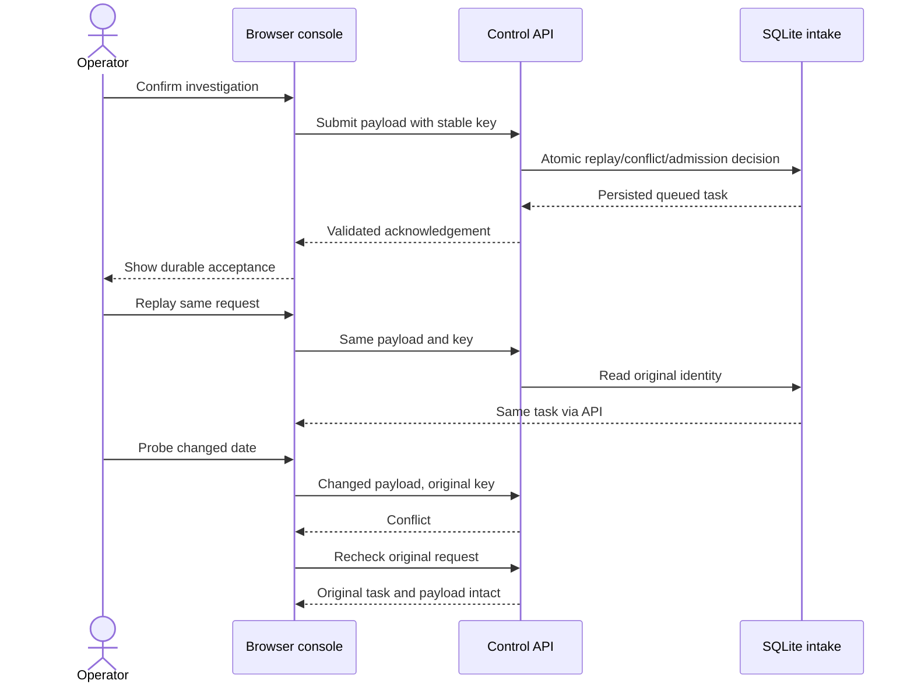

# Capability demonstrations and showcase UX

Status: Active
Last reviewed: 12 November 2026

## Demonstration contract

Show one synthetic travel-support case through three independently usable
libraries. Every visible state must come from an observed command response,
persisted domain event or explicitly labelled missing observation. A timeline is
a read model, never case authority. Simulated suppliers/models/carriers are labelled
at the point of use. Planned paths remain visibly planned.

Keep one short success path and one controlled failure per project. Show the
starting state, action, transition, recovery and final evidence. No timed fake
progress, decorative success animation or generated transcript may stand in for
actual operation. The three charters and [build plan](build-plan.md) own scope.

## Current runnable showcase

The browser console uses the official LiveKit dark/cyan visual language, local
fonts/assets, compact session controls and a readable event history. It remains
an independent portfolio project, labelled Built with LiveKit. Sources and license
notices accompany the assets. [Brand reference](https://livekit.com/brand),
[Agents UI reference](https://livekit.com/products/agents-ui).

| Step | Actual working behavior | Evidence and boundary |
| --- | --- | --- |
| Session setup | Operator token, scoped local room, named diagnostic worker | Invalid credentials produce a safe visible error; credentials remain in memory |
| Realtime text | Browser sends lk.chat and displays the SDK agent's echo | Agent-kind sender validation, bounded UTF-8 and finite display history |
| Optional microphone | Explicit operator action publishes microphone audio | Correlated audio.frames from the expected local track; browser permission is required |
| Investigation acceptance | Confirm an investigation and submit to the real API | Acknowledged SQLite task with scoped stable identity; no booking mutation |
| Replay | Resubmit exactly the accepted payload/key | Same task identity and created=false before the UI marks replay verified |
| Changed-payload conflict | Send a different date under the original key | 409, then a second original replay verifies unchanged task/payload |

Messages and microphone controls remain disabled until an actual SDK agent
participant joins; room connectivity alone cannot make the first message safe.
Cold worker process startup can take several seconds under the one-room local
memory budget. Connect during presentation preflight and retain the observed
waiting/joined states; do not add fake thinking indicators or promise instant startup.

Motion is brief and follows observed state changes. Reduced-motion preferences
remove animation and smooth scrolling. Pending, unknown, error and success states
have text labels; color alone is insufficient. Inputs remain labelled, keyboard
focus visible and native details controls reveal each planned V1 proof.

The default diagnostic UI shows M1 intake and transport. The separate opt-in P1
business workspace shows current persisted case/work state, exact human approval
and native scripted or explicitly selected provider voice under its recorded
qualification. The default product view remains the P1 workspace. An isolated P2 native input
page passed its selected actual native gate and installed-artifact checks. Final
selected phase gates and the affected media rerun passed; complete cross-channel
product behavior remains future scope.
A reload clears transient UI history/credentials; server state remains persistent.
Copy the displayed request identity when investigating an unacknowledged operation
rather than inventing a new logical attempt.

### Current P2/P3 backend proofs

With the documented frozen setup, make p2-demo shows committed fake-carrier
acceptance and original-receipt replay, with pending/not_executed preview only.
make p2-dispatch-check separately exercises the explicit v2 upgrade, bounded
claims, immutable prepared investigation, uncertain acknowledgement and lookup-only
reconciliation against a cooperating operation fixture. Show original receipt,
operation identity, actual attempt history and uncertain/dispatched observations;
these are CLI/API proofs, not browser animations or authorized booking changes.

make p3-coordinator-check shows immutable P1-backed acceptance, original-key replay,
requested cancellation and fresh-process lookup after an observed postcommit kill.
Its separate Python-to-TypeScript probe shows held status/cancel and a grounded
scripted policy candidate. The gate labels its synthetic case preflight and lack
of a P1-issued attempt. Neither probe is coordinator execution, result delivery
or action authority. The [acceptance handoff](work-items/0028-p2-dispatch-and-p3-coordinator.md)
retains that historical scope.

The [gateway/issued phase](work-items/0029-p2-gateway-and-p3-issued-execution.md)
adds an actual bounded P2 gateway restart proof: retain the original signed input
receipt after acknowledgement, terminate before dispatch, restart against the same
store and inspect useful dispatch under the original operation identity. These
transitions are inspected from actual HTTP/database observations: accepted/pending,
claimed, uncertain when external acceptance is possible, and dispatched only after
a matching cooperating receipt. A repeated model/agent computation is not another
logical business acceptance. The selected synthetic adapters remain explicit.

P3-I07A's explicit runner instead demonstrates accepted work, a newly P1-issued
grant, deterministic wire attempt correlation, validated policy bytes, durable
result disposition and read-only applicability. A delayed result can be outdated,
expired or execution-ineligible while its original result remains inspectable.
Case fixtures in that checkpoint are synthetic; a candidate/current read grants
no action permission. The [agent recovery/completion phase](work-items/0030-p2-agent-recovery-and-p3-completion.md)
adds two explicit backend stories whose selected gates determine task completion:

| Story | Observed transitions and independent proof | Limit |
| --- | --- | --- |
| P2-I09 worker death | A live gateway retains accepted input, a scripted agent process is killed at a controlled barrier, the persisted claim expires, and a fresh attempt reprocesses the same input/case/operation context. Attempt history and the cooperating operation receipt establish useful recovery and one logical acceptance. | Scripted owned POSIX worker; no native voice, current-revision route or outbox proof |
| P3-I07B first useful result | P1 issues a real HTTP attempt and retains strict result bytes. An immutable receiver-bound plan precedes byte acceptance; stable receipt lookup reconciles lost acknowledgement. A delayed old revision remains historical; independently confirmed current B commits a guarded intent and the existing leased worker performs one actual fake supplier change. | Synthetic policy/supplier, independent local receiver; receipt is neither playback nor human acknowledgement, and no specialist can confirm a quote |

Show delivery missing/prepared/unknown/accepted separately from result
applicability and committed action. Existing possible sends use receiver lookup
only; absence remains unknown for a paused prior caller. P1 validates current
work/result/cancellation/deadline and exact case authority in one transaction;
supplier and receiver calls remain outside it. Preserve original known receipts
after later cancellation or expiry. Broader process/race/event-recovery schedules,
route resumption and full P2/P3 release remain pending;3 selected P3 lab rows are
registered separately below. The normal
Docker console does not yet present or animate these backend paths; joined
browser/media presentation has its own later implementation and actual gates.

The [routing/acceptance phase](work-items/0031-revision-routing-and-delegation-acceptance.md)
adds another explicit backend presentation. make p2-routing-check shows signed
accepted structured inputs with conflicting dates and skewed occurrence timestamps,
two real blocked database paths, one revised case and one stale conflict. A current
subsequent input progresses. Lose a successful revision ACK and show unknown beside
an independent current-case read; matching state does not name the original winner.
Use one standalone reference authority or the public P1 bridge, clearly labelled.
Retained account access does not recheck the sender's current association.

The registered P3-01/P3-03/P3-11 lab cases now pass 13/8/12 complete assertions.
Show concurrent identical requests retaining one accepted work identity, changed
content conflicting, useful issued policy output and safe complete rejection
explanations. The public completion example receives exact confirmation separately
and snapshots it before awaiting; receiver acceptance is still not human ACK.
These backend proofs introduce no automatic UI animation. Selected native/playback/
rehydration media and standalone image extraction passed their later scoped gates.
All seventeen P2 and the remaining fourteen P3 complete rows, broader integrated
media and full release remain pending.

The current intake proof follows this sequence:

## P1 Agent Continuity Lab

**Question:** Can accepted work outlive the conversation and survive an ambiguous
effect boundary without silently repeating a booking change?

The first demo accepts an investigation, closes the session, runs an independent
worker and terminates it at the supplier-success/before-acknowledgement barrier.
Restart and reconcile the same inquiry. Show both persisted stores and the stable
effect identity; the booking stays unchanged. The later mutation demo requires a
separate exact quote/revision confirmation before a fake booking change.

The UI should display intake, execution attempt, external evidence and outcome
as separate columns/events. An ambiguous noncooperating supplier remains uncertain.
The success path still progresses; rejecting every action cannot pass the demo.
Primary evidence: P1-04/05, then P1-06/07/08/09/15/16/19/20 as implemented.

## P2 Channel Continuity Kit

**Question:** Can the user move across voice, browser chat and fake SMS while the
case remains current and delivery observations stay honest?

Start in voice, interrupt an explanation, switch to browser text or fake SMS,
then resume after room closure. Highlight the stable case, a changed channel route
and separately retained generation/playback/acknowledgement evidence. Replay a
carrier message and deliver a delayed confirmation for an old revision. The
current case progresses while the duplicate or stale input cannot authorize action.

The UI should show channel lanes alongside one authoritative case snapshot.
Interrupted or unobserved playback is partial/unknown, never magically delivered.
No room or running agent is allocated merely because a dormant case exists.
Primary evidence: P2-03/04/05/06/07/08/09/10/11/14/15/16 as implemented.

## P3 Delegation Reliability Kit

**Question:** Can conversation stay responsive while bounded specialists work,
and can obsolete results be prevented from becoming actions?

Begin with native tools/subagents, then demonstrate the reason for a remote
capability boundary. Hold a read-only screenshot/policy specialist on a controlled
barrier, revise the case, and release its stale result. Show its execution outcome
separately from the applicability rejection. A current result must still progress.
Terminate a specialist/coordinator and recover through P1-owned execution attempts.

The UI should show immutable request revision, bounded specialist status, result
evidence and the authority decision. Cancellation is a request/observation, not an
unconditional remote stop. Compare tools, native subagents and remote capability
calls under the same measured workload. Primary evidence: P3-02/05/06/08/10/12/13/15/16/17.

## Integrated presentation and artifacts

Use a five-to-eight-minute walkthrough: working setup, one normal path, one
failure/recovery path and a short evidence inspection. Follow it with each library's
isolated installed-consumer example. The package API must be understandable
without the showcase application.

Record actual configuration, machine/workload, seed, scenario IDs, timings and
correctness outcomes. Use the [observability contract](observability.md) for logs,
metrics and traces. Raw logs are a secondary inspection view; the main interface
explains what happened, what is still unknown and what action is possible next.

Before a public portfolio claim, run the applicable local and live gates. Preserve
successful and failed evidence and accurately record AI assistance and personal
contributions. Planned screens or a polished UI do not complete the 54 product cases.

## Phase G operator showcase

Use the [conversation flow](conversation-and-showcase.md) to demonstrate current
durable state, native scripted speech and exact UI approval. Begin with the
business workspace, keep transport diagnostics collapsed until needed, and expose
request/inquiry/approval/effect/outcome/delivery as separate observed states. Use
short, reduced-motion-compatible visual transitions only after real state changes.
Show voice interruption/end/reconnect while the same accepted work continues.
Inspect the independent provider/receiver and filtered trace after the visible
flow. The validation artifact records actual scripted/browser mode and remaining
physical microphone/real-model qualification, without claiming a complete release.

## Explicit local real-inference demonstration

Keep the retained scripted demonstration reproducible. The separate local_real
implementation uses prepared Whisper/Qwen/Piper rather than canned transcript or
reply mappings; its actual engine/model/browser qualification remains pending.
Use the [operations guide](local-real-inference.md) for the explicit model fetch,
private engine setup, resource headroom and isolated gate. Present configured
profile, native readiness and measured model/media success as distinct facts.

| UI transition | What the demonstration must establish | Evidence boundary |
| --- | --- | --- |
| Before Join | Generic local voice with no assumed inference profile | No client request selects a privileged alternate profile |
| Authenticated mint | Configured scripted, local_real or provider_real profile appears | Trusted expected configuration, not proof that a model ran |
| Selected native readiness | Matching mode, exact ready attribute and active SDK state enable controls | Native-profile-matched badge; real model quality still needs actual output |
| Explicit WAV publication and manual turn | Prerecorded fixture reaches native WebRTC; real mode produces ASR, model/tool usage and generated audio | Advancing browser audio and safe usage/engine observations; no hardware capture/hearing claim |
| Voice End with pending inquiries | Eight accepted inquiries remain persisted while the session ends | Separate owned worker later produces inspected results; this is one model session, not eight |
| Fresh consumer and exact approval | Same original case rehydrates; person separately approves the exact quote/revision | Model speech never authorizes mutation; independent supplier and receiver records establish outcome/delivery |

Show actual failure/unknown states without timer-created progress. Retain safe
numeric/timing/resource reports and screenshots with empty password fields.
Report a missing/failed model/media assertion as non-passing. P2/P3 full browser,
modality and integrated demonstrations remain planned under their charters; their
current backend proofs are described above. Neither the scripted nor real P1 path
qualifies P2 cross-channel delivery, P3 specialist integration or production capacity.

### Linked confirmation and resumable as-of results

The active backend-only slice demonstrates original accepted linked consent with
an immutable prompt: staleA clarifies, currentB produces an exact intent receipt,
a dropped ACK remains unknown, and explicit original-command replay returns the
same receipt before one independent fake effect is inspected. Current sender
association is rechecked before a new call; this is not an atomic revocation fence.
Do not show a bare YES or an agent statement as authorization.

For P3, show the stable source cursor, exact historical issued result and immutable
as-of applicability row, then reopen the projector and replay the same checkpoint.
A later case/work change does not silently rewrite an earlier observation. These
metadata transitions are not delivery, human acknowledgement or permission to
mutate. New UI/native transitions remain planned until composed and exercised;
selected complete qualification is tracked by the
[phase work item](work-items/0032-linked-confirmation-and-result-projections.md).

### Outbound intents and processing acknowledgements

The qualified selected backend slice can show a queued logical reply, guarded route
reservation and actual fake-provider acceptance as separate transitions. A revoked
or suppressed route that wins before reservation prevents a new call; later
revocation cannot retract an already possible call. Unknown stays visibly unknown
with its original route. A newly verified route for the same recipient may permit
eligible future work, never transfer it to another account.

For P3 show unknown event A with no terminal ACK, later eligible B accepted by its
exact receiver, discovery moving ahead and the terminal watermark held at the
gap. Restart replays original receipt/ACK identities. Metadata does not generate
consent, a current-result badge or a physical delivery claim. These are locally qualified backend
proofs; new UI/native transitions need their own composition and actual media
evidence. The
[phase handoff](work-items/0033-outbound-replies-and-completion-processing.md)
records the passing selected qualification and exact evidence. A provider
acceptance observation remains distinct from physical delivery or human hearing.

### Callback evidence and refreshed applicability rehearsal

The [completed phase](work-items/0034-callback-evidence-and-applicability-refresh.md)
completed selected local phase gates for P2-I13 and P3-I11. Rehearse a callback arriving before send response and
again after route reassignment: show its original attempt/recipient, the retained
semantic event receipt, compatible stronger reports and visible contradictions.
An unknown send response stays distinct from provider-reported delivery; neither
means human acknowledgement or consent. Show callback-first veto versus an already
admitted frozen call, without claiming external cancellation.

For P3 show original A becoming historical, valid B's new as-of refresh and a
separately confirmed guarded action. Show raw unavailable/stale observations
beside retained invalidation evidence. Replay the original refresh command after
later changes, then hide display and replay it again: the same truth/ACK/receipt
survives, and an unresolved hidden event remains processable. These are backend
rehearsals, not an implemented UI, native-media or release claim. No timer or
animation may manufacture progress.

### Send uncertainty and protected action rehearsal

The [completed selected phase](work-items/0035-send-policy-and-action-races.md)
supplies the following synthetic backend rehearsal evidence. Show an ordinary provider-observed send
with a lost response: it stays unknown after restart/route change, and explicit
retry makes zero calls. Separately show a cooperating provider operation with a
new trusted retry command, a new local attempt and the same frozen provider key/
payload: two requests may yield one provider acceptance. Show exact original
command replay with zero I/O, lookup without resend authority, and a callback
veto without claiming physical SMS or human acknowledgement.

For P3, pause A after facade validation, let B win the real revision lock, then
show A's protected rejection and B's separately confirmed useful effect. Reverse
the order: A commits, B revision is rejected and A's original intent cannot be
undone by revision. Rehearse cancellation before dispatch versus requested best
effort after reservation, and fresh-process original lookup after supplier success.
Keep receiver acceptance, supplier effect, cancellation and human ACK separate.
These are backend protocols, not new UI/native transitions; animate only observed
states when future interface integration is actually tested.

### Explicit provider-real profile

The trusted mode enum is scripted (default), local_real or provider_real.
provider_real uses livekit-plugins-deepgram, livekit-plugins-openai and
livekit-plugins-elevenlabs, all pinned to 1.8.11 with Agents 1.8.11. The fixed
pipeline is Deepgram nova-3 batch recognition on manual flush, OpenAI gpt-5.4-mini
streaming Chat Completions with none reasoning and at most 128 output tokens,
and ElevenLabs eleven_v4_turbo chunked HTTP PCM speech. It is a separately
selected profile, never an automatic fallback from a failed local engine.

The [provider operations guide](provider-demo.md) owns explicit setup/check/start/stop and
the trusted provider P1-20 selector. Three private keys reach only the native
process; local model caches and engines are unnecessary. The selected provider_real v2 gate passed both actual browser cases with cleanup. P1 V1 is qualified for the local POC using provider_real v2. External provider CPU/memory are
unobserved; no zero-retention or model-quality guarantee follows from local
content-free telemetry. Default offline/scripted checks make no provider calls.

## Opt-in native input demonstration: selected qualification passed

The [completed handoff](work-items/0036-native-input-and-deadline-cancellation.md)
owns qualification. The optional p2-native.html build is separate from the default
M1/P1 console and Compose profile. Its host AgentSession and channel gateway use
the existing local Docker SFU/PostgreSQL and scripted STT/LLM/TTS; it reads no
provider-key file and uses an explicitly labelled audio fixture. The selected run
passed browser text, WAV committed voice, returned text/audio, v6 restore and
complete cleanup across six groups. The installed Python package passed fifty-five
local SDK/HTTP tests; the npm package separately passed actual PG/HTTP first/replay
with synthetic case/operation ports. Final selected phase gates and the UI-hint media rerun
passed. The subsequent I17/I14 handoff preserves its selected evidence, and the
completed I18/I15 work item records current rehydration/standalone qualification.

After actual qualification, show observed transitions: transport submission,
durable accepted/replayed/unknown receipt, explicit native generation attempt/SDK
completion and separate browser playback. Retry the original input unchanged;
never infer original rejection from a later denied retry. Text and a genuine final
voice turn use one input/operation boundary. Repeated commit or SDK-promoted interim
text cannot create another accepted input or automatic reply. Generation messages
contain six bound fields and no transcript/credential; they never imply consent.

The six native groups and selected installed artifact checks passed at that
checkpoint. Preserve their actual reports; SDK/storage groups cannot be counted
as additional browser tests. I17 separately qualified interruption/missing playback,
while completed I18 separately qualifies selected verified current-case continuation. Physical microphone,
general ASR and live-model quality retain separate evidence requirements.

P3's selected deadline/cancellation demo is qualified through eighteen source and
eighteen isolated installed assertions with forty-six compatibility assertions.
Show a late strict result retained but ineligible, separate running/unknown cancel
ACK facts, owned I/O after waiter abandonment, then separately confirmed current B
progress. The peer deliberately ignores cancellation only as a bounded test fault;
production SpecialistServer remains cooperative. I14 owns broader process recovery.

## Case continuity and installed completion story

Use the [completed handoff](work-items/0038-case-rehydration-and-standalone-release.md)
for qualified scope: eighteen storage assertions, three actual media groups in one
Playwright case, isolated Python/npm consumers and sixteen maintained P3 package
assertions passed. These selected observations do not qualify physical hearing or
the full charter. On the optional native page, show A's real fixture voice and
chat receipts, end the room, then deliver the configured signed local SMS while
neither owned case room exists. B uses fresh room/participant/binding identity and
loads the same verified case, current revision and original accepted history before
input becomes ready. Earlier response states identify their original room and have
no B playback/interruption controls. Only a genuinely new B input proves continued
reply generation. Refresh failure retains labelled prior facts and disables current
input until a new verified read; transitions follow actual observations.

For P3, the explicit local installed gate shows useful specialist output, separate
exact operator confirmation and one fake supplier change. Kill only the owned
consumer after known completion, then replay original identities in a fresh process
with no new invocation/effect. Show projection/ACK/refresh/display as metadata;
none grants human acknowledgement or mutation authority. These are synthetic local
POC demonstrations, with real provider/model and broader load work separately gated.

Selected P2-I19/P3-I16 and P2-I20/P3-I17 demonstrations passed local qualification;
full release remains separate. Keep the
already qualified current-case story separate from that later scope; loading or
refreshing context itself still performs zero generation or business work.

## Active bounded-workload and image demonstrations

Use the [completed handoff](work-items/0039-bounded-channel-workloads-and-image-evidence.md)
for completed selected qualification. For P2, show explicit overload before acceptance,
inspectable original receipts at retained capacity, useful second-scope work while
a dependency is held, then actual stop/fresh reopen and dormant-case wakeup. Display
observed resource samples with the seed and fixed ceilings. Do not infer production
capacity, fairness or permanently allocated rooms/agents from persisted case counts.

For P3, show the actual synthetic PNG beside four validated fields and exact scoped
regions. Missing or conflicting dates require clarification; screenshot instructions
remain data. Show a schema-valid wrong value and swapped valid region passing the
structural layer, then failing the independent literal oracle. The scripted provider
is a fixture mapping, not OCR. Demonstrate invalid image/expiry rejection before
provider entry, useful admitted progress and retained work through cancel/close.
Use the configured examples and separate installed gate; no P1 image execution,
action/consent or real vision/model claim follows. A passing plan, healthy service
or displayed JSON is not qualification.

## Operations and grounded-policy demonstration

Use the [operations and policy handoff](work-items/0040-operations-ui-and-fixed-policy-evidence.md) and the separate optional P2 operations page. The maintained gate
seeds synthetic accepted input, then explicit producer children cause real pending,
running, uncertain and known observations. The page only reads; it never advances
the workflow, resends a message or grants confirmation. Show the ordinary carrier
send remaining unknown beside its independently signed delivered callback. Keep
native generated/SDK/playback facts separate, with absent playback shown unknown.

Connect with a locally held read capability; the password input clears immediately.
Show bounded section paging, explicit current refresh, a real unavailable refresh
with labelled prior facts, and useful recovery. While an actual case read is held,
Forget clears the presentation and fences later data. This demonstrates retained
backend work and no repopulation; ignored-cancellation unit tests separately prove
a late positive JavaScript result cannot cross the UI epoch. Respect reduced
motion, keyboard position and live-region announcements. This page introduces no
RTC/audio or physical microphone qualification; the existing media gates remain
separate. Bind the read port, cursor key and operator token only in the host
example; do not put credentials in URLs, screenshots or retained browser output.

For P3, show an explicit v2 request citing separate scoped immutable policy/fact
JSON records. The fixed notice_v1 rule uses seven days: seven is eligible, six is
ineligible, no fact asks for clarification, and contradictory facts ask for
clarification without inventing a value. Display a structurally valid wrong
conclusion/rule/fact, followed by the independent factual verifier rejecting it.
Instruction-like policy, fact and PNG text remains inert. Hold actual work through
expiry/cancel/close, show retained ownership and later useful admitted progress.
The same public consumers run from fresh isolated Python/npm artifacts. The rule
is deterministic; there is no model-accuracy or OCR claim. At 0040, v2 was a
standalone HTTP capability and the durable coordinator was v1-only. The selected
I18A prerequisite in [0041](work-items/0041-standalone-channel-and-durable-policy.md)
now has explicit v2 durable coordinator/runner consumption over opaque public P1
work records. Twelve source/twelve installed assertions, a separate offline eight
and four HTTP regressions passed; v1 defaults and v1-only delivery/projection/action
adapters remain unchanged. No native background conversation or new UI follows
from that durable prerequisite.

## Remaining integrated demonstration and video

The broader delivery goal continues through the selected 0041 checkpoint. P2's
installed starter journey has twenty standalone assertions and a separate six-case
public-P1 adapter lane; complete P2 qualification remains pending. The CLI
uses explicit role-separated setup and routing while the gateway is quiescent,
then original-history, fake-carrier and recovery evidence. It does not add a
second authority or make the read-only operations page a controller.

P3's versioned durable policy prerequisite is qualified within its selected scope;
full responsive native/background conversation and compact UI remain planned.
Use the existing native session and durable authority for that next integration,
then complete the remaining handoff, restart, media and release requirements.
P2's coherent integrated/native revision-0 execution, fresh-agent and supported-
platform review, full charter registrations and final demo recording remain gated.
All 146 selected P3 compatibility assertions passed with cleanup. Shared quality
and original M1 observations still need final retained results before phase closure.

Before the final recording, review populated desktop/mobile screens and actual
pending, unknown, failure, recovery and returned-result states. Keep the primary
case/conversation timeline compact; move identifiers, full histories, metrics and
spans behind labelled progressive disclosure. Advanced diagnostic screens are not
the main portfolio narrative. Show voice/text, an explicitly labelled local SMS
simulator, room-independent durable progress and a useful specialist result.
No timer or animation may manufacture a business transition.

Qualify applicable live-provider paths through the existing explicit trusted
runtime configuration. Keep credentials out of source, URLs, browser storage,
recorded pixels and artifacts. Qualification traces/HAR/video remain disabled;
the requested final demo recording is a separate, bounded, credential-free run.
Label recorded fixture audio, deterministic specialist rules, synthetic supplier
changes and any injected failure accurately. Retain reproducible launch/stop and
capture commands with the resulting local video. Do not mark the overall goal
complete from one selected phase or an edited video alone.
