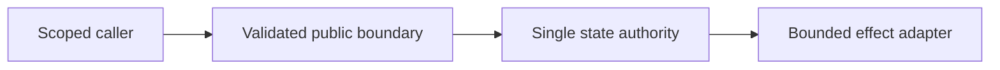
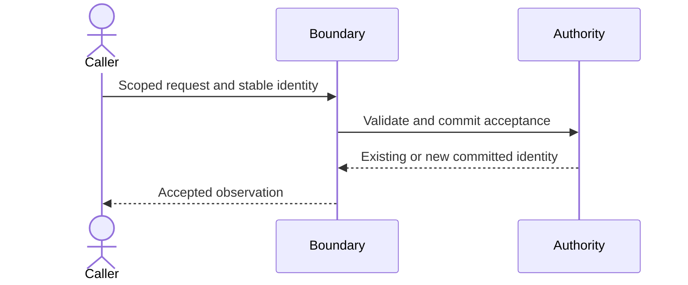
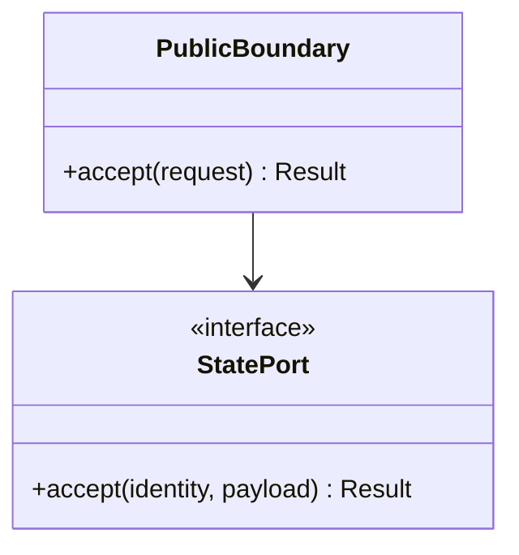

# Component design template

Status: Template
Last reviewed: 9 November 2026

## Overview

Replace this guidance with the component purpose, users, scope, current behavior,
planned changes and authoritative charter/design links. Identify external
dependencies and explicit exclusions. Copy the section structure into the owned
Design.md; a completed document must contain concrete reviewed decisions.

## Objectives

| Kind | Objective | Success measure | Status/evidence |
| --- | --- | --- | --- |
| Business | Describe the user outcome | Observable benefit with a defined test | Planned until inspected |
| Technical | Describe the engineering invariant | Exact invariant and verification | Planned until inspected |

## Functional requirements

| ID/reference | Kind | Requirement | Acceptance assertion | Status |
| --- | --- | --- | --- | --- |
| Existing charter ID or foundation behavior | Business | Describe a concrete user action | Given preconditions, when action occurs, then expected result | Planned |
| Existing contract | Technical | Describe the responsible component behavior | Ordinary path, failure and eventual-progress assertions | Planned |

Use existing acceptance IDs; local design rows are references, not new catalog
cases. Include scope, state owner and the acceptance/commitment boundary.

## Non-functional requirements

| Concern | Target/bound and units | Workload/assumptions | Verification | Status |
| --- | --- | --- | --- | --- |
| Correctness | State an exact invariant | Named ordinary/fault scenario | Persisted/external observations | Planned |
| Resources/latency | Set a numeric experiment budget before measuring | Machine, concurrency, payload and timestamp sources | Raw samples and declared threshold | Proposed, not measured |
| Reliability/operability | State recovery, shutdown and diagnostic behavior | Named crash/exporter/timeout boundary | Recovery plus safe evidence | Planned |

## Back-of-the-envelope calculations

| Quantity | Inputs with units | Formula/result | Limits of inference |
| --- | --- | --- | --- |
| Example retained events | Illustrative 100 cases, 10 events/case, 1 KiB/event | 100 × 10 × 1 KiB = 1,000 KiB, about 0.98 MiB payload | Excludes indexes, WAL, runtime and copies; not measured capacity |

Replace the example with relevant throughput/concurrency, storage, connection,
memory or metric-series calculations. Mark configured limits, estimates and
measurements separately; state retention, safety margin and what is excluded.

## High-level design

1. Replace the nodes with actual components and label trust/process boundaries.
2. Explain acceptance, state ownership and independent lifecycle/effect behavior.
3. Explain why each dependency exists and how results become observable.

## Sequence diagram

Replace the sequence with one actual success and its important failure/replay
branch. Show transaction/acknowledgement, uncertainty, cancellation and retry
boundaries where relevant; do not imply atomicity across external systems.

## Low-level design

Use actual proposed or implemented types and relationships. Mark interfaces,
dependencies and ownership clearly. A stateDiagram-v2 is appropriate when the
state machine is the essential low-level contract; explain its component owners.

## Components and related details

Include component responsibility/path/status, state ownership and invariants,
public types/versions/units, identity and canonicalization, storage constraints,
transaction/commitment boundary, configuration, resources and shutdown. Explain
migrations, backup/restore, replay horizons/tombstones and upgrade compatibility
where applicable. Keep operational commands in the relevant README.

## Security and privacy

Record verified-principal/scope boundaries, untrusted inputs, evidence access,
secret handling, runtime versus migration privileges and diagnostic retention.
Name exact rejection tests. For tooling/data-only modules, explain their actual
attack surface instead of inventing a network authentication layer.

## Observability

Define real event/span producers, correlation fields, timestamp sources,
readiness semantics, log severity/sampling/retention and exporter failure behavior.
State current instrumentation and gaps separately. Link the shared
[observability contract](observability.md); never promise metrics for nonexistent
producers or treat traces as durable truth.

## Metrics

| Measurement | Type/unit | Collection point and bounded labels | Interpretation/status |
| --- | --- | --- | --- |
| Component-specific measurement | Counter/gauge/histogram and unit | Actual producer and finite vocabulary | Implemented or planned, with reset/sample limitations |

For a data-only module, explain why there is no runtime exporter and identify
consumer-owned validation evidence. IDs, raw paths and customer values are not
metric dimensions.

## Exception handling

| Failure | Detection and owner | Safe response/state | Retry/reconciliation | Test |
| --- | --- | --- | --- | --- |
| Component-specific failure | Typed exception or explicit domain outcome | Stable code and preserved authority | Bounded policy or no automatic retry | Exact ordinary/negative/progress assertion |

Cover validation, scope, conflict, capacity, dependency/storage, cancellation,
deadline, uncertainty, unexpected defects and telemetry failure as applicable.
Do not catch cancellation/fatal exceptions as ordinary business failures or log
raw provider/exception payloads.

## Design considerations and trade-offs

| Decision | Reason | Cost/alternative | Revisit trigger |
| --- | --- | --- | --- |
| Concrete choice | Why it satisfies the requirements | Explicit limitation and rejected/optional alternative | Evidence that would warrant another decision |

Record unresolved questions, risks and deferred scope here or in linked ADRs.
Prefer the smallest useful boundary; avoid speculative frameworks.

## Validation and acceptance gates

| Gate | Required assertion/lane | Evidence and prerequisites | Completion rule |
| --- | --- | --- | --- |
| Applicable shared gate | Existing acceptance IDs and exact tests | Command if implemented, mode, timeout and artifacts | Missing/skipped/timed-out mandatory checks remain non-passing |

Link [validation](validation-plan.md), [Python engineering](python-engineering.md)
where applicable and the owned implementation plan. Distinguish offline,
self-hosted media and real inference. Include meaningful normal/failure/liveness
tests, process recovery, installed consumers, load budgets, safe diagnostics and
independent review where relevant. A diagram or plan is not acceptance evidence.
