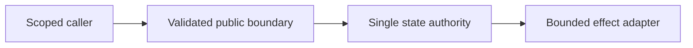
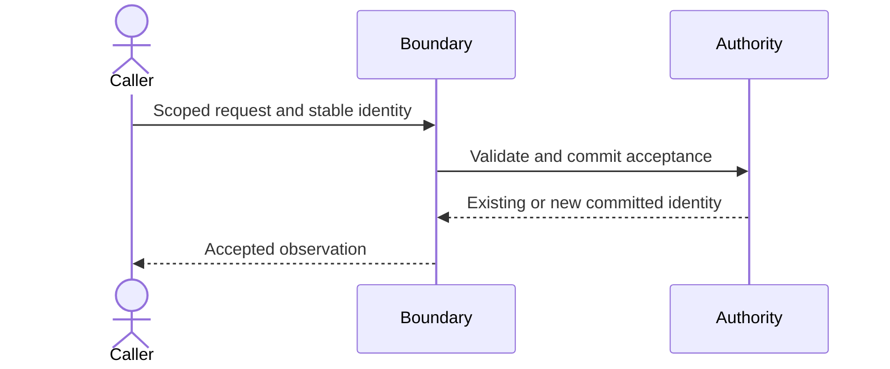
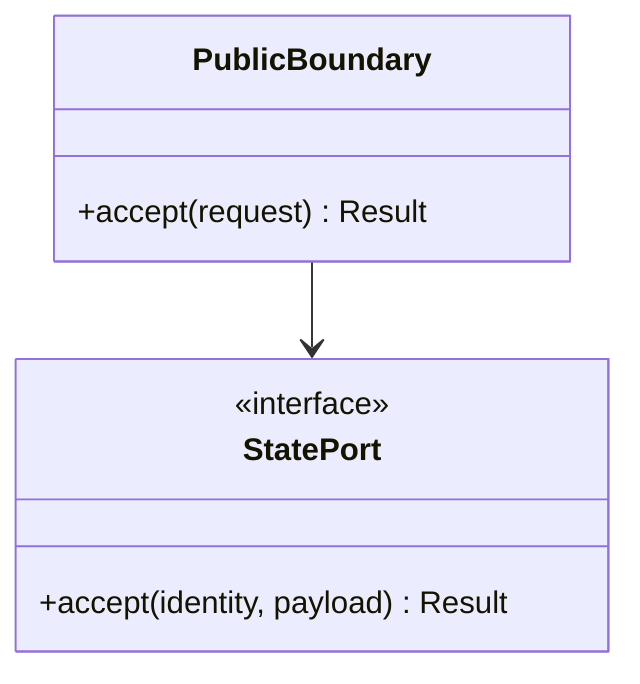

# Component design template

| Field | Value |
| --- | --- |
| Status | Template |
| Purpose | State in one sentence what this component design explains |
| Audience | Name the readers, for example engineers changing the component; coding agents |
| Scope | State what the design covers and, briefly, what it excludes |
| Owns | Name the boundaries and decisions the design owns; this template owns only the standard design structure, never implementation evidence |
| Related | Link two to five documents, such as [Python engineering](python-engineering.md) · [Observability](observability.md) · [Validation plan](validation-plan.md) |

## Overview

This template is the standard structure for every maintained Design.md. Copy the
section structure into the owned Design.md, then replace each guidance paragraph
and example with the component's actual content. A completed document must
contain concrete reviewed decisions. The
[documentation standards](documentation-standards.md) list the required sections
and the structural checks applied to them.

Copy the document card too. Set its Status to Active, replace each guidance value
with a short value free of pipe characters, and make every Related link relative
to the new location.

In this section, replace this guidance with:

- the component purpose, users and scope;
- current behavior and planned changes;
- authoritative charter and design links;
- external dependencies and explicit exclusions.

## Objectives

| Kind | Objective | Success measure | Status/evidence |
| --- | --- | --- | --- |
| Business | Describe the user outcome | Observable benefit with a defined test | Planned until inspected |
| Technical | Describe the engineering invariant | Exact invariant and verification | Planned until inspected |

## Functional requirements

| ID/reference | Kind | Requirement | Acceptance assertion | Status |
| --- | --- | --- | --- | --- |
| Existing charter ID or foundation behavior | Business | Describe a concrete user action | Given preconditions, when action occurs, then expected result | Planned |
| Existing contract | Technical | Describe the responsible component behavior | Ordinary path, failure and eventual-progress assertions | Planned |

Use existing acceptance IDs. Local design rows are references, not new catalog
cases. For each requirement, include the scope, the state owner and the
acceptance or commitment boundary.

## Non-functional requirements

| Concern | Target/bound and units | Workload/assumptions | Verification | Status |
| --- | --- | --- | --- | --- |
| Correctness | State an exact invariant | Named ordinary/fault scenario | Persisted/external observations | Planned |
| Resources/latency | Set a numeric experiment budget before measuring | Machine, concurrency, payload and timestamp sources | Raw samples and declared threshold | Proposed, not measured |
| Reliability/operability | State recovery, shutdown and diagnostic behavior | Named crash/exporter/timeout boundary | Recovery plus safe evidence | Planned |

## Back-of-the-envelope calculations

| Quantity | Inputs with units | Formula/result | Limits of inference |
| --- | --- | --- | --- |
| Example retained events | Illustrative 100 cases, 10 events/case, 1 KiB/event | 100 × 10 × 1 KiB = 1,000 KiB, about 0.98 MiB payload | Excludes indexes, WAL, runtime and copies; not measured capacity |

Replace the example with relevant throughput, concurrency, storage, connection,
memory or metric-series calculations.

- Mark configured limits, estimates and measurements separately.
- State retention, safety margin and what is excluded.

## High-level design

1. Replace the nodes with actual components, and label trust and process
   boundaries.
2. Explain acceptance, state ownership and independent lifecycle and effect
   behavior.
3. Explain why each dependency exists and how results become observable.

## Sequence diagram

Replace the sequence with one actual success path and its important failure or
replay branch.

- Show transaction and acknowledgement, uncertainty, cancellation and retry
  boundaries where relevant.
- Do not imply atomicity across external systems.

## Low-level design

Use actual proposed or implemented types and relationships. Mark interfaces,
dependencies and ownership clearly.

A stateDiagram-v2 is appropriate when the state machine is the essential
low-level contract. In that case, explain its component owners.

## Components and related details

| Component | Path | Responsibility | Status |
| --- | --- | --- | --- |
| Actual module, process or adapter | Repository-relative path in backticks | What it owns and does | Implementation status, such as Implemented or Planned |

List each component with its responsibility, path and status, using the
implementation status vocabulary in the
[documentation standards](documentation-standards.md). Put the detail under these
H3 sections where it applies.

### State ownership and invariants

Describe the state each component owns and the invariants it preserves.

### Interfaces and identity

Describe:

- public types, versions and units;
- identity and canonicalization.

### Transaction and failure boundaries

Describe the storage constraints, the transaction or commitment boundary and the
failure boundaries.

### Implementation layout and lifecycle

Describe the implementation layout, configuration, resources and shutdown.

### Migration, restore and compatibility

Explain migrations, backup and restore, replay horizons and tombstones, and
upgrade compatibility where applicable. Keep operational commands in the relevant
README.

## Security and privacy

| Boundary or threat | Control | Test or evidence |
| --- | --- | --- |
| Verified principal and scope | Describe how scope binds to the verified principal | Name the exact rejection test |
| Untrusted input and evidence access | Describe input validation and evidence-access limits | Name the malformed-input and access-denial tests |
| Secrets | Describe where secrets live and how diagnostics exclude them | Name the secret-sentinel or redaction test |
| Runtime versus migration privileges | Describe the separate runtime and migration privileges | Name the privilege-rejection test |
| Diagnostic retention | Describe what diagnostics retain and for how long | Name the retention or redaction check |

Record one row for each boundary, and name the exact rejection tests. For tooling
or data-only modules, explain their actual attack surface instead of inventing a
network authentication layer.

## Observability

| Signal | Producer | Fields or labels | Status |
| --- | --- | --- | --- |
| Event or log record | Actual module or process that emits it | Fixed event name, correlation fields, severity and timestamp source | Implemented or Planned |
| Trace span | Actual instrumented boundary | Bounded attributes, sampling and retention | Implemented or Planned |
| Readiness signal | Process or endpoint that reports it | What readiness does and does not establish | Implemented or Planned |

Define the real event and span producers, correlation fields, timestamp sources,
readiness semantics, log severity, sampling and retention, and exporter failure
behavior. State current instrumentation and gaps separately.

Link the shared [observability contract](observability.md). Never promise metrics
for nonexistent producers, and never treat traces as durable truth.

## Metrics

| Measurement | Type/unit | Collection point and bounded labels | Interpretation/status |
| --- | --- | --- | --- |
| Component-specific measurement | Counter/gauge/histogram and unit | Actual producer and finite vocabulary | Implemented or planned, with reset/sample limitations |

For a data-only module, explain why there is no runtime exporter and identify the
consumer-owned validation evidence. IDs, raw paths and customer values are not
metric dimensions.

## Exception handling

| Failure | Detection and owner | Safe response/state | Retry/reconciliation | Test |
| --- | --- | --- | --- | --- |
| Component-specific failure | Typed exception or explicit domain outcome | Stable code and preserved authority | Bounded policy or no automatic retry | Exact ordinary/negative/progress assertion |

Cover these failures as applicable: validation, scope, conflict, capacity,
dependency and storage, cancellation, deadline, uncertainty, unexpected defects
and telemetry failure.

- Do not catch cancellation or fatal exceptions as ordinary business failures.
- Do not log raw provider or exception payloads.

## Design considerations and trade-offs

| Decision | Reason | Cost or alternative | Revisit trigger |
| --- | --- | --- | --- |
| Concrete choice | Why it satisfies the requirements | Explicit limitation and rejected/optional alternative | Evidence that would warrant another decision |

Record unresolved questions, risks and deferred scope here or in linked
architecture decision records (ADRs). Prefer the smallest useful boundary, and
avoid speculative frameworks.

## Validation and acceptance gates

| Gate | Assertion or lane | Evidence | Status |
| --- | --- | --- | --- |
| Applicable shared gate | Required: existing acceptance IDs and exact tests | Command if implemented, mode, timeout, artifacts and prerequisites | Planned until observed evidence passes |

Name the sufficient evidence and any missing prerequisites for each gate.
Missing, skipped or timed-out mandatory checks remain non-passing.

Link the [validation plan](validation-plan.md), the
[Python engineering guide](python-engineering.md) where applicable, and the owned
implementation plan. Distinguish offline, self-hosted media and real inference.

Include, where relevant:

- meaningful normal, failure and liveness tests;
- process recovery and installed consumers;
- load budgets and safe diagnostics;
- independent review.

A diagram or plan is not acceptance evidence.
