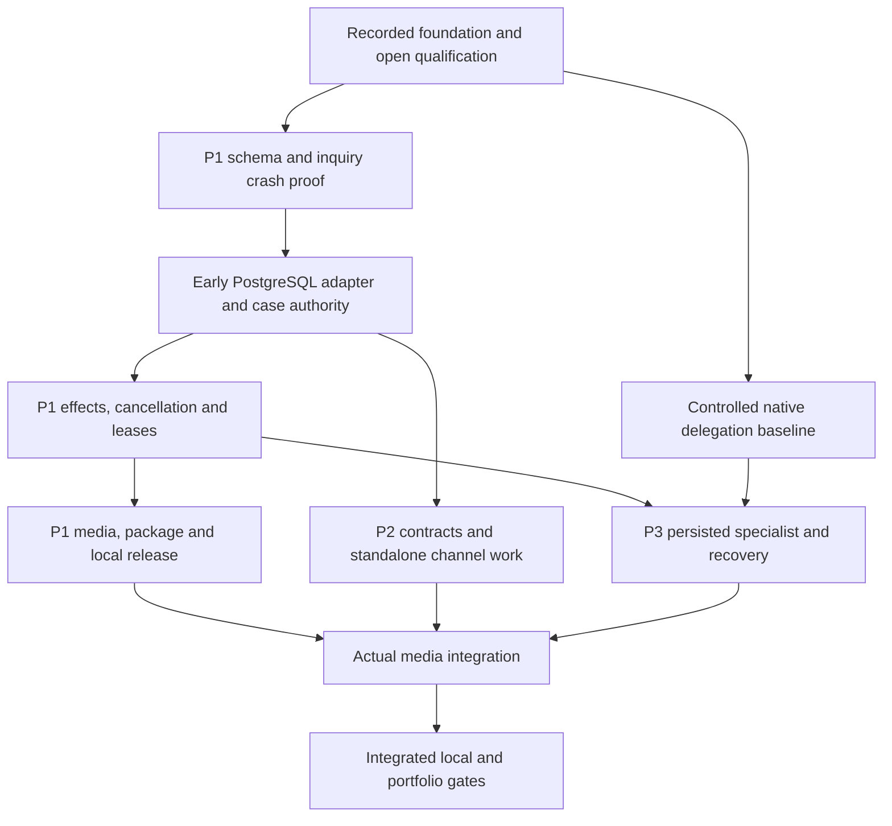

# Granular ecosystem implementation roadmap

Status: Active
Last reviewed: 13 November 2026

## Purpose and authority

Build three independently usable libraries and one local reference application in
small, reviewable increments. This roadmap owns task decomposition and cross-project
execution gates. The [build plan](build-plan.md) retains the authoritative PLAN-01
through PLAN-22 sequence; [project charters](portfolio-scope.md) retain all 54
acceptance requirements. Task IDs below are work items, not acceptance IDs.

| Detailed plan | Implementation tasks | Product requirements |
| --- | --- | --- |
| [P1 Agent Continuity Lab](implementation/p1-agent-continuity.md) | P1-I01 through P1-I28 | P1-01 through P1-20 |
| [P2 Channel Continuity Kit](implementation/p2-channel-continuity.md) | P2-I01 through P2-I22 | P2-01 through P2-17 |
| [P3 Delegation Reliability Kit](implementation/p3-delegation-reliability.md) | P3-I01 through P3-I24 | P3-01 through P3-17 |

The project plans name prerequisites, affected artifacts, normal/failure assertions,
acceptance contributions, UI evidence, metrics/errors, exit gates and effort per
slice. The [validation plan](validation-plan.md), [observability contract](observability.md),
[demo plan](demo-plan.md), [architecture](../Design.md) and
[runtime decision](decisions/0001-runtime-boundaries.md) remain authoritative for
those subjects. No product implementation or dependency upgrade is performed by
writing this roadmap.

P2 now starts with the [contract slice](work-items/0022-p2-channel-contracts.md);
P3 starts independently with the [controlled native baseline](work-items/0023-p3-native-baseline.md).
P2 now has verified durable inbox/association, standalone preview, persisted
dispatch/reconciliation and a bounded gateway. P3 has the I07A explicit issued
runner and durable opaque results. The [completed phase](work-items/0030-p2-agent-recovery-and-p3-completion.md)
adds P2-I09 owned scripted-agent process recovery and P3-I07B first durable receiver
acceptance plus a separately confirmed fake action. P1 work-profile v3 preserves
v1/v2 input and execution while adding stable delivery and atomic work/case action
receipts. Current-read applicability grants no action authority; P1 validates work
eligibility and exact confirmation in the same protected transaction. The selected
phase gates passed, completing I09/full I07. The
[completed routing/acceptance phase](work-items/0031-revision-routing-and-delegation-acceptance.md)
adds explicit I10 investigation CAS routing and I08 concurrent acceptance/public
inspection. Three complete P3 lab rows (01/03/11) have registered fresh passing
reports; all 17 P2 and remaining 14 P3 rows stay planned. I10 selected qualification
is separate from outbox, broader recovery, default Docker/UI,
media/model and integrated release gates.

The [completed linked-confirmation/result-projection phase](work-items/0032-linked-confirmation-and-result-projections.md)
completes P2-I11 and P3-I09 within their selected local scope; no complete
P2 or additional P3 acceptance row is registered. P2 uses immutable exact prompts
and a current-association preflight, then existing P1 atomic confirmation and
original-command receipts. P1 work v4 exposes result-only source-bound cursors; P3
checkpoints derived as-of observations without creating another execution owner.
Unknown acknowledgement, later work/case changes, delivery/event ACK and broader
recovery remain distinct. Neither addition changes default Compose/UI or the
qualified booking/native/provider behavior.

The [completed outbound-reply/processing phase](work-items/0033-outbound-replies-and-completion-processing.md)
completes P2-I12 and P3-I10 within their selected local scope; the actual and
installed gates passed. P2 preserves one
logical recipient/outbound identity, selects versioned authorized routes and
commits suppression/permission checks with possible-send reservation. P3 adds
only derived terminal ACKs and a separate bounded discovery cursor; an unknown
result stays unacknowledged while later eligible work can progress. P1 APIs,
work v4 and booking/native/provider behavior remain unchanged. Callbacks,
ambiguous resend policy, broader applicability/recovery and complete native/media
release remain separate. No automatic booking-completion integration or new
complete charter row is introduced.

The [completed callback/applicability phase](work-items/0034-callback-evidence-and-applicability-refresh.md)
retains selected passing P2-I13/P3-I11 evidence. Callbacks remain original-attempt
observations; refreshed applicability is non-atomic as-of metadata. Display hiding
preserves profile-lifetime replay identities and protected capacity.

The [completed send-policy/action-race phase](work-items/0035-send-policy-and-action-races.md)
completed the selected local gates for P2-I14 and P3-I12. Ordinary unknown
sends remain held. Only a separately configured cooperating idempotent provider
and a new trusted controller command can reserve an eligible same-operation retry.
P3 exercises both protected revision/intent lock orders and cancellation/effect
boundaries through existing public guards. At that checkpoint, P1's 77 and P3's 30 runtime payloads,
their authorities and default Compose/UI were unchanged. No new complete charter
row, automatic retry, external provider/inference call or full-release claim follows.

## Review-driven additions

Use the [architecture audit disposition](work-items/0020-architecture-audit-reconciliation.md)
to distinguish older snapshot findings from current gaps. The
[P1 operational extension](work-items/0021-p1-operational-safety-extensions.md)
is planned post-V1 work; P2/P3 contract refinements stay within their existing
acceptance IDs and phase gates. Implement one bounded slice, test its actual
failure boundary and record review before progressing. Current P1 qualification
is unchanged; future operational behavior and human usability feedback are not
certified by a documentation update.

## Starting position: reuse the foundation

The recorded 9 November foundation includes:

- SQLite M1 investigation intake, scoped idempotency, changed-payload conflict,
  admission safety and bounded inspection.
- The local API, native Python diagnostic agent, TypeScript console, LiveKit,
  PostgreSQL, Docker lifecycle and optional Jaeger UI.
- Frozen dependencies, immutable image selections, source/documentation contracts,
  negative harness fixtures, safe error envelopes and bounded API metrics/logs.
- Actual SDK text/audio smoke, browser authentication/text/explicit reconnect and
  the visible M1 acceptance/replay/conflict demonstration.
- A recorded passing baseline of 121 Python tests and 59 frontend tests. These
  counts are historical evidence, not a threshold for future quality.

The original baseline recorded all 54 product cases as planned. Phases A and B now
add executable SQLite evidence for P1-01 through P1-05. All twenty P1 rows now
have passing retained reports under the selected-provider local release. Full
ecosystem acceptance remains pending because complete P2/P3 acceptance remains pending; the harness
catalog owns current registrations. Phase C adds the standalone PostgreSQL inquiry
adapter and controlled cutover.
Original SQLite M1 and the diagnostic worker remain independent profiles. The
opt-in G business application adds managed PostgreSQL work, scoped current-case UI,
native scripted speech/tools and inspected raw Jaeger v3 traces. Physical microphone
quality, automatic network-loss recovery and real-model quality remain unqualified.
Capacity claims require their own measurements; remote CI is outside this local POC.
A prerequisite blocks only the work that needs it: independent offline execution
work can proceed while a permission-dependent media check remains unverified.

## Current delivery checkpoint

P1-I01 through P1-I04 passed the [Phase A gate](work-items/0007-p1-phase-a-execution-foundation.md).
The independent inquiry/supplier crash slice P1-I05 through P1-I07 passed its
[Phase B gate](work-items/0008-p1-phase-b-inquiry-recovery.md). Phase C implements
S-I05 and P1-I08 through P1-I10: restricted roles, verified PostgreSQL cutover,
store parity and trusted synthetic scope. See its
[gate](work-items/0009-p1-phase-c-postgres-cutover.md). Phase D adds P1-I11 through P1-I14: exact authority/intent and persisted
waits/signals/retry/deadlines. Its [gate](work-items/0010-p1-phase-d-authority-and-waits.md)
records observed tests. Phase E implements P1-I15 through P1-I18: supplier-bound
v2 proposals, PostgreSQL v3 effects, cancellation and durable completion delivery.
Its [work item](work-items/0011-p1-phase-e-effects-and-completion.md) records the completed
final combined gate. Phase F implements P1-I19 through P1-I21: server-time leases,
stale external-call safety and bounded pull-worker deployment/restart. Its
[final gate](work-items/0012-p1-phase-f-leases-and-deployment.md) has passed.
Phase G implements P1-I22 through P1-I25; its inspected local combined gate is
recorded in the [work item](work-items/0013-p1-phase-g-conversation-and-showcase.md).
H1 completed the S-I06/P1-I27 local inquiry baseline under its
[work item](work-items/0014-p1-phase-h-workload-baseline.md). Broader I27 restart/
slow-provider/media workloads were extended by passed H2 restart/slow-dependency/
saturation/shutdown measurements. P1 V1 is qualified for the local POC using provider_real v2. local_real remains unqualified and complete P2/P3 acceptance remains pending. P1-I26
host/Linux artifacts, API/failure review and genuine native consumer passed.
P1-I28 provider_real v2 has passed actual media qualification; local_real remains unqualified.
P1 local V1 release gates passed; complete P2/P3 acceptance remains pending. Initial estimates below remain a
planning baseline, not a refreshed remaining-work forecast.

### Current local P1 qualification

P1 V1 is implemented and locally qualified with selected provider_real v2.
The final 20-case index, current P1-18/P1-14/P1-20, full H2, PostgreSQL, installed
host/Linux artifacts and shared quality gates passed with independent reviews.
Historical checkpoints retain their original scope. local_real remains unqualified;
complete P2/P3 acceptance remains pending, and hosted CI/publication are outside this local POC.

## Phasewise delivery map

Use this as the default serial path for one primary implementer. Parallel branches
are permitted only through the explicit gates below; a later row is not a reason
to delay independent contract/fixture work until every earlier project is released.

| Ecosystem phase | Work to implement | Primary tasks | Exit evidence and visible proof |
| --- | --- | --- | --- |
| EC-00 Foundation delta qualification | Record known-good baseline, remaining browser permissions and safe runtime configuration changes | S-I01 recorded; S-I02; early S-I05 when needed | Existing capabilities remain working; unavailable checks stay visibly unverified; no infrastructure rebuild project |
| EC-01 P1 first recovery slice | Migration, explicit execution identity, independent fake inquiry and exact crash barrier | P1-I01–I07; early S-I04 after P1-I04 | A fresh worker reconciles the same inquiry; booking unchanged; CLI/store evidence is available first, and the shared projection shows actual states when ready |
| EC-02 P1 PostgreSQL and case authority | Controlled import/cutover, restricted runtime role, canonical case/quote/confirmation and persisted waits | S-I05; P1-I08–I14 | M1 identities preserved; current exact consent is required; waiting work survives without sleeping tasks |
| EC-03 P1 effects and coordination | Mutation reconciliation/uncertainty, cancellation, completion events, leases and deployment recovery | P1-I15–I21; S-I06 foundation | Authorized work progresses; stale attempts cannot write; ambiguous effects remain uncertain; restart preserves accepted state |
| EC-04 P1 conversational and library release | Native tools, real read projections, telemetry/export, scripted voice, isolated package consumer and benchmarks | S-I03; extend S-I04; P1-I22–I27; P1-I28 for live evidence | A conversation stays responsive while durable work continues independently; P1 local and portfolio gates reported separately |
| EC-05 P2 channel continuity | Typed events, trusted association, durable input/dispatch, fake SMS, case routing, playback evidence and standalone package | P2-I01–I22 | Voice/chat/fake-SMS resume one current case; duplicates/stale confirmations cannot become new actions; generated/played/acknowledged remain separate |
| EC-06 P3 first reliable specialist | Native baseline first, authenticated bounded HTTP capability, immutable input, applicability, races and process recovery | P3-I01–I15 | A current useful result progresses; late A cannot act on revised B; P1 remains the only durable execution scheduler |
| EC-07 P3 modalities and comparison | Static image and fixed policy capabilities, responsive conversation, stable delivery route, admission and three-way comparison | P3-I16–I24 | Specialist work stays bounded/read-only; outdated results stay historical; useful current results survive handoff and restart |
| EC-08 Integrated release | Supported-platform reproduction, installed consumers, all required local/live evidence and short demos | S-I07/S-I08 with completed project gates | Three independently usable packages plus one coherent reference app; no missing required case is reported as passed |



The graph shows dependency frontiers, not a second implementation schedule. In
particular, P2 and P3 local fixtures do not require the complete sibling deployments.
P1-I28 real-inference evidence may follow its local gate; missing provider setup
must not silently block unrelated deterministic work or become a passing live gate.

## Shared work: implement once

These support tasks do not create a fourth product. Their estimates exclude each
project's business event producers, feature views and scenario runs. If two tasks
are implemented in one change, record the shared work once rather than charging
both estimates for the same exporter, schema or UI scaffold.

| Task | Status and prerequisite | Deliverable and ownership | Failure/exit evidence | Effort |
| --- | --- | --- | --- | --- |
| S-I01 | Starting checkpoint recorded in this roadmap | Preserve baseline inventory, capability ledger and the existing PLAN/acceptance mapping; use it to open the first selected work item | Current evidence and missing evidence stay distinct; do not schedule the implemented foundation again | 0 h remaining |
| S-I02 | Planned; operator permission and existing local stack | Qualify diagnostic-browser microphone publication, denial, track correlation, mute/disconnect and cleanup; later voice playback belongs to P1/P2 media tasks | Actual expected track reaches the SDK worker; denial/unavailable capability remains visible; never substitute native-client frames for browser playback | 2–4 h |
| S-I03 | Implemented for the G local profile; extend/review for later project producers | Common bounded OTLP/exporter configuration, trace context propagation and local collector inspection; project tasks add their own spans/metrics | Inspect an actual trace; exporter failure cannot block acceptance/conversation/shutdown; no IDs in metric dimensions or private payloads in logs | 3–5 h |
| S-I04 | Implemented for G managed case projections; later project views remain separate | Common authorized GET/cursor read-projection envelope and bounded console refresh/error handling; feature views consume actual project-owned records | Replay/reconnect resumes safely, unknown stays unknown, scope and cursor/input bounds are tested; no timer-created progress or second event bus | 3–5 h |
| S-I05 | Implemented for P1-C; reuse/review for each new component migration | Extend local service profiles, versioned environment/credential upgrades and a one-shot PostgreSQL migration principal; preserve restricted serving roles | Existing credentials and volume owner labels survive upgrade; init is idempotent/private; runtime cannot create schemas; normal upgrade never requires volume reset | 3–5 h |
| S-I06 | H1 local inquiry manifest/controller and measured baseline complete; broader project workloads remain | Small seeded workload/evidence envelope reused by project load tasks, including machine/resource/mode/timing definitions | Declare numeric budgets before measuring; retain actual samples, errors and useful progression; do not claim production capacity from laptop counts | 2–4 h |
| S-I07 | Local host/container integration active; artifacts/services available | Run clean local setup, preserved-state restart and standalone/integrated installed consumers on the selected Python 3.14 host and Linux containers | Actual local executions and retained artifacts; neither source checkout nor CI YAML alone passes; remote CI/publication are outside scope | 3–5 h |
| S-I08 | Planned; all applicable project local gates, then selected live gates | Integrated success/failure rehearsal, cross-project identity/route review, final API/docs review and retained portfolio evidence | Report all 54 cases by required mode; local-ready and portfolio-ready remain separate; no optional carrier/Cloud account becomes a default prerequisite | 4–6 h |

S-I02 is diagnostic input qualification, not a replacement for actual scripted
speech output, interruption and playback assertions later. S-I03 is common export
wiring; P1-I24 and the P2/P3 tasks own their distinct application instrumentation.
S-I04 is a read adapter and presentation envelope, never another case authority.
S-I05 may proceed alongside the SQLite inquiry slice but must finish before the
early PostgreSQL adapter. Apply the same upgrade path to P2-I04 and P3-I09/I21
before their owned schema, grants or configuration changes; reusing the mechanism
does not repeat its implementation estimate. Start S-I04 after P1-I04 for the
first observed UI slice; later product tasks extend that scaffold. S-I07 has
foundation and product local-container passes; it does not depend on a hosted
runner or repository publication. Grant migration privilege only to a one-shot
job; never pass the bootstrap administrator credential into the serving API or worker.

Changes to environment schemas must add newly required secrets safely without
rotating existing database credentials or the volume-owner identity. Test old
configuration upgrade, interrupted upgrade and repeated initialization. Introduce
only the service/schema privileges needed by the next actual consumer.

## Cross-project gates and parallel work

| Gate | Producer | Consumer permitted after the gate | What is still not established |
| --- | --- | --- | --- |
| Execution identity and supported store contract | P1-I04, then P1-I08/I09 | Typed execution fixtures, adapter design and fake consumers | Rich cancellation, leases and full recovery |
| Current case and atomic intent authority | P1-I11/I12 with trusted scope from P1-I10 | P2 case/confirmation fixtures; P3 current-result/action fixtures | Complete channel/media/delegation runtime |
| Durable completion/delivery intent | P1-I18 plus narrow ResultDeliveryPort contract | P2 outbound adapter and P3 standalone result delivery | Guaranteed physical SMS or client playback |
| Execution recovery/deadlines/cancellation | P1-I14/I16/I17/I19/I20 | P3 persisted invocation and real recovery assertions | Specialist result applicability, which remains P3's responsibility |
| Real local conversation client | P1-I22–I25 | P2 actual audio/playback and P3 responsive-media scenarios | Real inference quality or network-loss recovery not exercised by that run |
| Current channel association and route | P2's public routing/resumption adapter | P3 integrated returning-interaction result routing | P3 need not depend on a complete P2 deployment for standalone tests |
| Installable execution package | P1-I26 | P3 isolated package consumer and declared P1 library dependency | Any undeclared sibling source/store access |

Freeze only the fields required by the next slice and version changes explicitly.
Do not design every future schema before running the first worker. One owner
changes shared authority/contract definitions; parallel agents may prepare fixtures,
review code or implement frozen adapters in separate owned paths.

P2-I01–I06 contract/standalone work can overlap later P1 work after the required
ports are agreed. P3-I01/I02 can run early against controlled input without the
complete application. P3-I03–I05 schema/service fixtures may proceed after its
native decision; real persisted invocations and race/recovery gates still wait for
P1's actual contracts. P2 is required only for P3's integrated route, not every P3 test.

## What each project should show

| Checkpoint | Demonstration | Truth shown in the UI |
| --- | --- | --- |
| First P1 proof | Accept inquiry, stop worker after supplier success, recover in a new process | Original identities and unchanged booking from CLI/store evidence first; read-projection UI follows S-I04 |
| P1 local V1 | Exact quote confirmation, mutation/reconciliation, waits, cancellation and worker takeover | Committed consent, actual effect outcome and completion delivery are separate |
| First P2 proof | Accept fake SMS, kill gateway before dispatch, recover the same input | Original receipt; repeated processing visible; one business acceptance |
| P2 local V1 | Interrupt voice, continue in chat/fake SMS, reconnect to the current case | Case revision, active route, generated/played/acknowledged/unknown evidence |
| First P3 proof | Hold a capability, revise A to B, release A and complete B | Computation may succeed while A is outdated; current B progresses |
| P3 local V1 | Kill a specialist/coordinator and route the recovered current result after handoff | Execution, applicability, cancellation observation and delivery remain distinct |

Keep the current TypeScript console/native SDK as the V1 default. Consider official
Agents UI components only at a genuine conversation-client integration checkpoint,
with one room/session lifecycle owner and preserved authenticated boundaries. A
framework rewrite is optional work, not a prerequisite for these proofs.

A bounded GET/cursor projection is sufficient initially; native SDK notifications
may request a refresh. Do not create a bespoke transport or durable event bus for
the interface. The process harness injects failure and owns only its test children;
the normal UI must not receive a Docker socket, arbitrary command execution or
unscoped process-control endpoint. Optional demonstration controls must be narrow,
explicitly isolated test-mode operations after the underlying scenario works.

## Per-task engineering and coding-agent contract

Before coding, copy the [work-item template](work-items/template.md), select
the applicable G-READY/G-FAST/G-CONTRACT/G-DURABLE/G-OBS/G-MEDIA/G-PACKAGE/G-RELEASE
checks from the [validation authority](validation-plan.md), and record:

1. Implementation task, PLAN mapping and affected acceptance IDs; identify which
   assertions are only partial until later integration evidence exists.
2. Prerequisites, owned paths, typed public boundary, storage/schema version,
   principal/scope, stable identities and exact commitment/cancellation boundary.
3. The ordinary path plus named failure schedule and liveness assertion. Prefer
   process barriers/fake clocks to lucky races or sleeps. A crash test must actually
   terminate its owned process and inspect persistent state after recovery.
4. Appropriate tests, finite time/resource limits, cleanup and evidence locations.
   A low-impact documentation edit needs the existing documentation check, not a
   new unit test that merely repeats its wording.
5. Safe error/unknown-outcome behavior, fixed metric vocabulary, correlation/log
   policy and actual UI state producer. Add signals with real code, not zero-only
   placeholder metrics or fabricated progress.
6. Given/When/Then acceptance for the slice, the normal/negative/useful-progress
   assertions, and expected safe log/error/metric evidence. Python follows the
   [engineering guide](python-engineering.md); each changed Design.md follows the
   [standard template](design-template.md). Add new packages to actual test,
   lint/type discovery; current service-only typing cannot qualify a future SDK.
7. Exact implemented verification commands, outcomes, artifacts, interface/docs
   changes, independent review findings, assistance and the next eligible task.

Extend the current harness minimally when process/media/language lanes arrive.
Keep stable acceptance IDs and versioned report metadata for mode, prerequisites,
command, timeout and artifacts. Local scripted results cannot become passing live
inference evidence. Missing required tests, skipped cases, timeouts, zero-test
runners and unavailable prerequisites remain non-passing for the affected gate.
Do not build a universal runner framework before a concrete scenario requires it.

## First ten implementation tasks

Use this default sequence to obtain the first useful recovery proof quickly.
S-I01 is already recorded. S-I02 can run alongside it when permission is available;
S-I05 may also run earlier after P1-I01 if an isolated owner is available.

| Order | Task | Concrete result |
| --- | --- | --- |
| 1 | P1-I01 | Execution/consent/storage decision and precise crash contract |
| 2 | P1-I02 | Owned-process/failpoint harness and old-data fixture |
| 3 | P1-I03 | Safe versioned SQLite migration with preserved M1 data |
| 4 | P1-I04 | Typed persisted execution and inquiry effect identity |
| 5 | P1-I05 | Independent fake supplier with persisted inquiry evidence |
| 6 | P1-I06 | One real worker completes the ordinary inquiry |
| 7 | P1-I07 | New process recovers the selected inquiry crash boundary |
| 8 | S-I05 | Upgrade-safe configuration and restricted migration/runtime roles |
| 9 | P1-I08 | Verified controlled PostgreSQL import/cutover |
| 10 | P1-I09 | PostgreSQL execution adapter and supported-store parity |

The first CLI/store recovery demo is available after task 7, before mutation,
channels, specialists or live inference. Showing its observed states in the UI
also requires S-I04. This is a completed vertical slice, not a complete P1 V1 release.
The historical first-slice order above is complete. Phase D implemented P1-I11
through P1-I14; Phase E implements P1-I15 through P1-I18 with its final gate
passed. Phase F implements P1-I19 through P1-I21 with its combined gate passed.
Phase G implements P1-I22 through P1-I25 with its inspected local gate. Preserve
its evidence, the H1/H2 snapshots and I26 artifact/API/genuine-consumer proofs.
P1 V1 is qualified for the local POC using provider_real v2. local_real remains unqualified and complete P2/P3 acceptance remains pending. Advance at the documented dependency frontiers.

## Preserved rehydration and standalone checkpoints

Preserve the [completed native/deadline checkpoint](work-items/0036-native-input-and-deadline-cancellation.md):
selected P2-I15/I16 actual native/artifact and P3-I13 temporal gates passed.
The [completed playback/recovery handoff](work-items/0037-playback-evidence-and-process-recovery.md)
records the current selected scope and retained failure provenance.

P3-I14 passed seventeen source and the same seventeen installed recovery assertions,
each with eight owned process kills and one actual two-waiter issuance graph.
Eighty compatibility assertions also passed across execution, processing,
applicability, action-race and deadline lanes, with complete cleanup and unchanged
P1/P3 runtime payloads. Original issuance replay never invokes; only an explicitly
new eligible command can do so. Unknown possible delivery remains lookup-only,
while separate current work progresses. P1 remains the sole durable authority.

P2-I17 completed its selected communication scope: the sixteen-case PostgreSQL
storage gate, three-group actual browser/media gate, isolated npm consumer and
then-qualified eight-payload Python package with ninety-four unadapted tests passed.
All 147 P2 compatibility assertions passed. Final shared phase closure is recorded
separately in the linked handoff. Generated text, SDK progress, client-reported
playback and business consent remain separate facts. The current
[case rehydration/standalone phase](work-items/0038-case-rehydration-and-standalone-release.md)
completed selected P2-I18 and P3-I15. P2 passed eighteen storage assertions, three
actual room/voice/text/SMS browser groups and 166 compatibility assertions. Its
nine-payload Python distribution passed 111 unadapted tests across fifteen
commands; the 96-payload npm consumer passed seven stages with actual P2
PostgreSQL/HTTP and explicitly synthetic case/operation ports. P3 passed sixteen
installed assertions: eight offline and eight local lab assertions, including one
owned caller-process kill, original replay and complete cleanup. That checkpoint preserved thirty Python and sixteen npm payloads and the
seventy-seven-payload P1 dependency; the later image slice is additive.

Loaded case/history and source-qualified response facts are separate non-atomic
as-of observations. Loading creates no execution, speech or consent authority;
P1 revision0 is read-only under the existing positive-revision native command
contract. Original receipts survive replay, and cleanup retains shared readers and
owned work until dependent clients/processes actually settle.

Final shared gates passed 2,148 Python and 1,224 TypeScript checks, broad/strict
Python typing for 144/132 sources, formatting for 387 Python files, 113-document
validation and syntax parsing for all 29 Mermaid bodies. Ordinary stack doctor and
eight smoke checks passed with ten audio frames and original M1 state preserved.
P2-I19 capacity/dormant-case experiments and P3-I16 standalone static-image
HTTP completed selected qualification in the current handoff.
Selected P2-I20 joined operational UI/telemetry and P3-I17 fixed-policy semantic
evidence passed in the 0040 handoff. Current P2-I21 and the qualified P3-I18A
durable prerequisite belong to 0041. Selected P3-I18B native RTC text qualification
passed in [0042](work-items/0042-responsive-native-policy-and-compact-demo.md).
Remaining P2-I22/P3-I19 origin binding and broader voice/SMS release retain their later gates. The catalog remains fifty-five cases with twenty-four registered
runners; all seventeen P2 and fourteen remaining full P3 rows stay planned.

### Bounded workload and image qualification

The [completed work item](work-items/0039-bounded-channel-workloads-and-image-evidence.md)
owns P2-I19 and P3-I16. P2 implements a seeded steady/burst/saturation and 1,000-case
dormancy study plus bounded ordinary observer callbacks. P3 implements a separate
read-only image contract/HTTP path with actual PNG validation, explicit clarification,
independent synthetic-image facts and fresh installed consumers. Both selected
qualification lanes passed; no new complete acceptance row is registered.
P1's policy-only work authority and default stack remain unchanged. The current
0041 slice adds P2-I21 and explicit P3-I18A durable v2 consumption. Selected
P3-I18B native RTC text qualification subsequently passed in 0042. The selected
0043 delivery/read seam precedes remaining P2-origin binding, integrated voice/SMS
and full release.

## Effort, uncertainty and replanning

| Work area | Task count | Preliminary direct engineering effort |
| --- | --- | --- |
| P1 | 28 | 73–108 h |
| P2 | 22 | 53–98 h |
| P3 | 24 | 64–89 h |
| Shared remaining work | 7; S-I01 already recorded | 20–34 h |
| Initial decomposition baseline | 81 originally planned tasks | 210–329 h |

These are initial task-sizing ranges, not a measured remaining-delivery forecast.
They assume prerequisites work and include each slice's targeted tests/docs/first
review. They exclude learning, unexpected compatibility work, later review fixes
and additional presentation polish. A provisional 20–30% integration/review reserve
would produce roughly 252–428 engineering hours; it is a scheduling allowance,
not permission to hide unresolved work inside completed tasks. Do not add another
reserve for work already explicitly estimated.

The historical 204–304-hour estimate in the build plan remains historical. This
new bottom-up pass is deliberately not obtained by subtracting guessed hours for
the existing foundation. Re-estimate after P1-I07, P2-I08, first real browser audio
and P3-I14 using actual implementation/test/review time and remaining work. At each
checkpoint keep estimates, time spent and new discoveries separate.

The existing 12–15-hour weekly budget includes learning/review, not just coding.
Keep supporting study inside it. No calendar completion date is committed by this
plan. Use a revised remaining-work estimate and actual available engineering time
before assigning dates. Reduce optional UI/framework/provider experiments before
weakening the 54 required invariants.

## Phase and release completion

A task moves through planned, ready, in-progress, needs-evidence and done. Ready
means prerequisites exist; it does not mean a product requirement passed. A phase
exits only with the concrete assertions and artifacts defined in its project plan.
If an expected gate fails, keep the phase open and create a bounded corrective task.

Local-ready V1 requires every applicable local acceptance row, actual process and
media evidence, migrations/restart, resource bounds, supported-platform setup and
isolated package consumers. Portfolio-ready V1 adds selected real-model outcomes,
equivalent comparisons, costs/configuration and success/failure demonstrations.
An unavailable live lane stays unverified; it does not invalidate an independent
passing local assertion or complete the portfolio gate.

Use the existing commands below from the repository root after its documented
bootstrap. Product/mode-specific commands are planned until implemented and verified.
The deep command remains incomplete with exit2 while any required row lacks a
complete registered runner. The catalog is authoritative for current registrations.
Phase tests contribute evidence; only a reviewed complete assertion mapping may
register a charter row.

```sh
make check
make format-check
make frontend-check
.venv/bin/python -m harness validate
.venv/bin/python -m harness run BASE-01
HARNESS_PYTHON=.venv/bin/python sh scripts/harness-deep.sh
```

Run local-setup smoke only under its existing prerequisites, including the current
single active diagnostic-room limit. Keep disposable artifacts under ignored
.local and promote only reviewed synthetic evidence when a release needs it.
Update nearest AGENTS.md, Design.md, README.md and the relevant work item with each
implemented boundary. Do not replace the project charters with a second checklist.

## Operations and policy implementation frontier

The [operations and policy handoff](work-items/0040-operations-ui-and-fixed-policy-evidence.md) records completed selected P2-I20/P3-I17 qualification.
It adds an opt-in read-only operations UI/telemetry adapter and an explicit v2
fixed-policy HTTP contract with independent structural/factual verification.
Preserve all prior completed gates; these additions require fresh affected
storage/media, package, v1 policy/image and shared quality checks. No new complete
catalog registration is made. The [completed 0041 work item](work-items/0041-standalone-channel-and-durable-policy.md)
implements P2-I21's installed standalone application and the coherent typed v2
durable prerequisite for P3-I18. Selected P2 twenty/six/187, P3 source/installed twelve plus separate offline eight
and 146 compatibility assertions, and shared quality gates passed. Preserve the
handoff's exact historical/current source and archive attribution. Native background
conversation and its bounded UI read view follow that prerequisite; v1 completion,
projection and action remain explicitly separate. Full charter/release and model
evidence stay separately gated. Selected task results do not establish full release.

### Stable result seam and next integration dependency

The [0043 work item](work-items/0043-stable-result-delivery-and-return-context.md)
implements selected P3-I19/P2-I22 delivery/read prerequisites. Source qualification
passed sixteen storage and four return assertions; package and final aggregate
outcomes remain separately recorded there. Before native composition, persist a
versioned original P2 operation/input-receipt/digest binding through P1's existing
opaque work body, preserving the first accepted deadline and evidence on replay.
Then join one native SDK owner to A/B voice/text and signed simulated SMS. Model
calls, restart discovery, full charter registration and final video retain their
explicit later evidence. These additions create no new complete acceptance row.

### Active original-input integration

The [0044 work item](work-items/0044-origin-bound-channel-policy.md)
implements selected P3-I19/P2-I22 original-input prerequisites without a new queue
or migration. Versioned facades, the narrow operation client and local bridge have
passing focused/shared tests and isolated package/fake-port checks. Its fourteen
actual PostgreSQL assertions passed, including independent original-input/work/result
joins and the owned commit-before-ACK kill. Existing 0043 result-return and P3
completion regressions passed after the shared changes. Integrated media,
restart/discovery, applicable providers and the final video retain their later
gates; no complete charter registration advances from these checks.
