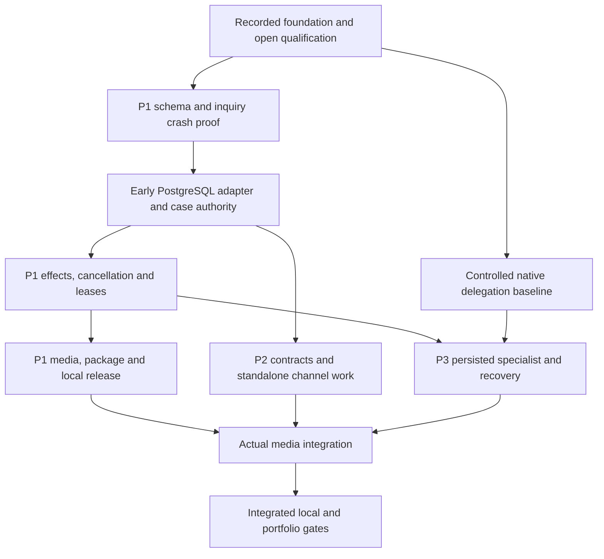

# Granular ecosystem implementation roadmap

| Field | Value |
| --- | --- |
| Status | Active |
| Purpose | Break the build plan's work packages into small, reviewable tasks and define the cross-project gates between them |
| Audience | Engineers and coding agents who choose, size or hand off the next slice |
| Scope | Ecosystem phases, shared tasks, cross-project gates, delivery checkpoints, sizing and completion rules; excludes per-project task detail |
| Owns | Subordinate granular task decomposition, phase gates, effort sizing and per-task handoff |
| Related | [Build plan](build-plan.md) · [P1 task plan](implementation/p1-agent-continuity.md) · [P2 task plan](implementation/p2-channel-continuity.md) · [P3 task plan](implementation/p3-delegation-reliability.md) · [Validation plan](validation-plan.md) |

## Purpose and authority

This roadmap breaks the work packages of the [build plan](build-plan.md) into
small, reviewable implementation tasks and defines the cross-project gates
between them. It is for engineers and coding agents who choose, size or hand off
the next slice. Use it with the per-project task plans to see what each phase
must prove, which tasks may run in parallel and which delivery checkpoints are
already recorded.

The goal is three independently usable libraries and one local reference
application, built in small, reviewable increments. This roadmap owns task
decomposition and cross-project execution gates. The build plan retains the
authoritative PLAN-01 through PLAN-22 sequence, and the
[project charters](portfolio-scope.md) retain all 54 acceptance requirements.
Task IDs below are work items, not acceptance IDs.

### Contents

| Section | What it covers |
| --- | --- |
| [Current position](#current-position) | The P1 delivery checkpoint, the reused foundation and review-driven additions |
| [Phasewise delivery map](#phasewise-delivery-map) | Ecosystem phases EC-00 to EC-08, their dependency graph and where each phase stands |
| [Shared work: implement once](#shared-work-implement-once) | Shared support tasks S-I01 to S-I08 |
| [Cross-project gates and parallel work](#cross-project-gates-and-parallel-work) | What each producer gate permits and which work may overlap |
| [What each project should show](#what-each-project-should-show) | The demonstrations and the truth each one shows in the UI |
| [Per-task engineering and coding-agent contract](#per-task-engineering-and-coding-agent-contract) | What to record for every task |
| [First ten implementation tasks](#first-ten-implementation-tasks) | The historical first-slice order |
| [P2 and P3 delivery checkpoints](#p2-and-p3-delivery-checkpoints) | Selected qualification by work item, from 0029 to the current joined application |
| [Effort, uncertainty and replanning](#effort-uncertainty-and-replanning) | Preliminary sizing and re-estimation rules |
| [Phase and release completion](#phase-and-release-completion) | Task states, release gates, commands and evidence handling |

### Detailed project plans

| Detailed plan | Implementation tasks | Product requirements |
| --- | --- | --- |
| [P1 Agent Continuity Lab](implementation/p1-agent-continuity.md) | P1-I01 through P1-I28 | P1-01 through P1-20 |
| [P2 Channel Continuity Kit](implementation/p2-channel-continuity.md) | P2-I01 through P2-I22 | P2-01 through P2-17 |
| [P3 Delegation Reliability Kit](implementation/p3-delegation-reliability.md) | P3-I01 through P3-I24 | P3-01 through P3-17 |

For each slice, the project plans name the prerequisites, affected artifacts,
normal and failure assertions, acceptance contributions, UI evidence, metrics
and errors, exit gates and effort.

### Related authorities

These documents remain authoritative for their subjects:

| Document | Owns |
| --- | --- |
| [Validation plan](validation-plan.md) | Test lanes, required fault scenarios, benchmarks and evidence |
| [Observability contract](observability.md) | Signals, safe errors, cardinality and operational evidence |
| [Demo plan](demo-plan.md) | Capability demonstrations and honest observable UI transitions |
| [Architecture](../Design.md) | Shared data flow, state authority, interfaces and failure boundaries |
| [Runtime decision](decisions/0001-runtime-boundaries.md) | Runtime, package and persistence boundaries |

Writing this roadmap performs no product implementation or dependency upgrade.

### Identifiers and terms

| Term | Meaning |
| --- | --- |
| P1-I01, P2-I22, P3-I18B and similar | Implementation tasks from the project plans. Some tasks are split, for example P3-I07A and P3-I07B. |
| P1-01, P2-07, P3-15 and similar | Acceptance IDs: the rows of each project charter's acceptance matrix. |
| BASE-01 | The harness baseline case for the existing M1 intake tests. The catalog defines 55 cases: 54 product cases plus BASE-01. |
| S-I01 to S-I08 | Shared support tasks, implemented once for all projects. |
| EC-00 to EC-08 | Ecosystem phases in the delivery map. |
| PLAN-01 to PLAN-22 | Work packages in the build plan. |
| Phase A to Phase H | The P1 implementation phases P1-A to P1-H in the P1 plan. |
| H1, H2 | P1 Phase H workload steps: the local inquiry baseline, then the restart, slow-dependency, saturation and shutdown measurements. |
| G business profile | The opt-in business application added by P1 Phase G. |
| 45A to 45D | The sub-phases of the [0045 joined application](work-items/0045-joined-native-channel-policy.md). |
| M1, V1 | M1 is the existing confirmed-investigation intake. V1 is the fixed project scope. |
| Selected qualification | The gates a work item selected passed within its declared scope. It does not, by itself, complete an acceptance row or a release gate. |
| scripted, local_real, provider_real | The trusted inference modes. Scripted is the default. |
| RTC | Real-time communication: LiveKit rooms, tracks and text streams. |
| CLI | Command-line interface. |
| OTLP | OpenTelemetry Protocol, used for trace and metric export. |
| POC, CI | Proof of concept (the complete local delivery target) and continuous integration. Remote CI is outside this local POC. |

## Current position

P1 V1 is implemented and locally qualified. P2 and P3 are partially implemented.
Their checkpoints are listed under
[P2 and P3 delivery checkpoints](#p2-and-p3-delivery-checkpoints), and the
[build plan](build-plan.md#current-status) summarizes status by project.

### P1 delivery checkpoint

| P1 phase | Tasks | What the phase delivered | Gate record |
| --- | --- | --- | --- |
| Phase A | P1-I01 to P1-I04 | Tasks 1 to 4 of the [first ten tasks](#first-ten-implementation-tasks) | [Phase A gate](work-items/0007-p1-phase-a-execution-foundation.md) passed |
| Phase B | P1-I05 to P1-I07 | The independent inquiry and supplier crash slice | [Phase B gate](work-items/0008-p1-phase-b-inquiry-recovery.md) passed |
| Phase C | S-I05, P1-I08 to P1-I10 | Restricted roles, verified PostgreSQL cutover, store parity and trusted synthetic scope | [Phase C gate](work-items/0009-p1-phase-c-postgres-cutover.md) |
| Phase D | P1-I11 to P1-I14 | Exact authority and intent; persisted waits, signals, retry and deadlines | Its [gate](work-items/0010-p1-phase-d-authority-and-waits.md) records observed tests |
| Phase E | P1-I15 to P1-I18 | Supplier-bound v2 proposals, PostgreSQL v3 effects, cancellation and durable completion delivery | Its [work item](work-items/0011-p1-phase-e-effects-and-completion.md) records the completed final combined gate |
| Phase F | P1-I19 to P1-I21 | Server-time leases, stale external-call safety and bounded pull-worker deployment and restart | [Final gate](work-items/0012-p1-phase-f-leases-and-deployment.md) passed |
| Phase G | P1-I22 to P1-I25 | Conversational adapter, visible continuity and traces | Inspected local combined gate recorded in the [work item](work-items/0013-p1-phase-g-conversation-and-showcase.md) |
| Phase H, step H1 | S-I06, P1-I27 | Local inquiry baseline | Completed under its [work item](work-items/0014-p1-phase-h-workload-baseline.md) |
| Phase H, step H2 | P1-I27 | Restart, slow-dependency, saturation and shutdown measurements | Passed; see the [reliability work item](work-items/0015-p1-reliability-workloads.md) |
| Phase H, release | P1-I26, P1-I28 | Host/Linux artifacts, API/failure review and genuine native consumer; provider_real v2 actual media qualification | Passed; see the [release work item](work-items/0019-p1-phase-h-release-qualification.md) |

The passed H2 measurements extended the broader P1-I27 restart, slow-provider
and media workloads. P1-I28 passed actual media qualification with
provider_real v2; local_real remains unqualified. P1 local V1 release gates
passed, and P1 V1 is qualified for the local POC using provider_real v2.
Complete P2/P3 acceptance remains pending. The initial estimates in this roadmap
remain a planning baseline, not a refreshed remaining-work forecast.

### Current local P1 qualification

P1 V1 is implemented and locally qualified with selected provider_real v2.

| Gate or evidence | Recorded outcome | Record |
| --- | --- | --- |
| Final 20-case index, the then-current P1-18, P1-14 and P1-20 runs, full H2, PostgreSQL, installed host/Linux artifacts and shared quality gates | Passed with independent reviews | [0019](work-items/0019-p1-phase-h-release-qualification.md) |
| provider_real deep gate rerun after the P1 PostgreSQL v5 upgrade | Passed 20 of 21 rows: BASE-01 and P1-01 to P1-19, with 104 tests and zero skips | [0047](work-items/0047-open-findings-schema-upgrades-and-landing.md) |
| P1-20 in that rerun | Blocked on that network; a rerun with `P1_PROVIDER_CA_BUNDLE` pointing at the approved bundle remains open | [0047](work-items/0047-open-findings-schema-upgrades-and-landing.md) |
| local_real | Not qualified | [0017](work-items/0017-p1-local-real-inference.md) |

Historical checkpoints retain their original scope.

- Complete P2/P3 acceptance remains pending.
- Hosted CI and publication are outside this local POC.

The rerun followed the explicit owner upgrade to P1 PostgreSQL v5 (persisted
mutation retry due time). The passing reference run had mounted an approved
certificate authority (CA) bundle into the native container, but every 0047 run
used the image trust store and recorded zero speech-to-text, language-model and
text-to-speech usage before the agent's reply timed out. The v5 change also
raised the pinned P1 runtime payload count from 77 to 78.

### Foundation reused from 9 November

The recorded 9 November foundation includes:

- SQLite M1 investigation intake, scoped idempotency, changed-payload conflict,
  admission safety and bounded inspection.
- The local API, native Python diagnostic agent, TypeScript console, LiveKit,
  PostgreSQL, Docker lifecycle and optional Jaeger UI.
- Frozen dependencies, immutable image selections, source and documentation
  contracts, negative harness fixtures, safe error envelopes and bounded API
  metrics and logs.
- Actual software development kit (SDK) text/audio smoke, browser
  authentication, text and explicit reconnect, and the visible M1
  acceptance/replay/conflict demonstration.
- A recorded passing baseline of 121 Python tests and 59 frontend tests. These
  counts are historical evidence, not a threshold for future quality.

The original baseline recorded all 54 product cases as planned. Phases A and B
then added executable SQLite evidence for P1-01 through P1-05. All twenty P1
rows now have passing retained reports under the selected-provider local
release. Full ecosystem acceptance remains pending because complete P2/P3
acceptance remains pending. The harness catalog owns current registrations.

Phase C added the standalone PostgreSQL inquiry adapter and controlled cutover.
Original SQLite M1 and the diagnostic worker remain independent profiles. The
opt-in G business application adds managed PostgreSQL work, scoped current-case
UI, native scripted speech and tools, and inspected raw Jaeger v3 traces.
Physical microphone quality, automatic network-loss recovery and real-model
quality remain unqualified.

Capacity claims require their own measurements, and remote CI is outside this
local POC. A prerequisite blocks only the work that needs it: independent
offline execution work can proceed while a permission-dependent media check
remains unverified.

### Review-driven additions

Use the [architecture audit disposition](work-items/0020-architecture-audit-reconciliation.md)
to distinguish older snapshot findings from current gaps.

- The [P1 operational extension](work-items/0021-p1-operational-safety-extensions.md)
  is planned post-V1 work.
- P2/P3 contract refinements stay within their existing acceptance IDs and phase
  gates.
- Implement one bounded slice, test its actual failure boundary and record
  review before progressing.

Current P1 qualification is unchanged. A documentation update does not certify
future operational behavior or human usability feedback.

## Phasewise delivery map

Use this map as the default serial path for one primary implementer. Parallel
branches are permitted only through the explicit gates below. A later row is not
a reason to delay independent contract or fixture work until every earlier
project is released.

| Ecosystem phase | Work to implement | Primary tasks | Exit evidence and visible proof |
| --- | --- | --- | --- |
| EC-00 Foundation delta qualification | Record known-good baseline, remaining browser permissions and safe runtime configuration changes | S-I01 recorded; S-I02; early S-I05 when needed | Existing capabilities remain working; unavailable checks stay visibly unverified; no infrastructure rebuild project |
| EC-01 P1 first recovery slice | Migration, explicit execution identity, independent fake inquiry and exact crash barrier | P1-I01–I07; early S-I04 after P1-I04 | A fresh worker reconciles the same inquiry; booking unchanged; CLI/store evidence is available first, and the shared projection shows actual states when ready |
| EC-02 P1 PostgreSQL and case authority | Controlled import/cutover, restricted runtime role, canonical case/quote/confirmation and persisted waits | S-I05; P1-I08–I14 | M1 identities preserved; current exact consent is required; waiting work survives without sleeping tasks |
| EC-03 P1 effects and coordination | Mutation reconciliation/uncertainty, cancellation, completion events, leases and deployment recovery | P1-I15–I21; S-I06 foundation | Authorized work progresses; stale attempts cannot write; ambiguous effects remain uncertain; restart preserves accepted state |
| EC-04 P1 conversational and library release | Native tools, real read projections, telemetry/export, scripted voice, isolated package consumer and benchmarks | S-I03; extend S-I04; P1-I22–I27; P1-I28 for live evidence | A conversation stays responsive while durable work continues independently; P1 local and portfolio gates reported separately |
| EC-05 P2 channel continuity | Typed events, trusted association, durable input/dispatch, fake SMS, case routing, playback evidence and standalone package | P2-I01–I22 | Voice/chat/fake-SMS resume one current case; duplicates/stale confirmations cannot become new actions; generated/played/acknowledged remain separate |
| EC-06 P3 first reliable specialist | Native baseline first, authenticated bounded HTTP capability, immutable input, applicability, races and process recovery | P3-I01–I15 | A current useful result progresses; late A cannot act on revised B; P1 remains the only durable execution scheduler |
| EC-07 P3 modalities and comparison | Static image and fixed policy capabilities, responsive conversation, stable delivery route, admission and three-way comparison | P3-I16–I24 | Specialist work stays bounded/read-only; outdated results stay historical; useful current results survive handoff and restart |
| EC-08 Integrated release | Supported-platform reproduction, installed consumers, all required local/live evidence and short demos | S-I07/S-I08 with completed project gates | Three independently usable packages plus one coherent reference app; no missing required case is reported as passed |



The graph shows dependency frontiers, not a second implementation schedule. In
particular, P2 and P3 local fixtures do not require the complete sibling
deployments. P1-I28 real-inference evidence may follow its local gate. Missing
provider setup must not silently block unrelated deterministic work or become a
passing live gate.

### Where each phase stands

| Ecosystem phase | Current position |
| --- | --- |
| EC-00 | S-I01 recorded; S-I05 implemented for P1 Phase C; S-I02 planned |
| EC-01 to EC-04 | Delivered through P1 Phases A to H; P1 local V1 release gates passed |
| EC-05 | P2-I01 to P2-I21 recorded in completed work items; P2-I22 in progress through the joined application |
| EC-06 | P3-I01 to P3-I15 recorded in completed work items; P3-01, P3-03 and P3-11 registered |
| EC-07 | P3-I16 to P3-I18B recorded in completed work items; P3-I19 and P3-I22 in progress; no work item yet for P3-I20, P3-I21, P3-I23 or P3-I24 |
| EC-08 | Pending: project gates are incomplete; S-I07 local integration active; S-I08 planned |

The [P2 and P3 delivery checkpoints](#p2-and-p3-delivery-checkpoints) give the
evidence for each P2 and P3 entry.

## Shared work: implement once

These support tasks do not create a fourth product. Their estimates exclude each
project's business event producers, feature views and scenario runs. If two
tasks are implemented in one change, record the shared work once rather than
charging both estimates for the same exporter, schema or UI scaffold.

| Task | Status and prerequisite | Deliverable and ownership | Failure/exit evidence | Effort |
| --- | --- | --- | --- | --- |
| S-I01 | Starting checkpoint recorded in this roadmap | Preserve baseline inventory, capability ledger and the existing PLAN/acceptance mapping; use it to open the first selected work item | Current evidence and missing evidence stay distinct; do not schedule the implemented foundation again | 0 h remaining |
| S-I02 | Planned; operator permission and existing local stack | Qualify diagnostic-browser microphone publication, denial, track correlation, mute/disconnect and cleanup; later voice playback belongs to P1/P2 media tasks | Actual expected track reaches the SDK worker; denial/unavailable capability remains visible; never substitute native-client frames for browser playback | 2–4 h |
| S-I03 | Implemented for the G local profile; extend/review for later project producers | Common bounded OTLP/exporter configuration, trace context propagation and local collector inspection; project tasks add their own spans/metrics | Inspect an actual trace; exporter failure cannot block acceptance/conversation/shutdown; no IDs in metric dimensions or private payloads in logs | 3–5 h |
| S-I04 | Implemented for G managed case projections; later project views remain separate | Common authorized GET/cursor read-projection envelope and bounded console refresh/error handling; feature views consume actual project-owned records | Replay/reconnect resumes safely, unknown stays unknown, scope and cursor/input bounds are tested; no timer-created progress or second event bus | 3–5 h |
| S-I05 | Implemented for P1-C; reuse/review for each new component migration | Extend local service profiles, versioned environment/credential upgrades and a one-shot PostgreSQL migration principal; preserve restricted serving roles | Existing credentials and volume owner labels survive upgrade; init is idempotent/private; runtime cannot create schemas; normal upgrade never requires volume reset | 3–5 h |
| S-I06 | H1 local inquiry manifest/controller and measured baseline complete; broader project workloads remain | Small seeded workload/evidence envelope reused by project load tasks, including machine/resource/mode/timing definitions | Declare numeric budgets before measuring; retain actual samples, errors and useful progression; do not claim production capacity from laptop counts | 2–4 h |
| S-I07 | Local host/container integration active; artifacts/services available | Run clean local setup, preserved-state restart and standalone/integrated installed consumers on the selected Python 3.14 host and Linux containers | Actual local executions and retained artifacts; neither source checkout nor CI YAML alone passes; remote CI/publication are outside scope | 3–5 h |
| S-I08 | Planned; all applicable project local gates, then selected live gates | Integrated success/failure rehearsal, cross-project identity/route review, final API/docs review and retained portfolio evidence | Report all 54 cases by required mode; local-ready and portfolio-ready remain separate; no optional carrier/Cloud account becomes a default prerequisite | 4–6 h |

### Scope of each shared task

- S-I02 is diagnostic input qualification. It does not replace actual scripted
  speech output, interruption and playback assertions later.
- S-I03 is common OTLP export wiring. P1-I24 and the
  P2/P3 tasks own their distinct application instrumentation.
- S-I04 is a read adapter and presentation envelope, never another case
  authority. Start S-I04 after P1-I04 for the first observed UI slice; later
  product tasks extend that scaffold.
- S-I05 may proceed alongside the SQLite inquiry slice but must finish before
  the early PostgreSQL adapter. Apply the same upgrade path to P2-I04, P3-I09 and
  P3-I21 before their owned schema, grants or configuration changes. Reusing the
  mechanism does not repeat its implementation estimate.
- S-I07 has foundation and product local-container passes. It does not depend
  on a hosted runner or repository publication.

### Credentials and configuration upgrades

- Grant migration privilege only to a one-shot job. Never pass the bootstrap
  administrator credential into the serving API or worker.
- Changes to environment schemas must add newly required secrets safely, without
  rotating existing database credentials or the volume-owner identity.
- Test old configuration upgrade, interrupted upgrade and repeated
  initialization.
- Introduce only the service and schema privileges needed by the next actual
  consumer.

## Cross-project gates and parallel work

| Gate | Producer | Consumer permitted after the gate | What is still not established |
| --- | --- | --- | --- |
| Execution identity and supported store contract | P1-I04, then P1-I08/I09 | Typed execution fixtures, adapter design and fake consumers | Rich cancellation, leases and full recovery |
| Current case and atomic intent authority | P1-I11/I12 with trusted scope from P1-I10 | P2 case/confirmation fixtures; P3 current-result/action fixtures | Complete channel/media/delegation runtime |
| Durable completion/delivery intent | P1-I18 plus narrow ResultDeliveryPort contract | P2 outbound adapter and P3 standalone result delivery | Guaranteed physical SMS or client playback |
| Execution recovery/deadlines/cancellation | P1-I14/I16/I17/I19/I20 | P3 persisted invocation and real recovery assertions | Specialist result applicability, which remains P3's responsibility |
| Real local conversation client | P1-I22–I25 | P2 actual audio/playback and P3 responsive-media scenarios | Real inference quality or network-loss recovery not exercised by that run |
| Current channel association and route | P2's public routing/resumption adapter | P3 integrated returning-interaction result routing | P3 need not depend on a complete P2 deployment for standalone tests |
| Installable execution package | P1-I26 | P3 isolated package consumer and declared P1 library dependency | Any undeclared sibling source/store access |

### Contract ownership

Freeze only the fields required by the next slice, and version changes
explicitly. Do not design every future schema before running the first worker.
One owner changes shared authority and contract definitions. Parallel agents may
prepare fixtures, review code or implement frozen adapters in separate owned
paths.

### Work that may overlap

- P2-I01 to P2-I06 contract and standalone work can overlap later P1 work after
  the required ports are agreed.
- P3-I01/I02 can run early against controlled input without the complete
  application.
- P3-I03 to P3-I05 schema and service fixtures may proceed after the P3 native
  decision. Real persisted invocations and race/recovery gates still wait for
  P1's actual contracts.
- P2 is required only for P3's integrated route, not for every P3 test.

## What each project should show

| Checkpoint | Demonstration | Truth shown in the UI |
| --- | --- | --- |
| First P1 proof | Accept inquiry, stop worker after supplier success, recover in a new process | Original identities and unchanged booking from CLI/store evidence first; read-projection UI follows S-I04 |
| P1 local V1 | Exact quote confirmation, mutation/reconciliation, waits, cancellation and worker takeover | Committed consent, actual effect outcome and completion delivery are separate |
| First P2 proof | Accept fake SMS, kill gateway before dispatch, recover the same input | Original receipt; repeated processing visible; one business acceptance |
| P2 local V1 | Interrupt voice, continue in chat/fake SMS, reconnect to the current case | Case revision, active route, generated/played/acknowledged/unknown evidence |
| First P3 proof | Hold a capability, revise A to B, release A and complete B | Computation may succeed while A is outdated; current B progresses |
| P3 local V1 | Kill a specialist/coordinator and route the recovered current result after handoff | Execution, applicability, cancellation observation and delivery remain distinct |

### Interface rules

- Keep the current TypeScript console and native SDK as the V1 default.
  Consider official Agents UI components only at a genuine conversation-client
  integration checkpoint, with one room/session lifecycle owner and preserved
  authenticated boundaries. A framework rewrite is optional work, not a
  prerequisite for these proofs.
- A bounded GET/cursor projection is sufficient initially, and native SDK
  notifications may request a refresh. Do not create a bespoke transport or
  durable event bus for the interface.
- The process harness injects failure and owns only its test children. The
  normal UI must not receive a Docker socket, arbitrary command execution or an
  unscoped process-control endpoint.
- Optional demonstration controls must be narrow, explicitly isolated test-mode
  operations, added only after the underlying scenario works.

## Per-task engineering and coding-agent contract

Before coding, copy the [work-item template](work-items/template.md) and select
the applicable engineering gates from the [validation authority](validation-plan.md):
G-READY, G-FAST, G-CONTRACT, G-DURABLE, G-OBS, G-MEDIA, G-PACKAGE and G-RELEASE.
Then record:

1. The implementation task, PLAN mapping and affected acceptance IDs. Identify
   which assertions are only partial until later integration evidence exists.
2. Prerequisites, owned paths, typed public boundary, storage/schema version,
   principal/scope, stable identities and the exact commitment/cancellation
   boundary.
3. The ordinary path plus a named failure schedule and liveness assertion.
   Prefer process barriers and fake clocks to lucky races or sleeps. A crash
   test must actually terminate its owned process and inspect persistent state
   after recovery.
4. Appropriate tests, finite time/resource limits, cleanup and evidence
   locations. A low-impact documentation edit needs the existing documentation
   check, not a new unit test that merely repeats its wording.
5. Safe error/unknown-outcome behavior, fixed metric vocabulary, correlation/log
   policy and the actual UI state producer. Add signals with real code, not
   zero-only placeholder metrics or fabricated progress.
6. Given/When/Then acceptance for the slice, the normal/negative/useful-progress
   assertions, and the expected safe log/error/metric evidence. Python follows
   the [engineering guide](python-engineering.md), and each changed Design.md
   follows the [standard template](design-template.md). Add new packages to
   actual test, lint and type discovery; current service-only typing cannot
   qualify a future SDK.
7. Exact implemented verification commands, outcomes, artifacts, interface and
   documentation changes, independent review findings, assistance and the next
   eligible task.

### Harness rules

- Extend the current harness minimally when process, media or language lanes
  arrive.
- Keep stable acceptance IDs and versioned report metadata for mode,
  prerequisites, command, timeout and artifacts.
- Local scripted results cannot become passing live inference evidence.
- Missing required tests, skipped cases, timeouts, zero-test runners and
  unavailable prerequisites remain non-passing for the affected gate.
- Do not build a universal runner framework before a concrete scenario requires
  it.

## First ten implementation tasks

Use this default sequence to obtain the first useful recovery proof quickly.
S-I01 is already recorded. S-I02 can run alongside it when permission is
available. S-I05 may also run earlier, after P1-I01, if an isolated owner is
available.

| Order | Task | Concrete result |
| --- | --- | --- |
| 1 | P1-I01 | Execution/consent/storage decision and precise crash contract |
| 2 | P1-I02 | Owned-process/failpoint harness and old-data fixture |
| 3 | P1-I03 | Safe versioned SQLite migration with preserved M1 data |
| 4 | P1-I04 | Typed persisted execution and inquiry effect identity |
| 5 | P1-I05 | Independent fake supplier with persisted inquiry evidence |
| 6 | P1-I06 | One real worker completes the ordinary inquiry |
| 7 | P1-I07 | New process recovers the selected inquiry crash boundary |
| 8 | S-I05 | Upgrade-safe configuration and restricted migration/runtime roles |
| 9 | P1-I08 | Verified controlled PostgreSQL import/cutover |
| 10 | P1-I09 | PostgreSQL execution adapter and supported-store parity |

The first recovery demo, shown through CLI and store evidence, is available
after task 7. That is before mutation, channels,
specialists or live inference. Showing its observed states in the UI also
requires S-I04. This is a completed vertical slice, not a complete P1 V1
release.

The historical first-slice order above is complete. The later P1 phases D to H
are listed in the [P1 delivery checkpoint](#p1-delivery-checkpoint). Preserve
the Phase G evidence, the H1/H2 snapshots and the P1-I26 artifact, API and
genuine-consumer proofs. P1 V1 is qualified for the local POC using
provider_real v2; local_real remains unqualified and complete P2/P3 acceptance
remains pending. Advance at the documented dependency frontiers.

## P2 and P3 delivery checkpoints

Each completed work item below passed its own selected gates within its declared
scope; 0045 to 0047 are still Active. Apart from the 0031 phase, which
registered complete P3-01, P3-03 and P3-11 lab runners, none of them registers a
complete charter row. The catalog remains
fifty-five cases with twenty-four registered runners. All seventeen P2 rows and
the fourteen remaining full P3 rows stay planned.

| Work item | P2 task | P3 task | Selected outcome |
| --- | --- | --- | --- |
| [0029](work-items/0029-p2-gateway-and-p3-issued-execution.md) | P2-I08 bounded gateway | P3-I07A issued runner | Checkpoint completed |
| [0030](work-items/0030-p2-agent-recovery-and-p3-completion.md) | P2-I09 agent process recovery | P3-I07B first delivery and fake action | Gates passed; P2-I09 and full P3-I07 complete |
| [0031](work-items/0031-revision-routing-and-delegation-acceptance.md) | P2-I10 revision routing | P3-I08 concurrent acceptance | P3-01, P3-03 and P3-11 registered |
| [0032](work-items/0032-linked-confirmation-and-result-projections.md) | P2-I11 linked confirmation | P3-I09 result projections | Selected local scope complete |
| [0033](work-items/0033-outbound-replies-and-completion-processing.md) | P2-I12 outbound replies | P3-I10 completion processing | Actual and installed gates passed |
| [0034](work-items/0034-callback-evidence-and-applicability-refresh.md) | P2-I13 callback evidence | P3-I11 applicability refresh | Selected evidence passed |
| [0035](work-items/0035-send-policy-and-action-races.md) | P2-I14 send policy | P3-I12 action races | Selected local gates passed |
| [0036](work-items/0036-native-input-and-deadline-cancellation.md) | P2-I15, P2-I16 native input | P3-I13 deadlines | Native, artifact and temporal gates passed |
| [0037](work-items/0037-playback-evidence-and-process-recovery.md) | P2-I17 playback evidence | P3-I14 process recovery | Selected scope passed |
| [0038](work-items/0038-case-rehydration-and-standalone-release.md) | P2-I18 case rehydration | P3-I15 standalone consumption | Selected scope passed |
| [0039](work-items/0039-bounded-channel-workloads-and-image-evidence.md) | P2-I19 workload study | P3-I16 image HTTP | Both lanes passed |
| [0040](work-items/0040-operations-ui-and-fixed-policy-evidence.md) | P2-I20 operations UI | P3-I17 fixed policy | Selected scope passed |
| [0041](work-items/0041-standalone-channel-and-durable-policy.md) | P2-I21 standalone application | P3-I18A durable policy | Selected scope passed |
| [0042](work-items/0042-responsive-native-policy-and-compact-demo.md) | None | P3-I18B native RTC text | Source and installed passed |
| [0043](work-items/0043-stable-result-delivery-and-return-context.md) | P2-I22 prerequisite | P3-I19 prerequisite | Delivery and read seam passed |
| [0044](work-items/0044-origin-bound-channel-policy.md) | P2-I22 prerequisite | P3-I19 prerequisite | Original-input binding passed |
| [0045](work-items/0045-joined-native-channel-policy.md) | P2-I22 | P3-I19, P3-I22 | Active; 45A qualified |
| [0046](work-items/0046-joined-showcase-providers-and-demo.md) | P2-I22 contribution | P3-I19 contribution | Active; provider journeys and demo video |
| [0047](work-items/0047-open-findings-schema-upgrades-and-landing.md) | P2 v9 indexes and gateway fixes | P3 processing and close fixes | Active; P1-20 rerun open |

The subsections below keep each checkpoint's counts and caveats as recorded at
that checkpoint. Where a later work item changed the picture, the later
subsection says so.

### 0022 to 0031: first slices, gateway, agent recovery and routing

P2 started with the [contract slice](work-items/0022-p2-channel-contracts.md),
and P3 started independently with the
[controlled native baseline](work-items/0023-p3-native-baseline.md). P2 then
gained a verified durable inbox and association, a standalone preview, persisted
dispatch and reconciliation, and a bounded gateway.

The [gateway and issued-execution checkpoint](work-items/0029-p2-gateway-and-p3-issued-execution.md)
added P2-I08 and P3-I07A. P3-I07A is the explicit issued runner with durable
opaque results.

The [completed bounded phase](work-items/0030-p2-agent-recovery-and-p3-completion.md)
added two tasks:

- P2-I09: owned scripted-agent process recovery.
- P3-I07B: first durable result delivery (receiver acceptance) plus a
  separately confirmed fake action.

P1 work-profile v3 adds immutable recipient-bound delivery and guarded, atomic
work/case action receipts. It preserves, and does not replace, the v1 accepted
input and the v2 issued execution. One protected P1 transaction checks work
eligibility (cancellation, deadline and result) together with exact case
authorization and confirmation. Receiver and supplier I/O remain outside that
transaction. Current-read applicability grants no action authority, and P3 owns
no second execution ledger. The selected process, database, artifact and
regression gates passed, completing P2-I09 and the full P3-I07 task.

The [completed routing and acceptance phase](work-items/0031-revision-routing-and-delegation-acceptance.md)
added P2-I10 explicit structured investigation compare-and-set (CAS) revision
routing and P3-I08 concurrent acceptance and public inspection. It also added
complete registered P3-01, P3-03 and P3-11 lab runners, and those three rows have
fresh passing reports. All 17 P2 rows and the remaining 14 P3 rows stay planned.
P2-I10's selected qualification is recorded separately. It is separate from the
outbox, broader recovery, default Docker/UI, media/model and integrated release
gates. Default Docker/UI composition and broader recovery, media, model, scale
and integrated release remain pending.

### 0032: linked confirmation and result projections

The [completed linked-confirmation and result-projection phase](work-items/0032-linked-confirmation-and-result-projections.md)
completes P2-I11 and P3-I09 within their selected local scope. No complete P2 or
additional P3 acceptance row is registered.

- P2 uses immutable exact prompts and a current-association preflight, then the
  existing P1 atomic confirmation and original-command receipts.
- P1 work v4 exposes result-only, source-bound cursors. P3 checkpoints derived
  as-of observations without creating another execution owner.

Unknown acknowledgement, later work or case changes, delivery or event
acknowledgement (ACK) and broader recovery remain distinct. Neither addition
changes default Compose/UI or the qualified booking, native or provider behavior.

### 0033: outbound replies and completion processing

The [completed outbound-reply and processing phase](work-items/0033-outbound-replies-and-completion-processing.md)
completes P2-I12 and P3-I10 within their selected local scope. Its actual and
installed gates passed.

- P2 preserves one logical recipient/outbound identity, selects versioned
  authorized routes and commits suppression and permission checks together with
  the possible-send reservation.
- P3 adds only derived terminal ACKs and a separate bounded discovery cursor. An
  unknown result stays unacknowledged while later eligible work can progress.

P1 APIs, work v4 and booking, native and provider behavior remain unchanged.
Callbacks, ambiguous resend policy, broader applicability/recovery and complete
native/media release remain separate. The phase introduces no automatic
booking-completion integration and no new complete charter row.

### 0034: callback evidence and applicability refresh

The [completed callback and applicability phase](work-items/0034-callback-evidence-and-applicability-refresh.md)
retains selected passing P2-I13 and P3-I11 evidence. Callbacks remain
original-attempt observations. Refreshed applicability is non-atomic as-of
metadata. Display hiding preserves profile-lifetime replay identities and
protected capacity.

### 0035: send policy and action races

The [completed send-policy and action-race phase](work-items/0035-send-policy-and-action-races.md)
completed the selected local gates for P2-I14 and P3-I12.

- Ordinary unknown sends remain held. Only a separately configured cooperating
  idempotent provider and a new trusted controller command can reserve an
  eligible same-operation retry.
- P3 exercises both protected revision/intent lock orders and the
  cancellation/effect boundaries through existing public guards.

At that checkpoint, P1's 77 and P3's 30 runtime payloads, their authorities and
default Compose/UI were unchanged. No new complete charter row, automatic retry,
external provider or inference call, or full-release claim follows.

### 0036 and 0037: native input, deadlines, playback and process recovery

Preserve the [completed native/deadline checkpoint](work-items/0036-native-input-and-deadline-cancellation.md):
the selected P2-I15/I16 actual native and artifact gates and the P3-I13 temporal
gates passed. The [completed playback/recovery handoff](work-items/0037-playback-evidence-and-process-recovery.md)
records its selected scope and retained failure provenance.

| Selected gate | Recorded result |
| --- | --- |
| P3-I14 source recovery | Seventeen assertions passed, with eight owned process kills and one actual two-waiter issuance graph |
| P3-I14 installed recovery | The same seventeen assertions passed, with eight owned process kills and one actual two-waiter issuance graph |
| P3 compatibility across the execution, processing, applicability, action-race and deadline lanes | Eighty assertions passed, with complete cleanup and unchanged P1/P3 runtime payloads |
| P2-I17 PostgreSQL storage | The sixteen-case gate passed |
| P2-I17 actual browser/media | The three-group gate passed |
| P2-I17 isolated npm consumer | Passed |
| P2-I17 Python package | The then-qualified eight-payload package passed ninety-four unadapted tests |
| P2 compatibility | All 147 assertions passed |

P3-I14's recovery keeps these rules:

- Original issuance replay never invokes; only an explicitly new eligible
  command can do so.
- Unknown possible delivery remains lookup-only while separate current work
  progresses.
- P1 remains the sole durable authority.

P2-I17 completed its selected communication scope. Final shared phase closure is
recorded separately in the linked handoff. Generated text, SDK progress,
client-reported playback and business consent remain separate facts.

### 0038: case rehydration and standalone consumption

The [case rehydration and standalone phase](work-items/0038-case-rehydration-and-standalone-release.md)
completed selected P2-I18 and P3-I15.

| Selected gate | Recorded result |
| --- | --- |
| P2 storage | Eighteen assertions passed |
| P2 actual room/voice/text/SMS browser groups | Three groups passed |
| P2 compatibility | 166 assertions passed |
| P2 Python distribution | The nine-payload distribution passed 111 unadapted tests across fifteen commands |
| P2 npm consumer | The 96-payload consumer passed seven stages with actual P2 PostgreSQL/HTTP and explicitly synthetic case and operation ports |
| P3 installed assertions | Sixteen passed: eight offline and eight local lab assertions, including one owned caller-process kill, original replay and complete cleanup |

That checkpoint preserved thirty Python and sixteen npm payloads and the
seventy-seven-payload P1 dependency; the later image slice is additive.

Loaded case state and history and source-qualified response facts are separate,
non-atomic as-of observations. Loading creates no execution, speech or consent
authority. P1 revision 0 is read-only under the existing positive-revision
native command contract. Original receipts survive replay. Cleanup retains
shared readers and owned work until dependent clients and processes actually
settle.

The final shared gates at this checkpoint passed:

| Shared gate | Recorded result |
| --- | --- |
| Python checks | 2,148 passed |
| TypeScript checks | 1,224 passed |
| Broad/strict Python typing | 144/132 sources |
| Python formatting | 387 files |
| Document validation | 113 documents |
| Mermaid syntax parsing | All 29 bodies |
| Ordinary stack doctor and eight smoke checks | Passed with ten audio frames and the original M1 state preserved |

### 0039: bounded workloads and image evidence

The [completed work item](work-items/0039-bounded-channel-workloads-and-image-evidence.md)
owns P2-I19 and P3-I16. P2-I19's capacity and dormant-case experiments and
P3-I16's standalone static-image HTTP completed selected qualification in this
handoff.

- P2 implements a seeded steady/burst/saturation study and a 1,000-case
  dormancy study, plus bounded ordinary observer callbacks.
- P3 implements a separate read-only image contract and HTTP path with actual
  PNG validation, explicit clarification, independent synthetic-image facts and
  fresh installed consumers.

Both selected qualification lanes passed, and no new complete acceptance row is
registered. P1's policy-only work authority and default stack remain unchanged.

### 0040 and 0041: operations UI, fixed policy and standalone application

The [operations and policy handoff](work-items/0040-operations-ui-and-fixed-policy-evidence.md)
records completed selected P2-I20 and P3-I17 qualification. It adds two things:

- an opt-in, read-only operations UI and telemetry adapter (P2-I20);
- an explicit v2 fixed-policy HTTP contract with independent structural and
  factual verification (P3-I17).

Preserve all prior completed gates. These additions require fresh affected
storage/media, package, v1 policy/image and shared quality checks. No new
complete catalog registration is made.

The [completed 0041 work item](work-items/0041-standalone-channel-and-durable-policy.md)
implements P2-I21's installed standalone application and the coherent typed v2
durable prerequisite for P3-I18 (P3-I18A). Its selected gates and the shared
quality gates passed:

| Selected gate | Assertions |
| --- | --- |
| P2-I21 installed standalone application | 20 |
| P2 installed public-P1 adapter contract | 6 |
| P2 compatibility | 187 |
| P3-I18A durable fixed policy, source and installed | 12 in each mode |
| P3 offline package, separate from the durable twelve | 8 |
| P3 compatibility | 146 |

Preserve the handoff's exact historical/current source and archive attribution.
Native background conversation and its bounded UI read view follow that
prerequisite; the next subsection records the selected P3-I18B result. v1
completion, projection and action remain explicitly separate. Full
charter/release and model evidence stay separately gated. Selected task results
do not establish full release.

### 0042: responsive native policy conversation

Selected P3-I18B native RTC text qualification passed in
[0042](work-items/0042-responsive-native-policy-and-compact-demo.md). One
model-argument-free tool acknowledges real P1 work, and a useful second answer
arrives while the authenticated specialist is held.

| Selected gate | Recorded result |
| --- | --- |
| Source mode | Twelve backend/SDK assertions and three browser groups passed |
| Installed mode | Twelve backend/SDK assertions and three browser groups passed |
| Offline package, within installed mode | Eight separate assertions passed |

Inference is scripted: the profile qualifies neither audio, speech recognition,
model quality nor provider calls.

### 0043: stable result delivery and return context

The completed [0043 work item](work-items/0043-stable-result-delivery-and-return-context.md)
implements selected P3-I19/P2-I22 delivery and read prerequisites. Package and
final aggregate outcomes are recorded separately there.

| Selected gate | Recorded result |
| --- | --- |
| Source storage | Sixteen assertions passed |
| Source return | Four assertions passed |
| Installed package lane | Twenty-five stages passed |
| Final shared checks | Passed |

These additions create no new complete acceptance row.

0043 set the order of the next two steps:

1. Before native composition, persist a versioned original P2
   operation/input-receipt/digest binding through P1's existing opaque work
   body, preserving the first accepted deadline and evidence on replay. The 0044
   work item completed this step.
2. Then join one native SDK owner to A/B voice/text and signed simulated SMS.
   This is the 0045 joined application.

0043 left model calls, restart discovery, full charter registration and the
final video to explicit later evidence.

### 0044: original-input binding

The [0044 work item](work-items/0044-origin-bound-channel-policy.md) is
completed. It implements selected P3-I19/P2-I22 original-input prerequisites
without a new queue or migration.

- Versioned facades, the narrow operation client and the local bridge have
  passing focused and shared tests and isolated package/fake-port checks.
- Its fourteen actual PostgreSQL assertions passed, including independent
  original-input/work/result joins and the owned commit-before-ACK kill.
- Existing 0043 result-return and P3 completion regressions passed after the
  shared changes.

At closure, integrated media, restart/discovery, applicable providers and the
final video retained their later gates. No complete charter registration
advances from these checks.

### 0045 to 0047: the joined application (current frontier)

The [0045 work item](work-items/0045-joined-native-channel-policy.md) owns the
joined local application and is still Active. It composes the qualified P2
native intake/rehydration, original-input policy-v3 and P2 result-receiver seams
into one locally runnable synthetic travel-support application. It contributes
to P2-I22, P3-I19 and P3-I22, and to P2-09, P2-12, P2-15, P3-02, P3-12 and
P3-17, without replacing their remaining charter and release requirements.

| Sub-phase | Scope | Recorded position |
| --- | --- | --- |
| 45A: contracts and ownership | Original/prepared/read and installed contracts | Qualified |
| 45B: actual backend composition | Public source, gateway, client and executor composition | Components implemented; complete frozen joined gate open |
| 45C: compact UI and native media | Actual native media and the compact browser journey | Connected observations recorded; gate open |
| 45D: reproducible app and handoff | Installed/local packaging, shared validation and the recorded demo | Open |

Phase 45B detail:

- Explicit owner setup succeeds, and preliminary actual signed-SMS, execution
  and delivery joins are observed.
- The current-result producer is component-tested and attached through one
  application-owned room facade.
- Room control and attachment, the Node native prepare/context bridge and a
  single-session scripted worker have scoped component qualification.
- The parent room/process composition has a component baseline: Parent
  Start/End passed nineteen focused independent tests, and the explicit
  launcher and its helper passed 36 focused tests.
- The complete frozen joined database, current-result and restart gate remains
  pending.

Phase 45C detail: the first connected browser probe observed real native
readiness, one fresh text reply, non-silent samples from the selected remote
audio track, the original native work dispatch, End, dormant-SMS visibility and
Forget. No SMS or returning interaction was submitted in that probe. Both whole
joined observations remain failed. The connected voice, interruption,
dormant-SMS, return and restart assertions remain required.

Later work on the same application:

- [0046](work-items/0046-joined-showcase-providers-and-demo.md), still Active,
  runs the journey with real Deepgram, OpenAI and ElevenLabs models in an
  explicit provider mode. Provider keys reach only each room's native worker,
  and the persisted dispatch decision stays the deterministic investigation rule
  in every mode. Three consecutive provider-mode journeys completed in 36–41
  seconds each, including End, with all nine inputs dispatched on their first
  attempt. It recorded an 80-second narrated demo video. It contributes to
  P2-I22, P3-I19 and the portfolio demo goal, registers no charter row and does
  not replace the 0045 qualification gates.
- [0047](work-items/0047-open-findings-schema-upgrades-and-landing.md), still
  Active, closed the 0046 review findings that the owner selected on 14 November
  2026. It added the explicit owner upgrades to P1 v5 (persisted mutation retry
  due time: 1 second doubling to 30 seconds, never past the deadline) and to
  P2 v9 (three operating indexes), plus a landing page. The full scripted joined
  journey passed on a fresh P2 v9 profile, and one complete demo video was
  recorded at the owner's request. Its P1 requalification left P1-20 open, as
  described under [Current local P1 qualification](#current-local-p1-qualification).

Items still open after 0047 are the P1-20 rerun with the approved CA bundle,
P1/P3 connection pooling, batched gateway polling, P2 lifetime capacity
tombstones, P1 lock-free reads and incremental validation, and three findings
from the demo recording. Preserve the existing acceptance IDs, and keep
component evidence separate from complete P2/P3 charter requirements.

## Effort, uncertainty and replanning

### Initial sizing

| Work area | Task count | Preliminary direct engineering effort |
| --- | --- | --- |
| P1 | 28 | 73–108 h |
| P2 | 22 | 53–98 h |
| P3 | 24 | 64–89 h |
| Shared remaining work | 7; S-I01 already recorded | 20–34 h |
| Initial decomposition baseline | 81 originally planned tasks | 210–329 h |

These are initial task-sizing ranges, not a measured remaining-delivery
forecast. They assume prerequisites work and include each slice's targeted
tests, documentation and first review. They exclude learning, unexpected
compatibility work, later review fixes and additional presentation polish.

A provisional 20–30% integration/review reserve would produce roughly 252–428
engineering hours. It is a scheduling allowance, not permission to hide
unresolved work inside completed tasks. Do not add another reserve for work
already explicitly estimated.

### Re-estimation

The historical 204–304-hour estimate in the build plan remains historical. This
new bottom-up pass is deliberately not obtained by subtracting guessed hours for
the existing foundation. Re-estimate after each of the following checkpoints,
using actual implementation, test and review time and the remaining work:

- P1-I07
- P2-I08
- the first real browser audio
- P3-I14

At each checkpoint, keep estimates, time spent and new discoveries separate. All
four checkpoints have now passed, and the build plan records that a measured
remaining-delivery forecast is still pending.

### Weekly budget and dates

The existing 12–15-hour weekly budget includes learning and review, not just
coding. Keep supporting study inside it. This plan commits no calendar
completion date. Use a revised remaining-work estimate and actual available
engineering time before assigning dates. Reduce optional UI, framework and
provider experiments before weakening the 54 required invariants.

## Phase and release completion

### Task states and phase exit

A task moves through five states in order: planned, ready, in-progress,
needs-evidence and done. Ready means prerequisites exist; it does not mean a
product requirement passed. A phase exits only with the concrete assertions and
artifacts defined in its project plan. If an expected gate fails, keep the phase
open and create a bounded corrective task.

### Release gates

| Release gate | Requirements |
| --- | --- |
| Local-ready V1 | Every applicable local acceptance row, actual process and media evidence, migrations/restart, resource bounds, supported-platform setup and isolated package consumers |
| Portfolio-ready V1 | Everything in local-ready V1, plus selected real-model outcomes, equivalent comparisons, costs/configuration and success/failure demonstrations |

An unavailable live lane stays unverified. It does not invalidate an independent
passing local assertion, and it does not complete the portfolio gate.

### Commands

Run these existing commands from the repository root after its documented
bootstrap. Product- and mode-specific commands are planned until implemented
and verified.

| Task | Command | Notes |
| --- | --- | --- |
| Run the shared fast checks | `make check` | Harness checks with tests, Ruff and mypy |
| Check Python formatting | `make format-check` | Ruff formatting check |
| Run the frontend checks | `make frontend-check` | Formatting, type checks, tests and builds |
| Validate the acceptance catalog | `.venv/bin/python -m harness validate` | Reports the case and registration counts |
| Run the baseline case | `.venv/bin/python -m harness run BASE-01` | The existing M1 intake tests |
| Run the deep acceptance lane | `HARNESS_PYTHON=.venv/bin/python sh scripts/harness-deep.sh` | Exits with status 2 while any required row lacks a complete registered runner |

The same commands as one sequence:

```sh
make check
make format-check
make frontend-check
.venv/bin/python -m harness validate
.venv/bin/python -m harness run BASE-01
HARNESS_PYTHON=.venv/bin/python sh scripts/harness-deep.sh
```

The deep command remains incomplete, with exit status 2, while any required row
lacks a complete registered runner. The catalog is authoritative for current
registrations. Phase tests contribute evidence; only a reviewed complete
assertion mapping may register a charter row.

### Local evidence and documentation

- Run local-setup smoke only under its existing prerequisites, including the
  current single active diagnostic-room limit.
- Keep disposable artifacts under the ignored .local directory. Promote only
  reviewed synthetic evidence when a release needs it.
- Update the nearest AGENTS.md, Design.md, README.md and the relevant work item
  with each implemented boundary.
- Do not replace the project charters with a second checklist.
