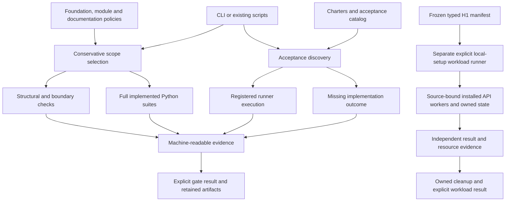
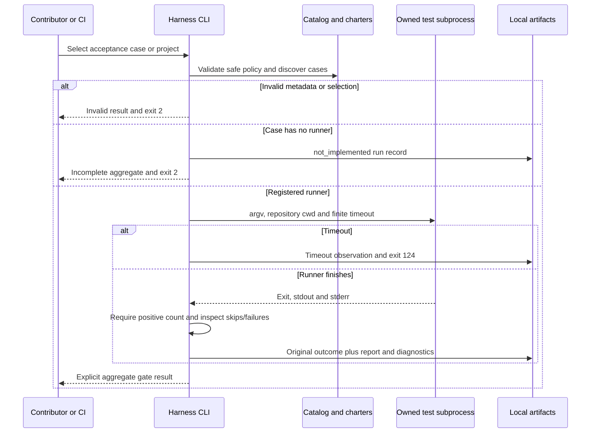
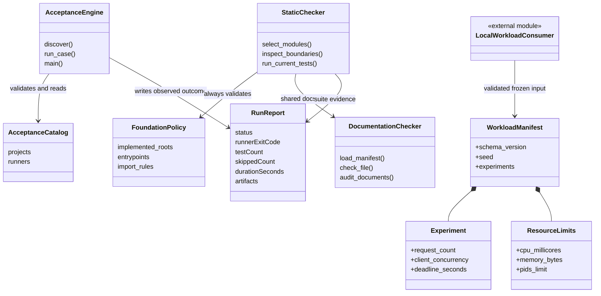

# Harness design

Status: Active
Last reviewed: 11 November 2026

## Overview

The harness is repository tooling with structural and behavioral planes. Module,
foundation and documentation policies check declared structure and known
boundaries. The acceptance catalog discovers requirements and runs registered
tests. Neither plane infers runtime correctness from documentation, diagrams,
process exit alone or the number of tests.

This support boundary is not a fourth product. BASE-01 exercises the implemented
M1 intake. P1-01/P1-02/P1-03 run the shared actual accepting-process suite;
P1-04/P1-05 run the shared independent supplier/worker recovery suite;
P1 local V1 coverage passed. P3-01/P3-03/P3-11 have complete registered lab
runners and fresh passing reports; all 17 P2 and remaining 14 P3 rows stay planned.
The catalog owns current complete registrations. Every later runner requires
meaningful executable assertions and observed evidence. The
[validation plan](../docs/validation-plan.md) owns evidence sufficiency, the
[charters](../docs/portfolio-scope.md) own acceptance IDs, and
[README.md](README.md) owns the implemented CLI.

H1 adds dependency-free WorkloadManifest, Experiment and ResourceLimits values
for one explicit inquiry baseline. Local setup owns their installed-runtime
consumer, not the catalog engine. Planning and measurement retain distinct status;
the [H1 work item](../docs/work-items/0014-p1-phase-h-workload-baseline.md) owns the
qualified local inquiry measurement and its inspected results. Full H/P1 release
and later P2/P3 workload qualification remains planned.

The completed linked-confirmation/result-projection slice adds selected explicit
application/database gates without registering new product rows. Public feed,
exact-consent bridge and derived checkpoint tests join the appropriate source
owners. Selected local qualification passed; preserved historical
P1 provider evidence is distinct from these new backend-only observations.

The completed outbound-reply/processing slice adds selected role-separated storage/
process qualification. It changes no P1 public API or complete runner registration.
Exact inventories, actual process barriers, finite raw capture, safe fixed reports
and independently observed cleanup remain required; selected local qualification
passed for the 24/16 named cases and isolated installed consumers. Provider acceptance and P3 processing acknowledgement do not establish
physical delivery, human acknowledgement or source-event deletion permission.

The [completed send-policy/action-race phase](../docs/work-items/0035-send-policy-and-action-races.md)
completed the selected local gates for P2-I14 and P3-I12. Preserve the
completed callback/applicability checkpoint. P2 requires 30 named actual assertions,
including populated inbox v4-to-v5 migration/restore, ordinary unknown holds,
cooperating same-key retries, callback ordering and independent provider ledgers.
P3 freezes 16 cases/31 one-time modes, three owned PID kills and two actual
two-waiter SQL order graphs. Its bounds are 180 seconds total/15 cleanup, at most
32 children, 128 KiB aggregate capture, 2 KiB per stream and a 32 KiB final report.
Prewarm both writers and the same owner locker/observer before lock contention;
never change P1's lock timeout. Validate exact keys and JSON primitive types,
first-failure precedence, role-separated environments and complete cleanup.
Optional diagnostic runs retain only bounded redacted failure streams and always
remain non-qualifying. Actual, isolated installed and prior regression gates passed for this slice;
require them after affected changes. No complete charter registration or P1/P3 runtime change is
introduced; physical delivery/human ACK remains distinct from provider evidence.

## Objectives

| Type | Objective | Success criterion |
| --- | --- | --- |
| Business | Make portfolio claims reviewable | A reader can distinguish a structural pass, a passing baseline, missing product behavior and runtime evidence. |
| Business | Enable reliable coding-agent handoffs | A fresh contributor can select a bounded scope, run existing commands and inspect original outcomes/artifacts without chat context. |
| Technical | Fail closed on unsafe or incomplete policy | Missing/corrupt foundation policy, unsafe paths, unknown fields and ownership violations produce explicit non-passing reports. |
| Technical | Execute meaningful tests under finite deadlines | Passing behavior requires a positive observed test count, no required skips and a successful runner; timeout and zero-test success cannot pass. |
| Technical | Preserve three-product ownership | Foundation policy runs for every selected scope without creating another product namespace or bypass. |

## Functional requirements

These local design rows do not create acceptance IDs or register future runners.

| Type | Requirement | Acceptance assertion | Status |
| --- | --- | --- | --- |
| Business | Discover fixed product requirements | Catalog discovery matches charter IDs; missing runner yields not_implemented and an incomplete aggregate. | Implemented. |
| Business | Report useful original evidence | Each run retains command, observed status, original runner exit, duration, test/skip counts and diagnostic paths. | Implemented local report contract. |
| Technical | Check mandatory foundation | Required source/entrypoints/docs and known imports are checked even for a focused unrelated product selection. | Implemented. |
| Technical | Select scope conservatively | Unknown ownership, shared policy changes or unavailable comparison baseline expand scope; focused structural inspection never drops full current Python suites. | Implemented. |
| Technical | Validate documentation policy | Declared corpus presence, metadata, role structure, safe relative links and prohibited reference forms are checked. | Implemented; standardized design table/diagram/order checks are introduced with their tested policy change. |
| Technical | Run registered behavior | unittest_discovery, python_json_report or python_infrastructure_report invokes bounded argv without a shell; both report kinds bind exact case and catalog mode. | Implemented. |
| Business and technical | Freeze a reproducible inquiry declaration before measurement | Strict typed manifest/digest binds schedules, resources and observation pressure; actual installed results and owned cleanup remain a separate explicit lane. | Local inquiry baseline qualified in [H1 work item](../docs/work-items/0014-p1-phase-h-workload-baseline.md); current P1 workload/release evidence is separately qualified; P2/P3 workload/release qualification remains pending. |
| Technical | Extend only for real evidence | Product report wrappers own prerequisites and exact assertion mappings; missing/skipped/timed-out cases never pass. | Implemented closed report protocol; register only reviewed complete rows. |

## Non-functional requirements

| Property | Bound or policy | Verification | Status |
| --- | --- | --- | --- |
| Dependencies | Structural/acceptance engine uses the Python standard library; offline checks never install dependencies or call providers. | Import/boundary review and offline fixtures. | Implemented engine contract; full tests use installed frozen service dependencies. |
| Runner deadline | timeoutSeconds is an integer from 1 through 300 for unittest_discovery/python_json_report, or through 900 for python_infrastructure_report; infrastructure permits lab/live and rejects offline. BASE-01 remains 60 seconds. | Catalog validation and timeout fixtures. | Implemented. |
| Fast suite deadline | Root uses two fixed complete-discovery partitions under one 120-second deadline including five seconds reserved for cleanup; project suites retain their existing subprocess runner. | Exact manifest/start-ID parity, timeout and ownership fixtures. | Implemented; actual current full gate must qualify new source. |
| Scope safety | Exactly three product module contracts; foundation policy is mandatory in every scope. | Missing/corrupt policy, unrelated-product and boundary fixtures. | Implemented. |
| Path safety | Policies and runner paths are repository-relative and cannot escape through traversal or symlink resolution. | Deliberately invalid and symlink fixtures. | Implemented. |
| Result integrity | Zero tests, required skips, timeout or missing implementation cannot yield passing acceptance. | Runner-result positive/negative fixtures. | Implemented. |
| Diagnostic volume | Both report kinds have 64 KiB capture/report bounds and private raw-output cleanup; legacy unittest_discovery still uses time-bounded capture_output without a byte cap | Report overflow/path/privacy fixtures; preserve explicit legacy limitation | Report protocol implemented; legacy capture is not a general process/media runner |
| Reproducibility | Run under the frozen repository interpreter and explicit working directory; retain machine-readable outcomes. | Existing CLI/integration tests and handoff commands. | Implemented; H1 separately retains canonical workload/source/image/machine evidence. |
| H1 bounds | Six modes, at most 32 offers each, HTTP concurrency 1–4, resource target 1 s, 4096 raw records and finite deadlines/caps | Strict positive/adversarial workload parsing and local-setup consumer tests | Frozen declaration, not a measurement result or registered charter runner. |

## Back-of-the-envelope calculations

These are configured deadline and artifact-count calculations, not observed wall
clock forecasts, coverage scores or product capacity claims.

| Quantity | Inputs and formula | Result | Interpretation |
| --- | --- | --- | --- |
| Fixed catalog population | 1 baseline +54 product requirements |55 cases | Registration status comes from catalog.json; missing required behavior remains non-passing. |
| Selected sequential deadline envelope | Sum timeoutSeconds over the selected registered runners | Scenario-dependent seconds | Read current catalog values; excludes discovery/I/O/orchestration and is not observed duration. |
| Illustrative sequential complete catalog budget | If 55 future runners each used 60 seconds: 55 × 60 | 3,300 seconds = 55 minutes | A reason to separate lanes and select meaningful scope; no placeholder runners should be registered to realize this assumption. |
| Per-run artifact count | stdout.txt + stderr.txt + report.json | 3 files/run; 165 files for 55 runs | Counts say nothing about file bytes; report-runner capture is bounded, legacy discovery capture differs. |
| Loose complete-catalog deadline ceiling | 55 × largest infrastructure ceiling of 900 seconds | 49,500 seconds = 13 hours 45 minutes | Illustrative upper bound only; ordinary runners retain 300 seconds. Use actual selected catalog durations and isolated local lanes. |
| H1 declared workload | 2 ×20 steady +2 × 32 burst +2 × 32 saturation | 168 new offers, expected 120 admissions and 48 rejections | Frozen input only; actual reconciliation must establish outcomes. |
| H1 round-robin illustration | 32 pending tasks × 250 ms sleeps | About 8 s plus HTTP/shared-slot delay per sweep | Observation lag is included in client result latency; no hard per-task 250 ms refresh is promised. |

Use actual measured durations to decide parallelism. Concurrent process/media
scenarios need isolated state, owned children and resource budgets; a faster
aggregate obtained from interference or skipped gates is not valid evidence.

## High-level design

1. The new process_control helper separately caps owned-child capture and verifies
PID-bound barriers/actual termination. This does not retroactively byte-cap the
existing top-level acceptance subprocess described above.

The fast path validates mandatory shared policies and selected structural
   groups, then runs all current Python tests when requested by the fast script.
2. The deep path discovers charter cases and runs only registered real behavior;
   unimplemented cases remain present in the report as non-passing.
3. Scope selection is conservative. A focused P1 selection does not bypass
   foundation policy or suppress service tests in the full fast lane.
4. Reports preserve observed process outcomes and diagnostic locations. They are
   evidence records, not the application's durable execution state or metrics.
5. Product-specific runner kinds are added when their actual process/media
   scenarios exist, not as an up-front universal test platform.
6. The H1 declaration/measurement path is separate from catalog discovery and
   registration. The model fixes inputs; the local-setup consumer owns installed
   execution and safe evidence/cleanup. It does not add product acceptance IDs.

## Sequence diagram

Signal termination maps to a non-passing harness exit; the original runner return
code remains in evidence. This is the catalog sequence; the separate explicit H1
consumer validates its manifest before runtime execution and is not registered here.
Neither path introduces another business scheduler.

## Low-level design

Classes here describe implemented modules/data responsibilities; selected labels
such as discover and inspect_boundaries are conceptual operations, not a new
public Python API. Existing implementation entrypoints remain authoritative.

## Components and related details

| Component | Responsibility | Current location |
| --- | --- | --- |
| Acceptance engine | Validate catalog, discover charter IDs, execute registered cases and aggregate results | __init__.py and __main__.py |
| Static checker | Conservative selection, source state, ownership/import checks and fast suites | static_check.py |
| Documentation checker | Declared corpus, metadata, role structure, links and reference policy | documentation_check.py |
| Policy files | Product ownership, foundation entrypoints, source boundaries, corpus, catalog and stack selections | modules, rules, foundation.json, documentation.json, catalog.json and stack-baseline.json |
| Script entrypoints | Existing POSIX fast/deep command wrappers | ../scripts |
| Isolated fixtures | Valid and deliberately invalid policy, path, architecture, runner and documentation cases | ../tests |
| Disposable evidence | Run records and child output | Ignored .local/harness under repository root |
| H1 workload contract | Immutable typed schedules/resources, strict parsing and canonical digest; no runtime orchestration | workload_models.py and workloads/p1-inquiry-v1.json |
| Separate workload consumer | Installed API/worker execution, raw observations, independent reconciliation and owned cleanup | ../local-setup/scripts/p1_benchmark.py; artifacts under ignored .local/validation/p1-phase-h |

### State ownership

| Owner | Authoritative data |
| --- | --- |
| Project charters | Stable acceptance IDs and expected product behavior |
| Modules and rules | Product source ownership, implementation state, known architecture constraints and test mapping |
| foundation.json | Installed service/app/setup/contract ownership, required entrypoints and import boundaries |
| documentation.json | Corpus, metadata, repeated-document structure and reference policy |
| catalog.json | Implemented runner registrations and finite deadlines |
| stack-baseline.json | Installed foundation pins, future candidates and compatibility evidence |
| Individual run reports | Observed outcome, original process result and diagnostic artifacts |

### Interfaces and failure boundaries

JSON policy rejects unknown and duplicate keys, unsafe paths and source/boundary
roots outside declared ownership. Deleting or corrupting foundation.json fails
closed. Implemented roots need content and required nonempty entrypoints/docs;
planned roots may remain absent until implementation.

Child execution uses argv arrays and explicit cwd; no arbitrary shell fragments
come from fixtures or provider output. A successful unittest process also needs a
positive observed test count. The current runner parses standard unittest
summaries; a future runner must define its own explicit evidence contract rather
than fabricate one. Import scanning is structural, not a complete Python or
TypeScript resolver and cannot prove runtime isolation, memory or correctness.

### Planned runner additions

The first actual process-failure slice must own child processes, barriers,
finite cleanup and post-recovery state assertions. Later media/cross-language
runners add their real command, prerequisites, execution mode, artifacts and
failure semantics. Do not create placeholder commands or mark a related
acceptance ID complete after only a partial assertion.

### H1 declaration and evidence contract

WorkloadManifest, Experiment and ResourceLimits use the standard library and
strictly validate unknown/duplicate fields, versions, nonfinite/bool/unbounded
numbers, paths, counts and capacity/schedule relationships. The default versioned
manifest has fixed seed 20261109 and six steady/burst/saturation modes. Freeze its
canonical digest before measuring. make p1-benchmark-plan prints status not_started
without Docker/load; make p1-benchmark explicitly invokes the local-setup consumer.
Neither command registers a complete acceptance case.

The declared aggregate is 168 offers, 120 admissions and 48 rejections. All HTTP
operations share bounded concurrency; one global round-robin GET is followed by
250 ms sleep with HTTP/queue/sweep lag included. First observed success comes from
any validated submit/replay/GET projection with its source; timeout finish is not
an acknowledgement. Cgroup probes target 1 s but retain actual timing/skipped slots
and sequential in-container observer overhead. CPU usec first/last/delta/window,
accounted memory and task counts retain their true scope; no RSS/peak claim follows.
The resource window includes post-inquiry cancellation/delivery, and shared host/VM/
PostgreSQL resources are excluded. The [observability guide](../docs/observability.md)
owns units and interpretation rather than a second measurement specification.

H1 raw records are bounded and closed-vocabulary. Pre-cleanup measured snapshots
are distinct from passing experiment/aggregate evidence. The local-setup consumer
requires independent result receipts, zero supplier mutation and verified owned
cleanup, with original failures retained. Small-sample summaries use count/minimum/
median/maximum, never an unsupported tail percentile or production/model claim.
The H1 work item owns the completed local inquiry measurement and inspected
results. H2 reliability and P1-I26 host/Linux artifact/API/genuine-consumer
checks passed separately. P1 V1 is qualified for the local POC using provider_real v2. local_real remains unqualified; all 17 P2 and remaining 14 P3 rows remain planned
alongside 3 passing registered P3 lab rows. The H1 inquiry slice is separate evidence.

### Fresh complete P3 lab reports

The p3_acceptance.py application wrapper selects fixed components for P3-01,
P3-03 and P3-11 (13/8/12 named assertions). Its 240-second deadline includes a
10-second reserve; owned child capture/report input is 32 KiB. The wrapper accepts
only a complete selected lab inventory with zero required skips/errors/failures
and actual cleanup. A fresh private component path cannot overwrite prior output;
regular-file reads reject symlink/hardlink/nonregular/oversized inputs, and
validated stdout must equal the retained report. Component path/hash and outer
case envelope remain separate artifacts. These assertions qualify selected lab
behavior, not full P3/media/model/platform release.

### Fresh infrastructure acceptance reports

python_infrastructure_report specializes the closed report protocol for bounded
actual local infrastructure. P1-14 uses fresh scripted browser assertions plus
three post-commit database assertions; P1-18 runs a fresh selected saturation/
shutdown workload; P1-20 runs fresh model/browser assertions for the trusted
selected profile. The first two report lab mode; P1-20 reports live for actual
inference. Default local_real uses prepared local engines; explicit provider_real
uses the declared Deepgram/OpenAI/ElevenLabs pipeline and needs private keys.
Neither requires hosted deployment or a carrier. Actual model/media results
remain profile-specific and pending.

The catalog supervisor allows at most 900 seconds. The product wrapper preserves
one original 840-second deadline; its browser helper has a 600-second work budget
and 180-second cleanup allowance. Finite observation chunks do not reset any
original deadline. Ordinary report and unittest runners retain their 300-second
maximum. Both report kinds validate exact case and mode, positive assertions,
zero required skips/failures/errors, finite duration and child success.

The wrapper creates fresh UUID-owned artifact paths, checks current source/input
provenance, re-verifies raw browser assertions and verifies owned cleanup before
passing. Prior G/H reports and successful setup/health cannot replace execution.
Raw captured child output remains bounded/private and is deleted; retained
references identify fresh sanitized evidence. Missing setup, invalid evidence,
failed cleanup and timeouts remain non-passing.

### Trusted provider composition

The shared/native path accepts exactly scripted (default), local_real and
provider_real. The diagrams retain the shared authority path; profile adapters use the same session and bound task rather than creating another
case authority. provider_real composes Deepgram nova-3 batch recognition after
manual flush, OpenAI gpt-5.4-mini streaming tool selection and ElevenLabs
eleven_v4_turbo chunked HTTP PCM speech. Only the native process receives provider
keys, and real output cannot bypass separate exact human consent.

The [provider operations guide](../docs/provider-demo.md) owns strict key setup, explicit lifecycle,
fixed model/voice/transports, bounded execution and the fresh P1-20 selector.
Real profiles keep 12-second commit and 40-second incoming-transcription limits;
other RPCs remain 8 seconds and browser cleanup 5 seconds. No silent fallback,
provider resource-capacity result or blanket zero-retention claim is made.
The selected provider_real v2 gate passed both actual browser cases with cleanup. P1 V1 is qualified for the local POC using provider_real v2.
A passing provider scenario cannot qualify the separate local-engine declaration.

### Opt-in native/deadline gate ownership

The [completed handoff](../docs/work-items/0036-native-input-and-deadline-cancellation.md)
adds explicit gate wrappers, not product authority. The native gate owns six named
browser groups plus separate SDK/storage checks, role-separated host processes,
room/schema ownership, safe captures and complete cleanup against local Docker
LiveKit/PostgreSQL. The selected actual six-group run and isolated Python/npm
package gates passed; final selected phase regression/shared checks and affected media
rerun passed. Code-focused checks cannot stand in for media. The P3 source
and installed eighteen-case temporal gates and forty-six compatibility assertions
passed.

Keep direct bounded authority/peer/lock proofs, strict report inventories and
unknown outcomes. The intentionally noncooperating peer is test-only. No added
catalog registration or queue follows; the existing diagrams describe harness
planes, not another execution scheduler. The validation guide owns sufficient
current evidence and the shared design owns native authority/credential boundaries.

## Security and privacy

Offline tooling uses synthetic isolated state, no provider credentials and no
network calls. Config paths and discovered symlinks must remain inside the root.
A comparison baseline or unknown changed path can expand scope but cannot grant
permission to execute untrusted content.

Child stdout/stderr are retained as evidence and are not automatically sanitized
service logs. Test producers must avoid printing environment variables, tokens,
model prompts or private payloads. Keep artifacts ignored and review synthetic
samples before publishing. Future runtime evidence requires producer-side
redaction, an output-size policy and explicit access/retention decisions.

## Observability

The harness observes verification, not business progress. Its machine-readable
reports retain selected scope, violations, original runner exit, harness status,
duration and artifact paths. Use a monotonically measured elapsed duration.
Structural violations point to rule/file/line when available without echoing
prohibited content. No exporter, collector or continuously running metrics server
is required for this command-line boundary.

The H1 model emits no runtime metrics or traces. Its local-setup consumer retains
bounded safe raw observations and digest/source/image evidence separately from
catalog run reports. Missing samples remain missing; a declaration or pre-cleanup
measurement cannot be promoted to a pass. Observer pressure and timestamp/resource
limitations are explicit in that evidence. The controller reports host platform/
architecture/Python and installed runtime architecture/versions. Docker-VM hardware
and shared-host context require separately labelled operator collection.

[Shared observability](../docs/observability.md) applies to application producers.
A reachable trace viewer or a static docs pass cannot substitute for an actual
trace, process recovery or browser observation. New evidence fields must have
positive/negative fixtures and remain truthful about unavailable modes.

## Metrics

| Measurement | Units and source | Interpretation and limit |
| --- | --- | --- |
| Observed test and skip counts | Count parsed from an implemented runner's result | Positive count is necessary, not sufficient; required skips remain non-passing. |
| Runner duration | Seconds from harness monotonic timing | Includes the defined run scope; not a conversational/provider latency metric. |
| Case outcome | Fixed status such as passed, failed, timeout or not_implemented | Aggregate missing requirements explicitly; do not turn planned rows into zero-success counters. |
| Documentation violations | Count plus fixed rule code and repository-relative location | Structural quality evidence only; cannot score design correctness. |
| H1 workload evidence | Frozen declaration, actual client seconds/cgroup usec/bytes/tasks and raw observations | Local inquiry baseline qualified in H1 work item; excludes media/model/production capacity, adds no dynamic dimensions and leaves broader workload/release gates open. |
| Future media/load coverage | Mode-specific clocks, machine/resource definitions and raw samples | Broader workload modes need their real separate runners; no fabricated coverage. |

Counts and durations live in run reports. If CI later aggregates them, use bounded
labels and preserve the original reports instead of creating a second source of
acceptance truth.

## Exception handling

| Failure | Required response | Verification |
| --- | --- | --- |
| Missing/corrupt/unknown-field policy or invalid selection | Stable invalid report and exit 2; no partial pass or generated replacement. | Missing policy, duplicate key, unknown field and invalid-ID fixtures. |
| Boundary/documentation violation | Explicit non-passing violation with safe relative location. | Valid plus deliberately invalid import/link/metadata/source fixtures. |
| Child failure | Preserve original return code and diagnostics; do not retry into a false pass. | Normal failure and signal-exit fixtures. |
| Child timeout | Record timeout and exit 124; missing runtime evidence remains missing. | Finite-time fixtures; the report runner uses owned terminate/kill/reap and validates cleanup. |
| Process success with zero tests or required skip | Non-passing or incomplete according to implemented outcome semantics. | Zero-count and skipped-test fixtures. |
| Runner cannot launch | runner_error and non-passing result; retain safe actionable context. | Missing/interpreter/launch failure fixture. |
| Missing product runner | not_implemented with incomplete aggregate and exit 2. | Current planned cases and explicit missing-runner fixture. |
| Artifact write failure | Surface a failed invocation; never return passed evidence that was not retained. | Add targeted filesystem-failure coverage when changing artifact handling. |
| Invalid H1 declaration or missing result/resource/cleanup evidence | Preserve fixed-enum original operation/code and observed bounded exit/timeout/budget/elapsed before temporary capture removal; report cleanup failures separately, without raw command/output/environment/body/exception text | Positive/adversarial model tests and explicit consumer reconciliation/cleanup tests; no fabricated zeros or budget changes. |

Catch known configuration, filesystem and process errors at the CLI boundary.
Library helpers raise meaningful domain errors with chained causes where useful;
do not broadly catch BaseException or swallow cancellation/termination. Reports
must not expose a token or payload merely because an exception includes it. New
logging uses fixed event/error categories and follows the
[Python engineering policy](../docs/python-engineering.md). Safe producer
diagnostics remain required before any artifacts are promoted for review.

## Design considerations and trade-offs

| Decision | Benefit | Cost or limitation |
| --- | --- | --- |
| Separate structural and acceptance planes | Fast feedback without claiming unimplemented behavior. | Both planes and their independent outcomes must be reviewed. |
| Mandatory foundation outside product modules | Prevents scope selection from hiding shared infrastructure regressions. | Focused checks still pay the required foundation cost. |
| Dependency-free engine | Simple local/CI startup and fewer tooling supply dependencies. | Specialized process/browser runners need deliberate adapters rather than hidden imports. |
| Conservative changed-scope selection | Unknown ownership fails toward more validation. | Some changes run broader checks than strictly necessary. |
| Positive and negative fixtures per rule | Proves rejection behavior and protects against permissive drift. | Rule maintenance includes both directions; a structural rule still has semantic limits. |
| Retain original child results | Inspectable failures and honest gate semantics. | Report capture is byte-bounded and private; legacy unittest_discovery retains its explicit uncapped-capture limitation. |
| Small real-runner extensions | Avoids building a universal test platform before product needs. | Different evidence lanes require explicit contracts and cannot share a false generic pass. |

## Validation and acceptance gates

| Gate | Required evidence | Non-passing examples |
| --- | --- | --- |
| Policy validity | Required policy files, valid schema, unique keys, safe paths and owned boundaries. | Missing mandatory foundation or unsafe/symlink path. |
| Rule behavior | Positive fixture passes; deliberate violation fails with expected code; focused unrelated scope still enforces shared boundaries. | Rule only tested against its implementation's happy path. |
| Runner integrity | Positive count, no required skips, original process outcome, finite timeout and retained artifacts. | Exit zero with no tests, timeout, launch failure or missing output evidence. |
| Shared fast lane | Current Python suites, lint, typing and format checks pass under the installed frozen interpreter. | Focused structural pass presented as full verification. |
| Documentation shape | Maintained corpus, role sections, links and tested design-format rules pass; semantic review still occurs. | A diagram-shaped code fence reported as a verified design. |
| Product local release | Every required local acceptance assertion plus independent process/store/package/media evidence from its actual lane. | BASE-01 or a static pass substituted for planned product scenarios. |
| Portfolio release | Applicable live-model outcomes, declared workload/cost/configuration, review and explainable demonstrations. | Scripted output relabelled live or missing lane marked passed. |
| H1 inquiry baseline | Frozen manifest/digest, actual installed-source observations, useful reconciled results, safe bounded raw samples and verified owned cleanup. | Planning-only status, pre-cleanup snapshot, missing observations or partial workload substituted for a complete release. |

Use [README.md](README.md) for exact existing commands. Shared policy, rule,
contract or instruction changes require full fast validation. Frontend checks,
actual local smoke, browser playback and real-provider evaluation remain explicit
separate lanes; Python success does not establish that they ran.
