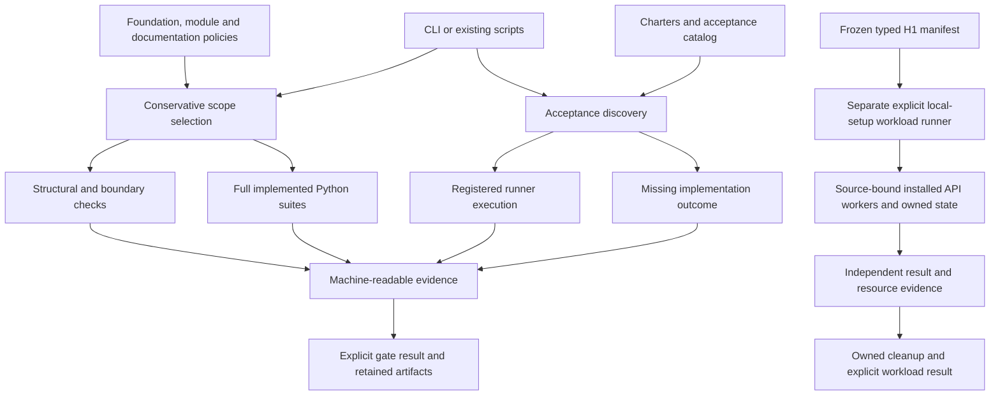
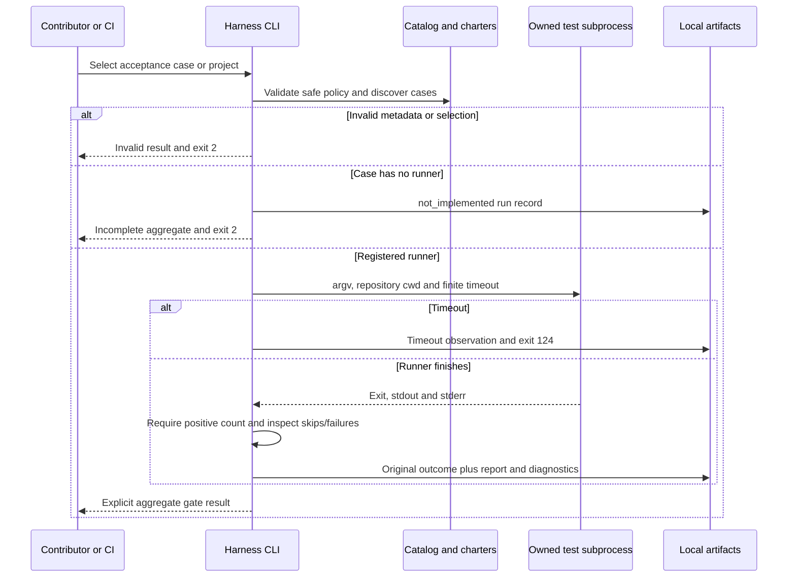
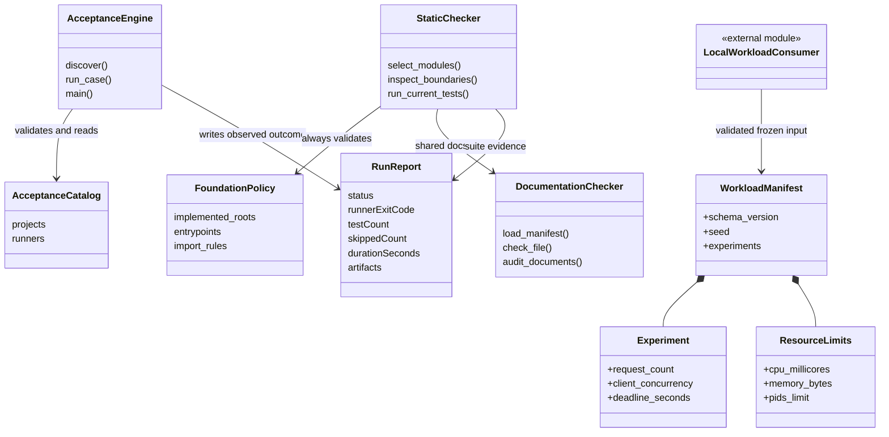

# Harness design

| Field | Value |
| --- | --- |
| Status | Active |
| Purpose | Describe how the harness is built: its two planes, policies, catalog, runners and evidence |
| Audience | Contributors who change harness code, policies or runners; coding agents |
| Scope | Harness engine, checkers, report runners and the H1 workload contract; excludes exact commands and product behavior |
| Owns | Harness architecture, state ownership, runner design, bounds and failure handling |
| Related | [Harness guide](README.md) · [Harness agent rules](AGENTS.md) · [Harness architecture](../docs/harness-architecture.md) · [Validation plan](../docs/validation-plan.md) · [Design template](../docs/design-template.md) |

## Overview

This document describes how the harness is built: its structural and behavioral
planes, the policies and catalog it reads, the runners it executes and the
evidence it records. It is for contributors who change harness code, policies or
runners. [README.md](README.md) owns the implemented command-line interface (CLI)
and its exact commands.

Contents:

- Objectives, functional requirements and non-functional requirements: what the
  harness must do and its bounds.
- Back-of-the-envelope calculations: configured deadline and artifact arithmetic.
- High-level design, sequence diagram and low-level design: the two planes, the
  catalog run sequence and module responsibilities.
- Components and related details: modules, state owners, failure boundaries, the
  Phase H1 inquiry workload contract, the report wrappers and provider
  composition.
- Security and privacy, observability, metrics and exception handling.
- Design considerations and trade-offs.
- Validation and acceptance gates, including the selected phase gates.

### Structural and behavioral planes

The harness is repository tooling with two planes:

- The structural plane uses module, foundation and documentation policies to check
  declared structure and known boundaries.
- The behavioral plane uses the acceptance catalog to discover requirements and
  run registered tests.

Neither plane infers runtime correctness from documentation, diagrams, process
exit alone or the number of tests. This support boundary is not a fourth product.

### Current coverage

- BASE-01 exercises the implemented M1 intake, which is the existing
  confirmed-investigation intake.
- P1-01, P1-02 and P1-03 run the shared actual accepting-process suite. P1-04 and
  P1-05 run the shared independent supplier/worker recovery suite.
- P1 local V1 coverage passed. V1 is the fixed project scope.
- P3-01, P3-03 and P3-11 have complete registered lab runners and fresh passing
  reports.
- All 17 P2 rows and the remaining 14 P3 rows stay planned.

The catalog owns current complete registrations. Every later runner requires
meaningful executable assertions and observed evidence. Selected phase gates for
later P2/P3 slices add explicit checks without registering new product rows. They
are described under [Selected phase gates](#selected-phase-gates).

| Topic | Authoritative owner |
| --- | --- |
| Evidence sufficiency | [Validation plan](../docs/validation-plan.md) |
| Acceptance IDs | [Charters](../docs/portfolio-scope.md) |
| Implemented CLI | [README.md](README.md) |

### H1 workload contract

Phase H1 is the P1 declared inquiry workload baseline. It adds dependency-free
WorkloadManifest, Experiment and ResourceLimits values for one explicit inquiry
baseline. Local setup, not the catalog engine, owns their installed-runtime
consumer. Planning and measurement retain distinct status.

The [H1 work item](../docs/work-items/0014-p1-phase-h-workload-baseline.md) owns the
qualified local inquiry measurement and its inspected results. H1 alone is not a
Phase H/P1 release. That qualification is recorded separately in the
[Phase H release-qualification work item](../docs/work-items/0019-p1-phase-h-release-qualification.md).
Later P2/P3 workload qualification remains planned.

## Objectives

| Type | Objective | Success criterion |
| --- | --- | --- |
| Business | Make portfolio claims reviewable | A reader can distinguish a structural pass, a passing baseline, missing product behavior and runtime evidence. |
| Business | Enable reliable coding-agent handoffs | A fresh contributor can select a bounded scope, run existing commands and inspect original outcomes/artifacts without chat context. |
| Technical | Fail closed on unsafe or incomplete policy | Missing/corrupt foundation policy, unsafe paths, unknown fields and ownership violations produce explicit non-passing reports. |
| Technical | Execute meaningful tests under finite deadlines | Passing behavior requires a positive observed test count, no required skips and a successful runner. Timeout and zero-test success cannot pass. |
| Technical | Preserve three-product ownership | Foundation policy runs for every selected scope without creating another product namespace or bypass. |

## Functional requirements

These local design rows do not create acceptance IDs or register future runners.

| Type | Requirement | Acceptance assertion | Status |
| --- | --- | --- | --- |
| Business | Discover fixed product requirements | Catalog discovery matches charter IDs. A missing runner yields not_implemented and an incomplete aggregate. | Implemented. |
| Business | Report useful original evidence | Each run retains command, observed status, original runner exit, duration, test/skip counts and diagnostic paths. | Implemented local report contract. |
| Technical | Check mandatory foundation | Required source/entrypoints/docs and known imports are checked even for a focused unrelated product selection. | Implemented. |
| Technical | Select scope conservatively | Unknown ownership, shared policy changes or an unavailable comparison baseline expand scope. Focused structural inspection never drops full current Python suites. | Implemented. |
| Technical | Validate documentation policy | Declared corpus presence, one six-row Field/Value document card before the first section, no `Status:` or `Last reviewed:` lines, required sections and populated tables per role, design order and diagrams, safe relative Markdown and HTML link targets and prohibited reference forms are checked. | Implemented. Each rule has positive and negative fixtures. |
| Technical | Run registered behavior | unittest_discovery, python_json_report or python_infrastructure_report invokes a bounded argument vector (argv) without a shell. Both report kinds bind the exact case and catalog mode. | Implemented. |
| Business and technical | Freeze a reproducible inquiry declaration before measurement | A strict typed manifest/digest binds schedules, resources and observation pressure. Actual installed results and owned cleanup remain a separate explicit lane. | Local inquiry baseline qualified in the [H1 work item](../docs/work-items/0014-p1-phase-h-workload-baseline.md). Current P1 workload/release evidence is separately qualified. P2/P3 workload/release qualification remains pending. |
| Technical | Extend only for real evidence | Product report wrappers own prerequisites and exact assertion mappings. Missing, skipped or timed-out cases never pass. | Implemented closed report protocol. Register only reviewed complete rows. |

## Non-functional requirements

| Property | Bound or policy | Verification | Status |
| --- | --- | --- | --- |
| Dependencies | The structural/acceptance engine uses the Python standard library. Offline checks never install dependencies or call providers. | Import/boundary review and offline fixtures. | Implemented engine contract. Full tests use installed frozen service dependencies. |
| Runner deadline | timeoutSeconds is an integer from 1 through 300 for unittest_discovery/python_json_report, or through 900 for python_infrastructure_report. Infrastructure permits lab/live and rejects offline. BASE-01 remains 60 seconds. | Catalog validation and timeout fixtures. | Implemented. |
| Fast suite deadline | The root tests use two fixed complete-discovery partitions under one 120-second deadline, including five seconds reserved for cleanup. Project suites retain their existing subprocess runner. | Exact manifest/start-ID parity, timeout and ownership fixtures. | Implemented. The actual current full gate must qualify new source. |
| Scope safety | Exactly three product module contracts. Foundation policy is mandatory in every scope. | Missing/corrupt policy, unrelated-product and boundary fixtures. | Implemented. |
| Path safety | Policies and runner paths are repository-relative and cannot escape through traversal or symlink resolution. | Deliberately invalid and symlink fixtures. | Implemented. |
| Result integrity | Zero tests, required skips, timeout or missing implementation cannot yield passing acceptance. | Runner-result positive/negative fixtures. | Implemented. |
| Diagnostic volume | Both report kinds have 64 KiB capture/report bounds and private raw-output cleanup. Legacy unittest_discovery still uses time-bounded capture_output without a byte cap. | Report overflow/path/privacy fixtures. Preserve the explicit legacy limitation. | Report protocol implemented. Legacy capture is not a general process/media runner. |
| Reproducibility | Run under the frozen repository interpreter and explicit working directory, and retain machine-readable outcomes. | Existing CLI/integration tests and handoff commands. | Implemented. H1 separately retains canonical workload/source/image/machine evidence. |
| H1 bounds | Six modes, at most 32 offers each, HTTP concurrency 1–4, resource target 1 s, 4096 raw records and finite deadlines/caps. | Strict positive/adversarial workload parsing and local-setup consumer tests. | Frozen declaration, not a measurement result or registered charter runner. |

## Back-of-the-envelope calculations

These are configured deadline and artifact-count calculations, not observed wall
clock forecasts, coverage scores or product capacity claims.

| Quantity | Inputs and formula | Result | Interpretation |
| --- | --- | --- | --- |
| Fixed catalog population | 1 baseline + 54 product requirements | 55 cases | Registration status comes from catalog.json. Missing required behavior remains non-passing. |
| Selected sequential deadline envelope | Sum timeoutSeconds over the selected registered runners | Scenario-dependent seconds | Read current catalog values. Excludes discovery, I/O and orchestration, and is not observed duration. |
| Illustrative sequential complete catalog budget | If 55 future runners each used 60 seconds: 55 × 60 | 3,300 seconds = 55 minutes | A reason to separate lanes and select meaningful scope. No placeholder runners should be registered to realize this assumption. |
| Per-run artifact count | stdout.txt + stderr.txt + report.json | 3 files/run; 165 files for 55 runs | Counts say nothing about file bytes. Report-runner capture is bounded, and legacy discovery capture differs. |
| Loose complete-catalog deadline ceiling | 55 × largest infrastructure ceiling of 900 seconds | 49,500 seconds = 13 hours 45 minutes | Illustrative upper bound only. Ordinary runners retain 300 seconds. Use actual selected catalog durations and isolated local lanes. |
| H1 declared workload | 2 × 20 steady + 2 × 32 burst + 2 × 32 saturation | 168 new offers, expected 120 admissions and 48 rejections | Frozen input only. Actual reconciliation must establish outcomes. |
| H1 round-robin illustration | 32 pending tasks × 250 ms sleeps | About 8 s plus HTTP/shared-slot delay per sweep | Observation lag is included in client result latency. No hard per-task 250 ms refresh is promised. |

A report-kind run that returns a validated runner report also writes
runner-result.json, so it retains four files instead of three.

Use actual measured durations to decide parallelism. Concurrent process/media
scenarios need isolated state, owned children and resource budgets. A faster
aggregate obtained from interference or skipped gates is not valid evidence.

## High-level design

1. The fast path validates mandatory shared policies and selected structural
   groups. It then runs all current Python tests when the fast script requests
   them.
2. The deep path discovers charter cases and runs only registered real behavior.
   Unimplemented cases remain present in the report as non-passing.
3. Scope selection is conservative. A focused P1 selection does not bypass
   foundation policy or suppress service tests in the full fast lane.
4. Reports preserve observed process outcomes and diagnostic locations. They are
   evidence records, not the application's durable execution state or metrics.
5. Product-specific runner kinds are added when their actual process/media
   scenarios exist, not as an up-front universal test platform.
6. The H1 declaration/measurement path is separate from catalog discovery and
   registration. The model fixes inputs, and the local-setup consumer owns
   installed execution and safe evidence/cleanup. It does not add product
   acceptance IDs.

## Sequence diagram

Signal termination maps to a non-passing harness exit, and the original runner
return code remains in evidence. The diagram shows the catalog sequence. The
separate explicit H1 consumer validates its manifest before runtime execution and
is not registered here. Neither path introduces another business scheduler.

## Low-level design

The classes describe implemented module and data responsibilities. Labels such as
discover and inspect_boundaries are conceptual operations, not a new public Python
API. Existing implementation entrypoints remain authoritative.

## Components and related details

### Component map

Code, policy, script and fixture paths are relative to the `harness` directory.
Evidence paths under `.local` are relative to the repository root.

| Component | Path | Responsibility | Status |
| --- | --- | --- | --- |
| Acceptance engine | `__init__.py` and `__main__.py` | Validate catalog, discover charter IDs, execute registered cases and aggregate results | Implemented |
| Report runner | `report_runner.py` | Closed report protocol for both report kinds, with exact case/mode binding, bounded private capture and owned cleanup | Implemented |
| Static checker | `static_check.py` | Conservative selection, source state, ownership/import checks and fast suites | Implemented |
| Root fast-suite runner | `root_unittest.py` | Two fixed complete-discovery partitions for the root tests under one 120-second deadline | Implemented |
| Documentation checker | `documentation_check.py` | Declared corpus, document card, legacy metadata, role sections and tables, links and reference policy | Implemented |
| Process control helper | `process_control.py` | Owned test children, barriers bound to a process ID (PID), capped capture and verified termination for test tooling | Implemented |
| Policy files | `modules`, `rules`, `foundation.json`, `documentation.json`, `catalog.json` and `stack-baseline.json` | Product ownership, foundation entrypoints, source boundaries, corpus, catalog and stack selections | Implemented |
| Script entrypoints | `../scripts` | Existing POSIX fast/deep command wrappers | Implemented |
| Isolated fixtures | `../tests` | Valid and deliberately invalid policy, path, architecture, runner and documentation cases | Implemented |
| Disposable evidence | Ignored `.local/harness` | Run records and child output | Implemented |
| H1 workload contract | `workload_models.py` and `workloads/p1-inquiry-v1.json` | Immutable typed schedules/resources, strict parsing and canonical digest, with no runtime orchestration | Implemented |
| Separate workload consumer | `../local-setup/scripts/p1_benchmark.py`, with artifacts under ignored `.local/validation/p1-phase-h` | Installed API/worker execution, raw observations, independent reconciliation and owned cleanup | Qualified (H1 local inquiry baseline) |

### State ownership

| Owner | Authoritative data |
| --- | --- |
| Project charters | Stable acceptance IDs and expected product behavior |
| Modules and rules | Product source ownership, implementation state, known architecture constraints and test mapping |
| foundation.json | Installed service/app/setup/contract ownership, required entrypoints and import boundaries |
| documentation.json | Corpus, supported document-card Status values, role sections, tables and diagrams, and prohibited reference policy |
| catalog.json | Implemented runner registrations and finite deadlines |
| stack-baseline.json | Installed foundation pins, future candidates and compatibility evidence |
| Individual run reports | Observed outcome, original process result and diagnostic artifacts |

The six document-card fields and the rejected `Status:` and `Last reviewed:` lines
are fixed in `documentation_check.py` rather than configured in
`documentation.json`.

### Interfaces and failure boundaries

JSON policy rejects unknown and duplicate keys, unsafe paths and source/boundary
roots outside declared ownership. Deleting or corrupting foundation.json fails
closed. Implemented roots need content and the required nonempty entrypoints and
docs. Planned roots may remain absent until implementation.

Child execution uses argv arrays and an explicit working directory (cwd). No
arbitrary shell fragments come from fixtures or provider output. A successful
unittest process also needs a positive observed test count. The current runner
parses standard unittest summaries. A future runner must define its own explicit
evidence contract rather than fabricate one.

Import scanning is structural. It is not a complete Python or TypeScript resolver
and cannot prove runtime isolation, memory or correctness.

### Process control and cleanup

The process_control helper separately caps owned-child capture. It verifies
PID-bound barriers and actual termination. It does not retroactively byte-cap the
existing top-level acceptance subprocess: legacy unittest_discovery still uses
time-bounded capture without a byte cap.

### Planned runner additions

The first actual process-failure slice must own child processes, barriers, finite
cleanup and post-recovery state assertions. Later media and cross-language runners
add their real command, prerequisites, execution mode, artifacts and failure
semantics. Do not create placeholder commands or mark a related acceptance ID
complete after only a partial assertion.

### H1 declaration and evidence contract

Declaration validation:

- WorkloadManifest, Experiment and ResourceLimits use the standard library. They
  strictly validate unknown or duplicate fields, versions, nonfinite, boolean or
  unbounded numbers, paths, counts and capacity/schedule relationships.
- The default versioned manifest has fixed seed 20261109 and six
  steady/burst/saturation modes. Freeze its canonical digest before measuring.
- `make p1-benchmark-plan` prints status not_started without Docker or load.
  `make p1-benchmark` explicitly invokes the local-setup consumer. Neither command
  registers a complete acceptance case.

Declared schedule and observation:

- The declared aggregate is 168 offers, 120 admissions and 48 rejections.
- All HTTP operations share bounded concurrency. One global round-robin GET is
  followed by a 250 ms sleep, with HTTP, queue and sweep lag included.
- First observed success comes from any validated submit, replay or GET
  projection, together with its source. A timeout finish is not an
  acknowledgement.

Resource measurement:

- Cgroup probes target 1 s but retain actual timing, skipped slots and sequential
  in-container observer overhead.
- CPU microsecond first/last/delta/window values, accounted memory and task counts
  retain their true scope. No resident set size (RSS) or peak claim follows.
- The resource window includes post-inquiry cancellation/delivery. Shared host,
  virtual machine (VM) and PostgreSQL resources are excluded.
- The [observability guide](../docs/observability.md) owns units and
  interpretation, rather than a second measurement specification here.

Evidence and pass rules:

- H1 raw records are bounded and closed-vocabulary.
- Pre-cleanup measured snapshots are distinct from passing experiment/aggregate
  evidence.
- The local-setup consumer requires independent result receipts, zero supplier
  mutation and verified owned cleanup, with original failures retained.
- Small-sample summaries use count, minimum, median and maximum. They never use an
  unsupported tail percentile or make a production or model claim.

Current evidence status:

- The H1 work item owns the completed local inquiry measurement and inspected
  results. The H1 inquiry slice is separate evidence.
- Phase H2 reliability (restart and slow-supplier workloads) and P1-I26
  host/Linux artifact/API/genuine-consumer checks passed separately.
- P1 V1 is qualified for the local proof of concept (POC) using provider_real v2.
  local_real remains unqualified.
- All 17 P2 rows and the remaining 14 P3 rows remain planned, alongside 3 passing
  registered P3 lab rows.

### Fresh complete P3 lab reports

The p3_acceptance.py application wrapper selects fixed components for P3-01, P3-03
and P3-11, with 13, 8 and 12 named assertions.

| Limit | Value |
| --- | --- |
| Deadline | 240 seconds, including a 10-second reserve |
| Owned child capture and report input | 32 KiB |

- The wrapper accepts only a complete selected lab inventory with zero required
  skips, errors and failures and actual cleanup.
- A fresh private component path cannot overwrite prior output.
- Regular-file reads reject symlink, hardlink, nonregular and oversized inputs.
- Validated standard output must equal the retained report.
- The component path/hash and the outer case envelope remain separate artifacts.

These assertions qualify selected lab behavior, not full P3, media, model or
platform release.

### Fresh infrastructure acceptance reports

python_infrastructure_report specializes the closed report protocol for bounded
actual local infrastructure.

| Case | Reported mode | Fresh execution |
| --- | --- | --- |
| P1-14 | lab | Scripted browser assertions plus three post-commit database assertions |
| P1-18 | lab | A selected saturation/shutdown workload |
| P1-20 | live, for actual inference | Model/browser assertions for the trusted selected profile |

Default local_real uses prepared local engines. Explicit provider_real uses the
declared Deepgram/OpenAI/ElevenLabs pipeline and needs private keys. Neither
requires hosted deployment or a carrier. Actual model/media results remain
profile-specific: the selected provider_real v2 gate passed, and local_real remains
unqualified.

Deadlines:

| Limit | Value |
| --- | --- |
| Catalog supervisor | At most 900 seconds |
| Product wrapper | One original 840-second deadline |
| Browser helper | 600-second work budget and 180-second cleanup allowance |
| Ordinary report and unittest runners | 300-second maximum |

Finite observation chunks do not reset any original deadline.

Evidence rules:

- Both report kinds validate exact case and mode, positive assertions, zero
  required skips/failures/errors, finite duration and child success.
- The wrapper creates fresh UUID-owned artifact paths, checks current source/input
  provenance, re-verifies raw browser assertions and verifies owned cleanup before
  passing.
- Prior Phase G/H reports and successful setup/health cannot replace execution.
- Raw captured child output remains bounded and private and is deleted. Retained
  references identify fresh sanitized evidence.
- Missing setup, invalid evidence, failed cleanup and timeouts remain non-passing.

### Trusted provider composition

The shared/native path accepts exactly three inference profiles: scripted
(default), local_real and provider_real. The diagrams retain the shared authority
path. Profile adapters use the same session and bound task rather than creating
another case authority.

provider_real composes:

| Stage | Provider | Model | Mode |
| --- | --- | --- | --- |
| Recognition | Deepgram | nova-3 | Batch recognition after manual flush |
| Tool selection | OpenAI | gpt-5.4-mini | Streaming |
| Speech | ElevenLabs | eleven_v4_turbo | Chunked HTTP pulse-code modulation (PCM) |

Only the native process receives provider keys. Real output cannot bypass separate
exact human consent.

The [provider operations guide](../docs/provider-demo.md) owns strict key setup,
explicit lifecycle, fixed model/voice/transports, bounded execution and the fresh
P1-20 selector.

Real profiles keep these limits:

| Limit | Value |
| --- | --- |
| Commit | 12 seconds |
| Incoming transcription | 40 seconds |
| Other remote procedure calls (RPCs) | 8 seconds |
| Browser cleanup | 5 seconds |

No silent fallback, provider resource-capacity result or blanket zero-retention
claim is made. The selected provider_real v2 gate passed both actual browser cases
with cleanup. P1 V1 is qualified for the local POC using provider_real v2. A
passing provider scenario cannot qualify the separate local-engine declaration.

## Security and privacy

| Boundary or threat | Control | Test or evidence |
| --- | --- | --- |
| Offline tooling | Synthetic isolated state, no provider credentials and no network calls | Import/boundary review and offline fixtures |
| Config paths and discovered symlinks | Must remain inside the repository root | Deliberately invalid and symlink fixtures |
| Comparison baseline or unknown changed path | Can expand scope but cannot grant permission to execute untrusted content | Changed-scope and missing-baseline fixtures |
| unittest_discovery child stdout/stderr | Retained as evidence; not automatically sanitized service logs | Explicit legacy limitation |
| Report-kind child capture | Raw capture kept private and removed | Report overflow/path/privacy fixtures |
| Test producer output | Avoid printing environment variables, tokens, model prompts or private payloads | None automated; producer responsibility |
| Retained artifacts | Keep artifacts ignored and review synthetic samples before publishing | Ignored `.local` paths |
| Future runtime evidence | Producer-side redaction, an output-size policy and explicit access/retention decisions | Planned |
| Provider keys | Reach only the native process | [Trusted provider composition](#trusted-provider-composition) |

## Observability

The harness observes verification, not business progress.

| Signal | Producer | Fields or labels | Status |
| --- | --- | --- | --- |
| Structural check report | Static checker | Selection, module and foundation summaries, violations and test results | Implemented |
| Documentation report | Documentation checker | Status, documents checked and violations with path, line and rule code | Implemented |
| Acceptance run report | Acceptance engine | Harness status, original runner exit, test and skip counts, duration and artifact paths | Implemented |
| H1 workload evidence | Local-setup workload consumer | Bounded safe raw observations and digest/source/image evidence | Implemented |
| H1 environment metadata | Local-setup workload controller | Host platform, architecture and Python; installed runtime architecture and versions | Implemented |

### Harness run reports

Machine-readable reports retain selected scope, violations, original runner exit,
harness status, duration and artifact paths. Use a monotonically measured elapsed
duration. Structural violations point to rule, file and line when available,
without echoing prohibited content. No exporter, collector or continuously running
metrics server is required for this command-line boundary.

### H1 workload evidence

The H1 model emits no runtime metrics or traces. Its local-setup consumer retains
bounded safe raw observations and digest/source/image evidence separately from
catalog run reports.

- Missing samples remain missing. A declaration or pre-cleanup measurement cannot
  be promoted to a pass.
- Observer pressure and timestamp/resource limitations are explicit in that
  evidence.
- The controller reports host platform, architecture and Python, and the installed
  runtime architecture and versions.
- Docker VM hardware and shared-host context require separately labelled operator
  collection.

### Shared observability

[Shared observability](../docs/observability.md) applies to application producers.
A reachable trace viewer or a static docs pass cannot substitute for an actual
trace, process recovery or browser observation. New evidence fields must have
positive/negative fixtures and remain truthful about unavailable modes.

## Metrics

| Measurement | Units and source | Interpretation and limit |
| --- | --- | --- |
| Observed test and skip counts | Count parsed from an implemented runner's result | Positive count is necessary, not sufficient. Required skips remain non-passing. |
| Runner duration | Seconds from harness monotonic timing | Includes the defined run scope. Not a conversational/provider latency metric. |
| Case outcome | Fixed status such as passed, failed, timeout or not_implemented | Aggregate missing requirements explicitly. Do not turn planned rows into zero-success counters. |
| Documentation violations | Count plus fixed rule code and repository-relative location | Structural quality evidence only. Cannot score design correctness. |
| H1 workload evidence | Frozen declaration, actual client seconds/cgroup microseconds/bytes/tasks and raw observations | Local inquiry baseline qualified in the H1 work item. Excludes media/model/production capacity, adds no dynamic dimensions and leaves broader workload/release gates open. |
| Future media/load coverage | Mode-specific clocks, machine/resource definitions and raw samples | Broader workload modes need their real separate runners. No fabricated coverage. |

Counts and durations live in run reports. If continuous integration (CI) later
aggregates them, use bounded labels and preserve the original reports instead of
creating a second source of acceptance truth.

## Exception handling

| Failure | Required response | Verification |
| --- | --- | --- |
| Missing/corrupt/unknown-field policy or invalid selection | Stable invalid report and exit 2. No partial pass or generated replacement. | Missing policy, duplicate key, unknown field and invalid-ID fixtures. |
| Boundary/documentation violation | Explicit non-passing violation with safe relative location. | Valid plus deliberately invalid import, Markdown and HTML link, document card, legacy metadata, role table and source fixtures. |
| Child failure | Preserve original return code and diagnostics. Do not retry into a false pass. | Normal failure and signal-exit fixtures. |
| Child timeout | Record timeout and exit 124. Missing runtime evidence remains missing. | Finite-time fixtures. The report runner uses owned terminate/kill/reap and validates cleanup. |
| Process success with zero tests or required skip | Non-passing or incomplete according to implemented outcome semantics. | Zero-count and skipped-test fixtures. |
| Runner cannot launch | runner_error and non-passing result. Retain safe actionable context. | Missing/interpreter/launch failure fixture. |
| Missing product runner | not_implemented with incomplete aggregate and exit 2. | Current planned cases and explicit missing-runner fixture. |
| Artifact write failure | Surface a failed invocation. Never return passed evidence that was not retained. | Add targeted filesystem-failure coverage when changing artifact handling. |
| Invalid H1 declaration or missing result/resource/cleanup evidence | Preserve fixed-enum original operation/code and observed bounded exit/timeout/budget/elapsed before temporary capture removal. Report cleanup failures separately, without raw command/output/environment/body/exception text. | Positive/adversarial model tests and explicit consumer reconciliation/cleanup tests. No fabricated zeros or budget changes. |

Catch known configuration, filesystem and process errors at the CLI boundary.
Library helpers raise meaningful domain errors with chained causes where useful.
Do not broadly catch BaseException or swallow cancellation/termination. Reports
must not expose a token or payload merely because an exception includes it.

New logging uses fixed event/error categories and follows the
[Python engineering policy](../docs/python-engineering.md). Safe producer
diagnostics remain required before any artifacts are promoted for review.

## Design considerations and trade-offs

| Decision | Reason | Cost or alternative | Revisit trigger |
| --- | --- | --- | --- |
| Separate structural and acceptance planes | Fast feedback without claiming unimplemented behavior | Both planes and their independent outcomes must be reviewed | None recorded |
| Mandatory foundation outside product modules | Prevents scope selection from hiding shared infrastructure regressions | Focused checks still pay the required foundation cost | None recorded |
| Dependency-free engine | Simple local/CI startup and fewer tooling supply dependencies | Specialized process/browser runners need deliberate adapters rather than hidden imports | None recorded |
| Conservative changed-scope selection | Unknown ownership fails toward more validation | Some changes run broader checks than strictly necessary | None recorded |
| Positive and negative fixtures per rule | Proves rejection behavior and protects against permissive drift | Rule maintenance includes both directions; a structural rule still has semantic limits | None recorded |
| Retain original child results | Inspectable failures and honest gate semantics | Report capture is byte-bounded and private; legacy unittest_discovery retains its explicit uncapped-capture limitation | None recorded |
| Small real-runner extensions | Avoids building a universal test platform before product needs | Different evidence lanes require explicit contracts and cannot share a false generic pass | An actual product process or media scenario exists |

## Validation and acceptance gates

| Gate | Assertion or lane | Evidence | Status | Non-passing examples |
| --- | --- | --- | --- | --- |
| Policy validity | Catalog validation and the fast lane | Required policy files, valid schema, unique keys, safe paths and owned boundaries | Implemented | Missing mandatory foundation or unsafe/symlink path |
| Rule behavior | Positive and negative fixtures | Positive fixture passes; deliberate violation fails with expected code; focused unrelated scope still enforces shared boundaries | Implemented | Rule only tested against its implementation's happy path |
| Runner integrity | Registered runner execution | Positive count, no required skips, original process outcome, finite timeout and retained artifacts | Implemented | Exit zero with no tests, timeout, launch failure or missing output evidence |
| Shared fast lane | Fast lane plus lint, typing and format checks | Current Python suites, lint, typing and format checks pass under the installed frozen interpreter | Implemented | Focused structural pass presented as full verification |
| Documentation shape | Documentation checker in the docs group | Maintained corpus, document cards, no legacy metadata lines, role sections and tables, Markdown and HTML link targets and tested design-format rules pass; semantic review still occurs | Implemented | A diagram-shaped code fence reported as a verified design |
| Product local release | Registered acceptance runners and actual local lanes | Every required local acceptance assertion plus independent process/store/package/media evidence from its actual lane | Partial: P1 local V1 qualified; P2 and P3 pending | BASE-01 or a static pass substituted for planned product scenarios |
| Portfolio release | Live-model, workload and demonstration lanes | Applicable live-model outcomes, declared workload/cost/configuration, review and explainable demonstrations | Partial: P1 provider_real v2 qualified; P2 and P3 pending | Scripted output relabelled live or missing lane marked passed |
| H1 inquiry baseline | Explicit local-setup workload lane | Frozen manifest/digest, actual installed-source observations, useful reconciled results, safe bounded raw samples and verified owned cleanup | Qualified (local inquiry baseline) | Planning-only status, pre-cleanup snapshot, missing observations or partial workload substituted for a complete release |

Use [README.md](README.md) for exact existing commands. Shared policy, rule,
contract or instruction changes require full fast validation. Frontend checks,
actual local smoke, browser playback and real-provider evaluation remain explicit
separate lanes. Python success does not establish that they ran.

### Selected phase gates

These selected local gates belong to later P2/P3 slices. None registers a new
complete charter row.

| Gate | Assertion or lane | Evidence | Status |
| --- | --- | --- | --- |
| Linked confirmation and result projections | Public feed, exact-consent bridge and derived checkpoint tests | [Work item 0032](../docs/work-items/0032-linked-confirmation-and-result-projections.md) | Qualified (selected local) |
| Outbound replies and completion processing | 24 P2 and 16 P3 named cases and isolated installed consumers | [Work item 0033](../docs/work-items/0033-outbound-replies-and-completion-processing.md) | Qualified (selected local) |
| Send policy and action races | 30 P2 assertions; 16 P3 cases and 31 one-time modes | [Work item 0035](../docs/work-items/0035-send-policy-and-action-races.md) | Qualified (selected local) |
| Native input and deadlines | Six browser groups plus SDK and storage checks; 18 source and 18 installed P3 temporal assertions | [Work item 0036](../docs/work-items/0036-native-input-and-deadline-cancellation.md) | Qualified (selected) |

#### Linked confirmation and result projections

The [completed linked-confirmation/result-projection slice](../docs/work-items/0032-linked-confirmation-and-result-projections.md)
adds selected explicit application/database gates without registering new product
rows. Public feed, exact-consent bridge and derived checkpoint tests join the
appropriate source owners. Selected local qualification passed. Preserved
historical P1 provider evidence is distinct from these new backend-only
observations.

#### Outbound replies and completion processing

The [completed outbound-reply/processing slice](../docs/work-items/0033-outbound-replies-and-completion-processing.md)
adds selected role-separated storage/process qualification. It changes no P1
public API or complete runner registration.

- Exact inventories, actual process barriers, finite raw capture, safe fixed
  reports and independently observed cleanup remain required.
- Selected local qualification passed for the 24 P2 and 16 P3 named cases and the
  isolated installed consumers.
- Provider acceptance and P3 processing acknowledgement do not establish physical
  delivery, human acknowledgement or source-event deletion permission.

#### Send policy and action races

The [completed send-policy/action-race phase](../docs/work-items/0035-send-policy-and-action-races.md)
completed the selected local gates for P2-I14 and P3-I12. Preserve the completed
[callback/applicability checkpoint](../docs/work-items/0034-callback-evidence-and-applicability-refresh.md).

The P2 gate requires 30 named actual assertions. They include populated inbox
v4-to-v5 migration and restore, ordinary unknown holds, cooperating same-key
retries, callback ordering and independent provider ledgers.

The P3 gate freezes 16 cases and 31 one-time modes, three owned PID kills and two
actual two-waiter SQL order graphs. Its bounds are:

| Limit | Value |
| --- | --- |
| Total deadline | 180 seconds, including 15 seconds for cleanup |
| Children | At most 32 |
| Aggregate capture | 128 KiB |
| Capture per stream | 2 KiB |
| Final report | 32 KiB |

- Prewarm both writers and the same owner locker/observer before lock contention.
  Never change P1's lock timeout.
- Validate exact keys and JSON primitive types, first-failure precedence,
  role-separated environments and complete cleanup.
- Optional diagnostic runs retain only bounded redacted failure streams and always
  remain non-qualifying.
- Actual, isolated installed and prior regression gates passed for this slice.
  Require them again after affected changes.

No complete charter registration or P1/P3 runtime change is introduced. Physical
delivery and human acknowledgement (ACK) remain distinct from provider evidence.

#### Native input and deadline gate ownership

The [completed native/deadline handoff](../docs/work-items/0036-native-input-and-deadline-cancellation.md)
adds explicit gate wrappers, not product authority.

- The native gate owns six named browser groups plus separate software
  development kit (SDK) and storage checks,
  role-separated host processes, room/schema ownership, safe captures and complete
  cleanup against local Docker LiveKit/PostgreSQL.
- The selected actual six-group run and isolated Python/npm package gates passed.
  Final selected phase regression/shared checks and the affected media rerun also
  passed. Code-focused checks cannot stand in for media.
- The P3 source and installed eighteen-case temporal gates and forty-six
  compatibility assertions passed.
- Keep direct bounded authority/peer/lock proofs, strict report inventories and
  unknown outcomes. The intentionally noncooperating peer is test-only.

No added catalog registration or queue follows. The existing diagrams describe
harness planes, not another execution scheduler. The
[validation plan](../docs/validation-plan.md) owns sufficient current evidence, and
the [shared design](../Design.md) owns native authority/credential boundaries.
