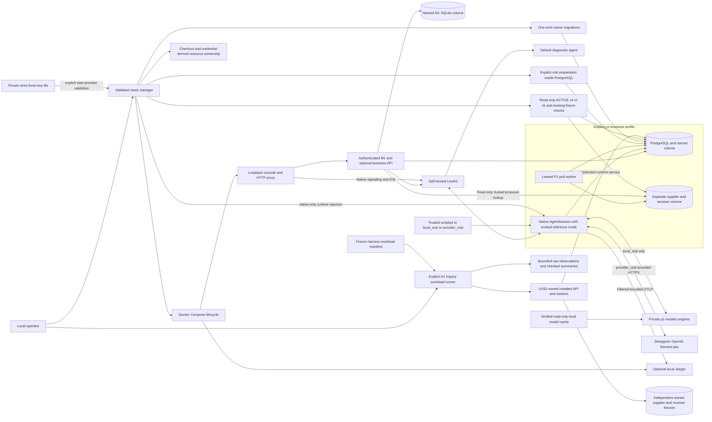
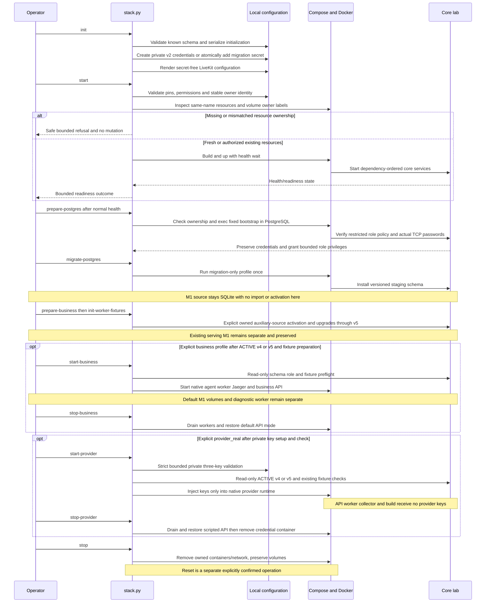
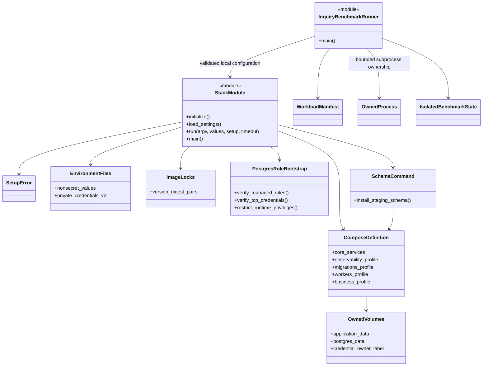

# Local setup design

| Field | Value |
| --- | --- |
| Status | Active |
| Purpose | Define the local stack, resource ownership, trust boundaries and qualification gates |
| Audience | Engineers and coding agents changing local orchestration or reviewing its evidence |
| Scope | Local Compose, setup, lifecycle, credentials and validation; excludes product state authority |
| Owns | Local setup topology, interfaces, failure handling and operational limits |
| Related | [Setup guide](README.md) · [Coding instructions](AGENTS.md) · [Shared design](../Design.md) · [Validation plan](../docs/validation-plan.md) |

## Overview

This document describes the design of the local orchestration boundary: what it
owns, how state and credentials are separated, how failures stay contained and
which gates qualify it. It is for engineers who change Compose, lifecycle
management, images or validation tooling in this directory. The
[setup guide](README.md) owns the operational commands.

This directory owns the implemented local orchestration boundary: a reproducible
five-service development lab with:

- self-hosted LiveKit;
- PostgreSQL;
- the control API;
- a deterministic native Agents SDK (software development kit) worker;
- the TypeScript console.

An optional profile adds Jaeger. A separate one-shot migrations profile prepares
P1's PostgreSQL schema. No model or carrier credentials are required for the
transport lab or the deterministic inquiry tests. Normal lifecycle preserves named
persistent state.

### Scope and exclusions

- This foundation does not implement the three products' complete business
  semantics or their 54 acceptance cases.
- Default API routes retain the M1 SQLite intake (M1 is the original
  confirmed-investigation intake).
- The explicit p1-workers and p1-business profiles compose PostgreSQL v4/v5 execution,
  the native scripted conversation and a scoped workspace without switching the M1
  volume.
- Owner-only migration and cutover, and fixture initialization, remain separate
  prerequisites.
- The [Phase G work item](../docs/work-items/0013-p1-phase-g-conversation-and-showcase.md)
  owns the local combined evidence. Complete charter, platform, workload and
  real-inference release qualification remains separate.

### Workload measurement

Phase H1 adds an opt-in inquiry workload controller over installed API and worker
services and fresh UUID-owned state. The dependency-free harness owns its frozen
declaration. Local setup owns explicit execution, resource probes and cleanup. The
[H1 work item](../docs/work-items/0014-p1-phase-h-workload-baseline.md) records the
qualified local inquiry measurement. It does not establish full Phase H or P1
release, production capacity or media and model performance.

### Related documents

Read the [setup guide](README.md), the [shared design](../Design.md), the
[technology baseline](../docs/technology-baseline.md) and the
[validation plan](../docs/validation-plan.md).

## Objectives

| Type | Objective | Success evidence |
| --- | --- | --- |
| Business | Let a reviewer run the foundation on one development machine | The documented Docker route works without host LiveKit, host Node or inference-provider setup |
| Business | Preserve accepted local data across ordinary stop and start | The same M1 task and stable key remain inspectable after restart |
| Technical | Keep infrastructure separate from business execution | Compose and lifecycle scripts orchestrate services without implementing workflow, channel or delegation state |
| Technical | Reproduce exact dependencies and contain local resources | Image digests, frozen installs, health checks and explicit container bounds |
| Technical | Avoid touching unrelated checkouts or exposing credentials | Namespace and volume ownership checks, loopback endpoints, private configuration and redacted diagnostics |
| Technical | Introduce a versioned application schema without serving-role administration | Retained-volume bootstrap, a migration-only one-shot profile and actual PostgreSQL privilege refusals |

## Functional requirements

| Type | Requirement | Current behavior and verification |
| --- | --- | --- |
| Business | Initialize without losing an existing lab identity | Parse ignored files as data. Atomically upgrade a complete credential v1 inventory to v2 while preserving all existing values and volume ownership. |
| Business | Make destructive reset distinguishable from normal shutdown | Stop removes this stack's containers and network and keeps volumes. Reset needs its separate explicit confirmation. |
| Technical | Start core services in readiness order | PostgreSQL and LiveKit health precede the API. API and agent health precede the console. A bounded Compose wait plus actual smoke. |
| Technical | Support actual native media paths | The browser uses the published signalling URL and containers use the internal name. Media uses Interactive Connectivity Establishment (ICE) candidates rather than the HTTP proxy. |
| Technical | Keep storage ownership explicit | SQLite M1 in application_data; PostgreSQL roles and database in postgres_data. Owner labels are checked even without containers. |
| Technical | Expose bounded operations and safe diagnostics | Config validates without printing expanded credentials. Status, logs and smoke have finite subprocess and operation budgets. |
| Technical | Distinguish optional trace UI readiness | The observability profile probes HTTP 200. The business gate additionally inspects actual filtered OpenTelemetry Protocol (OTLP) traces. |
| Business and technical | Enable P1 business composition explicitly | Read-only ACTIVE v4/v5 and fixture preflight, scoped native and controller commands, actual scripted browser media and preserved M1 compatibility |
| Technical | Prepare roles on fresh and retained volumes | Explicit post-health prepare-postgres verifies managed attributes and retained passwords over TCP with the Salted Challenge Response Authentication Mechanism (SCRAM), without rotation |
| Technical | Separate schema preparation from source activation | Explicit migrate-postgres creates a staging schema using only the migration principal. Standalone cutover requires a source, a private backup and verified checkpoints. |
| Business and technical | Declare reproducible inquiry experiments before measuring | p1-benchmark-plan validates frozen input without execution. p1-benchmark requires installed-source, independent-result and owned-cleanup evidence. |
| Business and technical | Restore a verified current case after dormant cross-channel interaction | Opt-in read-only P2-I18 facade and application. The selected source-bound 18-group storage and three-group media gates passed. |
| Technical | Reproduce standalone P3 consumption from declared artifacts | The maintained package command runs eight offline assertions, or eight offline plus eight lab assertions. The selected actual combined 16-case gate passed. |

## Non-functional requirements

| Concern | Bound or target | Verification | Status |
| --- | --- | --- | --- |
| Network exposure | The manager fixes the published bind address to 127.0.0.1; host ports are configurable and must not conflict | Invalid and duplicate address and port tests plus actual config inspection | Implemented local boundary |
| Core memory limits | PostgreSQL 384 MiB; LiveKit 384 MiB; API 384 MiB; agent 512 MiB; console 128 MiB | Compose source validation and runtime resource inspection | Configured caps; not measured working-set requirements |
| One-shot migration resources | 256 MiB, 0.5 CPU and 64 process IDs (PIDs); read-only application filesystem and 64 MiB temporary filesystem | Compose configuration and an explicit migration run | Configured; separate from the five persistent core services |
| Container containment | Nonroot users, no-new-privileges and dropped capabilities; application filesystems read-only with bounded tmpfs | Build, config and runtime checks | Implemented configuration |
| Log storage | json-file rotation: 10m per file, three files per service | Compose inspection; safe bounded manager output | Configured; application and provider privacy still requires review |
| Startup | Compose healthy wait 120 s within a 600 s command budget; optional UI probe 20 s | Fake-clock timeout tests and actual startup | Implemented bounded operations, not an availability service-level objective (SLO) |
| Database resources | max_connections=32, shared_buffers=64MB, work_mem=4MB; migration role connection limit 4 | Fresh and retained role verification, configuration and the PostgreSQL privilege lane | Configured limits; work_mem is not a total-memory cap |
| Administration | Runtime has no database or schema CREATE or TEMP, role membership, schema or table ownership, or migration-metadata writes | Actual PostgreSQL negative privilege tests and adapter startup checks | Implemented checks; migration and serving credentials stay separate |
| Lifecycle budgets | Role preparation 45 s; one-shot schema command 60 s; bootstrap connection 3 s, statement 5 s and lock 1 s | Timeout fixtures plus the explicit local PostgreSQL lane | Finite failure budgets, not latency SLOs |
| Persistence | No volume deletion or credential rotation in a normal upgrade or restart | Same-volume restart, interrupted credential replacement and ownership-negative tests | Implemented; source cutover remains an explicit standalone operation |
| Platform and media | Actual Linux and macOS Docker paths and browser and media checks need their own evidence | Supported-platform and media gates | Partial; continuous integration (CI) YAML alone is not Linux execution evidence |
| H1 measurement bounds | Six experiments, at most 32 new offers each; shared HTTP slots 1 or 4; 180 s per experiment within 600 s; cleanup 90 s; 4096 raw records | Strict declaration and adversarial tests, and the explicit installed runtime lane | Local inquiry baseline qualified in the [H1 work item](../docs/work-items/0014-p1-phase-h-workload-baseline.md) |
| H1 resource observations | API and each worker 1000 millicores, 512 MiB and pids limit 128; resource target 1 s; actual timings and skipped slots retained | Docker/cgroup configured-cap identity plus raw observations, independent of temporary overage | Configured finite limits; probe overhead included; not a resident set size (RSS), peak or capacity claim |
| P2-I18 gate budgets | Storage 180 s with 15 s cleanup; context 64 KiB UTF-8; media 240 s with 20 s cleanup | Frozen role, child and proof contracts, current grants, actual clocks and owned resource closure | Implemented bounds; selected actual 18-group storage and three-group media qualification passed |
| Standalone package budget | 360 s with 20 s cleanup; at most 40 children, 2 MiB capture and a 32 KiB report | Eight offline assertions, or explicit eight offline plus eight lab assertions; exact archives and index; owned cleanup | Implemented; no broader release or capacity claim |

Current P1 workload and release evidence is qualified separately from the H1
baseline. All 17 P2 rows and the remaining 14 P3 rows remain planned, alongside
three passing registered P3 lab rows.

## Back-of-the-envelope calculations

These figures are configured-limit arithmetic, not a measured minimum host
requirement, a benchmark or a production capacity claim. Docker, OS and build
caches need additional headroom beyond the service limits.

| Input or assumption | Calculation | Interpretation |
| --- | --- | --- |
| Core memory caps | 384 + 384 + 384 + 512 + 128 = 1,792 MiB = 1.75 GiB | Sum of configured service ceilings, not reserved memory or observed RSS |
| Optional Jaeger cap 256 MiB | 1,792 + 256 = 2,048 MiB = 2 GiB | Leaves no allowance for the Docker virtual machine (VM), host apps or builds; provision extra headroom |
| Explicit business additions | 1,792 + worker 256 + native agent 512 + Jaeger 256 = 2,816 MiB = 2.75 GiB | Configured ceilings, not measured RSS or host sizing; browser and builds remain additional |
| One-shot migration cap 256 MiB | 1,792 + 256 = 2,048 MiB; with Jaeger 2,304 MiB = 2.25 GiB | Transient configured ceilings; add Docker, OS and build headroom separately |
| Core CPU quotas | 1 + 1 + 1 + 1.5 + 0.5 = 5 CPU-equivalents | Maximum configured quotas, not a five-core minimum or expected utilization |
| Five core rotated logs, assumed 10 MiB per file | 5 × 3 × 10 MiB = about 150 MiB | Approximate rotation allocation; metadata and active rotation can add overhead; the optional service adds about 30 MiB |
| Illustrative 24 concurrent query sorts at work_mem=4MB | 24 × 4 MB = 96 MB for one sort allocation each | Queries can allocate multiple nodes; do not compute total PostgreSQL memory as one work_mem per connection |
| H1 declared new offers | 2 × 20 steady + 2 × 32 burst + 2 × 32 saturation = 168 | Expected 120 admissions and 48 capacity rejections, not observed results; replay, GET and cancel are separate calls |
| H1 serving memory ceilings | 512 MiB API + (1 or 2) × 512 MiB worker = 1024 or 1536 MiB | Isolated serving ceilings only; excludes shared PostgreSQL, VM, host and driver, fixture and bootstrap, and build overhead |

Before expanding product profiles, add their configured caps, actual idle and peak
RSS, database connections, and disk and replay-retention demand to the workload
sheet. Do not infer multi-server media scale from two execution workers.

## High-level design

1. The manager validates configuration, immutable image selections, file privacy
   and ownership before it invokes Compose with explicit environment values.
2. The console proxies /api only. Browser and container signalling URLs differ.
   Real-time data and media follow native SDK and ICE networking.
3. Default M1 writes stay in SQLite. Explicit business mode uses the prepared
   PostgreSQL v4/v5 service and the current-case UI. In that mode the API looks up
   trusted proposals read-only in the fixture volume, and the manager's read-only
   preflight checks the ACTIVE v4/v5 schema and the existing fixtures. The diagnostic
   agent remains transport-only. Role and schema preparation cannot implicitly
   activate business mode.
4. Role bootstrap runs inside PostgreSQL after its normal TCP server is healthy.
   Only that container has the administrator credential. The one-shot application
   service receives a separate migration credential, and serving code gets the
   restricted runtime credential.
5. Schema preparation creates staging metadata and does not admit runtime work. The
   explicit checker uses isolated schemas and private synthetic SQLite sources to
   exercise quiescence, backup, verified import, activation and recovery.
6. Optional Jaeger readiness establishes only a reachable UI. The explicit business
   gate also inspects real filtered native and application export. SMS, production
   telemetry retention and full release qualification remain planned.
7. Native input and status controls require actual RoomIO readiness and active SDK
   state. Explicit End and speech interruption do not cancel business work. Exact
   quote consent remains a separate authenticated controller command.
8. H1 execution is a separate opt-in host tool, not a normal startup profile or a
   second scheduler. It creates fresh source-bound installed services and state,
   and it retains declared inputs plus actual observations. Independent
   reconciliation and verified owned cleanup are required before a workload pass.
9. The trusted inference mode is scripted, local_real or provider_real. local_real
   uses the private p1-models engines over a verified read-only local model cache.
   For provider_real, the manager validates the private three-key file at an
   explicit start-provider and injects the keys only into the native runtime. See
   [Prepared local speech and model engines](#prepared-local-speech-and-model-engines)
   and [Trusted provider composition](#trusted-provider-composition).

## Sequence diagram

This sequence describes the normal stack lifecycle. H1's separate explicit runner
creates and cleans only its own schema, containers and volumes, and it never
replaces these preserved application resources. Planning alone does not enter
runtime execution.

## Low-level design

The diagram groups module and data responsibilities. It does not introduce new
runtime classes or assert those conceptual method names as public CLI commands.
The existing parser and functions in stack.py, and the [setup guide](README.md),
own the actual command surface.

## Components and related details

### State ownership

| Owner | Authoritative state |
| --- | --- |
| .env | Nonsecret local endpoints and networking configuration |
| .secrets.env | Versioned owner-only credential inventory; all old values and the stable volume-owner input are preserved |
| images.env and images.lock.json | Exact image version and digest selections |
| .generated | Derived secret-free LiveKit configuration and the private initialization lock |
| application_data | Current M1 SQLite records |
| postgres_data | PostgreSQL roles and the versioned P1 schema; live M1 API storage remains separate |
| worker_data | Separate independent supplier and receiver identities and retained receipts for explicit P1 profiles |
| Runtime services | Ephemeral rooms, media invocations and bounded process resources; durable business authority stays in PostgreSQL |

### Layout and interfaces

- [docker-compose.yaml](docker-compose.yaml) declares the core topology, health
  checks, resources, volumes and optional profiles.
- [config](config) contains the LiveKit template, fresh-volume runtime-role
  initialization and the explicitly invoked post-health role preparation for
  retained or fresh PostgreSQL volumes.
- [stack.py](stack.py) and the [Makefile](Makefile) expose initialization, doctor,
  config, lifecycle and smoke. stack.py also exposes prepare-postgres and
  migrate-postgres.
- [docker](docker) contains multi-stage builds. Frozen dependency installation
  precedes source copies, so ordinary edits reuse dependency layers.
- [scripts/smoke.py](scripts/smoke.py) runs bounded actual-service probes.
  Application logic stays in services, the browser in apps and product work in
  projects.
- [scripts/postgres_check.py](scripts/postgres_check.py) owns a separate explicit
  PostgreSQL gate. It reads validated local credentials, clears inherited database
  selectors, uses isolated test schemas and files, and emits a machine summary
  without starting or resetting Docker.

### Resource ownership and credential initialization

Container checkout ownership prevents cross-checkout mutation. Every named volume
(application_data, postgres_data and worker_data) carries a credential-derived
owner label. Missing or mismatched labels block reuse or mutation even when
containers are absent. Matching private credentials permit intentional relocation
of stopped state. Credentials must travel safely with their volumes; deleting and
recreating a secret file does not adopt old data.

Init recognizes only complete credential inventories. Under an initialization
lock, upgrading v1:

1. adds one generated migration password to a mode-0600 temporary file and flushes
   it;
2. atomically replaces the original file;
3. syncs the directory.

An interruption leaves either the original valid inventory or the complete new
one. The upgrade does not rotate the operator token, the runtime or administrator
passwords, or the volume-owner label.

### Role bootstrap and schema preparation

Fresh-volume SQL creates the runtime role. Explicit prepare-postgres then runs the
same bounded bootstrap on fresh and retained volumes:

- It takes a session advisory lock and validates managed role attributes.
- It assigns a password only to a new pending role that has no password.
- It proves existing credentials through a SCRAM TCP login. A retained mismatch is
  a refusal, not a rotation.
- A pending role can resume after interruption.
- Database TEMP and runtime CREATE, schema ownership and table ownership are
  forbidden. The migration role receives database CONNECT and CREATE only.

The one-shot profile executes postgres_cli schema with only the P1_MIGRATION_*
values. It prepares versioned staging tables and grants the serving role bounded
data access and read-only migration metadata. PostgreSQL runtime readiness
requires an active receipt. The API's P1_POSTGRES_* values carry only its runtime
identity. The live M1 endpoint remains SQLite regardless of schema preparation.

### Migration, restore and compatibility

The explicit standalone cutover runs these steps:

1. drain cooperating SQLite workers and writers;
2. create a private v1 backup;
3. commit a durable source v2 admission gate;
4. stage and verify the exact source identities, payloads, effects, versions and
   attempt history;
5. record source cutover and activate the matching target.

Interrupted checkpoints resume the same migration identity. There is no automatic
dual write, source reopening or replacement of active target data after progress.

P1 cutover binds source quiescence to one destination fingerprint. Final target
activation locks business tables and rechecks the staged content digest before
marking ACTIVE. A completed receipt preserves later target progress.

The PostgreSQL checker demonstrates these operations with synthetic temporary
sources and isolated schemas. Normal setup never selects or quiesces the live M1
database. Backup restoration is an explicit recovery decision: restore into an
isolated path to inspect the original v1 data before deciding which backend may
write. Do not resume both the restored source and the active target as
simultaneous authorities. Retention and cleanup of business history remain a
separate product policy.

The optional explicit upgrade-postgres command runs additive schema v2 through the
owner-only profile. Phase D demo containers receive runtime credentials only and
share persisted PostgreSQL, with no shared application file or live M1 cutover.
Later owner-only effects and coordination upgrades reach ACTIVE v4 without serving
schema-changing statements (data definition language, DDL). Passing demo evidence
is written only after owned-state cleanup.

prepare-business reports its schema action as `schemaActivation`:
`explicit_empty_bootstrap` for a fresh, empty target, `owner_upgrade_v5` when an
ACTIVE v4 target receives the owner v5 upgrade, or `read_only_ready` when an
ACTIVE v5 target is only checked. The step is therefore not read-only for an
ACTIVE v4 target.

### Phase E isolated fixtures

Schema v3 is an explicit additive ACTIVE-v2 upgrade through upgrade-effects and
the migration profile. Existing values and immutable v1 and v2 payloads remain, and
serving roles perform no DDL. An ACTIVE v3 target retains its original cutover
receipt. Legacy proposals remain inspectable and replayable. Fresh mutation
requires a complete versioned provider, case and revision binding.

phase-e-demo owns a new labelled volume for independent supplier and receiver
SQLite fixtures, and a separate synthetic PostgreSQL schema.

- Five fresh restricted containers use installed package code from /tmp. Module
  hashes are checked against inspected source.
- Two of the containers exit only after durable external commit and before local
  acknowledgement.
- Ordinary application volumes are never mounted.
- Fixture ownership is verified before initialization and deletion, output is
  capped, and only successful cleanup permits a passing artifact.

This is a single-worker local proof, not distributed external-call fencing or a
capacity measurement.

### Phase F bounded worker profile

The optional p1-worker consumes only due managed work and retained completion
intent in an explicitly ACTIVE v4 schema. The existing M1 API and console and the
diagnostic real-time communication (RTC) worker remain separate. Its unprivileged
process owns one bounded child, private health and metrics files, and no
acknowledged memory queue. The fixture volume retains supplier and receiver
identities and receipts, and serving roles perform no DDL.

Lease and shutdown bounds:

- The child occupancy ceiling is 15 seconds or half the persisted lease duration,
  whichever is smaller.
- SIGTERM stops acquisition and allows up to five seconds of child drain before
  owned group termination and reaping.
- The container's 35-second stop grace bounds deployment shutdown. Hard
  termination leaves retained state for another lease owner.
- Lease validation, not a wall-clock estimate, determines write authority. A
  current-lease limit does not count every stale external call that may remain in
  flight after expiry.

Optional worker schema and scope settings preserve old .env compatibility and
secret values. Explicit fixture initialization, the owner-only v4 upgrade and
worker start are separate actions. A STAGING or incompatible schema fails closed.
The upgrade refuses an unmanaged running legacy inquiry until it is reconciled on
v3. Normal stop removes worker processes but retains all named state. The isolated
phase proof never mounts or resets ordinary application volumes.

### Explicit business profile

The separate native conversation process consumes the same authenticated durable
service through signed room, participant and frozen-request grants. It owns no
supplier volume, migration credential or operator bearer. Only the controller and
UI can submit exact quote approval. The API proposal adapter mounts the existing
worker volume read-only. The durable worker remains the external effect and
delivery owner.

start-business validates read-only prerequisites and supplies explicit business
and local trace configuration. It starts the existing Jaeger profile, the leased
worker, the native agent and the API. Normal start remains M1 mode. stop-business
independently drains the native and durable workers and returns the API to default
mode, preserving data. Both workers have a 35-second Compose grace so finite
native session, observer and port cleanup can complete. After draining,
stop-business removes the native conversation-agent container, because a stopped
container keeps its environment, including earlier provider keys. start-business
recreates it.

Native readiness and media rules:

- Native readiness waits for public RoomIO subscription before greeting. Browser
  input and status also require continuity.session_ready=true and active SDK
  state.
- The explicit scripted source uses real bundled WebAudio pulse-code modulation
  (PCM) audio and owned tracks. The fixture is at most 512 KiB of 16 kHz mono PCM16
  audio and at most 12 seconds long. Source creation has a 5-second budget and
  context close a 1-second budget.
- Source and publication cleanup remains owned until real settlement. A new media
  context is blocked while old cleanup is unknown.
- A later explicit Join uses a fresh room and invocation for the same durable task.
  Unknown initial acknowledgements retry their unchanged frozen binding.
- Process health is not proof of registration, audio, authority or trace export.
  make phase-g-demo verifies those separately.

The business aggregate adds 256 MiB for the worker, 512 MiB for the native agent
and 256 MiB for the collector to the 1,792 MiB core configured limits, totaling
2,816 MiB. Two owned demo volumes keep supplier/receiver and API SQLite state
outside the main M1 volumes. The installed browser gate uses labelled UUID
containers, an isolated schema, fixed loopback test ports, private environment
files and bounded diagnostics, then verifies owned cleanup. No test-fault route
enters the product API.

### Frozen Python runtime

The shared Python build uses a frozen non-editable production installation with
bytecode compilation. The runtime retains those installed caches while disabling
bytecode writes. An image rebuild and matching installed-source and image evidence
are required after relevant changes. No automatic provider, resource or deadline
adjustment follows from this import preparation.

### Owned worker pause checkpoint

The real-media helper requests SIGUSR1 on the exact owned running worker. It then
awaits the worker's actual outer-loop health checkpoint, which follows child reap,
lease release and final queue SQL. It also requires active=0 before the declared
OS pause. Unpause and SIGUSR2 must produce fresh ready health, which may already
include one active child.

- Requests own ambiguous acknowledgements, and a failed restoration stays
  non-passing.
- Setup retains one 100-second deadline, and resume and close share 12 seconds.
- The original 45-second recovery starts before the resume acknowledgement.

These are local diagnostic controls, not user-facing business or consent
operations.

### H1 inquiry workload boundary

#### Execution

The harness [manifest](../harness/workloads/p1-inquiry-v1.json) owns typed seeded
inputs. make p1-benchmark-plan invokes the command-line interface without --run,
validates the manifest and prints a digest with the status not_started.
make p1-benchmark explicitly enters the separate runner after the owned-stack,
restricted-role and fresh-image prerequisites are met.

- The runner prepares a fresh UUID-owned v4 schema and separate provider/receiver
  and API volumes.
- It then runs the installed API and one or two workers without checkout mounts.
- It checks the runtime source inventory and image, the schema and volume identity,
  and the configured caps.
- Only the fixture owner receives migration authority. Serving roles perform no
  DDL.

#### Declared modes and observation

Six steady, burst and saturation modes declare 168 offers, 120 admissions and 48
capacity rejections. Saturation intentionally admits 8 and proves read and replay
at capacity, then rejects 24 new identities before starting workers. This staged
delay is part of its observed result latency, not live-worker burst throughput.
Submit, replay, GET and cancellation share the declared HTTP semaphore and pool.

Observation performs one global round-robin GET, then sleeps 250 ms. HTTP and queue
delay and cohort sweep lag extend that interval. The runner records the scheduled
offer, the first HTTP start, a known validated acknowledgement and the first
validated successful submit, replay or GET snapshot separately. An unknown attempt
finish is not an acknowledgement.

#### Resource probes

- Sequential in-cgroup Python resource probes target 1 s. They retain actual probe
  start, end and duration, and skipped intervals.
- The probes' CPU, memory and PID overhead is included. Missed slots are skipped
  rather than replayed back-to-back.
- CPU counters are cumulative microseconds with first, last, delta and window
  values.
- Accounted memory.current is not RSS or a peak, and pids.current counts kernel
  tasks and threads.
- Exact configured caps are separate from retained temporary usage overage.
- Resource windows include post-inquiry replay, cancellation and delivery. Host,
  VM and shared PostgreSQL resources are excluded.

The [observability guide](../docs/observability.md) owns the detailed units and
clocks.

#### Evidence and pass rules

Safe bounded raw records, the frozen manifest and source, image and machine
provenance stay under the ignored `.local/validation/p1-phase-h/<run-id>`
directory. Pre-cleanup measured snapshots are not phase passes. A pass requires
independent inquiry receipts, zero supplier mutation, separate cancellation,
outcome and delivery, and verified owned cleanup. Missing setup, progress or
observations, a required timeout or failed cleanup remains non-passing. Retain
failed evidence and closed Phase G artifacts.

The H1 work item owns the completed local inquiry measurement. H2 reliability and
P1-I26 host/Linux artifacts, API and failure review and the genuine native consumer
passed separately. P1 V1 (the fixed P1 project scope) is qualified for the local
proof of concept (POC) using provider_real v2. local_real remains unqualified. All 17 P2 rows and the remaining
14 P3 rows remain planned, alongside three passing registered P3 lab rows. No
product metric exporter is added.

### Prepared local speech and model engines

The default topology and scripted regression remain unchanged. An explicit
p1-models profile adds Ollama/Qwen, whisper.cpp/base.en and Piper/LJSpeech on an
internal inference network without host ports. The native agent also joins that
network, and the engines receive no application credentials. Prepared models
mount read-only at /models and are absent from application build contexts.

- Only models-fetch can download declared weights.
- start-models and start-local-real verify exact cached sizes and digests first.
  Neither initializes a schema or fixtures.
- start-local-real then uses the existing read-only ACTIVE v4/v5 and same-scope
  preflight and the explicit trusted local_real mode for API, native and traces.
- stop-local-real drains workers, restores the ordinary API and scripted mode, and
  stops engines without deleting state. Like stop-business, it removes the native
  conversation-agent container after draining.

The [operations guide](../docs/local-real-inference.md) owns the exact commands,
license distinctions, model total and headroom. Actual engine, model and media
results remain separate qualification; readiness is not a model result.

### Trusted provider composition

The shared native path accepts exactly scripted (the default), local_real and
provider_real. The diagrams retain the shared authority path. Profile adapters use
the same session and bound task rather than creating another case authority.
provider_real composes:

- Deepgram nova-3 batch recognition after a manual flush;
- OpenAI gpt-5.4-mini streaming tool selection;
- ElevenLabs eleven_v4_turbo chunked HTTP PCM speech.

Only the native process receives provider keys, and real output cannot bypass
separate exact human consent. If start-provider fails after serving begins, the
manager runs the stop-provider cleanup and reports
`{"status":"failed","code":"provider_start_failed","stage":"serving","cleanup_incomplete":<bool>}`.

The [provider operations guide](../docs/provider-demo.md) owns strict key setup,
the explicit lifecycle, fixed models, voice and transports, bounded execution and
the fresh P1-20 selector. Real profiles keep a 12-second commit limit and a
40-second incoming-transcription limit. Other remote procedure calls (RPCs) remain
at 8 seconds and browser cleanup at 5 seconds. No silent fallback, provider resource-capacity result or
blanket zero-retention claim is made. The selected provider_real v2 gate passed
both actual browser cases with cleanup. A passing provider scenario cannot qualify
the separate local-engine declaration.

An explicitly selected approved public CA bundle can replace the native
container's OS CA-file view through a read-only mount.

- Strict host validation and an atomic public snapshot preserve verified TLS,
  without ambient proxy or CA overrides and without image layers that contain local
  trust material.
- The interactive manager retains one ignored generated snapshot.
- The isolated gate owns its snapshot through verified native cleanup and binds its
  digest to the actual mounted bytes.
- The API, worker, models and private three-key schema receive no new trust
  authority.

See the [certificate procedure](../docs/provider-demo.md#explicit-local-certificate-trust).

### Opt-in host native and deadline fixtures

The [completed handoff](../docs/work-items/0036-native-input-and-deadline-cancellation.md)
keeps default M1/P1 Compose services and data unchanged. An explicitly invoked
host Python SDK, gateway and browser exercise connects to the existing Docker
selective forwarding unit (SFU, the LiveKit server) and PostgreSQL. Its disposable
owner-upgraded v6 channel profile adds two tables and preserves v5 identity and
history. Runtime roles do no DDL. New intake, prepare and reservation calls check
fresh database time and the current grant under admission and binding locks.
Retained facts and an already admitted possible call stay distinct.

`make p2-native-build` builds the P2 SDK, then the isolated page.
`make p2-native-check` owns its complete room, process and schema lifecycle.

- The selected actual six-group native and isolated Python/npm artifact gates
  passed.
- The final selected phase checks and the affected media rerun passed.
- The qualified source and installed P3 deadline gate reuses P1 public authority
  with an unchanged production runtime.

Keep restricted roles, transient private RTC configuration, bounded safe evidence
and independent complete cleanup. No provider-key file, new default service or
real-inference claim is introduced.

### Opt-in current-case and standalone consumers

The [completed handoff](../docs/work-items/0038-case-rehydration-and-standalone-release.md)
adds no default service or authority migration.

P2's current-grant read facade reuses the existing inbox and separately reads an
allowlisted public P1 projection, then makes a new protected permission check.

- Retained history access is not current room or SMS authorization.
- Scope, source fingerprint and observation times remain explicit. The cross-store
  read is not atomic, and a matching case revision cannot establish current
  supplier or workflow state.
- Public P1 revision 0 remains readable while native dispatch retains its positive
  revision contract.
- No automatic revision repair or confirmation tool is introduced.

The application owns two sequential SDK and RTC instances and one shared bounded
HTTP listener.

1. Room A's real owners close before the parent deletes the room.
2. The fixed signed SMS runs while neither room exists.
3. Only afterwards does the parent create room B and supply its owned ready marker.
4. B loads verified context before SDK readiness, and fresh input progresses
   separately.

The model-context tap inspects public ChatContext IDs and roles at the actual
scripted-model entry, without retaining bodies or claiming reasoning. Client
playback and PCM, and historical SDK facts, never establish hearing or consent.

The maintained P3 package command builds fresh declared P1 and P3 Python archives
plus the specialist npm package, then consumes installed public imports and
unchanged application examples. Offline mode checks eight assertions without SQL.
Explicit lab mode adds eight actual local completion and replay assertions.
Synthetic owner and leased-worker setup is separate from the public consumer. At
its selected checkpoint the command preserved 77 P1 and 30 P3 runtime payloads. It
adds no execution queue, provider requirement or full charter registration.

Both gates retain finite failure context and exact private inventories.

- Actual child exit precedes dependent DDL or removal. Failed close observers
  retain work.
- Dependent bridge, shared reader and schema cleanup proceed in that order, and
  only after actual success.
- New fixture stages are blocked after the original deadline or close.

The selected 18-group storage, three-group media and P3 combined 16-case gates
passed with actual owned cleanup. The 111 installed Python tests over nine payloads
and the 632 P2 TypeScript and 503 console unit tests passed within their narrower
scopes. These selected results do not complete full P2/P3 charter registration.
P2-I19 workload and dormancy and P3-I16 document extraction later passed selected
qualification in
[0039](../docs/work-items/0039-bounded-channel-workloads-and-image-evidence.md),
and P2-I20 joined-view and telemetry verification passed in
[0040](../docs/work-items/0040-operations-ui-and-fixed-policy-evidence.md).

### Joined scripted launcher

The explicit launcher composes one Python Parent and at most three closed Node and
Vite roles from an existing prepared profile and prebuilt artifacts.

1. The Parent starts source listeners first.
2. The specialist and gateway start next.
3. The actual observed gateway cursor admits the executor and operator surface.
4. The optional public Vite preview serves the joined page.

No startup performs DDL, reset, sender association, dependency installation or
provider loading.

Startup and shutdown bounds:

- Startup has one 60-second observer, and each child's readiness is bounded at
  fifteen seconds. Shutdown has one original 120-second observer.
- SIGHUP and SIGQUIT are treated like SIGTERM and SIGINT.
- Incomplete cleanup prints `cleanup_incomplete` once, then retries the same
  retained cleanup until it succeeds. After the shutdown deadline, retries
  without a new signal back off from 0.1 s, doubling to 5 s. Another signal
  retries at once.
- Independent retained UI close and Parent preparation begin before awaiting
  either owner. Parent preparation drains operator, room and SMS owners while
  application origins and gateway dispatch stay available. The launcher then
  observes both gateway dispatchers quiesced, closes the Parent application and
  finally removes gateway and specialist.
- Failed or cancelled readers require actual end-of-file (EOF) proof. Direct
  children require reap and process-group absence. Unresolved ownership retains
  dependencies.
- Normal stop preserves product state, the operator capability and the fixed bridge
  configuration.
- An existing active marker fails closed. Crash recovery is a separate future
  operation.

New joined profiles prepared by `channel_policy_setup.py` persist an 8,000 ms
dispatch claim lease. That lease outlives the joined gateways' 5,000 ms dispatch
step deadline, so a receipt returned near the deadline still passes the claim
guard. Profiles prepared earlier keep 5,000 ms.

The [lifecycle work item](../docs/work-items/0050-lifecycle-drain-and-documentation-cleanup.md)
records the failure schedules and verification of this order. Runtime cleanup
observers do not extend business, grant, provider or frozen qualification
deadlines. Selected connected journeys exist in
[0046](../docs/work-items/0046-joined-showcase-providers-and-demo.md); these
component bounds do not complete joined release or establish production capacity.

## Security and privacy

| Boundary | Required control | Limit |
| --- | --- | --- |
| Configuration | Parse data, validate paths/endpoints and bind the stack to loopback | Remote TLS, TURN and multi-server networking require separate decisions |
| Credentials | Separate administrator, migration and runtime credentials; redact diagnostic output | A local Docker administrator can inspect container environments |
| Smoke evidence | Use synthetic media and bounded observations | Smoke never prints tokens or establishes a hardened secret platform |

### Configuration and network exposure

- Parse dotenv values as data. Never source shell configuration.
- Validate filenames, types, allowed endpoints, file permissions and symlinks.
- In a git checkout, doctor refuses a tracked `.env`, `.secrets.env` or
  `.env.providers`. The check uses file names only and reads no contents.
- The Makefile's `P1_CONSOLE_URL` reads only `UI_PORT` from the non-secret `.env`
  settings, falling back to 13000.
- Do not print expanded Compose secrets, mount the Docker socket into services or
  expose operator endpoints on a local area network (LAN).
- The local manager fixes loopback binding. Remote TLS and TURN (Traversal Using
  Relays around NAT), mobile access and multi-server LiveKit networking require
  separate deployment decisions.

### Credential separation

- Bootstrap, migration and runtime passwords are independent.
- The administrator credential is confined to PostgreSQL. The one-shot application
  container receives only the migration credential, and serving containers
  receive neither.
- Fixed SQL and psql password handling avoid cleartext credentials in SQL and argv.
  Raw bootstrap client output is suppressed.
- Host P1_* overrides are scrubbed, and bootstrap libpq service and hostaddr
  selectors cannot redirect its authentication probes.

### Limits of this boundary

- Container environment inspection by a local Docker administrator remains outside
  this development boundary. Do not claim a hardened secret-management platform.
- Normal smoke is synthetic and must not print access tokens or raw personal media.

## Observability

| Producer | Observation | Qualification boundary |
| --- | --- | --- |
| Local manager | Bounded redacted command outcomes and diagnostic tails | Not unbounded log retention |
| Application API | Structured request logs and protected finite metrics | Other infrastructure producers retain their own formats |
| Workload runner | Declared raw timings, resource samples and independent results | A local workload is not production capacity |
| Native/application tracing | Filtered bounded OTLP and inspected export | Viewer health alone is insufficient; production retention remains separate |

### Manager output and logs

The manager reports bounded, redacted operational outcomes. It spools subprocess
output rather than retaining an unbounded build log. Diagnostic logs merge stdout
and stderr and can select one allowlisted service before applying the existing
8,000-byte tail and redaction policy. Selection addresses aggregate-tail loss. It
does not make retention unbounded or alter status parsing.

### Application and infrastructure producers

The implemented API exposes safe structured request logs and protected metrics.
LiveKit's configuration selects JSON logging. Other SDK and infrastructure logs
have their own formats and privacy limits, and there is no claim that every service
already shares one JSON schema.

Role preparation reports fixed safe outcomes. Source quiescence, schema and import,
and worker modules emit allowlisted event and code pairs. They do not include
tokens, data source names (DSNs), SQL or request payloads. The PostgreSQL checker
records counts, errors, skips and duration in its machine report. See the shared
[observability contract](../docs/observability.md) and
[Python practices](../docs/python-engineering.md) for application producer rules.

### H1 workload artifacts

H1 retains fixed-vocabulary bounded raw HTTP, resource, queue, result and observer
records, the canonical declaration and installed-source provenance as local
artifacts. These are not a new runtime exporter. Actual probe durations, skipped
slots and observer overhead remain visible. Independent supplier and receiver truth
and verified owned cleanup are required separately from those observations.

The automatically reported environment metadata is the host system, architecture
and Python version plus the installed runtime architecture and versions. Docker VM
hardware and shared-host context are separately collected operator evidence. See
the shared observability guide for client timestamps, failure context, accounted
memory and CPU-window interpretation.

### Readiness and traces

Status and readiness are not business progress. Retain the actual service
versions, profile, path exercised and operation outcome in validation evidence.
The optional Jaeger UI is in-memory. The business profile exports filtered bounded
native and application OTLP, and the Phase G gate inspects actual spans and
exporter failure behavior. Viewer health cannot substitute for export. Production
trace retention and complete distributed coverage remain later qualification.

## Metrics

| Signal | Source and unit | Meaning and status |
| --- | --- | --- |
| Health and readiness outcomes | Compose and bounded HTTP and SQL probes | Implemented operational readiness, not media success |
| Control API metrics | Protected /api/metrics | Implemented finite request, error, duration and in-flight observations; see the shared contract |
| LiveKit Prometheus port | Container configuration port 9780 | Configured internally; no published Prometheus or Grafana collection stack is implied |
| PostgreSQL gate result | Machine report: cases, failures, errors, skips and seconds | Implemented explicit validation outcome; not a production metric exporter or product SLO |
| H1 resource and timing records | Explicit installed inquiry workload runner | Local inquiry measurement qualified in the H1 work item; accounted current memory is not RSS or a peak, and probe pressure is included |
| Trace export success and failure | Bounded business native and application OTLP producer | Implemented local pipeline inspected by Phase G; UI reachability is insufficient and production retention remains open |

The note under [Non-functional requirements](#non-functional-requirements) records
the separate P1, P2 and P3 qualification status that applies to the H1 records.
Keep identifiers in safe bounded logs and traces rather than in metric labels.
Default local diagnostics do not require another dashboard stack.

## Exception handling

| Failure | Handling | Acceptance assertion |
| --- | --- | --- |
| Invalid config, permissions or image selection | SetupError with a safe message before mutation | No shell evaluation, secret reflection or partial destructive operation |
| Foreign container or volume owner | Refuse the operation | Existing unrelated resources and accepted state remain intact |
| Subprocess failure or deadline | Bounded safe, redacted output and a nonzero result | No indefinite wait or unbounded in-memory output |
| Optional trace UI unavailable | Fail only the requested observability qualification | Do not certify a profile solely because its container started |
| Dependency unhealthy | Startup or smoke remains unsuccessful | Health is never substituted for actual transport or product evidence |
| Interrupted or failed normal lifecycle | Inspect the current state and retry only the authorized bounded operation | Do not reset or regenerate credentials to hide a failed recovery |
| Legacy, unknown or interrupted credential initialization | Only init upgrades an exact known inventory, under a private lock with atomic replacement | The existing five values, volume owner and private permissions persist; unknown fields fail |
| Role policy or TCP credential mismatch | Fail the bounded bootstrap without password rotation or implicit adoption | No false success through socket trust, unsafe SQL or secret-bearing diagnostics |
| Missing or staging PostgreSQL target | Reject runtime readiness; schema preparation alone is insufficient | The explicit PostgreSQL lane proves no admission before verified activation |
| H1 missing progress, resource sample or receipt, or an ownership mismatch | Fail the workload, retain the original failure context before removing temporary capture, and clean only verified owned resources | No raw diagnostic retention, fabricated zeros, foreign cleanup or pre-cleanup phase pass |

For an H1 failure, the retained context is a fixed-enum original failure code plus
the observed numeric process status and timing. Cleanup failures are reported
separately. Raw argv, stdout, stderr, environment values, bodies and exception text
are not retained.

Readiness retries use finite budgets, and successful initialization remains
idempotent. Preserve original causes internally where safe while sanitizing
operator output. Cleanup is limited to the owned namespace. Cancelling a check
cannot authorize destroying persistent application data.

## Design considerations and trade-offs

| Decision | Benefit | Cost or limit |
| --- | --- | --- |
| Docker Compose and one media server | Small reproducible local topology | Not an orchestrator high-availability or distributed media demonstration |
| Default SQLite M1 plus an explicit PostgreSQL business profile | Preserves the original intake while composing prepared v4/v5 authority through scoped adapters | Explicit operator preflight and activation; the stores are not one atomic transaction |
| Explicit post-health role bootstrap | The same supported procedure on fresh and retained volumes, with real SCRAM proof | The operator must run prepare-postgres after updating the PostgreSQL container |
| Separate migration-only profile | No schema administration in serving containers; bounded one-shot resource use | Schema preparation stages data structures only; activation requires a verified source |
| Credential-derived volume ownership | Prevents accidental cross-checkout adoption or deletion | Retaining private credentials is necessary for legitimate state relocation |
| Loopback and native ICE candidates | Works without Linux-only host networking | Browser and container traffic must actually be exercised; remote access needs a new design |
| Optional lightweight trace UI and filtered business export | Inspect actual local producer spans without another dashboard stack | In-memory data and partial local coverage do not establish production observability |

## Validation and acceptance gates

| Gate | Required evidence | Scope |
| --- | --- | --- |
| Offline | Configuration, contracts, ownership, privacy and bounded failure tests | No real infrastructure or media claim |
| Infrastructure | Actual startup, restricted identities and readiness | Supported local platform only |
| Transport and intake | Authenticated SDK text/audio and retained intake identity | Synthetic transport is separate from real-model quality |
| PostgreSQL | Actual isolated-role, migration and process-recovery assertions | Required setup and zero skipped requirements |
| Business browser | Actual scripted input/output, interruption, consent and filtered traces | Native smoke or mocks cannot replace the browser path |
| Product/release | Required modality, artifact, API and inference qualification | Missing or timed-out assertions remain non-passing |
| H1 workload | Frozen declaration, installed runner, independent truth and owned cleanup | Summaries do not establish production throughput |

1. **Configuration and unit gate.** Run the existing commands in the
   [setup guide](README.md#unit-tests). Require tests for malformed dotenv files,
   substitution treated as data, private permissions and symlinks, exact image
   pins, namespace and volume ownership, timeouts, credential-upgrade interruption
   and repeat, unknown schemas, secret and argv privacy, and preserved secrets.
   Shared policy changes run the full fast lane.
2. **Infrastructure gate.** Actual startup and readiness on the supported platform,
   plus the restricted database identity and optional profile qualification when
   requested.
3. **Transport and intake gate.** Authenticate, obtain a scoped token and dispatch,
   verify native text and expected-track audio, inspect M1 replay and conflict, and
   preserve the same task across a normal restart. Synthetic smoke must clean up its
   own resources.
4. **PostgreSQL gate.** After init, start and prepare-postgres, run make
   postgres-check. Require actual runtime privilege refusals, staging and
   activation, exact source preservation, backup and recovery, interrupted
   checkpoints, scoped access and independent inquiry-process recovery. The lane
   uses isolated schemas and sources, fails without setup and permits no skipped
   requirements. Read its machine report separately from offline unit and transport
   results.
5. **Business browser gate.** make phase-g-demo requires actual scripted WebAudio
   and WebRTC input and returned audio, fresh native status after a new-room,
   same-task continuation, active speech interruption, real microphone permission
   denial, responsive controls under held PostgreSQL and supplier dependencies,
   exact UI consent and inspected filtered traces. Preserve current image and
   host-asset provenance and bounded sanitized artifacts. A mock or native smoke
   cannot pass a different path.
6. **Product and release gate.** Physical capture, real-inference quality and the
   complete platform and channel and delegation requirements remain separate.
   Hosted CI and publication are outside this local POC scope. H1 records a
   qualified local inquiry baseline; freeze resources, schedules and budgets for
   each broader workload before measuring. Standalone P1 host/Linux artifacts,
   API and failure review and the genuine native consumer passed, with exact
   evidence tracked in the
   [package work item](../docs/work-items/0016-p1-standalone-package.md). Missing,
   skipped or timed-out cases remain non-passing, and no normal check runs reset.
7. **H1 workload lane.** Validate and freeze the declaration, then explicitly run
   the installed API and worker experiments. Inspect raw timings, actual resource
   cadence, independent inquiry truth and zero mutation. Passing requires verified
   owned cleanup. Keep the completed local measurement evidence in the H1 work item,
   and preserve closed Phase G artifacts when running the separate browser
   regression. Minimum, median and maximum summaries are not throughput, model
   quality or complete release qualification.
