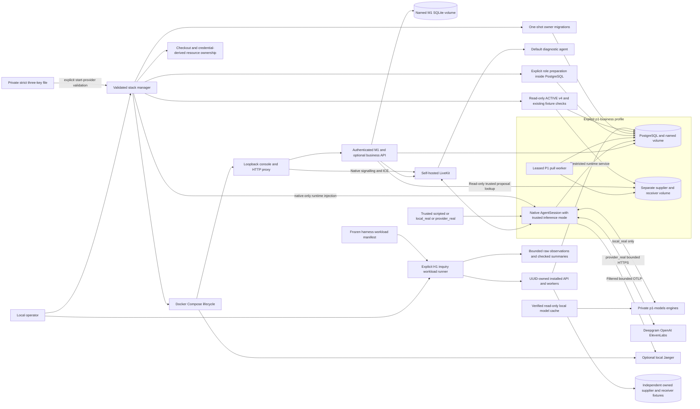
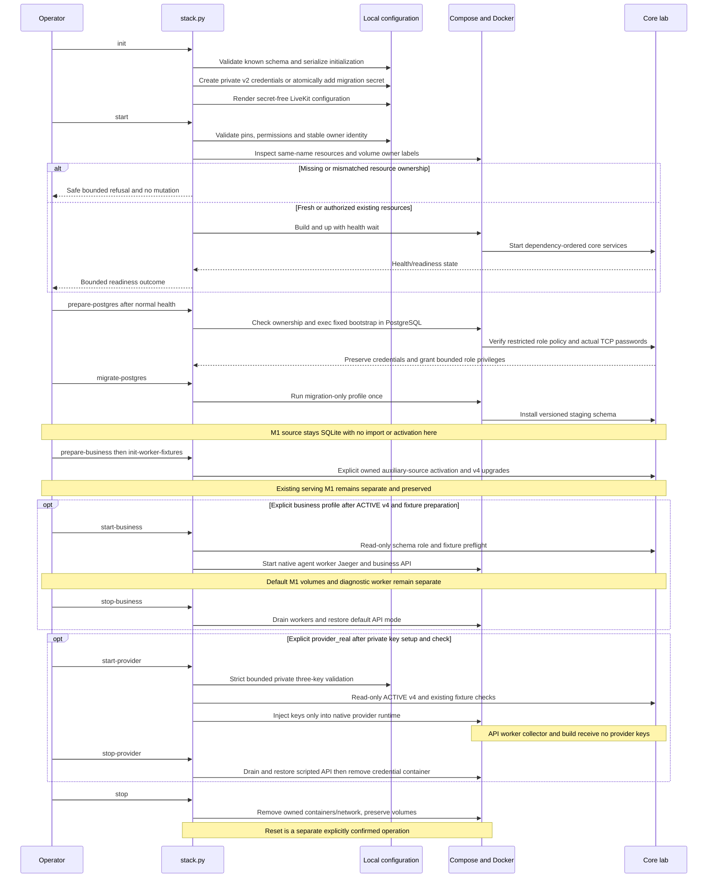

# Local setup design

Status: Active
Last reviewed: 11 November 2026

## Overview

This directory owns the implemented local orchestration boundary: a reproducible
five-service development lab with self-hosted LiveKit, PostgreSQL, the control
API, a deterministic native Agents SDK worker and the TypeScript console. An
optional profile adds Jaeger; a separate one-shot migrations profile prepares P1's
PostgreSQL schema. No model/carrier credentials are required for the transport lab
or deterministic inquiry tests. Normal lifecycle preserves named persistent state.

Read the [setup guide](README.md), [shared design](../Design.md),
[technology baseline](../docs/technology-baseline.md) and
[validation plan](../docs/validation-plan.md). This foundation does not implement
the three products' complete business semantics or their 54 acceptance cases.
Default API routes retain M1 SQLite intake. Explicit p1-workers/p1-business
profiles compose PostgreSQL v4 execution, native scripted conversation and a
scoped workspace without switching the M1 volume. Owner-only migration/cutover
and fixture initialization remain separate prerequisites. The
[Phase G work item](../docs/work-items/0013-p1-phase-g-conversation-and-showcase.md)
owns local combined evidence; complete charter/platform/workload and real-inference
release qualification remains separate.

H1 adds an opt-in inquiry workload controller over installed API/workers and
fresh UUID-owned state. The dependency-free harness owns its frozen declaration;
local setup owns explicit execution, resource probes and cleanup. The
[H1 work item](../docs/work-items/0014-p1-phase-h-workload-baseline.md) records the
qualified local inquiry measurement. It does not establish full H/P1 release,
production capacity or media/model performance.

## Objectives

| Type | Objective | Success evidence |
| --- | --- | --- |
| Business | Let a reviewer run the foundation on one development machine | Documented Docker route works without host LiveKit/Node or inference-provider setup |
| Business | Preserve accepted local data across ordinary stop/start | Same M1 task and stable key remain inspectable after restart |
| Technical | Keep infrastructure separate from business execution | Compose/lifecycle scripts orchestrate services without implementing workflow/channel/delegation state |
| Technical | Reproduce exact dependencies and contain local resources | Image digests, frozen installs, health checks and explicit container bounds |
| Technical | Avoid touching unrelated checkouts or exposing credentials | Namespace/volume ownership checks, loopback endpoints, private configuration and redacted diagnostics |
| Technical | Introduce a versioned application schema without serving-role administration | Retained-volume bootstrap, migration-only one-shot profile and actual PostgreSQL privilege refusals |

## Functional requirements

| Type | Requirement | Current behavior and verification |
| --- | --- | --- |
| Business | Initialize without losing an existing lab identity | Parse ignored files as data; atomically upgrade complete credential v1 to v2 while preserving all existing values and volume ownership |
| Business | Make destructive reset distinguishable from normal shutdown | Stop removes this stack's containers/network and keeps volumes; reset needs its separate explicit confirmation |
| Technical | Start core services in readiness order | PostgreSQL/LiveKit health precede API; API/agent health precede console; bounded Compose wait plus actual smoke |
| Technical | Support actual native media paths | Browser uses the published signalling URL; containers use the internal name; media uses ICE candidates rather than the HTTP proxy |
| Technical | Keep storage ownership explicit | SQLite M1 in application_data; PostgreSQL roles/database in postgres_data; owner labels checked even without containers |
| Technical | Expose bounded operations and safe diagnostics | Config validates without printing expanded credentials; status/logs/smoke have finite subprocess/operation budgets |
| Technical | Distinguish optional trace UI readiness | Observability profile probes HTTP 200; the business gate additionally inspects actual filtered OTLP traces |
| Business and technical | Enable P1 business composition explicitly | Read-only ACTIVE v4/fixture preflight, scoped native/controller commands, actual scripted browser media and preserved M1 compatibility |
| Technical | Prepare roles on fresh and retained volumes | Explicit post-health prepare-postgres verifies managed attributes and retained passwords over SCRAM TCP without rotation |
| Technical | Separate schema preparation from source activation | Explicit migrate-postgres creates a staging schema using only the migration principal; standalone cutover requires a source, private backup and verified checkpoints |
| Business and technical | Declare reproducible inquiry experiments before measuring | p1-benchmark-plan validates frozen input without execution; p1-benchmark requires installed-source, independent-result and owned-cleanup evidence |
| Business and technical | Restore a verified current case after dormant cross-channel interaction | Opt-in read-only I18 facade/application; selected source-bound 18-group storage and three-group media gates passed |
| Technical | Reproduce standalone P3 consumption from declared artifacts | Maintained offline8/combined8+8 package command; selected actual combined 16-case gate passed |

## Non-functional requirements

| Concern | Bound or target | Verification | Status |
| --- | --- | --- | --- |
| Network exposure | Manager fixes published bind address to 127.0.0.1; configurable nonconflicting host ports | Invalid/duplicate address/port tests plus actual config inspection | Implemented local boundary |
| Core memory limits | PostgreSQL 384 MiB; LiveKit 384 MiB; API 384 MiB; agent 512 MiB; console 128 MiB | Compose source validation and runtime resource inspection | Configured caps; not measured working-set requirements |
| One-shot migration resources | 256 MiB, 0.5 CPU, 64 PIDs; read-only application filesystem and 64 MiB temporary filesystem | Compose configuration and explicit migration run | Configured; separate from five persistent core services |
| Container containment | Nonroot users, no-new-privileges, dropped capabilities; application filesystems read-only with bounded tmpfs | Build/config/runtime checks | Implemented configuration |
| Log storage | json-file rotation: 10m per file, three files per service | Compose inspection; safe bounded manager output | Configured; application/provider privacy still requires review |
| Startup | Compose healthy wait 120 s within 600 s command budget; optional UI probe 20 s | Fake-clock timeout tests and actual startup | Implemented bounded operations, not an availability SLO |
| Database resources | max_connections=32, shared_buffers=64MB, work_mem=4MB; migration role connection limit 4 | Fresh/retained role verification, configuration and PostgreSQL privilege lane | Configured limits; work_mem is not a total-memory cap |
| Administration | Runtime has no database/schema CREATE or TEMP, role membership, schema/table ownership or migration-metadata writes | Actual PostgreSQL negative privilege tests and adapter startup checks | Implemented checks; migration/serving credentials stay separate |
| Lifecycle budgets | Role preparation 45 s; one-shot schema command 60 s; bootstrap connection 3 s, statement 5 s and lock 1 s | Timeout fixtures plus explicit local PostgreSQL lane | Finite failure budgets, not latency SLOs |
| Persistence | No volume deletion or credential rotation in normal upgrade/restart | Same-volume restart, interrupted credential replacement and ownership-negative tests | Implemented; source cutover remains an explicit standalone operation |
| Platform/media | Actual Linux/macOS Docker paths and browser/media checks need their own evidence | Supported-platform and media gates | Partial; CI YAML alone is not Linux execution evidence |
| H1 measurement bounds | Six experiments, at most 32 new offers each; shared HTTP slots 1 or 4; 180 s/experiment within 600 s, cleanup 90 s, 4096 raw records | Strict declaration/adversarial tests and explicit installed runtime lane | Local inquiry baseline qualified in [H1 work item](../docs/work-items/0014-p1-phase-h-workload-baseline.md); current P1 workload/release evidence is separately qualified; all 17 P2 and remaining 14 P3 rows remain planned alongside three passing registered P3 lab rows |
| H1 resource observations | API/each worker 1000 millicores, 512 MiB, pids limit 128; resource target 1 s, actual timings/skipped slots retained | Docker/cgroup configured-cap identity plus raw observations, independent of temporary overage | Configured finite limits; probe overhead included, not an RSS/peak/capacity claim |
| I18 gate budgets | Storage180s/15cleanup and context64KiB UTF-8; media240s/20cleanup | Frozen role/child/proof contracts, current grants, actual clocks and owned resource closure | Implemented bounds; selected actual 18-group storage and three-group media qualification passed |
| Standalone package budget | 360s/20cleanup, at most40 children,2MiB capture,32KiB report | Offline8 or explicit8offline+8lab, exact archives/index and owned cleanup | Implemented; no broader release or capacity claim |

## Back-of-the-envelope calculations

These are configured-limit arithmetic, not a measured minimum host requirement,
benchmark or production capacity claim. Docker/OS/build caches need additional
headroom beyond service limits.

| Input/assumption | Calculation | Interpretation |
| --- | --- | --- |
| Core memory caps | 384 + 384 + 384 + 512 + 128 = 1,792 MiB = 1.75 GiB | Sum of configured service ceilings, not reserved memory or observed RSS |
| Optional Jaeger cap 256 MiB | 1,792 + 256 = 2,048 MiB = 2 GiB | Leaves no allowance for Docker VM, host apps or builds; provision extra headroom |
| Explicit business additions | 1,792 + worker 256 + native agent 512 + Jaeger 256 = 2,816 MiB = 2.75 GiB | Configured ceilings, not measured RSS or host sizing; browser/builds remain additional |
| One-shot migration cap 256 MiB | 1,792 + 256 = 2,048 MiB; with Jaeger 2,304 MiB = 2.25 GiB | Transient configured ceilings; add Docker/OS/build headroom separately |
| Core CPU quotas | 1 + 1 + 1 + 1.5 + 0.5 = 5 CPU-equivalents | Maximum configured quotas, not a five-core minimum or expected utilization |
| Five core rotated logs, assumed 10 MiB/file | 5 × 3 × 10 MiB = about 150 MiB | Approximate rotation allocation; metadata/active rotation can add overhead; optional service adds about 30 MiB |
| Illustrative 24 concurrent query sorts at work_mem=4MB | 24 × 4 MB = 96 MB for one sort allocation each | Queries can allocate multiple nodes; do not compute total PostgreSQL memory as one work_mem per connection |
| H1 declared new offers | 2 ×20 steady +2 ×32 burst +2 ×32 saturation = 168 | Expected 120 admissions and 48 capacity rejections, not observed results; replay/GET/cancel are separate calls |
| H1 serving memory ceilings | 512 MiB API  + 1 or 2 ×512 MiB worker = 1024 or 1536 MiB | Isolated serving ceilings only; excludes shared PG, VM, host/driver, fixtures/bootstrap and build overhead |

Before expanding product profiles, add their configured caps, actual idle/peak
RSS, database connections and disk/replay-retention demand to the workload sheet.
Do not infer multi-server media scale from two execution workers.

## High-level design

1. The manager validates configuration, immutable image selections, file privacy
   and ownership before invoking Compose with explicit environment values.
2. The console proxies /api only. Browser/container signalling URLs differ;
   realtime data/media follow native SDK and ICE networking.
3. Default M1 writes stay in SQLite. Explicit business mode uses the prepared
   PostgreSQL v4 service and current-case UI. The diagnostic agent remains
   transport-only; role/schema preparation cannot implicitly activate business mode.
4. Role bootstrap runs inside PostgreSQL after its normal TCP server is healthy.
   Only that container has the administrator credential. The one-shot application
   service receives a separate migration credential; serving code gets the
   restricted runtime credential.
5. Schema preparation creates staging metadata and does not admit runtime work.
   The explicit checker uses isolated schemas and private synthetic SQLite sources
   to exercise quiescence, backup, verified import, activation and recovery.
6. Optional Jaeger readiness establishes a reachable UI only. The explicit
   business gate also inspects real filtered native/application export. SMS,
   production telemetry retention and full release qualification remain planned.
7. Native input/status controls require actual RoomIO readiness and active SDK
   state. Explicit End and speech interruption do not cancel business work;
   exact quote consent remains a separate authenticated controller command.
8. H1 execution is a separate opt-in host tool, not a normal startup profile or a
   second scheduler. It creates fresh source-bound installed services/state and
   retains declared inputs plus actual observations. Independent reconciliation
   and verified owned cleanup are required before a workload pass.

## Sequence diagram

This sequence describes normal stack lifecycle. H1's separate explicit runner
creates and cleans only its own schema/containers/volumes; it never replaces these
preserved application resources. Planning alone does not enter runtime execution.

## Low-level design

The diagram groups module/data responsibilities; it does not introduce new
runtime classes or assert those conceptual method names as public CLI commands.
stack.py's existing parser/functions and README own the actual command surface.

## Components and related details

### Joined scripted launcher

The explicit launcher composes one Python Parent and at most three closed
Node/Vite roles from an existing prepared profile and prebuilt artifacts. The
Parent starts source listeners first, then the specialist and gateway start;
the actual observed gateway cursor admits the executor/operator surface. The
optional public Vite preview serves the joined page. No startup performs DDL,
reset, sender association, dependency installation or provider loading.

Startup has one 60-second observer with each child readiness bounded at fifteen
seconds; shutdown has one original 60-second observer. Independent retained UI
and Parent cleanup begins before awaiting either owner, with both settled before
gateway and specialist removal. Failed/cancelled readers require actual EOF
proof, direct children require reap and group absence, and unresolved ownership
retains dependencies. Normal stop preserves product state, operator capability
and fixed bridge configuration. An existing active marker fails closed; crash
recovery is a separate future operation. These implemented component bounds do
not establish connected media/provider qualification or production capacity.

### Frozen Python runtime and owned worker checkpoint

The shared Python build uses frozen non-editable production installation with
bytecode compilation; the runtime retains those installed caches while disabling
bytecode writes. An image rebuild and matching installed-source/image evidence
are required after relevant changes. No automatic provider, resource or deadline
adjustment follows from this import preparation.

The real-media helper requests SIGUSR1 on the exact owned running worker and
awaits its actual outer-loop health checkpoint after child reap, lease release
and final queue SQL. It also requires active=0 before the declared OS pause.
Unpause/SIGUSR2 must produce fresh ready health, which may already include one
active child. Requests own ambiguous acknowledgements; failed restoration stays
non-passing. Setup retains one 100-second deadline, resume/close shares 12 seconds,
and original 45-second recovery starts before resume acknowledgement. These are
local diagnostic controls, not user-facing business or consent operations.

### State ownership

| Owner | Authoritative state |
| --- | --- |
| .env | Nonsecret local endpoints/networking configuration |
| .secrets.env | Versioned owner-only credential inventory; all old values and stable volume-owner input preserved |
| images.env and images.lock.json | Exact image version/digest selections |
| .generated | Derived secret-free LiveKit configuration and private initialization lock |
| application_data | Current M1 SQLite records |
| postgres_data | PostgreSQL roles and versioned P1 schema; live M1 API storage remains separate |
| worker_data | Separate independent supplier/receiver identities and retained receipts for explicit P1 profiles |
| Runtime services | Ephemeral rooms, media invocations and bounded process resources; durable business authority stays in PostgreSQL |

### Layout and interfaces

- docker-compose.yaml declares the core topology, health checks, resources,
  volumes and optional profiles. config contains the LiveKit template,
  fresh-volume runtime-role initialization and explicitly invoked post-health
  role preparation for retained or fresh PostgreSQL volumes.
- stack.py and Makefile expose initialization, doctor, config, lifecycle and
  smoke. stack.py also exposes prepare-postgres and migrate-postgres. docker
  contains multi-stage builds; frozen dependency installation
  precedes source copies so ordinary edits reuse dependency layers.
- scripts/smoke.py runs bounded actual-service probes. Application logic stays
  in services, the browser in apps and product work in projects.
- scripts/postgres_check.py owns a separate explicit PostgreSQL gate. It reads
  validated local credentials, clears inherited database selectors, uses isolated
  test schemas/files and emits a machine summary without starting/resetting Docker.

### Failure and recovery boundaries

Container checkout ownership prevents cross-checkout mutation. Both named volumes
carry a credential-derived owner label. Missing/mismatched labels block reuse or
mutation even when containers are absent; matching private credentials permit
intentional relocation of stopped state. Credentials must travel safely with
their volumes; deleting/recreating a secret file does not adopt old data.

Init recognizes only complete credential inventories. Upgrading v1 adds one
generated migration password to a mode-0600 temporary file, flushes it, atomically
replaces the original and syncs the directory under an initialization lock. An
interruption leaves the original valid inventory or the complete new one. It does
not rotate the operator token, runtime/admin passwords or volume-owner label.

Fresh-volume SQL creates the runtime role. Explicit prepare-postgres then runs
the same bounded bootstrap on fresh and retained volumes. It takes a session
advisory lock, validates managed role attributes, assigns a password only to a new
pending role with no password and proves existing credentials through SCRAM TCP
login. A retained mismatch is a refusal, not a rotation. A pending role can resume
after interruption. Database TEMP and runtime CREATE/schema/table ownership are
forbidden; the migration role receives database CONNECT/CREATE only.

The one-shot profile executes postgres_cli schema with only P1_MIGRATION_*.
It prepares versioned staging tables and grants the serving role bounded data
access and read-only migration metadata. PostgreSQL runtime readiness requires
an active receipt. The API's P1_POSTGRES_* values carry only its runtime identity;
the live M1 endpoint remains SQLite regardless of schema preparation.

### Migration, restore and compatibility

The explicit standalone cutover drains cooperating SQLite workers/writers,
creates a private v1 backup and commits a durable source v2 admission gate. It
then stages and verifies the exact source identities, payloads, effects, versions
and attempt history, records source cutover and activates the matching target.
Interrupted checkpoints resume the same migration identity. There is no automatic
dual write, source reopening or replacement of active target data after progress.

The PostgreSQL checker demonstrates these operations with synthetic temporary
sources and isolated schemas. Normal setup never selects or quiesces the live M1
database. Backup restoration is an explicit recovery decision; restore into an
isolated path to inspect original v1 data before deciding which backend may write.
Do not resume both restored source and active target as simultaneous authorities.
Retention/cleanup of business history remains a separate product policy.

P1 cutover binds source quiescence to one destination fingerprint. Final target
activation locks business tables and rechecks the staged content digest before
marking ACTIVE; a completed receipt preserves later target progress.

The optional explicit upgrade-postgres command runs additive schema v2 through
the owner-only profile. Phase D demo containers receive runtime credentials only
and share persisted PostgreSQL, with no shared application file or live M1 cutover.
Later owner-only effects/coordination upgrades reach ACTIVE v4 without serving DDL.
Passing demo evidence is written only after owned-state cleanup.

### Explicit business profile

The separate native conversation process consumes the same authenticated durable
service through signed room/participant/frozen-request grants. It owns no supplier
volume, migration credential or operator bearer. Only the controller/UI can submit
exact quote approval. The API proposal adapter mounts the existing worker volume
read-only; the durable worker remains the external effect/delivery owner.

start-business validates read-only prerequisites and supplies explicit business and
local trace configuration. It starts the existing Jaeger profile, leased worker,
native agent and API. Normal start remains M1 mode. stop-business independently
drains native/durable workers and returns the API to default mode, preserving data.
Both workers have 35-second Compose grace so finite native session/observer/port
cleanup can complete. Native readiness waits for public RoomIO subscription before
greeting; browser input/status also requires continuity.session_ready=true
and active SDK state. The explicit scripted source uses real bundled WebAudio PCM
and owned tracks (512 KiB maximum fixture, 16 kHz mono PCM16, at most 12 seconds;
5-second source creation and 1-second context-close budgets). Source/publication
cleanup remains owned until real settlement, and a new media context is blocked
while old cleanup is unknown.
A later explicit Join uses a fresh room/invocation for the same durable task;
unknown initial acknowledgements retry their unchanged frozen binding. Process
health is not proof of registration, audio, authority or trace export;
make phase-g-demo verifies those separately.

The business aggregate adds 256 MiB worker +512 MiB native +256 MiB collector to
the 1,792 MiB core configured limits, totaling 2,816 MiB. Two owned demo volumes
keep supplier/receiver and API SQLite state outside the main M1 volumes. The
installed/browser gate uses labelled UUID containers, isolated schema, fixed
loopback test ports, private environment files and bounded diagnostics, then
verifies owned cleanup. No test-fault route enters the product API.

### H1 inquiry workload boundary

The harness [manifest](../harness/workloads/p1-inquiry-v1.json) owns typed seeded
inputs. make p1-benchmark-plan invokes the CLI without --run, validates the manifest
and prints a digest with status not_started. make p1-benchmark explicitly enters
the separate runner after owned-stack/restricted-role/fresh-image prerequisites.
It prepares a fresh UUID-owned v4 schema, separate provider/receiver and API volumes,
then runs installed API and one/two workers without checkout mounts. Runtime source
inventory/image, schema/volume identity and configured caps are checked. Only the
fixture owner receives migration authority; serving roles perform no DDL.

Six steady/burst/saturation modes declare 168 offers, 120 admissions and 48 capacity
rejections. Saturation intentionally admits 8 and proves read/replay at capacity,
then rejects 24 new identities before starting workers. This staged delay is part
of its observed result latency, not live-worker burst throughput. Submit, replay,
GET and cancellation share the declared HTTP semaphore/pool. Observation performs
one global round-robin GET then sleeps 250 ms; HTTP/queue delay and cohort sweep
lag extend it. Record scheduled offer, first HTTP start, known validated ack and
first validated succeeded submit/replay/GET snapshot separately. Unknown attempt
finish is not an acknowledgement.

Sequential in-cgroup Python resource probes target 1 s and retain actual probe
start/end/duration and skipped intervals. Their CPU/memory/PID overhead is included;
missed slots are skipped rather than replayed back-to-back. CPU counters are
cumulative microseconds with first/last/delta/window. Accounted memory.current
is not RSS or a peak, and pids.current counts kernel tasks/threads. Exact configured
caps are separate from retained temporary usage overage. Resource windows include
post-inquiry replay/cancellation/delivery; host/VM/shared-PG resources are excluded.
The [observability guide](../docs/observability.md) owns detailed units and clocks.

Safe bounded raw records, frozen manifest and source/image/machine provenance stay
under ignored `.local/validation/p1-phase-h/<run-id>`. Pre-cleanup measured snapshots
are not phase passes. Require independent inquiry receipts, zero supplier mutation,
separate cancellation/outcome/delivery and verified owned cleanup. Missing setup,
progress, observations, required timeout or failed cleanup remains non-passing.
Retain failed evidence and closed G artifacts. The H1 work item owns the completed
local inquiry measurement. H2 reliability and P1-I26 host/Linux artifacts,
API/failure review and genuine native consumer passed separately. P1 V1 is qualified for the local POC using provider_real v2. local_real remains unqualified and all 17 P2 and remaining 14 P3 rows remain planned alongside three passing registered P3 lab rows. No product metric exporter is added.

### Prepared local speech and model engines

The default topology and scripted regression remain unchanged. An explicit
p1-models profile adds Ollama/Qwen, whisper.cpp/base.en and Piper/LJSpeech on an
internal inference network without host ports. The native agent also joins that
network; engines receive no application credentials. Prepared models mount
read-only at /models and are absent from application build contexts.

Only models-fetch can download declared weights. start-models/start-local-real
verify exact cached sizes/digests first; neither initializes schema or fixtures.
start-local-real then uses the existing read-only ACTIVE v4/same-scope preflight
and explicit trusted local_real mode for API/native/traces. stop-local-real drains
workers, restores ordinary API/scripted mode and stops engines without deleting
state. The [operations guide](../docs/local-real-inference.md) owns exact commands,
license distinctions, model total and headroom. Actual engine/model/media results
remain separate qualification; readiness is not a model result.

### Trusted provider composition

The shared/native path accepts exactly scripted (default), local_real and
provider_real. The diagrams retain the shared authority path; profile adapters use the same session and bound task rather than creating another
case authority. provider_real composes Deepgram nova-3 batch recognition after
manual flush, OpenAI gpt-5.4-mini streaming tool selection and ElevenLabs
eleven_v4_turbo chunked HTTP PCM speech. Only the native process receives provider
keys, and real output cannot bypass separate exact human consent.

The [provider operations guide](../docs/provider-demo.md) owns strict key setup, explicit lifecycle,
fixed model/voice/transports, bounded execution and the fresh P1-20 selector.
Real profiles keep 12-second commit and 40-second incoming-transcription limits;
other RPCs remain 8 seconds and browser cleanup 5 seconds. No silent fallback,
provider resource-capacity result or blanket zero-retention claim is made.
The selected provider_real v2 gate passed both actual browser cases with cleanup. P1 V1 is qualified for the local POC using provider_real v2.
A passing provider scenario cannot qualify the separate local-engine declaration.

An explicitly selected approved public CA bundle can replace the native container's
OS CA-file view through a read-only mount. Strict host validation and an atomic
public snapshot preserve verified TLS without ambient proxy/CA overrides or image
layers containing local trust material. The interactive manager retains one
ignored generated snapshot; the isolated gate owns its snapshot through verified
native cleanup and binds its digest to actual mounted bytes. The API, worker,
models and private three-key schema receive no new trust authority. See the
[certificate procedure](../docs/provider-demo.md#explicit-local-certificate-trust).

### Opt-in host native and deadline fixtures

The [completed handoff](../docs/work-items/0036-native-input-and-deadline-cancellation.md)
keeps default M1/P1 Compose services and data unchanged. An explicitly invoked host
Python SDK/gateway/browser exercise connects to the existing Docker SFU/PostgreSQL;
its disposable owner-upgraded v6 channel profile adds two tables and preserves v5
identity/history. Runtime roles do no DDL. New intake/prepare/reservation checks
fresh database time and current grant under admission/binding locks; retained
facts and an already admitted possible call stay distinct.

make p2-native-build builds the P2 SDK then isolated page; make p2-native-check owns
its complete room/process/schema lifecycle. Selected actual six-group native and
isolated Python/npm artifact gates passed. Final selected phase checks and the affected
media rerun passed. The qualified source/installed P3 deadline gate reuses P1 public
authority with unchanged production runtime. Keep restricted roles, transient
private RTC configuration, bounded safe evidence and independent complete cleanup.
No provider-key file, new default service or real-inference claim is introduced.

### Opt-in current-case and standalone consumers

The [completed handoff](../docs/work-items/0038-case-rehydration-and-standalone-release.md) adds no default service or authority migration. P2's
current-grant read facade reuses the existing inbox and separately reads an
allowlisted public P1 projection, then makes a new protected permission check.
Retained history access is not current room/SMS authorization. Scope, source
fingerprint and observation times remain explicit; the cross-store read is not
atomic and matching case revision cannot establish current supplier/workflow state.
Public P1 revision 0 remains readable while native dispatch retains its positive
revision contract. No automatic revision repair or confirmation tool is introduced.

The application owns two sequential SDK/RTC instances and one shared bounded HTTP
listener. A's real owners close before parent room deletion; the fixed signed SMS
runs while neither room exists. Parent creates B only afterwards and supplies its
owned ready marker. B loads verified context before SDK readiness, and fresh input
progresses separately. The model-context tap inspects public ChatContext IDs/roles
at actual scripted-model entry without retaining bodies or claiming reasoning.
Client playback/PCM and historical SDK facts never establish hearing or consent.

The maintained P3 package command builds fresh declared P1 and P3 Python archives
plus specialist npm, then consumes installed public imports and unchanged application
examples. Offline mode checks8 assertions without SQL; explicit lab mode adds8
actual local completion/replay assertions. Synthetic owner/leased-worker setup is
separate from the public consumer. It preserves77 P1/30 P3 runtime payloads and
adds no execution queue, provider requirement or full charter registration.

Both gates retain finite failure context and exact private inventories. Actual
child exit precedes dependent DDL/removal; failed close observers retain work.
Dependent bridge, shared reader and schema cleanup proceed in that order only after
actual success. New fixture stages are blocked after original deadline or close.
The selected 18-group storage, three-group media and P3 combined 16-case gates passed with actual owned cleanup.
The 111 installed Python tests over nine payloads and 632 P2 TypeScript/503 console
unit tests passed within their narrower scopes. These selected results do not complete
full P2/P3 charter registration. P2-I19 workload/dormancy, P2-I20 joined-view/telemetry
verification and P3-I16 document extraction remain next.

## Security and privacy

Parse dotenv values as data; never source shell configuration. Validate filenames,
types, allowed endpoints, file permissions and symlinks. Do not print expanded
Compose secrets, mount the Docker socket into services or expose operator endpoints
on a LAN. The local manager fixes loopback binding; remote TLS/TURN, mobile access
and multi-server LiveKit networking require separate deployment decisions.

Bootstrap, migration and runtime passwords are independent. The administrator
credential is confined to PostgreSQL; the one-shot application container receives
only the migration credential, and serving containers receive neither. Fixed SQL
and psql password handling avoid cleartext credentials in SQL/argv; raw bootstrap
client output is suppressed. Host P1_* overrides are scrubbed, and bootstrap
libpq service/hostaddr selectors cannot redirect its authentication probes.
Container environment inspection by a local Docker administrator remains outside this
development boundary; do not claim a hardened secret-management platform.
Normal smoke is synthetic and must not print access tokens or raw personal media.

## Observability

The manager reports bounded, redacted operational outcomes and spools subprocess
output rather than retaining an unbounded build log. Diagnostic logs merge
stdout/stderr and optionally select one allowlisted service before applying the
existing 8,000-byte tail/redaction policy. Selection addresses aggregate-tail
loss; it does not make retention unbounded or alter status parsing. The implemented API exposes
safe structured request logs and protected metrics. LiveKit's config selects JSON
logging; other SDK/infrastructure logs have their own formats and privacy limits.
There is no claim that every service already shares one JSON schema.

Role preparation reports fixed safe outcomes. Source quiescence, schema/import
and worker modules emit allowlisted event/code pairs; they do not include tokens,
DSNs, SQL or request payloads. The PostgreSQL checker records counts, errors,
skips and duration in its machine report. See the shared
[observability contract](../docs/observability.md) and
[Python practices](../docs/python-engineering.md) for application producer rules.

H1 retains fixed-vocabulary bounded raw HTTP/resource/queue/result/observer records,
canonical declaration and installed-source provenance as local artifacts, not a
new runtime exporter. Actual probe durations/skipped slots and observer overhead
remain visible. Independent supplier/receiver truth and verified owned cleanup
are required separately from those observations. Automatically reported environment
metadata is host system/architecture/Python plus installed runtime architecture/
versions; Docker-VM hardware/shared-host context is separately collected operator
evidence. See the shared observability guide for client timestamps, failure context,
accounted memory and CPU-window interpretation.

Status/readiness are not business progress. Retain actual service versions,
profile, path exercised and operation outcome in validation evidence. The optional
Jaeger UI is in-memory. The business profile exports filtered bounded native/
application OTLP and the Phase G gate inspects actual spans and exporter failure
behavior. Viewer health cannot substitute for export; production trace retention
and complete distributed coverage remain later qualification.

## Metrics

| Signal | Source/unit | Meaning and status |
| --- | --- | --- |
| Health/readiness outcomes | Compose and bounded HTTP/SQL probes | Implemented operational readiness, not media success |
| Control API metrics | Protected /api/metrics | Implemented finite request/error/duration/inflight observations; see the shared contract |
| LiveKit Prometheus port | Container configuration port 9780 | Configured internally; no published Prometheus/Grafana collection stack is implied |
| PostgreSQL gate result | Machine report: cases, failures, errors, skips and seconds | Implemented explicit validation outcome; not a production metric exporter or product SLO |
| H1 resource/timing records | Explicit installed inquiry workload runner | Local inquiry measurement qualified in the H1 work item; accounted current memory is not RSS/peak and probe pressure is included; current P1 workload/release evidence is separately qualified; all 17 P2 and remaining 14 P3 rows remain planned alongside three passing registered P3 lab rows |
| Trace export success/failure | Bounded business native/application OTLP producer | Implemented local pipeline inspected by Phase G; UI reachability is insufficient and production retention remains open |

Keep identifiers in safe bounded logs/traces rather than metric labels. Default
local diagnostics do not require another dashboard stack.

## Exception handling

| Failure | Handling | Acceptance assertion |
| --- | --- | --- |
| Invalid config/permissions/image selection | SetupError with safe message before mutation | No shell evaluation, secret reflection or partial destructive operation |
| Foreign container or volume owner | Refuse operation | Existing unrelated resources and accepted state remain intact |
| Subprocess failure or deadline | Bounded safe/redacted output and nonzero result | No indefinite wait or unbounded in-memory output |
| Optional trace UI unavailable | Fail only the requested observability qualification | Do not certify a profile solely because its container started |
| Dependency unhealthy | Startup/smoke remains unsuccessful | Health is never substituted for actual transport/product evidence |
| Interrupted/failed normal lifecycle | Inspect current state and retry only the authorized bounded operation | Do not reset or regenerate credentials to hide failed recovery |
| Legacy, unknown or interrupted credential initialization | Only init upgrades an exact known inventory under a private lock with atomic replacement | Existing five values, volume owner and private permissions persist; unknown fields fail |
| Role policy or TCP credential mismatch | Fail bounded bootstrap without password rotation or implicit adoption | No false success through socket trust, unsafe SQL or secret-bearing diagnostics |
| Missing/staging PostgreSQL target | Reject runtime readiness; schema preparation alone is insufficient | Explicit PostgreSQL lane proves no admission before verified activation |
| H1 missing progress/resource/receipt or ownership mismatch | Fail the workload and retain fixed-enum original failure context plus observed numeric process status/timing before temporary capture removal; clean only verified owned resources and report cleanup failures separately | No raw argv/stdout/stderr/environment/body/exception retention, fabricated zeros, foreign cleanup or pre-cleanup phase pass |

Readiness retries use finite budgets; successful initialization remains idempotent.
Preserve original causes internally where safe while sanitizing operator output.
Cleanup is limited to the owned namespace; cancelling a check cannot authorize
destroying persistent application data.

## Design considerations and trade-offs

| Decision | Benefit | Cost or limit |
| --- | --- | --- |
| Docker Compose and one media server | Small reproducible local topology | Not an orchestrator HA/distributed media demonstration |
| Default SQLite M1 plus explicit PostgreSQL business profile | Preserve original intake while composing prepared v4 authority through scoped adapters | Explicit operator preflight/activation; the stores are not one atomic transaction |
| Explicit post-health role bootstrap | Same supported procedure on fresh and retained volumes; real SCRAM proof | Operator must run prepare-postgres after updating the PostgreSQL container |
| Separate migration-only profile | No schema administration in serving containers; bounded one-shot resource use | Schema preparation stages data structures only; activation requires a verified source |
| Credential-derived volume ownership | Prevent accidental cross-checkout adoption/deletion | Retaining private credentials is necessary for legitimate state relocation |
| Loopback and native ICE candidates | Works without Linux-only host networking | Browser/container traffic must actually be exercised; remote access needs new design |
| Optional lightweight trace UI and filtered business export | Inspect actual local producer spans without another dashboard stack | In-memory data and partial local coverage do not establish production observability |

### Phase E isolated fixtures

Schema v3 is an explicit additive ACTIVE-v2 upgrade through upgrade-effects and
the migration profile. Existing values and immutable v1/v2 payloads remain;
serving roles perform no DDL. An ACTIVE v3 target retains its original cutover
receipt. Legacy proposals remain inspectable and replayable; fresh mutation
requires a complete versioned provider/case/revision binding.

phase-e-demo owns a new labelled volume for independent supplier and receiver
SQLite fixtures and a separate synthetic PG schema. Five fresh restricted
containers use installed package code from /tmp; module hashes are checked
against inspected source. Two exit only after durable external commit and before
local acknowledgement. Ordinary application volumes are never mounted. Fixture
ownership is verified before initialization/deletion, output is capped, and only
successful cleanup permits a passing artifact. This is a single-worker local
proof, not distributed external-call fencing or a capacity measurement.

### Phase F bounded worker profile

The optional p1-worker consumes only due managed work and retained completion
intent in an explicitly ACTIVE v4 schema. Existing M1 API/console and diagnostic
RTC worker remain separate. Its unprivileged process owns one bounded child,
private health/metrics files and no acknowledged memory queue. The fixture volume
retains supplier and receiver identities/receipts; serving roles perform no DDL.

The child occupancy ceiling is 15 seconds or half the persisted lease duration,
whichever is smaller. SIGTERM stops acquisition and allows up to five seconds of
child drain before owned group termination/reaping. The container's 35-second
stop grace bounds deployment shutdown; hard termination leaves retained state
for another lease owner. Lease validation, not a wall-clock estimate, determines
write authority. A current-lease limit does not count every stale external call
that may remain in flight after expiry.

Optional worker schema/scope settings preserve old .env compatibility and secret
values. Explicit fixture initialization, owner-only v4 upgrade and worker start
are separate actions; a STAGING or incompatible schema fails closed. The upgrade
refuses an unmanaged running legacy inquiry until it is reconciled on v3. Normal
stop removes worker processes but retains all named state. The isolated phase
proof never mounts or resets ordinary application volumes.

## Validation and acceptance gates

1. Configuration/unit gate: run existing commands in [README.md](README.md).
   Require malformed dotenv, substitution-as-data, private permissions/symlinks,
   exact image pins, namespace/volume ownership, timeout, credential-upgrade
   interruption/repeat, unknown-schema, secret/argv privacy and preserved-secret
   tests. Shared policy changes run the full fast lane.
2. Infrastructure gate: actual startup and readiness on the supported platform;
   restricted database identity and optional profile qualification when requested.
3. Transport/intake gate: authenticate, obtain scoped token/dispatch, verify native
   text and expected-track audio, inspect M1 replay/conflict and preserve the same
   task across normal restart. Synthetic smoke must clean up its own resources.
4. PostgreSQL gate: after init/start/prepare-postgres, run make postgres-check.
   Require actual runtime privilege refusals, staging/activation, exact source
   preservation, backup/recovery, interrupted checkpoints, scoped access and
   independent inquiry-process recovery. The lane uses isolated schemas/sources,
   fails without setup and permits no skipped requirements. Read its machine
   report separately from offline unit and transport results.
5. Business browser gate: make phase-g-demo requires actual scripted WebAudio/
   WebRTC input and returned audio, fresh native status after a new-room/same-task
   continuation, active speech interruption, real microphone permission denial,
   responsive controls under held PG/supplier dependencies, exact UI consent and
   inspected filtered traces. Preserve current image/host-asset provenance and
   bounded sanitized artifacts. Mock/native smoke cannot pass a different path.
6. Product/release gate: physical capture, real-inference quality, complete platform
   and channel/delegation requirements remain separate. Hosted CI/publication are
   outside this local POC scope. H1 records a qualified local inquiry baseline;
   freeze resources/schedules/budgets for each broader workload before measuring.
   Standalone P1 host/Linux artifacts, API/failure review and genuine native
   consumer passed, with exact evidence tracked in the package work item.
   Missing/skipped/timed-out cases remain non-passing; no normal check runs reset.
7. H1 workload lane: validate/freeze the declaration, then explicitly run the
   installed API/worker experiments and inspect raw timings, actual resource cadence,
   independent inquiry truth and zero mutation. Passing requires verified owned
   cleanup. Keep its completed local measurement evidence in the H1 work item and preserve closed G
   artifacts when running the separate browser regression. Minimum/median/maximum
   summaries are not throughput, model quality or complete release qualification.
