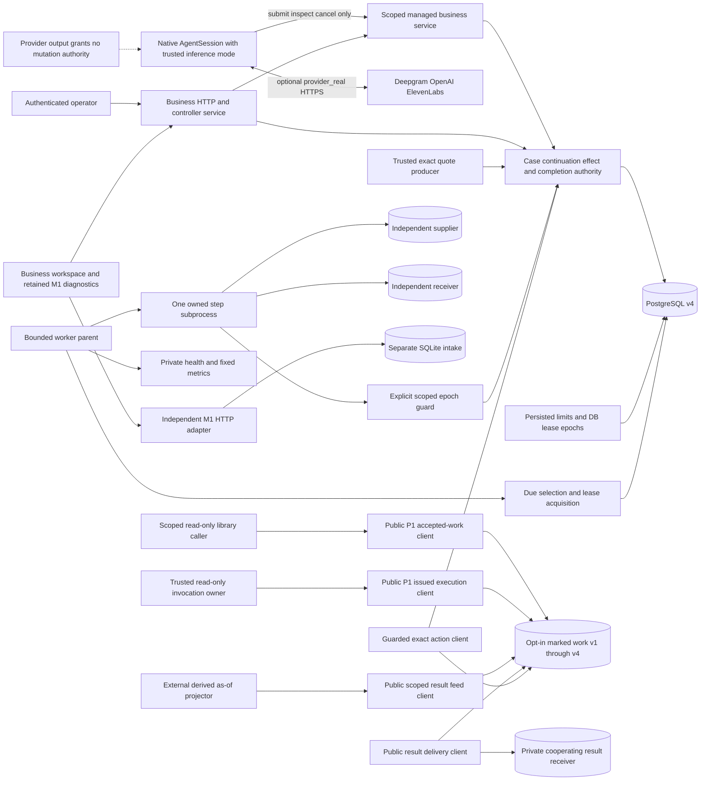
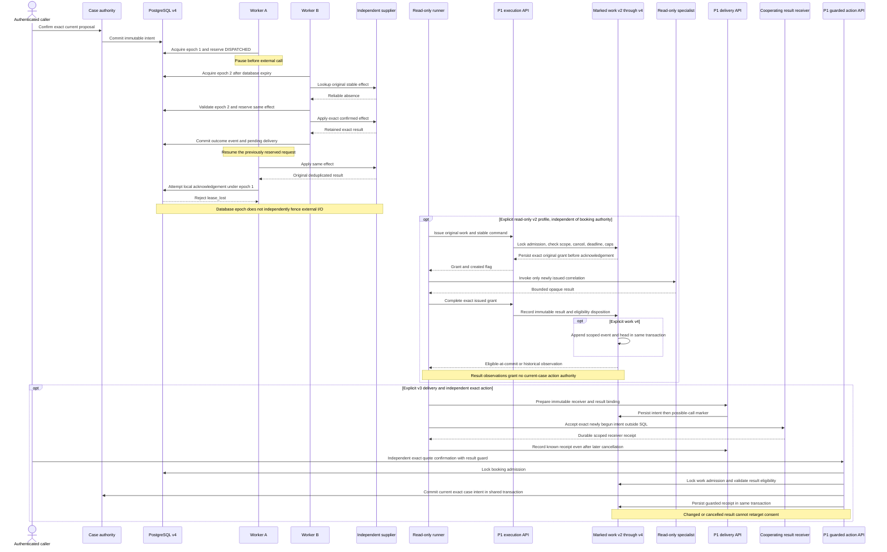

# Agent Continuity Lab design

| Field | Value |
| --- | --- |
| Status | Active |
| Purpose | Explain the P1 component design for accepted work that survives conversation closure and process failure |
| Audience | Engineers and coding agents who change P1 or consume its public interfaces |
| Scope | P1 components, state, interfaces, failure handling and gates; excludes acceptance IDs, phase tasks and operations setup |
| Owns | P1 implementation boundaries: state and identity ownership, transactions, interfaces and design trade-offs |
| Related | [V1 charter](../../docs/projects/agent-continuity-scope.md) · [Shared design](../../Design.md) · [Project README](README.md) · [Granular plan](../../docs/implementation/p1-agent-continuity.md) · [Effects guide](../../docs/effects-and-completion.md) |

## Overview

This document is the component design for P1, Agent Continuity Lab. P1 builds a
Python boundary for explicitly accepted business work that survives conversation
closure and process failure. The booking example investigates a date change,
collects exact confirmation and applies an authorized synthetic mutation. The
document is for engineers and coding agents who change P1 or consume its public
interfaces.

Authority is divided between documents:

- The [charter](../../docs/projects/agent-continuity-scope.md) owns P1-01 through
  P1-20.
- The [shared design](../../Design.md) owns common authority and ports.
- The [granular plan](../../docs/implementation/p1-agent-continuity.md) owns phase
  tasks.
- The [effects guide](../../docs/effects-and-completion.md) owns effect operational
  semantics. The [worker guide](../../docs/leases-and-workers.md) owns worker setup
  and operational limits.

These application contracts are separate from LiveKit SDK interfaces.

### Contents

- [Objectives](#objectives), [Functional requirements](#functional-requirements)
  and [Non-functional requirements](#non-functional-requirements): goals, required
  behavior and invariants with their status.
- [Back-of-the-envelope calculations](#back-of-the-envelope-calculations):
  configured bounds and illustrative sizing.
- [High-level design](#high-level-design), [Sequence diagram](#sequence-diagram)
  and [Low-level design](#low-level-design): components, the lease-takeover
  sequence and the main types.
- [Components and related details](#components-and-related-details): the component
  map, booking authority state, migrations and retention, the worker process,
  native consumers, packaging and work profile versions 1 to 4.
- [Security and privacy](#security-and-privacy), [Observability](#observability),
  [Metrics](#metrics) and [Exception handling](#exception-handling): cross-cutting
  rules.
- [Design considerations and trade-offs](#design-considerations-and-trade-offs)
  and [Validation and acceptance gates](#validation-and-acceptance-gates):
  decisions, gates and the qualification record.

### Terms used in this document

| Term | Meaning |
| --- | --- |
| M1 | The original SQLite investigation-only intake, retained on the ordinary browser and API path |
| Phases A to H | Implementation phases in the granular plan. H1 is the inquiry workload slice of Phase H; H2 is its restart, slow-dependency, saturation and shutdown slice |
| P1-I22 and similar | Implementation task IDs in the granular plan, not acceptance IDs |
| Booking schema v1 to v5 | The PostgreSQL case-authority schema line. Each upgrade is owner-only. Runtime surfaces that require ACTIVE v4 also accept ACTIVE v5 |
| Work profile v1 to v4 | The separate opt-in schema line for read-only accepted work, used by P3 |
| Epoch | The retained, increasing generation of a task lease; database time decides its expiry |
| Attempt generation | An attempt-owner token in the effect authority; not a lease epoch or a general row revision |
| dispatch_count | The count of committed dispatch reservations; above zero it records a possible prior supplier invocation |
| Possible-call marker | A record committed before an external call. Afterwards the call may have happened, so its outcome stays unknown until a known result or receipt exists |
| CAS | Compare-and-set: a conditional write that succeeds only if the stored state is unchanged |
| ACK | Acknowledgement |
| DDL | Data definition language (schema changes); runtime roles never run it |
| ACL | Access control list (database grants) |
| OTLP | OpenTelemetry Protocol, used for trace export |
| STT, LLM and TTS | Speech-to-text, large language model and text-to-speech |
| POC | Proof of concept |

### Capabilities by phase

| Stage | Adds |
| --- | --- |
| M1 | Investigation-only intake |
| Phases A and B | SQLite inquiry persistence and independent supplier recovery |
| Phase C | PostgreSQL parity, controlled cutover and trusted scope |
| Phase D | Exact case, quote and confirmation authority; atomic intent and dispatch; persisted waits, signals, retries and deadlines |
| Phase E | PostgreSQL v3 mutation, provider and revision binding, cancellation, immutable business completion and bounded delivery to an independent cooperating receiver |
| Phase F | PostgreSQL v4 server-time leases and epochs, guarded worker writes, persisted admission limits and a bounded product-worker process |
| Phase G | An explicit profile with atomic managed intake, current-case UI, exact UI approval, native scripted conversation and bounded filtered trace export |
| Booking v5 | A persisted retry due time for dependency-unavailable mutation effects before any dispatch reservation |
| Work profile v1 to v4 | Read-only accepted work, issued execution, delivery and guarded-action receipts, and a result feed |

Notes on these stages:

- The final Phase F gate passed and is recorded in its
  [work item](../../docs/work-items/0012-p1-phase-f-leases-and-deployment.md).
- The ordinary browser and API retain M1 intake and diagnostic transport. The
  Phase G [work item](../../docs/work-items/0013-p1-phase-g-conversation-and-showcase.md)
  owns actual gate evidence. Those Phase G observations retain their historical
  boundary.
- The later package, platform and selected provider qualification are recorded in
  the [release work item](../../docs/work-items/0019-p1-phase-h-release-qualification.md).
  An individual phase observation does not replace its complete release evidence.
- The [0047 work item](../../docs/work-items/0047-open-findings-schema-upgrades-and-landing.md)
  records the booking v5 upgrade.

### Opt-in work profile

The additive public `work_api`/`work_admin` profile stores read-only immutable
accepted input in an explicitly installed, marked v1 schema. It is a P1-owned
prerequisite for P3. It does not duplicate existing booking execution or alter the
booking v4 or SQLite formats. Its accepted status is not an issued attempt,
completion or action permission.

- The explicit version-2 upgrade adds separate `execution_api` issued grants and
  immutable opaque result observations. Current-case applicability, delivery and
  authorized action remain separate P3 concerns.
- Work v3 adds immutable delivery and action receipts.
- Explicit work v4 adds a generic result-only feed with stable source-bound scope
  cursors.

P3 metadata is derived as-of evidence, never an execution queue or consent source.
Selected local qualification passed in the
[completed phase](../../docs/work-items/0032-linked-confirmation-and-result-projections.md).

## Objectives

| Type | Objective | Evidence of achievement |
| --- | --- | --- |
| Business | Preserve an accepted investigation after conversation end | The same scoped task and payload are inspected after the accepting process is lost |
| Business | Apply only the exact confirmed change | Case, task, revision, provider or booking mismatches cause zero apply calls |
| Business | Represent cancellation and uncertain outcomes honestly | Positive prevention is distinguished from a best-effort request and from a known result |
| Business | Preserve completion after receiver or worker loss | The same final outcome, event and receiver deduplication receipt survive retry |
| Technical | Recover with persisted state and bounded work | Independent-process crash schedules with useful normal and recovery progress |
| Technical | Expose a reusable responsive execution boundary | Phase G covers local scripted media under held dependencies. Standalone host and Linux artifacts, independent API review and a genuine native consumer passed |

For the reusable-boundary objective, P1 V1 is qualified for the local POC using
provider_real v2. local_real remains unqualified, and complete P2/P3 acceptance
remains pending.

## Functional requirements

| Type | Requirement | Mechanism and implementation status | Acceptance reference |
| --- | --- | --- | --- |
| Business | Accept investigation independently of mutation consent | Implemented canonical scoped intake and durable acknowledgement | P1-01–P1-05 |
| Business | Confirm exact case, revision, provider, booking and date, amount and currency, and expiry | Implemented immutable quote v2 and atomic case commitment | P1-06, P1-07, P1-13 contribution |
| Business | Preserve the actual effect after interruption or cancellation | Implemented stable mutation effect, provider lookup and deduplication, and explicit uncertainty | P1-08, P1-09, P1-14 contribution |
| Technical | Recover waits, callbacks and finite inquiry retries | Implemented original-task continuation, persisted signals and deadlines, and a one-attempt worker | P1-10–P1-12 contribution |
| Business and technical | Commit and deliver one logical completion | Implemented outcome, event and pending-delivery transaction and a retained receiver receipt | P1-16 contribution |
| Technical | Coordinate scoped trusted workers | Implemented v4 database-time leases and epochs, conditional worker writes and independent takeover tests | P1-15, P1-17 contribution |
| Technical | Bound resources and preserve old data | Implemented finite local caps and versioned SQLite and PostgreSQL upgrades. Selected provider_real v2 local release qualified; local_real remains unqualified | P1-18, P1-19 contribution |
| Business and technical | Keep the conversation responsive while work continues | Implemented native scripted submit/get/cancel consumer, scoped current-state UI and separate exact human quote approval. Current workload and provider_real v2 local release evidence passed; local_real remains unqualified | P1-20 contribution |

The acceptance column cites charter IDs. "Contribution" marks partial evidence
toward an ID; these rows are references, not new catalog cases.

## Non-functional requirements

Configured bounds below are local safety limits. Proposed release criteria and
measured observations remain separate in the phase work items.

| Property | Target or invariant and unit | Verification | Status |
| --- | --- | --- | --- |
| Durability | Zero lost acknowledged identities in each declared crash schedule | Real accepting, worker and receiver process loss, and new-process inspection | Implemented targeted evidence through Phase F; combined Phase F gate passed |
| Effect safety | Zero unauthorized apply calls and zero duplicated logical cooperating mutations in covered schedules | Independent supplier ledger and exact result and provider binding | Implemented deterministic PostgreSQL and stale-worker schedules; final combined gate passed |
| Resource bounds | By default: 1,000 outstanding workflows, four active leases, 10,000 retained tasks and eight mutation or delivery attempts | Saturation, deadline, recovery and exhausted replay assertions | Implemented local bounds; production capacity unmeasured |
| Responsiveness | Zero external calls inside protected transactions | Held-provider and held-store media-control tests plus code inspection; quantitative workload budgets precede measurement | Backend and local scripted-media boundaries implemented; workload service-level objective (SLO) unmeasured |
| Isolation | Zero cross-owner or cross-account reads, signals, cancellation or mutation | Trusted-principal negative fixtures at the public boundary and the real adapter | Implemented local principal model; production identity planned |
| Compatibility | Original rows and IDs survive v1→v2→v3→v4→v5 upgrades | Populated migration, interruption, replay, schema and role drift, and old receipt tests | Implemented local migrations; complete platform qualification pending |
| Reproducibility | Frozen dependencies and explicit fixture and schema setup | Lock and image checks, local container demos, and isolated wheel and Linux installed-artifact lanes (both passed for P1-I26) | Partial |
| Observability | Finite safe events and metric labels; telemetry cannot change truth | Real producer, privacy and outage assertions | Implemented local observations and filtered Phase G OTLP export; see the combined gate |

## Back-of-the-envelope calculations

Illustrative assumptions select experiments; they are not throughput or storage
measurements. Replace estimated row sizes with actual PostgreSQL, write-ahead log
(WAL) and index growth before selecting production retention.

| Quantity | Inputs and formula | Result and exclusions |
| --- | --- | --- |
| Current v4 worker concurrency | Four default live leases across the schema and one owned child per parent | At most four active invocation leases; physical external calls still depend on the provider contract |
| Illustrative occupancy | Arrival 0.1 steps/s × assumed 5 s occupancy | 0.5 mean occupied leases; no measured throughput claim |
| Lease and recovery allowance | 30 s default database lease; 1 s idle and error polling | Completed steps permit immediate next selection. Expiry plus selection, database and provider time bounds eligibility; this is not an end-to-end recovery SLO |
| Parent occupancy ceiling | min(15 s configured step ceiling, 30 s / 2) | 15 s monotonic ceiling before bounded kill and reap; not proof of remaining database lease freshness |
| Mutation attempt retention | 10,000 tasks × a maximum of 8 default mutation attempts | Up to 80,000 attempt rows for that admitted workload; no pruning or per-row size claim |
| Work feed retention | 10,000 accepted records × at most 3 issued results; at most one head per accepted scope | At most 30,000 event references and 10,000 heads plus one source row; excludes payload, index and WAL sizes and does not measure throughput |
| Completion footprint | Assume 8 KiB of outcome, event, delivery and receiver evidence × 10,000 tasks | 78.1 MiB of raw illustrative data; excludes indexes, WAL, backup, attempts and the supplier ledger |
| Default delivery delay budget | Delays of 1 + 2 + 4 + 8 + 16 + 30 + 30 s before eight attempts | 91 s of scheduled waiting plus call and manual invocation time; not an automatic scheduler deadline |
| Public metric series | 16 operations × 3 outcomes × 17 counter and histogram series | At most 816 series if all combinations are observed; no task, actor or tenant labels |
| Media experiment | One explicitly published scripted browser input and actual returned audio in the Phase G lane | Functional media and fault evidence only; native frame counts alone cannot establish browser playback or workload capacity |

Future capacity work must declare these inputs before measuring: arrivals, provider
occupancy, worker count, queue-age budget, attempts and the retained-state
allowance. It records admitted, completed, failed and uncertain counts, CPU and
resident set size (RSS), storage growth and timestamp sources. Live inference
records actual model usage and cost separately.

## High-level design

1. **One consent commitment point.** The original task or inquiry effect and its
   distinct case UUID survive every lease, revision and delivery. The case
   authority remains the sole exact-consent commitment point. Neither a worker
   epoch nor model text grants mutation power.
2. **Short protected transactions.** Controller changes and worker transitions
   share the short protected authority transaction. Controllers do not need worker
   leases to confirm, signal, cancel or inspect. Supplier and receiver I/O remains
   outside all database transactions.
3. **Due selection under database time.** The selector reads existing durable due
   state and acquires a retained task/scope lease in the same transaction.
   Database time after locks determines authority. Epoch checks reject a resumed
   old worker after takeover.
4. **One owned child per parent.** Each parent owns one bounded step child. No
   additional durable queue or unbounded local buffer is created. Shutdown stops
   acquisition and reaps the owned process group before release. A durable wait
   occupies no sleeping child.
5. **Possible dispatch survives every epoch.** `dispatch_count` preserves possible
   external invocation across every epoch. Provider lookup and deduplication enable
   reliable recovery. Missing cooperation leaves uncertainty without an unsafe
   resend, including when an old request resumes.
6. **Atomic, receiver-bound completion.** The final business outcome, event and
   pending delivery remain atomic and receiver-bound. Delivery failure, process
   exit and health status cannot change business truth. The opt-in workspace
   renders effect, final outcome and delivery separately.
7. **Native tools and the controller.** Native submit, get and cancel tools operate
   through the scoped business service. Only the explicit authenticated controller
   prepares and confirms an exact quote. Original M1 intake and diagnostic
   transport remain independently available.
8. **Readiness, End and rehydration.** Native input and status are gated by actual
   RoomIO readiness and active SDK state. Explicit media End retires that room, and
   a new consumer rehydrates the same task. Ambiguous initial connection retries
   preserve the exact frozen invocation.
9. **Work profile versions 1 and 2.** The separate read-only profile preserves
   immutable accepted input. Only an explicit v2 owner upgrade enables issued
   grants. Its runtime shares bounded admission locking and never performs DDL. It
   has no autonomous worker or second queue. A grant fences local result
   eligibility, not physical remote computation.
10. **Work profile version 3.** Explicit v3 adds immutable delivery and receiver
    bindings and guarded case receipts. Receiver I/O remains outside SQL. The
    guarded action acquires booking admission, work admission and case/control
    locks in that order. It then atomically records result eligibility,
    independent exact consent and the original case intent.
11. **Work profile version 4.** Explicit work v4 appends only result references
    under the existing admission transaction. Scoped source cursors and
    `adopted_history` distinguish committed live history from deterministic
    migration order. External projectors own derived as-of metadata and cannot
    schedule work or generate confirmation.

The diagram labels the booking database PostgreSQL v4. The additive owner-only v5
upgrade keeps this design, and runtime accepts both ACTIVE v4 and v5; see
[Migration, lifecycle and retention](#migration-lifecycle-and-retention).

## Sequence diagram

The cooperating-supplier sequence deliberately resumes an old request after
server-time takeover. Local epoch rejection and external deduplication establish
different guarantees. The noncooperating branch must instead preserve uncertainty.

The diagram has three parts:

1. The main sequence. Worker A reserves a dispatch and pauses. Worker B takes over
   after database expiry and applies the effect. A's resumed request returns the
   supplier's deduplicated result, and its local acknowledgement is rejected with
   `lease_lost`.
2. An optional branch for the explicit read-only v2 profile, independent of booking
   authority, including the version-4 feed append.
3. An optional branch for version-3 delivery and the independent exact action.

## Low-level design

```mermaid
classDiagram
    class WorkClient {
        +scope
        +submit(key, immutablePayload)
        +find(key)
        +get(workId)
        +cancel(workId, commandId)
        +close()
    }
    class WorkPayload {
        +operation
        +body
        +sha256
        +deadline_at_ms
    }
    class ExecutionClient {
        +issue(workId, ownerId, commandId)
        +find_issue(commandId)
        +complete(issuedAttempt, resultBytes)
        +result(workId, attemptId)
        +observe(workId)
        +close()
    }
    class ResultFeedClient {
        +source_id
        +scope
        +read(afterCursor, limit) Page
        +close()
    }
    ResultFeedClient --> WorkStore
    class DeliveryClient {
        +prepare(workId, attemptId, resultDigest, receiverId, recipientId)
        +begin(intent)
        +record_receipt(intent, receipt)
        +inspect(workId)
    }
    class ResultReceiver {
        +receiver_id
        +accept(intent)
        +find(intent)
        +close()
    }
    class ActionClient {
        +authorize(workId, attemptId, resultDigest, exactConfirmation)
        +find_action(commandId)
        +action(workId)
    }
    DeliveryClient --> WorkStore
    DeliveryClient --> ResultReceiver
    ActionClient --> WorkStore
    ActionClient --> PostgresCaseAuthority
    class IssuedAttempt {
        +originalRecord
        +attemptId
        +ownerId
        +number
        +epoch
        +leaseUntilMs
    }
    class AttemptResult {
        +body
        +sha256
        +disposition
        +recordedAtMs
    }
    class ExecutionStore
    class WorkStore
    ExecutionClient --> ExecutionStore
    ExecutionStore --> WorkStore
    ExecutionStore --> IssuedAttempt
    ExecutionStore --> AttemptResult
    WorkClient --> WorkStore
    WorkStore --> WorkPayload
    class PostgresManagedAdmission
    class ConversationService
    class PostgresCaseProjection
    class NativeBusinessConsumer
    class AuthenticatedBusinessController
    class ScopedCaseService {
        +confirm(token, confirmation, commandId)
        +cancel(token, taskId, commandId)
        +get_effect(token, taskId)
        +get_completion(token, taskId)
        +get_delivery(token, taskId)
    }
    class AsyncCaseService {
        +bounded offload
        +close()
    }
    class PostgresCaseAuthority {
        +publish_quote(actor, quote)
        +commit_intent(actor, confirmation, commandId)
    }
    class PostgresLifecycle {
        +manage(scope, taskId, policy, deadline)
        +arm_wait(actor, taskId, quote)
        +claim_due(scope, taskId)
    }
    class PostgresEffects {
        +claim(scope, taskId) EffectClaim
        +prepare_dispatch(claim, absenceConfirmed)
        +finish_success(claim, result)
        +cancel(actor, taskId, commandId)
        +claim_delivery(scope, taskId, targetId)
        +finish_delivery(claim, delivered)
    }
    class MutationWorker {
        +run_one(scope, taskId)
    }
    class MutationSupplier {
        +provider_id
        +capabilities
        +lookup(intent)
        +apply(intent)
    }
    class CompletionDeliveryWorker {
        +run_one(scope, taskId)
    }
    class CompletionSink {
        +receiver_id
        +accept(event) SinkReceipt
        +prune_diagnostics(keep)
    }
    class PostgresExecutionStore {
        +submit(scope, key, request)
    }
    class CoordinationPolicy {
        +maximum_pending
        +maximum_active
        +maximum_records
        +lease_seconds
    }
    class PostgresLeases {
        +acquire(scope, taskId, ownerId)
        +renew(grant)
        +release(grant)
    }
    class PostgresWorkQueue {
        +claim_next(scope, ownerId)
        +snapshot(scope)
    }
    class WorkerRuntime {
        +run_once()
        +request_stop()
    }
    NativeBusinessConsumer --> ConversationService
    AuthenticatedBusinessController --> ConversationService
    AuthenticatedBusinessController --> ScopedCaseService
    ConversationService --> PostgresManagedAdmission
    ConversationService --> PostgresCaseProjection
    PostgresCaseProjection --> PostgresCaseAuthority
    AsyncCaseService --> ScopedCaseService
    ScopedCaseService --> PostgresCaseAuthority
    ScopedCaseService --> PostgresLifecycle
    ScopedCaseService --> PostgresEffects
    PostgresLifecycle --> PostgresCaseAuthority
    PostgresEffects --> PostgresCaseAuthority
    PostgresEffects --> PostgresExecutionStore
    MutationWorker --> PostgresEffects
    MutationWorker --> MutationSupplier
    CompletionDeliveryWorker --> PostgresEffects
    CompletionDeliveryWorker --> CompletionSink
    WorkerRuntime --> PostgresWorkQueue
    PostgresWorkQueue --> PostgresLeases
    PostgresLeases --> CoordinationPolicy
    PostgresLifecycle --> PostgresLeases
    PostgresEffects --> PostgresLeases
```

The class diagram has three groups:

- **Work profile clients.** `WorkClient`, `ExecutionClient` (through
  `ExecutionStore`), `ResultFeedClient`, `DeliveryClient` and `ActionClient` use
  `WorkStore`. `DeliveryClient` also uses the private `ResultReceiver`, and
  `ActionClient` also uses `PostgresCaseAuthority`.
- **Booking consumers and authority.** `NativeBusinessConsumer` and
  `AuthenticatedBusinessController` use `ConversationService`, which composes
  managed admission and the case projection. The controller also uses
  `ScopedCaseService`, which `AsyncCaseService` wraps with bounded offload. The
  scoped service composes `PostgresCaseAuthority`, `PostgresLifecycle` and
  `PostgresEffects`.
- **Workers and coordination.** `MutationWorker` (with `MutationSupplier`) and
  `CompletionDeliveryWorker` (with `CompletionSink`) act through `PostgresEffects`.
  `WorkerRuntime` pulls work through `PostgresWorkQueue`, `PostgresLeases` and
  `CoordinationPolicy`. `PostgresLifecycle` and `PostgresEffects` also depend on
  `PostgresLeases`.

## Components and related details

### Component map

Paths are modules under `projects/agent-continuity/python/src/continuity_lab`
unless a row names a repository directory. Status records implementation only;
[Validation and acceptance gates](#validation-and-acceptance-gates) records
qualification.

| Component | Path | Responsibility | Status |
| --- | --- | --- | --- |
| Intake and inquiry | `models`, `execution_models`, `execution`, `postgres_store`, `inquiry_worker` | Canonical accepted investigation, original effect and attempts, and SQLite compatibility | Implemented |
| Managed business composition | `managed_admission`, `conversation_service`, `conversation_composition`, `case_projection` and bounded adapters | Atomic scoped admission, frozen original request and deadline, authenticated current snapshots and bounded recent observations | Implemented |
| Native and controller consumers | `services/conversation_agent`, `services/control_api` and `apps/local-console` | Trusted native profiles, scoped HTTP and UI commands, and separate exact human consent; no second durable scheduler | Implemented |
| Case authority | `case_models`, `postgres_case` | Current revision, immutable quotes, confirmation and intent, and the atomic consent decision | Implemented |
| Continuation | `lifecycle_models`, `retry_policy`, `postgres_lifecycle`, `managed_inquiry_worker` | Original managed task, durable waits and signals, and finite inquiry eligibility | Implemented |
| Authenticated application | `authorization`, `case_service`, `bounded_io`, `case_telemetry` | Derived owner and scope, finite async offload and safe operation observations | Implemented |
| Mutation authority | `effect_models`, `postgres_effects` | Exact typed result binding, attempts, cancellation and atomic final completion | Implemented |
| Independent mutation | `mutation_supplier`, `mutation_worker` | Immutable provider and capability metadata, revision check, real booking change and explicit reconciliation limits | Implemented |
| Completion transport | `completion_sink`, `outbox_delivery` | Bound receiver identity, canonical event deduplication and bounded one-attempt delivery | Implemented |
| Coordination and selection | `lease_models`, `postgres_leases`, `postgres_work` | Persisted policy, server-time per-task invocation epoch, due selection and safe projections | Implemented |
| Worker process | `worker_runtime`, `worker_cli` | One bounded child, ready pull after completion, cooperative quiescence and resume, sticky shutdown, process-group cleanup and private health and metrics | Implemented |
| Schema and cutover | `postgres_migrations`, `postgres_schema_v2`, `postgres_schema_v3`, `postgres_schema_v4`, `postgres_schema_v5`, `source_transfer`, `cutover` | Explicit migration owner, exact schema and grants, recoverable import and preserved old state | Implemented |

The opt-in work profile modules are described in the work profile sections at the
end of this section.

### State, identities and transactions

The case authority is the sole commitment point.

**Quote binding.** Quotes v2 bind distinct `case_id`, `supplier_id` and
`expected_supplier_revision`, as well as every original quote field. Historical v1
quotes remain readable and replayable but cannot authorize a new mutation. The
configured supplier cannot fill missing authority after confirmation.

**Effect attempts.** `PostgresEffects` retains effect state, the active attempt
generation and `dispatch_count`. CLAIMED before any reservation is distinguishable
from CLAIMED after recovering a possible request. Stale generations cannot finish
another attempt. A generation is an attempt-owner token, not a lease epoch or a
general row revision.

**External calls.** Supplier and receiver calls occur outside protected
transactions. Database CAS cannot fence an external request independently of the
provider contract.

**Lookup absence after a prior reservation.** After a prior dispatch reservation
(`dispatch_count` above zero), a lookup that finds nothing permits the same-key
retry only while the case is not cancelled and before the original deadline.
Otherwise the effect finishes `uncertain` with `ambiguous_outcome`, and its
cancellation disposition is `requested_best_effort` if the case is cancelled. It
never finishes as `cancelled_before_dispatch` or `deadline_expired`, because the
prior reservation may still land after the lookup miss.

**Leases.** V4 adds a separate retained invocation lease. Each worker write
requires matching scope, task, owner and epoch and a live database expiry in its
protected transaction. Controller authority and worker authority remain separate.

**Cancellation and completion.** Cancellation behavior depends on how far the
effect has progressed:

| Cancellation arrives | Result |
| --- | --- |
| Before commit | Prevents the intent |
| With zero reservations | Retains any immutable intent and prevents dispatch |
| Once dispatch is possible | Records `requested_best_effort` and preserves known result truth |

Outcome, event and pending delivery share a final transaction. The delivery target
binds once, before the first receiver I/O, and cannot silently switch on recovery.

### Migration, lifecycle and retention

Each storage version supports a defined set of behavior:

| Storage | Supports |
| --- | --- |
| SQLite | The original inquiry subset, and read and replay of quiesced v2 |
| PostgreSQL ACTIVE v1, v2 or v3 | Legacy inquiry |
| PostgreSQL v2 or later | Case and continuation |
| PostgreSQL v3 or later | Effects and completion |
| PostgreSQL v4 or later | Worker transitions, each requiring an explicit live lease |

Runtime does no DDL. Each upgrade is an explicit owner-only command:

| Task | Command | Notes |
| --- | --- | --- |
| Upgrade ACTIVE v2 to v3 | `upgrade-effects` | Adds six tables, operational indexes, and completed and cancelled control states |
| Upgrade ACTIVE v3 to v4 | `upgrade-coordination` | Adds the two v4 coordination tables and the task/scope key |
| Upgrade ACTIVE v4 to v5 | `upgrade-retry-pacing` | Adds a typed `mutation_effects.next_attempt_at` and two operating indexes |

- `upgrade-coordination` refuses unmanaged RUNNING inquiries before DDL, so v3
  reconciliation can finish them first.
- On v5, a pre-dispatch `dependency_unavailable` holds the pending effect until its
  due time: 1 s, doubling to 30 s, never past the deadline. Cancellation is not
  held, and v4 keeps immediate retry. Existing effects keep a NULL due time.
- Outages after a possible dispatch do not yet receive that persisted pacing.
  Recovery preserves uncertainty and the finite attempt budget; P1-A2 in
  [0048](../../docs/work-items/0048-code-audit-fixes-and-documentation-cleanup.md)
  remains a separate reconciliation-pacing design task.
- All prior rows, payloads and import receipts survive. Existing v1 mutation
  consent is history and replay only, and is excluded from automatic mutation
  selection.

**Retention.** No cleanup exists for core workflow, effect, cancellation, outcome,
event or receiver receipts.

- V4 limits count outstanding managed workflows (including waits), active leases
  and all retained task identities. New management of a completed inquiry checks
  pending capacity too.
- An expired inquiry-complete continuation closes under a leased step. It does not
  erase its known successful inquiry result or call a provider.
- Known replay and inspection remain available at capacity.
- Only the sink's separate diagnostic projection can be pruned. Late replay after
  pruning still returns the original deduplication receipt.
- Production cleanup needs a replay-horizon and tombstone decision and fault tests.

See the [effects guide](../../docs/effects-and-completion.md) for exact bounds and
operations.

### Fresh schema catalog validation

Schema validation remains fresh on every connection and after the admission lock.
No cross-request or connection cache is introduced.

- One ordered catalog column read replaces the separate reads for the 21 declared
  v4 tables. Each table still receives every existing shape, type, nullability,
  default and collation check.
- Restricted-role flags and inherited-membership checks share one current query.
- ACL, index, constraint, ownership and safe metadata-read ordering predicates are
  unchanged.

This reduces the query count without discarding security or schema checks.
Correctness and actual fault-window and resource measurements remain separate
gates.

### Worker checkpoint and runtime preparation

**Step selection.** The parent selects the next durable step immediately after a
COMPLETED step. An empty or failed selection keeps the configured idle or error
backoff. One child, lease fencing, step and failure limits, and sticky SIGTERM and
SIGINT shutdown remain unchanged.

**Maintenance signals.**

| Signal | Effect |
| --- | --- |
| SIGTERM or SIGINT | Sticky shutdown |
| SIGUSR1 | Requests quiescence. The outer loop acknowledges it only after child reap, lease release and the final queue SQL |
| SIGUSR2 | Resumes acquisition without clearing shutdown |

The private health record must be fresh and name a live PID. It distinguishes
actual quiescence (`ready=false`, `active_children=0`) from resumed readiness
(`active_children=0` or 1). The isolated gate still requires a separate `active=0`
snapshot and its operating-system pause.

**Image preparation.** The Python image precompiles installed bytecode during the
frozen non-editable build and disables runtime bytecode writes. This prepares
imports without changing the source payload, authority contracts or workload
budgets. The Phase H release recorded a 58-file source payload; after the v5 change
the package has 78 runtime payload files
([0047](../../docs/work-items/0047-open-findings-schema-upgrades-and-landing.md)).
Source and image bindings, useful progression and cleanup remain separate evidence.
The [worker operations guide](../../docs/leases-and-workers.md) owns the
maintenance signal, deadline and observation contract.

### Scoped workspace and native media

**Projection reads.** The projection authenticates every read and always returns
current state alongside bounded recent persisted observations.

- Digest-bound cursors reset on aggregate change and disclose older truncated
  history.
- Missing or unknown records and failed reads remain unknown or unavailable.
- Business revision, original accepted request, lease and attempt, effect, outcome
  and delivery are separate observations.
- Decimal revision strings and the unchanged opaque canonical quote payload avoid
  lossy JavaScript reconstruction.
- Only a visible explicit UI command grants exact consent. A model output, native
  hint or playback never does.

**Scripted native media.** The scripted native consumer uses actual AgentSession
tools and local STT, LLM and TTS fixtures. Its browser source publishes bundled
spoken PCM audio through real WebAudio and WebRTC, with explicit user controls and
bounded owned tracks.

- Public RoomIO readiness precedes greeting and control admission. The UI requires
  the selected agent's `continuity.session_ready=true` plus active native SDK
  state.
- Mute and End remain available when the agent departs.
- Speech interruption preserves a captured turn and does not request business
  cancellation.
- Explicit End retires the room, participant and invocation. A later Join loads the
  same durable task in a fresh media context.
- Automatic transport reconnect and an unknown initial acknowledgement reuse the
  frozen current invocation.
- Unresolved resource cleanup blocks creating another context.

**Browser state and evidence limits.** Tokens and task selection are memory-only.
After a hard reload, a person re-enters a token and task for a fresh authenticated
scoped read. Native reliable hints only trigger that read. Actual received audio is
playback evidence, not human hearing. Physical microphone permission denial is a
separate negative case. Positive hardware capture and real-provider quality are not
qualified by the scripted local gate.

### Trusted provider composition

The shared and native paths accept exactly scripted (default), local_real and
provider_real. The diagrams retain the shared authority path. Profile adapters use
the same session and bound task rather than creating another case authority.

provider_real composes three providers:

| Stage | Provider and model | Mode |
| --- | --- | --- |
| Recognition (STT) | Deepgram nova-3 | Batch recognition after manual flush |
| Tool selection (LLM) | OpenAI gpt-5.4-mini | Streaming tool selection |
| Speech (TTS) | ElevenLabs eleven_v4_turbo | Chunked HTTP PCM speech |

Only the native process receives provider keys, and real output cannot bypass
separate exact human consent.

The [provider operations guide](../../docs/provider-demo.md) owns strict key setup,
the explicit lifecycle, the fixed model, voice and transports, bounded execution
and the fresh P1-20 selector. Time limits:

| Limit | Value |
| --- | --- |
| Commit (real profiles) | 12 seconds |
| Incoming transcription (real profiles) | 40 seconds |
| Other remote procedure calls (RPCs) | 8 seconds |
| Browser cleanup | 5 seconds |

No silent fallback, provider resource-capacity result or blanket zero-retention
claim is made. The selected provider_real v2 gate passed both actual browser cases
with cleanup. P1 V1 is qualified for the local POC using provider_real v2. A passing
provider scenario cannot qualify the separate local-engine declaration.

### Implementation layout and Python practices

**Layout.**

- Canonical source is `projects/agent-continuity/python/src/continuity_lab`.
- The agent-continuity distribution retains existing imports, CLI entrypoints and
  persisted formats. `api`, `postgres_api` and `testing` are explicit typed public
  surfaces.
- Root services are consumers of the locked workspace member.
- The isolated wheel, source distribution (sdist) and rebuilt-wheel gate rejects
  checkout injection and undeclared application or harness dependencies.
- P1 does not import P2 or P3 implementations.
- Python support is >=3.14,<3.15, with local host and container qualification
  tracked separately.

**Practices.** Use frozen validated value types, small Protocol interfaces,
explicit UTC clocks, finite budgets, canonical versioned payloads and
context-managed resources.

- Async orchestration remains separate from blocking adapters.
- A cancelled thread offload retains capacity until the actual work ends.
- Unexpected defects preserve dispatch evidence and propagate through a sanitized
  public boundary.
- Ordinary producer telemetry exceptions are contained so they cannot replace a
  committed result or primary failure. Cancellation and fatal control flow still
  propagate.

The [Python engineering guide](../../docs/python-engineering.md) owns the wider
policy.

### Work profile version 1: read-only accepted work

| Module or type | Responsibility |
| --- | --- |
| `work_api` | Exposes the scoped asynchronous port and immutable work values |
| `work_admin` | Installs the version-1 marked profile explicitly through the migration owner |
| `work_schema` | Validates builtin metadata shape, index and collation before reading rows; all relation, constraint, index, default and ACL signatures; and safe catalog lookup |
| `work_store` | Atomically commits exact scope/key bytes, digest and original deadline, with separate cancellation commands and guarded retained caps |
| `WorkDirectory` | Copies at most 64 credential/principal bindings and never retains raw bearer values |

Bounds:

| Limit | Value | Applies to | Notes |
| --- | --- | --- | --- |
| Record cap | 1,000 by default | Retained accepted records | Owner-configurable to 10,000 |
| Cancel cap | 1,000 by default | Cancellation commands | Owner-configurable to 10,000 |
| Offloaded calls | At most four actual calls | Each client | Owned until thread completion |
| Shutdown observation | Five seconds | Client shutdown | Cannot falsely claim rollback or complete cleanup |
| SQL budgets | Existing finite connect, statement and lock budgets | Each SQL operation | No unmeasured aggregate latency guarantee is made |

Behavior:

- New acceptance uses database time after the persisted admission lock.
- Known replay and reads survive caps and expiry. No retained core identity is
  deleted.
- An unexpected commit acknowledgement becomes `acknowledgement_unknown` and
  reconciles the original identity.
- Safe fixed logs and counters cannot replace durable truth. Logging exceptions are
  contained.

The [acceptance work item](../../docs/work-items/0028-p2-dispatch-and-p3-coordinator.md)
records separate actual database, process and consumer evidence.

### Work profile version 2: issued read-only execution

Version 1 owns accepted records only. The explicit version-2 owner upgrade adds
`execution_limits`, immutable `issued_attempts` and immutable `attempt_results`. It
preserves all existing acceptance and cancellation rows and the old v1 APIs.

- The runtime principal has SELECT and INSERT only on attempts and results, and
  SELECT only on execution configuration.
- Existing catalog and metadata preflight, role restrictions and unknown-ACK
  containment apply to both versions.
- No runtime DDL or baseline refresh exists.

**Issuance.** `execution_api` exposes credential-bound `issue`, `find_issue`,
`complete`, `result` and `observe`.

- Commands are idempotent across scope, work and owner. Only `created=true` permits
  a new invocation.
- The exact original payload and issued identity persist before acknowledgement.
- Every issuance or result write uses the original admission guard, then database
  time.
- There is no selector, automatic retry, renewal or failure-finish operation.
- Unknown transport retains its lease. Expired authority cannot prove stopped
  remote computation.

The owner configures each logical bound within its allowed values:

| Option | Default | Allowed values | Description |
| --- | --- | --- | --- |
| Active leases | 2 | 1–4 | Bounds logical authority, not physical remote computation |
| Attempts per work | 3 | 1–3 | Issued attempts for one accepted work |
| Lease duration | 10 seconds | 100–30,000 ms | Clipped to the original business deadline |

**Results.** One opaque 1–8,192-byte result and its digest are retained per exact
issued attempt.

- The `eligible_at_commit` disposition records only P1 scope, lease, time and
  cancellation eligibility.
- Cancellation, business expiry, lease expiry and a superseding epoch retain
  distinct historical dispositions. Stale writes cannot promote or replace the
  newer result.
- An already eligible result remains recorded after a later cancellation or
  deadline, with current cancellation observed separately. No new attempt follows
  such a result.

**Boundaries.**

- This v2 profile still owns no semantic result truth, current-case action,
  delivery, booking consent or generic scheduler.
- P3 must use declared public ports and verify credential scope before submission.
  It must never import `work_store`, `work_schema`, `execution_store` or
  `issued_models` directly.
- No change is made to SQLite, booking v4, native inference or old worker
  selectors.

The [issued-execution work item](../../docs/work-items/0029-p2-gateway-and-p3-issued-execution.md)
records the version-2 evidence.

### Work profile version 3: delivery and guarded commitment

The explicit v2-to-v3 extension adds `result_delivery_intents`,
`result_delivery_possible`, `result_delivery_receipts` and `result_actions`.
Primary, unique and foreign keys retain one immutable record of each kind per
accepted work. These tables are therefore bounded by the inherited finite record
cap, without another admission queue or independent execution owner. Runtime
grants are SELECT and INSERT only. All known version catalogs and markers are
checked without repair.

**Result delivery.**

- `DeliveryClient.prepare` binds the exact latest eligible result, receiver UUID and
  recipient before external I/O.
- `begin` rechecks current work eligibility and records possible acceptance. Only a
  new marker permits accept.
- Replay of a possible call uses receiver lookup. It cannot silently resend or
  change target.
- Known receiver receipts remain facts after later cancellation or expiry.

**Private receiver.** It has explicit schema initialization and a stable UUID.

| Limit | Value | Applies to | Notes |
| --- | --- | --- | --- |
| Scope/recipient bindings | Up to 64 | Receiver configuration | Immutable |
| Retained receipts | 1,000 by default | Receiver store | Owner range 1–10,000; core receipts are never pruned |
| I/O slots | Four | Receiver calls | Survive waiter cancellation |
| Close observation | Five seconds | Receiver close | Cannot claim that a blocked thread stopped |

**Guarded action.** `ActionClient` is distinct from result delivery and from the
read-only specialist. Its trusted factory binds work scope to an explicit
authenticated case actor and an existing ACTIVE booking v4 or v5 schema on the same
SQL target.

1. It takes locks in a fixed order: booking admission, work admission, then
   case/control.
2. It validates current work cancellation, the database deadline, the exact attempt
   and result digest, and an independent exact Confirmation.
3. Only then does it commit: the guarded receipt and the original case intent
   commit together.

The existing case authority still owns quote and revision, supplier binding and
intent commitment. A known replay is returned before later expiry or cancellation,
while changed bindings conflict. Supplier effect execution remains the existing leased worker's
separate operation outside the transaction. P1 never parses policy JSON or
generates consent from a result. The separate `case_control_api` supplies trusted
exact-case read, revise and confirmation without changing old public APIs.

The [completion work item](../../docs/work-items/0030-p2-agent-recovery-and-p3-completion.md)
records selected real and fake tests and retained failures. Receiver acceptance is
not delivery to a person, playback or acknowledgement. Retry, outbox, media and
production capacity remain separate gates.

### Work profile version 4: generic result feed

Explicit work v3-to-v4 adoption adds `result_feed_source`, `result_feed_heads` and
`result_feed_events`.

**Adoption and commits.**

- A stable profile UUID binds each verified-scope cursor.
- Existing results receive deterministic `adopted_history` events under owner and
  admission locking. Their original bytes, IDs, timestamps and dispositions stay
  unchanged.
- Live result, event and scope head commit together under existing admission
  locking. No global pre-commit sequence exists that could skip a late lower
  commit, and result replay emits no duplicate.
- Old APIs and delivery and action work on all supported later versions.

**Reads.**

- `ResultFeedClient.read` returns at most 100 references, not duplicated result
  bodies.
- The original issue command identifies every historical grant through the
  existing public `find_issue` API.
- Empty reads retain the cursor, and explicit rewind is allowed. A foreign source or
  scope and an ahead-of-head cursor fail.

**Retention and grants.**

- Signed-int64 sequence types are distinct from retention. At most 10,000 accepted
  works × 3 results gives 30,000 events, and scope heads are bounded by accepted
  works.
- SELECT only on the source, INSERT only on events and UPDATE only on the head
  sequence column preserve the runtime boundary.
- A repeat owner upgrade validates without repair or source rotation. An actual
  before-commit owner SIGKILL rolls back.

**What the feed does not do.** The source has no ACK, cancel events, projector,
retry selector or P3 schema. P3 validates original references and stores only
derived as-of rows and a checkpoint. Later work or case changes do not refresh
those observations. Restored or branched database source incarnation rotation and
full projection and delivery recovery remain unqualified.

## Security and privacy

The rows cover authority and scope first, then target and result binding, then
data handling.

| Boundary or threat | Control | Test or evidence |
| --- | --- | --- |
| Caller actor and scope | Derive the actor and scope from authentication before reads or writes | Trusted-principal negative fixtures at the public boundary and the real adapter (P1-17 contribution) |
| Probing another owner's work | Another owner's work and unknown work return the same unavailable result | The same trusted-principal negative fixtures |
| Body scope and correlation data | They grant no authority | The same trusted-principal negative fixtures |
| Model-issued proposals | Public proposal issuance is not exposed to a model | Native tools expose only submit, get and cancel ([Phase G work item](../../docs/work-items/0013-p1-phase-g-conversation-and-showcase.md)) |
| Claims of human presence | Trusted explicit confirmation is an application command, not a human-presence attestation | Not applicable; a stated limit |
| Target switch after commitment or possible external I/O | Provider and receiver UUIDs prevent silent target switching | Provider binding in the authority and effects gate (P1-06–P1-09 contributions) |
| Result identity substitution | Full result identity and operation binding is checked on write and read | Independent supplier ledger and exact result and provider binding (effect safety requirement) |
| Independently stored SQLite fixtures | Private owner-only regular files and an exact schema | Fail-closed schema, permission and symlink tests in `tests/test_completion_sink.py` and `tests/test_supplier.py` |
| Test data, endpoints and credentials | Synthetic data, loopback endpoints and separate owner and runtime credentials | Schema and role drift tests (compatibility requirement) |
| Diagnostics | Never log raw bookings, tokens, transcripts, SQL parameters or dependency exception text | Real producer, privacy and outage assertions (observability requirement) |
| External content | Treat external content as data | No separate assertion cited |

## Observability

Implemented producers emit fixed events and codes for acceptance, authority,
claims, dispatch reservation, supplier apply and reconciliation, cancellation,
completion and delivery. Public operations produce safe operation and outcome
observations. Producer failure cannot replace an accepted result or the original
error. Current application metrics are local renderable registries. Phase G adds
inspected, filtered OTLP spans under its explicit local profile.

| Signal | Producer | Fields or labels | Status | Interpretation |
| --- | --- | --- | --- | --- |
| Operation observations | Case and application | Fixed operation, outcome and code | Implemented | Authentication and explicit commands are separate from model text |
| Execution events | Worker and store | Claim, reservation, final disposition and reconciliation events | Implemented | A reservation is possible dispatch evidence, not proof of supplier success |
| Effect events | Mutation supplier | Applied or replayed stable effect | Implemented | An exact supplier receipt establishes synthetic booking truth |
| Completion and delivery events | Completion, outbox and receiver | Committed event, delivery attempt and accepted or replayed receipt | Implemented | Delivery is independent of business outcome and human acknowledgement |
| Lease and process observations | Lease and process | Acquisition, renewal and release, stale rejection, child result and shutdown observations | Implemented | The epoch fences local writes, while child exit is a process observation |
| Issued-execution codes | Read-only work v2 | Fixed issue, complete, find_issue, result and observe operation and code; pending I/O and telemetry-failure counts | Implemented | Issued lease and result eligibility are separate from actual invocation, semantic truth and booking authority |
| Delivery codes | Result delivery v3 | Fixed delivery_prepare, begin, receipt and inspect codes and receiver accept and find codes; pending I/O and telemetry-failure counts | Implemented | Possible acceptance, durable receiver receipt and human acknowledgement remain distinct |
| Feed read code | Work v4 result feed | Fixed result_feed_read/ok plus pending and telemetry_failures through the existing work boundary | Implemented | A scoped committed reference is historical evidence, never current applicability, source ACK or action permission |
| Action codes | Guarded case action | Fixed authorize and inspect code and a retained action receipt | Implemented | Only atomic exact current case authority commits; a result or delivery receipt cannot supply consent |
| Filtered OTLP spans | Business profile under Phase G | Approved opaque context; IDs never become metric labels | Implemented | A reachable collector alone does not establish export; see [Trace export](#trace-export) |

### Trace export

The business profile uses approved opaque context, finite sampling, queues and
retries, and bounded filtered OTLP shutdown. Local qualification inspects actual
native and application spans and exporter failure behavior. A reachable collector
alone does not establish export. IDs never become metric labels. Complete
production observability and retention require separate evidence. The
[observability contract](../../docs/observability.md) owns shared signals.

## Metrics

`CaseTelemetry` implements `continuity_case_operations_total` and
`continuity_case_operation_duration_seconds` for 16 fixed operations and three
outcomes. The series count is bounded:

- 16 operations × 3 outcomes gives at most 48 label combinations.
- Each combination has 17 series: eleven histogram boundaries plus the infinity,
  count, sum and created series, and two counter samples.
- 48 combinations × 17 series gives at most 816 counter and histogram series.

No actor, task, quote, provider or tenant is a label. Counters reset with process
restart and do not replace the ledger.

| Measurement | Type and unit | Status and collection point |
| --- | --- | --- |
| Public case, effect, cancel and delivery operations | Counter (operations) and histogram (seconds) | Implemented at the authenticated boundary |
| Work feed and projection cursors | Retained source and scope sequence, count | Public read-only references; process metrics expose only pending and telemetry failures, with no identifier labels |
| Durable final outcomes and delivery state | Retained typed records, counts by finite enum | Implemented inspection, separate from process counters |
| Worker step occupancy | Histogram (seconds) and step counter by fixed kind and outcome | Implemented parent process observation, not supplier or business latency |
| Active child and scoped queue snapshot | Gauges, counts and seconds | Implemented pending and active limits and retained queue and recovery observations |
| Lease rejections | Counter by fixed safe code | Implemented current, missing or expired authority observation |
| Conversational responsiveness and playback | Native SDK metrics plus identified client observations, seconds | Local scripted-media functional and fault evidence under Phase G; the H1 inquiry baseline is separate; broader media workload measurements remain open |

Set numeric workload budgets before measuring. Retain samples, counts and the
timestamp source. Avoid cross-machine clock subtraction and unsupported tail
percentiles.

## Exception handling

Typed domain failures preserve original identities and sanitized public errors.
Raw chained dependency text is not emitted. Cleanup uses context managers and
`finally` blocks. Python cancellation is propagated without claiming an external
rollback.

| Failure | Current behavior | Recovery |
| --- | --- | --- |
| Validation, scope, wrong target or legacy mutation | Reject before provider I/O and, where possible, before a new attempt | Correct the trusted configuration or proposal; no inferred authority |
| Changed idempotent payload | Typed conflict; retain the original receipt | Replay the original content or deliberately create a new request |
| Capacity | Reject a new identity or attempt; preserve reads and replay | Explicit bounded eligible retry; no receipt eviction |
| Positive no-dispatch dependency outage | Retain the failed attempt; a fresh mutation may return PENDING | Manual bounded retry before the original deadline. On v5 the effect waits for its persisted due time (1 s doubling to 30 s, never past the deadline); v4 keeps immediate retry |
| Definitive supplier rejection | Final FAILED with the supplier_rejected effect code | No automatic retry; control maps to permanent_failure |
| Possible dispatch without a reliable outcome | Retain recoverable evidence or terminal UNCERTAIN | Reliable same-provider lookup and deduplication only; no blind resend |
| Foreign source or scope, or ahead result cursor | Fixed identity_conflict or invalid_input | Use only the verified original source and scope; no automatic source rebinding |
| Corrupt feed head or migration drift | Fixed schema_mismatch | Explicit owner investigation; a repeat upgrade never repairs or regenerates the source |
| Stale attempt or delivery claim | Transition conflict | Inspect the current generation or event; no stale local overwrite |
| Missing, busy or lost v4 lease | Typed lease_required, lease_busy or lease_lost | Retry eligible acquisition only; no stale token substitution |
| Child timeout, output or shutdown failure | Bounded process-group kill and reap, and a safe process error | Retain effect evidence and do not release before confirmed cleanup |
| Unmanaged running inquiry at v4 upgrade | Pre-DDL unsupported-operation refusal | Reconcile in v3, then retry the explicit upgrade |
| Sink unavailable or delivery budget exhausted | Persist the next eligibility or EXHAUSTED | Same event and receiver retry; never rewrite the business outcome |
| Unexpected defect or telemetry failure | Original sanitized boundary error or a contained telemetry observation | Preserve durable evidence and inspect retained state |

A lost response after commit does not undo accepted work. A known external success
survives expiry and best-effort cancellation. Automatic terminal-uncertainty
adjudication, compensation and receiver rerouting need explicit later contracts.

## Design considerations and trade-offs

| Decision | Reason | Cost or alternative | Revisit trigger |
| --- | --- | --- | --- |
| Narrow typed operation API | Explainable consent and constrained behavior | General workflow or directed acyclic graph (DAG) engine deferred | None recorded |
| SQLite inquiry subset, then PostgreSQL authority | Preserves the first crash demo and one full lifecycle owner | Explicit cutover and supported-subset errors | None recorded |
| Atomic intent and external reconciliation | Prevents consent and revision races and represents real uncertainty | No unconditional exactly-once physical effect or post-commit reversal | An explicit compensation contract |
| Retained database-time lease plus generation CAS | Independent scoped takeover and stale local-write rejection | A supplier request still needs provider cooperation or uncertainty | None recorded |
| One owned child per parent | Finite occupancy and output, and observable shutdown | POSIX process ownership and explicit limits; no high-availability (HA) or capacity certification | None recorded |
| Provider and receiver identity binding | Prevents silent target swaps after uncertain I/O | Rerouting or replacement requires an explicit future contract | A rerouting or replacement requirement |
| Stable event and retained cooperating receipt | Recoverable logical delivery without a broker | Finite retention capacity; no human acknowledgement guarantee | Production cleanup, which needs a replay-horizon and tombstone decision |
| Terminal unknown is immutable | Honest bounded automatic behavior | Manual adjudication requires a new version or event contract | A manual adjudication requirement |
| Native LiveKit with a scoped business console | Reuses the SDK lifecycle and renders actual durable state | Local scripted input is explicit; physical capture, real inference and declared workload measurements remain separate | None recorded |

Revisit triggers restate the later contracts named in
[Exception handling](#exception-handling) and
[Migration, lifecycle and retention](#migration-lifecycle-and-retention). "None
recorded" means this design names no trigger.

## Validation and acceptance gates

The [validation plan](../../docs/validation-plan.md),
[harness guide](../../harness/README.md) and [README](README.md) own commands and
evidence.

### Phase lanes

| Check | Command | What it proves | Status |
| --- | --- | --- | --- |
| Real PostgreSQL lane | `make postgres-check` | The v4 and v5 migrations, server-time coordination, stale-worker schedules and the existing mutation, cancellation, supplier and receiver recovery | Passed after v5 in [0047](../../docs/work-items/0047-open-findings-schema-upgrades-and-landing.md); the later full run in [0048](../../docs/work-items/0048-code-audit-fixes-and-documentation-cleanup.md) was not clean |
| Phase E demo | `make phase-e-demo` | Preserves Phase E's installed crash proof | Qualified in the [Phase E work item](../../docs/work-items/0011-p1-phase-e-effects-and-completion.md) |
| Phase F demo | `make phase-f-demo` | Adds leased worker, restart and shutdown evidence without resetting retained state | Qualified: the [Phase F work item](../../docs/work-items/0012-p1-phase-f-leases-and-deployment.md) records the passed final combined gate |

These phase contributions register no additional product runner. The harness
catalog owns current complete runner registrations; phase-test totals alone do not
register another charter row.

### Gates

| Gate | Assertion or lane | Evidence | Status |
| --- | --- | --- | --- |
| Core intake and inquiry | Scoped replay and conflict, and a real accepting or supplier-success process kill | P1-01–P1-05 existing runners | Qualified |
| Authority and effects | Exact negative confirmation, useful normal apply, provider binding, and mutation crash with reconciliation or uncertainty | P1-06–P1-09 contributions | Qualified |
| Wait, cancel and completion | Signal, deadline and retry behavior, transaction winners, receiver stop and replay, and immutable business truth | P1-10–P1-14, P1-16 contributions | Qualified |
| Storage, isolation and resources | Populated upgrade, role and shape drift, independent lease takeover, scoped negatives, and finite admission and shutdown | P1-15, P1-17–P1-19 contributions | Qualified |
| Operational and media | Safe real observations and inspected local traces, actual scripted playback and interruption, held-store and held-supplier controls, and fresh-room same-task continuation | P1-18/P1-20 contributions under the Phase G work item | Qualified; P1-20 rerun after v5 open |
| Local-ready release | Every required local assertion, frozen checks, installed wheel, supported platforms and independent review | All applicable charter rows and P1-I26/I27 | Qualified; P1-20 rerun after v5 open |
| Portfolio-ready release | Qualified live-model and speech runs, checked outcomes and costs, and retained demos and benchmarks | P1-I28 and portfolio gates | Partial: P1-I28 complete for provider_real v2; ecosystem release gates incomplete |

The first four statuses rest on P1 V1's retained passing reports for all twenty
rows; the [qualification record](#qualification-record) gives the sources and the
open P1-20 rerun.

### Evidence rules

- Missing, skipped, timed-out, zero-test and unavailable required evidence remains
  non-passing.
- Fault tests include normal and recovery progress.
- Keep deterministic, local-media and live-model evidence distinct, and record
  assistance and contributions accurately.
- Freeze hardware and mode, seeded schedules, clock sources and budgets before
  further measurements.

### Qualification record

- The [Phase G work item](../../docs/work-items/0013-p1-phase-g-conversation-and-showcase.md)
  records P1-I22 through P1-I25 local composition and combined evidence.
- The [H1 work item](../../docs/work-items/0014-p1-phase-h-workload-baseline.md)
  records the completed S-I06/P1-I27 local inquiry steady, burst and saturation
  baseline, with independent results and owned cleanup.
- H2 restart, slow-dependency, saturation and shutdown measurements passed. So did
  the P1-I26 host and Linux artifacts, API and failure review, and genuine native
  consumer.
- P1 V1 is qualified for the local POC using provider_real v2. local_real remains
  unqualified, and complete P2/P3 acceptance remains pending.
- All twenty P1 rows have retained passing reports in the
  [release work item](../../docs/work-items/0019-p1-phase-h-release-qualification.md).
  The [granular plan](../../docs/implementation/p1-agent-continuity.md) records
  P1-I28 as complete for provider_real v2. The
  [build plan](../../docs/build-plan.md) records the ecosystem Local-ready and
  Portfolio-ready V1 gates, which still wait for P2 and P3, as incomplete.
- After the v5 change, the
  [0047 requalification](../../docs/work-items/0047-open-findings-schema-upgrades-and-landing.md)
  passed BASE-01 and P1-01 to P1-19 with provider_real (104 tests, zero skips).
  P1-20 stayed blocked on that network and remains open until it reruns with
  `P1_PROVIDER_CA_BUNDLE` pointing at the approved bundle.
- Production capacity remains unclaimed. The harness catalog owns current complete
  runner registrations.
- The later [0048 review](../../docs/work-items/0048-code-audit-fixes-and-documentation-cleanup.md)
  records five errors in its last full PostgreSQL run under host load and a
  subsequent 27-test targeted pass. Source inspection or an offline diagnostic
  regression does not replace that missing full current-source result.
