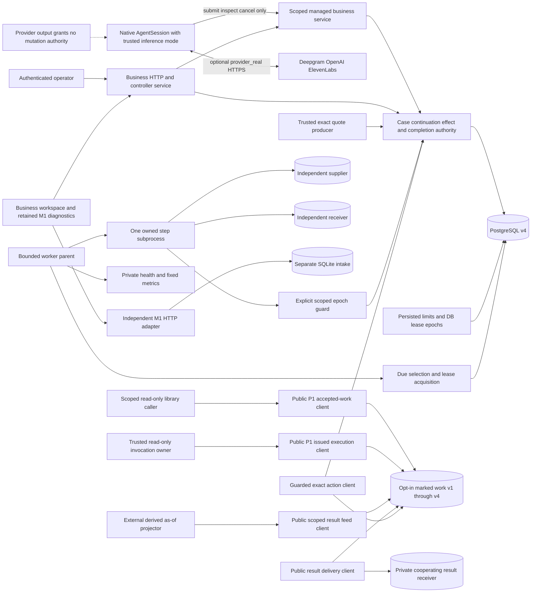
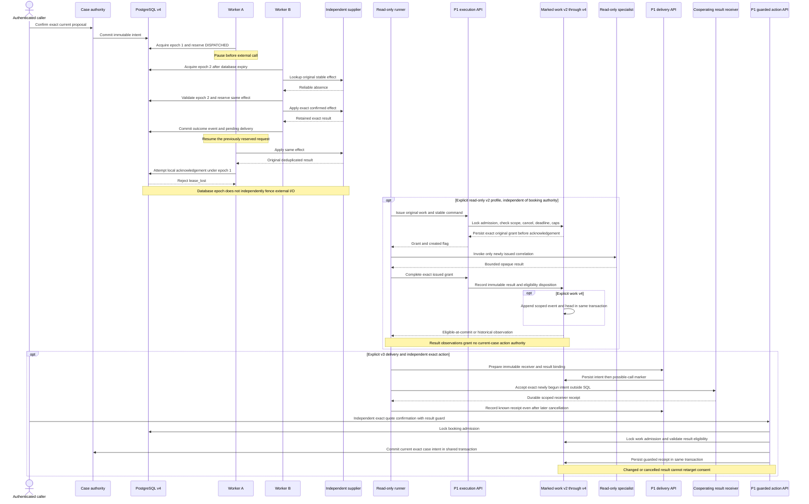

# Agent Continuity Lab design

Status: Active
Last reviewed: 11 November 2026

## Overview

P1 builds a Python boundary for explicitly accepted business work that survives
conversation closure and process failure. The booking example investigates a date
change, collects exact confirmation and applies an authorized synthetic mutation.
The [charter](../../docs/projects/agent-continuity-scope.md) owns P1-01 through
P1-20. The [shared design](../../Design.md) owns common authority and ports, and the
[granular plan](../../docs/implementation/p1-agent-continuity.md) owns phase tasks.
These application contracts are separate from LiveKit SDK interfaces.

M1 implements investigation-only intake. Phases A/B add SQLite inquiry persistence
and independent supplier recovery. Phase C adds PostgreSQL parity, controlled
cutover and trusted scope. Phase D adds exact case/quote/confirmation authority,
atomic intent/dispatch and persisted waits/signals/retries/deadlines. Phase E adds
PostgreSQL v3 mutation, provider/revision binding, cancellation, immutable business
completion and bounded delivery to an independent cooperating receiver. The
[effects guide](../../docs/effects-and-completion.md) owns operational semantics.

Phase F adds PostgreSQL v4 server-time leases/epochs, guarded worker writes,
persisted admission limits and a bounded product-worker process. The
[worker guide](../../docs/leases-and-workers.md) owns setup and operational limits.
The final Phase F gate passed and is recorded in its work item.

The ordinary browser/API retains M1 intake and diagnostic transport. The explicit
Phase G profile adds atomic managed intake, current-case UI, exact UI approval,
native scripted conversation and bounded filtered trace export. Its
[work item](../../docs/work-items/0013-p1-phase-g-conversation-and-showcase.md) owns
actual gate evidence. Those Phase G observations retain their historical boundary;
the later package/platform and selected provider qualification are recorded in the
[release work item](../../docs/work-items/0019-p1-phase-h-release-qualification.md).
An individual phase observation does not replace its complete release evidence.

The additive public work_api/work_admin profile stores read-only immutable
accepted input in an explicitly installed marked v1 schema. It is a P1-owned
prerequisite for P3 and does not duplicate existing booking execution or alter
v4/SQLite formats. Its accepted status is not an issued attempt, completion or
action permission. The explicit version-2 upgrade adds separate execution_api
issued grants and immutable opaque result observations. Current-case applicability,
delivery and authorized action remain separate P3 concerns. Work v3 adds immutable
delivery/action receipts; explicit work v4 adds a generic result-only feed with
stable source-bound scope cursors. P3 metadata is derived as-of evidence, never an
execution queue or consent source. Selected local qualification passed
in the [completed phase](../../docs/work-items/0032-linked-confirmation-and-result-projections.md).

## Objectives

| Type | Objective | Evidence of achievement |
| --- | --- | --- |
| Business | Preserve an accepted investigation after conversation end | Same scoped task/payload inspected after accepting-process loss |
| Business | Apply only the exact confirmed change | Case/task/revision/provider/booking mismatches cause zero apply calls |
| Business | Represent cancellation and uncertain outcomes honestly | Positive prevention distinguished from best-effort request and known result |
| Business | Preserve completion after receiver or worker loss | Same final outcome/event and receiver dedup receipt across retry |
| Technical | Recover with persisted state and bounded work | Independent-process crash schedules with useful normal/recovery progress |
| Technical | Expose a reusable responsive execution boundary | Local scripted media under held dependencies is covered by Phase G; standalone host/Linux artifacts, independent API review and genuine native consumer passed; P1 V1 is qualified for the local POC using provider_real v2. local_real remains unqualified and complete P2/P3 acceptance remains pending. |

## Functional requirements

| Type | Requirement | Mechanism and implementation status | Acceptance reference |
| --- | --- | --- | --- |
| Business | Accept investigation independently of mutation consent | Implemented canonical scoped intake and durable acknowledgement | P1-01–P1-05 |
| Business | Confirm exact case, revision, provider, booking/date, amount/currency and expiry | Implemented immutable quote v2 and atomic case commitment | P1-06, P1-07, P1-13 contribution |
| Business | Preserve actual effect after interruption/cancellation | Implemented stable mutation effect, provider lookup/dedup and explicit uncertainty | P1-08, P1-09, P1-14 contribution |
| Technical | Recover waits, callbacks and finite inquiry retries | Implemented original-task continuation, persisted signals/deadlines and one-attempt worker | P1-10–P1-12 contribution |
| Business and technical | Commit/deliver one logical completion | Implemented outcome/event/pending delivery transaction and retained receiver receipt | P1-16 contribution |
| Technical | Coordinate scoped trusted workers | Implemented v4 DB-time leases/epochs, conditional worker writes and independent takeover tests | P1-15, P1-17 contribution |
| Technical | Bound resources and preserve old data | Implemented finite local caps and versioned SQLite/PostgreSQL upgrades; selected provider_real v2 local release qualified; local_real remains unqualified | P1-18, P1-19 contribution |
| Business and technical | Keep conversation responsive while work continues | Implemented native scripted submit/get/cancel consumer, scoped current-state UI and separate exact human quote approval; current workload/provider_real v2 local release evidence passed; local_real remains unqualified | P1-20 contribution |

## Non-functional requirements

Configured bounds below are local safety limits. Proposed release criteria and
measured observations remain separate in the phase work items.

| Property | Target or invariant and unit | Verification | Status |
| --- | --- | --- | --- |
| Durability | Zero lost acknowledged identities in each declared crash schedule | Real accepting/worker/receiver process loss and new-process inspection | Implemented targeted evidence through Phase F, combined F gate passed |
| Effect safety | Zero unauthorized apply calls and zero duplicated logical cooperating mutations in covered schedules | Independent supplier ledger and exact-result/provider binding | Implemented deterministic PostgreSQL and stale-worker schedules, final combined gate passed |
| Resource bounds | 1,000 outstanding workflows, four active leases, 10,000 retained tasks, eight mutation/delivery attempts by default | Saturation, deadline, recovery and exhausted replay assertions | Implemented local bounds, production capacity unmeasured |
| Responsiveness | Zero external calls inside protected transactions | Held-provider/store media-control tests plus code inspection; quantitative workload budgets precede measurement | Backend and local scripted-media boundaries implemented; workload SLO unmeasured |
| Isolation | Zero cross-owner/account reads, signals, cancellation or mutation | Trusted-principal negative fixtures at public boundary and real adapter | Implemented local principal model, production identity planned |
| Compatibility | Original rows/IDs survive v1→v2→v3→v4 upgrades | Populated migration, interruption, replay, schema/role drift and old receipt tests | Implemented local migrations, complete platform qualification pending |
| Reproducibility | Frozen dependencies and explicit fixture/schema setup | Lock/image checks, local container demos, isolated wheel and Linux lane later | Partial |
| Observability | Finite safe events/metric labels, telemetry cannot change truth | Real producer/privacy/outage assertions | Implemented local observations and filtered Phase G OTLP export; see combined gate |

## Back-of-the-envelope calculations

Illustrative assumptions select experiments and are not throughput or storage
measurements. Replace estimated row sizes with actual PostgreSQL/WAL/index growth
before selecting production retention.

| Quantity | Inputs and formula | Result and exclusions |
| --- | --- | --- |
| Current v4 worker concurrency | Four default live leases across the schema and one owned child per parent | At most four active invocation leases, physical external calls still depend on provider contract |
| Illustrative occupancy | Arrival 0.1 steps/s × assumed 5 s occupancy | 0.5 mean occupied leases, no measured throughput claim |
| Lease/recovery allowance | 30 s default DB lease; 1 s idle/error polling | Completed steps permit immediate next selection; expiry plus selection/DB/provider time bounds eligibility, not an end-to-end recovery SLO |
| Parent occupancy ceiling | min(15 s configured step ceiling, 30 s / 2) | 15 s monotonic ceiling before bounded kill/reap, not proof of remaining DB lease freshness |
| Mutation attempt retention | 10,000 tasks × maximum 8 default mutation attempts | Up to 80,000 attempt rows for that admitted workload, no pruning or per-row size claim |
| Work feed retention | 10000 accepted records × at most 3 issued results; at most one head per accepted scope | At most 30000 event references and 10000 heads plus one source row; excludes payload/index/WAL sizes and does not measure throughput |
| Completion footprint | Assume 8 KiB outcome/event/delivery/receiver evidence × 10,000 tasks | 78.1 MiB raw illustrative data, excludes indexes, WAL, backup, attempts and supplier ledger |
| Default delivery delay budget | Delays 1 + 2 + 4 + 8 + 16 + 30 + 30 s before eight attempts | 91 s scheduled waiting plus call/manual invocation time, not an automatic scheduler deadline |
| Public metric series | 16 operations × 3 outcomes × 17 counter/histogram series | At most 816 series if all combinations observed, no task/actor/tenant labels |
| Media experiment | One explicitly published scripted browser input and actual returned audio in the Phase G lane | Functional media/fault evidence only; native frame counts alone cannot establish browser playback or workload capacity |

Future capacity work must declare arrivals, provider occupancy, worker count,
queue-age budget, attempts and retained-state allowance before measuring. Record
admitted/completed/failed/uncertain counts, CPU/RSS, storage growth and timestamp
sources. Live inference records actual model usage/cost separately.

## High-level design

1. The original task/inquiry effect and distinct case UUID survive every lease,
   revision and delivery. The case authority remains the sole exact-consent
   commitment point. Neither a worker epoch nor model text grants mutation power.
2. Controller changes and worker transitions share the short protected authority
   transaction. Controllers do not need worker leases to confirm, signal, cancel
   or inspect. Supplier/receiver I/O remains outside all database transactions.
3. The selector reads existing durable due state and acquires a retained task/scope
   lease in the same transaction. Database time after locks determines authority.
   Epoch checks reject a resumed old worker after takeover.
4. Each parent owns one bounded step child. No additional durable queue or
   unbounded local buffer is created. Shutdown stops acquisition and reaps the
   owned process group before release. A durable wait occupies no sleeping child.
5. Dispatch_count preserves possible external invocation across every epoch.
   Provider lookup/deduplication enables reliable recovery. Missing cooperation
   leaves uncertainty without unsafe resend, including if an old request resumes.
6. Final business outcome/event/pending delivery remain atomic and receiver-bound.
   Delivery failure, process exit and health status cannot change business truth.
   The opt-in workspace renders effect, final outcome and delivery separately.
7. Native submit/get/cancel tools operate through the scoped business service.
   Only the explicit authenticated controller prepares and confirms an exact quote.
   Original M1 intake and diagnostic transport remain independently available.
8. Native input/status is gated by actual RoomIO readiness and active SDK state.
   Explicit media End retires that room; a new consumer rehydrates the same task.
   Ambiguous initial connection retries preserve the exact frozen invocation.
9. The separate read-only profile preserves immutable accepted input. Only an
   explicit v2 owner upgrade enables issued grants; its runtime shares bounded
   admission locking and never performs DDL. It has no autonomous worker or second
   queue. A grant fences local result eligibility, not physical remote computation.
10. Explicit v3 adds immutable delivery/receiver bindings and guarded case receipts.
    Receiver I/O remains outside SQL. Guarded action acquires booking admission,
    work admission and case/control in that order, then atomically records result
    eligibility, independent exact consent and the original case intent.

11. Explicit work v4 appends only result references under the existing admission
    transaction. Scoped source cursors and adopted_history distinguish committed
    live history from deterministic migration order. External projectors own derived
    as-of metadata and cannot schedule work or generate confirmation.

## Sequence diagram

The cooperating-supplier sequence deliberately resumes an old request after
server-time takeover. Local epoch rejection and external deduplication establish
different guarantees. The noncooperating branch must instead preserve uncertainty.

## Low-level design

```mermaid
classDiagram
    class WorkClient {
        +scope
        +submit(key, immutablePayload)
        +find(key)
        +get(workId)
        +cancel(workId, commandId)
        +close()
    }
    class WorkPayload {
        +operation
        +body
        +sha256
        +deadline_at_ms
    }
    class ExecutionClient {
        +issue(workId, ownerId, commandId)
        +find_issue(commandId)
        +complete(issuedAttempt, resultBytes)
        +result(workId, attemptId)
        +observe(workId)
        +close()
    }
    class ResultFeedClient {
        +source_id
        +scope
        +read(afterCursor, limit) Page
        +close()
    }
    ResultFeedClient --> WorkStore
    class DeliveryClient {
        +prepare(workId, attemptId, resultDigest, receiverId, recipientId)
        +begin(intent)
        +record_receipt(intent, receipt)
        +inspect(workId)
    }
    class ResultReceiver {
        +receiver_id
        +accept(intent)
        +find(intent)
        +close()
    }
    class ActionClient {
        +authorize(workId, attemptId, resultDigest, exactConfirmation)
        +find_action(commandId)
        +action(workId)
    }
    DeliveryClient --> WorkStore
    DeliveryClient --> ResultReceiver
    ActionClient --> WorkStore
    ActionClient --> PostgresCaseAuthority
    class IssuedAttempt {
        +originalRecord
        +attemptId
        +ownerId
        +number
        +epoch
        +leaseUntilMs
    }
    class AttemptResult {
        +body
        +sha256
        +disposition
        +recordedAtMs
    }
    class ExecutionStore
    class WorkStore
    ExecutionClient --> ExecutionStore
    ExecutionStore --> WorkStore
    ExecutionStore --> IssuedAttempt
    ExecutionStore --> AttemptResult
    WorkClient --> WorkStore
    WorkStore --> WorkPayload
    class PostgresManagedAdmission
    class ConversationService
    class PostgresCaseProjection
    class NativeBusinessConsumer
    class AuthenticatedBusinessController
    class ScopedCaseService {
        +confirm(token, confirmation, commandId)
        +cancel(token, taskId, commandId)
        +get_effect(token, taskId)
        +get_completion(token, taskId)
        +get_delivery(token, taskId)
    }
    class AsyncCaseService {
        +bounded offload
        +close()
    }
    class PostgresCaseAuthority {
        +publish_quote(actor, quote)
        +commit_intent(actor, confirmation, commandId)
    }
    class PostgresLifecycle {
        +manage(scope, taskId, policy, deadline)
        +arm_wait(actor, taskId, quote)
        +claim_due(scope, taskId)
    }
    class PostgresEffects {
        +claim(scope, taskId) EffectClaim
        +prepare_dispatch(claim, absenceConfirmed)
        +finish_success(claim, result)
        +cancel(actor, taskId, commandId)
        +claim_delivery(scope, taskId, targetId)
        +finish_delivery(claim, delivered)
    }
    class MutationWorker {
        +run_one(scope, taskId)
    }
    class MutationSupplier {
        +provider_id
        +capabilities
        +lookup(intent)
        +apply(intent)
    }
    class CompletionDeliveryWorker {
        +run_one(scope, taskId)
    }
    class CompletionSink {
        +receiver_id
        +accept(event) SinkReceipt
        +prune_diagnostics(keep)
    }
    class PostgresExecutionStore {
        +submit(scope, key, request)
    }
    class CoordinationPolicy {
        +maximum_pending
        +maximum_active
        +maximum_records
        +lease_seconds
    }
    class PostgresLeases {
        +acquire(scope, taskId, ownerId)
        +renew(grant)
        +release(grant)
    }
    class PostgresWorkQueue {
        +claim_next(scope, ownerId)
        +snapshot(scope)
    }
    class WorkerRuntime {
        +run_once()
        +request_stop()
    }
    NativeBusinessConsumer --> ConversationService
    AuthenticatedBusinessController --> ConversationService
    AuthenticatedBusinessController --> ScopedCaseService
    ConversationService --> PostgresManagedAdmission
    ConversationService --> PostgresCaseProjection
    PostgresCaseProjection --> PostgresCaseAuthority
    AsyncCaseService --> ScopedCaseService
    ScopedCaseService --> PostgresCaseAuthority
    ScopedCaseService --> PostgresLifecycle
    ScopedCaseService --> PostgresEffects
    PostgresLifecycle --> PostgresCaseAuthority
    PostgresEffects --> PostgresCaseAuthority
    PostgresEffects --> PostgresExecutionStore
    MutationWorker --> PostgresEffects
    MutationWorker --> MutationSupplier
    CompletionDeliveryWorker --> PostgresEffects
    CompletionDeliveryWorker --> CompletionSink
    WorkerRuntime --> PostgresWorkQueue
    PostgresWorkQueue --> PostgresLeases
    PostgresLeases --> CoordinationPolicy
    PostgresLifecycle --> PostgresLeases
    PostgresEffects --> PostgresLeases
```

## Components and related details

| Component | Current implementation | Responsibility and boundary |
| --- | --- | --- |
| Intake/inquiry | models, execution_models, execution, postgres_store, inquiry_worker | Canonical accepted investigation, original effect/attempts and SQLite compatibility |
| Managed business composition | managed_admission, conversation_service, conversation_composition, case_projection and bounded adapters | Atomic scoped admission, frozen original request/deadline, authenticated current snapshots and bounded recent observations |
| Native/controller consumers | services/conversation_agent, services/control_api and apps/local-console | Trusted native profiles, scoped HTTP/UI commands and separate exact human consent; no second durable scheduler |
| Case authority | case_models, postgres_case | Current revision, immutable quotes/confirmation/intent and atomic consent decision |
| Continuation | lifecycle_models, retry_policy, postgres_lifecycle, managed_inquiry_worker | Original managed task, durable waits/signals and finite inquiry eligibility |
| Authenticated application | authorization, case_service, bounded_io, case_telemetry | Derived owner/scope, finite async offload and safe operation observations |
| Mutation authority | effect_models, postgres_effects | Exact typed result binding, attempts, cancellation and atomic final completion |
| Independent mutation | mutation_supplier, mutation_worker | Immutable provider/capability metadata, revision check, real booking change and explicit reconciliation limits |
| Completion transport | completion_sink, outbox_delivery | Bound receiver identity, canonical event dedup and bounded one-attempt delivery |
| Coordination and selection | lease_models, postgres_leases, postgres_work | Persisted policy, server-time per-task invocation epoch, due selection and safe projections |
| Worker process | worker_runtime, worker_cli | One bounded child, ready pull after completion, cooperative quiescence/resume, sticky shutdown, process-group cleanup and private health/metrics |
| Schema/cutover | postgres_migrations, postgres_schema_v2, postgres_schema_v3, postgres_schema_v4, source_transfer, cutover | Explicit migration owner, exact schema/grants, recoverable import and preserved old state |

### Fresh schema catalog validation

Schema validation remains fresh on every connection and after the admission lock;
no cross-request or connection cache is introduced. One ordered catalog column
read replaces the separate reads for the 21 declared v4 tables, while each table
still receives every existing shape/type/nullability/default/collation check.
Restricted-role flags and inherited-membership checks share one current query.
ACL, index, constraint, ownership and safe metadata-read ordering predicates are
unchanged. This reduces query count without discarding security or schema checks.
Correctness and actual fault-window/resource measurements remain separate gates.

### Worker checkpoint and runtime preparation

The parent selects the next durable step immediately after COMPLETED; empty/failed
selection retains configured idle/error backoff. One child, lease fencing,
step/failure limits and sticky SIGTERM/SIGINT shutdown remain unchanged.
SIGUSR1 requests quiescence; the outer loop acknowledges it only after child reap,
lease release and final queue SQL. SIGUSR2 resumes acquisition without clearing
shutdown. Private fresh/alive-PID health distinguishes actual quiescence
(ready=false, active_children=0) from resumed readiness (active_children=0 or 1).
The isolated gate still requires a separate active=0 snapshot and its OS pause.

The Python image precompiles installed bytecode during frozen non-editable build
and disables runtime bytecode writes. This prepares imports without changing the
58-file source payload, authority contracts or workload budgets. Source and image
bindings, useful progression and cleanup remain separate evidence. The
[worker operations guide](../../docs/leases-and-workers.md) owns the maintenance
signal, deadline and observation contract.

### State, identities and transactions

The case authority is the sole commitment point. Quotes v2 bind distinct case_id,
supplier_id and expected_supplier_revision as well as every original quote field.
Historical v1 remains readable/replayable, but cannot authorize a new mutation.
The configured supplier cannot fill missing authority after confirmation.

PostgresEffects retains effect state, active attempt generation and dispatch_count.
CLAIMED before any reservation is distinguishable from CLAIMED after recovering a
possible request. Stale generations cannot finish another attempt. Generation is
an attempt-owner token, not a lease epoch or a general row revision. Supplier and
receiver calls occur outside protected transactions. Database CAS cannot fence
an external request independently of the provider contract. V4 adds a separate
retained invocation lease. Each worker write requires matching scope/task/owner/
epoch and live database expiry in its protected transaction. Controller authority
and worker authority remain separate.

Cancellation before commit prevents intent. Cancellation with zero reservations
retains any immutable intent and prevents dispatch. Once dispatch is possible,
cancellation records requested_best_effort and preserves known result truth.
Outcome/event/pending delivery share a final transaction. Delivery target binds
once before first receiver I/O and cannot silently switch on recovery.

### Scoped workspace and native media

The projection authenticates every read and always returns current state alongside
bounded recent persisted observations. Digest-bound cursors reset on aggregate
change and disclose older truncated history. Missing/unknown records and failed
reads remain unknown or unavailable. Business revision, original accepted request,
lease/attempt, effect, outcome and delivery are separate observations. Decimal
revision strings and the unchanged opaque canonical quote payload avoid lossy
JavaScript reconstruction. Only a visible explicit UI command grants exact consent;
a model output, native hint or playback never does.

The scripted native consumer uses actual AgentSession tools and local STT/LLM/TTS
fixtures. Its browser source publishes bundled spoken PCM through real WebAudio
and WebRTC with explicit user controls and bounded owned tracks. Public RoomIO
readiness precedes greeting/control admission; the UI requires the selected agent's
continuity.session_ready=true plus active native SDK state. Mute/End remains available on
agent departure. Speech interruption preserves a captured turn and does not request
business cancellation. Explicit End retires the room/participant/invocation; a later
Join loads the same durable task in a fresh media context. Automatic transport
reconnect and unknown initial acknowledgement reuse the frozen current invocation.
Unresolved resource cleanup blocks creating another context.

Tokens and task selection are memory-only; after hard reload a person re-enters a
token and task for a fresh authenticated scoped read. Native reliable hints only
trigger that read. Actual received audio is playback evidence, not human hearing.
Physical microphone permission denial is a separate negative; positive hardware
capture and real-provider quality are not qualified by the scripted local gate.

### Implementation layout and Python practices

Canonical source is projects/agent-continuity/python/src/continuity_lab. The
agent-continuity distribution retains existing imports, CLI entrypoints and
persisted formats; api, postgres_api and testing are explicit typed public surfaces.
Root services are consumers of the locked workspace member. The isolated
wheel/sdist/rebuilt-wheel gate rejects checkout injection and undeclared application
or harness dependencies. P1 does not import P2/P3 implementations. Python support
is >=3.14,<3.15, with local host/container qualification tracked separately.

Use frozen validated value types, small Protocol interfaces, explicit UTC clocks,
finite budgets, canonical versioned payloads and context-managed resources. Async
orchestration remains separate from blocking adapters. A cancelled thread offload
retains capacity until actual work ends. Unexpected defects preserve dispatch
evidence and propagate through a sanitized public boundary. Only producer
telemetry exceptions are intentionally contained. The
[Python engineering guide](../../docs/python-engineering.md) owns wider policy.

### Migration, lifecycle and retention

SQLite supports the original inquiry subset and read/replay of quiesced v2.
PostgreSQL legacy inquiry works on ACTIVE v1/v2/v3. Case/continuation requires
v2 or later and effects/completion requires v3. V4 worker transitions require an
explicit live lease. Runtime does no DDL.
Owner-only upgrade-effects adds six tables, operational indexes and completed/
cancelled control states after v2. Owner-only upgrade-coordination adds the two
v4 coordination tables and task/scope key after ACTIVE v3. It refuses unmanaged
RUNNING inquiries before DDL so v3 reconciliation can finish them first. All
prior rows, payloads and import receipts survive. Existing v1 mutation consent is
history/replay only and is excluded from automatic mutation selection.

No core workflow/effect/cancel/outcome/event/receiver receipt cleanup exists.
V4 limits count outstanding managed workflows including waits, active leases and
all retained task identities. New management of a completed inquiry checks pending
capacity too. An expired inquiry-complete continuation closes under a leased
step without erasing its known successful inquiry result or calling a provider.
Known replay/inspection remains available at capacity. Only the sink's
separate diagnostic projection can be pruned. Late replay after pruning still
returns the original dedup receipt. Production cleanup needs a replay-horizon/
tombstone decision and fault tests. See the
[effects guide](../../docs/effects-and-completion.md) for exact bounds and operations.

### Trusted provider composition

The shared/native path accepts exactly scripted (default), local_real and
provider_real. The diagrams retain the shared authority path; profile adapters use the same session and bound task rather than creating another
case authority. provider_real composes Deepgram nova-3 batch recognition after
manual flush, OpenAI gpt-5.4-mini streaming tool selection and ElevenLabs
eleven_v4_turbo chunked HTTP PCM speech. Only the native process receives provider
keys, and real output cannot bypass separate exact human consent.

The [provider operations guide](../../docs/provider-demo.md) owns strict key setup, explicit lifecycle,
fixed model/voice/transports, bounded execution and the fresh P1-20 selector.
Real profiles keep 12-second commit and 40-second incoming-transcription limits;
other RPCs remain 8 seconds and browser cleanup 5 seconds. No silent fallback,
provider resource-capacity result or blanket zero-retention claim is made.
The selected provider_real v2 gate passed both actual browser cases with cleanup. P1 V1 is qualified for the local POC using provider_real v2.
A passing provider scenario cannot qualify the separate local-engine declaration.

### Opt-in read-only accepted work

work_api exposes the scoped asynchronous port and immutable work values;
work_admin installs the version-1 marked profile explicitly through the migration
owner. work_schema validates builtin metadata shape/index/collation before reading
rows, all relation/constraint/index/default/ACL signatures and safe catalog lookup.
work_store atomically commits exact scope/key bytes, digest and original deadline,
with separate cancellation commands and guarded retained caps. WorkDirectory copies
at most 64 credential/principal bindings, never retaining raw bearer values.

New acceptance uses database time after the persisted admission lock. Known replay
and reads survive caps and expiry; no retained core identity is deleted. The default
record/cancel caps are 1,000 each and owner-configurable to 10,000. At most four
actual offloaded calls per client remain owned until thread completion. Shutdown
observes for five seconds and cannot falsely claim rollback or complete cleanup.
Existing finite connect/statement/lock budgets apply to each SQL operation; no
unmeasured aggregate latency guarantee is made. Unexpected commit acknowledgement
becomes acknowledgement_unknown and reconciles the original identity. Safe fixed
logs/counters cannot replace durable truth; logging exceptions are contained.

Version 1 owns accepted records only. The explicit version-2 owner upgrade adds
execution_limits, immutable issued_attempts and immutable attempt_results, while
preserving all existing acceptance/cancellation rows and old v1 APIs. The runtime
principal has SELECT/INSERT only on attempts/results and SELECT only on execution
configuration. Existing catalog/metadata preflight, role restrictions and unknown-ACK
containment apply to both versions. No runtime DDL or baseline refresh exists.

execution_api exposes credential-bound issue/find_issue/complete/result/observe.
Commands are idempotent across scope/work/owner; only created=true permits a new
invocation. Exact original payload and issued identity persist before acknowledgement.
Every issuance/result write uses the original admission guard, then database time.
Default logical bounds are two active leases, three attempts per work and a
10-second lease, clipped to the original business deadline. Owner configuration
allows 1–4 active, 1–3 attempts and 100–30,000 ms leases. There is no selector,
automatic retry, renewal or failure-finish operation. Unknown transport retains its
lease; expired authority cannot prove stopped remote computation.

One opaque 1–8,192-byte result/digest is retained per exact issued attempt. The
eligible_at_commit disposition records only P1 scope/lease/time/cancel eligibility.
Cancellation, business expiry, lease expiry and superseding epoch retain distinct
historical dispositions; stale writes cannot promote or replace the newer result.
An already eligible result remains recorded after later cancellation/deadline,
with current cancellation observed separately. No new attempt follows such a
result. This v2 profile still owns no semantic result truth, current-case action,
delivery, booking consent or generic scheduler. P3 must use declared public ports and
verify credential scope before submission; it must never import work_store/schema,
execution_store or issued_models directly.
No change is made to SQLite, booking v4, native inference or old worker selectors.
The [phase work item](../../docs/work-items/0028-p2-dispatch-and-p3-coordinator.md)
records separate actual database/process/consumer evidence.

### Version-3 delivery and guarded commitment

The explicit v2-to-v3 extension adds result_delivery_intents,
result_delivery_possible, result_delivery_receipts and result_actions. Primary,
unique and foreign keys retain one immutable record of each kind per accepted
work. Thus these tables are bounded by the inherited finite record cap, without
another admission queue or independent execution owner. Runtime grants are
SELECT/INSERT only; all known version catalogs/markers are checked without repair.

DeliveryClient.prepare binds the exact latest eligible result, receiver UUID and
recipient before external I/O. begin rechecks current work eligibility and records
possible acceptance; only a new marker permits accept. Replay of a possible call
uses receiver lookup and cannot silently resend or change target. Known receiver
receipts remain facts after later cancellation/expiry. The separate private
receiver has explicit schema initialization, stable UUID, up to 64 immutable
scope/recipient bindings and 1,000 retained receipts by default (owner range
1–10,000). Its four I/O slots survive waiter cancellation, and a five-second close
observer cannot claim a blocked thread stopped. Core receipts are never pruned.

ActionClient is distinct from result delivery and the read-only specialist. Its
trusted factory binds work scope to an explicit authenticated case actor and
existing ACTIVE booking v4 schema on the same SQL target. Fixed lock order is
booking admission, work admission, then case/control. Current work cancellation,
DB deadline, exact attempt/result digest and independent exact Confirmation are
validated before committing. Existing case authority still owns quote/revision,
supplier binding and intent commitment. The guarded receipt and original case
intent commit together; a known replay is returned before later expiry/cancel,
while changed bindings conflict. Supplier effect execution remains the existing
leased worker's separate outside-transaction operation. P1 never parses policy
JSON or generates consent from a result. The separate case_control_api supplies
trusted exact-case read/revise/confirmation without changing old public APIs.

The [completion work item](../../docs/work-items/0030-p2-agent-recovery-and-p3-completion.md)
records selected real/fake tests and retained failures. Receiver acceptance is
not delivery to a person, playback or acknowledgement. Retry/outbox/media and
production capacity remain separate gates.

### Version-4 generic result feed

Explicit work v3-to-v4 adoption adds result_feed_source, result_feed_heads and
result_feed_events. A stable profile UUID binds each verified-scope cursor. Existing
results receive deterministic adopted_history events under owner/admission locking;
their original bytes, IDs, timestamps and dispositions stay unchanged. Live result,
event and scope head commit together under existing admission locking. There is
no global pre-commit sequence that can skip a late lower commit, and result replay
emits no duplicate. Old APIs and delivery/action work on all supported later versions.

ResultFeedClient.read returns at most 100 references, not duplicated result bodies.
Original issue command identifies every historical grant through the existing public
find_issue API. Empty reads retain the cursor; explicit rewind is allowed; foreign
source/scope and ahead-of-head fail. Signed-int64 sequence types are distinct from
retention: at most 10000 accepted works × 3 results gives30000 events; scope heads
are bounded by accepted works. Source-only SELECT, event INSERT-only and head
column UPDATE grants preserve the runtime boundary. Repeat owner upgrade validates
without repair/source rotation; actual before-commit owner SIGKILL rolls back.

The source has no ACK, cancel events, projector, retry selector or P3 schema. P3
validates original references and stores only derived as-of rows/checkpoint. Later
work/case changes do not refresh those observations. Restored/branched database
source incarnation rotation and full projection/delivery recovery remain unqualified.

## Security and privacy

Derive actor/scope from authentication before reads or writes. Another owner and
unknown work have the same unavailable result. Body scope and correlation data
grant no authority. Public proposal issuance is not exposed to a model. Trusted
explicit confirmation is an application command, not a human-presence attestation.

Provider and receiver UUIDs prevent silent target switching after commitment or
possible external I/O. Full result identity/operation binding is checked on write
and read. Independently stored SQLite fixtures require private owner-only regular
files and exact schema. Use synthetic data, loopback endpoints and separate owner/
runtime credentials. Never log raw bookings, tokens, transcripts, SQL parameters
or dependency exception text. Treat external content as data.

## Observability

Implemented producers emit fixed events/codes for acceptance, authority, claims,
dispatch reservation, supplier apply/reconciliation, cancellation, completion and
delivery. Public operations produce safe operation/outcome observations. Producer
failure cannot replace an accepted result or original error. Current application
metrics are local renderable registries; Phase G adds inspected filtered OTLP
spans under its explicit local profile.

| Producer | Current safe observation | Interpretation |
| --- | --- | --- |
| Case/application | Fixed operation, outcome and code | Authentication and explicit commands are separate from model text |
| Worker/store | Claim, reservation, final disposition and reconciliation events | A reservation is possible dispatch evidence, not proof of supplier success |
| Mutation supplier | Applied/replayed stable effect | Exact supplier receipt establishes synthetic booking truth |
| Completion/outbox/receiver | Committed event, delivery attempt and accepted/replayed receipt | Delivery is independent of business outcome and human acknowledgement |
| Lease and process | Acquisition/renewal/release, stale rejection, child result and shutdown observations | Epoch fences local writes while child exit is a process observation |
| Read-only work v2 | Fixed issue/complete/find_issue/result/observe operation and code, pending I/O and telemetry-failure counts | Issued lease and result eligibility are separate from actual invocation, semantic truth and booking authority |
| Result delivery v3 | Fixed delivery_prepare/begin/receipt/inspect and receiver accept/find codes; pending I/O and telemetry-failure counts | Possible acceptance, durable receiver receipt and human acknowledgement remain distinct |
| Work v4 result feed | Fixed result_feed_read/ok plus pending and telemetry_failures through the existing work boundary | A scoped committed reference is historical evidence, never current applicability, source ACK or action permission |
| Guarded case action | Fixed authorize/inspect code and retained action receipt | Only atomic exact current case authority commits; result or delivery receipt cannot supply consent |

The business profile uses approved opaque context, finite sampling/queues/retries
and bounded filtered OTLP shutdown; local qualification inspects actual native/
application spans and exporter failure behavior. A reachable collector alone does
not establish export. IDs never become metric labels. Complete production
observability and retention require separate evidence. The
[observability contract](../../docs/observability.md) owns shared signals.

## Metrics

CaseTelemetry implements continuity_case_operations_total and
continuity_case_operation_duration_seconds for 16 fixed operations and three
outcomes: at most 48 label combinations and 816 counter/histogram series. Eleven
histogram boundaries plus infinity/count/sum/created and two counter samples give
17 series per combination. No actor/task/quote/provider/tenant is a label.
Counters reset with process restart and do not replace the ledger.

| Measurement | Type and unit | Status and collection point |
| --- | --- | --- |
| Public case/effect/cancel/delivery operations | Counter, operations and histogram, seconds | Implemented at authenticated boundary |
| Work feed and projection cursors | Retained source/scope sequence, count | Public read-only references; process metrics expose only pending/telemetry failures, no identifier labels |
| Durable final outcomes and delivery state | Retained typed records, counts by finite enum | Implemented inspection, separate from process counters |
| Worker step occupancy | Histogram, seconds, and step counter by fixed kind/outcome | Implemented parent process observation, not supplier/business latency |
| Active child and scoped queue snapshot | Gauges, counts and seconds | Implemented pending/active limits and retained queue/recovery observations |
| Lease rejections | Counter by fixed safe code | Implemented current/missing/expired authority observation |
| Conversational responsiveness and playback | Native SDK metrics plus identified client observations, seconds | Local scripted-media functional/fault evidence under Phase G; H1 inquiry baseline is separate; broader media workload measurements remain open |

Set numeric workload budgets before measuring. Retain samples/count/timestamp
source and avoid cross-machine clock subtraction or unsupported tail percentiles.

## Exception handling

Typed domain failures preserve original identities and sanitized public errors.
Raw chained dependency text is not emitted. Cleanup uses context managers/finally,
and Python cancellation is propagated without claiming an external rollback.

| Failure | Current behavior | Recovery |
| --- | --- | --- |
| Validation, scope, wrong target or legacy mutation | Reject before provider I/O and before new attempt where possible | Correct trusted configuration/proposal, no inferred authority |
| Changed idempotent payload | Typed conflict, retain original receipt | Replay original content or deliberately create a new request |
| Capacity | Reject new identity/attempt, preserve reads/replay | Explicit bounded eligible retry, no receipt eviction |
| Positive no-dispatch dependency outage | Retain failed attempt, fresh mutation may return PENDING | Manual bounded retry before original deadline |
| Definitive supplier rejection | Final FAILED with supplier_rejected effect code | No automatic retry, control maps to permanent_failure |
| Possible dispatch without reliable outcome | Retain recoverable evidence or terminal UNCERTAIN | Reliable same-provider lookup/dedup only, no blind resend |
| Foreign source/scope or ahead result cursor | Fixed identity_conflict or invalid_input | Use only the verified original source/scope; no automatic source rebinding |
| Corrupt feed head or migration drift | Fixed schema_mismatch | Explicit owner investigation; repeat upgrade never repairs or regenerates source |
| Stale attempt or delivery claim | Transition conflict | Inspect current generation/event, no stale local overwrite |
| Missing, busy or lost v4 lease | Typed lease_required, lease_busy or lease_lost | Retry eligible acquisition only, no stale token substitution |
| Child timeout/output or shutdown failure | Bounded process-group kill/reap and safe process error | Retain effect evidence and do not release before confirmed cleanup |
| Unmanaged running inquiry at v4 upgrade | Pre-DDL unsupported-operation refusal | Reconcile in v3, then retry the explicit upgrade |
| Sink unavailable or delivery budget exhausted | Persist next eligibility or EXHAUSTED | Same event/receiver retry, never rewrite business outcome |
| Unexpected defect or telemetry failure | Original sanitized boundary error or contained telemetry observation | Preserve durable evidence and inspect retained state |

A lost response after commit does not undo accepted work. A known external success
survives expiry and best-effort cancellation. Automatic terminal-uncertainty
adjudication, compensation and receiver rerouting need explicit later contracts.

## Design considerations and trade-offs

| Decision | Benefit | Cost or limit |
| --- | --- | --- |
| Narrow typed operation API | Explainable consent and constrained behavior | General workflow/DAG engine deferred |
| SQLite inquiry subset then PostgreSQL authority | Preserves first crash demo and one full lifecycle owner | Explicit cutover and supported-subset errors |
| Atomic intent and external reconciliation | Prevents consent/revision races and represents real uncertainty | No unconditional exactly-once physical effect or postcommit reversal |
| Retained DB-time lease plus generation CAS | Independent scoped takeover and stale local-write rejection | Supplier request still needs provider cooperation or uncertainty |
| One owned child per parent | Finite occupancy/output and observable shutdown | POSIX process ownership and explicit limits, no HA/capacity certification |
| Provider/receiver identity binding | Prevents silent target swaps after uncertain I/O | Rerouting/replacement requires explicit future contract |
| Stable event and retained cooperating receipt | Recoverable logical delivery without a broker | Finite retention capacity, no human acknowledgement guarantee |
| Terminal unknown is immutable | Honest bounded automatic behavior | Manual adjudication requires new version/event contract |
| Native LiveKit with scoped business console | Reuses SDK lifecycle and renders actual durable state | Local scripted input is explicit; physical capture, real-inference and declared workload measurements remain separate |

## Validation and acceptance gates

The [validation plan](../../docs/validation-plan.md),
[harness guide](../../harness/README.md) and [README](README.md) own commands/evidence.
make postgres-check includes v4 migration, server-time coordination, stale-worker
schedules and existing mutation/cancellation/supplier/receiver recovery. Phase E's
make phase-e-demo preserves its installed crash proof. make phase-f-demo adds
leased worker/restart/shutdown evidence without resetting retained state. The
[Phase F work item](../../docs/work-items/0012-p1-phase-f-leases-and-deployment.md)
records the passed final combined gate. No additional product runner is registered by these phase
contributions. The harness catalog owns current complete runner registrations;
phase-test totals alone do not register another charter row.

| Gate | Required evidence | References |
| --- | --- | --- |
| Core intake/inquiry | Scoped replay/conflict and real accepting/supplier-success process kill | P1-01–P1-05 existing runners |
| Authority and effects | Exact negative confirmation, useful normal apply, provider binding and mutation crash/reconciliation or uncertainty | P1-06–P1-09 contributions |
| Wait/cancel/completion | Signal/deadline/retry behavior, transaction winners, receiver stop/replay and immutable business truth | P1-10–P1-14, P1-16 contributions |
| Storage/isolation/resources | Populated upgrade, role/shape drift, independent lease/takeover, scoped negatives and finite admission/shutdown | P1-15, P1-17–P1-19 contributions |
| Operational/media | Safe real observations and inspected local traces, actual scripted playback/interruption, held-store/supplier controls and fresh-room same-task continuation | P1-18/P1-20 contributions under the Phase G work item |
| Local-ready release | Every required local assertion, frozen checks, installed wheel, supported platforms and independent review | All applicable charter rows and P1-I26/I27 |
| Portfolio-ready release | Qualified live-model/speech runs, checked outcomes/costs and retained demos/benchmarks | P1-I28 and portfolio gates |

Missing, skipped, timed-out, zero-test and unavailable required evidence remains
non-passing. Fault tests include normal/recovery progress. Keep deterministic,
local-media and live-model evidence distinct, and record assistance/contributions
accurately. The [Phase G work item](../../docs/work-items/0013-p1-phase-g-conversation-and-showcase.md)
records P1-I22 through P1-I25 local composition and combined evidence. The
[H1 work item](../../docs/work-items/0014-p1-phase-h-workload-baseline.md) records
the completed S-I06/P1-I27 local inquiry steady/burst/saturation baseline with
independent results and owned cleanup. Freeze hardware/mode, seeded schedules,
clock sources and budgets before further measurements. H2 restart/slow-dependency/
saturation/shutdown measurements and P1-I26 host/Linux artifacts, API/failure review
and genuine native consumer passed. P1 V1 is qualified for the local POC using provider_real v2. local_real remains unqualified and complete P2/P3 acceptance remains pending. Production capacity remains unclaimed;
the harness catalog owns current complete runner registrations.
