# Channel Continuity Kit design

| Field | Value |
| --- | --- |
| Status | Active |
| Purpose | Explain what P2 must achieve and the boundaries, limits and failure rules of each implemented slice |
| Audience | Engineers who change P2 source or review its boundaries; coding agents |
| Scope | P2 package, gateway, Python adapter, browser example and installed starter slices; excludes commands, API usage and acceptance definitions |
| Owns | P2 implementation boundaries, state ownership, failure rules and design decisions |
| Related | [V1 charter](../../docs/projects/channel-continuity-scope.md) · [Project guide](README.md) · [Shared design](../../Design.md) · [P2 implementation plan](../../docs/implementation/p2-channel-continuity.md) · [Project instructions](AGENTS.md) |

## Overview

This document is the design of P2, the Channel Continuity Kit. It explains what
P2 must achieve, how its parts fit together, and the boundaries, limits and
failure rules of every implemented slice. It is written for engineers and coding
agents who change P2 source or review its boundaries. Implemented,
selected-qualified and planned behavior are stated separately throughout.
Commands and API usage live in the [project README](README.md) and the topic
guides listed below.

Contents:

- [Scope and authority](#scope-and-authority), [terms](#terms) and
  [implementation status](#implementation-status), in this section
- [Objectives](#objectives), [functional requirements](#functional-requirements)
  and [non-functional requirements](#non-functional-requirements)
- [Back-of-the-envelope calculations](#back-of-the-envelope-calculations)
- [High-level design](#high-level-design), [sequence diagram](#sequence-diagram)
  and [low-level design](#low-level-design)
- [Components and related details](#components-and-related-details): shared
  contracts and storage versions, then one subsection per implemented slice
- [Security and privacy](#security-and-privacy), [observability](#observability),
  [metrics](#metrics) and [exception handling](#exception-handling)
- [Design considerations and trade-offs](#design-considerations-and-trade-offs)
- [Validation and acceptance gates](#validation-and-acceptance-gates)

### Scope and authority

P2 will provide a TypeScript continuity package and gateway, a narrow Python
LiveKit adapter and a browser example. Together they preserve one verified case
across voice, browser text and simulated SMS. These are application contracts,
not LiveKit SDK APIs.

The required integrated example uses self-hosted LiveKit and fake SMS. Real
carriers and LiveKit Cloud are optional. In integrated mode, P1 (the agent
continuity project) is the case authority. P3 (the delegation reliability
project) is not a dependency. The existing console, pinned toolchain, local stack
and M1 intake (the existing confirmed-investigation intake) remain separate
foundation components.

| Topic | Authoritative document |
| --- | --- |
| Product acceptance IDs P2-01 through P2-17 | [V1 charter](../../docs/projects/channel-continuity-scope.md) |
| Common authority shared across projects | [Shared design](../../Design.md) |
| Task order | [Granular implementation plan](../../docs/implementation/p2-channel-continuity.md) |
| Verified commands and API usage | [Project README](README.md) |
| Response and playback evidence (I17) | [COMMUNICATION.md](COMMUNICATION.md) |
| Current-case rehydration (I18) | [REHYDRATION.md](REHYDRATION.md) |
| Bounded workload profile (I19) | [WORKLOAD.md](WORKLOAD.md) |
| Read-only operations view (I20) | [OPERATIONS.md](OPERATIONS.md) |
| Installed starter (I21) | [STARTER.md](STARTER.md) |

The granular plan numbers implementation tasks P2-I01 through P2-I22. This
document shortens them to I01 through I22. Task IDs are not product acceptance
IDs, and the charter remains authoritative. Four-digit numbers such as 0043 name
work items under [docs/work-items](../../docs/work-items), which record each
slice's observed qualification.

### Terms

| Term | Meaning |
| --- | --- |
| Acknowledgement (ACK) | The response that tells a caller its input or command was accepted. A lost ACK leaves the outcome unknown. |
| As-of observation | A fact read from one source at a stated time. Separate reads are never one atomic snapshot. |
| Compare-and-set (CAS) | A conditional write that succeeds only while the expected revision or version still matches. |
| DDL and DML | Data definition language (schema changes) and data manipulation language (row reads and writes). |
| Epoch | A counter that advances on revocation, reassignment or lease expiry. Checks against the current epoch reject stale challenges, associations and claims. |
| Owner and runtime roles | The trusted migration owner (`continuity_migrator`) runs DDL. The restricted runtime role (`livekit_lab`) serves traffic with narrow DML. |
| Possible send or possible external call | A reservation committed before an external call. Without a validated result its outcome stays unknown, even if the call never happened. |
| Quiescence | Stopping serving writers so that an owner upgrade runs at a maintenance boundary. |
| SDK | The P2 TypeScript package or, in native sections, the LiveKit Agents SDK. |
| Selected qualification | A passing gate for the scope chosen for one slice, recorded in its work item. It never closes a complete charter row. |
| UUID | Universally unique identifier. Stable UUIDs identify inputs, operations, replies and attempts. |

Other abbreviations are expanded where they first appear.

### Implementation status

Status labels follow the
[implementation status vocabulary](../../docs/documentation-standards.md#implementation-status-vocabulary).
Qualified means the slice passed its selected gate with retained evidence, as the
[P2 implementation plan](../../docs/implementation/p2-channel-continuity.md)
records for each task. It never closes a charter row.

| Task | Capability | Status | Evidence |
| --- | --- | --- | --- |
| I01, I02 | [Version-1 event contracts, text producer and codecs](#version-1-event-codec-i01-and-i02) | Qualified | [0022](../../docs/work-items/0022-p2-channel-contracts.md) |
| I03, I04, I05 | [Verified fake-SMS intake and PostgreSQL inbox](#verified-postgresql-intake-i03-to-i05) (schema v1) | Qualified | [0024](../../docs/work-items/0024-p2-verified-durable-intake.md), [0026](../../docs/work-items/0026-p2-postgres-inbox.md) |
| I06 | [Standalone intake and read-only preview](#standalone-intake-and-read-only-preview-i06) | Qualified | [0027](../../docs/work-items/0027-p2-standalone-and-p3-http.md) |
| I07 | [Bounded recoverable investigation dispatch](#recoverable-investigation-dispatch-i07) (schema v2) | Qualified | [0028](../../docs/work-items/0028-p2-dispatch-and-p3-coordinator.md) |
| I08 | [Bounded loopback gateway and acknowledged-input restart path](#bounded-loopback-gateway-i08) | Qualified | Its three real gateway cases qualify I08 only; [0029](../../docs/work-items/0029-p2-gateway-and-p3-issued-execution.md) |
| I09 | [Owned scripted agent process with live-gateway recovery after agent death](#isolated-scripted-worker-i09) | Qualified | [0030](../../docs/work-items/0030-p2-agent-recovery-and-p3-completion.md) |
| I10 | [Investigation-request compare-and-set through one selected authority](#investigation-revision-routing-i10) | Qualified | [0031](../../docs/work-items/0031-revision-routing-and-delegation-acceptance.md) |
| I11 | [Exact response-linked confirmation through public P1 authority](#exact-response-linked-confirmation-i11) | Qualified | [0032](../../docs/work-items/0032-linked-confirmation-and-result-projections.md) |
| I12 | [Explicit outbox and ordinary fake sends](#durable-replies-and-ordinary-fake-sends-i12) (schema v3) | Qualified | [0033](../../docs/work-items/0033-outbound-replies-and-completion-processing.md) owns qualification |
| I13 | [Authenticated callback evidence](#authenticated-callback-evidence-i13) (schema v4) | Qualified | [0034](../../docs/work-items/0034-callback-evidence-and-applicability-refresh.md) records qualification |
| I14 | [Explicit uncertain-send recovery with immutable provider operations](#explicit-uncertain-send-policy-i14) (schema v5) | Qualified | [0035](../../docs/work-items/0035-send-policy-and-action-races.md) records qualification |
| I15, I16 | [Native text and committed voice composition](#native-text-and-committed-voice-intake-i15-and-i16) (schema v6) | Qualified | Selected composition; [0036](../../docs/work-items/0036-native-input-and-deadline-cancellation.md) owns qualification |
| I17 | [Source-qualified response and playback evidence](#source-qualified-response-and-playback-evidence-i17) (schema v7) | Qualified | Opt-in profile; [0037](../../docs/work-items/0037-playback-evidence-and-process-recovery.md) records implementation and qualification boundaries |
| I18 | [Read-only current-case context](#read-only-current-case-context-i18) (no storage migration) | Qualified | Selected qualification in [0038](../../docs/work-items/0038-case-rehydration-and-standalone-release.md) |
| I19 | [Bounded workload profile](#bounded-workload-observations-i19) (no storage version) | Qualified | Selected qualification in [0039](../../docs/work-items/0039-bounded-channel-workloads-and-image-evidence.md) |
| I20 | [Joined read-only operations view](#joined-read-only-operations-i20) | Qualified | Selected qualification in [0040](../../docs/work-items/0040-operations-ui-and-fixed-policy-evidence.md) |
| I21 | [Installed standalone starter](#installed-standalone-starter-i21) | Qualified | Current installed starter slice; observed qualification in [0041](../../docs/work-items/0041-standalone-channel-and-durable-policy.md) |
| Result return | [Original result receipts and current-native reads](#original-result-receipts-and-current-native-reads-schema-v8) (schema v8) | Qualified | Actual PostgreSQL gate passed sixteen storage and four return assertions, including restored state; [0043](../../docs/work-items/0043-stable-result-delivery-and-return-context.md) records installed and shared outcomes |
| Schema v9 | [Operating indexes](#version-9-operating-indexes) | Implemented | Owner upgrade; [0047](../../docs/work-items/0047-open-findings-schema-upgrades-and-landing.md) records it |
| I22 | Fresh-agent handoff and complete integrated release | Planned | None |

All seventeen complete P2 charter rows (P2-01 through P2-17) remain planned. No
selected slice registers a complete charter row, and complete product scenarios
retain later gates. The opt-in native and browser composition preserves the
existing authority.

## Objectives

| Type | Objective | Evidence of achievement |
| --- | --- | --- |
| Business | Continue a verified request after a room closes or the channel changes | Same case/current revision, relevant history and pending work references load into the returning interaction |
| Business | Tell the user what communication actually happened | Separate generated, native progress, client playback, carrier delivery/read and explicit acknowledgement observations |
| Business | Prevent stale or ambiguous replies from authorizing a different action | Old confirmation is rejected; unlinked SMS yes requests clarification; current linked reply still progresses |
| Technical | Persist accepted input before acknowledging it | Crash after acknowledgement/before dispatch recovers the original receipt and stable operation identity |
| Technical | Expose independently usable typed contracts | Full fake-carrier example works from an isolated installed npm package without P1/P3 services |
| Technical | Bound processing and dormant-case resources | Saturation/cleanup evidence with no permanently active room or agent per dormant case |

## Functional requirements

| Type | Requirement | Planned mechanism | Acceptance reference |
| --- | --- | --- | --- |
| Technical | Canonical scoped event acceptance and changed-payload conflict | Runtime-validated versioned union; PostgreSQL inbox/processing intent; stable original receipt | P2-01, P2-02 |
| Business and technical | Recover accepted input after gateway/agent failure | Durable dispatch replay preserving operation identity; processing attempts remain observable | P2-03, P2-04 |
| Business | Resolve competing changes and exact confirmation | Expected revision through the single case authority; linked response/revision or clarification | P2-05, P2-06 |
| Business | Preserve interruption, unknown playback and channel continuity | Consume native SDK behavior plus source-qualified communication records and current-case rehydration | P2-07–P2-09 |
| Technical | Preserve send/callback history and uncertainty | Stable reply intent, provider attempt correlation, deduplicated callback interpretation | P2-10, P2-11 |
| Business and technical | Protect associated accounts and bounded service resources | Provider verification distinct from user association; scoped queries and explicit admission policy | P2-12–P2-14 |
| Technical | Ensure one native text/audio acceptance path and usable package | Custom committed-input intake; disable duplicate automatic dispatch; standalone and fresh-agent evidence | P2-15–P2-17 |

## Non-functional requirements

These are proposed release targets, not measured latency or capacity promises.
Fix workload budgets and finite limits before running a benchmark, not after
seeing its results.

| Property | Target or invariant | Verification | Status |
| --- | --- | --- | --- |
| Durable receipt | Zero lost acknowledged logical input in each declared crash schedule | Owned gateway/agent process kill and independent-process recovery | Planned |
| Identity | One original receipt per scoped canonical event; two distinct identical-text messages remain distinct | Concurrent replay, metadata-only retry, altered payload and new-ID fixtures | Planned |
| Authorization | Zero cross-account history/work disclosure or unauthorized case changes | Signature, association, scope, callback and route negative fixtures | Planned |
| Communication honesty | Missing playback remains unknown; no one-physical-SMS promise after non-idempotent lost response | Actual browser disconnect/interruption and persisted fake-carrier effect ledger | Planned |
| Resource bounds | Configured positive queue/pool/active/retry/input/page/export limits; explicit pre-acceptance rejection | Seeded saturation, large input/page tests and shutdown inspection | Planned |
| Dormancy | Dormant records require zero active room/agent allocation per case | Resource comparison experiment at 1,000 seeded dormant cases | Planned |
| Compatibility | Python/TypeScript agree on every shared valid/invalid versioned fixture | Both decoders and public adapter contract tests | Planned |
| Accessibility | Keyboard, reduced motion, empty/error/unknown states and responsive reflow remain usable | Browser flow review on the actual joined projection | Partial: foundation and selected operations UI verified; complete conversation UI gated |
| Reproducibility | Standalone installed consumer, preserved-volume upgrades and actual supported-platform runs | npm-pack isolation, restart/migration and macOS/Linux evidence | Partial: selected local installed consumers implemented; complete supported-platform/native release planned |

## Back-of-the-envelope calculations

The illustrative inputs below establish test sizes only. They are not configured
production defaults or evidence that the gateway can sustain the computed rate.
Measure real schema, index and write-ahead log (WAL) growth and processing
distributions before sizing.

| Quantity | Assumption and calculation | Implication to test |
| --- | --- | --- |
| Active processing | 2 accepted messages/s × 1.5 s mean scripted processing = 3 active dispatches | Four dispatch slots is a useful first experiment; bursts, retries and slow models need explicit admission/queue policy |
| Dormant storage | 1,000 cases × (20 messages × 2 KiB + 10 delivery records × 1 KiB + 4 KiB routing metadata) = 52.7 MiB raw | A 3× illustrative data/index allowance is 158 MiB; WAL, tombstones/backups and case-authority storage are additional |
| Callback traffic | Ten replies/s × three observations/reply = 30 observations/s before provider retries | Callback dedupe/reordering and bounded event/history reads need measurement independently of message acceptance |
| Browser projection | Page limit 50 records × assumed 1 KiB/record = 50 KiB/page; ten active viewers refreshing every 2 s = about 250 KiB/s before protocol overhead | Pagination/refresh limits are proposed experiment settings, not a required polling frequency; idle viewers should not generate unbounded work |
| Starter operation wire | 4,096 NUL characters expand to 6 × 4,096 bytes in canonical JSON and 7 × 4,096 bytes in its enclosing string; all other identifiers use their supported maxima in the regression | A compact single canonicalPayload plus version and digest fits 32,768 bytes; the next byte rejects before acceptance |
| V8 original-result metadata | Illustrative 10,000 result-bearing replies × the 16 KiB canonical-intent bound = 156.25 MiB of additional intent text | Result rows share `maxReplies` with ordinary replies |
| Media and live inference | Start with one actual scripted browser voice session and one fake-SMS path | Text success does not establish playback; real inference adds separately measured model usage, latency and cost |

Notes on two rows:

- The starter operation-wire bound is declared, not observed load capacity.
- The v8 figure is an upper-bound sizing assumption. It excludes reply and notice
  rows, metadata, PostgreSQL out-of-line storage (TOAST), index and WAL growth,
  P1 results and backups. The actual eight-reply gate proves admission, not
  storage capacity.

Raw audio and video are carried by LiveKit tracks, not this durable text-event
history. Define retention and replay horizons before cleanup. Do not reduce
measured growth by silently deleting receipt or delivery protection. Dormant-case
storage does not imply one running room per case or distributed LiveKit media
capacity.

### Envelopes for configured caps

These envelopes size the configured caps of two slices. The
[outbox](#durable-replies-and-ordinary-fake-sends-i12) and
[callback](#authenticated-callback-evidence-i13) subsections define the caps.

| Quantity | Assumption and calculation | Excluded or not established |
| --- | --- | --- |
| Outbox attempt payload (I12) | At default caps, 3000 request records at the 32 KiB ceiling bound the retained attempt payload to 93.75 MiB | Reply, result, index and WAL overhead and allocator or storage copies; not measured capacity |
| Typical outbox storage (I12) | Typical 4096-byte text plus roughly 1 KiB of identity metadata gives about 4.9 MiB for 1000 replies and 14.6 MiB for 3000 attempts | Allocator and storage copies; not measured capacity |
| Callback observations (I13) | Canonical plus first-wire payload ceilings are approximately 78.125 MiB for the default 10000 observations and 781.25 MiB for the maximum 100000 | Row, index and WAL overhead; an envelope estimate, not measured throughput |

## High-level design

The planned flow separates provider trust, durable input, current case authority,
native media and delivery evidence. It reuses the existing console and real-time
communication (RTC) infrastructure.

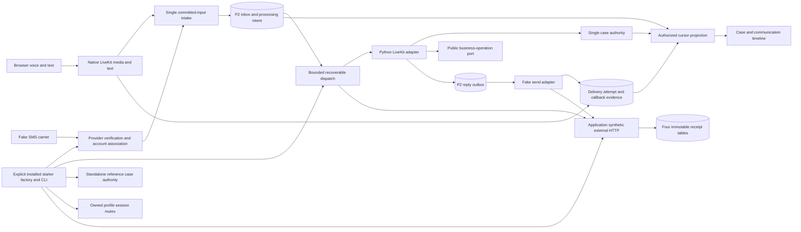

1. Provider verification authenticates an integration account. A separate trusted
   association adapter establishes the business account. Neither a room name nor
   caller-supplied scope grants case access.
2. One committed-input path validates and canonicalizes an event. It commits the
   event's stable identity, destination and processing intent before returning a
   durable receipt.
3. Dispatch can repeat after failure. It preserves the original business-operation
   identity. Repeated model processing is visible and is not promised to happen
   once.
4. The agent loads current authority facts and bounded relevant accepted history.
   Competing changes use an expected revision. An old or unlinked confirmation
   cannot silently approve the latest request.
5. A stable reply intent precedes each send. Callback history preserves attempt
   provenance and provider-specific interpretation. A missing acknowledgement can
   leave the outcome uncertain.
6. UI lanes show actual input acceptance, native output progress, client playback
   and carrier observations. They never convert generated text into played text,
   comprehension or mutation consent.
7. The explicit installed starter factory and command-line interface (CLI) compose
   provider verification, dispatch, the standalone reference case authority and an
   owned profile session mutex. Dispatch and the fake send adapter call the
   application's synthetic external HTTP server, which keeps four immutable
   receipt tables. See [Installed standalone starter (I21)](#installed-standalone-starter-i21).

## Sequence diagram

The diagram follows one standalone journey. The owner bootstraps storage and
routes the case while the session mutex excludes serving. A user then sends a
signed fake SMS, and the harness kills the gateway before dispatch. A new gateway
recovers the input, and the agent processes it against the current revision. The
carrier later retries the original event, and the user returns through another
channel.

The gateway prefix (acknowledgement, kill and durable selection) is implemented
and tested with actual processes and sockets. Native composition, exact
confirmation association and reply, callback and send recovery have separate
implemented profiles and qualification. Selected current-case room resumption is
qualified in I18. The diagram grants no physical SMS deduplication and no
guarantee of a single model invocation.

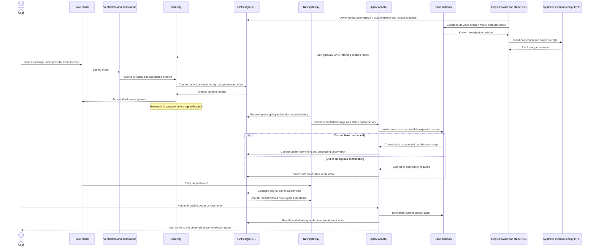

## Low-level design

The class diagram shows the main public types, ports and owners. ChannelGateway
and ChannelDispatcher have the implemented methods shown. The general
ChannelContinuity facade remains planned. I12 adds the explicit outbox and
ordinary fake-carrier surface described in
[Durable replies and ordinary fake sends (I12)](#durable-replies-and-ordinary-fake-sends-i12).
I13 callback evidence is separate from the I14 ambiguous resend policy. Preserve
variant-specific payload validation rather than collapsing modalities into text.

```mermaid
classDiagram
    class ChannelEvent {
        +schemaVersion
        +eventId
        +providerScope
        +accountScope
        +conversationId
        +caseId
    }
    class ChannelContinuity {
        <<interface>>
        +accept(event, principal) Receipt
        +inspect(id, principal) MessageRecord
        +history(id, principal) HistoryPage
        +enqueueReply(reply, principal) Receipt
    }
    class VerifiedPrincipal
    class AssociationAdapter {
        <<interface>>
        +associate(provider_event) AccountScope
    }
    class ChannelStore {
        <<interface>>
        +accept(event) Receipt
        +claim_dispatch() ProcessingAttempt
        +record_evidence(event) Observation
    }
    class ChannelGateway {
        +listen(port) GatewayEndpoint
        +close() Promise
        +metrics() Snapshot
    }
    class ChannelDispatcher {
        +eligible(token, limit) ReceiptIds
        +step(token, receiptId) Observation
        +inspect(token, receiptId) Observation
    }
    class CaseAuthorityPort {
        <<interface>>
        +inspect(reference, signal) CaseSnapshot
        +revise(command, signal) CaseSnapshot
    }
    class RevisionRouter {
        +route(accountToken, receiptId) RoutingResult
        +inspect(accountToken, receiptId) CaseSnapshot
        +close() Promise
    }
    class CaseAuthorityHttpClient
    class ReferenceCaseAuthority
    RevisionRouter --> ChannelStore : authenticated retained input
    RevisionRouter --> CaseAuthorityPort : investigation revision
    CaseAuthorityHttpClient ..|> CaseAuthorityPort
    ReferenceCaseAuthority ..|> CaseAuthorityPort
    class StandaloneApplication {
        +startGateway() GatewayEndpoint
        +route(alias, receiptId) RoutingResult
        +dispatch(alias, receiptId, reconcileOnly) Observation
        +close() Promise
    }
    class StandaloneOwner {
        +bootstrap() Versions
        +close() Promise
    }
    class StarterConfig
    class ExternalHttpServer
    class ExternalReceiptStore
    class ModeMutex
    StandaloneApplication --> StarterConfig : validates explicit profile
    StandaloneApplication --> ChannelGateway : owns until actual close
    StandaloneApplication --> RevisionRouter : explicit quiescent command
    StandaloneApplication --> ReferenceCaseAuthority : standalone case mode
    StandaloneApplication --> ExternalHttpServer : bounded HTTP ports
    StandaloneApplication --> ModeMutex : owns session through dependent closure
    ExternalHttpServer --> ExternalReceiptStore : append and original lookup only
    StandaloneOwner --> ExternalReceiptStore : explicit schema bootstrap
    class AgentAdapter
    class AgentProcess {
        +port AgentAdapter
        +prepare(context, signal) Decision
        +close() Promise
        +metrics() Snapshot
    }
    class ConfirmationRouter {
        +confirm(accountToken, receiptId) ConfirmationResult
        +close() Promise
    }
    class PromptRegistry {
        +publish(publisherToken, prompt) StoredPrompt
        +find(reference) StoredPrompt
    }
    class ConfirmationAuthorityPort {
        <<interface>>
        +confirm(exactQuote, originalCommand) Receipt
    }
    ConfirmationRouter --> ChannelStore : retained input and late eligibility
    ConfirmationRouter --> PromptRegistry : immutable response binding
    ConfirmationRouter --> ConfirmationAuthorityPort : exact atomic commitment
    class TrustedWorker {
        +runAgentWorker(config) Promise
    }
    class CarrierAdapter {
        <<interface>>
        +send(reply) SendObservation
        +verify(callback) VerifiedEvent
    }
    class ReplyOutbox
    ChannelGateway --> ChannelEvent
    ChannelGateway --> VerifiedPrincipal
    ChannelGateway --> AssociationAdapter
    ChannelGateway --> ChannelStore
    ChannelGateway --> ChannelDispatcher
    AgentProcess ..|> AgentAdapter
    AgentProcess --> TrustedWorker : owns POSIX group
    ChannelDispatcher --> AgentProcess : explicit port
    AgentAdapter --> CaseAuthorityPort
    AgentAdapter --> ChannelStore
    ReplyOutbox --> ChannelStore
    ReplyOutbox --> CarrierAdapter
```

The diagram also shows the I09 agent process, the I10 routing types, the I11
confirmation types and the I21 standalone application. The state machines for
[investigation dispatch](#recoverable-investigation-dispatch-i07) and
[outbound sends](#durable-replies-and-ordinary-fake-sends-i12) appear with their
components.

## Components and related details

This section starts with three shared subsections: component responsibilities,
contracts and layout, and storage schema versions. One subsection per
implemented slice follows, in task order. Each slice subsection states its owned
state, bounds, lifecycle and qualification boundary. The topic guides and the
[README](README.md) own API usage and commands.

### Component responsibilities

Paths are relative to this project. Each status follows the slices that implement
the component, listed in [Implementation status](#implementation-status).

| Component | Path | Responsibility | Status |
| --- | --- | --- | --- |
| TypeScript package | `src` | Versioned event discriminants, canonicalization, typed receipts/errors/history and adapter contracts | Partial: general `ChannelContinuity` facade planned |
| Gateway/store | `src/gateway.ts`, `src/postgres.ts`, `src/dispatch-store.ts`, `src/outbox-store.ts`, `src/communication-store.ts` | Inbox, processing intents/attempts, reply outbox, provider identities, communication records and bounded queries | Qualified |
| Association adapter | `src/postgres.ts` | Verified mapping from provider sender/account to business account; ProviderScope never substitutes for AccountScope | Qualified |
| Case authority | `src/reference-case.ts`, `src/case-http.ts`, `src/confirmation-http.ts` | Sole current revision/confirmed-facts authority; standalone adapter follows the same fixtures as integrated authority | Qualified |
| Python LiveKit adapter | `python/src/channel_continuity` | Loads scope/current context, dispatches accepted input and consumes native conversation/interruption observations; no supplier scheduler | Qualified |
| Carrier adapter | `src/security.ts`, `src/fake-sms-send.ts`, `src/idempotent-fake-sms.ts`, `src/callback-security.ts` | Seeded fake signature verification, send attempts, callback provenance and explicit capability-dependent uncertainty | Qualified |
| Browser/read projection | `src/communication.ts`, `src/rehydration.ts`, `src/operations.ts` | Native controls, receipt states, safe current-case/history pages and source-qualified playback reports | Partial: complete conversation UI gated |
| Business-operation adapter | `examples/standalone/external-http.ts` | Standalone fake port or public P1 interface preserving stable logical operation identity; no copied supplier state | Partial: complete integrated release planned (I22) |

### Contracts, layout and lifecycle

#### Event contracts

- The charter's event union includes `text.received`, `response.generated`,
  `playback.reported`, `delivery.reported` and `user.acknowledged`.
- Keep message, response, case, conversation and room IDs distinct.
- Canonical identity includes the semantic payload and stable destination.
  Receipt times, retries and transport signatures remain attempt observations.
- Bound and validate history cursors, pages and variant payloads in both
  languages.

#### Source layout

- Implementation belongs under `src` and `tests`.
- Establish Python adapter packaging with its first consumer. Follow the
  [Python engineering guide](../../docs/python-engineering.md) for immutable typed
  boundary values, async ownership, context-managed clients and narrow exception
  translation.
- TypeScript public APIs use exported discriminated types and runtime schemas
  rather than unchecked casts.
- Shared contract fixtures live under `../../contracts` once both producers and
  consumers exist.

#### Standalone and integrated composition

- Standalone adapters provide a small case store, scripted agent and fake
  operation port without P1 or P3 deployments.
- Integrated P1 access uses public ports. P3 is never required.
- A real text consumer establishes npm exports. Test the npm-pack artifact outside
  repository imports, and repeat after media integration.
- Native Agents UI is an optional consumer decision. Keep the current TypeScript
  console by default.

### Storage schema versions and upgrades

P2 owns its PostgreSQL schemas and migrations. They use the one-shot migration
principal and versioned configuration upgrade from shared task S-I05 in the
[implementation plan](../../docs/implementation-plan.md).

- Runtime roles cannot create schemas or receive bootstrap administrator
  credentials.
- Repeated or interrupted upgrades and normal same-volume restart preserve
  credentials and accepted records.
- Define provider replay horizons and retained receipt and delivery tombstones
  before pruning display history. Late replay then deduplicates or returns
  explicit expiry.

The inbox schema grows through explicit owner steps, one for each slice that
needs new storage.

| Version | Owner entry point | Storage added | Slice |
| --- | --- | --- | --- |
| v1 | `installChannelSchema` | Eight tables: metadata, admission counters, sender heads, versioned bindings, challenges, conversation sequence, inbox and processing intents | [Intake (I03 to I05)](#verified-postgresql-intake-i03-to-i05) |
| v2 | `upgradeChannelSchemaV2` | Dispatch settings, immutable prepared plans and attempt rows; claim, attempt, due-time, `possible_external` and external-receipt fields on processing intents | [Dispatch (I07)](#recoverable-investigation-dispatch-i07) |
| v3 | `upgradeChannelSchemaV3` | Outbox settings and admission, `reply_intents`, `outbound_routes`, `send_attempts` and `send_results`; a stable receiver UUID | [Replies and sends (I12)](#durable-replies-and-ordinary-fake-sends-i12) |
| v4 | `upgradeChannelSchemaV4` | `callback_settings`, `callback_admission` and `callback_observations` | [Callbacks (I13)](#authenticated-callback-evidence-i13) |
| v5 | `upgradeChannelSchemaV5` | `send_policy_settings`, `send_operations`, `send_recovery_commands` and `send_recovery_observations`, with the `recovery_count` counter | [Send policy (I14)](#explicit-uncertain-send-policy-i14) |
| v6 | `upgradeChannelSchemaV6` | `native_settings` and `native_bindings` | [Native intake (I15 and I16)](#native-text-and-committed-voice-intake-i15-and-i16) |
| v7 | `upgradeChannelSchemaV7` | Three communication tables: settings, response anchors and append-only observations | [Communication (I17)](#source-qualified-response-and-playback-evidence-i17) |
| v8 | `upgradeChannelSchemaV8` | One immutable result-receipt metadata table | [Result return](#original-result-receipts-and-current-native-reads-schema-v8) |
| v9 | `upgradeChannelSchemaV9` | Three operating indexes only | [Version 9 operating indexes](#version-9-operating-indexes) |

The I18 context read model and the I19 workload profile add no storage version.
Three other schemas are separate from the inbox schema:

| Schema | Storage | Slice |
| --- | --- | --- |
| Standalone reference case authority (marked v1) | Metadata and 1–64 seeded cases | [I10](#investigation-revision-routing-i10) |
| `p2_prompt_` prompt registry (v1) | Immutable prompt rows, one admission row and catalog metadata | [I11](#exact-response-linked-confirmation-i11) |
| Starter synthetic external receipt profile | Four immutable receipt tables | [I21](#installed-standalone-starter-i21) |

Rules for every version:

- Only the explicit trusted owner installs or upgrades a schema. Serving code never
  installs, upgrades or repairs storage and executes no DDL.
- An upgrade is a maintenance boundary, not a seamless live upgrade. Quiesce
  serving processes first, and retain a restorable database backup before
  upgrading a retained deployment.
- Owner validation precedes DDL and does not repair drift.
- Upgrades preserve existing rows, receipts and identities.
- Each slice subsection records its version's compatibility and qualification
  details.

#### Version 9 operating indexes

The explicit owner `upgradeChannelSchemaV9` adds only operating indexes after v8:

- `dispatch_due`, a partial index over pending, running and uncertain intents;
- `attempts_operation`; and
- `recovery_outbound`.

Before it creates the indexes, the upgrade takes ACCESS EXCLUSIVE locks on
`schema_metadata`, `admission`, `processing_intents`, `send_attempts` and
`send_recovery_commands`, then revalidates the schema. The locks change neither
the v9 catalog nor its definition digest.

Its digest and `p2-channel-schema-v9` marker are checked like every earlier
version. The catalog snapshot is retaken in the same transaction. The
[0047 work item](../../docs/work-items/0047-open-findings-schema-upgrades-and-landing.md)
records this upgrade.

### Version-1 event codec (I01 and I02)

The TypeScript package exports five event variants, scoped principal and event
types, a real text producer, a strict JSON decoder and canonical event and
identity accessors. The Python workspace member exports equivalent decoding,
production and immutable data. Shared fixtures in
[contracts/channel/v1.json](../../contracts/channel/v1.json) compare actual
producer output with the results of both decoders. No codec method acknowledges
acceptance or grants authority.

The general ChannelContinuity interface remains planned, and the explicit I12
outbox is separate. The separate server ChannelInbox implements SMS receipts and
scoped history.

#### Codec limits

| Limit | Value | Applies to | Notes |
| --- | --- | --- | --- |
| Wire message | 32 KiB | Each encoded event | None |
| Text and played text | 4 KiB UTF-8 | Text and played-text fields | None |
| Identifiers | At most 128 ASCII bytes | Every identifier | None |
| Signature observations | At most 256 UTF-8 bytes | Signature observation fields | None |
| Containers | At most 64 members and depth eight | Objects and arrays | None |
| Producer preflight | Global 256-node and 32 KiB aggregate UTF-8 budget | Producer runtime data | Charged on every shared-child visit |
| Integers | Zero through 9,007,199,254,740,991 | Integer fields | None |

Large strings fail a cheap length check before encoding. The codec rejects
duplicate keys before projection. It also rejects unknown fields, versions and
variants, lone surrogates, non-integer numbers, booleans used as revisions and
integers outside the range above. UTC timestamps use the exact millisecond `Z`
form and valid calendar dates. These configured codec limits are not gateway
throughput or media capacity claims.

#### Canonical form and identity

- Canonical JSON uses sorted known ASCII keys, no insignificant whitespace, ASCII
  escaping with lowercase UTF-16 escapes and exact integer decimal form.
- Identity is the canonical tuple of tenant, provider, provider account and event
  ID.
- Canonical event semantics retain the payload, the account, case and
  conversation destination, and `occurredAt`. The `receivedAt`, signature and
  `retryCount` fields are observations excluded from comparison.
- The codec computes comparison bytes only. The separate server PostgreSQL path
  owns verified fake-SMS durable replay and conflict.
- New event IDs remain distinct even when the text is identical.

#### Trust boundary

TrustedPrincipal is separate caller configuration. The implemented SMS path
builds it from authenticated scope and the protected current database binding.
The codec validates that provider and account match. It does not prove webhook
authenticity, current association, case authorization or mutation consent. A
provider-only event cannot attach an account or reference a case.

Producers reject unsupported or cyclic runtime data with fixed payload-free
ContractError codes. Returned data is immutable. Downstream code must decode
untrusted boundary data and must not accept caller-created decoded objects as
authority. This pure data component fabricates no runtime telemetry or
persistence.

### Verified PostgreSQL intake (I03 to I05)

The default npm entry stays browser-safe. The server-only `./security`,
`./postgres` and `./migrations` exports own hash-based message authentication
code (HMAC) handling and the `pg` client. ChannelInbox provides the implemented
DurableReceipt, StoredMessage and history API. It is distinct from the general
ChannelContinuity interface, which remains a future interface.

#### Authentication and association

- Authentication binds the trusted provider scope, the timestamp and the exact
  request bytes.
- Account association is a separate step. A seeded account token creates a
  60-second challenge. Only a signed LINK message from the intended sender,
  carrying that exact challenge ID and secret, consumes it.
- The store keeps only the LINK proof's digest and decision metadata. It never
  enrolls the proof as a business message.
- Revocation and reassignment advance epochs and invalidate older challenges.
- A reassigned sender cannot replay or read the previous account's receipt. The
  original account keeps ownership of its history.

#### Tables and acceptance

Eight owned tables hold metadata, admission counters, sender heads, versioned
bindings, challenges, the conversation sequence, the inbox and processing
intents. A persisted guard serializes retained-cap checks and atomic receipt and
intent insertion. The inbox returns acceptance only after commit, and the scoped
sequence grants no business authority. `acceptedAt` is a database-time
observation within the transaction, not an independently measured commit
timestamp.

#### Intake connections and time limits

| Limit | Value | Applies to | Notes |
| --- | --- | --- | --- |
| Admitted operations | At most four, on two connections | Each ChannelInbox instance | None |
| Connect and lock | 1.5 seconds | ChannelInbox | None |
| Statement | Three seconds | ChannelInbox | None |
| Driver query and idle transaction | Five seconds | ChannelInbox | None |
| Idempotent close | Under six seconds | ChannelInbox | Drains admitted work |
| Owner-client close | 1.5 seconds | Migration owner client | None |

Use parameterized asynchronous queries, one checked-out client per transaction and
no external call while holding locks. Catalog inspection is batched. The global
guard favors local correctness. Measure contention before replacing it with
per-scope admission or partitions. Configured bounds are not production
throughput or latency measurements.

#### Catalog validation

A catalog-only metadata preflight runs before any row read. It rejects executable
views, row-level security (RLS), triggers and rules, unsafe grants and expressions,
and incorrect column shape. Catalog comparison covers all serving relations,
defaults, constraints, indexes, column grants and collations, and RLS, triggers and
rules. Runtime cannot change the saved baseline. Installing over an existing
schema validates it rather than repairing it.

The migration owner is trusted and can manually rewrite both data and baseline, so
this validation does not defend against a malicious owner. Such changes are
outside the supported protocol.

#### Retained caps and database roles

| Limit | Value | Applies to | Notes |
| --- | --- | --- | --- |
| Inbox rows | 1,000 (default) | Each schema | Owner configuration permits 1–10,000 |
| Challenges | 512 (default) | Each schema | Owner configuration permits 1–10,000 |
| Bindings | 256 (default) | Each schema | Owner configuration permits 1–10,000 |
| Sender heads | 128 (default) | Each schema | Owner configuration permits 1–10,000 |

No runtime deletes core receipts or epochs. Authorized replay and inspection
precede new-growth rejection.

The owner is `continuity_migrator`. The runtime role `livekit_lab` has narrow DML
without DDL or canonical UPDATE, DELETE or TRUNCATE. This shares the local P1
credential and does not establish independent database principals. Split
principals before a separately exposed P2 deployment.

The bounded investigation dispatcher is described in
[Recoverable investigation dispatch (I07)](#recoverable-investigation-dispatch-i07).
Complete callback and resend qualification, broader agent composition and media
remain planned.

### Standalone intake and read-only preview (I06)

The `./standalone` public subpath requires explicit inbox, case, scripted-agent
and operation-inspection ports, plus a trusted provider, account, conversation and
case binding. Missing adapters fail before any input. `accept` delegates to the
real durable inbox. `preview` is a separate authenticated read.

At runtime the preview validates the case reply scope, ID and revision, the agent
revision and the original persisted operation key. No callback receives mutation
consent or invokes business execution. The output keeps the durable processing
intent pending and labels the fake operation `not_executed` with `durable` false.
That flag describes the inspection-only fixture, not the persistence of the inbox
receipt or processing intent.

#### Preview bounds and lifetime

| Option | Default | Allowed values | Description |
| --- | --- | --- | --- |
| Active preview calls | Two | One through four | Concurrently owned preview slots |
| Whole-preview deadline | Two seconds | 20 through 5,000 ms | Monotonic budget for one whole preview |
| Cleanup | One second | 20 through 5,000 ms | Budget for preview cleanup |

- Monotonic time is checked before and after every awaited stage and before
  returning success, so a delayed timer cannot certify late results.
- Signals request a cooperative stop. They cannot preempt arbitrary synchronous
  adapter code.
- A timed-out adapter keeps its slot until its actual call settles. No later stage
  starts after a timeout or close.
- Uncooperative work produces CleanupIncomplete instead of a false clean report.
- `activePreviews` observes the owned slots, not generated progress. There is no
  in-memory queue of pending work.

#### Preview ownership and errors

The helper closes only its preview resources. The caller owns the supplied
ChannelInbox and the in-flight intake lifecycle. The example attempts both cleanup
paths. A failed preview does not undo acceptance or request business
cancellation. An unknown intake acknowledgement preserves the original retry
identity. Fixed safe errors never include raw adapter or provider exceptions,
account tokens or proofs.

#### Fake-carrier example

The `examples/fake-carrier.ts` consumer imports declared public package paths.
Its local wrapper builds the current source and accepts input. It then runs a
fresh process that replays and inspects the same receipt and operation key
against actual PostgreSQL. Example-only output contains a strict safe projection
of actual observations. Normal full-store qualification remains separate.

The case, agent and operation adapters are explicit synthetic read-only fixtures.
Actual channel dispatch, carrier delivery, native media and isolated
artifact-release qualification each have separate gates. None follows from this
preview example.

### Recoverable investigation dispatch (I07)

The server-only `./dispatch` export provides ChannelDispatcher. It offers one
explicitly requested step, a lookup-only reconcile, an authenticated inspect,
finite counters and an idempotent close. It imports no P1 or P3 application and
no LiveKit runtime.

- Case and scripted-agent ports can only prepare an investigation.
- The cooperating operation port must advertise `stable_idempotency_and_lookup`.
- Schema-valid output is not mutation authority.
- The `dispatched` state records durable acceptance by that investigation port.
  It never asserts completed business work or delivered communication.

#### Schema version 2

Version 2 adds dispatch settings, an immutable prepared-plan row and at most three
default attempt rows per original receipt. It extends the processing intent with
the claim owner, epoch, deadline and kind, the attempt count, the due time,
`possible_external` and the external receipt.

- The explicit owner upgrade validates and locks version 1 before DDL in one
  transaction. It preserves accepted rows and changes the catalog baseline only
  for that recognized transition.
- An existing version 2 installation requires the same limits and the exact
  catalog.
- Runtime performs no DDL, canonical update or deletion, or baseline refresh.
- The original install entry creates version 1 and never silently upgrades.
- Owners quiesce serving processes and retain a restorable database backup before
  upgrading retained deployments.

Current disposable tests establish identity preservation and drift rejection.
Production backup and restore rollout remains a separate operational
qualification.

#### Dispatch states

The processing intent moves through the states below. A committed
`possible_external` reservation makes the state `uncertain`. Only a matching
authoritative receipt leaves that state.

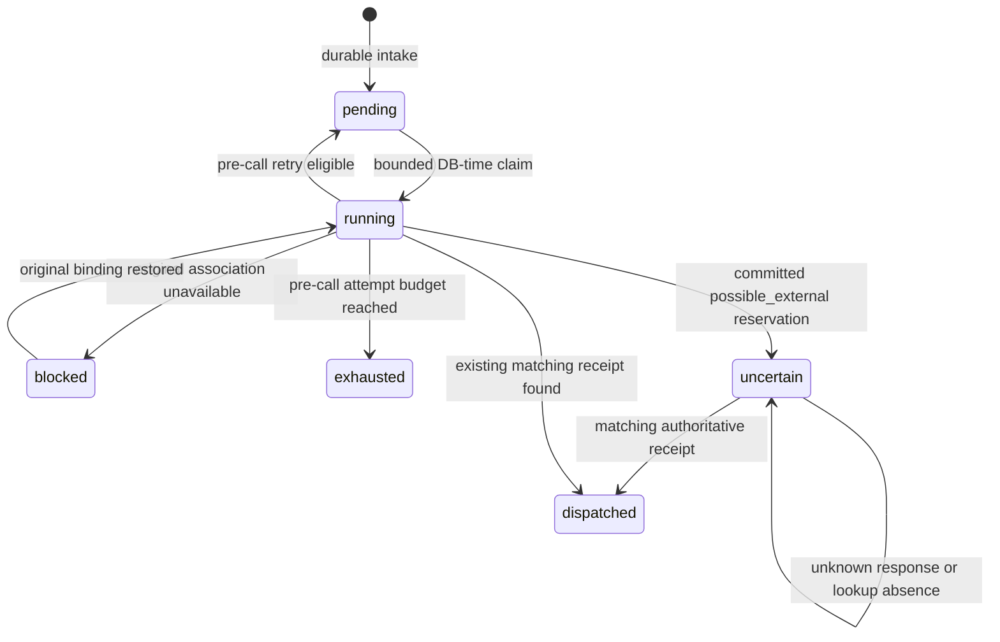

| State | Entered by | Next transitions |
| --- | --- | --- |
| `pending` | Durable intake, or a pre-call retry that is eligible | `running` on a bounded DB-time claim |
| `running` | A bounded DB-time claim, or a restored original binding | `pending`, `blocked`, `exhausted`, `uncertain` or `dispatched` |
| `blocked` | Original association unavailable | `running` once the original binding is restored |
| `exhausted` | Pre-call attempt budget reached | None in the diagram |
| `uncertain` | Committed `possible_external` reservation | Stays `uncertain` on an unknown response or lookup absence; `dispatched` on a matching authoritative receipt |
| `dispatched` | Matching authoritative receipt, or an existing matching receipt found | None; durable acceptance by the investigation port, not completed business work |

#### Claims and leases

- The persisted admission guard serializes claim and count decisions.
- Database time is read after the row and binding locks. An unexpired owner
  prevents a second claim.
- Expiry permits a higher epoch and closes the prior attempt as `lease_expired`.
- A stale owner cannot prepare, reserve, fail or finish a newer claim.
- No external port runs inside a transaction.

#### Prepared plan and destination

The first prepared scope, case, revision and scripted plan, together with the
original message, form a bounded 32 KiB canonical JSON string with a SHA256
digest. Retries and takeovers reuse it. They never regenerate a changed case plan
under the same key.

The current association must still match the original account, conversation and
case before preparation and before each possible new accept. Reassignment cannot
change that destination. A known original receipt may be recorded under a current
claim even after sender revocation. The original authenticated history ownership
persists.

#### External acceptance and uncertainty

- Before calling accept, the dispatcher commits `possible_external=true` and the
  state `uncertain`. That observation is monotonic. Uncertainty cannot become
  pending while an old paused call may still arrive.
- Each ordinary attempt performs a lookup first. Any accept uses the same
  immutable scope, key and digest.
- Expiry is a local write guard and cannot fence external execution.
- The cooperating operation adapter owns durable deduplication and authoritative
  lookup.
- A wrong key, scope or digest is a conflict. Reliable lookup absence still does
  not disprove an earlier possible call.
- After the attempt limit, an ordinary step performs no new accept.
- An explicit reconcile only looks up the original prepared operation. It does not
  invoke the case, agent or accept ports and creates no additional attempt-history
  rows. Its claim is still bounded by global capacity, lease and due-time policy.
- A lookup after reassignment never exposes the old receipt to the new account.

#### Dispatch limits and lifetime

| Option | Default | Allowed values | Description |
| --- | --- | --- | --- |
| Active leases | Two | 1–4 | Owner setting |
| Ordinary attempts | Three | 1–5 | Owner setting |
| Lease | 5 s | 500–30,000 ms | Owner setting |
| Retry delay | 250 ms | 20–5,000 ms | Owner setting |
| Whole-step lifetime | 2 s | 20–5,000 ms | Budget for one explicit step |
| Cleanup | 1 s | 20–2,000 ms | Budget for owned shutdown |

| Limit | Value | Applies to | Notes |
| --- | --- | --- | --- |
| Whole dispatch calls | Two | Each instance | No in-memory accepted-work queue or background retry loop |
| Store operations | Four, across two connections | Each instance | None |
| Pending observer notifications | At most eight retained | Each instance | Observer promises are consumed without changing outcomes |

- Monotonic checks include synchronous observer and abort work and late adapter
  results.
- Timed-out ignored callbacks keep their slots until actual settlement.
- A matching late operation receipt may be persisted as known truth while the
  expired caller still gets a timeout.
- Cleanup reports failure within its total budget and continues owned shutdown
  after held work eventually settles.

### Bounded loopback gateway (I08)

The `./gateway` export composes the real raw authenticated ChannelInbox boundary
and ChannelDispatcher from explicit database, integration, account and adapter
settings.

- Only configured account credentials select bounded due input. Raw JSON cannot
  choose a worker scope.
- Startup validates an existing v2 schema within a finite observation budget. It
  never migrates or repairs storage.
- The eligibility query is a read observation. The dispatcher step performs the
  protected association, epoch and time checks.

#### Polling

One serial driver rotates account bindings and reads at most the remaining batch.
A two-second tick budget is checked before each next scan.

| Option | Default | Allowed values | Description |
| --- | --- | --- | --- |
| `batchSize` | Four | 1–16 | Batch of eligible rows for each scan |
| `pollMs` | 100 ms | 20–1,000 ms | Polling cadence |
| `idlePollMs` | `pollMs`, which means no backoff | `pollMs`–5,000 ms | Opt-in ceiling for the idle pause |

With the opt-in `idlePollMs` ceiling, the pause doubles after each cycle that
dispatches nothing, up to that ceiling. It resets to the cadence only when a step
dispatches work or a newly accepted local intake nudges the loop. A nudge also
ends a pause at once. Finding eligible rows that dispatch nothing does not reset
the pause.

Due selection excludes active leases, future retries, blocked, exhausted and
dispatched rows, and exhausted uncertain attempts. It also excludes uncertain
input held because its sender association or native binding is gone (last code
`association_required`). That input is parked outside automatic eligibility. It
needs an explicit step, which rechecks current permission, or a lookup-only
reconcile, which never needs that permission. Claiming still revalidates all
conditions, which does not fence physical external execution. No memory queue
owns acknowledged work, and normal active ingress cannot starve dispatch.

The trusted acknowledgement test hook temporarily gates polling. This makes the
actual HTTP 200 and kill-before-dispatch schedule deterministic. No wire field
selects the hook.

#### Gateway listener bounds

| Limit | Value | Applies to | Notes |
| --- | --- | --- | --- |
| Sockets | 16 | Each listener | None |
| Active requests | Four | Each listener | None |
| Raw header fields | 16 fields and 8 KiB | Each request | None |
| Header and response time | One second each | Each request | None |
| Body time | Two seconds | Each request | None |
| Raw input | 32 KiB | Each request | A finite Content-Length is required |
| Output | 16 KiB | Each response | None |
| Startup | Five seconds (default) | Listener startup | None |
| Close | Two seconds (default) | Listener close | None |

The literal-loopback server closes each connection. It rejects duplicate,
pipelined and transfer-encoded requests. GET receipt reads require the account
bearer. Health reports driver state without claiming model, carrier or business
readiness. Startup and close both check monotonic elapsed time, retain ignored
work and observe actual resource retirement. A rejected or late bind starts owned
cleanup.

#### Dispatch quiescence and room retirement

The [public lifecycle methods](README.md#gateway-lifecycle-controls) separate
admission fencing, actual work settlement and resource closure. They are trusted
process-local owner controls. They add no HTTP capability, durable queue, schema
or business cancellation.

| Control | Owned state and order | Limit or failure boundary |
| --- | --- | --- |
| Dispatcher quiescence | `quiesce()` permanently rejects new step/reconcile attempts, observes actual tasks and retains the store for prepared/receipt reads | Cleanup observer expiry retains actual work; no resume operation |
| Gateway quiescence | `quiesceDispatch()` permanently stops new intake/polling and waits for driver/dispatcher quiescence before application origins close | `cleanupMs` bounds observation; it does not close the inbox, dispatcher store or read dependencies |
| Native admission fence | Publish a hash of one bearer before awaiting every already admitted SQL accept owner; reserve the owner before invoking its dependency | 1,024 retained bearer hashes per gateway instance; direct trusted inbox calls and process restart are outside this HTTP fence |
| Native accepted-input drain | Read retained history after fencing, match full provider scope and original binding, then observe original receipt/operation identities | Two actual drains; 16 total account/conversation history records before filtering; 20-second monotonic drain budget |

The ordinary dispatcher and application origins stay live during room drain.
Possible external calls receive lookup-only reconciliation; no fresh ordinary
attempt is created by the drain itself. Overflow, blocked/exhausted inputs,
expired/revoked grants or unknown outcomes can keep a room Closing. Grant checks
before each new prepare/reservation remain authoritative, and an already admitted
external call cannot be retrospectively fenced.

The joined room owner fences and drains accepted input before revocation and
worker stop. A prepare already awaiting the same retiring worker can fall through
to the existing deterministic preparation path within its original claim if its
signal is not aborted and the room expiry has not passed. The store still checks
current grant permission. Later whole-gateway quiescence follows room drain.
Timeout preserves actual owners; neither fence proves closure or grants new
authority. The [lifecycle work item](../../docs/work-items/0050-lifecycle-drain-and-documentation-cleanup.md)
records focused and integrated evidence separately from earlier qualification.

#### Gateway qualification

The three real gateway cases use owned runtime-only child environments, real
loopback HTTP and PostgreSQL, typed synthetic case and scripted agent ports, and a
separately persisted cooperating operation fixture. They show:

- normal progress;
- a fully flushed acknowledgement followed by SIGKILL before any prepared plan or
  external call;
- fresh-process recovery and repeated replay;
- scoped reads; and
- progress after blocked input.

They qualify I08 only. Agent-process recovery and investigation routing have
separate I09 and I10 gates. Native media and callback and resend qualification
have their own separate gates, and complete charter gates remain pending.

### Isolated scripted worker (I09)

AgentProcess and runAgentWorker are explicit server-only process entry points.
The parent validates the trusted module configuration and its finite allowed-scope
inventory. It then spawns `process.execPath` without a shell.

Each call passes one canonical read-only InvestigationSubmission of at most
32 KiB. The worker independently validates its configured account scopes, exact
fields, duplicate-key and UTF-8 rules and context bytes. Its strict decision, at
most 2 KiB, echoes a digest of all input facts, including receipt, operation key,
scope, case and revision. This context is not a persisted plan or an execution
permission. The dispatcher alone prepares and persists a plan after the validated
worker response.

#### Worker limits

| Limit | Value | Applies to | Notes |
| --- | --- | --- | --- |
| Active workers | One (default); at most two by configuration | AgentProcess | None |
| Work and cleanup observer budgets | One second (default) | AgentProcess | None |
| Captured stderr | 4 KiB | Each worker | Never reflected to a caller or diagnostic event |
| Child environment | At most 16 `P2_AGENT_` fields and 4 KiB | Each worker | Explicit |
| Scope inventory | At most 64 nonempty, distinct scopes | AgentProcess configuration | Copied |
| Pending observer notifications | Eight asynchronous notifications | AgentProcess | Excess counted as dropped |

The child environment excludes inherited service credentials and runtime
selectors. Fixed numeric counters saturate.

#### Process ownership and cleanup

- A cancelled or expired waiter is rejected while the actual process work keeps
  its slot.
- The parent signals only its own POSIX process group. It escalates TERM to KILL
  and observes direct exit, pipe closure and group disappearance before releasing
  the slot.
- Incomplete cleanup remains non-passing, and its ownership is retained.
- Cleanup failures, including unexpected cleanup exceptions, keep the actual slot
  until the group is observed gone.
- No persistent process queue, supplier state, schema or autonomous retry is
  introduced.
- Application-owned observer work and remote provider computation are separate
  from local process cleanup.
- Trusted modules must keep descendants in their owned group. Memory and CPU
  sandboxing and containment of arbitrary hostile modules are outside this
  contract.

#### Success counters

The `succeeded` counter and the `settled(code=ok)` event describe a validated
worker that has already exited and whose group and streams are gone. A slow
synchronous observer can still delay caller delivery. The final signal and
monotonic guard then rejects that late delivery and increments `waiterRejected`.
Known worker-completion observations are not relabelled as a successful caller
response.

#### Worker qualification

The selected actual fixture shortens only its declared database lease to 750 ms
and uses a 1500 ms process budget, within production configuration bounds. It
waits for the database expiry observation, then kills a held real agent while the
ordinary gateway remains available. The next persisted claimant starts a new
worker. Two diagnostic context digests, case revisions and dispatch attempts
remain visible, with one independently persisted external investigation
acceptance.

Diagnostic fixture files carry synthetic input observations only. They never own
acceptance or retry authority. This scripted-worker gate alone does not qualify
the separate native SDK profile or model quality.

### Investigation revision routing (I10)

The `./routing` contract is additive and separate from the investigation
dispatcher. RevisionRouter reads an accepted message through an authenticated
input adapter. It validates the original receipt, event and operation and the
trusted scope and case binding. It then decodes the strict canonical
`case.revise_investigation` body.

- The request is a typed booking investigation with explicit investigation
  consent, a date and a portable booking reference.
- The body contains no scope, actor or target override.
- The expected revision is decimal. It includes zero and avoids JavaScript
  integer loss. An optional numeric event revision must agree with it.
- Unsupported or unlinked text yields clarification. I11 owns prompt- and
  response-linked exact confirmation.

#### Case authority port

CaseAuthorityPort exposes inspect and conditional revise. A revision outcome is
known revised or unchanged, conflict, or unknown. The router never sorts provider
times, automatically retries or rebases, infers acceptance from later matching
state or creates a quote confirmation. A fresh inspection can show current facts
without resolving the original command's unknown outcome.

| Option | Default | Allowed values | Description |
| --- | --- | --- | --- |
| Active calls | Two | One through four | RevisionRouter call concurrency |
| Call deadline | Two seconds | 20–5,000 ms | Budget for one router call |
| Close | One second | 20–2,000 ms | Budget for router close |

Timed-out or aborted work owns its actual slot until settlement. Caller signals
are brand-validated with native event methods before admission. Fixed telemetry
keeps at most eight pending notifications. Application observers have separate
resource ownership.

#### Standalone reference authority

The standalone `./reference-case` adapter owns one explicitly selected, marked v1
schema with metadata and seeded cases.

| Limit | Value | Applies to | Notes |
| --- | --- | --- | --- |
| Seeded cases | 1–64 | Reference schema | None |
| Active calls | Two, sharing two connections | ReferenceCaseAuthority | None |
| Owner connection cleanup and runtime close | Two seconds | ReferenceCaseAuthority | None |

- Owner installation validates the catalog and binding inventory. Runtime
  performs no DDL or inserts.
- Inspection uses an ordinary scoped SELECT. Conditional revision locks the case
  row and checks the revision and the cancelled and committed state before
  updating the request and revision.
- Persisted cap or catalog drift fails preflight.
- A failed rollback or uncertain commit discards the connection. A known commit
  can reuse it.

#### Integrated P1 authority

Integrated mode selects the literal-loopback CaseAuthorityHttpClient and an
explicit local application bridge. The bridge maps trusted bearer, account and
logical-case bindings to public P1 CaseControlClient, task and case identities.

| Limit | Value | Applies to | Notes |
| --- | --- | --- | --- |
| Header | 4 KiB | Each HTTP call | Each call owns a fresh connection |
| Body and response | 8 KiB each | Each HTTP call | No proxy, redirect or retry is used |
| Active calls | Two (default) | CaseAuthorityHttpClient | None |
| Call deadline | Two seconds (default) | CaseAuthorityHttpClient | None |
| Close | One second (default) | CaseAuthorityHttpClient | None |

- Both the actual ClientRequest close and the assigned socket close retire
  capacity.
- A malformed or mismatched response, or transport loss after a possible
  revision, remains OutcomeUnknown.
- P1 is the only integrated revision authority. The reference schema is not
  installed alongside it in that mode.

#### Association boundary and routing qualification

Authenticated retained-account access is distinct from current sender
association. ChannelInbox.inspect intentionally preserves the original account's
history. I10 does not add an atomic association-revocation fence. Complete P2-05
and P2-12 and deployment remain open. Native ingress and exact confirmation are
separate slices (I15 and I16, and I11).

Equivalent actual PostgreSQL fixtures hold a case lock and observe two blocked
callers through the database wait graph. They require one winner, one conflict
and valid subsequent progress. A trusted post-commit ACK loss keeps the outcome
unknown and retains the original receipt. Independent owner reconciliation checks
the full scope, actor, case and request and zero action effects.

### Exact response-linked confirmation (I11)

I11 adds a separate ConfirmationRouter, ConfirmationAuthorityPort and opt-in
ConfirmationHttpClient. It does not widen the public revision client's
capability. A private local transport shares the already bounded framing and
socket lifecycle. Known responses require an explicit `Connection: close`,
complete validated fields and actual request and socket retirement.

The Python bridge defaults confirmation off for each binding. Its opt-in path
parses the original canonical supplier-bound v2 quote and checks the digest and
the trusted task, case, revision and quote identity. It then calls the public
`CaseControlClient.commit_confirmation` once. No case pre-read grants authority.

#### Prompt registry

The explicitly owner-installed `p2_prompt_` v1 registry has immutable prompt rows,
one admission row and catalog metadata.

- A separate application publisher credential binds each permitted account, case
  and conversation.
- Tenant, account and response ID form the unique identity. All case,
  conversation, revision and quote bytes are compared payload. A reused response
  cannot be reassigned.
- Runtime cannot update or delete prompts or metadata. Normal restart preserves
  all bindings.
- There is no automatic cleanup horizon or hidden scheduler. The shared local
  PostgreSQL runtime role remains as documented.

Growth is bounded as follows:

| Limit | Value | Applies to | Notes |
| --- | --- | --- | --- |
| Prompts | 1,000 (default) | Persisted registry cap | Range 1–10,000; equal replay remains available at the cap |
| Runtime connections and calls | Two | Prompt registry | None |

#### Quote bytes

Publication checks a bounded, opaque, ASCII-escaped quote string and its SHA256.
It does not check quote issuance. The trusted P1 producer and the final public P1
parser and transaction validate authority.

Never `JSON.parse` or reserialize the consent quote in TypeScript, because its
revision and supplier integer literals can exceed JavaScript precision. Separate
revision metadata is decimal. Quote IDs accept P1's deterministic UUIDv5
contract. The prompt is a recorded association, not output-delivery or playback
evidence.

#### Linking a reply to a prompt

| Reply | Treatment |
| --- | --- |
| Literal YES plus a response ID | An explicit original-user link |
| Bare YES | Accepted only with both trusted existing event links; otherwise clarification is required |
| Strict structured command | Additionally binds the revision and digest |
| Model output, a generated response, timestamps or playback | Never supply explicit consent |
| Missing, mismatched or stale reply | Cannot silently approve the current quote |

Scope, case, conversation and command identity come from authenticated retained
input and the immutable trusted binding.

#### Association preflight

After the prompt lookup, the router calls `inspectForConfirmation` and compares
the complete original input, operation and association identity. ChannelInbox
checks the original configured provider and sender, the current active epoch and
the account, case and conversation. Known revocation or reassignment is rejected,
and retained history reads are unchanged. The check does not share P1's commit
transaction. An atomic revocation fence and full P2-06 and P2-12 therefore remain
open.

#### Commitment and replay

P1 receives the complete original quote bytes and the original inbox operation
UUID. Its transaction checks the current quote, revision, expiry and cancellation
before committing one intent.

- Replaying an existing command returns its original receipt.
- A lost reply remains unknown. There is no matching-state inference and no
  automatic retry or rebase.
- Explicit replay can retrieve known truth after case cancellation or expiry while
  the association still passes preflight.
- After association revocation this facade rejects replay and offers no
  lookup-only historical receipt API. P1 receipts are not erased.
- Standalone reference-case v1 remains investigation-only. Independent
  confirmation consumers provide their own narrow atomic authority fixture or
  adapter.

#### Confirmation limits and qualification

| Limit | Value | Applies to | Notes |
| --- | --- | --- | --- |
| Active calls | Two (default) | ConfirmationRouter | Same finite option range as revision routing |
| Call deadline | Two seconds (default) | ConfirmationRouter | Same finite option range as revision routing |
| Close | One second (default) | ConfirmationRouter | Same finite option range as revision routing |
| Observer promises | Up to eight admitted | ConfirmationRouter | External observer resources stay application-owned |
| Owner and runtime close | Two seconds | Prompt publication | SQL and driver budgets are also bounded |

Actual ignored work retains capacity.

Actual P1 fixtures use issued ABA quotes (quotes issued after the request was
revised away and back again), an observed two-caller lock graph, original
lost-ACK replay and one leased fake mutation. No new quote is forged for a revised
inquiry.

### Durable replies and ordinary fake sends (I12)

I12 adds the server-only ChannelOutbox and OutboxStore, the FakeSmsSendClient and
the explicit owner inbox v3 upgrade.
[The phase handoff](../../docs/work-items/0033-outbound-replies-and-completion-processing.md)
owns current qualification. The default codec and the fake-SMS inbound v1 wire
remain unchanged. The new version-1 reply and send contracts are distinct from
ChannelEvent. There is no automatic P1 booking-completion feed, callback endpoint
or background sender.

| Component | Path | Responsibility | Status |
| --- | --- | --- | --- |
| Outbox types | `src/outbox-types.ts` | Strict draft/recipient/attempt/result records, UUIDs, int64 decimal epochs and exact text/digests | Qualified |
| OutboxStore | `src/outbox-store.ts` | Authenticated publisher/recipient access, immutable acceptance, route CAS, protected possible-send reservation and known-result retention | Qualified |
| ChannelOutbox | `src/outbox.ts` | Explicit bounded sends, actual task lifetime, safe producer observations; owns its store, not the supplied carrier | Qualified |
| FakeSmsSendClient | `src/fake-sms-send.ts` | Explicit authenticated literal-loopback ordinary-send client; no provider retry/lookup or delivery inference | Qualified |
| Owner migrations | `src/migrations.ts` | Quiesced v2-to-v3 addition, catalog/role validation, persistent receiver identity; no runtime DDL | Qualified |

#### Reply identity

- The publisher binding fixes tenant, account, case and conversation
  independently of account credentials.
- ReplyDraft contains only the schema version, outbound UUID, response ID and at
  most 4096 exact UTF-8 body bytes.
- Immutable enqueue identity is tenant, account and outbound UUID. Replay compares
  the complete recipient, response and body envelope.
- `bodyDigest` hashes the exact UTF-8 body, and `intentDigest` hashes the complete
  envelope. Neither substitutes for a P1 result digest.
- A P1 result may be 8192 bytes, so delivering one requires a bounded notice or
  reference and the original source digest. The opt-in v8 result receiver
  provides that notice. See
  [Original result receipts and current-native reads (schema v8)](#original-result-receipts-and-current-native-reads-schema-v8).

#### Outbox storage (schema v3)

Owner v3 adds outbox settings and admission, `reply_intents`, `outbound_routes`,
`send_attempts` and `send_results`. The stable receiver UUID is installed once.

- Runtime cannot modify or delete canonical replies, attempts or results.
- A persisted cap guards new growth. Equal replay and reads remain available at
  the cap.
- An ordered scoped reply index supports bounded pending discovery. The unique
  attempt-ordinal index supports its bounded subqueries.
- No pruning or tombstone policy is introduced. Core identities remain retained
  until an explicit future replay-horizon policy is qualified.

#### Routes and suppression

Route and suppression identity is tenant, account and conversation. The fixed
provider and case binding are compared data. The sender, address and association
epoch may change under an expected-route-version CAS. Zero means absent, and
versions are decimal int64 values.

- Selection requires the exact current association and never clears
  recipient-level suppression. This is not a global cross-conversation phone
  opt-out.
- Original account credentials keep historical outbox access after sender
  revocation. A reassigned sender's new account gains no old reply or attempt
  ownership.

#### Send reservation

A new send reservation takes the existing inbox admission lock. It validates
persisted counts, the route, the current association and suppression, and inserts
one immutable possible attempt before commit. Association, revocation, route and
suppression writes share that guard.

This reservation is the local permission commitment point. A revocation or
suppression that wins first prevents a new call. One committed later cannot
independently fence a paused external request. Provider I/O occurs outside SQL.
The old attempt's recipient, address, epoch, version, key and digest never change.

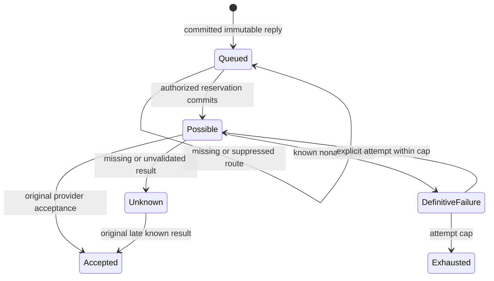

| State | Entered by | Next transitions |
| --- | --- | --- |
| `Queued` | Committed immutable reply | Stays `Queued` on a missing or suppressed route; `Possible` when an authorized reservation commits |
| `Possible` | Authorized reservation, or an explicit attempt within cap | `Unknown`, `Accepted` or `DefinitiveFailure` |
| `Unknown` | Missing or unvalidated result | `Accepted` on an original late known result |
| `Accepted` | Original provider acceptance, or an original late known result | None in the diagram |
| `DefinitiveFailure` | Known nonacceptance | `Possible` for an explicit attempt within cap; `Exhausted` at the attempt cap |
| `Exhausted` | Attempt cap | None in the diagram |

#### Unknown send outcomes

- A possible attempt without a validated result is unknown, even when a crash
  happened before physical invocation.
- Unknown blocks another send and cannot be retargeted by a route change.
- Every explicit eligible invocation has a fresh attempt UUID and provider
  operation UUID.
- Only definitive nonacceptance allows another bounded explicit call.
- I14 owns the stable-key ambiguous resend and reconciliation policy. The separate
  I13 callback boundary owns authenticated provider evidence reduction.
- The outbox never invents a delivered, read, heard or acknowledged state.

#### Outbox upgrade

The upgrade requires a maintenance and quiescence boundary. It is not a seamless
live upgrade. Metadata-first exclusive locking drains existing serving
transactions. Owner validation precedes DDL and does not repair drift. v1 and v2
bytes remain unchanged, and an existing installation or v2 upgrade validates v3
without downgrading it.

The actual lane includes cancellation after earlier v3 DDL blocked on a catalog
name, rollback, an actual isolated pg_dump/psql restore, original
prepared-operation reconciliation and new inbox and dispatch progress on v3.

#### Outbox limits

| Limit | Value | Applies to | Notes |
| --- | --- | --- | --- |
| Replies | 1000 (default) | Persisted outbox cap | Supported maximum 10000 |
| Routes | 256 (default) | Persisted outbox cap | Supported maximum 10000 |
| Attempts | Three (default) | Each reply | Supported maximum five |
| Send concurrency | Two | Each instance | Maximum 4; not a global physical-provider bound |
| Ordinary store operations | Four, sharing two bounded connections | Each instance | None |
| Result and recovery recording | Separate four-slot admission | `recordResult` and `recordRecovery` | A known carrier result is still recorded while ordinary calls are busy |
| Store calls | At most eight, on the two pooled connections | Each instance | Ordinary operations plus recording admission |
| Send waiter | 2 seconds (default) | Each send | Maximum 5 seconds |
| Close | 2 seconds (default) | ChannelOutbox | None |

The [sizing envelope](#envelopes-for-configured-caps) estimates the storage these
caps allow. SQL keeps its finite connection, statement, lock and query budgets. No
hidden queue or retry loop is created.

#### Outbox shutdown and telemetry

ChannelOutbox closes its actual tasks and store. The application separately
closes carrier and inbox resources.

- Ignored provider promises keep their slots beyond a waiter abort or timeout.
- Known late results can persist under the original attempt while the caller
  remains uncertain.
- Logs contain component, event and code only, with at most eight pending
  observer promises.
- Incomplete cleanup fails rather than certifying that remote work stopped.
- Telemetry is observation, not the retained outbox authority.

### Authenticated callback evidence (I13)

I13 adds the server-only `./callbacks` export and the quiesced v4 upgrade. The
[phase handoff](../../docs/work-items/0034-callback-evidence-and-applicability-refresh.md)
records qualification. This local synthetic slice advances P2-10 and P2-12
without registering a complete product row. The SDK provides raw intake, and the
explicit test application owns its bounded HTTP listener. There is no default
daemon or new carrier.

Rows for database tables name the store module that reads and writes them;
`src/migrations.ts` defines the tables.

| Component | Path | Responsibility | Bound or authority | Status |
| --- | --- | --- | --- | --- |
| callback-security | `src/callback-security.ts` | Separate WeakMap-backed callback key, trusted provider scope, raw message authentication code (MAC), strict flat JSON | 4096 bytes, eight keys, 60s envelope window; old inbound SMS domain unchanged | Qualified |
| CallbackInbox | `src/callbacks.ts` | Public accept/inspect, immutable caller snapshots, deadlines/abort/telemetry | Four actual tasks, default 2s/max 5s waiter, 2s close; ignored work retains slots | Qualified |
| CallbackStore | `src/callback-store.ts` | Catalog/role/version checks, immutable correlation, insertion/replay, snapshot reads | Two restricted PostgreSQL connections; no DDL/repair/delete | Qualified |
| callback_settings | `src/callback-store.ts` | Fixed ruleVersion1 and global/per-attempt persisted caps | Default 10000/8, maxima 100000/32 | Qualified |
| callback_admission | `src/callback-store.ts` | Count parity/cap validation under guard | Global admission first; callback growth lock second | Qualified |
| callback_observations | `src/callback-store.ts` | Scoped event identity, original attempt foreign key (FK), receipt, ordinal, canonical/digest/first raw/time | Insert/read only; per-attempt unique ordinal, bounded 32-observation read | Qualified |
| Provider evidence rule | `src/callback-types.ts` | Pure commutative normalized observations plus independent original result | Fixed strongest report/conflict reasons; timestamp never orders authority | Qualified |
| Existing OutboxStore | `src/outbox-store.ts` | New v4 reservation veto and advisory pending filter | Any callback on any bounded prior attempt vetoes; no callback-triggered send | Qualified |

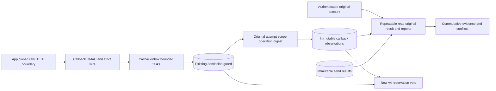

#### Callback intake steps

1. Snapshot raw bytes and headers before awaiting. Authenticate the
   callback-specific domain, provider scope and fresh retry envelope before any
   lookup, even for replay at capacity.
2. Acquire existing admission. Read a fresh database `clock_timestamp()` and
   recheck freshness after the lock wait. Equal semantic event replay returns its
   original receipt. A changed state, message ID or `occurredAt` under that
   identity conflicts.
3. Verify the immutable persisted attempt ID, provider operation key, request
   digest and configured scope. No current phone or route selects a recipient. A
   known send result is optional, which allows callback evidence while a normal
   provider ACK is still pending.
4. Before growth, verify global counter parity and caps and the bounded
   per-attempt count. Acquire `callback_admission` only after admission. Append
   the first authenticated raw bytes and the normalized canonical payload and
   digest with a new receipt and ordinal. Commit before the ACK.
5. Account inspection selects the original result and all observations within one
   REPEATABLE READ transaction. A reassigned sender cannot read another account's
   old history. Delayed legitimate reports may still append to their original
   attempt.
6. New v4 reservations under admission inspect all prior attempts for retained
   reports. Any report can conservatively veto a new call. It cannot enable one or
   overwrite a result. A callback arriving after reservation cannot retract
   admitted network work.

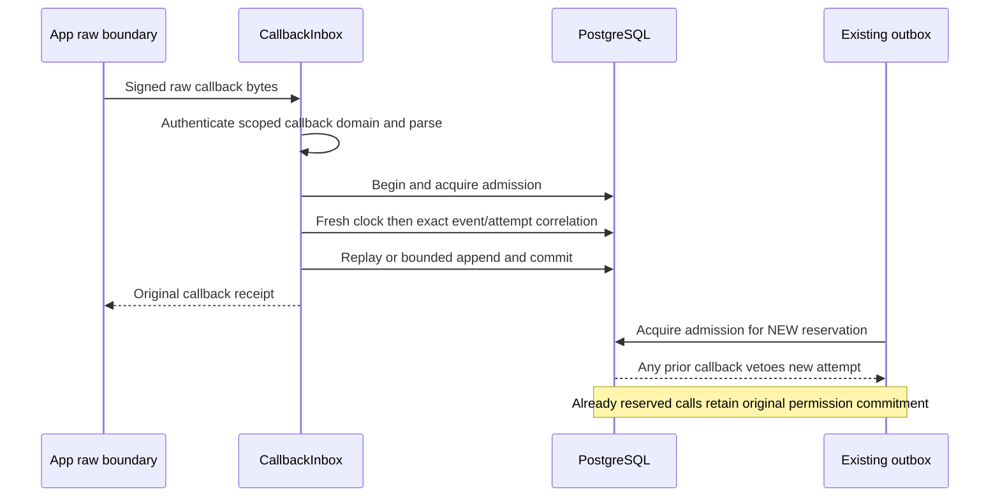

#### Callback wire format and identity

The exact callback schema1 has eight fields: `schemaVersion`, `eventId`,
`attemptId`, `providerOperationKey`, `requestDigest`, `providerMessageId`,
`state` and `occurredAt`.

- The HMAC covers the trusted provider scope and the transport timestamp. The
  signature and retry timestamp are excluded from semantic identity.
- The original `occurredAt` remains part of changed-payload conflict detection. It
  is diagnostic only and never revision or ordering authority.
- Unknown or duplicate fields, invalid UTF-8, noncanonical UUIDs or digests and
  invalid UTC dates fail closed.
- The first raw bytes are retained separately from the normalized semantics.
  Equivalent JSON retries do not rewrite them.
- The generic ChannelEvent and SMS v1 format remains unchanged.

#### Provider evidence rule

| Provider rule | Result |
| --- | --- |
| No callbacks | none; original send result remains separate |
| Reports present | strongestReported ranks read, delivered, failed, accepted, unknown |
| Accepted plus failed | Compatible lifecycle; strongest failed, no terminal conflict solely for these reports |
| Delivered/read plus failed | terminal_reports conflict; retain both |
| Multiple callback message IDs or mismatch with known accepted result ID | provider_identity conflict; IDs are evidence, never ownership |
| Positive accepted/delivered/read against known definitive nonacceptance | send_result conflict; never rewrite original result |
| Any conflict | assessment conflicted even when strongestReported is positive |
| Unknown/failed report | No definitive nonacceptance, consent, human ACK or new-send permission |

#### Callback capacity

| Limit | Value | Applies to | Notes |
| --- | --- | --- | --- |
| Observations | 10000 (default) | Persisted global cap | Supported maximum 100000 |
| Observations per attempt | 8 (default) | Persisted per-attempt cap | Supported maximum 32 |
| Attempt read | At most 32 observations | Each attempt read | None |
| Reservation veto | At most five indexed prior attempts | Each new reservation | None |

The [sizing envelope](#envelopes-for-configured-caps) estimates payload storage at
the default and maximum caps. No scheduler, queue,
tombstone pruning or callback-triggered retry is introduced. At capacity new
facts are rejected, while authenticated original replay and retained reads keep
working.

#### Callback telemetry and errors

Events are `accepted`, `replayed`, `rejected`, `waiter_rejected` and `closed`,
with fixed safe codes. Counters distinguish durable accepted and replayed facts
from waiter rejection, public preflight failures, conflicts and bounded observer
failures and drops. The actual task count survives a waiter timeout.

`WebhookRejected`, `AccessDenied`, `IdentityConflict`, `Overloaded`,
`Unavailable`, `AcknowledgementUnknown` and `CleanupIncomplete` remain finite
exceptions. A possibly committed ACK loss stays uncertain until explicit replay.
Matching current state does not invent original acceptance.

#### Callback upgrade and qualification

The upgrade requires serving quiescence and owner-only advisory and exclusive
locks. An existing v1 installation and the v2 and v3 upgrades validate v4 without
downgrading it. Runtime catalog drift and counter corruption fail closed.

The actual fixture proves:

- populated v3 preservation;
- SQL-cancel rollback after partial new DDL;
- one owned SIGKILL after callback commit and before the application HTTP ACK;
- original replay and both reservation orderings;
- independent SQL and provider facts; and
- populated v4 pg_dump/psql restore and fresh reopen.

The application-owned provider delays a normal known ACK to exercise a callback
that arrives before the send result. These I13 observations alone did not qualify
ambiguous-send recovery. The separate
[I14 design](#explicit-uncertain-send-policy-i14) and its linked handoff record
current selected evidence. Later selected native, communication and rehydration
slices have separate contracts below. Full charter and broader media, UI and load
qualification remain pending.

### Explicit uncertain-send policy (I14)

Qualification is recorded in
[the send-policy handoff](../../docs/work-items/0035-send-policy-and-action-races.md).
The provider-operation boundary is narrower than physical delivery. Queued
acceptance, local invocation, provider report, callback report and human
acknowledgement remain separate facts.

| Objective | Business outcome | Technical rule |
| --- | --- | --- |
| Preserve uncertainty | Avoid an accidental duplicate ordinary reply | Lost ordinary ACK holds permanently; no automatic resend |
| Recover with cooperation | Permit useful explicitly controlled same-key progress | Bind capability/key/digest before first possible call; provider deduplicates exact operation |
| Preserve recipient | Route changes cannot transfer uncertain work | Immutable tenant/account/case/conversation/outbound/address/body |
| Preserve history | Late evidence remains inspectable | Immutable original results, commands, observations and predecessor admission proof |

Rows for database tables name the store module that reads and writes them;
`src/migrations.ts` defines the tables.

| Component | Path | Responsibility | Identity and limits | Status |
| --- | --- | --- | --- | --- |
| send_policy_settings | `src/send-policy-store.ts` | One additional counter row; existing admission serializes new reservations | Fixed ordinary/idempotent policy; 10000 commands default, 100000 max; 8 per-operation default, 32 max; recovery_count | Qualified |
| send_operations | `src/send-policy-store.ts` | Freezes original payload before first possible call; proof binds exact predecessor terminal evidence | Stable provider key, scoped outbound FK, provider namespace/capability, canonical operation ≤32768 bytes, SHA256, first attempt FK; admission proof ≤4096 + SHA256 | Qualified |
| send_recovery_commands | `src/send-policy-store.ts` | Separate trusted controller credential; replay returns original permission without I/O | UUID, exact kind/target/expected attempt, immutable receipt/digest, optional new-attempt FK | Qualified |
| send_recovery_observations | `src/send-policy-store.ts` | Lookup/send/policy source is explicit; old send_results never rewritten | One immutable source/state/assessment/message observation per command | Qualified |
| IdempotentFakeSmsClient | `src/idempotent-fake-sms.ts` | Explicit synthetic capability; no listener, retry loop or real-provider claim | Literal-loopback authenticated send+lookup, 32KiB request/8KiB response/4KiB headers | Qualified |

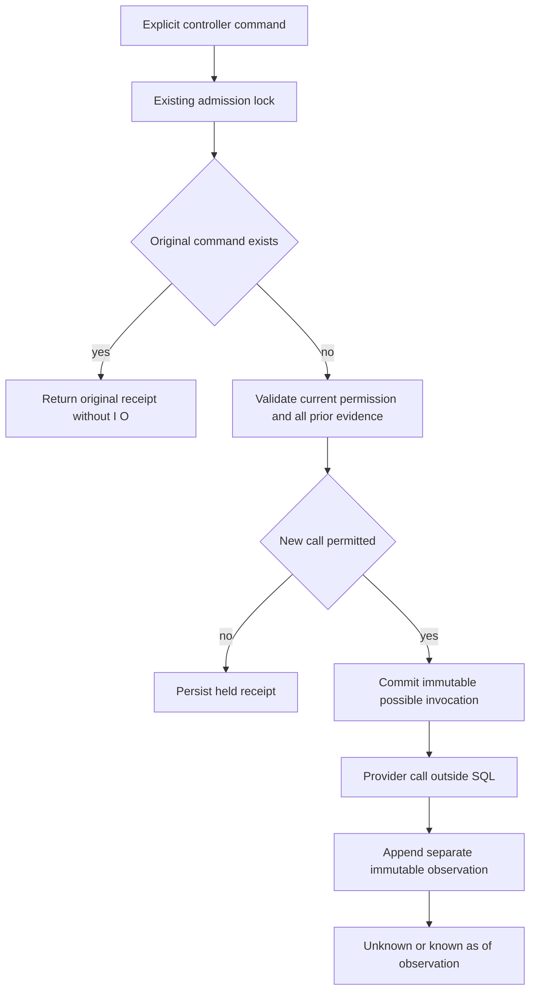

#### Recovery rules

1. An ordinary possible send without a result remains unknown. Neither an
   explicit new command nor a route reassignment converts it into a safe new send.
2. The cooperating capability binds one stable key to the canonical provider
   scope, recipient, response, original address and body. The local attempt ID,
   association epoch and route epoch remain per-invocation observations and are
   excluded from that digest.
3. Before any new call, existing admission serializes the current permission and
   all bounded prior-operation evidence. Accepted or conflicted earlier evidence,
   or any prior callback, vetoes a new call. `pending` is advisory, and the
   reservation commits permission.
4. A network call whose reservation committed first cannot be retracted by a
   later revocation or callback. Historical read and lookup may remain available
   after revocation but cannot authorize I/O.
5. A provider terminal nonacceptance is a durable per-key tombstone. An absent or
   unavailable lookup is unknown. Progress under a new key requires actual
   terminal evidence and a retained immutable witness. A later provider-contract
   contradiction preserves that past fact while holding all future calls for the
   same logical outbound reply.

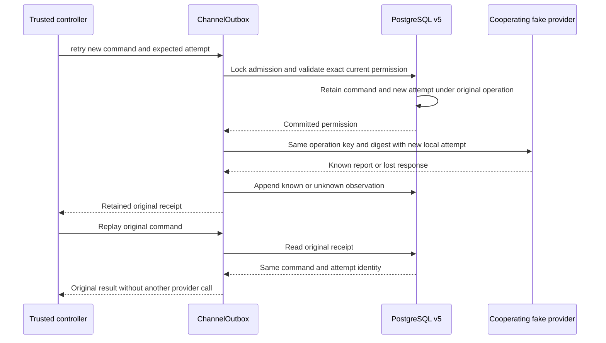

#### Send-policy resources, telemetry and errors

| Limit | Value | Applies to | Notes |
| --- | --- | --- | --- |
| Attempts or operations | At most five | Each reply | Bounds evidence reduction |
| Commands | At most 32 | Each operation | Bounds evidence reduction |
| Sampled provider IDs | At most two | Compact summaries | Original command facts are retained |

- Policy operations share the existing two connections and the outbox store's
  four ordinary SQL tasks. `recordRecovery` uses the store's separate four-slot
  recording admission (see [Outbox limits](#outbox-limits)). There is no second
  queue or pool.
- Separate actual task slots survive waiter abandonment. Application-supplied
  HTTP clients have an independent close.
- Fixed per-code metrics distinguish controller replay and denial, lookup state,
  ordinary hold, callback, permission and prior-evidence vetoes, conflict and
  unknown acknowledgement.
- Exceptions contain fixed codes only. No body, address, token, key or provider
  error text is logged.
- Final monotonic checks include synchronous observers.

#### Upgrade from v4 to v5

The owner-only v4-to-v5 procedure requires stopped writers. Existing v4 attempts
are adopted permanently as ordinary operations. Adoption is bounded at 50000 rows
in pages of 64. The procedure validates the full reply, request, result and
counter relationships and keeps old row bytes.

Only provider-key uniqueness is relaxed, with a composite FK to the new
operation. No old admission column is added. Actual tests must prove partial-DDL
rollback, malformed adoption rollback, populated dump and restore, and fresh
original-command replay without extra sends. Data and receipts remain for the
profile lifetime. There is no time-to-live (TTL), physical pruning or reclaimed
command identity.

### Native text and committed voice intake (I15 and I16)

The selected I15 and I16 composition adds an opaque native publisher and binding
capability and a Python SDK adapter. Its
[phase handoff](../../docs/work-items/0036-native-input-and-deadline-cancellation.md)
owns actual qualification. The same inbox, conversation sequence, processing
intent, prepared plan and cooperating operation remain authoritative. No native
work queue or P1 case replica exists.

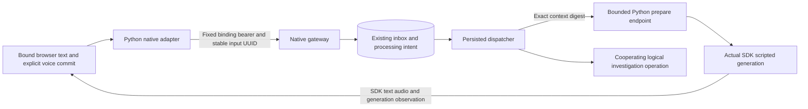

1. Trusted construction fixes the provider, account, case, conversation, room and
   participant. Browser RTC grants and request-body labels grant no inbox
   authority.
2. Native input commits before a reliable acceptance observation. Equal
   stable-input replay returns the original identity. A changed body or modality
   conflicts.
3. Bounded custom text readers replace the SDK's default automatic text input.
   Manual voice capture preserves source-turn provenance and genuine final
   snapshots. Completed-turn hooks always stop automatic replies.
4. The sole persisted dispatcher sends its validated complete context to the
   authenticated prepare endpoint. Preparation waits for input and hook settlement
   and invokes the SDK once for that processing attempt. Generation UUIDs expose
   repeats independently of the logical operation identity.
5. The cooperating operation accepts a stable investigation identity. No model
   text, audio, SDK completion or browser observation grants quote confirmation or
   supplier mutation permission. SDK completion is not proof of human hearing.

#### Native storage (schema v6) and grant lifetime

Version 6 adds only `native_settings` and `native_bindings`. Native input reuses
existing state. Grants and immutable IDs are retained for the profile lifetime.
Retained metadata has these bounds:

| Limit | Value | Applies to | Notes |
| --- | --- | --- | --- |
| Bindings | 64 (default) | Native profile | Supported maximum 1024 |
| Input UUIDs | 32 | Each session | None |
| Generations | 64 | Each session | None |
| SQL operations | Four, on two actual connections | Shared with the existing inbox | None |

The owner upgrade is a maintenance boundary, qualified with deterministic
interrupted-DDL rollback, old-data preservation and populated backup and restore.

Fresh database time, read after the admission and binding locks, fences a NEW
prepare or reservation on expiry or revocation. A later expiry cannot retract an
already admitted external call. Disconnect does not revoke a grant. Known account
history remains separate from a new binding-credential attempt, which may be
denied after expiry. The separate I18 contract owns explicit read-only
continuation and rehydration.

#### Native logs and metrics

- Native logs use fixed event and code pairs and counters, with no transcript, ID
  or credential labels.
- Reliable acceptance and generation events bind the original input, operation and
  room grant. Their messages are bounded and awaited within owned work.
- Metrics distinguish durable accept calls; accepted, replayed and rejected
  inputs; real SDK generation attempts and completions; default reply events; and
  active readers, prepares, intakes and actual recognition work.
- Scripted fixture audio maps only a fixed transcript. General automatic speech
  recognition (ASR), real inference and physical playback require separate
  evidence.
- An interruption request, a generated response and a physical effect stay
  distinct.

The `nativeGenerationAttempts` producer counts dispatched preparation attempts
admitted after input and hook settlement and the first monotonic deadline check.
It is separate from actual model invocations, which the scripted application
records independently. A delayed started-observation publisher can exhaust the
remaining budget. A fresh deadline and closed check then prevents any new SDK
call. Completed replies count only actual successful SpeechHandle settlement.

Observer failures include contained synchronous and asynchronous observer
failures and logging-sink failures. Pending observations and dropped observations
(cap eight) are separate fixed counters. Library import attaches no handlers. The
explicit application sanitizes SDK log fields and exceptions.

#### Native startup

| Limit | Value | Applies to | Notes |
| --- | --- | --- | --- |
| Participant wait | At most 60 seconds | Launch application | Waits for the exact configured, authenticated RTC participant before starting the SDK |
| SDK readiness | Ten seconds | SDK | Unchanged; separate from the application precondition |
| Whole runtime start | Ten seconds | Example | Additional bound |

The launch application registers its event observer before reading the current
participant map and removes it on completion, timeout or cancellation.

A closed startup sidecar records monotonic observations without copying room
tokens or SDK exception text. It establishes the observed ordering and does not
infer why a prior startup failed.

#### Native trade-off and related profiles

The extra native boundary trades explicit trusted application wiring for strong
scope and lifetime control. It does not add a default service or alter the
existing P1 UI or worker. I17 source-qualified communication has its separate
opt-in profile, and I18 read-only current-case context has its separate contract.
Both are described below.

### Source-qualified response and playback evidence (I17)

The [communication contract](COMMUNICATION.md) defines the public API, HTTP
routes and projection meaning. It and the
[I17 handoff](../../docs/work-items/0037-playback-evidence-and-process-recovery.md)
separate implemented behavior from qualification. This subsection records the
design boundaries.

The explicit v7 upgrade adds settings, response anchors and append-only
observations. It preserves old rows and the native v6 protocol. One original
admission lock serializes finite growth. Runtime uses the existing four SQL
operations and two connections. Read projections use repeatable-read snapshots, so
source facts and receipts are coherent as of one database snapshot.

| Component | Path | Responsibility and bound | Authority | Status |
| --- | --- | --- | --- | --- |
| CommunicationInbox | `src/communication.ts` | Immutable input/operation/generation/speech anchor; separately authenticated SDK/browser append; response page 32 and fact page 8 | Evidence only; no case revision/action change | Qualified |
| Native capture | `python/src/channel_continuity/native_capture.py` | Application ContextVar and exact returned handle; queue of 2, 4096 UTF-8 bytes, 256 chunks, 16 text-to-speech (TTS) calls, 8 active SDK tasks | Full generated fact only after actual normal large language model (LLM) exhaustion and closure | Qualified |
| Browser report | `../../apps/local-console/src/p2-native.ts` | Fixed room/caller/response; measured local pulse-code modulation (PCM) audio and explicit client completion claim | Reports its observation; never certifies hearing or business consent | Qualified |
| Projection | `src/communication-types.ts` | Commutative generated/SDK/browser reducer, unknown and contradiction retained | No timestamp winner or automatic retry | Qualified |

1. Persist and acknowledge native input through the original inbox and
   dispatcher.
2. Capture an immutable generation context around the synchronous SDK invocation.
   The registered public LLM and TTS nodes inherit it. They never infer identity
   from a mutable current speech handle. Publish a durable response anchor before
   model source consumption and first audio.
3. Stream bounded source chunks to speech while retaining an independent producer.
   Only actual normal model exhaustion publishes `generated_complete`. Errors,
   overflow and cancellation do not turn a prefix into a full response.
4. Retain actual source tasks beyond a forced SpeechHandle watchdog completion.
   After the nodes drain, record the SDK settlement as completed, interrupted or
   unknown, together with any actual SDK text. A complete, clean, scripted,
   read-only preparation that was interrupted remains known, which avoids
   playback-triggered regeneration.
5. Append browser playback facts to the original response. Missing reports stay
   unknown even when the SDK completed. A response-scoped interrupt requests only
   the captured handle and cannot retarget a later generation.

#### Communication sequences and capacity

Response sequences are contiguous within tenant, account and conversation.
Observation sequences are local to each response. Global counters bound profile
capacity, not account-visible traffic order.

| Limit | Value | Applies to | Notes |
| --- | --- | --- | --- |
| Responses | 1024 (default) | Profile | Supported maximum 10000 |
| Facts | 8192 (default) | Profile | Supported maximum 100000 |
| Facts per response | 16 (default) | Each response | Supported maximum 64 |

Profile-lifetime receipts and event identities are retained without TTL or
pruning. Equal replay precedes capacity checks. New response creation rechecks
fresh grant expiry after locks. Retained original facts can append after expiry
or revocation without creating new work or action authority.

#### Communication metrics and logs

- Nine store metrics cover committed response and fact acceptance and replay,
  admitted SQL rejection, unknown, cap and conflict outcomes, and telemetry
  failure.
- Pre-SQL authentication or shape errors are not advertised as a total rejection
  counter.
- Observer promises have an independent eight-task cap with pending and dropped
  metrics. Application observer resources require a separate close.
- Native capture exports separate finite communication counters and gauges and
  keeps the original eighteen native metrics (`native18`) stable as a compatibility
  subset. Current runtime metrics also include lifecycle and scheduled-reply fields.
- Logs carry fixed event and code fields without IDs, transcripts or credentials.
- A failed write may have committed and remains unknown. Explicit original replay
  reconciles its receipt.

#### Communication trade-off and limits

The design trades per-response metadata for honest source separation. Browser
claims are untrusted evidence. SDK completion is local output settlement, not
physical playback. There is no AudioOutput positional inference, synchronizer
replacement, human acknowledgement feature, case mutation or playback-triggered
retry. Selected I18 current-case reads and their Python profile have a separate
contract below. Broader native workloads, real models and complete P2 release
acceptance retain their gates.

### Read-only current-case context (I18)

The [rehydration contract](REHYDRATION.md) defines the read API, sections and
byte bounds. It and the
[I18 handoff](../../docs/work-items/0038-case-rehydration-and-standalone-release.md)
record selected qualification of this opt-in read model: eighteen storage groups,
three actual media groups and isolated consumers. The read model needs no storage
migration.

#### Context authority and read sequence

- A current native binding, or an exact already accepted signed SMS with the
  current epoch, derives business identity.
- One coherent P2 repeatable-read snapshot precedes a bounded external
  CurrentCasePort call. A fresh protected P2 disclosure check follows.
- No transaction crosses network I/O, and no read creates work.
- P1 public projection normalization excludes quote, confirmation and private
  controls. Inquiry data cannot become mutation truth.
- The sources are observed separately. Disclosure admission cannot retract bytes
  already returned after a later revocation.

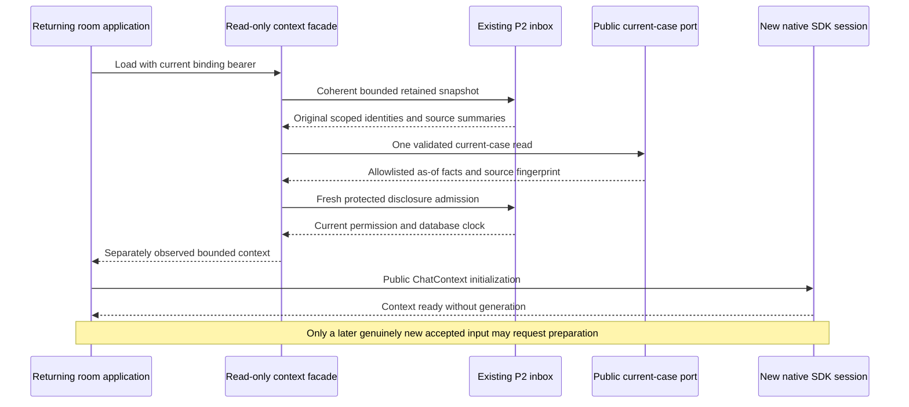

#### Context contents and bounds

Nine closed context sections carry bounded original history, pending references
and inert communication summaries. Separate scope-bound cursors and whole-record
omission keep the total serialized envelope within 64 KiB. Source fingerprints,
case revisions, supplier revisions and section sequences remain distinct.

Old-room responses keep their original anchors and cannot become the new room's
speech controls. New-room input uses a new binding, a fresh input UUID and the
existing dispatcher.

#### Native Python profile and revision zero

The optional Python profile initializes the public SDK ChatContext before
readiness. It uses stable original history IDs and supports an explicit idle
refresh without any acceptance or generation. Prepare checks the loaded
investigation revision, but an equal revision does not prove supplier or workflow
freshness. Data and answers are as of their observed times until refreshed.

Pure CurrentCase reads include revision zero. Existing native dispatch and
communication keep their positive-revision domain. Unsupported native input at
revision zero is denied before acceptance rather than silently rebased or
mutating the case. Complete integrated native domain support remains a release
gate.

#### Context resources and ownership

Two actual facade calls share the existing inbox SQL budget. Current permissions
are checked after the original admission locks, with fresh database time.
Timeouts and close retain actual SQL, HTTP and SDK work, and a deadline is not
proof that a remote read stopped. Observability uses fixed event and code outcomes
and separate context metrics without ID or body labels. The application owns
listeners, adapters, SDK and RTC sessions and current-case clients independently.
There is no default service or paid provider dependency.

#### Context evidence

The prior 0038 checkpoint also recorded these results:

| Proof | Observed result |
| --- | --- |
| Selected Python consumer | 111 tests passed |
| Selected npm consumer | Seven stages passed |
| Compatibility assertions | 166 passed |

Later slices record their own evidence, listed in
[Implementation status](#implementation-status). All seventeen full P2 charter
rows and valid-domain integrated native release remain separately gated.

### Bounded workload observations (I19)

The opt-in [I19 profile](WORKLOAD.md) adds no storage version or processing
owner. WORKLOAD.md defines its schedules, budgets and quantitative
interpretation.

- Two fixed tenant gateways expose the existing bounded HTTP, SQL and dispatch
  behavior.
- A separate dormant stage uses sequential public credential windows of at most
  sixty-four.
- One thousand retained conversations have no per-case live room or agent.
- Current limits are per instance, except the shared persisted claim limit.
- The parent reconciles actual pool and waiter observations and useful
  second-scope progress. It does not derive a global fairness or capacity promise.

#### Workload observer slots

Ordinary ChannelInbox observer promises have eight slots, reserved before user
code runs. The separate communication lane keeps its existing eight-slot budget.
Ordinary pending, dropped and failure values use a new three-key snapshot, and
legacy metrics field sets remain stable. Callback ownership outlives SQL close
until the application settles the injected observer. An inbox never silently
closes a transport. The selected workload distinguishes retained row capacity,
pending processing, display-card eviction and durable replay identities.

#### Workload evidence

The
[0039 handoff](../../docs/work-items/0039-bounded-channel-workloads-and-image-evidence.md)
owns the fixed cohorts, units, command and evidence budgets, selective forwarding
unit (SFU) inventory, graceful same-volume restart, independent operation ledger
and populated two-schema restore.

| Proof | Observed result |
| --- | --- |
| Selected local gate | 24 groups in 81.819 seconds with sixteen owned commands; 1066 original inputs and 68 fake operations preserved across populated restore |
| Current isolated npm consumer | Seven stages |
| Installed Python consumer | 113 unadapted tests in fifteen commands |
| Fresh compatibility run | 187 assertions in eleven serial lanes, with complete cleanup |

The prior source snapshots remain historical evidence. Later human status updates
do not change runtime qualification. Quantitative observations do not qualify
providers, general voice or model latency, the I20 joined UI or complete P2
release acceptance.

### Joined read-only operations (I20)

The [operations contract](OPERATIONS.md) defines the read routes, paging,
process diagnostics and how to run the optional page. The optional operations
profile owns two actual read tasks over the existing inbox transaction and pool.
For each read it:

1. validates a configured native binding and an opaque signed paging cursor;
2. reads the existing repeatable-read P2 projection;
3. observes one public current-case port; and
4. performs the original final protected disclosure check.

Permission is current at that admission point. Later revocation cannot retract
bytes already disclosed. P2 and case observations remain separate and as of their
reads. Pure case revision zero remains readable without enabling zero-revision
native work.

| Limit | Value | Applies to | Notes |
| --- | --- | --- | --- |
| Read tasks | Two actual tasks | Operations profile | Over the existing inbox transaction and pool |
| Context sections | Nine, with the context budget unchanged | Each operations read | None |
| Envelope | 73,728 bytes | Each operations read | At most 8,192 additional bytes, including every signed cursor and framing field |
| Export callback owners | Eight, reserved before invocation | Operator diagnostics | Failures and drops remain visible |
| Producer cause vocabulary | Closed, 76 codes | Operator diagnostics | Includes callback, gateway, outbox and dispatch forms |
| Page requests | At most two actual requests | Operations page client | One retained client across Connect and Forget epochs |

#### Operations cursors and envelope

Cursor signatures bind the trusted application source and profile, the native
binding, scope, section and retained immutable anchor. The application configures
the stable signing key, which never reaches the UI. Cursors page accepted rows,
not a status-event stream. An explicit current refresh observes later states and
replaces a page window. A read failure preserves known facts only with historical
labels. The envelope bound appears in the limits table at the start of this
section.

#### Operator diagnostics

The independent privileged operator diagnostic capability exposes finite process
samples and bounded safe read-span and producer-log observations. It does not
expose account-body labels or authorize case access. The page pauses all updates
on context denial and labels retained diagnostics historical.

- Export callbacks have eight actual owners reserved before invocation. Failures
  and drops remain visible.
- Source-specific maps keep actual producer causes within a closed 76-code
  vocabulary, including callback, gateway, outbox and dispatch forms. Unknown
  fields, labels and accessors cannot enter diagnostics.
- A completion owner is registered before any callback, getter or thenable is
  invoked. A reentrant close therefore drains actual work and cannot admit later
  getters.
- The actual reader owner count is distinct from completed caller spans.
- No OpenTelemetry Protocol (OTLP) wire service, fleet capacity or human
  acknowledgement is implied.

#### Operations page lifetime

The dedicated page keeps a single retained client across Connect and Forget
epochs, with at most two actual requests. Forget immediately removes facts and
credentials, while new admission waits for the old client to close. The
application closes HTTP and read dependencies before shared inbox and current-case
resources. A failed close keeps those owners and private work instead of allowing
dependent schema cleanup.

#### Operations evidence

The
[0040 handoff](../../docs/work-items/0040-operations-ui-and-fixed-policy-evidence.md)
records these selected results:

| Proof | Observed result |
| --- | --- |
| PostgreSQL and read assertions with browser groups | Sixteen assertions and three actual browser groups passed in 13.779 seconds with thirteen owned commands |
| Isolated 105-payload npm consumer | Seven stages passed; the actual consumer phase took 5.704 seconds and offline preparation took 1.208 seconds |
| Fresh compatibility assertions | All 187 passed in 135.933 seconds with complete cleanup, including the prior native, playback and current-case storage and media lanes |

The current Python runtime and its 113-test installed proof are unchanged. The
I21 standalone starter has its own evidence in 0041, described in
[Installed standalone starter (I21)](#installed-standalone-starter-i21). I22's
fresh-agent and integrated release remain planned. No complete charter row follows
from the selected operations view.

### Installed standalone starter (I21)

[STARTER.md](STARTER.md) defines the explicit commands, roles, caps, the compact
32 KiB operation wire and shutdown ownership. The additive public `./starter`
entry and its inert executable compose the existing fifty-one SDK modules. No
existing SDK storage or execution owner changes.

- Explicit private configuration selects a standalone reference authority and a
  separate four-table synthetic external receipt profile.
- Owner bootstrap performs DDL. Restricted runtime roles can append receipts and
  update only three admission counters.
- A profile session advisory mutex excludes routing and a live gateway across
  processes. It stays owned through actual dependent closure. This is application
  lifecycle exclusion, not a workflow lease or supplier fence.
- The operation-only `ExternalOperationClient` configuration accepts an optional
  `callTimeoutMs` (20 to 5,000 ms) for each external call. The default stays
  `STARTER_LIMITS.externalCallMs` (2,000 ms).

#### Starter gateway startup and external receipts

Gateway startup first makes a bounded read-only external-profile observation. It
requires an explicitly routed positive case revision. Revision-zero case reads
remain valid, and the initial owner seed never silently promotes the revision.
History and processing inspection do not require a healthy external provider.

The external receipt store has no pending work, scheduling, retry, lease or
mutation authority. Investigation and idempotent keys replay or conflict before
capacity is checked. Ordinary sends append a new physical-call observation even
for equal attempt bytes. They expose no reliable lookup or resend permission.

#### Starter evidence

The twenty installed standalone assertions and the separate six public-P1
controls keep independent reports. Their observed qualification and current
source boundaries belong to 0041. Follow the
[current handoff](../../docs/work-items/0041-standalone-channel-and-durable-policy.md)
for observed results. Implemented source and controlled tests alone do not
establish complete native, media or release acceptance.

### Original result receipts and current-native reads (schema v8)

The opt-in `./result-receiver` implementation adds `ChannelResultReceiver` and
`ChannelResultReader`. The `./result-receiver-types` export exposes browser-safe
data types. The
[0043 work item](../../docs/work-items/0043-stable-result-delivery-and-return-context.md)
owns the fixed actual schedule.

#### Receiver and reader construction

- The receiver constructor takes the existing outbox, the retained receiver UUID
  and trusted route bindings with separate publisher tokens.
  `accept(token, intent)` and `find(token, intent)` use that publisher capability.
- The reader takes the same outbox, the native inbox, the public `CurrentCasePort`
  and route bindings without publisher secrets. `native(bindingBearer, deliveryId)`
  derives disclosure scope from the original current grant.
- Unsupported identifiers outside the lowercase P3-compatible one-to-64-character
  subset are rejected without truncation or remapping.

#### Result receipt storage (schema v8)

The explicit owner `upgradeChannelSchemaV8` installs one immutable result-receipt
metadata table after v7 and returns the existing outbox receiver UUID. The table
retains the original canonical P1 intent, scope, work, attempt, result digest and
logical recipient, linked to one ordinary reply.

- Metadata insertion and notice enqueue share one protected outbox transaction and
  the existing admission lock.
- The original delivery UUID is the outbound UUID. The linked reply supplies the
  original receipt UUID and accepted time.
- Exact replay precedes capacity checks. Changed original intent bytes and
  collisions with unrelated ordinary reply UUIDs conflict.
- The metadata adds no accepted-work queue, case authority, retry policy or
  scheduler.

| Boundary | Implemented bound or rule | Qualification |
| --- | --- | --- |
| P1 intent | Exact sorted ASCII JSON at most 16,384 bytes; canonical base64 decodes to 1–8,192 bytes with the original result SHA | Shared codec and actual bounded opaque storage checks passed |
| P1 receipt | Exact six original identity/digest/time fields; notice body/envelope digests never substitute for the result digest | Actual commit-before-ACK and lookup-only recovery passed |
| Notice | Fixed ordinary text at most 4,096 UTF-8 bytes; one linked row consumes existing `maxReplies` | Actual atomicity, replay and restored capacity checks passed |
| Shared owner | Existing outbox pool two SQL connections and four actual-call reservations, including external-read waits | Actual SQL lock/held-read/settlement checks passed |
| Facade admission | Receiver at most two active calls; reader one; observer callbacks capped at eight retained promises | Implemented finite admission, containment and incomplete-close tests |
| Native read | Local qualification HTTP request at most 256 bytes; SDK view at most 32,768 bytes; current native grant required before and after the external read | Actual selected revocation, lock-expiry and returning-result joins passed |

#### Current-native read

The reader captures scoped P2 metadata, then releases its SQL connection and
transaction for the public P1 current-case observation. It then takes the
admission and binding locks and checks the same grant with fresh PostgreSQL time
before returning bytes.

The view contains the original intent and receipt and current-case facts. It
carries independent `p2ObservedAt`, `caseObservedAt` and `disclosureAdmittedAt`
times and `atomic: false`. It neither computes candidate eligibility from equal
revisions nor grants new execution, generation, confirmation or send authority.
Receiver acceptance history survives native revocation, but a current-channel
read must pass fresh authorization. Later revocation cannot retract bytes already
disclosed.

#### Result facade deadlines and shutdown

| Limit | Value | Applies to | Notes |
| --- | --- | --- | --- |
| Caller deadline | Two seconds (default) | ChannelResultReceiver | None |
| Caller deadline | Three seconds (default) | ChannelResultReader | None |
| Cleanup observation | Two seconds (default) | Receiver and reader | None |

Actual work and observer promises remain owned after a waiter timeout or incomplete close. Each facade
closes its own admission and observers. The application closes the shared outbox,
native inbox and case resources only after those dependants settle.

V8 serving code executes no DDL. Old APIs and owner upgrade entry points validate
v8 without downgrading it. The ordinary uncertain-send and explicit recovery
policies remain unchanged.

#### Result return qualification

`make p2-result-receiver-plan` starts no resources. `make p2-result-receiver-check`
requires the reviewed restricted local setup. Selected actual qualification passed
sixteen storage and four return assertions, including populated backup and
restore. The work item records separate installed-consumer outcomes.

Old-surface coverage on v8 is limited to outbox inspection, native bind and
revoke, and current-case inspection. Separate compatibility lanes keep their
original profile versions. The high-level, sequence and low-level diagrams keep
their general inbox, outbox and current-case ownership. This opt-in receipt and
read composition does not change that authority or close a full charter row. All
seventeen complete P2 charter rows remain planned.

## Security and privacy

### Controls for every channel

These rules apply to every channel. Their complete negative gates belong to the
planned charter rows in
[Validation and acceptance gates](#validation-and-acceptance-gates).

| Boundary or threat | Control | Test or evidence |
| --- | --- | --- |
| Unauthenticated provider callback | Authenticate provider callbacks and compare their scope against the verified principal | Planned: signature and callback negative fixtures (P2-12) |
| Unassociated end user | Separately associate the end user before case reads or writes, reply routing or rehydration | Planned: association negative fixtures (P2-12) |
| Forged labels or inaccessible callbacks | Reject forged tenant, case and sender labels and inaccessible callbacks without cross-account disclosure | Planned: scope and route negative fixtures (P2-12) |
| Weak confirmation signals | Interim transcription, familiar room names and an SMS yes are not independently sufficient confirmation | Planned: stale or unlinked reply rejection (P2-06) |
| Instructions inside message or model text | Treat all message and model text as data; it cannot grant tools or change the trusted intake policy | None recorded |
| Real data or broad credentials | Use synthetic data, loopback endpoints and least-privilege local credentials | None recorded |
| Sensitive values in diagnostics | Phone numbers, text bodies, signatures, transcripts and tokens never enter logs, metric labels, screenshots or saved diagnostics | Planned: safe log, error and cardinality assertions (resource and operations gate) |

### Boundaries defined by each slice

Each component subsection states its own credential separation and authority
boundary. The main ones are:

| Boundary or threat | Control | Test or evidence |
| --- | --- | --- |
| Provider and account trust in [Verified PostgreSQL intake (I03 to I05)](#verified-postgresql-intake-i03-to-i05) | Provider authentication, LINK association, epochs and the owner and runtime database roles | Selected I03 to I05 qualification |
| Account history versus current sender in [Investigation revision routing (I10)](#investigation-revision-routing-i10) and [Exact response-linked confirmation (I11)](#exact-response-linked-confirmation-i11) | Retained-account access versus current sender association, with no atomic revocation fence | Selected I10 and I11 qualification; complete P2-05, P2-06 and P2-12 remain open |
| Prompt and quote integrity in [Exact response-linked confirmation (I11)](#exact-response-linked-confirmation-i11) | Separate prompt publisher credential and opaque quote bytes | Selected I11 qualification |
| Outbound permission in [Durable replies and ordinary fake sends (I12)](#durable-replies-and-ordinary-fake-sends-i12) | Publisher binding, routes, suppression and the send-reservation commitment point | Selected I12 qualification |
| Callback authenticity in [Authenticated callback evidence (I13)](#authenticated-callback-evidence-i13) | Separate callback key and exact-attempt correlation | Selected I13 qualification |
| Recovery commands in [Explicit uncertain-send policy (I14)](#explicit-uncertain-send-policy-i14) | Separate trusted recovery-controller credential | Selected I14 qualification |
| Native ingress in [Native text and committed voice intake (I15 and I16)](#native-text-and-committed-voice-intake-i15-and-i16) | Opaque native publisher and binding capability; browser RTC grants grant no inbox authority | Selected I15 and I16 qualification |
| Evidence appends in [Source-qualified response and playback evidence (I17)](#source-qualified-response-and-playback-evidence-i17) | Separately authenticated SDK and browser evidence appends | Selected I17 qualification |
| Current-channel disclosure in [Read-only current-case context (I18)](#read-only-current-case-context-i18) and [Original result receipts and current-native reads (schema v8)](#original-result-receipts-and-current-native-reads-schema-v8) | Current-grant disclosure checks with fresh database time | Selected I18 qualification; v8 revocation and lock-expiry joins passed |
| Operator diagnostics in [Joined read-only operations (I20)](#joined-read-only-operations-i20) | Operator diagnostic capability that grants no case access | Selected I20 qualification |

The [Implementation status](#implementation-status) table links the work item
that records each selected qualification.

## Observability

### Implemented producers

P2 inbox, dispatch, gateway, routing, confirmation and outbound-reply producer
events and counters are implemented. Later slices add producers that are
described with their components: callbacks (I13), send policy (I14), native
intake (I15 and I16), communication (I17), current-case context (I18), workload
observers (I19) and operations diagnostics (I20). An exporter remains planned.
Existing safe foundation API events and metrics stay as documented in the
[observability contract](../../docs/observability.md).

| Signal | Producer | Fields or labels | Status |
| --- | --- | --- | --- |
| Allow, deny or association-required decision | Verification/association | Fixed code and request ID | Implemented |
| Accepted, duplicate or conflict event | Durable intake | Approved opaque message/receipt handle, schema and fixed outcome | Implemented |
| Attempt, current revision decision or clarification | Dispatch/case adapter | Stable operation correlation | Implemented |
| Reply acceptance, send attempt or observed delivery state | Outbox/carrier | Callback provenance | Implemented |
| Generated, progress, interruption or playback observation | Native/browser adapter | Source, missing evidence and current route observation | Implemented |
| Telemetry export | Exporter | Not applicable | Planned |

Interpret these signals as follows:

- Verification and association: provider authentication and business-account
  authorization are separate decisions.
- Durable intake: acceptance follows commit; transport receipt alone is
  insufficient.
- Dispatch and case adapter: repeated processing stays visible; a stale reply is
  not current authorization.
- Outbox and carrier: provider send failure differs from unknown physical
  delivery.
- Native and browser adapter: report agent emission and browser playback
  separately; no acknowledgement is fabricated.

### Logging and tracing rules

- Use INFO for normal, replayed and clarification transitions, bounded WARN for
  degraded or rejected service behavior and ERROR for unexpected boundary
  failures.
- Own each failure log once.
- Allowlist safe fields at producers. Never interpolate payloads, raw provider
  exceptions, SQL parameters or chained secret-bearing messages.
- Correlate approved opaque handles through logs and spans, not metric labels.
- Inspect actual exported traces and inject exporter failure with bounded queues,
  retries and shutdown. Telemetry cannot block intake or create a second dispatch
  path.

### Event and log producers by component

Each component subsection holds the detail. Status here describes the producer
code; only the I20 diagnostics producers were covered by a selected gate of their
own.

| Signal | Producer | Fields or labels | Status |
| --- | --- | --- | --- |
| Component, event, operation and code objects | [ChannelInbox](#verified-postgresql-intake-i03-to-i05) observer | Fixed values; no bodies, tokens, SQL parameters or LINK proofs | Implemented |
| Event and code counters and an optional observer | [ChannelDispatcher](#recoverable-investigation-dispatch-i07) | By default no body, token, LINK proof, payload digest or raw exception | Implemented |
| HTTP, poll and close events | [ChannelGateway](#bounded-loopback-gateway-i08) | Fixed event and safe code pairs; default logs carry component, event and code only | Implemented |
| `confirmation_routing` event and code logs | [ConfirmationRouter](#exact-response-linked-confirmation-i11) | No prompt, quote, account, body or credential values | Implemented |
| Component, event and code logs | [ChannelOutbox](#durable-replies-and-ordinary-fake-sends-i12) | At most eight pending observer promises | Implemented |
| `accepted`, `replayed`, `rejected`, `waiter_rejected` and `closed` events | [CallbackInbox](#authenticated-callback-evidence-i13) | Fixed safe codes | Implemented |
| Per-code metrics and fixed-code exceptions | [Send policy](#explicit-uncertain-send-policy-i14) | No body, address, token, key or provider error text | Implemented |
| Event and code pairs and counters | [Native intake](#native-text-and-committed-voice-intake-i15-and-i16) | No transcript, ID or credential labels | Implemented |
| Event and code logs and store metrics | [Communication](#source-qualified-response-and-playback-evidence-i17) | No IDs, transcripts or credentials | Implemented |
| Event and code outcomes and context metrics | [Current-case context](#read-only-current-case-context-i18) | No ID or body labels | Implemented |
| Pending, dropped and failure snapshot | [Workload observers](#bounded-workload-observations-i19) | New three-key snapshot; legacy metrics field sets unchanged | Implemented |
| Process samples, read spans and producer logs | [Operator diagnostics](#joined-read-only-operations-i20) | Closed 76-code vocabulary; no account-body labels | Qualified |
| Finite observer events | [Result receiver and reader](#original-result-receipts-and-current-native-reads-schema-v8) | No body, credentials or arbitrary dependency text | Implemented |

- A ChannelInbox domain rejection stays rejected even when the attempt counter
  commits.
- A synchronous or asynchronous observer failure cannot change a committed result.
- Exporter transport remains future work.

## Metrics

### Planned instruments

Proposed instruments are added together with actual producers. Each slice defines
final names, buckets and finite label enums when it adds its producer. Process
counters are operational views, not authoritative accepted-message counts after a
restart.

| Measurement | Type/unit | Fixed label vocabulary | Producer |
| --- | --- | --- | --- |
| Accepted/duplicate/conflicting input | Counter, messages | channel, event variant, outcome/code | Intake after actual transaction result |
| Acceptance-to-dispatch lag | Histogram, seconds | channel, outcome | Inbox/dispatch observations with qualified timing source |
| Pending/active/rejected dispatch | Gauge/count; counter/count | service, fixed reason | Admission and slot lifecycle |
| Reply send/callback evidence | Counter, observations; histogram, seconds | fake provider variant, fixed state/outcome | Outbox/carrier, preserving unknown state |
| Resumption and route lookup | Histogram, seconds; counter, decisions | channel, fixed outcome | Verified current-case rehydration |
| Dormant/active resource use | Counts and measured CPU, resident set size (RSS) and storage | fixed workload/mode | Seeded experiment report, not per-case metric series |
| Interruption/playback observations | Counter, observations; histogram, seconds | source, fixed state | Native/browser adapter with actual observations |

### Label and interpretation rules

- Keep provider account, tenant, sender, case, message, room and arbitrary route
  out of metric dimensions.
- Report sample counts and missing timing evidence.
- Do not infer comprehension from playback or compute a latency from unrelated
  clocks.

### Implemented process-local metrics

Each producer below reports process-local counters. Metrics for callbacks (I13),
send policy (I14), native intake (I15 and I16), communication (I17), current-case
context (I18) and workload observers (I19) are described with their components.

#### Inbox metrics

`metrics()` reports acknowledged accepted and replayed calls, admitted-operation
rejections, dependency and telemetry failures and active operations. These
volatile counts are not persisted totals or proof of a commit whose
acknowledgement was lost. Database receipts remain authoritative. No placeholder
exporter is added.

#### Dispatcher metrics

The dispatcher exposes fixed event and code counters and an optional observer. By
default it logs no body, token, LINK proof, payload digest or raw exception.
Attempt history and current state are authorized PostgreSQL observations, not
fabricated progress.

- Use receipt and operation identity in a trusted diagnostic context, not as
  metric labels.
- Count dispatched investigation acceptance separately from completed business
  operations.
- Runtime sanitizes malformed adapter error codes before counters or observers.
- Pending telemetry is capped at eight promises.

#### Gateway metrics

Gateway metrics report actual active intake, handler, socket and driver
occupancy; observed accepted, replayed and dispatched calls; poll and HTTP
rejections; and bounded observer failure, drop and pending counts. These are
volatile process observations, not retained totals, logical business completions
or proof that external work has stopped. Default logs contain component, event and
code only. The application owns external observer resources. No exporter or
benchmark result is implied.

#### Revision routing metrics

`RevisionRouter.metrics` reports started, revised, unchanged, conflicts,
clarification, unknown and unavailable counts, actual active calls,
`waiterRejected` and bounded observer failure, drop and pending counts. Completed
events describe observed adapter outcomes. A late known result does not certify an
in-budget caller response. HTTP authority metrics separately count started, known,
rejected, unknown and failed calls and actual sockets. Reference authority metrics
describe its own CAS observations. None of these are durable command receipts,
aggregate tenant series or mutation-completion claims.

#### Confirmation metrics

ConfirmationRouter reports started, accepted, clarification, unknown and rejected
counts, actual active calls and bounded waiter and observer counters. Accepted
counts observed known authority receipts, including replays, rather than unique
effects or guaranteed in-budget caller delivery. PromptRegistry reports known
published and replayed calls, conflicts, lookups, rejections and unknown writes.
Database prompt and command receipts remain authoritative.

Fixed `confirmation_routing` event and code logs omit prompt, quote, account, body
and credential values. A late known receipt can still leave the caller uncertain.
Observer failure cannot alter committed truth.

#### Outbox metrics

ChannelOutbox metrics observe:

- `enqueued`, `enqueueReplayed` and `enqueueConflicts`;
- `routeSelections`, `suppressionObserved` and `controlRejected`;
- `started`, `accepted`, `definitiveFailure`, `unknown`, `held` and `rejected`;
  and
- actual active tasks, `waiterRejected` and bounded telemetry and observer
  occupancy.

Enqueue replay is a historical acceptance fact, not a claim that the reply is
currently queued. Route and suppression counters count known call observations,
including unchanged values. `accepted` counts provider observations, not unique
physical deliveries. Identifiers and addresses are never metric dimensions. The
fake-client transport separately reports actual owned socket occupancy and fixed
known and unknown outcomes.

#### Result receiver and reader metrics

The result receiver and reader expose only actual process-local `metrics()`
fields: `started`, `completed`, `rejected`, `waiterRejected`,
`observerFailures`, `observerDropped`, `active`, `observerPending` and
`closing`. Completed calls may include an original replay or lookup. These
counters are not durable result totals, provider sends or unique deliveries. Their
finite observer events contain no body, credentials or arbitrary dependency text
and introduce no exporter service.

## Exception handling

### General rules

Translate typed domain and adapter failures once into a safe versioned error with
a stable code and bounded retry guidance. The server exports fixed ChannelError
and WebhookError codes. The gateway translates them once into fixed GatewayError
categories without messages, tokens, bodies or SQL. HTTP request correlation
export remains future work. Expected uncertainty is persisted state, not an
excuse to raise a generic retryable exception.

| Failure | Required behavior | Retry/recovery rule |
| --- | --- | --- |
| InvalidEvent / UnsupportedEventVersion | Reject before durable acceptance; exclude submitted values from detail | Correct event/version; no automatic processing |
| AssociationRequired / AccessDenied | Reject without exposing case/history or work | Establish trusted association/authorization first |
| IdentityConflict | Preserve original canonical event/receipt; no replacement | Same original identity/payload only; separate real messages need new IDs |
| RevisionConflict / ClarificationRequired | Do not apply current mutation from old/unlinked reply | Ask explicit current linked clarification through authority |
| Overloaded | Explicit unaccepted outcome; accepted records remain inspectable | Finite retry advice under original identity and caller deadline |
| Store/agent dispatch unavailable | Roll back uncommitted work; reconcile possible acceptance | Recover original durable input; model processing may repeat visibly |
| OutcomeUnknown after send | Record unknown physical delivery and provider capability | Reconcile or follow reviewed resend policy; never invent idempotent send support |
| Cancel/disconnect/exporter/defect | Close owned streams/clients/tasks; preserve accepted state and safe boundary error | Python cancellation propagates; disconnect does not delete input; telemetry failure cannot block delivery |

- Bound TypeScript promises and active registries and Python tasks and clients.
- Catch known adapter errors narrowly. Retain internal causes without printing raw
  exception chains.
- Do not swallow broad BaseException, reject silently in the background or retry a
  provider without bound.
- Tests include cancellation with in-progress I/O, lost responses and safe logs
  and errors containing adversarial secret-shaped input.

### Acknowledgement, schema and cleanup errors

- AcknowledgementUnknown requires replay of the original event and payload, with a
  fresh valid transport signature if necessary. It never permits inventing another
  operation key.
- SchemaMismatch requires owner inspection rather than runtime repair.
- CleanupIncomplete cannot pass shutdown. Preserve the primary safe failure with
  separate cleanup evidence.
- A failed close of the gateway, the dispatcher, the dispatch store or the inbox
  can be retried. The retry observes the retained work again, and each store ends
  its database pool at most once.
- Commit hooks are trusted code-level test barriers, not a browser or
  process-control endpoint.

### Dispatch errors

Dispatch failures use fixed ChannelError categories. Existing
AcknowledgementUnknown semantics apply to lost transaction responses.

| Code | Behavior |
| --- | --- |
| UpgradeRequired | Rejects dispatch on a valid version-1 schema without changing storage |
| OperationConflict | Rejects a wrong case or revision, or a wrong operation scope, key or digest |
| DispatchClaimLost | Prevents stale publication |
| DispatchUnavailable | Reports unavailable or timed-out adapters without raw diagnostics; possible external work remains uncertain |
| CleanupIncomplete | Reports unfinished owned shutdown and never certifies that external work stopped |

### Revision routing errors

- RoutingError contains a finite payload-free code.
- RevisionConflict is a known conditional rejection.
- OutcomeUnknown after a possible revision never means rolled back and never
  triggers a retry.
- Invalid or mismatched known responses are unknown after a possible write.
  Invalid inspection is unavailable.
- The inbox retains the original accepted identity and command bytes. Exact
  current inspection cannot retroactively identify a winning command.
- Errors and metrics do not evaluate adapter-provided code accessors or reflect
  private dependency messages.

### Confirmation errors

- ConfirmationError uses finite safe codes. Invalid prompt or controller data
  never becomes consent.
- A known stale or identity rejection asks for clarification. Malformed or lost
  responses after a possible commitment remain OutcomeUnknown.
- A current eligibility failure is AccessDenied and never falls through to a new
  write.
- Same-command replay is explicit and byte-preserving. There is no automatic
  receipt inference.
- Publisher, lookup, HTTP and SQL failures exclude dependency text and
  credentials.

### Outbox errors

- OutboxError exposes fixed payload-free codes. Publisher or recipient denial and
  invalid input cannot select a route.
- RevisionConflict preserves the original route. Overload rejects new growth while
  receipts, reads and replay remain inspectable.
- A lost write ACK is AcknowledgementUnknown. Malformed or lost possible-send
  responses remain OutcomeUnknown.
- No error is converted into a definitive nonacceptance merely to retry.
- Known late results are retained separately from a caller timeout.
- A failed rollback or uncertain commit retires the connection.
- CleanupIncomplete preserves actual ownership and requires application cleanup.
  It grants no certainty that remote work stopped.

### Result receiver errors

`ResultReceiverError` exposes the finite codes `InvalidCommand`, `AccessDenied`,
`NotFound`, `IdentityConflict`, `Overloaded`, `UpgradeRequired`, `Unavailable`,
`AcknowledgementUnknown`, `CleanupIncomplete` and `Closed`. An uncertain
acceptance never becomes a definitive failure or resend permission. A
current-grant denial reveals no result body. Incomplete cleanup preserves actual
owners and requires explicit cleanup observation before dependency closure.

Callback exceptions are listed in
[Authenticated callback evidence (I13)](#authenticated-callback-evidence-i13).

## Design considerations and trade-offs

| Decision | Benefit | Cost or limit |
| --- | --- | --- |
| Durable inbox around native LiveKit transport | Recoverable application acceptance/history while reusing media/text SDK | Requires explicit committed-input handling; duplicate default dispatch must be disabled |
| Scoped provider identity, not text dedupe | Correct provider retry behavior and distinct repeated user messages | Canonicalization/versioning and retained replay evidence require care |
| One case authority with conditional revision | Stops cross-channel confirmation races | No invented global channel order; conflicts/clarification are user-visible |
| Separate communication evidence | Honest partial/unknown playback and delivery | More UI fields and provider-specific callback interpretation |
| Fake carrier and standalone ports first | Credential-free local reproduction and small package boundary | Does not establish real-carrier interoperability or physical-delivery guarantees |
| Bounded cursor projection/current console | Inspectable smooth transitions from real observations | Framework rewrite/custom event bus is optional, not a prerequisite |
| Persistent dormant cases without live rooms | Resources follow active interactions rather than history count | Reactivation must reauthorize and rehydrate current facts explicitly |

Slice-specific trade-offs appear with their components: the global intake
admission guard ([I03 to I05](#verified-postgresql-intake-i03-to-i05)), the
explicit native boundary
([I15 and I16](#native-text-and-committed-voice-intake-i15-and-i16)) and
per-response communication metadata
([I17](#source-qualified-response-and-playback-evidence-i17)).

## Validation and acceptance gates

Use the [validation plan](../../docs/validation-plan.md), the
[harness guide](../../harness/README.md) and the [README](README.md) for verified
commands. Complete P2 charter and release gates remain incomplete. Implemented
contract and intake checks contribute only their stated narrow evidence. Each task
names normal, fault and useful-progress assertions, a finite timeout and cleanup,
and expected artifacts.

| Gate | Required executable evidence | References |
| --- | --- | --- |
| Contract and identity | Shared Python/TypeScript positive/negative schemas; concurrent replay; metadata-only retry; changed destination/content conflict; identical text under distinct IDs retained | P2-01, P2-02 |
| Input recovery | Kill gateway after receipt/before dispatch; kill agent during processing; new process recovers original input with stable business acceptance and visible attempts | P2-03, P2-04 |
| Authority and account | Barrier-controlled competing revisions; stale/unlinked reply rejection or clarification; valid reply progresses; invalid signature/association/scope cannot disclose or mutate | P2-05, P2-06, P2-12 |
| Delivery | Replayed/reordered correlated callbacks; ordinary success and definitive failure; fake send succeeds then response is lost without safe idempotency | P2-10, P2-11 |
| Actual media | Real browser audio interruption, disconnect before playback evidence, voice/chat/fake-SMS resumption after room closure and one committed text/audio path | P2-07–P2-09, P2-15 |
| Resource/operations | Declared burst/saturation plus second admitted account; 1,000 dormant records; same-volume restart; safe log/error/cardinality/exporter-outage assertions | P2-13, P2-14 and operational contributions |
| Package and handoff | Isolated npm consumer runs full standalone history/fake delivery/recovery without P1/P3 deployment; fresh agent finds contracts/checks without hidden setup | P2-16, P2-17 |
| Local-ready release | All required local assertions, supported-platform evidence, actual local media, public P1 integration, migrations and installed-consumer rerun | All 17 rows and shared gates |
| Portfolio-ready release | Separately labelled selected real-model voice/text outcomes/configuration/costs and success/failure demo | P2-I22 and portfolio policy |

- Register an acceptance runner only after its whole charter assertion exists.
- Missing, skipped, timed-out or zero-test evidence remains non-passing.
- A text-only or native-frame test cannot close a browser playback gate. A
  scripted media run cannot support a live-model quality claim.
- Record assistance and remaining limits.
