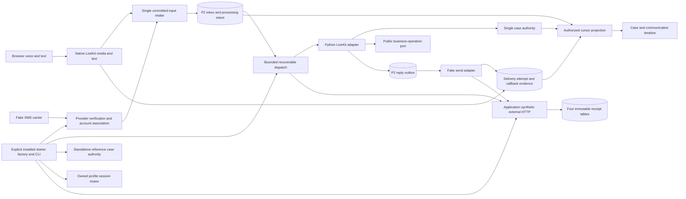
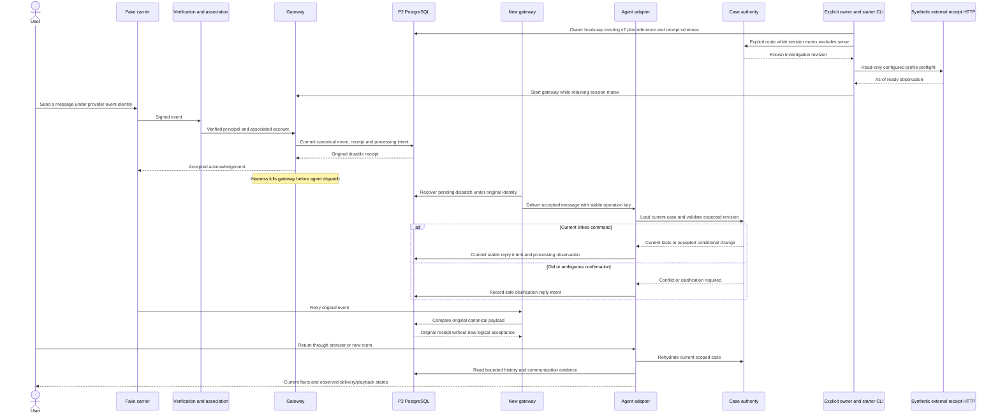
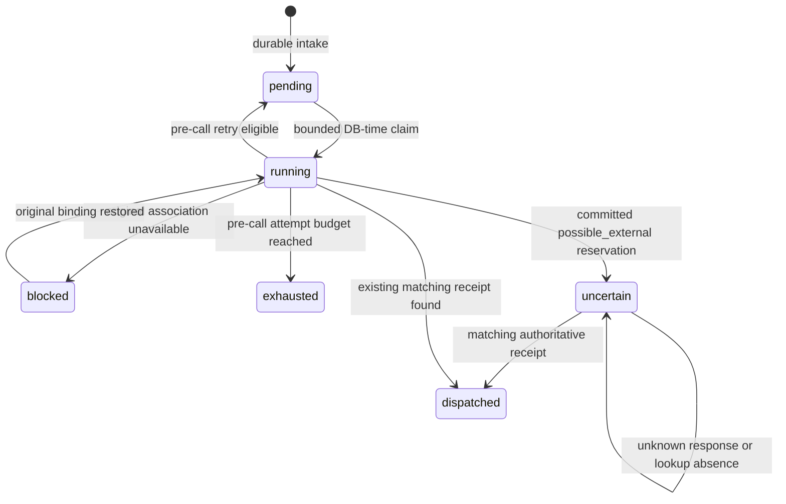
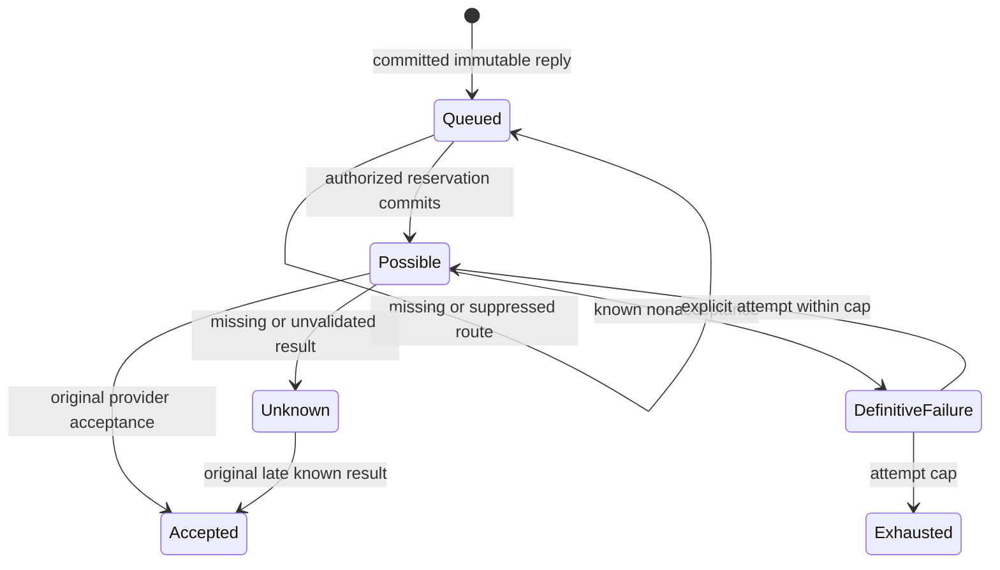
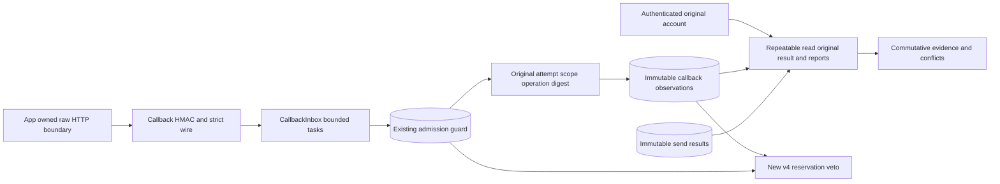
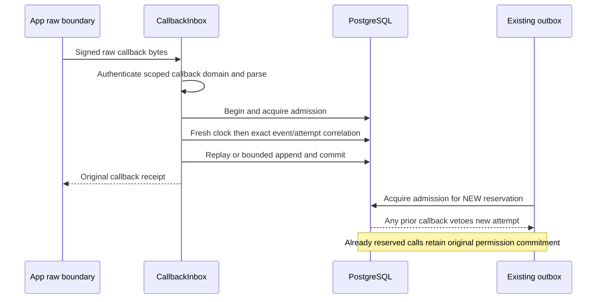
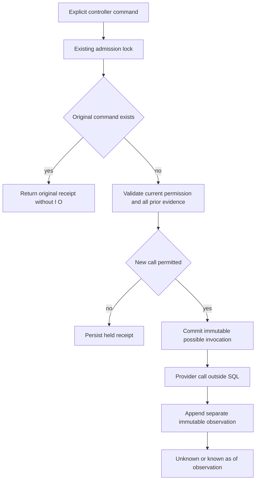
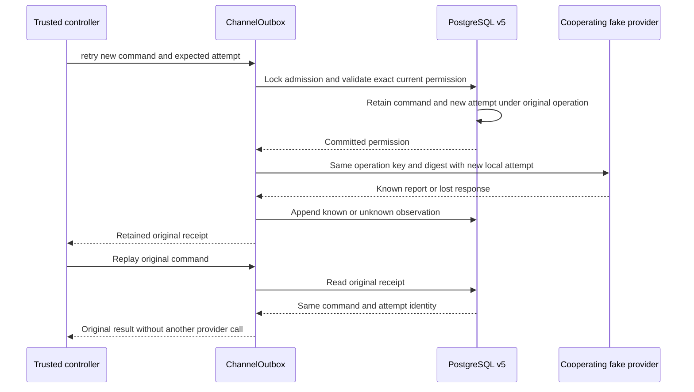
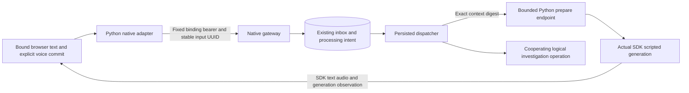
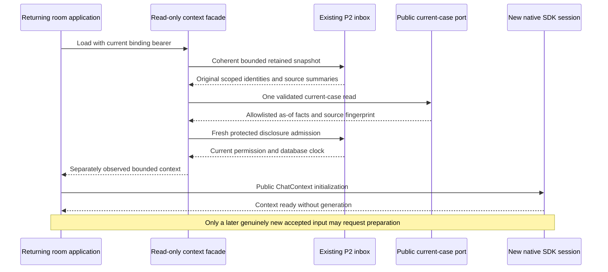

# Channel Continuity Kit design

Status: Active
Last reviewed: 13 November 2026

## Overview

P2 will provide a TypeScript continuity package/gateway, a narrow Python LiveKit
adapter and browser example that preserve one verified case across voice,
browser text and simulated SMS. The
[charter](../../docs/projects/channel-continuity-scope.md) owns P2-01 through P2-17;
the [shared design](../../Design.md) owns common authority; the
[granular plan](../../docs/implementation/p2-channel-continuity.md) owns task order.
The first version-1 data codec and text producer are implemented; SMS intake and a bounded investigation-dispatch step are implemented; selected native intake/generation composition is implemented with separate qualification; explicit investigation revision routing is implemented. These are application contracts,
not LiveKit SDK APIs.

The existing console, pinned toolchain, local stack and M1 intake remain separate
foundation components. I01/I02 contracts and I03/I04/I05 verified fake-SMS inbox
are implemented. The I08 bounded loopback gateway and acknowledged-input restart path are
implemented. I09 adds a scope-bound owned Node process adapter, visible repeated
scripted attempts and live-gateway recovery after agent death. I10 adds explicit
investigation request CAS through one selected standalone or P1 authority.
I11 adds immutable response/quote bindings and exact linked-user confirmation
through public P1 authority, with a late original-association preflight. I12 provides
the explicit outbox/ordinary fake-send path; I13 adds authenticated callback evidence
and I14 adds explicit uncertain-send recovery with immutable provider operations.
The separate opt-in native/browser composition preserves the existing authority. Selected response/playback evidence and current-case read/profile have their separate contracts below. Complete product scenarios retain later gates. The required
integrated example uses self-hosted LiveKit and fake SMS; real carriers and Cloud
are optional, and P3 is not a dependency.

The [0043 result-return seam](../../docs/work-items/0043-stable-result-delivery-and-return-context.md) implements an explicit owner v8 upgrade, atomic original result receipt plus
notice, and a separate current-native-grant read. Selected actual PostgreSQL
qualification passed sixteen storage/four return assertions, including restored
state. The linked work item records separate installed and shared outcomes.
Result metadata shares the existing outbox owner and cap. It adds no accepted-work
queue or case authority. New reads release SQL around the external public P1 read
and recheck disclosure permission under locks using fresh database time.

## Objectives

| Type | Objective | Evidence of achievement |
| --- | --- | --- |
| Business | Continue a verified request after a room closes or the channel changes | Same case/current revision, relevant history and pending work references load into the returning interaction |
| Business | Tell the user what communication actually happened | Separate generated, native progress, client playback, carrier delivery/read and explicit acknowledgement observations |
| Business | Prevent stale or ambiguous replies from authorizing a different action | Old confirmation is rejected; unlinked SMS yes requests clarification; current linked reply still progresses |
| Technical | Persist accepted input before acknowledging it | Crash after acknowledgement/before dispatch recovers the original receipt and stable operation identity |
| Technical | Expose independently usable typed contracts | Full fake-carrier example works from an isolated installed npm package without P1/P3 services |
| Technical | Bound processing and dormant-case resources | Saturation/cleanup evidence with no permanently active room or agent per dormant case |

## Functional requirements

| Type | Requirement | Planned mechanism | Acceptance reference |
| --- | --- | --- | --- |
| Technical | Canonical scoped event acceptance and changed-payload conflict | Runtime-validated versioned union; PostgreSQL inbox/processing intent; stable original receipt | P2-01, P2-02 |
| Business and technical | Recover accepted input after gateway/agent failure | Durable dispatch replay preserving operation identity; processing attempts remain observable | P2-03, P2-04 |
| Business | Resolve competing changes and exact confirmation | Expected revision through the single case authority; linked response/revision or clarification | P2-05, P2-06 |
| Business | Preserve interruption, unknown playback and channel continuity | Consume native SDK behavior plus source-qualified communication records and current-case rehydration | P2-07–P2-09 |
| Technical | Preserve send/callback history and uncertainty | Stable reply intent, provider attempt correlation, deduplicated callback interpretation | P2-10, P2-11 |
| Business and technical | Protect associated accounts and bounded service resources | Provider verification distinct from user association; scoped queries and explicit admission policy | P2-12–P2-14 |
| Technical | Ensure one native text/audio acceptance path and usable package | Custom committed-input intake; disable duplicate automatic dispatch; standalone and fresh-agent evidence | P2-15–P2-17 |

## Non-functional requirements

These are proposed release targets, not measured latency/capacity promises. Fix
workload budgets and finite limits before a benchmark rather than after seeing it.

| Property | Target or invariant | Verification | Status |
| --- | --- | --- | --- |
| Durable receipt | Zero lost acknowledged logical input in each declared crash schedule | Owned gateway/agent process kill and independent-process recovery | Planned |
| Identity | One original receipt per scoped canonical event; two distinct identical-text messages remain distinct | Concurrent replay, metadata-only retry, altered payload and new-ID fixtures | Planned |
| Authorization | Zero cross-account history/work disclosure or unauthorized case changes | Signature, association, scope, callback and route negative fixtures | Planned |
| Communication honesty | Missing playback remains unknown; no one-physical-SMS promise after non-idempotent lost response | Actual browser disconnect/interruption and persisted fake-carrier effect ledger | Planned |
| Resource bounds | Configured positive queue/pool/active/retry/input/page/export limits; explicit pre-acceptance rejection | Seeded saturation, large input/page tests and shutdown inspection | Planned |
| Dormancy | Dormant records require zero active room/agent allocation per case | Resource comparison at 1,000 seeded dormant cases | Planned experiment |
| Compatibility | Python/TypeScript agree on every shared valid/invalid versioned fixture | Both decoders and public adapter contract tests | Planned |
| Accessibility | Keyboard, reduced motion, empty/error/unknown states and responsive reflow remain usable | Browser flow review on the actual joined projection | Foundation and selected operations UI verified; complete conversation UI gated |
| Reproducibility | Standalone installed consumer, preserved-volume upgrades and actual supported-platform runs | npm-pack isolation, restart/migration and macOS/Linux evidence | Selected local installed consumers implemented; complete supported-platform/native release planned |

## Back-of-the-envelope calculations

Illustrative inputs below establish test sizes only. They are not configured
production defaults or evidence that the gateway can sustain the computed rate.
Measure real schema/index/WAL growth and processing distributions before sizing.

| Quantity | Assumption and calculation | Implication to test |
| --- | --- | --- |
| Active processing | 2 accepted messages/s × 1.5 s mean scripted processing = 3 active dispatches | Four dispatch slots is a useful first experiment; bursts, retries and slow models need explicit admission/queue policy |
| Dormant storage | 1,000 cases × (20 messages × 2 KiB + 10 delivery records × 1 KiB + 4 KiB routing metadata) = 52.7 MiB raw | A 3× illustrative data/index allowance is 158 MiB; WAL, tombstones/backups and case-authority storage are additional |
| Callback traffic | Ten replies/s × three observations/reply = 30 observations/s before provider retries | Callback dedupe/reordering and bounded event/history reads need measurement independently of message acceptance |
| Browser projection | Page limit 50 records × assumed 1 KiB/record = 50 KiB/page; ten active viewers refreshing every 2 s = about 250 KiB/s before protocol overhead | Pagination/refresh limits are proposed experiment settings, not a required polling frequency; idle viewers should not generate unbounded work |
| Starter operation wire | 4,096 NUL characters expand to 6 × 4,096 bytes in canonical JSON and 7 × 4,096 bytes in its enclosing string; all other identifiers use their supported maxima in the regression | Compact single canonicalPayload plus version/digest fits 32,768 bytes; the next byte rejects before acceptance. This bound is declared, not observed load capacity |
| V8 original-result metadata | Illustrative 10,000 result-bearing replies × the 16 KiB canonical-intent bound = 156.25 MiB of additional intent text | Result rows share `maxReplies` with ordinary replies. This is an upper-bound sizing assumption, excluding reply/notice rows, metadata, TOAST/index/WAL, P1 results and backups. The actual eight-reply gate proves admission, not storage capacity |
| Media and live inference | Start with one actual scripted browser voice session and one fake-SMS path | Text success does not establish playback; real inference adds separately measured model usage, latency and cost |

Raw audio/video is carried by LiveKit tracks, not this durable text-event history.
Define retention/replay horizons before cleanup; do not reduce measured growth by
silently deleting receipt/delivery protection. Dormant-case storage does not imply
one running room per case or distributed LiveKit media capacity.

## High-level design

The planned flow separates provider trust, durable input, current case authority,
native media and delivery evidence. Existing console/RTC infrastructure is reused.

1. Provider verification authenticates an integration account; a separate trusted
   association adapter establishes the business account. Neither room name nor
   caller-supplied scope grants case access.
2. One committed-input path validates/canonicalizes an event and commits its stable
   identity/destination/processing intent before returning a durable receipt.
3. Dispatch can repeat after failure. It preserves the original business-operation
   identity; repeated model processing is visible and is not promised to happen once.
4. The agent loads current authority facts and bounded relevant accepted history.
   Competing changes use expected revision; an old or unlinked confirmation cannot
   silently approve the latest request.
5. Stable reply intent precedes send. Callback history preserves attempt provenance
   and provider-specific interpretation; missing acknowledgement can be uncertain.
6. UI lanes show actual input acceptance, native output progress, client playback
   and carrier observations. They never convert generated text into played text,
   comprehension or mutation consent.

## Sequence diagram

The gateway ACK/kill/durable-selection prefix below is implemented and tested with
actual processes and sockets. Native composition, exact confirmation association
and reply/callback/send recovery have separate implemented profiles and qualification;
selected current-case room resumption is qualified in I18. The diagram grants no physical SMS deduplication or
one-model-invocation guarantee.

## Low-level design

ChannelGateway and ChannelDispatcher have the implemented methods shown below.
The general continuity facade remains planned. I12 adds the explicit outbox and ordinary fake-carrier surface described below; I13 callback evidence is separate from I14 ambiguous resend policy. Preserve
variant-specific payload validation rather than collapsing modalities into text.

## Components and related details

### Implemented standalone intake and read-only preview

The ./standalone public subpath requires explicit inbox, case, scripted-agent and
operation-inspection ports plus a trusted provider/account/conversation/case
binding. Missing adapters fail before input. accept delegates to the real durable
inbox; preview is a separate authenticated read. Case reply scope/ID/revision,
agent revision and the original persisted operation key are validated at runtime.
No callback receives mutation consent or invokes business execution. The output
keeps the durable processing intent pending and labels the fake operation
not_executed/durable false; that flag describes the inspection-only fixture,
not the persistence of the inbox receipt or processing intent.

The default preview limit is two active calls (configurable one through four),
with a two-second whole-preview deadline (20 through 5,000 ms). Check monotonic
time before/after every awaited stage and before returning success, so a delayed
timer cannot certify late results. Signals request cooperative stop; they cannot
preempt arbitrary synchronous adapter code. A timed-out adapter retains its slot
until its actual call settles, and no later stage starts after timeout/close.
Cleanup defaults to one second (20 through 5,000 ms); uncooperative work produces
CleanupIncomplete instead of a false clean report. activePreviews observes the
owned slots rather than generated progress. There is no pending-memory work queue.

The helper closes only its preview resources; the caller owns the supplied
ChannelInbox and in-flight intake lifecycle. The example attempts both cleanup
paths. Failed preview does not undo acceptance or request business cancellation.
Unknown intake acknowledgement preserves the original retry identity. Fixed safe
errors never include raw adapter/provider exceptions, account tokens or proofs.

The examples/fake-carrier.ts consumer imports declared public package paths. Its
local wrapper builds current source, accepts input, then runs a fresh process to
replay and inspect the same receipt/operation key against actual PostgreSQL.
Example-only output contains a strict safe projection of actual observations;
normal full-store qualification remains separate. The case/agent/operation
adapters are explicit synthetic read-only fixtures. Actual channel dispatch,
carrier delivery, native media and isolated artifact-release qualification each
have separate gates; none follows from this preview example.

### Implemented bounded loopback gateway

The ./gateway export composes the real raw authenticated ChannelInbox boundary
and ChannelDispatcher from explicit database/integration/account/adapter settings.
Only configured account credentials select bounded due input; raw JSON cannot
choose a worker scope. Startup validates existing v2 through a finite observation
budget and never migrates or repairs storage. The actual eligibility query is a
read observation; step performs the protected association/epoch/time checks.

One serial driver rotates account bindings and reads at most the remaining batch
(1–16, default four). A two-second tick budget is checked before each next scan,
with a 20–1,000ms cadence (default 100ms). Due selection excludes active leases,
future retries, blocked/exhausted/dispatched rows and exhausted uncertain attempts.
Claiming still revalidates all conditions; this does not fence physical external
execution. No memory queue owns acknowledged work. Normal active ingress cannot
starve dispatch. The trusted ACK test hook temporarily gates polling so the actual
HTTP200/kill-before-dispatch schedule is deterministic; no wire field selects it.

The literal-loopback server has 16 sockets, four active requests, 16 raw header
fields/8KiB, one-second header/response and two-second body budgets. It requires
finite Content-Length, caps raw input at 32KiB and output at 16KiB, closes each
connection and rejects duplicate/pipelined/transfer-encoded requests. GET receipt
reads require the account bearer; health reports driver state without claiming
model, carrier or business readiness. Startup defaults to five seconds and close
to two seconds; both check monotonic elapsed time, retain ignored work and observe
actual resource retirement. A rejected or late bind initiates owned cleanup.

The three real gateway cases use owned runtime-only child environments, real
loopback HTTP and PostgreSQL plus typed synthetic case/scripted agent ports and
a separately persisted cooperating operation fixture. They show normal progress,
a fully flushed acknowledgement followed by SIGKILL before any prepared plan or
external call, fresh-process recovery/repeated replay, scoped reads and progress
after blocked input. They qualify I08 only. Agent-process recovery and investigation
routing have separate I09/I10 gates; native media, callback/resend qualification and complete charter
gates remain pending.

### Implemented version-1 codec boundary

The TypeScript package exports five event variants, scoped principal/event types,
a real text producer, strict JSON decoder and canonical event/identity accessors.
The Python workspace member exports equivalent decoding/production and immutable
data. The general ChannelContinuity interface remains planned; the explicit I12 outbox is separate; the separate
server ChannelInbox now implements SMS receipts and scoped history.
Shared fixtures in contracts/channel/v1.json compare actual producer output and
both decoder results. No codec method acknowledges acceptance or grants authority.

The wire bound is 32 KiB, text/played text is 4 KiB UTF-8, identifiers are at most
128 ASCII bytes and signature observations at most 256 UTF-8 bytes. Containers
have at most 64 members and depth eight. Producer preflight also has a global
256-node/32 KiB aggregate UTF-8 budget, charged on every shared-child visit; large
strings fail a cheap length check before encoding. Reject duplicate keys before projection,
unknown fields/versions/variants, lone surrogates, non-integer numbers, booleans as
revisions and integers outside zero through 9,007,199,254,740,991. UTC timestamps
use exact millisecond Z form and valid calendar dates. These configured codec
limits are not gateway throughput or media capacity claims.

Canonical JSON uses sorted known ASCII keys, no insignificant whitespace, ASCII
escaping with lowercase UTF-16 escapes, and exact integer decimal form. Identity
is the canonical tenant/provider/provider-account/event-ID tuple. Canonical event
semantics retain payload, account/case/conversation destination and occurredAt;
receivedAt, signature and retryCount are observations excluded from comparison.
This computes comparison bytes only; the separate server PostgreSQL path now
owns verified fake-SMS durable replay/conflict. New event IDs remain distinct even with identical text.

TrustedPrincipal is separate caller configuration. The implemented SMS path
builds it from authenticated scope and the protected current database binding. The codec validates provider/account matches; it does not prove webhook
authenticity, current association, case authorization or mutation consent. A
provider-only event cannot attach an account or reference a case. Producers reject
unsupported/cyclic runtime data with fixed payload-free ContractError codes.
Returned data is immutable; downstream code must decode untrusted boundary data,
not accept caller-created decoded objects as authority. No runtime telemetry or
persistence is fabricated for this pure data component.

| Component | Responsibility and authoritative state |
| --- | --- |
| TypeScript package | Versioned event discriminants, canonicalization, typed receipts/errors/history and adapter contracts |
| Gateway/store | Inbox, processing intents/attempts, reply outbox, provider identities, communication records and bounded queries |
| Association adapter | Verified mapping from provider sender/account to business account; ProviderScope never substitutes for AccountScope |
| Case authority | Sole current revision/confirmed-facts authority; standalone adapter follows the same fixtures as integrated authority |
| Python LiveKit adapter | Loads scope/current context, dispatches accepted input and consumes native conversation/interruption observations; no supplier scheduler |
| Carrier adapter | Seeded fake signature verification, send attempts, callback provenance and explicit capability-dependent uncertainty |
| Browser/read projection | Native controls, receipt states, safe current-case/history pages and source-qualified playback reports |
| Business-operation adapter | Standalone fake port or public P1 interface preserving stable logical operation identity; no copied supplier state |

### Implemented verified PostgreSQL intake

The default npm entry stays browser-safe. Server-only ./security, ./postgres and
./migrations exports own HMAC and the pg client. Authentication binds trusted
provider scope, timestamp and exact bytes. Account association is separate:
a seeded account token creates a 60-second challenge, consumed only by a signed
LINK carrying that exact ID/secret from the intended sender. Store only its digest
and decision metadata; never enroll the proof as a business message.

Eight owned tables hold metadata, admission counters, sender heads, versioned
bindings, challenges, conversation sequence, inbox and processing intents. A
persisted guard serializes retained-cap checks and atomic receipt/intent insertion.
Revocation and reassignment advance epochs and invalidate older challenges. A
reassigned sender cannot replay/read the previous account's receipt; original
account ownership of history persists. acceptedAt is a database-time observation
within the transaction, not an independently measured commit timestamp. Return
acceptance only after commit; scoped sequence grants no business authority.

Each instance admits at most four operations to two connections. Connect/lock
limits are 1.5 seconds, statements three seconds, driver query/idle transaction
limits five seconds, and idempotent close drains admitted work under six seconds.
Owner-client close has a 1.5-second bound. Use parameterized asynchronous queries,
one checked-out client per transaction and no external call while holding locks.
Catalog inspection is batched. The global guard favors local correctness; measure
contention before replacing it with per-scope admission or partitions. Configured
bounds are not production throughput/latency measurements.

Catalog-only metadata preflight rejects executable views, RLS, triggers/rules,
unsafe grants/expressions and incorrect column shape before row reads. Catalog
comparison includes all serving relations, defaults, constraints, indexes, column
grants/collations and RLS/triggers/rules. Runtime cannot change the saved baseline;
existing-schema installation validates rather than repairs. The migration owner
is trusted and can manually rewrite both data and baseline: this does not defend
against a malicious owner. Such changes are outside the supported protocol.

Default retained caps are 1,000 inbox rows, 512 challenges, 256 bindings and 128
sender heads per schema; owner configuration permits 1–10,000. No runtime deletes
core receipts or epochs. Authorized replay and inspection precede new-growth
rejection. The owner is continuity_migrator; livekit_lab has narrow DML without
DDL or canonical UPDATE/DELETE/TRUNCATE. This shares the local P1 credential and
does not establish independent database principals. Split principals before a
separately exposed P2 deployment. A bounded investigation dispatcher is described
below; complete callback/resend qualification, broader agent composition and media remain planned. General ChannelContinuity remains a future interface; ChannelInbox now
provides the distinct implemented DurableReceipt/StoredMessage/history API.

### Implemented recoverable investigation dispatch

The server-only ./dispatch export provides ChannelDispatcher with one explicitly
requested step, lookup-only reconcile, authenticated inspect, finite counters and
idempotent close. No P1/P3 application or LiveKit runtime is imported. Case and
scripted-agent ports can only prepare an investigation; the cooperating operation
port must advertise stable_idempotency_and_lookup. Schema-valid output is not
mutation authority. dispatched records durable acceptance by that investigation
port and never asserts completed business work or delivered communication.

Version2 adds dispatch settings, an immutable prepared-plan row and at most three
default attempt rows per original receipt. It extends processing intent with
claim owner/epoch/deadline/kind, attempt count, due time, possible_external and
external receipt. The explicit owner upgrade validates and locks version1 before
DDL in one transaction, preserves accepted rows and changes the catalog baseline
only for that recognized transition. Existing version2 requires the same limits
and exact catalog. Runtime does no DDL, canonical update/deletion or baseline
refresh. The original install entry creates version1 and never silently upgrades.
Owners quiesce serving processes and retain a restorable database backup before
upgrading retained deployments. Current disposable tests establish identity
preservation and drift rejection; production backup/restore rollout remains a
separate operational qualification.

The persisted admission guard serializes claim/count decisions. DB time is read
after row/binding locks; an unexpired owner prevents a second claim. Expiry permits
a higher epoch and closes the prior attempt as lease_expired. A stale owner cannot
prepare, reserve, fail or finish a newer claim. No external port runs inside a
transaction. The first prepared scope/case/revision/scripted plan and original
message form a bounded 32KiB canonical JSON string with SHA256 digest; retries and
takeovers reuse it without regenerating a changed case plan under the same key.
The current association must still match the original account/conversation/case
before preparation and each possible new accept. Reassignment cannot change that
destination. A known original receipt may be recorded under a current claim even
after sender revocation; original authenticated history ownership persists.

Before accept, commit possible_external=true and state uncertain. That observation
is monotonic; uncertainty cannot become pending when an old paused call may still
arrive. Each ordinary attempt performs lookup first and uses the same immutable
scope/key/digest for any accept. Expiry is a local write guard and cannot fence
external execution. The cooperating operation adapter owns durable deduplication
and authoritative lookup. A wrong key/scope/digest is a conflict; reliable lookup
absence still does not disprove an earlier possible call. After the attempt limit,
ordinary step performs no new accept. Explicit reconcile only looks up the
original prepared operation, does not invoke case/agent/accept, and creates no
additional attempt-history rows. Its claim is still bounded by global capacity,
lease and due-time policy. Lookup after reassignment never exposes the old receipt
to the new account.

Defaults are two active leases, three ordinary attempts, a 5 s lease and 250ms retry
delay. Owner ranges are active 1–4, attempts 1–5, lease 500–30,000ms, retry 20–5,000ms.
One instance admits two whole dispatch calls and four store operations across two
connections; there is no in-memory accepted-work queue or background retry loop.
Whole-step lifetime defaults to 2 s (20–5,000ms); cleanup defaults to 1 s (20–2,000ms).
Monotonic checks include synchronous observer/abort work and late adapter results.
Timed-out ignored callbacks retain slots until actual settlement. Matching late
operation receipts may be persisted as known truth while the expired caller still
gets a timeout. Cleanup reports failure within its total budget and continues
owned shutdown after held work eventually settles. Observer promises are consumed
without changing outcomes and at most eight pending notifications are retained.

### Contracts, layout and lifecycle

The charter's event union includes `text.received`, `response.generated`,
`playback.reported`, `delivery.reported` and `user.acknowledged`. Keep message,
response, case, conversation and room IDs distinct. Canonical identity includes
semantic payload and stable destination, while receipt times, retries and
transport signatures remain attempt observations. Bound/validate history cursors,
pages and variant payloads in both languages.

Implementation belongs under `src` and `tests`. Establish Python adapter packaging
with its first consumer; follow the
[Python engineering guide](../../docs/python-engineering.md) for immutable typed
boundary values, async ownership, context-managed clients and narrow exception
translation. TypeScript public APIs use exported discriminated types and runtime
schemas rather than unchecked casts. Shared contract fixtures live under
`../../contracts` once both producers/consumers exist.

Use P2-owned PostgreSQL schema/migrations through shared S-I05's one-shot migration
principal and versioned configuration upgrade. Runtime roles cannot create
schemas or receive bootstrap administrator credentials. Repeated/interrupted
upgrades and normal same-volume restart preserve credentials and accepted records.
Define provider replay horizons and retained receipt/delivery tombstones before
pruning display history; late replay deduplicates or returns explicit expiry.

Standalone adapters provide a small case store, scripted agent and fake operation
port without P1/P3 deployments. Integrated P1 access uses public ports; P3 is never
required. A real text consumer establishes npm exports; test npm-pack outside
repository imports and repeat after media integration. Native Agents UI is an
optional consumer decision; keep the current TypeScript console by default.

### Implemented isolated scripted worker

AgentProcess and runAgentWorker are explicit server-only process entrypoints.
The parent validates trusted module configuration and its finite allowed scope
inventory before spawning process.execPath without a shell. Each call passes one
canonical 32 KiB maximum read-only InvestigationSubmission. The worker independently
validates its configured account scopes, exact fields, duplicate-key/UTF-8 rules
and context bytes. Its at-most-2 KiB strict decision echoes a digest of all input
facts, including receipt, operation key, scope, case and revision. This context is
not a persisted plan or execution permission. The dispatcher alone prepares and
persists a plan after the validated worker response.

One worker is active by default, at most two by configuration. Work/cleanup
observer budgets default to one second; stderr is capped at 4 KiB and never
reflected to a caller or diagnostic event. Child environment is explicit and
limited to 16 P2_AGENT_ fields/4 KiB, excluding inherited service credentials or
runtime selectors. Scope inventories are copied and limited to 64 nonempty,
distinct scopes. Fixed numeric counters saturate; at most eight asynchronous
observer notifications remain pending, with excess counted as dropped.

A cancelled/expired waiter is rejected while actual process work retains its slot.
The parent signals only its own POSIX process group, escalates TERM to KILL and
observes direct exit, pipe closure and group disappearance before release.
Incomplete cleanup remains non-passing and retained. No persistent process queue,
supplier state, schema or autonomous retry is introduced. Application-owned
observer work and remote provider computation are separate from local process
cleanup. Trusted modules must keep descendants in their owned group; memory/CPU
sandboxing and arbitrary hostile-module containment are outside this contract.

The succeeded counter and settled(code=ok) event describe a validated worker that
has already exited and whose group/streams are gone. A slow synchronous observer
can still delay caller delivery: the final signal/monotonic guard rejects that
late delivery and increments waiterRejected. Known worker-completion observations are
not relabelled as a successful caller response. Cleanup failures retain the actual
slot until the group is observed gone, including unexpected cleanup exceptions.

The selected actual fixture shortens only its declared database lease to750 ms
and uses a1500 ms process budget, within production configuration bounds. It waits
for the database expiry observation, then kills a held real agent while the
ordinary gateway remains available. The next persisted claimant starts a new
worker. Two diagnostic context digests/case revisions and dispatch attempts remain
visible, with one independently persisted external investigation acceptance.
Diagnostic fixture files carry synthetic input observations only and never own
acceptance or retry authority. This scripted-worker gate alone does not qualify
the separate native SDK profile or model quality.

### Implemented investigation revision routing

The ./routing contract is additive and separate from the investigation dispatcher.
RevisionRouter reads an accepted message through an authenticated input adapter,
validates its original receipt/event/operation and trusted scope/case binding,
and decodes the strict canonical case.revise_investigation body. The request is
a typed booking investigation with explicit investigation consent, date and
portable booking reference. No scope/actor/target override appears in that body.
A decimal expected revision includes zero and avoids JavaScript integer loss.
Optional numeric event revision must agree. Unsupported or unlinked text yields
clarification; I11 still owns prompt/response-linked exact confirmation.

CaseAuthorityPort exposes inspect and conditional revise. The revision outcome is
known revised/unchanged, conflict or unknown. It never sorts provider times,
automatically retries/rebases, infers acceptance from later matching state or
creates quote confirmation. Fresh inspection can show current facts without
resolving the original command's unknown outcome. Default router limits are two
active calls (one through four), two seconds (20–5,000ms) and one-second close
(20–2,000ms). Timed-out/aborted work owns its actual slot until settlement. Caller
signals are brand-validated before admission, using native event methods. Fixed
telemetry has at most eight pending notifications; application observers have
separate resource ownership.

The standalone ./reference-case adapter owns one explicitly selected marked v1
schema with metadata and 1–64 seeded cases. Owner installation validates the
catalog and binding inventory; runtime performs no DDL/inserts. Two active calls
share two connections. Inspection uses an ordinary scoped SELECT; conditional
revision locks the case row and checks revision/cancelled/committed state before
updating request/revision. Persisted cap/catalog drift fails preflight. Failed
rollback or uncertain commit discards the connection; known commit can reuse it.
Owner connection cleanup and runtime close are bounded to two seconds.

Integrated mode selects the literal-loopback CaseAuthorityHttpClient and explicit
local application bridge, which maps trusted bearer/account/logical-case bindings
to public P1 CaseControlClient/task/case identities. Each HTTP call owns a fresh
connection, with 4KiB header and 8KiB body/response bounds; no proxy, redirect or
retry is used. Client defaults are two active calls, two seconds and one-second
close. Both actual ClientRequest close and assigned socket close retire capacity.
Malformed/mismatched response or transport loss after possible revision remains
OutcomeUnknown. P1 is the only integrated revision authority; the reference
schema is not installed alongside it for that case.

Authenticated retained-account access is distinct from current sender association.
ChannelInbox.inspect intentionally preserves the original account's history;
I10 does not add an atomic association-revocation fence. Complete P2-05/P2-12,
native ingress, exact confirmation and deployment remain open. Equivalent actual
PostgreSQL fixtures hold a case lock, observe two blocked callers through the DB
wait graph, and require one winner/one conflict plus valid subsequent progress.
Trusted postcommit ACK loss retains unknown and the original receipt. Independent
owner reconciliation checks full scope/actor/case/request and zero action effects.

### Implemented exact response-linked confirmation

I11 adds a separate ConfirmationRouter, ConfirmationAuthorityPort and opt-in
ConfirmationHttpClient. It does not widen the public revision client's capability.
A private local transport shares the already bounded framing/socket lifecycle;
known responses require explicit Connection: close, complete validated fields and
actual request/socket retirement. The Python bridge defaults confirmation off per
binding. Its opt-in path parses the original canonical supplier-bound v2 quote,
checks digest and trusted task/case/revision/quote identity, then calls public
CaseControlClient.commit_confirmation once. No case pre-read grants authority.

The explicitly owner-installed p2_prompt_ v1 registry has immutable prompt rows,
one admission row and catalog metadata. A separate application publisher credential
binds each permitted account/case/conversation. Tenant/account/response ID is the
unique identity; all case/conversation/revision/quote bytes are compared payload.
A reused response cannot be reassigned. Two runtime connections/calls and a
persisted default cap of 1,000 prompts (1–10,000) bound growth. Equal replay is
available at cap. Runtime cannot update/delete prompts or metadata; normal restart
preserves all bindings. There is no automatic cleanup horizon or hidden scheduler.
The shared local PostgreSQL runtime role remains as documented.

Publication checks a bounded opaque ASCII-escaped quote string and SHA256, not
quote issuance. The trusted P1 producer and final public P1 parser/transaction
validate authority. Never JSON.parse/reserialize the consent quote in TypeScript:
its revision/supplier integer literals can exceed JavaScript precision. Separate
revision metadata is decimal; quote IDs accept P1's deterministic UUIDv5 contract.
The prompt is a recorded association, not output-delivery/playback evidence.

Literal YES plus a response ID is an explicit original-user link. Bare YES is
accepted only with both trusted existing event links; otherwise clarification is
required. A strict structured command additionally binds revision/digest. Model
output, a generated response, timestamps and playback never supply explicit
consent. Scope/case/conversation/command identity come from authenticated retained
input and immutable trusted binding. Missing, mismatched and stale replies cannot
silently approve the current quote.

After prompt lookup the router calls inspectForConfirmation and compares the
complete original input/operation/association identity. ChannelInbox checks the
original configured provider/sender, current active epoch and account/case/
conversation. Known revocation/reassignment is rejected; retained history reads
are unchanged. The check does not share P1's commit transaction, so an atomic
revocation fence and full P2-06/P2-12 remain open.

P1 receives complete original quote bytes and the original inbox operation UUID.
Its transaction checks current quote/revision/expiry/cancellation before committing
one intent. Existing command replay returns its original receipt. A lost reply
remains unknown; no matching-state inference or automatic retry/rebase exists.
Explicit replay can retrieve known truth after case cancellation/expiry while the
association still passes preflight. After association revocation this facade
rejects replay and offers no lookup-only historical receipt API. P1 receipts are
not erased. Standalone reference-case v1 remains investigation-only; independent
confirmation consumers provide their own narrow atomic authority fixture/adapter.

Router defaults are two active calls, a two-second deadline and one-second close,
with the same finite option ranges as revision routing. Actual ignored work
retains capacity. Up to eight observer promises are admitted; external observer
resources stay application-owned. Prompt publication has bounded SQL/driver
budgets and two-second owner/runtime close. Actual P1 fixtures use issued ABA
quotes, an observed two-caller lock graph, original lost-ACK replay and one leased
fake mutation; no new quote is forged for a revised inquiry.

### Installed standalone starter application

The additive public ./starter entry and inert executable compose the existing
fifty-one SDK modules. Explicit private configuration selects a standalone
reference authority and a separate four-table synthetic external receipt profile.
Owner bootstrap performs DDL; restricted runtime roles can append receipts and
update only three admission counters. A profile session advisory mutex excludes
routing and a live gateway across processes and remains owned through actual
dependent closure. This is application lifecycle exclusion, not a workflow lease
or supplier fence.

Gateway startup first makes a bounded read-only external-profile observation and
requires an explicitly routed positive case revision. Revision-zero case reads
remain valid. The initial owner seed never silently promotes the revision. History
and processing inspection do not require a healthy external provider. The external
receipt store has no pending work, scheduling, retry, lease or mutation authority.
Investigation and idempotent keys replay/conflict before capacity. Ordinary sends
append a new physical-call observation even for equal attempt bytes; they expose
no reliable lookup or resend permission.

[STARTER.md](STARTER.md) defines explicit commands, roles, caps, the compact 32 KiB
operation wire and shutdown ownership. The twenty installed standalone assertions
and separate six public-P1 controls retain independent reports. Their observed
qualification and current source boundaries belong to 0041; implemented source
and controlled tests alone do not establish complete native/media/release acceptance. Follow the [current handoff](../../docs/work-items/0041-standalone-channel-and-durable-policy.md)
for observed results. No existing SDK storage or execution owner changes.

### Joined read-only operations

The optional operations profile owns two actual read tasks over the existing inbox
transaction/pool. It validates a configured native binding and an opaque signed
paging cursor, reads the existing repeatable-read P2 projection, observes one public
current-case port and performs the original final protected disclosure check.
Permission is current at that admission point; later revocation cannot retract
already disclosed bytes. P2 and case observations remain separate and as-of. Pure
case revision zero remains readable without enabling zero-revision native work.

Cursor signatures bind the trusted application source/profile, native binding,
scope, section and retained immutable anchor. The stable signing key is configured
by the application and never reaches the UI. Cursors page accepted rows rather than
a status-event stream. Explicit current refresh observes later states and replaces
a page window; read failure preserves known facts only with historical labels.
The nine-section context budget is unchanged. The new 73,728-byte envelope allows
at most 8,192 additional bytes, including every signed cursor and framing field.

The independent privileged operator diagnostic capability exposes finite process
samples and bounded safe read-span/producer-log observations. It does not expose
account-body labels or authorize case access. The page pauses all updates on
context denial and labels retained diagnostics historical. Export callbacks have
eight actual owners reserved before invocation; failures and drops remain visible.
Source-specific maps retain actual producer causes within a closed 76-code
vocabulary, including callback, gateway, outbox and dispatch forms. Unknown fields, labels and accessors cannot
enter diagnostics. A completion owner precedes callback/getter/thenable invocation,
so reentrant close drains actual work and cannot admit later getters.
The actual reader owner count is distinct from completed caller spans. No OTLP
wire service, fleet capacity or human acknowledgement is implied.

The dedicated page has a single retained client across Connect/Forget epochs and
at most two actual requests. Forget immediately removes facts and credentials,
while new admission waits for the old client to close. The application closes
HTTP/read dependencies before shared inbox/current-case resources. A failed close
retains those owners and private work instead of allowing dependent schema cleanup.
The [0040 handoff](../../docs/work-items/0040-operations-ui-and-fixed-policy-evidence.md)
records sixteen PostgreSQL/read assertions and three actual browser groups passed
in 13.779 seconds with thirteen owned commands. The isolated 105-payload npm
consumer passed seven stages; its actual consumer phase took 5.704 seconds and
offline preparation took 1.208 seconds. All 187 fresh compatibility assertions
passed in 135.933 seconds with complete cleanup, including the prior native,
playback and current-case storage/media lanes. The current Python runtime and its
113-test installed proof are unchanged. I21's complete standalone starter and
I22's fresh-agent/integrated release remain planned; no complete charter row follows
from the selected operations view.

### Original opaque result receipts and current-native reads

The opt-in `./result-receiver` implementation adds `ChannelResultReceiver` and
`ChannelResultReader`; `./result-receiver-types` exposes browser-safe data types.
The receiver constructor takes the existing outbox, retained receiver UUID and
trusted route bindings with separate publisher tokens. `accept(token, intent)`
and `find(token, intent)` use that publisher capability. The reader takes the
same outbox, native inbox, public `CurrentCasePort` and route bindings without
publisher secrets; `native(bindingBearer, deliveryId)` derives disclosure scope
from the original current grant. Unsupported identifiers outside the lowercase
P3-compatible one-to-64-character subset reject without truncation or remapping.

The explicit owner `upgradeChannelSchemaV8` installs one immutable result-receipt
metadata table after v7 and returns the existing outbox receiver UUID. It retains
the original canonical P1 intent, scope, work, attempt, result digest and logical
recipient, linked to one ordinary reply. Metadata insertion and notice enqueue
share one protected outbox transaction and existing admission lock. The original
delivery UUID is the outbound UUID; the linked reply supplies the original receipt
UUID and accepted time. Exact replay precedes capacity checks. Changed original
intent bytes and collisions with unrelated ordinary reply UUIDs conflict. The
metadata adds no accepted-work queue, case authority, retry policy or scheduler.

| Boundary | Implemented bound or rule | Qualification |
| --- | --- | --- |
| P1 intent | Exact sorted ASCII JSON at most 16,384 bytes; canonical base64 decodes to 1–8,192 bytes with the original result SHA | Shared codec and actual bounded opaque storage checks passed |
| P1 receipt | Exact six original identity/digest/time fields; notice body/envelope digests never substitute for the result digest | Actual commit-before-ACK and lookup-only recovery passed |
| Notice | Fixed ordinary text at most 4,096 UTF-8 bytes; one linked row consumes existing `maxReplies` | Actual atomicity, replay and restored capacity checks passed |
| Shared owner | Existing outbox pool two SQL connections and four actual-call reservations, including external-read waits | Actual SQL lock/held-read/settlement checks passed |
| Facade admission | Receiver at most two active calls; reader one; observer callbacks capped at eight retained promises | Implemented finite admission, containment and incomplete-close tests |
| Native read | Local qualification HTTP request at most 256 bytes; SDK view at most 32,768 bytes; current native grant required before and after the external read | Actual selected revocation, lock-expiry and returning-result joins passed |

The reader captures scoped P2 metadata, releases its SQL connection and transaction
for the public P1 current-case observation, then takes admission/binding locks and
checks the same grant with fresh PostgreSQL time before returning bytes. The view
contains original intent/receipt and current-case facts with independent
`p2ObservedAt`, `caseObservedAt` and `disclosureAdmittedAt` times and `atomic: false`.
It neither computes candidate eligibility from equal revisions nor grants new
execution, generation, confirmation or send authority. Receiver acceptance history
survives native revocation; a current-channel read must pass fresh authorization.
Later revocation cannot retract bytes already disclosed.

Caller deadlines default to two seconds for the receiver and three seconds for
the reader; cleanup observation defaults to two seconds. Actual work and observer
promises remain owned after waiter timeout or incomplete close. Each facade closes
its own admission/observers; the application closes shared outbox, native inbox and
case resources only after those dependants settle. V8 serving code executes no
DDL, and old APIs/owner upgrade entrypoints validate v8 without downgrading it.
Ordinary uncertain-send and explicit recovery policies remain unchanged.

The [0043 work item](../../docs/work-items/0043-stable-result-delivery-and-return-context.md)
owns the fixed actual schedule. `make p2-result-receiver-plan` starts no resources;
`make p2-result-receiver-check` requires the reviewed restricted local setup.
Selected actual qualification passed sixteen storage and four return assertions,
including populated backup/restore. The work item records separate installed-consumer outcomes. Old-surface coverage on v8 is limited to outbox inspection, native
bind/revoke and current-case inspection; separate compatibility lanes retain their
original profile versions. The three existing diagrams retain their general
inbox/outbox/current-case ownership; this opt-in receipt/read composition does not
change that authority or close a full charter row. All seventeen complete P2
charter rows remain planned.

## Security and privacy

Authenticate provider callbacks and compare scope against the verified principal.
Separately associate the end user before case reads/writes, reply routing or
rehydration. Reject forged tenant/case/sender labels and inaccessible callbacks
without cross-account disclosure. Interim transcription, familiar room names and
an SMS yes are not independently sufficient confirmation. Treat all message and
model text as data; it cannot grant tools or change the trusted intake policy.
Use synthetic data, loopback endpoints and least-privilege local credentials.
Phone numbers, text bodies, signatures, transcripts and tokens never enter logs,
metric labels, screenshots or saved diagnostics.

### Durable reply and ordinary-send boundary

I12 adds the server-only ChannelOutbox/OutboxStore, FakeSmsSendClient and explicit
owner inbox v3 upgrade. [The phase handoff](../../docs/work-items/0033-outbound-replies-and-completion-processing.md)
owns current qualification. The default codec and fake-SMS inbound v1 wire remain
unchanged; these new version-1 reply/send contracts are distinct from ChannelEvent.
There is no automatic P1 booking-completion feed, callback endpoint or background sender.

| Component | Owned state and boundary |
| --- | --- |
| `outbox-types.ts` | Strict draft/recipient/attempt/result records, UUIDs, int64 decimal epochs and exact text/digests |
| `outbox-store.ts` | Authenticated publisher/recipient access, immutable acceptance, route CAS, protected possible-send reservation and known-result retention |
| `outbox.ts` | Explicit bounded sends, actual task lifetime, safe producer observations; owns its store, not the supplied carrier |
| `fake-sms-send.ts` | Explicit authenticated literal-loopback ordinary-send client; no provider retry/lookup or delivery inference |
| Owner migrations | Quiesced v2-to-v3 addition, catalog/role validation, persistent receiver identity; no runtime DDL |

The publisher binding fixes tenant/account/case/conversation independently of account
credentials. ReplyDraft contains only schema version, outbound UUID, response ID
and at most 4096 exact UTF-8 body bytes. Immutable enqueue identity is tenant/account/
outbound UUID with the complete recipient/response/body envelope compared on replay.
BodyDigest hashes exact UTF-8; intentDigest hashes that complete envelope. Neither
substitutes for a P1 result digest. A P1 result may be 8192 bytes, so its future delivery
adapter requires a bounded notice/reference and original source digest.

Owner v3 adds outbox settings/admission, reply_intents, outbound_routes, send_attempts
and send_results. Stable receiver UUID is installed once. Runtime cannot modify or
delete canonical replies, attempts or results. A persisted cap guards new growth;
equal replay and reads remain available at cap. An ordered scoped reply index
supports bounded pending discovery; the attempt unique ordinal index supports its
bounded subqueries. No pruning/tombstone policy is introduced: core identities
remain retained until an explicit future replay-horizon policy is qualified.

Route/suppression identity is tenant/account/conversation. The fixed provider and
case binding are compared data, while sender/address and association epoch may
change under expected-route-version CAS. Zero means absent; versions are decimal
int64 values. Selection requires the exact current association and never clears
recipient-level suppression. This is not a global cross-conversation phone opt-out.
Original account credentials retain historical outbox access after sender revocation;
a reassigned sender's new account gains no old reply or attempt ownership.

New send reservation takes the existing inbox admission lock, validates persisted
counts, route, current association and suppression, and inserts one immutable possible
attempt before commit. Association/revoke/route/suppression writes share that guard.
This reservation is the local permission commitment point. A revocation/suppression
that wins first prevents a new call; one committed later cannot independently fence
a paused external request. Provider I/O occurs outside SQL and the old attempt's
recipient/address/epoch/version/key/digest never changes.

Possible without a validated result is unknown even when a crash happened before
physical invocation. Unknown blocks another send and cannot be retargeted by a route
change. Every explicit eligible invocation has a fresh attempt UUID and provider
operation UUID. Only definitive nonacceptance allows another bounded explicit call.
I14 owns stable-key ambiguous resend/reconciliation policy; the separate I13
callback boundary below owns authenticated provider evidence reduction. No delivered/read/heard/acknowledged
state is invented by the outbox.

Upgrade requires a maintenance/quiescence boundary, not a seamless live-upgrade
claim. Metadata-first exclusive locking drains existing serving transactions; owner
validation precedes DDL and does not repair drift. v1/v2 bytes remain unchanged;
existing installation/v2 upgrade validates v3 without downgrading. The actual lane
includes cancellation after earlier v3 DDL blocked on a catalog name, rollback,
actual isolated pg_dump/psql restore, original prepared-operation reconciliation and
new inbox/dispatch progress on v3.

Default persisted limits are 1000 replies, 256 routes and three attempts/reply, with
maxima 10000/10000/five. At default caps, 3000 request records at the 32 KiB ceiling
bound retained attempt payload to 93.75 MiB, plus reply/result/index/WAL overhead.
Typical 4096-byte text plus roughly 1 KiB identity metadata gives about 4.9 MiB for 1000
replies and 14.6 MiB for 3000 attempts. These estimates exclude allocator/storage copies
and are not measured capacity. Actual send concurrency is two per instance (maximum 4),
not a global physical-provider bound. Four actual store operations share two bounded
connections. Send waiter defaults to 2 seconds (maximum 5 seconds); close defaults to 2 seconds. SQL retains its finite
connection/statement/lock/query budgets. No hidden queue or retry loop is created.

ChannelOutbox closes its actual tasks and store; the application separately closes
carrier and inbox resources. Ignored provider promises retain slots beyond waiter
abort/timeout. Known late results can persist under the original attempt while the
caller remains uncertain. Logs contain component/event/code only, with at most eight
pending observer promises. Fail incomplete cleanup rather than certifying stopped
remote work. Telemetry is observation, not the retained outbox authority.

## Observability

P2 inbox, dispatch, gateway, routing, confirmation and outbound-reply producer
events/counters are implemented. Exporter and future modality/callback producers
remain planned.
Existing safe foundation API events/metrics stay
as documented in the [observability contract](../../docs/observability.md).

| Producer | Structured event/span and safe fields | Interpretation |
| --- | --- | --- |
| Verification/association | Fixed allow/deny/association-required code and request ID | Provider authentication and business-account authorization are separate decisions |
| Durable intake | Accepted/duplicate/conflict event, approved opaque message/receipt handle, schema and fixed outcome | Acceptance follows commit; transport receipt alone is insufficient |
| Dispatch/case adapter | Attempt, current revision decision, clarification and stable operation correlation | Repeated processing stays visible; stale reply is not current authorization |
| Outbox/carrier | Reply acceptance, send attempt, callback provenance and observed delivery state | Provider send failure differs from unknown physical delivery |
| Native/browser adapter | Generated/progress/interruption/playback source, missing evidence and current route observation | Report agent emission and browser playback separately; no fabricated acknowledgement |

Use INFO for normal/replayed/clarification transitions, bounded WARN for degraded
or rejected service behavior and ERROR for unexpected boundary failures. Own each
failure log once. Allowlist safe fields at producers; never interpolate payloads,
raw provider exceptions, SQL parameters or chained secret-bearing messages.
Correlate approved opaque handles through logs/spans, not metric labels. Inspect
actual exported traces and inject exporter failure with bounded queues/retries/
shutdown; telemetry cannot block intake or create a second dispatch path.

### Current inbox producer

ChannelInbox emits fixed component/event/operation/code objects through an observer.
It excludes bodies, tokens, SQL parameters and LINK proofs. Domain rejection stays
rejected even when the attempt counter commits. Synchronous/asynchronous observer
failure cannot change a committed result. The gateway now emits fixed HTTP/poll/close
event and safe code pairs. Exporter transport remains future work.

## Metrics

Proposed instruments are added with actual producers; define final names, buckets
and finite label enums at that slice. Process counters are operational views,
not authoritative accepted-message counts after restart.

| Measurement | Type/unit | Fixed label vocabulary | Producer |
| --- | --- | --- | --- |
| Accepted/duplicate/conflicting input | Counter, messages | channel, event variant, outcome/code | Intake after actual transaction result |
| Acceptance-to-dispatch lag | Histogram, seconds | channel, outcome | Inbox/dispatch observations with qualified timing source |
| Pending/active/rejected dispatch | Gauge/count; counter/count | service, fixed reason | Admission and slot lifecycle |
| Reply send/callback evidence | Counter, observations; histogram, seconds | fake provider variant, fixed state/outcome | Outbox/carrier, preserving unknown state |
| Resumption and route lookup | Histogram, seconds; counter, decisions | channel, fixed outcome | Verified current-case rehydration |
| Dormant/active resource use | Counts and measured CPU/RSS/storage | fixed workload/mode | Seeded experiment report, not per-case metric series |
| Interruption/playback observations | Counter, observations; histogram, seconds | source, fixed state | Native/browser adapter with actual observations |

Keep provider account, tenant, sender, case, message, room and arbitrary route out
of dimensions. Report sample counts and missing timing evidence. Do not infer
comprehension from playback or compute a latency from unrelated clocks.

### Current operational snapshot

metrics() reports acknowledged accepted/replayed calls, admitted-operation
rejections, dependency/telemetry failures and active operations. These volatile
counts are not persisted totals or proof of a commit whose acknowledgement was
lost. Database receipts remain authoritative. No placeholder exporter is added.

The dispatcher exposes fixed event/code counters and an optional observer; no
body, token, LINK proof, payload digest or raw exception is logged by default.
Attempt history and current state are authorized PostgreSQL observations rather
than fabricated progress. Use receipt/operation identity in a trusted diagnostic
context, not metric labels. Count dispatched investigation acceptance separately
from completed business operations. Runtime sanitizes malformed adapter error
codes before counters or observers. Pending telemetry is capped at eight promises.

The gateway metrics report actual active intake/handler/socket/driver occupancy,
observed accepted/replayed/dispatched calls, poll/HTTP rejections and bounded
observer failure/drop/pending counts. These are volatile process observations,
not retained totals, logical business completions or proof that external work has
stopped. Default logs contain component/event/code only. The application owns
external observer resources; no exporter or benchmark result is implied.

RevisionRouter.metrics reports started/revised/unchanged/conflicts/clarification/
unknown/unavailable, actual active calls, waiterRejected and bounded observer
failure/drop/pending counts. Completed events describe observed adapter outcomes;
a late known result does not certify an in-budget caller response. HTTP authority
metrics separately count started/known/rejected/unknown/failed and actual sockets.
Reference authority metrics describe its own CAS observations. None are durable
command receipts, aggregate tenant series or mutation-completion claims.

ConfirmationRouter reports started/accepted/clarification/unknown/rejected,
actual active calls and bounded waiter/observer counters. Accepted counts observed
known authority receipts, including replay, rather than unique effects or guaranteed
in-budget caller delivery. PromptRegistry reports known published/replayed calls,
conflicts/lookups/rejections and unknown writes. Database prompt/command receipts
remain authoritative. Fixed confirmation_routing event/code logs omit prompt,
quote, account, body and credential values. A late known receipt can still leave
the caller uncertain; observer failure cannot alter committed truth.

ChannelOutbox metrics observe enqueued/enqueueReplayed/enqueueConflicts,
routeSelections/suppressionObserved/controlRejected, started/accepted/
definitiveFailure/unknown/held/rejected, actual active tasks, waiterRejected and
bounded telemetry/observer occupancy. Enqueue replay is a historical acceptance
fact, not a claim that the reply is currently queued. Route/suppression counters
count known call observations, including unchanged values. Accepted counts provider
observations, not unique physical deliveries. Identifiers and addresses are never
metric dimensions. The fake-client transport reports actual owned socket occupancy
and fixed known/unknown outcomes separately.

The result receiver and reader expose only actual process-local `metrics()` fields:
`started`, `completed`, `rejected`, `waiterRejected`, `observerFailures`,
`observerDropped`, `active`, `observerPending` and `closing`. Completed calls may
include original replay or lookup; these counters are not durable result totals,
provider sends or unique deliveries. Their finite observer events contain no body,
credentials or arbitrary dependency text, and introduce no exporter service.

## Exception handling

Translate typed domain/adapter failures once into a safe versioned error with
stable code and bounded retry guidance. The server exports fixed ChannelError/
WebhookError codes; the gateway translates them once into fixed GatewayError
categories without messages, tokens, bodies or SQL. HTTP request correlation
export remains future work. Expected
uncertainty is persisted state, not an excuse
to raise a generic retryable exception.

| Failure | Required behavior | Retry/recovery rule |
| --- | --- | --- |
| InvalidEvent / UnsupportedEventVersion | Reject before durable acceptance; exclude submitted values from detail | Correct event/version; no automatic processing |
| AssociationRequired / AccessDenied | Reject without exposing case/history or work | Establish trusted association/authorization first |
| IdentityConflict | Preserve original canonical event/receipt; no replacement | Same original identity/payload only; separate real messages need new IDs |
| RevisionConflict / ClarificationRequired | Do not apply current mutation from old/unlinked reply | Ask explicit current linked clarification through authority |
| Overloaded | Explicit unaccepted outcome; accepted records remain inspectable | Finite retry advice under original identity and caller deadline |
| Store/agent dispatch unavailable | Roll back uncommitted work; reconcile possible acceptance | Recover original durable input; model processing may repeat visibly |
| OutcomeUnknown after send | Record unknown physical delivery and provider capability | Reconcile or follow reviewed resend policy; never invent idempotent send support |
| Cancel/disconnect/exporter/defect | Close owned streams/clients/tasks; preserve accepted state and safe boundary error | Python cancellation propagates; disconnect does not delete input; telemetry failure cannot block delivery |

Bound TypeScript promises/active registries and Python tasks/clients. Catch known
adapter errors narrowly; retain internal causes without printing raw exception
chains. No broad BaseException swallowing, silent background rejection or
unbounded provider retry. Tests include cancellation with in-progress I/O, lost
responses and safe logs/errors containing adversarial secret-shaped input.

AcknowledgementUnknown requires original-event/payload replay with a fresh valid
transport signature if necessary; it never permits inventing another operation
key. SchemaMismatch requires owner inspection rather than runtime repair.
CleanupIncomplete cannot pass shutdown; preserve the primary safe failure with
separate cleanup evidence. Commit hooks are trusted code-level test barriers,
not a browser/process-control endpoint.

Dispatch failures use fixed ChannelError categories. UpgradeRequired rejects a
valid version1 dispatch runtime without changing storage. OperationConflict rejects
wrong case/revision or operation scope/key/digest. DispatchClaimLost prevents stale
publication. DispatchUnavailable reports unavailable/timed-out adapters without
raw diagnostics; possible external work remains uncertain. CleanupIncomplete
reports unfinished owned shutdown and never certifies stopped external work.
Existing AcknowledgementUnknown semantics apply to lost transaction responses.

RoutingError contains a finite payload-free code. RevisionConflict is a known
conditional rejection. OutcomeUnknown after possible revision never means rolled
back and never triggers a retry. Invalid or mismatched known responses are unknown
after a possible write; invalid inspection is unavailable. Original accepted
identity and command bytes remain retained by the inbox. Exact current inspection
cannot retroactively identify a winning command. Errors/metrics do not evaluate
adapter-provided code accessors or reflect private dependency messages.

ConfirmationError uses finite safe codes. Invalid prompt/controller data never
becomes consent. Known stale/identity rejection asks clarification; malformed or
lost responses after possible commitment remain OutcomeUnknown. A current eligibility
failure is AccessDenied and never falls through to a new write. Same-command
replay is explicit and byte-preserving; there is no automatic receipt inference.
Publisher/lookup/HTTP/SQL failures exclude dependency text and credentials.

OutboxError exposes fixed payload-free codes. Publisher/recipient denial and invalid
input cannot select a route. RevisionConflict preserves the original route; overload
rejects new growth while receipts/read/replay remain inspectable. A lost write ACK is
AcknowledgementUnknown; malformed/lost possible-send responses remain OutcomeUnknown.
No error is converted into a definitive nonacceptance merely to retry. Known late
results are retained separately from caller timeout. Failed rollback/uncertain commit
retires the connection. CleanupIncomplete preserves actual ownership and requires
application cleanup; it grants no remote-stop certainty.

`ResultReceiverError` exposes the finite codes `InvalidCommand`, `AccessDenied`,
`NotFound`, `IdentityConflict`, `Overloaded`, `UpgradeRequired`, `Unavailable`,
`AcknowledgementUnknown`, `CleanupIncomplete` and `Closed`. An uncertain acceptance
never becomes a definitive failure or resend permission. Current-grant denial
reveals no result body. Incomplete cleanup preserves actual owners and requires
explicit cleanup observation before dependency closure.

## Design considerations and trade-offs

| Decision | Benefit | Cost or limit |
| --- | --- | --- |
| Durable inbox around native LiveKit transport | Recoverable application acceptance/history while reusing media/text SDK | Requires explicit committed-input handling; duplicate default dispatch must be disabled |
| Scoped provider identity, not text dedupe | Correct provider retry behavior and distinct repeated user messages | Canonicalization/versioning and retained replay evidence require care |
| One case authority with conditional revision | Stops cross-channel confirmation races | No invented global channel order; conflicts/clarification are user-visible |
| Separate communication evidence | Honest partial/unknown playback and delivery | More UI fields and provider-specific callback interpretation |
| Fake carrier and standalone ports first | Credential-free local reproduction and small package boundary | Does not establish real-carrier interoperability or physical-delivery guarantees |
| Bounded cursor projection/current console | Inspectable smooth transitions from real observations | Framework rewrite/custom event bus is optional, not a prerequisite |
| Persistent dormant cases without live rooms | Resources follow active interactions rather than history count | Reactivation must reauthorize and rehydrate current facts explicitly |

## Validation and acceptance gates

Use the [validation plan](../../docs/validation-plan.md),
[harness guide](../../harness/README.md) and [README](README.md) for verified
commands. Complete P2 charter/release gates remain incomplete; implemented
contract/intake checks contribute only their stated narrow evidence. Each task
names normal, fault and useful-progress assertions, finite timeout/cleanup and
expected artifacts.

| Gate | Required executable evidence | References |
| --- | --- | --- |
| Contract and identity | Shared Python/TS positive/negative schemas; concurrent replay; metadata-only retry; changed destination/content conflict; identical text under distinct IDs retained | P2-01, P2-02 |
| Input recovery | Kill gateway after receipt/before dispatch; kill agent during processing; new process recovers original input with stable business acceptance and visible attempts | P2-03, P2-04 |
| Authority and account | Barrier-controlled competing revisions; stale/unlinked reply rejection or clarification; valid reply progresses; invalid signature/association/scope cannot disclose or mutate | P2-05, P2-06, P2-12 |
| Delivery | Replayed/reordered correlated callbacks; ordinary success and definitive failure; fake send succeeds then response is lost without safe idempotency | P2-10, P2-11 |
| Actual media | Real browser audio interruption, disconnect before playback evidence, voice/chat/fake-SMS resumption after room closure and one committed text/audio path | P2-07–P2-09, P2-15 |
| Resource/operations | Declared burst/saturation plus second admitted account; 1,000 dormant records; same-volume restart; safe log/error/cardinality/exporter-outage assertions | P2-13, P2-14 and operational contributions |
| Package and handoff | Isolated npm consumer runs full standalone history/fake delivery/recovery without P1/P3 deployment; fresh agent finds contracts/checks without hidden setup | P2-16, P2-17 |
| Local-ready release | All required local assertions, supported-platform evidence, actual local media, public P1 integration, migrations and installed-consumer rerun | All 17 rows and shared gates |
| Portfolio-ready release | Separately labelled selected real-model voice/text outcomes/configuration/costs and success/failure demo | P2-I22 and portfolio policy |

Register an acceptance runner only after its whole charter assertion exists.
Missing, skipped, timed-out or zero-test evidence remains non-passing. A text-only
or native-frame test cannot close a browser playback gate; a scripted media run
cannot support a live-model quality claim. Record assistance and remaining limits.

## Authenticated callback evidence design

I13 adds server-only `./callbacks` and the quiesced v4 upgrade. The
[phase handoff](../../docs/work-items/0034-callback-evidence-and-applicability-refresh.md)
records qualification. This local synthetic slice advances P2-10/P2-12 without
registering a complete product row. The SDK provides raw intake; the explicit test
application owns its bounded HTTP listener. There is no default daemon or new carrier.

| Component | Responsibility | Bound/authority |
| --- | --- | --- |
| callback-security | Separate WeakMap-backed callback key, trusted provider scope, raw MAC, strict flat JSON | 4096 bytes, eight keys, 60s envelope window; old inbound SMS domain unchanged |
| CallbackInbox | Public accept/inspect, immutable caller snapshots, deadlines/abort/telemetry | Four actual tasks, default 2s/max 5s waiter,2s close; ignored work retains slots |
| CallbackStore | Catalog/role/version checks, immutable correlation, insertion/replay, snapshot reads | Two restricted PG connections; no DDL/repair/delete |
| callback_settings | Fixed ruleVersion1 and global/per-attempt persisted caps | Default 10000/8, maxima 100000/32 |
| callback_admission | Count parity/cap validation under guard | Global admission first; callback growth lock second |
| callback_observations | Scoped event identity, original attempt FK, receipt, ordinal, canonical/digest/first raw/time | Insert/read only; per-attempt unique ordinal, bounded32 observation read |
| Provider evidence rule | Pure commutative normalized observations plus independent original result | Fixed strongest report/conflict reasons; timestamp never orders authority |
| Existing OutboxStore | New v4 reservation veto and advisory pending filter | Any callback on any bounded prior attempt vetoes; no callback-triggered send |

1. Snapshot raw bytes/headers before awaiting. Authenticate callback-specific domain,
   provider scope and fresh retry envelope before any lookup, even for replay at cap.
2. Acquire existing admission. Read a fresh database `clock_timestamp()` and recheck
   freshness after lock wait. Equal semantic event replay returns its original receipt;
   changed state/message ID/occurredAt under that identity conflicts.
3. Verify immutable persisted attempt ID, provider operation key, request digest and
   configured scope. No current phone or route selects a recipient. A known send result
   is optional, allowing callback evidence while a normal provider ACK remains pending.
4. Before growth, verify global counter parity/caps and bounded per-attempt count;
   acquire callback_admission only after admission. Append first authenticated raw and
   normalized canonical payload/digest with a new receipt/ordinal; commit before ACK.
5. Account inspection selects original result and all observations within one
   REPEATABLE READ transaction. A reassigned sender cannot read another account's
   old history. Delayed legitimate reports may still append to their original attempt.
6. New v4 reservations under admission inspect all prior attempts for retained reports.
   Any report can conservatively veto a new call; it cannot enable one or overwrite a
   result. A callback arriving after reservation cannot retract admitted network work.

The exact callback schema1 consists of schemaVersion,eventId,attemptId,
providerOperationKey,requestDigest,providerMessageId,state,occurredAt. HMAC includes
trusted provider scope and transport timestamp; signature/retry timestamp are excluded
from semantic identity. Original occurredAt remains part of changed-payload conflict
but is diagnostic, never revision/order authority. Unknown fields/duplicates, invalid
UTF-8, noncanonical UUIDs/digests and invalid UTC dates fail closed. First raw bytes are
retained separately from normalized semantics; equivalent JSON retries do not rewrite
them. The generic ChannelEvent/SMS v1 format remains unchanged.

| Provider rule | Result |
| --- | --- |
| No callbacks | none; original send result remains separate |
| Reports present | strongestReported ranks read, delivered, failed, accepted, unknown |
| Accepted plus failed | Compatible lifecycle; strongest failed, no terminal conflict solely for these reports |
| Delivered/read plus failed | terminal_reports conflict; retain both |
| Multiple callback message IDs or mismatch with known accepted result ID | provider_identity conflict; IDs are evidence, never ownership |
| Positive accepted/delivered/read against known definitive nonacceptance | send_result conflict; never rewrite original result |
| Any conflict | assessment conflicted even when strongestReported is positive |
| Unknown/failed report | No definitive nonacceptance, consent, human ACK or new-send permission |

At default caps, canonical plus first-wire payload ceilings are approximately
78.125 MiB for 10000 observations; maximum 100000 is 781.25 MiB before row/index/WAL
overhead. Each attempt read is at most32 observations, and the veto follows at most
five indexed prior attempts. These are envelope estimates, not measured throughput.
No scheduler, queue, tombstone pruning or callback-triggered retry is introduced.
Capacity rejects new facts while authenticated original replay and retained reads work.

Events are accepted/replayed/rejected/waiter_rejected/closed with fixed safe codes.
Counters distinguish durable accepted/replayed facts from waiter rejection, public
preflight failures, conflicts and bounded observer failures/drops. Actual task count
survives waiter timeout. `WebhookRejected`, `AccessDenied`, `IdentityConflict`,
`Overloaded`, `Unavailable`, `AcknowledgementUnknown` and `CleanupIncomplete` remain
finite exceptions. A possible committed ACK loss is uncertain until explicit replay;
matching current state does not invent original acceptance.

Upgrade requires serving quiescence and owner-only advisory/exclusive locks. Existing
v1 installation/v2/v3 upgrades validate v4 without downgrade. Runtime catalog drift
and counter corruption fail closed. The actual fixture proves populated v3
preservation, SQL-cancel/rollback after partial new DDL, one owned SIGKILL after
callback commit and before app HTTP ACK, original replay, both reservation orderings,
independent SQL/provider facts, and populated v4 pg_dump/psql restore/fresh reopen.
The application-owned provider delays a normal known ACK to exercise callback-before-
send-result. Those I13 observations alone did not qualify ambiguous-send recovery;
the separate I14 design and linked handoff below record current selected evidence.
Subsequent selected native, communication and rehydration slices have separate
contracts below; full charter, broader media/UI/load qualification remains pending.

## Explicit uncertain-send policy (I14)

Qualification is recorded in [the send-policy handoff](../../docs/work-items/0035-send-policy-and-action-races.md).
The provider-operation boundary is narrower than physical delivery. Queued acceptance,
local invocation, provider report, callback report and human acknowledgement remain
separate facts.

| Objective | Business outcome | Technical rule |
| --- | --- | --- |
| Preserve uncertainty | Avoid an accidental duplicate ordinary reply | Lost ordinary ACK holds permanently; no automatic resend |
| Recover with cooperation | Permit useful explicitly controlled same-key progress | Bind capability/key/digest before first possible call; provider deduplicates exact operation |
| Preserve recipient | Route changes cannot transfer uncertain work | Immutable tenant/account/case/conversation/outbound/address/body |
| Preserve history | Late evidence remains inspectable | Immutable original results, commands, observations and predecessor admission proof |

| Component | Persisted identity and limits | Authority |
| --- | --- | --- |
| send_policy_settings | Fixed ordinary/idempotent policy;10000 commands default,100000 max;8 per-operation default,32 max; recovery_count | One additional counter row; existing admission serializes new reservations |
| send_operations | Stable provider key, scoped outbound FK, provider namespace/capability, canonical operation≤32768 bytes, SHA256, first attempt FK; admission proof≤4096+SHA256 | Freezes original payload before first possible call; proof binds exact predecessor terminal evidence |
| send_recovery_commands | UUID, exact kind/target/expected attempt, immutable receipt/digest, optional new-attempt FK | Separate trusted controller credential; replay returns original permission without I/O |
| send_recovery_observations | One immutable source/state/assessment/message observation per command | Lookup/send/policy source is explicit; old send_results never rewritten |
| IdempotentFakeSmsClient | Literal-loopback authenticated send+lookup,32KiB request/8KiB response/4KiB headers | Explicit synthetic capability; no listener, retry loop or real-provider claim |

1. Ordinary possible-without-result remains unknown. Neither an explicit new command
   nor route reassignment converts it into a safe new send.
2. The cooperating capability binds one stable key to canonical provider scope,
   recipient, response, original address and body. Local attempt ID, association epoch
   and route epoch remain per-invocation observations and are excluded from that digest.
3. Before any new call, existing admission serializes current permission and all
   bounded prior-operation evidence. Accepted/conflicted earlier evidence or any prior
   callback vetoes a new call. pending is advisory; reservation commits permission.
4. A reservation-first network call cannot be retracted by later revocation/callback.
   Historical read/lookup may remain available after revocation but cannot authorize I/O.
5. Provider terminal nonacceptance is a durable per-key tombstone. Absent/unavailable
   lookup is unknown. New-key progress requires actual terminal evidence and a retained
   immutable witness. A later provider-contract contradiction preserves that past fact
   while holding all future calls for the same logical outbound.

The existing two-connection/four-SQL-task budget is shared with policy operations;
there is no second queue/pool. At most five attempts/operations per reply and32
commands per operation bound evidence reduction. Compact summaries sample at most
two provider IDs while retaining original command facts. Separate actual task slots
survive waiter abandonment; application-supplied HTTP clients have independent close.
Fixed per-code metrics distinguish controller replay/denial, lookup state, ordinary
hold, callback/permission/prior-evidence veto, conflict and unknown acknowledgement.
Exceptions contain fixed codes only. No body, address, token, key or provider error
text is logged. Final monotonic checks include synchronous observers.

The owner-only v4→v5 procedure requires stopped writers, bounds adoption at50000
rows in pages64, validates full reply/request/result and counter relationships, and
retains old row bytes. Only provider-key uniqueness is relaxed, with a composite FK
to the new operation; no old admission column is added. Actual tests must prove
partial-DDL rollback, malformed adoption rollback, populated dump/restore and fresh
original-command replay without extra sends. Data/receipts remain for profile life;
there is no TTL, physical pruning or reclaimed command identity.

## Native intake and generation composition

The selected I15/I16 composition adds an opaque native publisher/binding capability
and a Python SDK adapter. Its [phase handoff](../../docs/work-items/0036-native-input-and-deadline-cancellation.md)
owns actual qualification. The same inbox, conversation sequence, processing intent,
prepared plan and cooperating operation remain authoritative; no native work queue
or P1 case replica exists.

1. Trusted construction fixes provider/account/case/conversation/room/participant;
   browser RTC grants and request body labels grant no inbox authority.
2. Native input commits before a reliable acceptance observation. Equal stable-input
   replay returns original identity; changed body/modality conflicts.
3. Bounded custom text readers replace default automatic SDK text input. Manual
   voice capture preserves source-turn provenance and genuine final snapshots.
   Completed-turn hooks always stop automatic replies.
4. The sole persisted dispatcher sends its validated complete context to the
   authenticated prepare endpoint. Preparation waits for input/hook settlement and
   invokes the SDK once for that processing attempt. Generation UUIDs expose repeats
   independently of logical operation identity.
5. The cooperating operation accepts a stable investigation identity. No model text,
   audio, SDK completion or browser observation grants quote confirmation or supplier
   mutation permission. SDK completion is not proof of human hearing.

Version6 adds only `native_settings` and `native_bindings`; native input reuses
existing state. Grants and immutable IDs are retained for profile lifetime. Default
binding cap 64/max 1024, input UUID/session cap 32 and generation/session cap 64 bound
retained metadata. Existing four SQL operations/two actual connections are shared.
The owner upgrade is a maintenance boundary, with deterministic interrupted-DDL
rollback, old-data preservation and populated backup/restore qualification.

Fresh database time after admission/binding locks fences NEW prepare/reservation
on expiry/revoke. A later expiry cannot retract an already admitted external call.
Disconnect does not revoke. Known account history remains separate from a new
binding-credential attempt, which may be denied after expiry. The separate I18 contract owns explicit
read-only continuation and rehydration.

Native logs use fixed event/code pairs and counters without transcript, IDs or
credential labels. Reliable acceptance and generation events bind original input,
operation and room grant; their messages are bounded and awaited within owned work.
Metrics distinguish durable accept calls, accepted/replayed/rejected inputs, real
SDK generation attempts/completions, default reply events and active readers,
prepares, intakes and actual recognition work. Scripted fixture audio maps only a
fixed transcript; general ASR, real inference and physical playback require separate
evidence. Interruption request, generated response and physical effect stay distinct.

The extra native boundary trades explicit trusted application wiring for strong
scope and lifetime control. It does not add a default service or alter the existing
P1 UI/worker. I17 source-qualified communication has its separate opt-in profile below; I18 read-only current-case context has its separate contract below.

The `nativeGenerationAttempts` producer counts dispatched preparation attempts
admitted after input/hook settlement and the first monotonic deadline check. It is
separate from actual model invocations, which the scripted application independently
records. A delayed started-observation publisher can exhaust the remaining budget;
a fresh deadline/closed check then prevents any new SDK call. Completed replies
count only actual successful SpeechHandle settlement. Observer failures include
contained synchronous/asynchronous observer and logging-sink failures; pending and
cap-eight dropped observations are separate fixed counters. Library import attaches
no handlers, while the explicit application sanitizes SDK log fields and exceptions.

The launch application waits at most 60 seconds for the exact configured,
authenticated RTC participant before starting the SDK. It registers its event
observer before reading the current participant map and removes it on completion,
timeout or cancellation. This application precondition is separate from the
unchanged ten-second SDK readiness limit; the example additionally bounds the
whole runtime start to ten seconds. A closed startup sidecar records monotonic
observations without copying room tokens or SDK exception text. It establishes
observed ordering and does not infer why a prior startup failed.

## Source-qualified response and playback profile

The [communication contract](COMMUNICATION.md) and [I17 handoff](../../docs/work-items/0037-playback-evidence-and-process-recovery.md)
separate implemented behavior from qualification. Explicit v7 upgrade adds settings,
response anchors and append-only observations. It preserves old rows and the native
v6 protocol. One original admission lock serializes finite growth; runtime uses the
existing four SQL operations/two connections. Read projections use repeatable-read
snapshots, so source facts and receipts are coherent as of one database snapshot.

| Component | Responsibility and bound | Authority |
| --- | --- | --- |
| CommunicationInbox | Immutable input/operation/generation/speech anchor; separately authenticated SDK/browser append; response page32 and fact page8 | Evidence only; no case revision/action change |
| Native capture | Application ContextVar and exact returned handle; queue of 2,4096 UTF-8 bytes,256 chunks,16 TTS calls,8 active SDK tasks | Full generated fact only after actual normal LLM exhaustion and closure |
| Browser report | Fixed room/caller/response; measured local PCM and explicit client completion claim | Reports its observation; never certifies hearing or business consent |
| Projection | Commutative generated/SDK/browser reducer, unknown and contradiction retained | No timestamp winner or automatic retry |

1. Persist and acknowledge native input through the original inbox/dispatcher.
2. Capture immutable generation context around synchronous SDK invocation. The
   registered public LLM/TTS nodes inherit it; they never infer identity from a
   mutable current speech handle. Publish a durable response anchor before model
   source consumption and first audio.
3. Stream bounded source chunks to speech while retaining an independent producer.
   Only actual normal model exhaustion publishes generated_complete. Errors,
   overflow and cancellation do not turn a prefix into a full response.
4. Retain actual source tasks beyond a forced SpeechHandle watchdog completion.
   After node drain, record SDK settled completed/interrupted/unknown and actual
   optional SDK text. A complete clean scripted read-only interrupted preparation
   remains known, avoiding playback-triggered regeneration.
5. Append browser playback facts to the original response. Missing reports stay
   unknown even when the SDK completed. A response-scoped interrupt requests only
   the captured handle and cannot retarget a later generation.

Response sequences are contiguous within tenant/account/conversation; observation
sequences are local to each response. Global counters bound profile capacity,
not account-visible traffic order. Default caps are 1024 responses/8192 facts/16 facts
per response; maxima10000/100000/64. Profile-lifetime receipts and event identities
are retained without TTL/pruning. Equal replay precedes capacity checks. New
response creation rechecks fresh grant expiry after locks; retained original facts
can append after expiry/revoke without creating new work or action authority.

Nine store metrics cover committed response/fact acceptance/replay and admitted
SQL rejection/unknown/cap/conflict plus telemetry failure. Pre-SQL authentication
or shape errors are not advertised as a total rejection counter. Observer promises
have an independent eight-task cap with pending/dropped metrics; application
observer resources require separate close. Native capture exports separate finite
communication counters/gauges, keeping original native18 stable. Logs carry fixed
event/code fields without IDs, transcripts or credentials. A failed write may have
committed and remains unknown; explicit original replay reconciles its receipt.

The design trades per-response metadata for honest source separation. Browser
claims are untrusted evidence; SDK completion is local output settlement, not
physical playback. No AudioOutput positional inference, synchronizer replacement,
human acknowledgement feature, case mutation or playback-triggered retry exists.
Selected I18 current-case reads/profile have a separate contract below; broader
native workloads, real models and complete P2 release acceptance retain gates.

## Current-case context (I18)

The [rehydration contract](REHYDRATION.md) and [handoff](../../docs/work-items/0038-case-rehydration-and-standalone-release.md)
record selected eighteen-group storage, three-group actual media and isolated
consumer qualification of the opt-in read model without a storage migration. A current native binding
or exact already accepted/current-epoch signed SMS derives business identity.
One coherent P2 repeatable-read snapshot precedes a bounded external CurrentCasePort
call, then a fresh protected P2 disclosure check. No transaction crosses network
I/O and no read creates work. P1 public projection normalization excludes quote,
confirmation and private controls; inquiry data cannot become mutation truth.
The sources are separately observed, and disclosure admission cannot retract
already returned bytes after later revocation.

Nine closed context sections carry bounded original history, pending references
and inert communication summaries. Separate scope-bound cursors and whole-record
omission keep the total serialized envelope within 64 KiB. Source fingerprints,
case revisions, supplier revisions and section sequences remain distinct. Old room
responses retain original anchors and cannot become the new room's speech controls.
New-room input uses a new binding/fresh input UUID and the existing dispatcher.

The optional Python profile initializes public SDK ChatContext before readiness,
uses stable original history IDs and supports explicit idle refresh without any
acceptance/generation. Prepare checks the loaded investigation revision; equal
revision does not prove supplier/workflow freshness. Data and answers are as-of
observed times until refreshed. Pure CurrentCase reads include revision zero;
existing native dispatch/communication retain their positive domain. Unsupported
zero native input is denied before acceptance rather than silently rebased or
mutating the case. Complete integrated native domain support remains a release gate.

Two actual facade calls share the existing inbox SQL budget. Current permissions
are checked after original admission locks with fresh database time. Timeouts and
close retain actual SQL/HTTP/SDK work; a deadline is not proof a remote read stopped.
Observability uses fixed event/code outcomes and separate context metrics without
IDs/body labels. The application owns listeners, adapters, SDK/RTC and current-case
clients independently, with no default service or paid provider dependency.

At the prior 0038 checkpoint, the selected Python 111/npm seven-stage consumers and 166 compatibility assertions also passed. Selected I19 bounded workloads are qualified in 0039; the separate joined I20 view is qualified in 0040. I21 is the current installed starter slice in 0041; I22 retains complete
integrated release evidence. All seventeen full P2 charter rows and valid-domain integrated native release remain separately gated.

## Bounded workload observations

The opt-in [I19 profile](WORKLOAD.md) adds no storage version or processing owner.
Two fixed tenant gateways expose the existing bounded HTTP/SQL/dispatch behavior;
a separate dormant stage uses sequential public credential windows of at most
sixty-four. One thousand retained conversations have no per-case live room or
agent. Current limits are per instance except the shared persisted claim limit.
The parent reconciles actual pool/waiter observations and useful second-scope
progress rather than deriving a global fairness or capacity promise.

Ordinary ChannelInbox observer promises have eight slots reserved before user
code runs. The separate communication lane retains its existing eight-slot
budget. Ordinary pending/dropped/failure values use a new three-key snapshot;
legacy metrics fieldsets remain stable. Callback ownership outlives SQL close
until the application settles the injected observer. No transport is silently
closed by an inbox. The selected workload distinguishes retained row capacity,
pending processing, display-card eviction and durable replay identities.

Fixed cohorts, units, command/evidence budgets, SFU inventory, graceful same-volume
restart, independent operation ledger and populated two-schema restore belong to
the [0039 handoff](../../docs/work-items/0039-bounded-channel-workloads-and-image-evidence.md).
The selected local gate passed 24 groups in 81.819 seconds with sixteen owned commands, preserving 1066 original inputs and 68 fake operations across populated restore. The current isolated npm consumer passed seven stages, Python passed 113 unadapted tests in fifteen commands, and the fresh compatibility run passed 187 assertions in eleven serial lanes with complete cleanup. The prior source snapshots remain historical evidence; later human status updates do not change runtime qualification.

Quantitative observations do not qualify providers, general voice/model latency,
I20 joined UI or complete P2 release acceptance.
