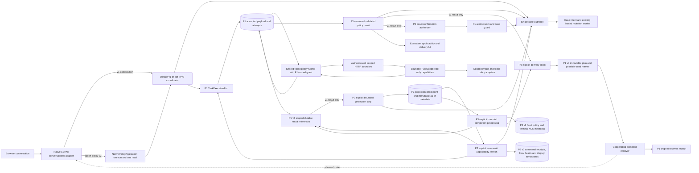
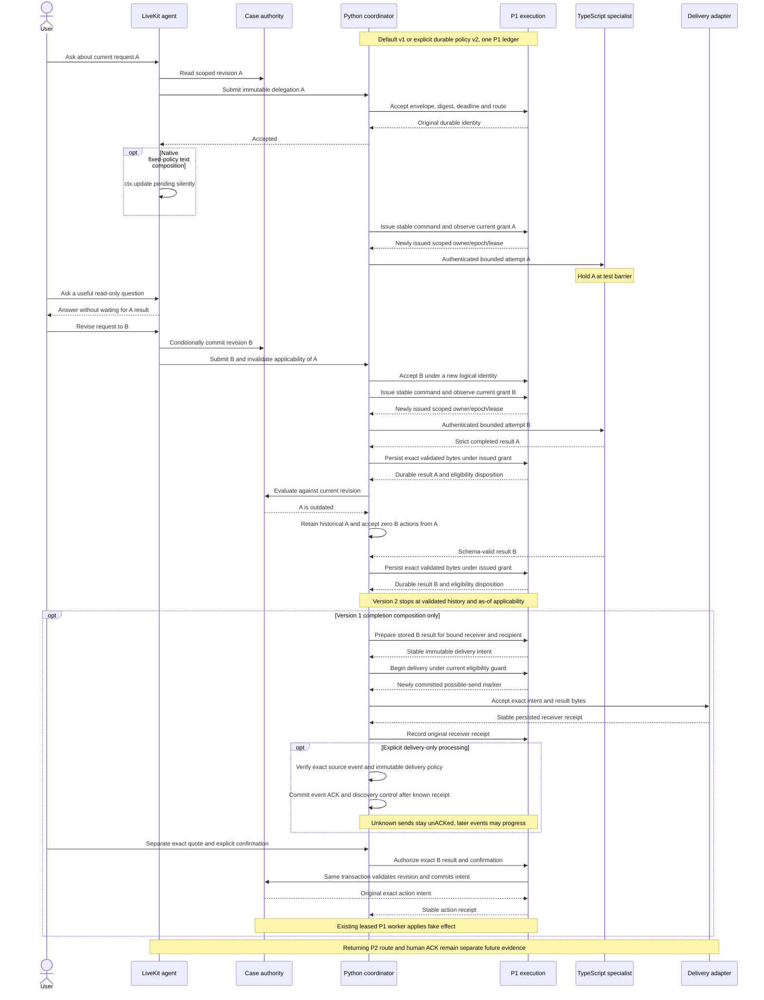

# Delegation Reliability Kit design

| Field | Value |
| --- | --- |
| Status | Active |
| Purpose | Describe P3 data flow, state ownership, component boundaries, limits and failure handling, and record how each slice was qualified |
| Audience | Engineers and coding agents who change P3 or need to know which component owns a fact |
| Scope | P3 Python coordination library, TypeScript HTTP specialist and implemented slices; excludes V1 requirements, task order and commands |
| Owns | P3 implementation boundaries, state ownership, limits and design decisions |
| Related | [Charter](../../docs/projects/delegation-reliability-scope.md) · [Shared design](../../Design.md) · [Granular plan](../../docs/implementation/p3-delegation-reliability.md) · [README](README.md) |

## Overview

This document is the design of P3, the Delegation Reliability Kit: a Python
coordination library and an authenticated TypeScript HTTP specialist service for
bounded background collaboration during a LiveKit conversation. It covers data
flow, state ownership, component boundaries, limits and failure handling, and it
records which slices are implemented and how each was qualified. It is written
for engineers and coding agents who change P3 or need to know which component
owns a fact.

In the reference scenario, a synthetic traveller supplies a static booking
screenshot and asks about a date change. Read-only specialists extract evidence
and evaluate a fixed, versioned policy while the ordinary conversation continues.
V1 covers static images and a fixed policy. It does not include continuous video,
arbitrary specialists or another workflow runtime.

Authority is divided between documents:

| Document | Purpose |
| --- | --- |
| [Charter](../../docs/projects/delegation-reliability-scope.md) | Owns the V1 requirements and the acceptance IDs P3-01 through P3-17 |
| [Shared design](../../Design.md) | Owns common authority across P1, P2 and P3 |
| [Granular plan](../../docs/implementation/p3-delegation-reliability.md) | Owns task order |
| [Project README](README.md) | Covers onboarding and commands |

Types in this document are application contracts, not LiveKit SDK methods.
Future components are explicitly marked as planned.

### Contents

| Section | Covers |
| --- | --- |
| [Objectives](#objectives), [Functional requirements](#functional-requirements) and [Non-functional requirements](#non-functional-requirements) | Goals, required behavior and quality targets with their evidence status |
| [Back-of-the-envelope calculations](#back-of-the-envelope-calculations) | Illustrative experiment sizing and configured metadata ceilings |
| [High-level design](#high-level-design), [Sequence diagram](#sequence-diagram) and [Low-level design](#low-level-design) | Component flow, the stale-result A/B sequence and the public classes and ports |
| [Components and related details](#components-and-related-details) | Responsibilities, shared types and persistence rules, then one subsection per implemented slice, grouped in the next five rows |
| Foundation slices | [Native baseline](#native-baseline-p3-a), [contracts and local trust](#specialist-contracts-and-local-trust-p3-i03-and-p3-i04) and the [HTTP specialist](#http-specialist-handler-and-client-p3-i05) |
| Execution slices | [Coordinator acceptance](#coordinator-acceptance-and-python-http-consumer-p3-i06), [issued execution](#issued-execution-and-results-p3-i07a), [delivery and guarded action](#explicit-delivery-and-guarded-action-p3-i07b) and [acceptance runners](#acceptance-runners-and-public-example-p3-i08) |
| Result metadata slices | [Projection](#result-projection-metadata-p3-i09), [completion processing](#delivery-only-completion-processing-p3-i10) and [applicability refresh](#applicability-refresh-and-display-retention-p3-i11) |
| Fault validation slices | [Action races](#protected-action-races-p3-i12), [deadlines](#deadlines-and-the-noncooperating-peer-p3-i13) and [process recovery](#explicit-process-recovery-p3-i14) |
| Package and policy capability slices | [Standalone packages](#standalone-installed-packages-p3-i15), [document extraction](#bounded-document-extraction-p3-i16), [fixed policy over HTTP](#versioned-fixed-policy-over-http-p3-i17), [durable fixed policy](#durable-fixed-policy-version-2-p3-i18a), [version 2 delivery](#version-2-result-delivery-0043), [native policy application](#native-fixed-policy-application-p3-i18b) and [origin-bound policy](#origin-bound-policy-version-3-0044) |
| [Security and privacy](#security-and-privacy), [Observability](#observability), [Metrics](#metrics) and [Exception handling](#exception-handling) | Cross-cutting rules |
| [Design considerations and trade-offs](#design-considerations-and-trade-offs) | Recorded decisions and their costs |
| [Validation and acceptance gates](#validation-and-acceptance-gates) | Gates, evidence rules and remaining acceptance status |

### Terms used in this document

| Term | Meaning |
| --- | --- |
| P1, P2 and P3 | The three projects. P1 agent continuity owns durable execution and the case authority, P2 channel continuity owns the channel inbox, outbox and routing, and P3 is this project |
| Case authority | The P1 component that owns the current case revision, exact quote confirmation and accepted mutation intents |
| Specialist | The read-only TypeScript HTTP service that evaluates policy or extracts document fields |
| Acceptance ID | A charter scenario ID such as P3-05 |
| Task ID | An implementation task from the granular plan, such as P3-I07A, often shortened to I07A. P3-A is the controlled native baseline (P3-I01 and P3-I02) |
| S-I05, S-I08 and PLAN-21 | S-I05 is the shared task that provides the one-shot migration principal and restricted roles. S-I08 is the shared integrated release rehearsal. PLAN-21 is the build-plan work package for baselines, live inference and performance |
| Handoff | A numbered work item under docs/work-items, such as 0042, that records a slice's scope and observed evidence |
| Selected qualification | A pass of the gate assertions chosen for one task or checkpoint. It never completes a charter acceptance row by itself |
| Registered runner | A harness catalog runner for a complete acceptance row |
| Source and installed modes | A gate run from the repository checkout, and a run from freshly built artifacts in an isolated consumer outside the checkout |
| Owner and runtime roles | The owner (migration) role installs and upgrades versioned schemas. Runtime (serving) roles never run data definition language (DDL) |
| Issued grant | A P1 execution attempt issued to one owner with an epoch and a lease |
| eligible_at_commit | P1's result disposition: time, lease and cancellation eligibility when the result committed. It is not semantic validity, current applicability or action permission |
| Possible send | A P1 marker committed before receiver I/O. Once it exists the receiver may have accepted, so the outcome stays unknown until a receipt is found |
| As-of observation | A fact stored with the read that produced it (as_of_non_atomic). It is never refreshed automatically and grants no current permission |
| Terminal ACK | A P3 record that processing of one result event is finished under the fixed delivery policy. It is not a P1 source acknowledgement, action permission or human acknowledgement |
| Display tombstone | A permanent marker that hides a retained result from display without deleting it |
| Requests A and B | An older and a newer revision of the same request in stale-result scenarios |
| Fake supplier effect | The synthetic external booking change that stands in for a real mutation. Only P1's leased mutation worker applies it |
| Owned-PID kill | A deliberate kill of a child process whose process identifier (PID) the test parent owns and verifies |
| pg_blocking_pids | The PostgreSQL function that lists the backends blocking another backend. Gates use it to prove real lock waits |
| ACK | Acknowledgement |
| CAS | Compare-and-set: a conditional write that succeeds only when a stored revision still matches the expected one |
| RTC | Real-time communication: the LiveKit room connection that carries live text and media |
| SDK | The pinned LiveKit Agents software development kit |
| DTO | Data transfer object; here, the compact native observation |
| CLI | Command-line interface |
| STT, LLM and TTS | Speech-to-text, large language model and text-to-speech |
| OCR | Optical character recognition |
| OTLP | OpenTelemetry Protocol, used for trace export |
| RSS and WAL | Resident set size; PostgreSQL write-ahead log |
| TTL | Time to live |
| PNG, CRC, IHDR, IDAT and IEND | Portable Network Graphics; its cyclic redundancy check; and its header, image-data and end chunks |
| Wheel, sdist and npm pack | A built Python wheel, a Python source distribution and an npm package archive |

### Current status

The pinned toolchain, diagnostic RTC, local stack, console and foundation API
signals exist. The table lists each P3 slice and the handoff that records its
selected scope and evidence. Status labels use the
[implementation status vocabulary](../../docs/documentation-standards.md#implementation-status-vocabulary),
and the Evidence column keeps each handoff's own result wording.

| Task | Capability | Status | Evidence |
| --- | --- | --- | --- |
| P3-A (P3-I01 and P3-I02) | Controlled native baseline; its reviewed remote-isolation decision preceded HTTP implementation | Implemented | [0023](../../docs/work-items/0023-p3-native-baseline.md) |
| P3-I03 and P3-I04 | Policy contracts and local trust, evidence and admission checks | Implemented | [0025](../../docs/work-items/0025-p3-specialist-contracts-and-trust.md) |
| P3-I05 | Scripted authenticated loopback HTTP capability and typed client, usable as a library with no import-time server startup | Implemented | [0027](../../docs/work-items/0027-p2-standalone-and-p3-http.md) |
| P3-I06 | Python coordinator acceptance over P1's public opt-in read-only accepted-work profile, a public managed-case read adapter and a typed Python loopback HTTP consumer | Implemented | [0028](../../docs/work-items/0028-p2-dispatch-and-p3-coordinator.md) |
| P3-I07A | One-step runner over P1's explicitly owner-upgraded v2 issued execution and result profile | Implemented | [0029](../../docs/work-items/0029-p2-gateway-and-p3-issued-execution.md) |
| P3-I07B | Explicit durable delivery through a cooperating receiver, exact case-control reads and guarded exact confirmation through P1's public v3 completion profile | Implemented | [0030](../../docs/work-items/0030-p2-agent-recovery-and-p3-completion.md) |
| P3-I08 | Actual concurrent admission and conflict, the complete bounded rejection inventory and a typed public composition and inspection example | Implemented | [0031](../../docs/work-items/0031-revision-routing-and-delegation-acceptance.md); P3-01, P3-03 and P3-11 runners registered |
| P3-I09 | Versioned reference metadata and explicit resumable projection over P1 work v4, with immutable non-atomic as-of observations | Implemented | [0032](../../docs/work-items/0032-linked-confirmation-and-result-projections.md) |
| P3-I10 | Explicit owner v1-to-v2 upgrade with delivery-only processing, gap-aware discovery and immutable terminal event ACKs | Implemented | [0033](../../docs/work-items/0033-outbound-replies-and-completion-processing.md) |
| P3-I11 | Separate owner v2-to-v3 refresh and display layer with exact command replay and retained invalidation evidence | Implemented | [0034](../../docs/work-items/0034-callback-evidence-and-applicability-refresh.md) |
| P3-I12 | Validation of the existing protected-action boundary under real SQL races | Qualified | [0035](../../docs/work-items/0035-send-policy-and-action-races.md): selected qualification recorded |
| P3-I13 | Deadline and cancellation schedules with a test-only noncooperating peer | Qualified | [0036](../../docs/work-items/0036-native-input-and-deadline-cancellation.md): selected qualification recorded |
| P3-I14 | Explicit process-recovery composition through unchanged authorities | Qualified | [0037](../../docs/work-items/0037-playback-evidence-and-process-recovery.md): source and installed gates passed |
| P3-I15 | Standalone installed consumption of the public packages | Qualified | [0038](../../docs/work-items/0038-case-rehydration-and-standalone-release.md): selected gate passed |
| P3-I16 | Separate read-only document HTTP path | Qualified | [0039](../../docs/work-items/0039-bounded-channel-workloads-and-image-evidence.md): selected gates passed |
| P3-I17 | Versioned fixed-policy HTTP (policy version 2) | Qualified | [0040](../../docs/work-items/0040-operations-ui-and-fixed-policy-evidence.md): selected gates passed |
| P3-I18A | Opt-in durable fixed-policy version 2 facades | Qualified | [0041](../../docs/work-items/0041-standalone-channel-and-durable-policy.md): selected qualification passed |
| P3-I18B | NativePolicyApplication and NativePolicyAgent for one RTC text profile | Qualified | [0042](../../docs/work-items/0042-responsive-native-policy-and-compact-demo.md): selected RTC text qualification passed |
| Selected backend part of P3-I19 | Typed version 2 result delivery | Qualified | [0043](../../docs/work-items/0043-stable-result-delivery-and-return-context.md): selected assertions passed |
| Origin binding toward P3-I19 | Metadata-only version-3 envelope that binds the original P2 input | Qualified | [0044](../../docs/work-items/0044-origin-bound-channel-policy.md): selected actual schedule and package checks passed |

Only P3-01, P3-03 and P3-11 have registered lab runners. The fourteen other full
charter rows remain planned. Autonomous scheduling and real models remain planned.
Full charter acceptance, integrated return routing, joined voice, text and SMS
routing and broader release also remain planned.

## Objectives

| Type | Objective | Evidence of achievement |
| --- | --- | --- |
| Business | Keep a useful conversation going during slow specialist work | Hold specialist at a barrier while another user question receives a useful response |
| Business | Use only evidence relevant to the current request | Late A stays historical after revision B; zero B actions use A; valid B still progresses |
| Business | Explain cancellation, uncertainty and delivery honestly | Separate execution outcome, applicability, remote cancellation observation and delivery fields |
| Technical | Share a safe typed Python/TypeScript contract | Runtime-validated versioned schemas and equivalent positive/negative fixtures |
| Technical | Recover through one persisted execution owner | Coordinator/specialist kill tests use P1 public execution adapter and original logical identities |
| Technical | Justify remote isolation with measured comparison | Retain tool/native baselines first; compare all three with equivalent workload and declared limits |

## Functional requirements

| Type | Requirement | Planned mechanism | Acceptance reference |
| --- | --- | --- | --- |
| Business and technical | Complete useful scoped work through both languages | Immutable accepted request, authenticated bounded invocation, structured result and durable delivery intent | P3-01–P3-04 |
| Business | Prevent stale evidence from authorizing current actions | Applicability check plus atomic current revision/exact confirmation/intent commitment at case authority | P3-05–P3-07 |
| Technical | Recover accepted work and respect deadlines/cancellation | P1-owned attempts/retry/deadline contract; persisted result projection and explicit invalidation | P3-08–P3-10, P3-14 |
| Technical | Reject unauthorized, malformed and excessive work | Trusted service principal, allowlisted capability/evidence adapter and context/image/result limits | P3-11, P3-13 |
| Business | Return current useful results after handoff or room closure | Stable logical route through standalone delivery adapter or integrated P2 routing | P3-12, P3-17 |
| Business | Produce evidence or clarification from image/policy input | Static booking.extract_document and booking.evaluate_policy capabilities; no mutation permissions | P3-15 |
| Technical | Compare native and remote behavior fairly | Controlled seeded tool/native/remote fixtures, raw correctness/usage/timing samples and reviewed context differences | P3-16 |

## Non-functional requirements

All product targets are planned release criteria, not measured global-scale or
latency claims. Each run fixes finite resource limits and numeric regression
budgets before collecting results.

| Property | Target or invariant | Verification | Status |
| --- | --- | --- | --- |
| Applicability safety | Zero action intents based on outdated/invalidated/wrong-scope results | A/B schedules, real case-authority race and exact fake-effect ledger | Selected I07B/I11 and I12 authority schedules; full row planned |
| Useful progress | Expected current results progress; holding specialist does not block useful ordinary response | Positive B path and actual held-specialist media run | Planned |
| Durability | Zero lost accepted logical delegations under each declared crash schedule | Kill real coordinator/specialist processes; recover through P1 persisted adapter | Planned |
| Identity | Same scoped canonical ID returns original work; changed content conflicts | Concurrent requests, lost-response replay and completion-after-restart | Planned |
| Resource bounds | Finite configured global/per-tenant active, queue, attempt, context, image, result and shutdown limits | Saturation, second admitted tenant, image decode guard and cleanup probes | Selected HTTP/I16/I17 limits passed; global-scale release gates remain planned |
| Trust | Zero unauthorized invocation/lookup/cancel/evidence reads | Missing credential, forged scope, inaccessible image and arbitrary URL negatives | Selected policy/image rejection gates passed; full row planned |
| Compatibility | Both languages agree on supported schema and exact semantic identity | Shared fixtures and built artifact consumer contract tests | Selected I16/I17 cross-language and affected compatibility gates passed; full row planned |
| Observability | Actual boundary events, finite metric labels and nonblocking bounded exporter | Producer-safe log/error checks, inspected trace and exporter outage | Planned; API foundation signals implemented |
| Reproducibility | Standalone installed library works without complete P1/P2 deployment; actual platform runs retained | Wheel/npm-pack isolation, preserved-volume restart and supported-platform evidence | Selected I15/I16/I17 installed gates passed on the declared host; broader platform/release gates planned |

## Back-of-the-envelope calculations

### Illustrative experiment sizing

These illustrative calculations choose local experiments and expose possible
resource pressure. They are not configured defaults, capacity proof or permission
to advertise a lower-latency remote architecture.

| Quantity | Inputs and formula | Result | Implication to test |
| --- | --- | --- | --- |
| Concurrent invocation | 0.5 delegations/s × 4 s mean scripted invocation | 2 active attempts | Four total service slots is an initial experiment with nominal headroom; retries, uneven capabilities and provider limits reduce it |
| Small request/result buffers | Four active attempts × (16 KiB context + 8 KiB result + 1 KiB registry metadata) | 100 KiB | This excludes image decode, HTTP/runtime buffers and model SDK allocations; a bounded registry alone does not bound RSS |
| Image memory | Four admitted 2 MiB encoded images; four decoded 2048 × 2048 × 4-byte images | 8 MiB encoded; 64 MiB decoded | Peak includes both representations, decoder intermediates and model buffers; validate dimensions/bytes before uncontrolled decode and measure actual RSS |
| Retained work | 10,000 logical delegations × assumed 32 KiB combined immutable input/result/projection history | 312.5 MiB raw | A 3× illustrative data/index allowance is 937.5 MiB; count P1/P3 records once according to ownership; WAL/backups are extra |
| Comparison samples | Three implementations × three controlled concurrency points × 30 repeats | 270 observations | Useful for first distributions, not an automatic tail-percentile guarantee; disclose samples and deterministic versus live inference |
| Live cost | Sum actual reported input/output/image/audio usage × applicable configured provider rates | Not estimated | Report actual or unavailable usage/cost; fixture calls have no model usage and cannot stand in for live quality |

Start with one real media session before increasing load. Workload and platform
records identify inference mode, capability, data sizes, worker slots, machine
resources and timestamp sources. CPU/RSS or throughput from scripted HTTP tests
does not establish voice/video/model or distributed media capacity.

### Configured metadata ceilings

The implemented P3 metadata stores have configured caps. This arithmetic gives
their raw body budgets.

| Store | Configured bound | Calculation and result | Excluded |
| --- | --- | --- | --- |
| Projection reference records (P3-I09) | Default cap 3,000 records, configurable 1–30,000 | 3,000 records × 8 KiB canonical metadata per record = 23.44 MiB default maximum body budget | Indexes, WAL and backups |
| Processing ACK bodies (P3-I10) | Each ACK body at most 4 KiB; the count never exceeds the inherited 3,000-record default, configurable to 30,000 | 3,000 × 4 KiB = 11.72 MiB default ACK-body budget, in addition to the 23.44 MiB projection metadata | Indexes, WAL and backups |
| Refresh command receipts (P3-I11) | Default cap 3,000 retained commands, configurable 1–30,000; each receipt at most 4,096 bytes | 3,000 × 4,096 bytes = 11.72 MiB default raw-body allowance; 30,000 × 4,096 bytes = 117.19 MiB maximum | Indexes, WAL and backups |
| Applicability heads and display tombstones (P3-I11) | One head per retained projected event, following the original record cap; each tombstone at most 2,048 bytes | No separate byte total is calculated | Indexes, WAL and backups |

These are finite arithmetic bounds and correctness limits, not measured production
capacity, throughput or latency targets.

## High-level design

The implemented policy core and the opt-in native application keep one durable
execution ledger. The configured text host and page form a separate qualification
boundary, so this component diagram does not establish an actual RTC or media
result. The TypeScript service handles a bounded attempt and returns evidence. It
never becomes a recovering queue.

1. Retain equivalent tool and native-subagent examples and a deployment and
   isolation decision before constructing the remote service. Remote is not
   presumed faster.
2. The coordinator validates a bounded immutable envelope and its canonical
   digest. P1 atomically persists both with the accepted execution before
   acknowledgement. Later P3 metadata must not retrofit identity after acceptance.
3. P1 alone owns durable attempts, retry and deadline eligibility, cancellation
   policy and execution outcomes. The HTTP status, result and cancel endpoints are
   observations of an authenticated attempt, not an independently recovering
   scheduler.
4. The specialist receives only scoped evidence and allowlisted read-only
   capabilities. It cannot mutate bookings, charge, notify or acquire tools from
   untrusted text. Begin with scripted policy evaluation, then image extraction.
5. P3 validates result identity, schema and revision, and records current,
   outdated or invalidated applicability separately from computation success. Any
   resulting action must pass the case authority's atomic exact-confirmation
   commitment.
6. P1 v3 binds stored result bytes to one receiver and recipient before I/O. Only
   a newly committed possible-send marker permits accept. A receiver receipt is
   retained acceptance, separate from human acknowledgement. Only the selected P2
   backend receiver and read route from 0043 is qualified; joined P2 routing and
   media presentation remain planned. Room closure must not erase accepted work.
7. Exact confirmation is separate caller input. P1 serializes work eligibility and
   case revision, confirmation and intent in one transaction, retaining a stable
   action receipt. P3 and the specialist never dispatch the supplier effect
   themselves.

## Sequence diagram

This A/B sequence combines the implemented P3-I07A invocation with the explicit
P3-I07B completion ports. In the actual test, request A is bound to case
revision 2 and request B to revision 4. Revision 3 changes the facts and
revision 4 restores the original facts, because trusted quote generation uses the
original completed inquiry facts.

The native policy tool is implemented for the first RTC text profile, and its
selected RTC text qualification passed (see
[Native fixed-policy application](#native-fixed-policy-application-p3-i18b)).
The broader A/B revision and delivery media composition shown here remains
planned outside that one configured policy tool. Neither this sequence nor a
lease claims that remote computation can always be stopped.

## Low-level design

The class diagram shows the implemented version 1 defaults, the opt-in version 2
acceptance and issued-result facades, and the version-1-only explicit completion
ports. The separate version 2 FixedPolicyDeliveryClient and the version 3 channel
policy facades are described under
[Components and related details](#components-and-related-details) and are not
drawn.

Ownership follows these rules:

| Owner | Owns |
| --- | --- |
| Application | The shared case readers |
| Coordinators | Their P1 work clients |
| Runners | Their P1 execution and specialist clients |
| Version 1 completion facades | Their injected action or delivery clients and receiver ports; they borrow result inspectors |
| P3-I09 projection | Only a checkpoint and immutable as-of reference metadata |
| P3-I10 processing | A separate explicit delivery-only consumer checkpoint and terminal ACKs |
| P3-I11 refresh | Explicit refresh commands, local applicability heads and permanent display tombstones |

- The two facade pairs share closed typed cores, and callers cannot register
  arbitrary codecs. Selected I18A qualification is recorded in the
  [I18A handoff](../../docs/work-items/0041-standalone-channel-and-durable-policy.md).
- No component introduces another execution state machine.
- Automatic workers and broader recovery remain future work.

## Components and related details

This section starts with component responsibilities, shared types and persistence
rules. The remaining subsections follow the implementation tasks in order. Each
one describes the slice's behavior, limits, failure handling and selected
evidence.

### Component responsibilities

Python paths are relative to `python/src/delegation_reliability` and TypeScript
paths to `specialist-ts/src`. P1 entries name public `continuity_lab` modules in
the agent continuity project. Status labels follow the
[current status](#current-status) table.

| Component | Path | Responsibility | Status |
| --- | --- | --- | --- |
| Native baseline | `baseline.py`, `models.py` and `scripted.py` | Immutable PolicyInput and PolicyResult values, one fixed synthetic policy rule, an explicit local FixtureLLM and the run_baseline experiment | Implemented |
| Python coordinator | `coordinator.py` | Submit/find/get/requested-cancel and immutable input validation; explicit completion composition is separate | Implemented |
| One-step runner | `runner.py` | Explicit newly issued grant, bounded HTTP, strict factual result validation and fresh case read; owns no ledger, retry queue, action or delivery | Implemented |
| P1 execution adapter | P1 `work_api` and `execution_api` | Sole durable acceptance/attempt/retry/deadline/worker/outcome owner; accepted envelope/digest persist before acknowledgement | Implemented (P1-owned) |
| TypeScript handler and client | `server.ts`, `client.ts`, `http.ts` and `http-protocol.ts` | Authenticated bounded invocation, typed safe errors and finite active-attempt observations; no independent durable retry queue | Implemented |
| Python HTTP consumer | `http_client.py` | Typed Python loopback HTTP consumer with strict bounded responses | Implemented |
| Contracts and local trust | `contracts.py`, `security.py`, `contracts.ts` and `security.ts` | One strict policy-evaluation protocol, bearer-digest grants and AttemptBoundary live permits | Implemented |
| Evidence adapter | `security.py` and `security.ts` | Scoped allowlisted image references and fixed policy version; no arbitrary URL fetch or full-transcript copy | Implemented |
| Capability handlers | `server.ts`, `fixed-policy.ts` and `document*.ts` | Scripted booking.evaluate_policy and standalone booking.extract_document; both return read-only evidence/clarification without P1 image execution authority | Implemented; I16 and I17 selected gates passed |
| Result projection v1, v2 and v3 | `projector.py` and `projection_*.py` | Explicit P1 v4 feed consumption, original checkpoint and immutable as-of metadata; later versions retain compatible old projection clients | Implemented |
| Applicability refresh and display | `applicability_*.py` | Explicit exact-command non-atomic observations, monotonic retained witnesses and permanent display tombstones; original projection/ACK/receipt identities remain protected | Implemented |
| Completion processor | `completion_processor.py` and `processing_*.py` | Delivery-only bounded explicit steps, fixed receiver/routes, separate discovery and terminal watermark with exact per-event ACKs; no copied result body, queue, source ACK, action or delivery ledger | Implemented |
| Case authority | P1 case authority; P3 read adapters in `case_adapter.py` and `action_adapter.py` | Current revision, explicit exact authorization and atomic accepted mutation intent; cache values carry evaluated revision only | Implemented (P1-owned) |
| Explicit completion adapters | `completion.py`, `delivery_contract.py` and `action_adapter.py` | Revalidate full result/evidence, bind recipient/receiver, preserve original receipts and submit separate exact confirmation through P1 atomic guard | Implemented; selected P2 backend receiver/read route is qualified, joined media routing follows |
| Version 2 fixed-policy facades | `fixed_policy_execution.py`, `fixed_policy.py` and `completion.py` | FixedPolicyCoordinator, FixedPolicyRunner, FixedPolicySpecialistClient and FixedPolicyDeliveryClient for policy version 2 | Qualified (I17, I18A and 0043 selected gates) |
| Native RTC-text adapter and UI | `native_policy.py`; host `local-setup/scripts/p3_native_policy_http.py`; UI `apps/local-console/src/p3-background*.ts` | Selected background response and bounded observed read projection for one RTC text profile | Qualified in 0042; joined voice/text/SMS routing remains planned, with one native session owner |
| Version 3 channel-policy facades | `channel_policy_execution.py`, `channel_policy_contracts.py` and `completion.py` | ChannelPolicyCoordinator, ChannelPolicyRunner and ChannelPolicyDeliveryClient around unchanged policy-v2 requests and results | Qualified (selected 0044 checks) |

### Types, identity and status vocabulary

| Identity | Contents |
| --- | --- |
| Request identity | Trusted scope, delegation, case and revision, capability, input schema, immutable context and evidence, absolute deadline and a stable logical route |
| Result identity | The request identity plus the output schema and producer and attempt provenance |

Keep three status families distinct:

| Status family | Values |
| --- | --- |
| Execution | `accepted`, `running`, `completed`, `failed`, `timed_out` and `cancelled` |
| Applicability | `current`, `outdated` and `invalidated` |
| Delivery | A separate family; its values are not enumerated here |

A successfully completed computation can still be outdated or undelivered.

### Implementation layout

Add code under these paths:

| Area | Path |
| --- | --- |
| Python code | `python` |
| TypeScript handlers | `specialist-ts/src` |
| Project tests | `tests` |

- Python follows the [Python engineering guide](../../docs/python-engineering.md):
  immutable boundary values, narrow Protocols, validated inputs, explicit async
  task ownership, context-managed HTTP and store clients, and cancellation
  propagation.
- TypeScript uses runtime schemas plus discriminated result and error types,
  finite active registries and declared units.
- Neither library starts a server or performs I/O on import.

### Persistence, migrations and retention

P3-I06 and P3-I08 persist and replay the complete immutable envelope and digest
through P1. P3-I09 adds only P3-owned projection and applicability metadata that
references that accepted identity.

- Use the one-shot migration and configuration mechanism from S-I05 for owned
  schemas, grants and later service profiles.
- Serving roles cannot perform DDL or receive bootstrap administrator credentials.
- Upgrade and restart preserve accepted records, credentials and volume identity.
  Reset is never recovery.
- Define replay, result and effect tombstones before cleanup. Expiry or display
  pruning cannot permit duplicate acceptance.

### Standalone and integrated consumers

A standalone consumer may depend on P1's public execution library without its full
service deployment, sibling stores or the P2 gateway. Test built wheel and
npm-pack consumers outside repository import paths.

P3-I22 can first qualify real media with the narrow delivery adapter. Repeat
integrated routing through P2 when its gate exists, and retain that reference-app
evidence for the shared S-I08 release task. Do not label a standalone pass as P2
integration.

### Native baseline (P3-A)

The `python/src/delegation_reliability` workspace package owns:

- immutable PolicyInput and PolicyResult values and bounded JSON validation;
- one fixed synthetic policy rule;
- an explicit local FixtureLLM;
- the run_baseline experiment.

Both modes exercise real AgentSession tool dispatch. The native mode also awaits
the SDK AgentTask inside a TaskGroup, with summarization disabled and a task-owned
async tool so that on_enter can finish. RunContext.update permits a meaningful
read-only text question while the evaluation barrier is held. The task
temporarily owns the same session, so this does not implement a separate
reasoning model or an independent process.

Each run has these limits:

| Limit | Value |
| --- | --- |
| Evaluations | One |
| Fixture model calls | At most 24 |
| Input | 2,048 bytes |
| Note | 512 bytes |
| Experiment budget | 15 seconds |
| Cleanup budget | One shared 3-second budget |

Reports retain actual monotonic durations, finite outcomes, fingerprints, SDK
lifecycle counts and observed completion and cleanup. These are one-sample
orchestration observations with cold-start and ordering effects, not performance
rankings.

Diagnostics and failure handling:

| Concern | Behavior |
| --- | --- |
| Named library events | `policy_evaluation_started`, `policy_evaluation_closed` and `baseline_completed` |
| Unexpected operation or cleanup failure | Fixed safe events |
| Logging and export | The library does not configure logging or an exporter |
| Cancellation | Propagates |
| Cleanup failure | Cannot return a passing report; explicitly noted when a prior failure exists |
| CLI output | Fixed JSON codes without external exception text |

The [baseline work item](../../docs/work-items/0023-p3-native-baseline.md) records
the exact scope, tests and remote-isolation decision. The baseline contributes
only to the initial P3-16 comparison. No product acceptance registration,
authority, durable recovery, physical media or real-model claim follows from it.

### Specialist contracts and local trust (P3-I03 and P3-I04)

#### Policy evaluation contract

Python contracts.py and security.py, together with the TypeScript specialist-ts
source, implement one strict policy-evaluation protocol.

- The request binds schema, capability and scope, case and revision, immutable
  facts and evidence, deadline and logical destination.
- Only attempt identity and attempt number are excluded from the logical
  fingerprint. Results match the exact attempt and the original source versions
  and digests.
- Shared fixtures test real producer output, canonical Unicode bytes,
  duplicate-free JSON and named parser, matching and factual negatives.
- Document extraction required a later explicit contract extension, which P3-I16
  added. This contract-only slice does not imply a model or HTTP handler.

#### Local trust and evidence

- Operator-configured bearer digests bind separate invoke, result, cancel and
  evidence allowlists to trusted service scopes. Principal and scope labels in a
  request body grant no access.
- EvidenceRegistry validates and owns immutable source bytes. There is no
  arbitrary URL fetch.
- The current policy check compares known fixed facts and cited rules against
  that exact source. A candidate is neither current-case applicability nor
  mutation permission.
- TypeScript `verifyPolicyFacts` checks factual support before it classifies a
  result as expired or clarification, in the same order as Python
  `verify_policy_facts`. An expired result with an unsupported eligibility answer
  therefore fails with `unsupported_facts`.
- Producer and model metadata and completion time are observations. Trusted
  caller time determines expiry, and the case authority still owns commitment.

#### Attempt permits

AttemptBoundary owns at most four live permits by default, two per principal. It
has no queue, retries, timer, store or recovery behavior.

- Only the original permit can release its slot.
- Admission rejects unknown scope or evidence, or ineligible time, without
  retaining an entry.
- Independent authorized work and post-release work must still progress.

The [contract work item](../../docs/work-items/0025-p3-specialist-contracts-and-trust.md)
records the shared JSON limits, source byte and dimension limits and trusted
configuration bounds. This slice bounds image metadata, but actual decoding and
extraction remain unqualified here. Codec tests imply no HTTP instrumentation,
exporter or business completion.

### HTTP specialist handler and client (P3-I05)

#### Routes and grants

- SpecialistServer reuses the existing LocalTrust, EvidenceRegistry and
  AttemptBoundary. Its listen method chooses an ephemeral port on 127.0.0.1, and
  import starts no listener.
- Released attempts have no terminal history or result cache. The service never
  durably accepts work, retries it or owns another recovering queue.

Each route consumes the exact original request envelope:

| Route | Required grants |
| --- | --- |
| `POST /v1/invoke` | Both invoke and result grants plus all evidence grants |
| `POST /v1/status` | Result permission for the exact live attempt |
| `POST /v1/cancel` | Cancellation permission for the exact live attempt |

#### Resource limits

The server and typed client have these default ceilings:

| Limit | Value | Applies to | Notes |
| --- | --- | --- | --- |
| TCP connections / admitted HTTP requests | 16 / 16 | Server | Reject or close excess; one request per connection, no keepalive/pipelined second dispatch |
| Header bytes / fields | 8 KiB / 16 | Server | Owned header deadline and duplicate/framing validation before body consumption |
| Input / result / observation | 16 KiB / 8 KiB / 1 KiB | Server and typed client | Strict duplicate-free bounded UTF-8 schema; errors at most 512 bytes |
| Live attempts | Four total, two per principal | Server | No waiting queue; permit stays held until actual evaluation settles |
| Header / body / invocation / response | 1 / 2 / 5 / 1 seconds | Server | Monotonic operation budgets and trusted wall time for business expiry; smaller trusted fixture bounds allowed |
| Shutdown | Two seconds | Server | Stop admission, signal attempts, close owned sockets; incomplete owned cleanup fails |
| Live calls / call budget | Four live calls, five-second call budget | Typed client | Fixed loopback endpoint, bounded exact responses, explicit abort, no redirects/retries; one-second close budget |

#### Evaluation

The fixed evaluator reads only the accepted immutable policy source and applies
notice_minimum_days. It validates source metadata and known policy facts before
returning a candidate. The client validates the exact request, result, attempt
and evidence binding and the observed expiry. Without source bytes, the client
cannot independently prove factual truth. Neither side grants current-case
applicability or action authority.

#### Cancellation and fault barriers

A cancellation response records cancel_requested. A timeout or disconnect records
its own separate observation.

Trusted harness-only beforeEvaluate barriers test ignored abort and retained
capacity, and a request cannot select them. The normal scripted evaluator is
finite. A noncooperative trusted barrier cannot be preempted in-process, so it
makes cleanup incomplete until it settles. On that timeout the server neither
silently frees its permit nor starts replacement work.

#### Diagnostics and evidence

Fixed server events and process-local counters describe admission, computation,
rejection, cancellation, expiry, disconnect and telemetry failure. They omit
bodies, tokens, URLs and raw exceptions.

| Failure | Error type | Codes and retry |
| --- | --- | --- |
| Contract failure | `delegation.error` | Fixed codes; `retryable` false |
| Transport or unexpected failure | Strict `specialist.http_error` | Fixed codes; `retryable` false |

These signals are not a deployed exporter, durable totals or a new retry policy.

The [HTTP work item](../../docs/work-items/0027-p2-standalone-and-p3-http.md)
owns the actual socket, resource, artifact and cleanup evidence. `make p3-demo`
runs the public-export example with a fresh synthetic bearer and no provider
credentials.

### Coordinator acceptance and Python HTTP consumer (P3-I06)

#### P1 accepted-work profile

The coordinator uses P1's public work_api.TaskExecutionPort and an immutable
WorkPayload. P1 computes its own SHA-256 over the complete canonical request
bytes and atomically accepts them under the authenticated tenant and account plus
the logical key.

The opt-in marked accepted-work profile is P1-owned and separate from existing
booking storage. It provides acceptance and requested cancellation only. It does
not issue attempts, execute work, store results or implement another scheduler.
The request's attempt fields remain proposed transport correlation metadata.

#### Submit sequence

1. Strict encode and parse create a detached immutable snapshot before any await.
   Trusted scope must match both the body and P1's public credential-bound scope
   before any port call. Body labels never configure a P1 principal.
2. The coordinator first finds the original scoped logical key. It independently
   validates the stored typed fields, canonical bytes, digest, scope, operation
   and deadline. Complete semantic equality excludes only the attempt ID and
   number, and a fingerprint claim alone cannot hide changed input. Replay returns
   the original bytes and deadline without requiring the case to remain current
   or unexpired.
3. New work reads the mandatory credential-bound CaseAuthorityPort, validates the
   exact scope, case, revision and cancellation, and checks the remaining bounded
   deadline. This is a read observation, not atomic current-at-commit or action
   authority.
4. P1 submit commits immutable acceptance before acknowledgement. A concurrent
   byte conflict or an ambiguous acknowledgement is reconciled by finding the
   original key and comparing its full semantics. The coordinator never
   resubmits that call.
5. Get and cancel validate and use the original P1 identity. Cancellation remains
   requested, and accepted status does not imply remote stop, completion or
   delivery. The coordinator remains acceptance-only; P3-I07B composes completion
   separately.

#### Case reads

- ManagedCaseAuthority consumes only the public P1 ManagedCaseClient-compatible
  get and CaseProjection.
- At most 128 trusted logical-to-exact-task-and-case bindings avoid confusing P3
  logical IDs with P1 UUIDs or deriving authority from request JSON.
- The existing projection cannot distinguish a committed case that is cancelled
  afterward, so committed cases fail closed with case_state_unavailable.
- P3-I07B adds a separate ExactManagedCaseAuthority that uses the public
  authenticated CaseControlClient exact read.
- The application owns this case client's lifecycle separately from the
  coordinator-owned work client.

#### Resource limits

The Python coordinator and HTTP client have these default ceilings:

| Limit | Value | Applies to | Notes |
| --- | --- | --- | --- |
| Active operations | Four, no waiting queue | Coordinator | Finite admission before any port work; same ownership includes case reads and writes |
| Caller / cleanup observation | Five / one seconds | Coordinator | Monotonic whole-call observation; already-started port work retains its slot until actual settlement |
| New request business deadline | At most 60 seconds remaining | Coordinator | UTC absolute expiry remains immutable; P1 authoritative acceptance also checks expiry |
| Active connections | Four, no waiting queue | Python HTTP client | Native asyncio loopback streams, one connection/request; literal 127.0.0.1 and explicit port |
| Headers / fields | 8 KiB / 16 | Python HTTP client | Exact HTTP/1.1, duplicate-free headers, known Content-Length and connection close; no transfer/content encoding, proxy, redirect or retry |
| Result / observation / error | 8 KiB / 1 KiB / 512 bytes | Python HTTP client | Exact schema, duplicate-free UTF-8 JSON, scope/attempt/source/deadline binding |
| Caller / cleanup observation | Five / one seconds | Python HTTP client | Total monotonic budget plus bounded cleanup observation; held actual cleanup retains the permit and fails visibly |

#### Cancellation and close

| Event | Behavior |
| --- | --- |
| Coordinator waiter cancelled | Prevents a later write at a preflight boundary, but cannot cancel an authoritative write that has already started |
| Timeout during a write | Returns `acknowledgement_unknown`; inspection uses the original key |
| Coordinator close | Stops admission, abandons calls that have not reached their write boundary and observes actual pending work before closing its P1 client |
| Python HTTP client close | Requests socket cancellation while retaining its owned task through `wait_closed`; repeated close cannot release a held permit |
| Finite close | May report `cleanup_incomplete`; never promises that an uncooperative owner stopped |

#### Diagnostics and evidence lanes

- Library events use named loggers with fixed operation, outcome and code fields.
  They contain no body, notes, identifiers, credential or dependency exception
  text.
- Coordinator settled-port counters do not replace durable P1 truth.

| Counter | Counts | Notes |
| --- | --- | --- |
| `telemetry_failed` | Logger failures | Cannot change business acceptance |
| `received` | HTTP framing receipt only | Process-local HTTP counter |
| `validated` | Strict public result or observation success | Process-local HTTP counter |
| `validation_failed` | Rejected schema or correlation | Process-local HTTP counter |

Fake-port unit checks, actual PostgreSQL acceptance and reopen, and
Python-to-TypeScript sockets remain separate evidence lanes. None establishes
durable result recovery or action safety.

### Issued execution and results (P3-I07A)

P3-I07A adds a one-step runner over P1's issued execution and result profile.
Original accepted input remains immutable, strict results persist through P1, and
fresh case applicability is a read observation.

#### P1 issued-execution profile

- P1's explicit owner v1-to-v2 upgrade preserves accepted input and adds finite
  issued-attempt and result tables. Runtime factories validate an existing
  profile and perform no DDL.
- P1 bounds logical active leases and attempts, checks database time under locks
  and retains opaque immutable result bytes and digests.
- Its eligible_at_commit disposition means lease, time and cancellation
  eligibility only. It is distinct from P3 policy facts, current case reads or
  booking authority.

#### Invocation

- The runner issues one stable command. It invokes only a newly created grant,
  after a fresh exact observation of the current owner, epoch and lease.
  Replayed or ambiguous issuance never invokes.
- Transport correlation is attempt_ plus the issued UUID's 32 hexadecimal
  characters. The accepted canonical bytes, proposed attempt, fingerprint and
  deadline never change.
- The HTTP specialist verifies its own service principal and evidence
  permissions. It does not verify P1 issuance in this wire version, so direct
  HTTP computation establishes no P1 execution, result or business authority.

#### Result validation and history

- A strict result is independently validated against scoped evidence and factual
  policy claims, including after expiry, and then committed under its exact
  issued grant.
- An unknown commit acknowledgement reconciles the original result without a
  second write.
- Known cancelled, expired, superseded and lease-expired bytes remain historical
  in P1.
- A cancelled waiter retains actual local capacity. No HTTP starts after
  abandoned issuance, while already-started read-only I/O may still yield
  retained history.
- A lease or a prior current observation cannot fence a future paused physical
  request.

#### Read observations and limits

- Returned execution, request and result snapshots are reconstructed before
  awaiting case reads.
- inspect reports candidate, clarification, outdated, case_cancelled, expired,
  execution_ineligible or unavailable separately from accepted status, actual
  computation, P1 disposition and future delivery. These read observations cannot
  atomically authorize action.

| Limit | Value |
| --- | --- |
| Calls owned by the default runner | One |
| Caller observation | Five seconds |
| Cleanup observation | One second |
| Evidence | At most four verified immutable records and 16 KiB |
| P1 result body | At most 8 KiB |

#### Evidence

The actual twelve-case gate seeds v1 input, upgrades to v2, invokes real
TypeScript HTTP, retains cancellation and superseded history and observes useful
revision B. It kills a process after result commit and reads the same result in a
fresh process.

An independent owner verifies 6 accepted inputs, 2 cancel commands, 6 attempts and
6 result hashes, correlations and dispositions. Node independently observes
exactly 6 invocations and zero remaining resources. Case revision reads are
synthetic, and this slice claims no complete action, delivery, recovery or media
criterion.

### Explicit delivery and guarded action (P3-I07B)

P3-I07B adds explicit durable delivery through a cooperating receiver, exact
case-control reads and guarded exact confirmation through P1's public v3
completion profile. The actual v4 case authority and the existing leased mutation
worker retain booking and effect ownership.

#### Completion profile and bindings

- The owner upgrades existing work v2 to v3 before completion clients open.
  Serving performs no DDL.
- P1 owns the delivery intent, possible send and receipt and the action receipt,
  alongside the original issued result. P3 owns no completion store.
- A finite trusted mapping fixes the logical case and conversation to a receiver
  recipient and to the exact case actor, scope, schema, task and case identity.
- Full nested input, result, evidence and quote values are reconstructed before
  awaits. Caller labels never select authority.

#### Delivery

- Delivery revalidates the canonical stored result and finite current
  applicability, then prepares its original bytes for that bound receiver before
  I/O.
- Only a new P1 begin permits accept. An existing possible delivery uses find
  only. Reliable absence stays unknown because no retry policy is implemented
  here.
- The cooperating receiver stores an immutable receipt in private bounded SQLite.
  An original known receipt remains a fact after work cancellation, expiry or case
  invalidation.
- Accepted bytes, a useful validated result, current applicability, delivery
  acceptance and human acknowledgement remain distinct observations.

#### Guarded action

- Authorization requires factual eligible candidate evidence plus a separately
  supplied exact explicit Confirmation for the same trusted quote, task, case and
  revision.
- P1's ActionPort locks booking admission and then work admission. It validates
  the current work, issued attempt, result, deadline and cancellation, and
  atomically commits the case intent plus a stable action receipt.
- An unprotected read followed by a plain case write is never used.
- A cancellation after preflight rejects the intent. A later cancellation cannot
  undo a known commit.
- Only the existing leased P1 mutation worker calls the fake supplier.
- Receipt replay reads the original command facts without another write.

#### Ownership and limits

Each completion facade has these defaults:

| Limit | Value |
| --- | --- |
| Active calls | Two |
| Caller budget | Five seconds |
| Cleanup observation | One second |

- Cancel or timeout retains the actual owned task and slot until settlement.
- Each facade owns its P1 completion client, and the delivery facade also owns
  its receiver. The application owns the shared result inspector and case client.
- An unknown commit plus a failed lookup remains acknowledgement_unknown.
- No hidden retry, scheduler, automatic recovery or import-time I/O is
  introduced.

#### Evidence

The actual thirteen-case gate uses case v4 and work v3 with owner and runtime
credentials separated. Public quote production moves the case through revisions 2
(original facts), 3 (alternate facts) and 4 (original facts again), which makes A
stale while valid B progresses. No private quote injection is used. The gate
proves:

- a cancel barrier before the atomic guard;
- separate exact confirmation;
- one leased fake effect;
- receiver ACK loss and a SIGKILL at receiver commit;
- fresh-process reconciliation;
- later-cancel fact replay.

Owner SQL links the exact eligible issued result, confirmation, quote, intent and
effect. Independent receiver and supplier reads reconcile identities, bytes and
counts. Four service invocations and zero live resources are independently
observed.

This selected proof does not qualify broader races, P2 delivery, media, models or
full recovery and product rows. P3-I09 separately adds bounded metadata
projection; autonomous recovery remains planned.

### Acceptance runners and public example (P3-I08)

#### Concurrent acceptance (P3-03)

- P3-03's three runtime processes reach preflight only after independent scoped
  finds missed.
- The original acceptance enters P1's protected transaction first and holds its
  public before-commit test barrier.
- A separate owner observer requires one holder and two waiting backend chains on
  that exact schema's admission relation before release.
- Equal input resolves to the original logical ID, bytes and deadline. Changed
  nested input conflicts.
- Independent SQL verifies one accepted input, one selected issued attempt and
  result, no cancellation and no foreign-scope record. Fresh runtime inspection
  checks that separate tenant and account combinations disclose nothing.

Logical acceptance is the invariant. Arbitrary retry is not guaranteed to produce
one computation.

#### Rejection inventory (P3-11)

P3-11's exact twelve-case inventory executes malformed output; revision, version
and tenant mismatch; oversized result, context, request and image bytes and
dimensions; and evidence and factual negatives.

- Both public language codecs and registries reject safely.
- The actual receiving path gets five intentionally invalid HTTP outputs under
  P1-issued attempts. Each keeps the actual transport_unknown runner observation
  and commits no result.
- Leases expire according to observed P1 status before later admission, and then
  a valid useful result persists.
- The independent Node peer reports which request received each variant. Owner
  SQL verifies six accepted inputs, six attempts, one valid result and zero
  invalid commits.

These predecode checks do not qualify image extraction, model truth or the broader
modality scenario.

#### Public composition example

The public example [policy_completion.py](examples/policy_completion.py) snapshots
the request and the independently supplied exact confirmation before any await.
It concurrently demonstrates replay and reads actual public task and result state.

- Delivery and guarded action remain explicit separate calls. inspect_accepted
  performs reads only.
- The application owns the configured clients and cleanup.
- Import starts nothing. Neither the example nor a result manufactures operator
  confirmation, worker authority or human acknowledgement.

#### Registered rows

| Runner | Row | Evidence |
| --- | --- | --- |
| Issued, delivery and guarded action | P3-01 | Reuses the full fresh thirteen-case issued, delivery and guarded-action gate |
| Concurrent acceptance | P3-03 | Retains an exact eight-case fresh report |
| Rejection inventory | P3-11 | Retains an exact twelve-case fresh report |

Only those three complete rows are registered; the other fourteen rows retain
their own assertions.

### Result projection metadata (P3-I09)

#### P1 result feed

- P1's explicit v3-to-v4 owner upgrade adds a generic result-only feed.
- An immutable source UUID, the verified tenant and account and a contiguous
  signed-int64 scoped cursor identify references.
- A result commit and its live event share P1's existing guarded transaction.
  Pre-existing history is adopted once, with stable IDs and an explicit
  adopted_history origin. Adoption order is not original commit order.
- The feed has no consumer ACK, result body, case snapshot or action permission.

#### Projection schema

P3 installs one separate marked schema with exactly three tables:

- version 1 metadata and limits;
- a fixed source and scope checkpoint;
- strict canonical result-reference observations.

The owner grants runtime SELECT, result-row INSERT and checkpoint sequence and
count UPDATE only. Factories validate the existing schema, catalog and binding,
and serving performs no DDL. An exact repeated install preserves all state.
Neither accepted input nor P1's execution, delivery or action stores are copied
or modified.

#### Projection step

- ProjectionProjector uses the public feed and an exact historical command and
  attempt lookup to re-read the original request and result bytes.
- It validates immutable identity, canonical contracts and trusted policy evidence
  before recording schema_version=1, kind=result_projection metadata.
- Definite invalid P3 bytes or facts become a rejected reference with a fixed
  code. Missing, corrupt or unavailable source state halts without checkpoint
  advance.
- Later valid work can follow a rejected result.

#### As-of applicability

- Applicability records as_of_non_atomic and separate execution and case
  observation and evaluation times.
- A foreign or malformed case read is discarded and represented as unavailable,
  without its fields. A valid case observation records revision and cancellation.
- Case-only changes produce no result event, so a retained candidate can become
  stale.
- Stored observations never replace P1's atomic current work and result check plus
  exact confirmation and revision commitment. P3-I11 adds separate refresh
  receipts without rewriting these original observations.

#### Batches and reconciliation

- Each explicit step consumes four references by default and at most eight.
- Rows and checkpoint commit together under a checkpoint-row lock and CAS.

| Condition | Outcome |
| --- | --- |
| Concurrent exact complete batches | Return the original stored observations and the actual observed checkpoint; observations are never recalculated on replay |
| Partial overlap or a moved checkpoint | Can fail with `checkpoint_conflict`, which requires an explicitly scheduled fresh step |
| Unknown commit | One exact lookup returns the originals if known; a failed or absent lookup stays `acknowledgement_unknown` without another write |

#### Capacity and ownership

- The default cap is 3,000 records, configurable 1–30,000. The
  [configured metadata ceilings](#configured-metadata-ceilings) give the resulting
  body budget. Capacity failure leaves the checkpoint unchanged.
- P3-I11 adds explicit permanent display hiding without deleting protected rows.
  Automatic retention expansion remains planned.
- The source sequence type is independent of this record cap.
- The projector owns its three injected feed, execution and projection clients,
  and the application owns its shared case adapter.
- Actual blocking I/O retains slots after waiter timeout or cancellation. Close
  reports incomplete until actual settlement.

#### Evidence

`make p3-projection-check` has twelve named assertions over real restricted-role
PostgreSQL, actual v4 case reads and public issued results.

- Two owned-PID kills prove precommit rollback with fresh resume, and postcommit
  original reads.
- Concurrent projectors are independently observed contending on their SQL
  checkpoint before release, then reconcile the exact original metadata.
- Independent source, result and digest joins and case and supplier reads prove
  four referenced results, one rejected, no invented execution, zero intents,
  delivery and effects, and ownership-checked cleanup.

These selected I09 assertions do not complete P3-04 or P3-08. They add no
scheduler, provider, media or default UI behavior.

### Delivery-only completion processing (P3-I10)

#### Upgrade and fixed policy

- The explicit owner v1-to-v2 upgrade preserves every original projection body,
  source identity, checkpoint and retained-record limit. It adds
  processing_control and processing_acks to the existing three tables.
- Owner-only setup fixes one receiver UUID and up to 32
  case-and-conversation-to-recipient bindings.
- Policy bytes and schema and catalog fingerprints are validated on reopen.
  Runtime cannot retarget the policy or perform DDL.
- A repeated old v1 install validates v2 rather than downgrading.
- The tested versioned-profile row backup and restore recreates this synthetic
  profile through its explicit installer and restores the exact saved data. It is
  not pg_dump.

#### Ownership

CompletionProcessor owns its processing, feed and delivery clients. The
application owns the shared result and case readers. Public checkpoint and
exact-event ACK inspection is separate from processor-private bounded paging and
CAS writes. The additive ProcessingDeliveryPort exposes copied and revalidated
scope, receiver and route policy, and the existing ResultDeliveryPort interface
remains compatible.

#### Bounded discovery

- One explicit call examines four unACKed projected references by default and at
  most eight in total, with at most two queries and one wrap over retained
  projection rows.
- The captured projection checkpoint bounds the scan.
- Discovery advances past an unknown event so that later eligible work can
  progress. The terminal watermark advances only over a contiguous prefix of
  terminal ACKs.
- Neither cursor owns accepted work, schedules retries or acknowledges the P1
  source feed.

#### Terminal decisions

- Before a new ACK write, the processor verifies the exact current public source
  reference and the immutable projected, request and result identity.
- Definite rejected content or historical not-required-as-of observations may be
  terminal under this fixed delivery policy.
- Missing, mismatched or unavailable source state cannot become a terminal skip.
- Stored as-of applicability never authorizes a new delivery.

#### Unknown sends and known receipts

- An exact original P1 or receiver receipt is considered before current
  applicability.
- A possible send with reliable receiver absence remains unknown, including after
  a later case change, cancellation or expiry. That event gets no terminal ACK,
  and only lookup is permitted.
- A later exact receipt can close a gap without another accept call.
- New delivery retains the existing facade's fresh result and case preflight and
  the P1 begin eligibility check. Those reads do not atomically fence a
  cross-authority case or recipient revocation, and no stronger claim is made.

#### Unroutable results

A result whose case and conversation have no route in the frozen v2 bindings is
recorded as unACKed `unavailable` (counted as `unroutable`). The scan cursor still
advances and later results progress, but that result gets no terminal ACK and no
send. Scope, identity and source conflicts still fail the whole step closed.

#### Transient dependency failures

| Error | Source | Row outcome |
| --- | --- | --- |
| Transient code: capacity, closed, storage unavailable, acknowledgement unknown, deadline exceeded, cleanup incomplete or request aborted | The result feed, the delivery client or the direct result read | Per-row, unACKed `unavailable`; the scan continues with later rows |
| Acknowledgement unknown (exception to the row above) | The delivery client or the result read | Keeps its `unknown` outcome, which also stays unACKed |
| Definite invalid or unauthorized error | Any of these dependencies | Still fails the step |

The processor and the [applicability refresher](#refresh-commands) share one
mapping. The refresher therefore maps busy (capacity) or closed P1 reads to
`storage_unavailable`.

#### Transactions and reconciliation

- Each event ACK and the discovery and control revision share a repeatable-read
  CAS transaction. Receiver I/O stays outside that transaction.
- The coherent snapshot can exclude a concurrently appended projection, which the
  next read sees.

| Condition | Outcome |
| --- | --- |
| Definite serialization or checkpoint conflict | May look up the exact winning ACK once; an absent or failed lookup stays `checkpoint_conflict` |
| Ambiguous commit | Follows the same read-only reconciliation but stays `acknowledgement_unknown` if the outcome is unknown |

Neither path resubmits. Returned nested models are defensively copied, and
original terminal observations survive replay without reclassification.

#### Partial progress and close

- Per-event commits mean that a later error may follow earlier durable progress in
  the same bounded call. Exact public ACK and checkpoint reads expose those
  retained facts.
- Timed-out or cancelled waiters retain actual tasks and threads until settlement.
  No new ACK write starts after read abandonment, and an already-started write
  remains owned.
- `close()` takes effect between rows. A write already in flight completes, but
  no later row, delivery or ACK starts, and the caller receives
  `request_aborted`.
- Close reports cleanup_incomplete until real I/O settles.
- Logging failure cannot change any receipt, ACK or checkpoint.

#### Limits

| Limit | Value |
| --- | --- |
| ACK body | At most 4 KiB |
| ACK count | Never exceeds the inherited 3,000-record default, configurable to 30,000 |
| Active processing calls | Two by default |
| Caller observation | Ten seconds by default |
| Cleanup observation | One second by default |

The [configured metadata ceilings](#configured-metadata-ceilings) give the byte
budget. These finite limits are correctness bounds, not measured production
throughput or latency targets.

#### Evidence

`make p3-processing-check` runs sixteen actual PostgreSQL and receiver assertions
with five owned-PID kills and an observed competing-ACK SQL graph. It tests:

- nonempty upgrade, rollback, restore and repeat;
- old v1 readers plus a new projector write on v2;
- unknown A with useful later B;
- receiver and ACK commitment recovery;
- immutable policy, source and scope;
- fresh applicability and late known receipts;
- bounded wrap;
- independent exact source, ACK, P1 and receiver reconciliation.

A controlled snapshot schedule demonstrates processing through seven while a
public projector commits eight; fresh reads then see eight. It is an isolation
proof rather than an exact reproduction of the original problematic interleave.
Zero action intents or effects are produced. Full P3-04 and P3-08 remain outside
this selected task's registration.

### Applicability refresh and display retention (P3-I11)

#### Upgrade and schema

The owner-only v2-to-v3 upgrade preserves all five existing tables, the immutable
projection and ACK bytes, the source and checkpoint, the processing policy and the
limits. It adds three tables:

| Table | Contents |
| --- | --- |
| `refresh_control` | Fixed policy, caps and count |
| `applicability_heads` | A per-event local revision and latest command and an optional stable display tombstone |
| `applicability_refreshes` | Immutable refreshes, with a unique command and a unique event and revision |

Runtime has only the necessary SELECT, INSERT and column-UPDATE grants, and no DDL
or DELETE. The catalog, fingerprints, role, source and policy are validated on
reopen. Repeating the upgrade validates without downgrade, while a changed fixed
policy conflicts.

| Component | Path | Responsibility | Boundary | Status |
| --- | --- | --- | --- | --- |
| ApplicabilityRefresher | `applicability_refresher.py` | One exact work/attempt refresh with stable command UUID and expected local revision | Owns feed/execution/metadata clients, application owns case reader; no scheduler or effect | Implemented |
| ApplicabilityClient | `applicability_api.py` | Original command/latest inspection and explicit display hide/read | Credential-bound metadata only; original authenticated facts survive hiding | Implemented |
| ApplicabilityRefresh | `applicability_models.py` | Immutable exact source/projected/request/result identity, raw observations and effective classification | Historical receipt, never fresh action/delivery permission | Implemented |
| InvalidationEvidence | `applicability_models.py` | Highest verified case/attempt observations and sticky cancellation/expiry/different-attempt witnesses | No wall-clock winner inference or revival from stale reads | Implemented |
| DisplayTombstone | `applicability_models.py` | Stable permanent presentation hide for an exact retained result | No deletion, identity expiry, extra admission capacity or processing filter | Implemented |

#### Refresh commands

- Replaying the same semantic command returns the original refresh before new
  source or case reads or capacity checks. A changed work, attempt or expected
  revision conflicts.
- New commands verify the current scoped source event, the exact historical
  issuance and result, the original canonical request and trusted evidence.
- Current work cancellation and the current attempt are read separately from the
  historical grant. Execution status may remain result_recorded after
  cancellation or expiry, so status alone cannot prove current eligibility.
- A stored eligible result is not invalid merely because its original lease later
  elapsed.
- ExactManagedCaseAuthority supplies the scoped public current case read. Foreign
  or malformed case fields are discarded entirely.
- Failed P1 reads use the same mapping as completion processing (see
  [Transient dependency failures](#transient-dependency-failures)). Busy
  (capacity) or closed reads become `storage_unavailable`.

#### Stored observations and witnesses

- Refresh stores raw execution, case and time reads as as_of_non_atomic, alongside
  a current, outdated, invalidated, unavailable or rejected state and a specific
  reason. Candidate and clarification remain distinct.
- The highest verified case revision, different-attempt witnesses and cancellation
  or expiry evidence survive stale or unavailable reads. This includes witnesses
  in the original projection before the first refresh. Unavailable-only state can
  recover.
- Host deadline expiry is named local and as-of. It is not a new P1 database-time
  receipt.
- The local revision CAS orders metadata, without claiming a coherent source and
  case snapshot or any permission.

#### Commit and reconciliation

The refresh command, head and count commit under one repeatable-read metadata
CAS. External case and result reads occur before that transaction.

| Condition | Outcome |
| --- | --- |
| Stale local revision or serialization failure (SQLSTATE 40001) | Remains `checkpoint_conflict` unless one exact command lookup finds its original receipt |
| Ambiguous commitment | Similarly performs one exact lookup, otherwise preserving `acknowledgement_unknown` |

- Neither path resubmits.
- Returned and submitted nested values are copied before subsequent awaits.
- Retained tasks and threads keep capacity through waiter timeout or
  cancellation, and incomplete close remains visible. Telemetry failure cannot
  alter durable truth.

#### Display retention

The replay horizon is the retained profile lifetime.

- Explicit hide_display records one stable permanent tombstone, independent of
  the refresh revision. display returns that marker, and the original projection,
  refresh and ACK reads remain unchanged.
- Processing continues to inspect hidden unresolved events, so hide cannot
  acknowledge an unknown send or block later valid processing.
- Known delivery and action receipts and terminal ACKs remain facts after refresh
  invalidation.
- No physical pruning, TTL, identity reuse, automatic source ACK, action, accept
  retry or retarget is added.

#### Capacity

| Limit | Value |
| --- | --- |
| Retained refresh commands | 3,000 by default, configurable 1–30,000 |
| Commands per result | Four by default, at most eight |
| Command receipt | At most 4,096 bytes |
| Applicability heads | One per retained projected event, following the original record cap |
| Display tombstone | At most 2,048 bytes |

The [configured metadata ceilings](#configured-metadata-ceilings) give the byte
budgets. Hide never frees these protected slots. New commands fail closed at
capacity while original reads and replays work.

#### Evidence

`make p3-applicability-check` uses eighteen selected actual assertions:

- nonempty upgrade, interruption and repeat;
- populated new command, head and tombstone profile-row restore;
- late A after case revision B, with zero A-derived action and a separately
  confirmed valid B fake effect;
- cancellation, lease and deadline distinctions;
- stale and unavailable reads;
- local CAS contention;
- five owned-PID commitment kills;
- hidden unknown events with later progress;
- scope, source and capacity negatives;
- exact independent identity joins.

The restore is a quiescent captured-cut versioned-row procedure, not pg_dump or
stale-branch recovery. The
[phase handoff](../../docs/work-items/0034-callback-evidence-and-applicability-refresh.md)
records observed qualification. Full P3-05 remains unregistered. P3-I12 validates
selected protected-action schedules, and P3-I13 owns broader cancellation and
deadline recovery. P1 runtime and schema and the source-incarnation boundary
remain unchanged.

### Protected action races (P3-I12)

This slice adds validation and composition only. P3 runtime, P1 runtime, schema
and public interfaces are unchanged. The existing guarded action transaction
remains the only writer that joins current work and result eligibility to the
exact case revision, quote confirmation and intent. Cached applicability and a
successful preflight never grant permission. The public configured completion
example is reused.

#### Revision and intent ordering

1. A reaches the public authorize.before_locks hook after facade preflight.
2. An owner fixture then holds the exact isolated case admission lock while
   prewarmed public writers queue.
3. The same continuously connected observer refreshes activity statistics and
   records real pg_blocking_pids soft-blocker chains in both orders. It releases
   within P1's unchanged 1,000 ms lock timeout.

| Order | Outcome |
| --- | --- |
| B first | Case revision 2 advances to 3 before A's protected check rejects; revision 4 is produced afterward for a fresh, independently confirmed B action |
| Inverse (A's intent first) | A's intent wins; B receives `intent_committed` and cannot replace that case's committed revision; A applies once, while a separate newly quoted case proves post-intent, pre-dispatch cancellation |

#### Cancellation and the supplier boundary

| Cancellation point | Observed outcome |
| --- | --- |
| Before intent | No intent is created |
| Before dispatch | The intent is retained, with a CANCELLED effect and completion and zero application |
| After claim | The effect may become terminal before the old worker resumes; the worker's actual TransitionConflict is recorded rather than suppressed in production |
| After dispatch reservation | Cancellation is requested_best_effort; releasing the held actual supplier can still succeed |

After an independent supplier commit, an owned child is killed, and then
cancellation and database-observed work and lease expiry occur. A fresh leased
worker looks up the exact original success without another physical apply. A
kill before action commit rolls back, and a kill after action commit preserves
the original receipt. Same-command replay retains the original semantic identity
after later changes.

#### Gate bounds and proofs

| Limit | Value | Applies to |
| --- | --- | --- |
| Acceptance horizon | At most 60 seconds | Each work schedule, separately |
| Total time | 180 seconds, with 15 seconds reserved for cleanup | Explicit wrapper |
| Child modes | 31 | Explicit wrapper |
| Capture | 128 KiB aggregate, 2 KiB per stream | Explicit wrapper |
| Reports | 32 KiB | Explicit wrapper |

- Each scenario uses a separate persistent cooperating synthetic supplier and
  trusted inquiry and quote production, which avoids unrelated supplier revision
  drift.
- Three owned kills and two actual SQL graphs support sixteen selected
  assertions.
- SQL and SQLite owner reads join all original scope, work, attempt, request and
  result digests through confirmation, intent and effect, actual supplier results
  and calls, and distinct result-receiver receipts.
- Safe retained sidecars contain structural PIDs and counts and an
  identity-inventory digest. No raw confirmation, request or credential is
  retained there.

#### Ownership

Caller timeout or cancellation cannot free an outstanding action I/O slot. Close
stays cleanup_incomplete while the transaction is held. Eventual settlement and
an exact fresh receipt inspection establish the outcome. Existing fixed public
errors and completion counters describe actual boundaries. This validation adds
no producer metrics, execution queue, physical-send guarantee or automatic
authorization.

The [phase handoff](../../docs/work-items/0035-send-policy-and-action-races.md)
records qualification and failure provenance. Broader integrated recovery and
media remain separate, and no acceptance registration is added.

### Deadlines and the noncooperating peer (P3-I13)

The selected temporal slice changes no production P1 or P3 runtime, API or
schema. Public P1 work, execution and action clients and the P3 runner,
completion and refresh facades remain the authority path. The explicit gate
distinguishes its 18 selected assertions from full charter registration. New
requests use fresh horizons of at most 60 seconds. The 180-second tooling budget
is not an execution lease or acceptance horizon.

#### Expiry and cancellation before invocation

- A prewarmed owner locks the isolated work admission row. The public issuer is
  observed in a real pg_blocking_pids graph while the database clock crosses the
  original deadline. After release it rejects with zero new grants.
- The existing 1,000 ms lock timeout remains unchanged.
- Separate holds after issuance prove that deadline, lease and business
  cancellation prevent HTTP invocation.
- No precommit hook is mistaken for a fresh time decision after its eligibility
  sample.

#### The noncooperating peer

- The dedicated Node deadline peer deliberately ignores business cancel and
  expiry and returns strict read-only results. It uses the public specialist
  contracts, trust and facts, but it is a test-only fault producer. The
  production SpecialistServer remains cooperative.
- The peer reports its actual ready time separately from the producer
  completed_at_ms. Two late results deliberately claim predeadline completion, and
  P1 still marks them expired using database authority.
- Lease-expired and cancelled results are retained but ineligible.
- A running cancel ACK is non-durable and does not prove stop. A separate lost
  cancel response retains uncertainty while the original invocation finishes.
- Caller timeout or cancellation alone does not request business cancellation.
  The actual runner and HTTP task retain capacity until settlement, and then its
  known result may be eligible at commit.
- Later lease expiry does not invalidate an original eligible result. Refreshed
  current cancellation remains a separate as-of read.

#### Recovery and current progress

- One owned coordinator is killed after the late result commits. A fresh exact
  lookup proves the original historical fact without another issue or HTTP call.
- A separately quoted current B delivers to the cooperating receiver, and exact
  explicit confirmation commits one real guarded fake action.
- SQL and SQLite evidence joins source scope, work, attempt, request and result
  digests, refresh, action and effect, all supplier calls and the exact receiver
  intent and receipt. No stale result creates an action.
- The three retained proofs expose bounded identities and observations free of
  credentials and bodies, not merely an opaque aggregate hash.
- Peer computation, server-local response finish, persisted consumer result and
  human acknowledgement remain distinct.

#### Bounds and evidence

| Limit | Value |
| --- | --- |
| Child processes | At most 24 |
| Captures | 128 KiB aggregate, 2 KiB per stream |
| Report | 32 KiB |
| Proof files | Three, at 32 KiB each |
| Cleanup reserve | 15 seconds |

Diagnostic runs never qualify. The
[phase handoff](../../docs/work-items/0036-native-input-and-deadline-cancellation.md)
records measured source and installed outcomes and limitations. No retry queue,
automatic action, source ACK, profile-incarnation repair or general recovery
policy is introduced. Autonomous recovery remains separate.

### Explicit process recovery (P3-I14)

This slice validates existing authority behavior with a bounded application and
test composition. All P1 and P3 production payloads, APIs and schemas stay
unchanged. The source and isolated installed seventeen-assertion gates passed, as
recorded in the
[handoff](../../docs/work-items/0037-playback-evidence-and-process-recovery.md).
Full P3-04 and P3-08 registration is a separate decision.

#### Schedule bounds

| Limit | Value | Applies to |
| --- | --- | --- |
| Verified process kills | Eight | The seventeen-assertion schedule |
| Prewarmed two-waiter issuance graph | One real graph | The seventeen-assertion schedule |
| Planned children | Twenty-eight | The seventeen-assertion schedule |
| Work horizon | At most sixty seconds, fresh for each schedule | Each individual schedule |
| Total gate time | 180 seconds, with fifteen seconds reserved for cleanup | The whole gate |

- Runtime children receive only scoped tokens and application credentials. Only
  owner children install, inspect and remove the exact marked UUID schemas.
- No dependency or authority budget changes.

#### Recovery cuts

In this schedule, G names a completion work whose possible send has no receiver
receipt, and M names the current work that must progress.

1. Persist acceptance and an issued grant before a coordinator can crash prior to
   its first HTTP call. Replaying the original same-owner issuance is lookup-only.
   A changed owner conflicts, and a premature new command invokes zero times.
   After P1 database time reaches the old lease end, exactly one concurrent
   explicit new command is created.
2. Kill the real specialist or coordinator during actual HTTP. The specialist's
   cooperative socket-abort observation is separate from P1 history. A fresh
   process retains the exact input and failed attempt before a newly authorized
   read-only call.
3. Kill before result commit to prove result and feed rollback, then after commit
   to prove original exact result and event replay without new invocation.
   Immutable result truth is retained after later lease expiry or work
   cancellation.
4. Keep G's gap (a possible send with an absent receipt) unknown and unACKed.
   Current M progresses independently. A receiver-commit crash reconciles the
   original receipt without another accept, and fresh direct delivery or
   processing preserves that ACK.
5. A separate exact trusted quote confirmation authorizes M through the existing
   atomic P1 guard. Kill after commitment, replay its original receipt, and let
   one existing leased worker produce one independently observed fake supplier
   effect.

#### Accounts and derived metadata

- The early execution account uses only a synthetic trusted read-only case
  preflight.
- The completion account maps to an actual public P1 case. The accounts are not
  collapsed onto one authority record.
- Derived projection and processing see only the two result references for G and
  M, with a gap-aware ACK watermark. This is not another execution ledger.

#### Proofs and diagnostics

- The owner independently joins all accepted envelopes and digests; issued owner,
  command and epoch histories; actual server wire attempts; result and feed
  references; projection and ACK; receiver intent, body, route and receipt; exact
  case confirmation, intent and effect; supplier physical call and receipt; and
  the business-completion notification.
- Three bounded proof files retain directly inspectable identities and
  domain-separated, length-framed inventory hashes.
- The parent compares writer process IDs to actual owned handles. SQL backend IDs
  come from instrumented public connections. Restricted query visibility cannot
  justify broader database roles.
- Diagnostic context contains only fixed enums and bounded PID observations,
  never SQL text, bodies, credentials or exception messages.

No automatic scheduler, remote stop guarantee, exactly-once physical computation,
receiver retry, source ACK or action from a projected or display status is
introduced.

### Standalone installed packages (P3-I15)

The maintained package gate builds fresh declared distributions and copies the
public application examples unchanged into a private consumer outside the
checkout. It changes no runtime authority or schema.

| Mode | Assertions | Coverage |
| --- | --- | --- |
| Default | Eight | Wheel, sdist, rebuild, RECORD, readme and dependencies; npm exports; strict installed imports; both executable baseline examples |
| Explicit lab | Eight more | `standalone_policy.py` over configured public P1 and P3 ports |

P1 owns execution, delivery receipts and the atomic case guard. P3 retains only
its existing metadata.

#### Lab journey

1. The application submits concurrently through two independent coordinator
   clients.
2. It runs one selected issued attempt, delivers through the fixed cooperating
   receiver and authorizes only a separately supplied exact Confirmation.
3. One owned process kill occurs after known completion. Fresh same-owner replay
   must preserve the original input, result, delivery and action identities
   without new write, invoke, accept or apply calls.
4. Read-only metadata examples project one source reference, terminally
   acknowledge its known receipt, refresh as of separate reads and hide its
   display permanently.
5. Later cancellation preserves these original facts while a second refresh
   records invalidation.

Neither display status nor receipt replay grants current permission.

#### Proofs

- Owner SQL independently joins the exact source, work, attempt and result and
  the receiver route and body to case confirmation, intent and effect and to the
  actual supplier receipt and call truth.
- The old bootstrap and worker helper is explicit isolated test instrumentation,
  never a public consumer dependency.
- Three bounded proof files and an exact private file index include nested
  package summaries.
- Version pins, existing P1 and P3 payloads and all prior gates remain unchanged.

#### Close ordering

Application cleanup settles independent clients within a tier before closing
shared readers. If a dependent client retains I/O, a later explicit close retry
observes that same owner. Parent tooling similarly retains schema and work state
until owned children are reaped and dependency cleanup succeeds.

#### Evidence

The selected I15 run passed sixteen assertions: eight offline and eight installed
lab assertions, with one owned caller-process kill and complete cleanup. In that
run, fresh archives preserved P3's thirty Python payloads, sixteen npm payloads
and the declared P1 dependency's seventy-seven payloads. The selected host is
macOS arm64 with Python 3.14.10 and Node 24.22.2. Broader platform and release
work and integrated comparison remain separate. See
[0038](../../docs/work-items/0038-case-rehydration-and-standalone-release.md) for
qualification and failure provenance.

### Bounded document extraction (P3-I16)

P3-I16 adds a standalone, read-only document capability over the shared HTTP
boundary.

#### Capability boundary

- The additive document request and result have their own
  booking.extract_document discriminator.
- The shared LocalTrust, AttemptBoundary, HTTP server and typed clients dispatch
  only the two declared capabilities. Existing policy bytes and defaults are
  preserved.
- Python document_contracts.py and document.py expose the image models and the
  configured client. TypeScript's public document export supplies codecs,
  handler, client and an explicit finite scripted provider.
- P1 remains policy-only. This phase adds no durable image acceptance,
  execution, projection, delivery or mutation path.

#### Request and result

A request identifies one scoped immutable PNG, its exact length, digest and
dimensions, and four ordered fields: booking reference, property, check-in and
check-out.

| Field state | Rule |
| --- | --- |
| Known | One or two distinct source and region witnesses |
| Missing | No value and no witness |
| Ambiguous | Two distinct witnesses and no chosen value |

Dates are real ISO calendar dates in 1970–2100, and two known dates must be
increasing. Complete fields yield extracted; otherwise the result requires
clarification.

Structural correlation cannot prove factual accuracy. A separately authored
literal oracle checks the visible synthetic values and regions, including
schema-valid wrong values, swapped regions and inert instructions embedded in
the image.

#### Image validation

A fixed adjacent worker validates the actual bytes before the provider runs:

| Limit | Value |
| --- | --- |
| Encoded size | At most 2 MiB |
| Dimensions | At most 2048×2048 pixels |
| Pixel format | RGB8 or RGBA8, noninterlaced |
| Chunk layout | One first IHDR, contiguous IDAT and one final empty IEND |

The implementation checks CRC and framing, exact zlib consumption, scanline and
filter shape and bounded expansion. It rejects unsupported animation and
ancillary chunks and palette, greyscale and interlaced forms. This is a
deliberately restricted subset of the
[W3C PNG Third Edition](https://www.w3.org/TR/png-3/) sections 5, 11.2 and 13.3,
not full PNG conformance. Native row-major unfiltered channel bytes have their
own pixel digest.

Encoded and decoded representations may coexist. Four admitted calls can retain
up to 8 MiB encoded and 64 MiB RGBA data before runtime, decoder and provider
overhead. These are bounds, not measured RSS claims.

#### Worker and provider ownership

- The worker URL and code are trusted shipped configuration, with an empty
  environment and execArgv.
- A normal result requires an actual worker exit 0, followed by a fresh check of
  the original deadline before provider entry.
- The handler caps four owned calls. Workers and held provider promises retain
  their slots until actual settlement.
- Timeout, remote cancel acknowledgement and shutdown observation remain
  distinct.
- Public close may report incomplete, and an explicit retry observes the same
  retained work.
- The configured Python and JavaScript examples load no assets or models on
  import.

#### Evidence

Selected I16 qualification passed twenty source socket and contract assertions
and the same twenty from fresh isolated Python and npm artifacts. Installed mode
additionally passed eight separate offline package assertions. Each image run
retained eight scripted provider entries, seventeen worker records, five
canonical client-returned wires and complete cleanup.

The affected current compatibility gate passed 146 named assertions across ten
serial lanes, including the policy composition gate's eight offline assertions.
This is not a PostgreSQL-only count. That I16 checkpoint's archives preserved
thirty-two Python and twenty-seven npm payloads and the declared P1 dependency's
seventy-seven payloads. Server result digests are post-shutdown joins to those
client wires, not an independent raw-server serialization capture.

The
[image handoff](../../docs/work-items/0039-bounded-channel-workloads-and-image-evidence.md)
records selected qualification, retained failures and remaining boundaries.
Scripted lookup is not OCR. Real vision inference, integrated P1 image work and
P3-15 remain planned.

### Versioned fixed policy over HTTP (P3-I17)

P3-I17 implements an explicit input and result version 2 for
booking.evaluate_policy. Version 1 canonical bytes and public defaults stay
unchanged.

#### Version 2 contract

The new typed path accepts two scoped immutable JSON sources:

- a notice_v1 policy that declares only notice_minimum_days, with threshold
  seven;
- zero to two identified notice-day observations.

Source reference versions remain independent of the semantic policy version. All
exact source bytes, digests, scope and complete fact witnesses must match.

| Observations | Outcome |
| --- | --- |
| Two agreeing observations | Usable |
| Missing or conflicting observations | Clarification required |
| Invented rules or values | Factual verification fails |

Policy, fact and image text remains data and grants no tool or mutation
permission.

#### Validation and handler

- Shape and correlation validation and factual verification are separate.
  Factual checks also run on expired results, so lateness cannot hide unsupported
  answers.
- The fixed handler is a deterministic evaluator of this one declared rule,
  without a model, provider call, generic policy interpreter or new worker.
- The configured public examples receive explicit requests, evidence and
  clients. Importing them performs no setup.
- Client metrics describe owned transport calls and validated correlations, not
  factual truth or business permission.
- Timeout or cancel retains actual I/O until settlement. Incomplete close and a
  later close retry remain explicit.

#### Gate and evidence

Run these from the repository root:

| Task | Command | Notes |
| --- | --- | --- |
| Twenty-case inventory | `make p3-fixed-policy-plan` | None |
| Source contract/loopback journey | `make p3-fixed-policy-check` | Twenty assertions |
| Same journey using fresh installed artifacts | `make p3-fixed-policy-package-check` | Installed mode separately repeats eight offline package assertions |

Twenty is not a PostgreSQL or model-inference count.

| Limit | Value |
| --- | --- |
| Source / installed budget | 120 / 360 seconds, including twenty cleanup seconds |
| Owned child processes | At most 32 |
| Capture | 64 KiB per captured stream, 2 MiB aggregate |
| Proof or report | 32 KiB each |

The selected host is macOS arm64 with Python 3.14.10 and Node 24.22.2.

Selected I17 qualification passed twenty source assertions and the same twenty
from fresh installed artifacts. Installed mode separately passed eight offline
package assertions. The current document compatibility gates passed twenty
source and twenty installed assertions, with another separate offline eight. The
full affected compatibility run passed 146 assertions across ten serial lanes,
including the policy composition gate's eight offline assertions. See the
[fixed-policy handoff](../../docs/work-items/0040-operations-ui-and-fixed-policy-evidence.md).

### Durable fixed policy version 2 (P3-I18A)

The original DelegationCoordinator and DelegationRunner retain version 1
defaults. Explicit FixedPolicyCoordinator and FixedPolicyRunner compose policy
version 2 through the same public P1 work and execution ports and the shared
typed ownership cores. P1 accepts opaque policy-operation bytes, and P3 verifies
their versioned facts. Projection, refresh and action remain version-1-only. The
[I18A handoff](../../docs/work-items/0041-standalone-channel-and-durable-policy.md)
records this implementation and its selected qualification.

#### Submission and invocation

1. Construct FixedPolicyCoordinator with a public authenticated TaskExecutionPort
   and a trusted CaseAuthorityPort.
2. Submit acknowledges the original immutable request through P1 before an
   explicit FixedPolicyRunner.run_once(work_id, command_id).
3. The runner requires the original logical owner plus exactly two immutable
   scoped JSON EvidenceRecord values, at most 4,096 bytes each.
4. Only a newly issued current grant permits HTTP invocation. Replaying its
   original command never grants a new invocation, and known results preserve
   their original bytes and commit disposition.

#### Observed invocation and fact checks

- FixedPolicySpecialistClient.invoke_observed(request, evidence=records) in
  Python and invokeObserved(request, records) in TypeScript copy and validate
  that exact pair before I/O. They then verify every fact and witness, even on a
  late result.
- They return the typed result, the observation time and a separate candidate,
  clarification or expired classification.
- The existing invoke method remains the correlation-only transport API.
- The durable runner independently checks facts before P1 completion and when
  inspecting stored results.
- P1 eligibility uses fresh authority time and stays separate from semantic
  validity and current case applicability.
- Missing or conflicting facts clarify. Cancellation does not erase previously
  eligible result truth.

#### Examples and close

The configured Python example
[examples/durable_fixed_policy.py](examples/durable_fixed_policy.py) and the
TypeScript observeFixedPolicy export receive explicit public clients, evidence
and identities. They perform no implicit DDL, provider setup or scheduling.

To close, close independent owners within a tier, await successful facade
closure, then close shared case readers. Incomplete close retains actual I/O and
may be retried.

#### Gate and evidence

These commands cover the declared twelve-assertion source and installed journey.
Run them from the repository root:

| Task | Command | Notes |
| --- | --- | --- |
| Journey plan | `make p3-fixed-work-plan` | None |
| Source journey | `make p3-fixed-work-check` | Twelve assertions |
| Installed journey | `make p3-fixed-work-package-check` | Twelve assertions; installed mode separately repeats eight offline package assertions |

| Limit | Value |
| --- | --- |
| Source / installed budget | 180 / 360 seconds, including twenty cleanup seconds |
| Owned children | At most 32 |
| Capture | 64 KiB per stream, 2 MiB aggregate |
| Proof or report | 32 KiB each |

The synthetic local profile creates thirteen issued attempts, retains eight
valid results and rejects five invalid bodies. It includes one owned postcommit
kill, a fresh-process original lookup and independent scoped authority proofs.
The I18A handoff records measured outcomes, prerequisites and retained failure
provenance for these assertions.

Selected I18A qualification passed twelve source assertions and twelve isolated
installed assertions, with eight separate offline package assertions. Each
durable journey exercised thirteen invocations, retained eight validated results
and rejected five invalid bodies. The affected fixed-policy and document source
and installed gates passed twenty assertions each, and the fresh ten-lane
compatibility batch passed 146 assertions with complete cleanup.

This slice introduces no new P1 storage version, supplier call, result action or
native or session owner.

### Version 2 result delivery (0043)

The explicit FixedPolicyDeliveryClient implements typed version 2 result delivery
under [0043](../../docs/work-items/0043-stable-result-delivery-and-return-context.md).

- It shares the closed typed delivery core, rechecks both immutable sources and
  preserves the original P1 digest and receipt.
- New version 2 delivery requires candidate applicability. An already possible
  delivery permits lookup only.
- Current-case reads do not atomically fence a P2 receiver commit.

Selected sixteen storage and four return assertions passed. The work item records
the separate package and final shared outcomes.

### Native fixed-policy application (P3-I18B)

NativePolicyApplication and NativePolicyAgent are implemented over the same
public version 2 facades as P3-I18A. They serve one supplied AgentSession. The
first profile is RTC text only: it has no microphone, recognition or audio
playback path.

#### Call ownership

- The native application freezes one original request and command and two
  sources.
- The supplied AgentSession can release its foreground through ctx.update only
  after P1 acknowledges.
- The runner is explicitly configured with two slots, while the application
  admits at most one run and one read. A retained shielded call and public
  pending counts protect execution ownership, while the separate read slot
  supplies the compact DTO.
- The one run_once task is shielded from the SDK tool. SDK CANCELLABLE ends a
  waiter, not P1 work. Tool termination or a done wrapper cannot free the
  reservation while public pending counts remain nonzero.
- After actual settlement, repeat calls only inspect the original facts.
- There is no background queue, retry, source ACK or automatic polling loop.

#### Observation

- The immutable observation is at most 4,096 UTF-8 bytes.
- Its state comes from an actual original-key find or inspect. No-work or
  unknown, stored result, original disposition and as-of applicability remain
  separate.
- Only the original request revision is exposed. Application read-completion
  time cannot stand in for a case or database clock.

#### Host and routes

- The HTTP host binds the fixed authenticated session and read routes to one
  configured scope and room, with a separate in-memory operator token.
- RTC grants add no read or worker authority.
- The supplied-session example enables exact-participant SDK text only and
  imports no P2 runtime.

#### Close

1. Stop admission and retain the SDK close observer.
2. Attempt independent facade closes and bounded run observation even if SDK
   close fails.
3. Shared case readers wait for successful facade closure. Model and room
   resources wait for actual SDK closure.

Incomplete close retains owners for explicit retry. Local pending zero does not
independently prove that remote computation stopped.

#### Evidence

Local pinned-SDK checks and the selected actual PostgreSQL, HTTP, RTC text and
browser qualification passed in source and isolated installed modes, as recorded
in the
[native-policy handoff](../../docs/work-items/0042-responsive-native-policy-and-compact-demo.md).
Each mode passed twelve backend and SDK assertions and three browser groups.
Installed mode added eight separate offline package assertions. Joined voice,
text and SMS routing remains planned, with one native session owner.

### Origin-bound policy version 3 (0044)

The
[origin-bound composition](../../docs/work-items/0044-origin-bound-channel-policy.md)
adds a metadata-only version-3 envelope around unchanged policy-v2 requests and
results, through its ChannelPolicyCoordinator, ChannelPolicyRunner and
ChannelPolicyDeliveryClient facades.

- P1 remains the sole work, issuance and result authority.
- A scoped original P2 operation selects one work key, while the entire original
  input identity is validated before first-origin replay.
- Serving performs no DDL.
- The diagrams in this document retain the same authority and component flow for
  this composition.

Public facades and local application boundaries have unit and socket evidence,
and selected isolated library package checks passed. The fourteen-assertion
actual database original-input schedule passed with complete cleanup. It uses a
supplied scripted specialist and establishes no media or provider inference.

## Security and privacy

The component subsections give the specific rules for
[local trust](#specialist-contracts-and-local-trust-p3-i03-and-p3-i04),
[HTTP grants](#http-specialist-handler-and-client-p3-i05),
[coordinator scope](#coordinator-acceptance-and-python-http-consumer-p3-i06) and
[image validation](#bounded-document-extraction-p3-i16). These rules apply
across all of them.

| Boundary or threat | Control | Test or evidence |
| --- | --- | --- |
| Unauthorized invocation, status and result lookup, cancellation or evidence access | Bind each to a verified local service principal and an authorized tenant, account and capability | Missing credential, forged scope, inaccessible image and arbitrary URL negatives; selected policy and image rejection gates passed, full Trust row planned |
| Scope or correlation claims in JSON | JSON scope and correlation IDs grant no permission | P3-11 tenant mismatch case; P3-03 fresh inspection shows that separate tenant and account combinations disclose nothing |
| Credential and endpoint exposure | Use least-privilege local credentials and protected loopback operational endpoints | Ephemeral 127.0.0.1 listener (P3-I05); separated owner and runtime credentials in the P3-I07B and P3-I14 gates |
| Arbitrary, inaccessible or oversized evidence and input | Allowlist scoped image references; reject arbitrary fetch URLs, inaccessible evidence, malformed formats, excessive bytes or dimensions and oversized context or results before uncontrolled work | P3-11 twelve-case rejection inventory in both language codecs and the actual receiving path |
| Decoded-image resource exhaustion | Bound decoded resources as well as the encoded upload size | P3-I16 worker validates actual bytes, dimensions and bounded expansion before provider entry; selected I16 gates passed |
| Over-disclosure to specialists | Specialists receive the minimum immutable facts and policy version, not full transcripts or credentials | Evidence adapter has no full-transcript copy; no dedicated test is named here |
| Embedded instructions in image, policy or model output | Treat it as untrusted data; embedded instructions cannot add capabilities or rewrite application instructions | P3-I16 literal oracle covers inert instructions embedded in the image; P3-I17 keeps policy, fact and image text as data |
| Invalid or incomplete specialist output | Validate outputs in both languages; missing or ambiguous facts request clarification | Shared fixtures with named parser, matching and factual negatives; P3-11 rejection in both language codecs |
| Specialist-initiated mutation or notification | Specialists never own supplier mutation or notification credentials | Only the existing leased P1 mutation worker calls the fake supplier (P3-I07B) |
| Diagnostic leakage | Keep synthetic fixtures, secrets, raw images and prompts, policy text and model or provider exception strings out of logs, metrics and saved diagnostics | Fixed safe event fields in each slice; P3-I12 sidecars retain no raw confirmation, request or credential; P3-I14 diagnostic context excludes SQL text, bodies, credentials and exception messages |

## Observability

Future P3 instrumentation extends the existing foundation API signals according
to the [observability contract](../../docs/observability.md). Exported spans
remain planned until the actual producer and inspected evidence exist.

### Current instrumentation

| Signal | Producer | Fields or labels | Status |
| --- | --- | --- | --- |
| Fixed events and numeric process-local counters that describe actual port activity | `delegation_run` | Run, inspect, code and outcome | Implemented |
| Fixed events that omit identifiers; throwing log handlers are contained | `delegation_completion` | Deliver, inspect and authorize operation, code and outcome | Implemented |
| Fixed events and process-local counters | `result_projection` (P3-I09) | Operation, code and outcome events; started, succeeded, failed, active, capacity, waiter and telemetry counters | Implemented |
| Observation counters and exact ACK reconciliation counters | Completion processing (P3-I10) | Examined, terminal-ACK, unknown and unavailable | Implemented |
| Named library events | Native baseline (P3-A) | `policy_evaluation_started`, `policy_evaluation_closed` and `baseline_completed` | Implemented |
| Fixed server events and process-local counters | HTTP specialist (P3-I05) | Admission, computation, rejection, cancellation, expiry, disconnect and telemetry failure | Implemented |
| Named-logger events and process-local counters | Coordinator and Python HTTP client (P3-I06) | Fixed operation, outcome and code; `received`, `validated`, `validation_failed` and `telemetry_failed` | Implemented |

- For delegation_completion, logger failure is contained and cannot reverse a
  committed result.
- No exported span or cross-process metric is claimed for result_projection.
- The P3-I10 counters are local operation observations, not unique row counts or
  exported capacity metrics.
- No request body, policy note, token, raw URL, SQL parameter or dependency
  exception text is emitted by this boundary.

The [native baseline](#native-baseline-p3-a),
[HTTP specialist](#http-specialist-handler-and-client-p3-i05) and
[coordinator](#coordinator-acceptance-and-python-http-consumer-p3-i06)
subsections describe their own fixed events.

### Planned producers

Each planned producer emits fixed events or spans with these safe fields:

| Signal | Producer | Fields or labels | Required interpretation | Status |
| --- | --- | --- | --- | --- |
| Acceptance | Coordinator acceptance | Fixed capability, schema, safe outcome/code, request ID and approved opaque delegation/execution handles | Acknowledgement follows P1 accepted commit, not HTTP arrival | Planned |
| Attempt dispatch and status | P1 invocation adapter | Attempt dispatch/status, qualified monotonic duration and bounded retry/deadline observation | HTTP timeout does not prove remote work stopped | Planned |
| Handler decision | TypeScript handler | Verified principal decision, fixed capability, admitted/rejected/finished outcome and safe attempt handle | A bounded in-memory registry is observation, not another queue | Planned |
| Validation and applicability | Validator/applicability | Schema result, evaluated revision, current/outdated/invalidated reason and authority decision handle | Completion success is separate from applicability and action authorization | Planned |
| Delivery and cancellation | Delivery/cancellation | Stable logical intent, route outcome, cancellation requested/acknowledged/invalidation observations | No guarantee of remote termination, physical delivery or user comprehension | Planned |
| SDK and browser evidence | Conversation client | SDK-native metrics/session reports and qualified actual browser response/playback evidence | Filler speech is not useful task progression; client and emission timestamps differ | Planned |

### Logging and export rules

- Use INFO for ordinary transitions and known outdated results, bounded WARN for
  degradation or rejection, and ERROR for unexpected boundary defects.
- Log a failure once at its owning adapter.
- Producer allowlists exclude payloads, exception arguments, headers and
  secret-bearing chained tracebacks. Preserve approved safe correlation only.
- Bound logs and OTLP queues, retries and shutdown. Export failure must not block
  conversation, acceptance or result progress.
- Inspect actual trace spans, not merely collector readiness.

## Metrics

The instruments below describe planned semantics. Finalize names, units and
buckets with the first real producer. Counter resets are operational behavior and
cannot replace persisted correctness counts after restart.

### Planned instruments

| Measurement | Type/unit | Fixed label vocabulary | Producer |
| --- | --- | --- | --- |
| Delegation accepted/duplicate/conflict | Counter, delegations | allowlisted capability, outcome/code | Coordinator/P1 acceptance observation |
| Invocation active/admission rejection | Gauge/count; counter/count | capability, fixed rejection reason | P1 slot ownership and bounded HTTP handler registry separately |
| Queue/dispatch/result/recovery delay | Histogram, seconds | capability, fixed outcome | Qualified timing at relevant durable/attempt boundary |
| Result validation/applicability | Counter, decisions | capability, current/outdated/invalidated, fixed reason | Validator and applicability owner |
| Cancellation/expiry | Counter, observations; histogram, seconds | fixed disposition/source | P1 cancellation plus remote acknowledgement and invalidation observations |
| Useful current progress and stale intents | Exact experiment counts; bounded counters | fixed workload/mode/capability | Case-authority ledger and retained known-fixture outcomes |
| Resource/model/conversation evidence | CPU/RSS, bytes, SDK usage and qualified seconds | service/capability/mode | Seeded process run, SDK reports and actual browser observation |

### Implemented process-local counters

| Producer | Counters |
| --- | --- |
| Runner | started, succeeded, failed, invoked, not_reinvoked, capacity_rejected, timed_out_waiters, cancelled_waiters, telemetry_failed and active |
| Completion facades | started, succeeded, failed, receiver_invoked, reconciled, capacity_rejected, timed_out_waiters, cancelled_waiters, telemetry_failed and active |

- Runner counters reset with the process. Persisted P1 records remain execution
  truth.
- HTTP validated counts include strict historical observations from
  invoke_observed, whose timeliness remains explicit rather than a
  candidate-success claim.
- An unknown acknowledgement remains an explicit safe error code rather than a
  separate completion counter.
- Completion counters remain process-local. SQL, receiver and supplier
  reconciliation establishes retained correctness after restart.

### Label and interpretation rules

- Never label metrics by tenant, delegation, case, room, attempt, image URL,
  prompt or arbitrary result code.
- Report zero stale intents against known injected cases and verify expected
  valid results. A high stale-rejection percentage alone is not success.
- Retain sample counts and raw timings. Do not invent unsupported STT, LLM or TTS
  stages or compare unrelated clocks.

## Exception handling

Typed public failures preserve stable safe codes, the request ID and bounded retry
advice. The actual exported class names are fixed at the implementation
checkpoint. Execution failure, applicability and delivery failure remain distinct
outcomes.

| Category | Required behavior | Retry/recovery policy |
| --- | --- | --- |
| Validation/version/capability | Reject before acceptance/invocation; retain safe field category without submitted data | Correct trusted contract; no model work |
| Authentication/scope/evidence access | Reject invocation/lookups/cancel/image access without disclosure | Establish verified principal; never trust body scope |
| Idempotency conflict | Preserve original immutable envelope/digest | Same canonical original request only; genuine new intent needs new identity |
| Capacity/deadline | Explicit overload or expired outcome; accepted P1 work remains inspectable | P1 alone decides eligible bounded retries; remote service does not reschedule |
| HTTP/provider timeout or lost response | Preserve original attempt correlation and observed uncertainty | Reconcile/retry only under P1 policy; no claim that cancellation stopped computation |
| Invalid/mismatched result | Record validation failure or historical outdated/invalidated evidence | Never parse free text into authority or silently relabel as current |
| Revision/authorization conflict | Atomic case-authority rejection; current valid path still available | Clarify or submit newly accepted current intent, not overwrite old snapshot |
| Lost delivery acknowledgement | Preserve same logical intent and actual evidence | Receiver-cooperating dedupe or honest unknown delivery under its contract |
| Cancellation/unexpected/exporter defect | Propagate Python cancellation; bounded cleanup and sanitized boundary diagnostics | Local stop is not external rollback; telemetry failure cannot alter outcome or block progress |

### Stable codes and outcomes

The component subsections use these fixed codes and outcome labels:

| Code | Meaning | Tasks |
| --- | --- | --- |
| `acknowledgement_unknown` | A write's commit outcome is unknown; reconciliation reads only the original identity and never resubmits | P3-I06, P3-I07B, P3-I09, P3-I10 and P3-I11 |
| `checkpoint_conflict` | Partial batch overlap, a moved checkpoint, a stale local revision or a definite serialization conflict; in P3-I10 and P3-I11 one exact lookup may still find the original or winning record | P3-I09, P3-I10 and P3-I11 |
| `cleanup_incomplete` | Close observed owned I/O or a held transaction that had not settled; it never promises that an uncooperative owner stopped | P3-I06, P3-I10 and P3-I12 |
| `case_state_unavailable` | Committed cases fail closed because the existing case projection cannot distinguish a later cancellation | P3-I06 |
| `storage_unavailable` | Busy (capacity) or closed P1 reads map to it in the refresher; completion processing treats it as transient | P3-I10 and P3-I11 |
| `request_aborted` | `close()` took effect between processing rows; no later row, delivery or ACK starts | P3-I10 |
| `unavailable` | Per-row unACKed processing outcome for a transient dependency failure or an unroutable result (counted as `unroutable`) | P3-I10 |
| `unknown` | Per-row unACKed processing outcome kept for an acknowledgement unknown from the delivery client or the result read | P3-I10 |
| `unsupported_facts` | Factual support failed; it is checked before expiry or clarification classification, so an expired result with an unsupported eligibility answer still fails | P3-I03 and P3-I04 |
| `transport_unknown` | Runner observation kept for an intentionally invalid HTTP output under a P1-issued attempt; no result commits | P3-I08 |
| `intent_committed` | A revision after another request's intent commitment; it cannot replace that committed revision | P3-I12 |
| `requested_best_effort` | Cancellation after dispatch reservation; releasing the held actual supplier can still succeed | P3-I12 |
| `cancel_requested` | Recorded from a specialist cancellation response; a timeout or disconnect records its own separate observation | P3-I05 |

### Implementation rules

- Use narrow catches and explicit safe exception translation with internal cause
  preservation, without logging raw exception chains or locals.
- Do not swallow BaseException or create unobserved background tasks.
- Close owned HTTP, store and stream resources with context managers or finally
  blocks, and bound task joining.
- A remote handler that ignores cancellation may finish. Invalidation must still
  prevent its result from authorizing a current action.
- Test cancellation before and during calls and after intent commitment with
  actual independent-process outcomes.

## Design considerations and trade-offs

Revisit triggers come from conditions this document already records; "None
recorded" means the document names no trigger for that decision.

| Decision | Reason | Cost or alternative | Revisit trigger |
| --- | --- | --- | --- |
| Native tool/subagent baseline first | Demonstrates when existing SDK orchestration suffices | Remote isolation must justify extra HTTP/schema/auth/process overhead | The controlled three-way comparison (PLAN-21) |
| Python coordinator plus typed TypeScript HTTP service | Visible cross-language boundary and isolated read-only capability | More compatibility/error/migration tests; no automatic speed improvement | Measured comparison does not justify remote isolation |
| P1 as the sole durable execution owner | One attempt/deadline/recovery authority | Public narrow execution dependency must remain stable and independently installable | The public P1 execution dependency stops being stable or independently installable |
| Immutable minimal context | Repeatable identity, bounded disclosure and attributable result | Revisions produce new requests; old results remain historical | None recorded |
| Atomic case intent beyond result validation | Correct revision/authorization races | Validation followed by an unprotected remote write is insufficient | None recorded |
| Static images and fixed policy first | Deterministic multimodal evidence, bounded scope and explainable clarification | Continuous video/dynamic capability marketplace are deferred | None recorded |
| Separate execution/applicability/delivery views | Honest successful-but-outdated and completed-but-undelivered cases | UI and API expose more than a single green completed badge | None recorded |
| P1 v3 completion receipts and standalone receiver | One durable work owner with immutable route/result binding and explicit uncertainty | Same-database case guard is required here; P2 routing and recovering delivery policy remain separate | A P2 integrated routing gate exists |
| Bounded HTTP handler without Node Agents | Ordinary service dependencies match actual capability | Node Agents/RTC is introduced only if a real Node-hosted realtime agent is separately selected | A real Node-hosted realtime agent is separately selected |

## Validation and acceptance gates

Use the [validation plan](../../docs/validation-plan.md), the
[harness guide](../../harness/README.md) and the [README](README.md) for existing
commands. Future runners enter quickstarts only after implementation. Every fault
schedule names its preconditions, a finite timeout, cleanup, exact state and
effect checks and useful-progress assertions. An in-memory fake cannot pass
process durability.

### Gates

Each gate lists its acceptance references after its name. The Status column
summarizes selected evidence recorded in this document; the fourteen charter
rows without registered runners remain planned.

| Gate | Assertion or lane | Evidence | Status |
| --- | --- | --- | --- |
| Native decision (P3-I01/I02; P3-16 contribution) | Equivalent controlled tool/native-subagent useful-result examples, retained raw baseline and reviewed remote isolation/deployment decision before remote implementation | [0023](../../docs/work-items/0023-p3-native-baseline.md) | Partial: P3-A implemented; P3-16 comparison planned |
| First useful capability (P3-01, P3-03, P3-04, P3-11) | Both languages complete a scoped request; malformed/auth/version/size negatives; atomic immutable acceptance; concurrent replay/conflict; stable completion dedupe | [0031](../../docs/work-items/0031-revision-routing-and-delegation-acceptance.md) | Partial: P3-01, P3-03 and P3-11 runners registered; P3-04 planned |
| Applicability/authority (P3-05–P3-07) | Hold A, revise to B, accept zero A-based current action intents, then allow valid B; barrier-controlled revision/intent race; postcommit cancellation outcome | [0030](../../docs/work-items/0030-p2-agent-recovery-and-p3-completion.md), [0034](../../docs/work-items/0034-callback-evidence-and-applicability-refresh.md) and [0035](../../docs/work-items/0035-send-policy-and-action-races.md) | Partial: selected I07B, I11 and I12 schedules; full rows planned |
| Process/deadline/cancel (P3-08–P3-10, P3-14) | Actual coordinator/specialist kill; lost response; same-volume restart; expire before/during invocation; ignored cancel result remains invalidated | [0036](../../docs/work-items/0036-native-input-and-deadline-cancellation.md) and [0037](../../docs/work-items/0037-playback-evidence-and-process-recovery.md) | Partial: selected I13 and I14 gates passed; full rows planned |
| Read-only modalities (P3-11, P3-15) | Static screenshot/fixed policy with missing/ambiguous/adversarial text; schema-valid evidence/clarification; no mutation/notification capability; authorized image access only | [0039](../../docs/work-items/0039-bounded-channel-workloads-and-image-evidence.md) and [0040](../../docs/work-items/0040-operations-ui-and-fixed-policy-evidence.md) | Partial: P3-11 runner registered; selected I16 and I17 gates passed; P3-15 planned |
| Media/route/resource (P3-02, P3-12, P3-13, P3-17) | Held specialist while user gets useful reply; actual browser interruption; current scoped returning route; saturated A cap plus admitted B progress | [0042](../../docs/work-items/0042-responsive-native-policy-and-compact-demo.md) and [0043](../../docs/work-items/0043-stable-result-delivery-and-return-context.md) | Partial: selected I18B RTC text and 0043 backend assertions passed; full rows planned |
| Operational contract (P3 operational contributions and shared gates) | Producer log/error allowlists, finite metric labels, actual inspected trace, exporter outage and resource/cancellation cleanup | Current instrumentation in [Observability](#observability) | Planned; API foundation signals implemented |
| Local-ready release (P3-I15/I21–I23 and shared gates) | All 17 local assertions, frozen language checks, migrations/restart, actual supported-platform runs, isolated wheel/npm consumers and reviewed standalone/integrated adapters | [0038](../../docs/work-items/0038-case-rehydration-and-standalone-release.md) | Planned; selected P3-I15 package gate passed |
| Portfolio-ready release (P3-15–P3-17 live portions; P3-I24) | Controlled three-way comparison plus selected real-model image/policy/voice outcomes, raw samples, configuration/cost, reviewed API and short success/failure demo | None yet | Planned |

### Selected evidence and remaining status

Only P3-01, P3-03 and P3-11 have registered lab runners. The fourteen other full
charter rows remain planned, and each selected task gate in this document is a
partial contribution. The [current status table](#current-status) links each
task's handoff, and each component subsection summarizes what its selected gate
proves. The following index lists those selected gates; status labels match the
current status table.

| Gate | Assertion or lane | Evidence | Status |
| --- | --- | --- | --- |
| P3-A native baseline | Exact scope, tests and remote-isolation decision | [0023](../../docs/work-items/0023-p3-native-baseline.md) | Implemented |
| P3-I03 and P3-I04 contracts and trust | Shared fixtures with real producer output and named parser, matching and factual negatives | [0025](../../docs/work-items/0025-p3-specialist-contracts-and-trust.md) | Implemented |
| P3-I05 HTTP specialist | Actual socket, resource, artifact and cleanup evidence; `make p3-demo` runs the public-export example | [0027](../../docs/work-items/0027-p2-standalone-and-p3-http.md) | Implemented |
| P3-I06 coordinator acceptance | Separate fake-port unit, actual PostgreSQL acceptance and reopen, and Python-to-TypeScript socket lanes | [0028](../../docs/work-items/0028-p2-dispatch-and-p3-coordinator.md) | Implemented |
| P3-I07A issued execution | Twelve-case actual gate; Node observes exactly 6 invocations | [0029](../../docs/work-items/0029-p2-gateway-and-p3-issued-execution.md) | Implemented |
| P3-I07B delivery and guarded action | Thirteen-case actual gate; four service invocations | [0030](../../docs/work-items/0030-p2-agent-recovery-and-p3-completion.md) | Implemented |
| P3-I08 acceptance runners | Eight-case P3-03 and twelve-case P3-11 reports; P3-01 reuses the thirteen-case gate | [0031](../../docs/work-items/0031-revision-routing-and-delegation-acceptance.md) | Implemented; runners registered |
| P3-I09 projection | `make p3-projection-check`: twelve named assertions, two owned-PID kills | [0032](../../docs/work-items/0032-linked-confirmation-and-result-projections.md) | Implemented |
| P3-I10 processing | `make p3-processing-check`: sixteen assertions, five owned-PID kills | [0033](../../docs/work-items/0033-outbound-replies-and-completion-processing.md) | Implemented |
| P3-I11 applicability refresh | `make p3-applicability-check`: eighteen selected assertions, five owned-PID commitment kills | [0034](../../docs/work-items/0034-callback-evidence-and-applicability-refresh.md) | Implemented |
| P3-I12 action races | Sixteen selected assertions; three owned kills; two actual SQL graphs | [0035](../../docs/work-items/0035-send-policy-and-action-races.md) | Qualified |
| P3-I13 deadlines | 18 selected assertions; one owned coordinator kill | [0036](../../docs/work-items/0036-native-input-and-deadline-cancellation.md) | Qualified |
| P3-I14 process recovery | Seventeen assertions in source and isolated installed modes; eight verified process kills | [0037](../../docs/work-items/0037-playback-evidence-and-process-recovery.md) | Qualified |
| P3-I15 standalone packages | Eight offline plus eight installed lab assertions; one owned caller-process kill | [0038](../../docs/work-items/0038-case-rehydration-and-standalone-release.md) | Qualified |
| P3-I16 document extraction | Twenty source and twenty installed assertions; eight separate offline package assertions | [0039](../../docs/work-items/0039-bounded-channel-workloads-and-image-evidence.md) | Qualified |
| P3-I17 fixed policy over HTTP | `make p3-fixed-policy-check` and `make p3-fixed-policy-package-check`: twenty source and twenty installed assertions; eight separate offline package assertions | [0040](../../docs/work-items/0040-operations-ui-and-fixed-policy-evidence.md) | Qualified |
| P3-I18A durable fixed policy | `make p3-fixed-work-check` and `make p3-fixed-work-package-check`: twelve source and twelve installed assertions; eight separate offline package assertions | [0041](../../docs/work-items/0041-standalone-channel-and-durable-policy.md) | Qualified |
| Version 2 result delivery | Sixteen storage and four return assertions | [0043](../../docs/work-items/0043-stable-result-delivery-and-return-context.md) | Qualified |
| P3-I18B native policy | Per mode, twelve backend and SDK assertions and three browser groups; eight separate offline package assertions | [0042](../../docs/work-items/0042-responsive-native-policy-and-compact-demo.md) | Qualified |
| Origin-bound policy version 3 | Fourteen-assertion actual database original-input schedule; unit, socket and isolated package checks | [0044](../../docs/work-items/0044-origin-bound-channel-policy.md) | Qualified |
| Affected compatibility batch | 146 named assertions across ten serial lanes, including the policy composition gate's eight offline assertions | [0039](../../docs/work-items/0039-bounded-channel-workloads-and-image-evidence.md), [0040](../../docs/work-items/0040-operations-ui-and-fixed-policy-evidence.md) and [0041](../../docs/work-items/0041-standalone-channel-and-durable-policy.md) | Passed at the I16, I17 and I18A checkpoints |

### Evidence rules

- Report missing, skipped, timed-out, unavailable and zero-test evidence as
  non-passing.
- Retain deterministic or offline, actual local-media and live-model labels
  separately. Do not switch a failed live provider to a fake and retain the live
  label.
- Repeat P2 route integration for the reference-app release.
- Record review findings and assistance, and keep all deferred scope explicit.
