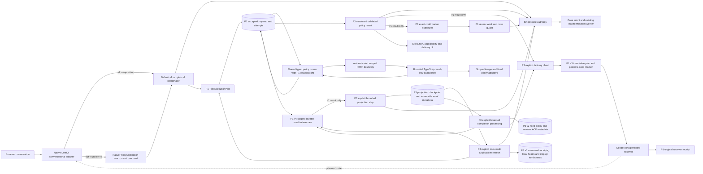
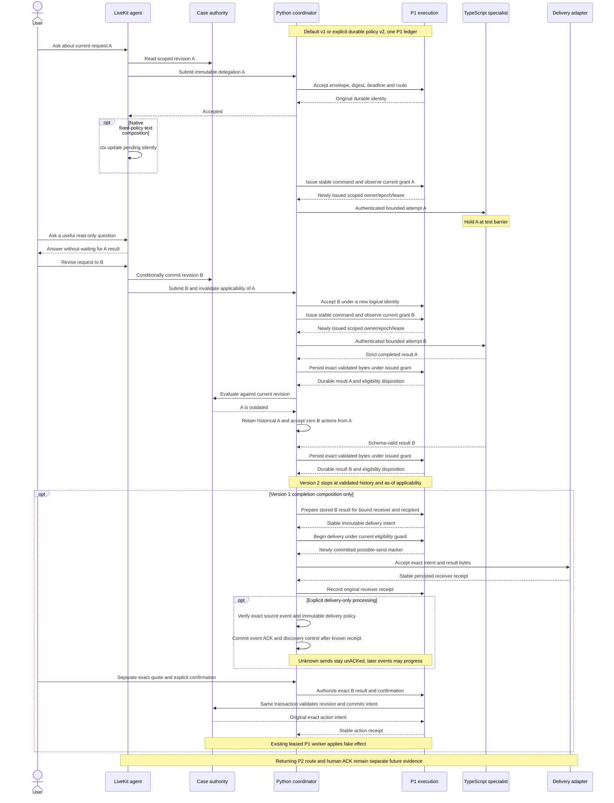

# Delegation Reliability Kit design

Status: Active
Last reviewed: 13 November 2026

## Overview

P3 will provide a Python coordination library and authenticated TypeScript HTTP
specialist service for bounded background collaboration during a LiveKit
conversation. A synthetic traveller supplies a static booking screenshot and asks
about a date change; read-only specialists extract evidence and evaluate a fixed
versioned policy while ordinary conversation continues. The
[charter](../../docs/projects/delegation-reliability-scope.md) owns P3-01 through
P3-17, the [shared design](../../Design.md) owns common authority, and the
[granular plan](../../docs/implementation/p3-delegation-reliability.md) owns task order.
Types below are application contracts, not LiveKit SDK methods; future components are explicitly marked.

The pinned toolchain, diagnostic RTC, local stack, console and foundation API
signals exist. P3-I03/I04 implement policy contracts and local trust/evidence/
admission checks. I05 adds a scripted authenticated loopback HTTP capability and
typed client, independently usable as a library with no import-time server startup.
I06 adds the Python coordinator acceptance surface over P1's public opt-in
read-only accepted-work profile, a public managed-case read adapter and a typed
Python loopback HTTP consumer. I07A adds a one-step runner over P1's explicitly
owner-upgraded v2 issued execution/result profile. Original accepted input remains
immutable; strict results persist through P1 and fresh case applicability is a read
observation. I07B adds explicit durable delivery through a cooperating receiver,
exact case-control reads and guarded exact confirmation through P1's public v3
completion profile. The actual v4 case authority and existing leased mutation
worker retain booking/effect ownership. Autonomous scheduling and real models remain planned. I16 selected qualification
passed for the separate read-only document HTTP path described below. I08 adds actual concurrent admission/conflict, complete
bounded rejection inventory and a typed public composition/inspection example.
I09 adds versioned reference metadata and explicit resumable projection over
P1 work v4, with immutable non-atomic as-of observations. I10 adds an explicit
owner v1-to-v2 upgrade with delivery-only processing, gap-aware discovery and
immutable terminal event acknowledgements. I11 adds a separate owner v2-to-v3
refresh/display layer with exact command replay and retained invalidation evidence.
P3-01/P3-03/P3-11 have registered lab runners; fourteen full scenarios remain planned. P3-A implements the controlled
native baseline described below; its reviewed remote-isolation decision preceded
HTTP implementation. Static-image/fixed-policy V1 does not
include continuous video, arbitrary specialists or another workflow runtime.

The selected I18A durable-v2 boundary remains qualified in its handoff. I18B adds
an implemented NativePolicyApplication/NativePolicyAgent over those same public
facades. One supplied AgentSession can release its foreground through ctx.update
only after P1 acknowledges. A retained shielded call and public pending counts
protect execution ownership while a separate read slot supplies the compact DTO.
Local pinned-SDK checks and selected actual PostgreSQL/HTTP/RTC text/browser
qualification passed in source and isolated installed modes in the
[native-policy handoff](../../docs/work-items/0042-responsive-native-policy-and-compact-demo.md).
Each mode passed twelve backend assertions and three browser groups; installed
mode added eight separate offline package assertions.
The first text profile has no microphone, recognition or audio playback path.

The [origin-bound composition](../../docs/work-items/0044-origin-bound-channel-policy.md)
adds a metadata-only version-3 envelope around unchanged policy-v2 requests/results.
P1 remains the sole work/issuance/result authority. A scoped original P2 operation
selects one work key, while the entire original input identity is validated before
first-origin replay. Serving performs no DDL. Public facades and local application
boundaries have unit/socket evidence, and selected isolated library package checks
passed. The fourteen-assertion actual database original-input schedule passed with
complete cleanup; it uses a supplied scripted specialist and establishes no media
or provider inference. The existing diagrams retain the same authority and component flow.

## Objectives

| Type | Objective | Evidence of achievement |
| --- | --- | --- |
| Business | Keep a useful conversation going during slow specialist work | Hold specialist at a barrier while another user question receives a useful response |
| Business | Use only evidence relevant to the current request | Late A stays historical after revision B; zero B actions use A; valid B still progresses |
| Business | Explain cancellation, uncertainty and delivery honestly | Separate execution outcome, applicability, remote cancellation observation and delivery fields |
| Technical | Share a safe typed Python/TypeScript contract | Runtime-validated versioned schemas and equivalent positive/negative fixtures |
| Technical | Recover through one persisted execution owner | Coordinator/specialist kill tests use P1 public execution adapter and original logical identities |
| Technical | Justify remote isolation with measured comparison | Retain tool/native baselines first; compare all three with equivalent workload and declared limits |

## Functional requirements

| Type | Requirement | Planned mechanism | Acceptance reference |
| --- | --- | --- | --- |
| Business and technical | Complete useful scoped work through both languages | Immutable accepted request, authenticated bounded invocation, structured result and durable delivery intent | P3-01–P3-04 |
| Business | Prevent stale evidence from authorizing current actions | Applicability check plus atomic current revision/exact confirmation/intent commitment at case authority | P3-05–P3-07 |
| Technical | Recover accepted work and respect deadlines/cancellation | P1-owned attempts/retry/deadline contract; persisted result projection and explicit invalidation | P3-08–P3-10, P3-14 |
| Technical | Reject unauthorized, malformed and excessive work | Trusted service principal, allowlisted capability/evidence adapter and context/image/result limits | P3-11, P3-13 |
| Business | Return current useful results after handoff or room closure | Stable logical route through standalone delivery adapter or integrated P2 routing | P3-12, P3-17 |
| Business | Produce evidence or clarification from image/policy input | Static booking.extract_document and booking.evaluate_policy capabilities; no mutation permissions | P3-15 |
| Technical | Compare native and remote behavior fairly | Controlled seeded tool/native/remote fixtures, raw correctness/usage/timing samples and reviewed context differences | P3-16 |

## Non-functional requirements

All product targets are planned release criteria, not measured global-scale or
latency claims. Each run fixes finite resource limits and numeric regression
budgets before collecting results.

| Property | Target or invariant | Verification | Status |
| --- | --- | --- | --- |
| Applicability safety | Zero action intents based on outdated/invalidated/wrong-scope results | A/B schedules, real case-authority race and exact fake-effect ledger | Selected I07B/I11 and I12 authority schedules; full row planned |
| Useful progress | Expected current results progress; holding specialist does not block useful ordinary response | Positive B path and actual held-specialist media run | Planned |
| Durability | Zero lost accepted logical delegations under each declared crash schedule | Kill real coordinator/specialist processes; recover through P1 persisted adapter | Planned |
| Identity | Same scoped canonical ID returns original work; changed content conflicts | Concurrent requests, lost-response replay and completion-after-restart | Planned |
| Resource bounds | Finite configured global/per-tenant active, queue, attempt, context, image, result and shutdown limits | Saturation, second admitted tenant, image decode guard and cleanup probes | Selected HTTP/I16/I17 limits passed; global-scale release gates remain planned |
| Trust | Zero unauthorized invocation/lookup/cancel/evidence reads | Missing credential, forged scope, inaccessible image and arbitrary URL negatives | Selected policy/image rejection gates passed; full row planned |
| Compatibility | Both languages agree on supported schema and exact semantic identity | Shared fixtures and built artifact consumer contract tests | Selected I16/I17 cross-language and affected compatibility gates passed; full row planned |
| Observability | Actual boundary events, finite metric labels and nonblocking bounded exporter | Producer-safe log/error checks, inspected trace and exporter outage | Planned; API foundation signals implemented |
| Reproducibility | Standalone installed library works without complete P1/P2 deployment; actual platform runs retained | Wheel/npm-pack isolation, preserved-volume restart and supported-platform evidence | Selected I15/I16/I17 installed gates passed on the declared host; broader platform/release gates planned |

## Back-of-the-envelope calculations

These illustrative calculations choose local experiments and expose possible
resource pressure. They are not configured defaults, capacity proof or permission
to advertise a lower-latency remote architecture.

| Quantity | Assumption and calculation | Implication to test |
| --- | --- | --- |
| Concurrent invocation | 0.5 delegations/s × 4 s mean scripted invocation = 2 active attempts | Four total service slots is an initial experiment with nominal headroom; retries, uneven capabilities and provider limits reduce it |
| Small request/result buffers | Four active attempts × (16 KiB context + 8 KiB result + 1 KiB registry metadata) = 100 KiB | This excludes image decode, HTTP/runtime buffers and model SDK allocations; a bounded registry alone does not bound RSS |
| Image memory | Four admitted 2 MiB encoded images = 8 MiB; four decoded 2048 × 2048 × 4-byte images = 64 MiB | Peak includes both representations, decoder intermediates and model buffers; validate dimensions/bytes before uncontrolled decode and measure actual RSS |
| Retained work | 10,000 logical delegations × assumed 32 KiB combined immutable input/result/projection history = 312.5 MiB raw | A 3× illustrative data/index allowance is 937.5 MiB; count P1/P3 records once according to ownership; WAL/backups are extra |
| Comparison samples | Three implementations × three controlled concurrency points × 30 repeats = 270 observations | Useful for first distributions, not an automatic tail-percentile guarantee; disclose samples and deterministic versus live inference |
| Live cost | Sum actual reported input/output/image/audio usage × applicable configured provider rates | Report actual or unavailable usage/cost; fixture calls have no model usage and cannot stand in for live quality |

Start with one real media session before increasing load. Workload and platform
records identify inference mode, capability, data sizes, worker slots, machine
resources and timestamp sources. CPU/RSS or throughput from scripted HTTP tests
does not establish voice/video/model or distributed media capacity.

## High-level design

The implemented policy core and opt-in native application retain one durable
execution ledger. The configured text host/page is a separate qualification
boundary; this component diagram does not establish an actual RTC/media result. The TypeScript service
handles a bounded attempt and returns evidence; it never becomes a recovering queue.

1. Retain equivalent tool/native-subagent examples and a deployment/isolation
   decision before constructing the remote service. Remote is not presumed faster.
2. The coordinator validates a bounded immutable envelope and canonical digest.
   P1 atomically persists them with accepted execution before acknowledgement;
   later P3 metadata must not retrofit identity after acceptance.
3. P1 alone owns durable attempts, retry/deadline eligibility, cancellation policy
   and execution outcomes. HTTP status/result/cancel endpoints are observations
   of an authenticated attempt, not an independently recovering scheduler.
4. The specialist receives only scoped evidence and allowlisted read-only
   capabilities. It cannot mutate bookings, charge, notify or acquire tools from
   untrusted text. Begin with scripted policy evaluation, then image extraction.
5. P3 validates result identity/schema/revision and records current/outdated/
   invalidated applicability separately from computation success. Any resulting
   action must pass the case authority's atomic exact-confirmation commitment.
6. P1 v3 binds stored result bytes to one receiver and recipient before I/O; only
   a newly committed possible marker permits accept. A receiver receipt is retained
   acceptance, separate from human ACK. P2 routing and media presentation remain
   planned, and room closure must not erase accepted work.
7. Exact confirmation is separate caller input. P1 serializes work eligibility and
   case revision/confirmation/intent in one transaction, retaining a stable action
   receipt. P3 and the specialist never dispatch the supplier effect themselves.

## Sequence diagram

The A/B sequence combines implemented I07A invocation with I07B's explicit
completion ports. The actual test uses original revision2, alternate3/original4
because trusted quote generation uses the original completed inquiry facts.
The native policy tool is implemented for the first RTC text profile; actual
end-to-end qualification remains pending. The broader A/B revision/delivery media
composition below is planned outside its one configured policy tool.
Neither this sequence nor a lease claims remote computation can always be stopped.

## Low-level design

The diagram shows implemented v1 defaults, opt-in v2 acceptance/issued results,
and version-1-only explicit completion ports. The two facade pairs share closed
typed cores; callers cannot register arbitrary codecs. Selected I18A qualification
is recorded in the linked handoff. The application owns shared case readers.
Coordinators own their P1 work clients; runners own their P1 execution and specialist
clients. Version-1 completion facades own their injected action/delivery clients and
receiver ports, and borrow result inspectors. No component introduces another
execution state machine. The I09 projection owns only a
checkpoint and immutable as-of reference metadata. I10 adds a separate explicit
delivery-only consumer checkpoint and terminal ACKs. I11 adds explicit refresh
commands, local applicability heads and permanent display tombstones. Automatic
workers and broader recovery remain future work.

```mermaid
classDiagram
    class DelegationCoordinator {
        +submit(request) AcceptedDelegation
        +get(work_id) DelegationView
        +cancel(work_id, command_id) DelegationCancellation
    }
    class DelegationRunner {
        +run_once(work_id, command_id) DelegationRun
        +inspect(work_id) DelegationExecutionView
        +close()
    }
    class FixedPolicyCoordinator {
        +submit(v2request) FixedPolicySubmission
        +get(work_id) FixedPolicyView
        +cancel(work_id, command_id) WorkCancellation
    }
    class FixedPolicyRunner {
        +run_once(work_id, command_id) FixedPolicyRun
        +inspect(work_id) FixedPolicyExecutionView
        +close()
    }
    class PolicyCoordinatorCore {
        -sealedV1OrV2Codec
        -boundedOwnedCalls
    }
    class PolicyRunnerCore {
        -sealedV1OrV2Codec
        -issuedGrantAndOwnedInvocation
    }
    PolicyCoordinatorCore <|-- DelegationCoordinator
    PolicyCoordinatorCore <|-- FixedPolicyCoordinator
    PolicyRunnerCore <|-- DelegationRunner
    PolicyRunnerCore <|-- FixedPolicyRunner
    class NativePolicyApplication {
        +binding CopiedTrustedBinding
        +evaluate(ctx) NativePolicyObservation
        +inspect_observed() NativePolicyObservation
        +stop()
        +close()
        -oneShieldedRunTask
        -oneReservedRead
    }
    class NativePolicyAgent {
        +evaluate_policy(ctx) ReadOnlyToolReceipt
    }
    NativePolicyAgent --> NativePolicyApplication
    NativePolicyApplication --> FixedPolicyCoordinator
    NativePolicyApplication --> FixedPolicyRunner
    FixedPolicyCoordinator --> CaseAuthorityPort
    FixedPolicyRunner --> ExecutionPort
    FixedPolicyRunner --> CaseAuthorityPort
    class ExecutionPort {
        <<interface>>
        +issue(work_id, owner_id, command_id) Issuance
        +observe(work_id) ExecutionObservation
        +complete(attempt, body) AttemptResult
        +result(work_id, attempt_id) AttemptResult
    }
    class CaseAuthorityPort {
        <<interface>>
        +snapshot(scope, case_id) CaseSnapshot
    }
    class ExactManagedCaseAuthority {
        +snapshot(scope, case_id) CaseSnapshot
    }
    class ResultDeliveryPort {
        <<interface>>
        +deliver_once(work_id) DelegationDelivery
        +inspect(work_id) DelegationDelivery
        +close()
    }
    class DelegationDeliveryClient {
        +deliver_once(work_id) DelegationDelivery
        +inspect(work_id) DelegationDelivery
    }
    class DeliveryPort {
        <<interface>>
        +prepare(result_identity, receiver, recipient) DeliveryIntent
        +begin(intent) DeliveryStart
        +record_receipt(intent, receipt) DeliveryReceipt
    }
    class ResultReceiver {
        +accept(intent) DeliveryReceipt
        +find(intent) DeliveryReceipt
    }
    class DelegationAuthorizer {
        +authorize_once(work_id, confirmation, command_id) DelegationAuthorization
        +inspect(work_id) ActionReceipt
    }
    class ResultFeedPort {
        <<interface>>
        +read(after, limit) ResultFeedPage
    }
    class ProjectionProjector {
        +project_once(limit) ProjectionBatch
        +close()
    }
    class ProjectionClient {
        +checkpoint() ProjectionCheckpoint
        +get(work_id, attempt_id) ProjectedResult
        +close()
    }
    class CompletionProcessor {
        +process_once(limit) ProcessingStep
        +close()
    }
    class ProcessingClient {
        +checkpoint() ProcessingCheckpoint
        +acknowledgement(event_id) ProcessingAcknowledgement
        +close()
    }
    class ProcessingDeliveryPort {
        <<interface>>
        +scope
        +receiver_id
        +bindings
        +inspect(work_id) DelegationDelivery
        +deliver_once(work_id) DelegationDelivery
    }
    class ApplicabilityRefresher {
        +refresh(work_id, attempt_id, command_id, expected_revision) ApplicabilityRefresh
        +close()
    }
    class ApplicabilityClient {
        +command(command_id) ApplicabilityRefresh
        +inspect(work_id, attempt_id) ApplicabilityView
        +display(work_id, attempt_id) VisibleOrTombstone
        +hide_display(work_id, attempt_id) DisplayTombstone
        +close()
    }
    class ApplicabilityRefresh {
        +revision
        +classification
        +reason
        +rawNonAtomicObservation
        +retainedInvalidationWitnesses
    }
    class DisplayTombstone {
        +exactRetainedResultIdentity
        +hidden_at_ms
        +profileLifetimeReplay
    }
    class ActionPort {
        <<interface>>
        +authorize(result_identity, revision, confirmation, command_id) ActionReceipt
        +find_action(command_id) ActionReceipt
    }
    ApplicabilityRefresher --> ApplicabilityClient
    ApplicabilityRefresher --> ResultFeedPort
    ApplicabilityRefresher --> ExecutionPort
    ApplicabilityRefresher --> CaseAuthorityPort
    ApplicabilityClient --> ApplicabilityRefresh
    ApplicabilityClient --> DisplayTombstone
    CompletionProcessor --> ProcessingClient
    CompletionProcessor --> ResultFeedPort
    CompletionProcessor --> ProcessingDeliveryPort
    CompletionProcessor --> DelegationRunner : shared read inspector
    DelegationDeliveryClient ..|> ProcessingDeliveryPort
    ProjectionProjector --> ResultFeedPort
    ProjectionProjector --> ExecutionPort
    ProjectionProjector --> ProjectionClient
    ProjectionProjector --> CaseAuthorityPort
    DelegationCoordinator --> CaseAuthorityPort
    DelegationRunner --> ExecutionPort
    DelegationRunner --> CaseAuthorityPort
    ExactManagedCaseAuthority ..|> CaseAuthorityPort
    DelegationDeliveryClient ..|> ResultDeliveryPort
    DelegationDeliveryClient --> DelegationRunner : shared inspector
    DelegationDeliveryClient --> DeliveryPort
    DelegationDeliveryClient --> ResultReceiver
    DelegationAuthorizer --> DelegationRunner : shared inspector
    DelegationAuthorizer --> ActionPort
```

## Components and related details

### Native call, observation and close ownership

The native application freezes one original request/command and two sources.
The runner is explicitly configured with two slots while the application admits
at most one run and one read. Its one run_once task is shielded from the SDK tool.
SDK CANCELLABLE ends a waiter, not P1 work; tool termination or a done wrapper
cannot free reservation while public pending counts remain nonzero. After actual
settlement, repeat calls only inspect original facts. There is no background queue,
retry, source ACK or automatic polling loop.

The immutable observation is at most 4,096 UTF-8 bytes. State comes from an actual
original-key find/inspect; no-work/unknown, stored result, original disposition and
as-of applicability remain separate. Only original request revision is exposed;
application read completion time cannot stand in for a case or database clock.
The HTTP host binds the fixed authenticated session/read routes to one configured
scope and room, with a separate in-memory operator token. RTC grants add no read
or worker authority. The supplied-session example enables exact-participant SDK
text only and imports no P2 runtime.

Stop admission and retain the SDK close observer. Attempt independent facade
closes and bounded run observation even if SDK close fails. Shared case readers
wait for successful facade closure; model/room resources wait for actual SDK
closure. Incomplete close retains owners for explicit retry. Local pending zero
does not independently prove remote computation stopped.

| Component | Responsibility and state authority |
| --- | --- |
| Python coordinator | Implemented submit/find/get/requested-cancel and immutable input validation; explicit completion composition is separate |
| Implemented one-step runner | Explicit newly issued grant, bounded HTTP, strict factual result validation and fresh case read; owns no ledger, retry queue, action or delivery |
| P1 execution adapter | Sole durable acceptance/attempt/retry/deadline/worker/outcome owner; accepted envelope/digest persist before acknowledgement |
| TypeScript handler/client | Authenticated bounded invocation, typed safe errors and finite active-attempt observations; no independent durable retry queue |
| Evidence adapter | Scoped allowlisted image references and fixed policy version; no arbitrary URL fetch or full-transcript copy |
| Capability handlers | Implemented scripted booking.evaluate_policy and standalone booking.extract_document; both return read-only evidence/clarification without P1 image execution authority |
| Implemented result projection v1/v2/v3 | Explicit P1 v4 feed consumption, original checkpoint and immutable as-of metadata; later versions retain compatible old projection clients |
| Implemented applicability refresh/display | Explicit exact-command non-atomic observations, monotonic retained witnesses and permanent display tombstones; original projection/ACK/receipt identities remain protected |
| Implemented completion processor | Delivery-only bounded explicit steps, fixed receiver/routes, separate discovery and terminal watermark with exact per-event ACKs; no copied result body, queue, source ACK, action or delivery ledger |
| Case authority | Current revision, explicit exact authorization and atomic accepted mutation intent; cache values carry evaluated revision only |
| Explicit completion adapters | Revalidate full result/evidence, bind recipient/receiver, preserve original receipts and submit separate exact confirmation through P1 atomic guard; selected P2 backend receiver/read route is qualified, joined media routing follows |
| Implemented native RTC-text adapter/UI | Selected background response and bounded observed read projection qualified in 0042; joined voice/text/SMS routing remains planned, with one native session owner |

### Types, persistence and implementation layout

Request identity includes trusted scope, delegation/case/revision, capability,
input schema, immutable context/evidence, absolute deadline and stable logical
route. Result identity adds output schema and producer/attempt provenance. Keep
execution (`accepted`, `running`, `completed`, `failed`, `timed_out`, `cancelled`),
applicability (`current`, `outdated`, `invalidated`) and delivery distinct. A
successfully completed computation can still be outdated or undelivered.

Add Python code under `python`, TypeScript handlers under `specialist-ts/src` and
project tests under `tests`. Use the
[Python engineering guide](../../docs/python-engineering.md): immutable boundary
values, narrow Protocols, validated inputs, explicit async task ownership,
context-managed HTTP/store clients and cancellation propagation. TypeScript uses
runtime schemas plus discriminated result/error types, finite active registries
and declared units. Neither library starts a server or performs I/O on import.

P3-I06/I08 persist/replay the complete immutable envelope/digest through P1;
P3-I09 now adds only P3-owned projection/applicability metadata and references that
accepted identity. Use S-I05's one-shot migration/configuration mechanism for
owned schemas/grants and later service profiles. Serving roles cannot perform
DDL or receive bootstrap administrator credentials. Upgrade/restart preserves
accepted records, credentials and volume identity; reset is never recovery.

Define replay/result/effect tombstones before cleanup; expiry or display pruning
cannot permit duplicate acceptance. A standalone consumer may depend on P1's
public execution library without its full service deployment, sibling stores or
P2 gateway. Test built wheel/npm-pack consumers outside repository import paths.
P3-I22 can first qualify real media with the narrow delivery adapter; repeat
integrated routing through P2 when its gate exists and retain that reference-app
evidence for shared S-I08. Do not label a standalone pass as P2 integration.

### Implemented P3-A controlled baseline

The `python/src/delegation_reliability` workspace package now owns immutable
PolicyInput/PolicyResult, bounded JSON validation, one fixed synthetic policy rule,
an explicit local FixtureLLM and the run_baseline experiment. Both modes exercise
real AgentSession tool dispatch. The native mode additionally awaits the SDK
AgentTask/TaskGroup, with summarization disabled and a task-owned async tool so
on_enter can finish. RunContext.update permits a meaningful read-only text question
while the evaluation barrier is held. The task temporarily owns the same session;
this does not implement a separate reasoning model or independent process.

One run permits one evaluation, at most 24 fixture model calls, a 2048-byte input,
a 512-byte note, a 15-second experiment budget and one shared 3-second cleanup
budget. Reports retain actual monotonic durations, finite outcomes, fingerprints,
SDK lifecycle counts and observed completion/cleanup. These are one-sample
orchestration observations with cold-start/order effects, not performance rankings.
Named library events are policy_evaluation_started, policy_evaluation_closed and
baseline_completed; unexpected operation/cleanup failures use fixed safe events.
The library does not configure logging or an exporter. Cancellation propagates;
cleanup failure cannot return a passing report and is explicitly noted on a prior
failure. The CLI emits fixed JSON codes without external exception text.

The [baseline work item](../../docs/work-items/0023-p3-native-baseline.md) records
the exact scope, tests and remote-isolation decision. It contributes only to the
initial P3-16 comparison; no product acceptance registration, authority, durable
recovery, physical media or real-model claim follows from this baseline.

### Implemented P3-I03/I04 contracts and local trust

Python contracts.py/security.py and the TypeScript specialist-ts source implement
one strict policy-evaluation protocol. The request binds schema/capability/scope,
case/revision, immutable facts/evidence, deadline and logical destination. Only
attempt identity/number are excluded from the logical fingerprint; results match
the exact attempt and original source versions/digests. Shared fixtures test real
producer output, canonical Unicode bytes, duplicate-free JSON and named parser,
matching and factual negatives. Document extraction requires a later explicit
contract extension; the contract-only slice does not imply a model or HTTP handler.

Operator-configured bearer digests bind separate invoke/result/cancel/evidence
allowlists to trusted service scopes. Body principal/scope labels grant no access.
EvidenceRegistry validates and owns immutable source bytes; there is no arbitrary
URL fetch. The current policy check compares known fixed facts and cited rules
against that exact source. A candidate is neither current-case applicability nor
mutation permission. Producer/model metadata and completion time are observations;
trusted caller time determines expiry and the case authority still owns commitment.

AttemptBoundary owns at most four live permits by default, two per principal,
with no queue, retries, timer, store or recovery behavior. Only the original permit
can release its slot. Admission rejects unknown scope/evidence or ineligible time
without retaining an entry; independent authorized work and post-release work must
still progress. Shared JSON limits, source bytes/dimensions and trusted-config
bounds are recorded in the [contract work item](../../docs/work-items/0025-p3-specialist-contracts-and-trust.md).
Image metadata is bounded, but actual decoding/extraction remains unqualified.
No HTTP instrumentation/exporter or business completion is implied by codec tests.

### Implemented P3-I05 HTTP handler and client

SpecialistServer reuses the existing LocalTrust, EvidenceRegistry and AttemptBoundary.
Its listen method chooses an ephemeral port on 127.0.0.1; import starts no listener.
POST /v1/invoke, /v1/status and /v1/cancel each consume the exact original request
envelope. Invoke requires both invoke and result grants plus all evidence grants.
Status requires result permission and cancel requires cancellation permission for
the exact live attempt. Released attempts have no terminal history or result cache.
The service never durably accepts work, retries it or owns another recovering queue.

| Resource | Default ceiling | Behavior |
| --- | --- | --- |
| TCP connections / admitted HTTP requests | 16 / 16 | Reject or close excess; one request per connection, no keepalive/pipelined second dispatch |
| Header bytes / fields | 8 KiB / 16 | Owned header deadline and duplicate/framing validation before body consumption |
| Input / result / observation | 16 KiB / 8 KiB / 1 KiB | Strict duplicate-free bounded UTF-8 schema; errors at most 512 bytes |
| Live attempts | Four total, two per principal | No waiting queue; permit stays held until actual evaluation settles |
| Header / body / invocation / response | 1 / 2 / 5 / 1 seconds | Monotonic operation budgets and trusted wall time for business expiry; smaller trusted fixture bounds allowed |
| Shutdown | Two seconds | Stop admission, signal attempts, close owned sockets; incomplete owned cleanup fails |
| Typed client | Four live calls, five-second call budget | Fixed loopback endpoint, bounded exact responses, explicit abort, no redirects/retries; one-second close budget |

The fixed evaluator reads only the accepted immutable policy source and applies
notice_minimum_days. It validates source metadata and known policy facts before
returning a candidate. The client validates exact request/result/attempt/evidence
binding and observed expiry; without source bytes it cannot independently prove
factual truth. Neither side grants current-case applicability or action authority.

A cancellation response records cancel_requested; timeout/disconnect records its
separate observation. Trusted harness-only beforeEvaluate barriers test ignored
abort and retained capacity. They cannot be selected by a request. The normal
scripted evaluator is finite; a noncooperative trusted barrier cannot be preempted
in-process and makes cleanup incomplete until it settles. The server does not
silently free its permit or start replacement work on that timeout.

Fixed server events and process-local counters describe admission, computation,
rejection, cancellation, expiry, disconnect and telemetry failure. They omit bodies,
tokens, URLs and raw exceptions. Contract failures use delegation.error; transport/
unexpected failures use strict specialist.http_error. Both have fixed codes and
retryable false. These are not a deployed exporter, durable totals or a new retry
policy. The [work item](../../docs/work-items/0027-p2-standalone-and-p3-http.md)
owns actual socket, resource, artifact and cleanup evidence. make p3-demo runs the
public-export example with a fresh synthetic bearer and no provider credentials.

## Security and privacy

Bind invocation, status/result lookup, cancellation and evidence access to a
verified local service principal and authorized tenant/account/capability.
JSON scope and correlation IDs grant no permission. Allowlist scoped image
references; reject arbitrary fetch URLs, inaccessible evidence, malformed formats,
excessive bytes/dimensions and oversized context/results before uncontrolled work.
Bound decoded resources as well as encoded upload size. Specialists receive the
minimum immutable facts and policy version, not full transcripts or credentials.

Image/policy/model output is untrusted data. Embedded instructions cannot add
capabilities or rewrite application instructions. Validate outputs in both
languages; missing/ambiguous facts request clarification. Specialists never own
supplier mutation or notification credentials. Keep synthetic fixtures, secrets,
raw images/prompts, policy text and model/provider exception strings out of logs,
metrics and saved diagnostics. Use least-privilege local credentials and protected
loopback operational endpoints.

### Implemented P3-I06 acceptance and Python HTTP consumer

The coordinator uses P1's public work_api.TaskExecutionPort and immutable
WorkPayload. P1 computes its own SHA-256 over the complete canonical request bytes
and atomically accepts them under authenticated tenant/account plus logical key.
The opt-in marked accepted-work profile is P1-owned and separate from existing
booking storage. It provides acceptance and requested cancellation only; it does
not issue attempts, execute work, store results or implement another scheduler.
The request's attempt fields remain proposed transport correlation metadata.

1. Strict encode/parse creates a detached immutable snapshot before any await.
   Trusted scope must match both the body and P1's public credential-bound scope
   before any port call; body labels never configure a P1 principal.
2. The coordinator first finds the original scoped logical key. It independently
   validates stored typed fields, canonical bytes, digest, scope, operation and
   deadline. Complete semantic equality excludes only attempt ID/number; a
   fingerprint claim alone cannot hide changed input. Replay returns original
   bytes and deadline without requiring the case to remain current or unexpired.
3. New work reads the mandatory credential-bound CaseAuthorityPort, validates exact
   scope/case/revision and cancellation, and checks the remaining bounded deadline.
   This is a read observation, not atomic current-at-commit/action authority.
4. P1 submit commits immutable acceptance before acknowledgement. A concurrent
   byte conflict or ambiguous acknowledgement is reconciled by finding the original
   key and comparing its full semantics; the coordinator never resubmits that call.
5. Get/cancel validate and use the original P1 identity. Cancellation remains
   requested; accepted status does not imply remote stop, completion or delivery.
   The coordinator remains acceptance-only; I07B composes completion separately.

ManagedCaseAuthority consumes only public P1 ManagedCaseClient-compatible get and
CaseProjection. A maximum of 128 trusted logical-to-exact-task/case bindings avoids
confusing P3 logical IDs with P1 UUIDs or deriving authority from request JSON.
The existing projection cannot distinguish a committed case cancelled afterward;
committed cases fail closed with case_state_unavailable. I07B adds a separate
ExactManagedCaseAuthority using the public authenticated CaseControlClient exact read. The application owns
this case client's lifecycle separately from the coordinator-owned work client.

| Python resource | Default ceiling | Enforcement/observation |
| --- | --- | --- |
| Coordinator active operations | Four, no waiting queue | Finite admission before any port work; same ownership includes case reads and writes |
| Coordinator caller / cleanup observation | Five / one seconds | Monotonic whole-call observation; already-started port work retains its slot until actual settlement |
| New request business deadline | At most 60 seconds remaining | UTC absolute expiry remains immutable; P1 authoritative acceptance also checks expiry |
| Python HTTP active connections | Four, no waiting queue | Native asyncio loopback streams, one connection/request; literal 127.0.0.1 and explicit port |
| HTTP headers / fields | 8 KiB / 16 | Exact HTTP/1.1, duplicate-free headers, known Content-Length and connection close; no transfer/content encoding, proxy, redirect or retry |
| HTTP result / observation / error | 8 KiB / 1 KiB / 512 bytes | Exact schema, duplicate-free UTF-8 JSON, scope/attempt/source/deadline binding |
| HTTP caller / cleanup observation | Five / one seconds | Total monotonic budget plus bounded cleanup observation; held actual cleanup retains the permit and fails visibly |

Cancelling a coordinator waiter prevents a subsequent write at a preflight boundary
but cannot cancel an already-started authoritative write. Timeout during a write
returns acknowledgement_unknown; inspection uses the original key. Coordinator
close stops admission, abandons calls that have not reached their write boundary
and observes actual pending work before closing its P1 client.
The Python HTTP client requests socket cancellation while retaining its owned task
through wait_closed. Repeated close cannot release a held permit. A finite close
may report cleanup_incomplete; it never promises an uncooperative owner stopped.

Library events use named loggers with fixed operation/outcome/code fields and no
body, notes, identifiers, credential or dependency exception text. Logger failures
increment telemetry_failed and cannot change business acceptance. Process-local
HTTP received counts framing receipt only; validated counts strict public result/
observation success, and validation_failed counts rejected schema/correlation.
Coordinator settled-port counters do not replace durable P1 truth. Fake-port unit
checks, actual PostgreSQL acceptance/reopen and Python-to-TypeScript sockets remain
separate evidence lanes; none establishes durable result recovery or action safety.

### Implemented P3-I07A issued invocation and results

P1's explicit owner v1-to-v2 upgrade preserves accepted input and adds finite
issued-attempt/result tables. Runtime factories validate an existing profile and
perform no DDL. P1 bounds logical active leases and attempts, checks database time
under locks and retains opaque immutable result bytes/digests. Its
eligible_at_commit disposition means lease/time/cancellation eligibility only.
It is distinct from P3 policy facts, current case reads or booking authority.

The runner issues one stable command and invokes only a newly created grant after
a fresh exact current owner/epoch/lease observation. Replayed or ambiguous issuance
never invokes. Transport correlation is attempt_ plus the issued UUID's 32 hex
characters; accepted canonical bytes, proposed attempt, fingerprint and deadline
never change. The HTTP specialist verifies its own service principal and evidence
permissions; it does not verify P1 issuance in this wire version. Direct HTTP
computation therefore establishes no P1 execution/result or business authority.

A strict result is independently validated against scoped evidence and factual
policy claims, including after expiry, then committed under its exact issued grant.
Unknown commit acknowledgements reconcile the original result without a second
write. Known cancelled/expired/superseded/lease-expired bytes remain historical in
P1. A canceled waiter retains actual local capacity; no HTTP starts after abandoned
issuance, while already-started read-only I/O may still yield retained history.
A lease or prior current observation cannot fence a future paused physical request.

Returned execution/request/result snapshots are reconstructed before awaiting case
reads. inspect reports candidate/clarification/outdated/case_cancelled/expired/
execution_ineligible/unavailable separately from accepted status, actual
computation, P1 disposition and future delivery. These read observations cannot
atomically authorize action. The default runner owns one call, five-second caller
observation and one-second cleanup observation. Evidence is at most four verified
immutable records/16 KiB; P1 result bodies are at most 8 KiB.

The actual twelve-case gate seeds v1 input, upgrades v2, invokes real TypeScript
HTTP, retains cancellation and superseded history, observes useful revision B,
kills a process after result commit and reads the same result in a fresh process.
An independent owner verifies 6 accepted inputs, 2 cancel commands, 6 attempts and 6
result hashes/correlations/dispositions; Node independently observes exactly 6
invocations and zero remaining resources. Case revision reads are synthetic and
no complete action/delivery/recovery/media criterion is claimed by this slice.

### Implemented P3-I07B explicit delivery and guarded action

The owner upgrades existing work v2 to v3 before opening completion clients;
serving performs no DDL. P1 owns delivery intent/possible-send/receipt and action
receipt alongside the original issued result. P3 owns no completion store. A finite
trusted mapping fixes logical case/conversation to receiver recipient and exact
case actor/scope/schema/task/case identity. Full nested input/result/evidence and
quote values are reconstructed before awaits; caller labels never select authority.

Delivery revalidates the canonical stored result and finite current applicability,
then prepares its original bytes for that bound receiver before I/O. Only a new
P1 begin permits accept. Existing possible delivery uses find only; reliable
absence stays unknown because no retry policy is implemented here. The cooperating
receiver stores an immutable receipt in private bounded SQLite. An original known
receipt remains a fact after work cancellation, expiry or case invalidation.
Accepted bytes, useful validated result, current applicability, delivery acceptance
and human acknowledgement remain distinct observations.

Authorization requires factual eligible candidate evidence plus separately supplied
exact explicit Confirmation for the same trusted quote/task/case/revision. P1's
ActionPort locks booking admission then work admission, validates current work,
issued attempt/result/deadline/cancellation and atomically commits case intent plus
stable action receipt. An unprotected read followed by a plain case write is never
used. A post-preflight cancellation rejects intent; a later cancellation cannot
undo a known commit. Only the existing leased P1 mutation worker calls the fake
supplier. Receipt replay reads original command facts without another write.

Each completion facade defaults to two active calls, a five-second caller budget
and one-second cleanup observation. Cancel/timeout retains the actual owned task
and slot until settlement. The facade owns its P1 completion client (delivery also
owns its receiver); the application owns the shared result inspector and case
client. Unknown commit plus failed lookup remains acknowledgement_unknown. No
hidden retry, scheduler, automatic recovery or import-time I/O is introduced.

The actual thirteen-case gate uses case v4/work v3 with owner/runtime credentials
separated. Public quote production and revision2→alternate3→original4 make A stale
while valid B progresses; no private quote injection is used. It proves a cancel
barrier before the atomic guard, separate exact confirmation, one leased fake
effect, receiver ACK loss and commit-SIGKILL, fresh-process reconciliation and
later-cancel fact replay. Owner SQL links exact eligible issued result, confirmation,
quote, intent and effect; independent receiver/supplier reads reconcile identities,
bytes and counts. Four service invocations and zero live resources are independently
observed. This selected proof does not qualify broader races, P2 delivery, media,
models or full recovery/product rows. I09 separately adds bounded metadata
projection; autonomous recovery remains planned.

### Implemented P3-I08 complete first acceptance runners

P3-03's three runtime processes reach preflight only after independent scoped finds
missed. Original acceptance enters P1's protected transaction first and holds its
public before-commit test barrier. A separate owner observer requires one holder
and two waiting backend chains on that exact schema's admission relation before
release. Equal input resolves to the original logical ID/bytes/deadline; changed
nested input conflicts. Independent SQL verifies one accepted input, one selected
issued attempt/result, no cancellation and no foreign-scope record. Fresh runtime
inspection checks separate tenant/account combinations disclose nothing. Logical
acceptance is the invariant; arbitrary retry is not guaranteed one computation.

P3-11's exact twelve-case inventory executes malformed output, revision/version/
tenant mismatch, oversized result/context/request/image bytes and dimensions, and
evidence/factual negatives. Both public language codecs/registries reject safely;
the actual receiving path gets five intentionally invalid HTTP outputs under P1
issued attempts. Each keeps the actual transport_unknown runner observation and
commits no result. Leases expire according to observed P1 status before later
admission, then a valid useful result persists. The independent Node peer reports
which request received each variant; owner SQL verifies six accepted inputs,
six attempts, one valid result and zero invalid commits. These predecode checks do
not qualify image extraction, model truth or the broader modality scenario.

The public example snapshots request and independently supplied exact confirmation
before any await, concurrently demonstrates replay and reads actual public task/
result state. Delivery and guarded action remain explicit separate calls;
inspect_accepted performs reads only. The application owns configured clients and
cleanup. Import starts nothing and neither the example nor a result manufactures
operator confirmation, worker authority or human acknowledgement.

P3-01 reuses the full fresh thirteen-case issued/delivery/guarded-action gate.
P3-03 and P3-11 retain exact eight/twelve-case fresh reports. Only those three
complete rows are registered; all fourteen others retain their own assertions.

### Implemented P3-I09 versioned resumable metadata

P1's explicit v3-to-v4 owner upgrade adds a generic result-only feed. Immutable
source UUID, verified tenant/account and contiguous signed-int64 scoped cursor
identify references. Result commit and its live event share P1's existing guarded
transaction; pre-existing history is adopted once with stable IDs and explicit
adopted_history origin. Adoption order is not original commit order. The feed has
no consumer ACK, result body, case snapshot or action permission.

P3 installs one separate marked schema with exactly three tables: v1 metadata and
limits; a fixed source/scope checkpoint; and strict canonical result-reference
observations. Owner grants runtime SELECT, result-row INSERT and checkpoint
sequence/count UPDATE only. Factories validate existing schema/catalog/binding;
serving performs no DDL. Exact repeated install preserves all state. Neither
accepted input nor P1's execution/delivery/action stores are copied or modified.

ProjectionProjector uses the public feed and exact historical command/attempt
lookup to re-read original request/result bytes. It validates immutable identity,
canonical contracts and trusted policy evidence before recording schema_version=1,
kind=result_projection metadata. Definite invalid P3 bytes/facts become a rejected
reference with a fixed code; missing/corrupt/unavailable source state halts without
checkpoint advance. Later valid work can follow a rejected result.

Applicability records as_of_non_atomic and separate execution/case observation
and evaluation times. A foreign/malformed case read is discarded and represented
as unavailable, without its fields. A valid case observation records revision and
cancellation. Case-only changes produce no result event, so a retained candidate
can become stale. Stored observations never replace P1's atomic current
work/result plus exact confirmation/revision commitment. I11 adds separate
refresh receipts without rewriting these original observations.

Each explicit step consumes four references by default, at most eight. Rows and
checkpoint commit together under a checkpoint-row lock and CAS. Concurrent exact
complete batches return the original stored observations and the actual observed
checkpoint; observations are never recalculated on replay. Partial overlap or a
moved checkpoint can fail checkpoint_conflict, requiring an explicitly scheduled
fresh step. An unknown commit gets one exact lookup, returning originals if known;
failed/absent lookup stays acknowledgement_unknown without another write.

The default cap is 3,000 records, configurable 1–30,000. At 8 KiB canonical metadata
per record the default maximum body budget is 23.44 MiB, excluding indexes, WAL
and backups. Capacity failure leaves the checkpoint unchanged. I11 adds explicit permanent display hiding without deleting protected rows.
Automatic retention expansion remains planned. Source sequence type is
independent of this record cap. The projector owns three injected clients; the
application owns its shared case adapter. Actual blocking I/O retains slots after
waiter timeout/cancellation; close reports incomplete until actual settlement.

make p3-projection-check has twelve named assertions over real restricted-role
PostgreSQL, actual v4 case reads and public issued results. Two owned-PID kills
prove precommit rollback/fresh resume and postcommit original reads. Concurrent
projectors are independently observed contending on their SQL checkpoint before
release, then reconcile exact original metadata. Independent source/result/digest
joins and case/supplier reads prove four referenced results, one rejected, no
invented execution, zero intents/delivery/effects and ownership-checked cleanup.
These selected I09 assertions do not complete P3-04 or P3-08 and add no scheduler,
provider, media or default UI behavior.

### Implemented P3-I10 completion processing

The explicit owner v1-to-v2 upgrade preserves every original projection body,
source identity, checkpoint and retained-record limit. It adds processing_control
and processing_acks to the existing three tables. Owner-only setup fixes one
receiver UUID and up to 32 case/conversation-to-recipient bindings. Policy bytes
and schema/catalog fingerprints are validated on reopen; runtime cannot retarget
it or perform DDL. A repeated old v1 install validates v2 rather than downgrading.
The tested versioned-profile row backup/restore recreates this synthetic profile
through its explicit installer and restores exact saved data; it is not pg_dump.

CompletionProcessor owns processing, feed and delivery clients. The application
owns shared result/case readers. Public checkpoint/exact-event ACK inspection is
separate from processor-private bounded paging and CAS writes. The additive
ProcessingDeliveryPort exposes copied and revalidated scope, receiver and route
policy; the existing ResultDeliveryPort interface remains compatible.

One explicit call examines four unACKed projected references by default, at most
eight total, with at most two queries and one wrap over retained projection rows.
The captured projection checkpoint bounds the scan. Discovery advances past an
unknown event so later eligible work can progress. The terminal watermark only
advances over a contiguous prefix of terminal acknowledgements. Neither cursor
owns accepted work, schedules retries or acknowledges the P1 source feed.

Before a new ACK write, the processor verifies the exact current public source
reference and immutable projected/request/result identity. Definite rejected
content or historical not-required-as-of observations may be terminal under this
fixed delivery policy. Missing/mismatched/unavailable source state cannot become
a terminal skip. Stored as-of applicability never authorizes a new delivery.

An exact original P1/receiver receipt is considered before current applicability.
Possible send plus reliable receiver absence remains unknown, including after
later case change, cancellation or expiry. That event gets no terminal ACK, and
only lookup is permitted. A later exact receipt can close a gap without another
accept call. New delivery retains the existing facade's fresh result/case
preflight and P1 begin eligibility check. Those reads do not atomically fence a
cross-authority case or recipient revocation; no stronger claim is made.

A result whose case and conversation have no route in the frozen v2 bindings is
recorded as unACKed `unavailable` (counted as `unroutable`) so the scan cursor
still advances and later results progress; it gets no terminal ACK and no send.
Scope, identity and source conflicts still fail the whole step closed.

Each event ACK and discovery/control revision share a repeatable-read CAS
transaction. Receiver I/O stays outside that transaction. The coherent snapshot
can exclude a concurrently appended projection while the next read sees it.
Definite serialization/checkpoint conflict may look up the exact winning ACK
once; absent/failed lookup stays checkpoint_conflict. Ambiguous commit follows
the same read-only reconciliation but stays acknowledgement_unknown if unknown.
Neither path resubmits. Returned nested models are defensively copied, and
original terminal observations survive replay without reclassification.

Per-event commits mean a later error may follow earlier durable progress in the
same bounded call. Exact public ACK/checkpoint reads expose those retained facts.
Timed-out/cancelled waiters retain actual tasks/threads until settlement. No new
ACK write starts after read abandonment; an already-started write remains owned.
Close reports cleanup_incomplete until real I/O settles. Logging failure cannot
change any receipt, ACK or checkpoint.

ACK bodies are bounded to 4 KiB and count never exceeds the inherited 3,000-record
default, configurable to 30,000. The default ACK-body budget is 11.72 MiB in
addition to 23.44 MiB projection metadata; indexes, WAL and backups are extra.
Processing defaults to two active calls, ten-second caller observation and
one-second cleanup. These finite limits are correctness bounds, not measured
production throughput or latency targets.

make p3-processing-check runs sixteen actual PostgreSQL/receiver assertions with
five owned-PID kills and an observed competing-ACK SQL graph. It tests nonempty
upgrade/rollback/restore/repeat, old v1 readers plus a new projector write on v2,
unknown A with useful later B, receiver and ACK commitment recovery, immutable
policy/source/scope, fresh applicability, late known receipts, bounded wrap and
independent exact source/ACK/P1/receiver reconciliation. A controlled snapshot
schedule demonstrates processing-through-seven while a public projector commits
eight, then fresh reads see eight; it is an isolation proof rather than an exact
reproduction of the original problematic interleave. Zero action intents/effects
are produced. Full P3-04 and P3-08 remain outside this selected task's registration.

### Implemented P3-I11 applicability refresh and retained display

The owner-only v2-to-v3 upgrade preserves all five existing tables, immutable
projection/ACK bytes, source/checkpoint, processing policy and limits. The schema
adds refresh_control with fixed policy/caps/count; applicability_heads with a
per-event local revision/latest command and optional stable display tombstone;
and immutable applicability_refreshes with unique command and event/revision.
Runtime has only the necessary SELECT/INSERT/column-UPDATE grants, no DDL/DELETE.
The catalog/fingerprints/role/source/policy are validated on reopen. Repeat
validates without downgrade, while changed fixed policy conflicts.

| Public component | Responsibility | Boundary |
| --- | --- | --- |
| ApplicabilityRefresher | One exact work/attempt refresh with stable command UUID and expected local revision | Owns feed/execution/metadata clients, application owns case reader; no scheduler or effect |
| ApplicabilityClient | Original command/latest inspection and explicit display hide/read | Credential-bound metadata only; original authenticated facts survive hiding |
| ApplicabilityRefresh | Immutable exact source/projected/request/result identity, raw observations and effective classification | Historical receipt, never fresh action/delivery permission |
| InvalidationEvidence | Highest verified case/attempt observations and sticky cancellation/expiry/different-attempt witnesses | No wall-clock winner inference or revival from stale reads |
| DisplayTombstone | Stable permanent presentation hide for an exact retained result | No deletion, identity expiry, extra admission capacity or processing filter |

Same semantic command replay returns the original refresh before new source/case
reads or capacity checks. A changed work/attempt/expected revision conflicts. New
commands verify the current scoped source event, exact historical issuance/result,
original canonical request and trusted evidence. Current work cancellation and
attempt are read separately from the historical grant. Execution status may
remain result_recorded after cancellation/expiry, so status alone cannot prove
current eligibility. A stored eligible result is not invalid merely because its
original lease later elapsed. ExactManagedCaseAuthority supplies the scoped
public current case read; foreign/malformed case fields are discarded entirely.

Refresh stores raw execution/case/time reads as as_of_non_atomic alongside
current/outdated/invalidated/unavailable/rejected state and a specific reason.
Candidate and clarification remain distinct. Highest verified case revision,
different-attempt witnesses and cancellation/expiry evidence survive stale or
unavailable reads, including witnesses in the original projection before the
first refresh. Unavailable-only state can recover. Host deadline expiry is named
local/as-of; it is not a new P1 database-time receipt. Local revision CAS orders
metadata, without claiming a coherent source/case snapshot or permission.

The refresh command/head/count commit under one repeatable-read metadata CAS.
External case/result reads occur before that transaction. A stale local revision
or SQLSTATE 40001 remains checkpoint_conflict unless one exact command lookup finds
its original receipt. An ambiguous commitment similarly performs one exact lookup,
otherwise preserving acknowledgement_unknown. Neither path resubmits. Returned
and submitted nested values are copied before subsequent awaits. Retained tasks/
threads keep capacity through waiter timeout/cancellation, and incomplete close
remains visible. Telemetry failure cannot alter durable truth.

The replay horizon is the retained profile lifetime. Explicit hide_display records
one stable permanent tombstone independent of refresh revision. display returns
that marker; original projection/refresh/ACK reads remain unchanged. Processing
continues to inspect hidden unresolved events, so hide cannot acknowledge an
unknown send or block later valid processing. Known delivery/action receipts and
terminal ACKs remain facts after refresh invalidation. No physical pruning, TTL,
identity reuse, automatic source ACK, action, accept retry or retarget is added.

The default cap is 3000 retained refresh commands, configurable 1–30000, with four
commands/result by default and maximum eight. Each command receipt is at most
4096 bytes, a default 11.72 MiB raw-body allowance and maximum 117.19 MiB. One head per
retained projected event follows the original record cap; a tombstone is at most
2048 bytes. Indexes/WAL/backups add overhead. Hide never frees these protected
slots; new commands fail closed at capacity while original reads/replays work.
These are finite arithmetic bounds, not measured production capacity.

make p3-applicability-check uses eighteen selected actual assertions: nonempty
upgrade/interruption/repeat, populated new command/head/tombstone profile-row
restore, late A after caseB with zero A-derived action and separately confirmed
valid B fake effect, cancellation/lease/deadline distinctions, stale/unavailable
reads, local CAS contention, five owned-PID commitment kills, hidden unknown/later
progress, scope/source/capacity negatives and exact independent identity joins.
The restore is a quiescent captured-cut versioned-row procedure, not pg_dump or
stale-branch recovery. The [phase handoff](../../docs/work-items/0034-callback-evidence-and-applicability-refresh.md)
records observed qualification. Full P3-05 remains unregistered; I12 validates
selected protected-action schedules and I13 owns broader cancellation/deadline recovery. P1 runtime/schema and the
source-incarnation boundary remain unchanged.

### P3-I12 existing protected action and supplier boundary

This slice adds validation/composition, with unchanged P3 runtime, P1 runtime,
schema and public interfaces. The existing guarded action transaction remains the
only writer that joins current work/result eligibility to exact case revision,
quote confirmation and intent. Cached applicability and a successful preflight
never grant permission. The public configured completion example is reused.

A reaches the public authorize.before_locks hook after facade preflight. An owner
fixture then holds the exact isolated case admission lock while prewarmed public
writers queue. The same continuously connected observer refreshes activity stats
and records real pg_blocking_pids soft-blocker chains in both orders. It releases
within P1's unchanged 1000ms lock timeout. In B-first order, revision2 advances to3
before A's protected check rejects; revision4 is produced afterward for a fresh
independently confirmed B action. In inverse order A's intent wins; B receives
intent_committed and cannot replace that case's committed revision. A applies
once, while a separate newly quoted case proves post-intent pre-dispatch cancel.

Cancellation before intent creates no intent; before dispatch retains the intent
and a CANCELLED effect/completion with zero application. Cancellation after claim
may terminalize the effect before the old worker resumes, so its actual
TransitionConflict is recorded rather than suppressed in production. After dispatch
reservation cancellation is requested_best_effort; releasing the held actual
supplier can still succeed. After independent supplier commit, an owned child is
killed, cancellation and database-observed work/lease expiry occur, and a fresh
leased worker looks up the exact original success without another physical apply.
Pre-action-commit kill rolls back; post-action-commit kill preserves the original
receipt. Same-command replay retains original semantic identity after later changes.

Each scenario uses a separate persistent cooperating synthetic supplier and trusted
inquiry/quote production, avoiding unrelated supplier revision drift. Every work
schedule uses its own maximum 60-second acceptance horizon. The explicit wrapper
bounds total time 180 seconds with 15 seconds reserved for cleanup, 31 child modes,
128 KiB aggregate capture, 2 KiB per stream and 32 KiB reports. Three owned kills and
two actual SQL graphs support sixteen selected assertions. SQL/SQLite owner reads
join all original scope/work/attempt/request/result digests through confirmation,
intent/effect, actual supplier result/calls and distinct result-receiver receipts.
Safe retained sidecars contain structural PIDs/counts and an identity-inventory
digest; no raw confirmation, request or credential is retained there.

Caller timeout/cancellation cannot free an outstanding action I/O slot. Close stays
cleanup_incomplete while the transaction is held; eventual settlement and exact
fresh receipt inspection establish the outcome. Existing fixed public errors and
completion counters describe actual boundaries; this validation adds no producer
metrics, execution queue, physical-send guarantee or automatic authorization.
The [phase handoff](../../docs/work-items/0035-send-policy-and-action-races.md)
records qualification and failure provenance. Selected I13 deadline/cancellation proof follows; broader integrated recovery/media and
full charter rows remain separate; no acceptance registration is added.

### P3-I13 authority time and noncooperating peer validation

The selected temporal slice changes no production P1/P3 runtime, API or schema.
Public P1 work/execution/action clients and P3 runner/completion/refresh facades
remain the authority path. The explicit gate distinguishes 18 selected assertions
from full charter registration. New requests use fresh at-most-60-second horizons;
the 180-second tooling budget is not an execution lease or acceptance horizon.

A prewarmed owner locks the isolated work admission row. The public issuer is
observed in a real pg_blocking_pids graph while database clock crosses the original
deadline, then rejects with zero new grants after release. Existing 1000ms lock
timeout remains unchanged. Separate holds after issuance prove deadline, lease and
business cancellation prevent HTTP invocation. No precommit hook is mistaken for
a fresh time decision after its eligibility sample.

The dedicated Node deadline peer deliberately ignores business cancel/expiry and
returns strict read-only results. It uses public specialist contracts/trust/facts
but is a test-only fault producer. Production SpecialistServer remains cooperative.
The peer reports actual ready time separately from producer completed_at_ms; two
late results deliberately claim predeadline completion, and P1 still marks them
expired using database authority. Lease-expired and cancelled results are retained
but ineligible. A running cancel ACK is non-durable and does not prove stop. A
separate lost cancel response retains uncertainty while the original invocation
finishes. Caller timeout/cancellation alone does not request business cancellation:
the actual runner/HTTP task retains capacity until settlement, then its known result
may be eligible at commit. Later lease expiry does not invalidate an original
eligible result. Refreshed current cancellation remains a separate as-of read.

One owned coordinator is killed after late result commit. Fresh exact lookup proves
the original historical fact without another issue or HTTP call. Separately quoted
current B delivers to the cooperating receiver and exact explicit confirmation
commits one real guarded fake action. SQL/SQLite evidence joins source scope, work,
attempt, request/result digests, refresh, action/effect, all supplier calls and the
exact receiver intent/receipt; no stale result creates an action. The three retained
proofs expose bounded credential/body-free identities and observations, not merely
an opaque aggregate hash. Peer computation, server-local response finish, persisted
consumer result and human acknowledgement remain distinct.

The gate owns at most 24 child processes, 128 KiB aggregate captures, 2 KiB per stream,
32 KiB report and three proof files at 32 KiB each, with 15 seconds cleanup reserve.
Diagnostic runs never qualify. The [phase handoff](../../docs/work-items/0036-native-input-and-deadline-cancellation.md)
records measured source/installed outcomes and limitations. No retry queue,
automatic action, source ACK, profile-incarnation repair or general recovery policy
is introduced; autonomous recovery and full charter rows remain separate.

### P3-I14 explicit process recovery composition

This slice validates existing authority behavior with a bounded application/test
composition, keeping all P1 and P3 production payloads, APIs and schemas unchanged.
The source and isolated installed seventeen-assertion gates passed as recorded in
the [handoff](../../docs/work-items/0037-playback-evidence-and-process-recovery.md). Full P3-04/P3-08 registration is a separate decision.

The seventeen-assertion schedule owns eight verified process kills, one real
prewarmed two-waiter issuance graph and twenty-eight planned children. A fresh
at-most-sixty-second work horizon belongs to each individual schedule; the total
180-second gate reserves fifteen seconds for cleanup. Runtime children receive only
scoped tokens and application credentials; owner children alone install, inspect
and remove the exact marked UUID schemas. No dependency or authority budget changes.

1. Persist acceptance and an issued grant before a coordinator can crash prior to
   first HTTP. Original same-owner issuance replay is lookup-only. Changed owner
   conflicts; a premature new command invokes zero times. After P1 database time
   reaches the old lease end, exactly one concurrent explicit new command is created.
2. Kill the real specialist or coordinator during actual HTTP. The specialist's
   cooperative socket-abort observation is separate from P1 history. A fresh process
   retains the exact input and failed attempt before a newly authorized read-only call.
3. Kill before result commit to prove result/feed rollback, then after commit to
   prove original exact result/event replay without new invocation. Immutable result
   truth is retained after later lease expiry or work cancellation.
4. Keep completion G's possible-send/absent-receipt gap unknown and unACKed. Current M
   progresses independently; a receiver-commit crash reconciles the original receipt
   without another accept, and fresh direct delivery/processing preserves that ACK.
5. A separate exact trusted quote confirmation authorizes M through the existing
   atomic P1 guard. Kill after commitment, replay its original receipt, and let one
   existing leased worker produce one independently observed fake supplier effect.

The early execution account uses synthetic trusted read-only case preflight only.
The completion account maps to an actual public P1 case; accounts are not collapsed
onto one authority record. Derived projection/processing sees only G/M's two result
references, with a gap-aware ACK watermark. It is not another execution ledger.

The owner independently joins all accepted envelopes/digests, issued owner/command/
epoch histories, actual server wire attempts, result/feed references, projection/ACK,
receiver intent/body/route/receipt, exact case confirmation/intent/effect, supplier
physical call/receipt and business-completion notification. Three bounded proof files
retain directly inspectable identities and domain-separated length-framed inventory
hashes. Parent compares writer process IDs to actual owned handles; SQL backend IDs
come from instrumented public connections. Restricted query visibility cannot justify
broader database roles. Diagnostic context contains only fixed enums and bounded PID
observations, never SQL text, bodies, credentials or exception messages.

No automatic scheduler, remote stop guarantee, exactly-once physical computation,
receiver retry, source ACK or action from a projected/display status is introduced.

### P3-I15 standalone installed composition

The maintained package gate builds fresh declared distributions and copies the
public application examples unchanged into a private outside-checkout consumer.
Its default eight assertions cover wheel/sdist/rebuild/RECORD/readme/dependencies,
npm exports, strict installed imports and both executable baseline examples.
The explicit lab adds eight assertions using `standalone_policy.py` over configured
public P1/P3 ports. P1 owns execution, delivery receipts and the atomic case guard;
P3 retains its existing metadata only. No runtime authority or schema changes.

The application submits concurrently through two independent coordinator clients,
runs one selected issued attempt, delivers through the fixed cooperating receiver
and authorizes only a separately supplied exact Confirmation. One owned process
kill occurs after known completion. Fresh same-owner replay must preserve original
input/result/delivery/action identities without new write/invoke/accept/apply calls.
Read-only metadata examples project one source reference, terminally acknowledge
its known receipt, refresh as of separate reads and hide its display permanently.
Later cancellation preserves these original facts while a second refresh records
invalidation. Neither display status nor receipt replay grants current permission.

Owner SQL independently joins the exact source/work/attempt/result and receiver
route/body to case confirmation/intent/effect and actual supplier receipt/call truth.
The old bootstrap/worker helper is explicit isolated test instrumentation, never a
public consumer dependency. Three bounded proof files and an exact private file
index include nested package summaries. Version pins, existing P1/P3 payloads and
all prior gates remain unchanged. The selected I15 run passed sixteen assertions:
eight offline and eight installed lab assertions, with one owned caller-process
kill and complete cleanup. Fresh archives preserved P3's thirty Python payloads,
sixteen npm payloads and the declared P1 dependency's seventy-seven payloads.

Application cleanup settles independent clients within a tier before closing shared
readers. If a dependent client retains I/O, a later explicit close retry observes
that same owner. Parent tooling similarly retains schema/work state until owned
children are reaped and dependency cleanup succeeds. The selected host is macOS
arm64/Python 3.14.10/Node 24.22.2; broader platform/release and integrated comparison
work remain separate. I16 selected standalone image gates are recorded below;
I17 selected fixed-policy qualification is recorded below. See [0038](../../docs/work-items/0038-case-rehydration-and-standalone-release.md)
for qualification and failure provenance; fourteen full charter rows remain planned.

### P3-I16 standalone bounded document HTTP

The additive document request/result has its own booking.extract_document
discriminator. The shared LocalTrust, AttemptBoundary, HTTP server and typed clients
dispatch only the two declared capabilities. Existing policy bytes and defaults are
preserved. Python document_contracts.py and document.py expose the image models and
configured client; TypeScript's public document export supplies codecs, handler,
client and explicit finite scripted provider. P1 remains policy-only: this phase
adds no durable image acceptance, execution, projection, delivery or mutation path.

A request identifies one scoped immutable PNG, its exact length/digest/dimensions
and four ordered fields: booking reference, property, check-in and check-out.
A field is known with one or two distinct source/region witnesses, missing with no
value/witness, or ambiguous with two distinct witnesses and no chosen value.
Dates are real ISO calendar dates in 1970–2100; two known dates must be increasing.
Complete fields yield extracted; otherwise the result requires clarification.
Structural correlation cannot prove factual accuracy. A separately authored literal
oracle checks visible synthetic values and regions, including schema-valid wrong
values/swapped regions and inert instructions embedded in the image.

A fixed adjacent worker validates actual bytes before the provider: at most 2 MiB,
2048×2048 pixels, RGB8/RGBA8 noninterlaced, one first IHDR, contiguous IDAT and one
final empty IEND. The implementation checks CRC/framing, exact zlib consumption,
scanline/filter shape and bounded expansion; unsupported animation/ancillary,
palette/greyscale/interlaced forms are rejected. This is a deliberately restricted
subset of the [W3C PNG Third Edition](https://www.w3.org/TR/png-3/) sections 5,
11.2 and 13.3, not full PNG conformance. Native row-major unfiltered channel bytes
have their own pixel digest. Encoded and decoded representations may coexist;
four admitted calls can retain up to 8 MiB encoded and 64 MiB RGBA data before
runtime/decoder/provider overhead. These are bounds, not measured RSS claims.

Worker URL and code are trusted shipped configuration, with empty environment and
execArgv. A normal result requires actual worker exit 0, followed by a fresh check
of the original deadline before provider entry. The handler caps four owned calls;
workers and held provider promises retain slots until actual settlement. Timeout,
remote cancel acknowledgement and shutdown observation remain distinct. Public
close may report incomplete and an explicit retry observes the same retained work.
The configured Python/JavaScript examples load no assets or models on import.

Selected I16 qualification passed twenty source socket/contract assertions and the
same twenty from fresh isolated Python/npm artifacts. Installed mode additionally
passed eight separate offline package assertions. Each image run retained eight
scripted provider entries, seventeen worker records, five canonical client-returned
wires and complete cleanup. The affected current compatibility gate passed 146
named assertions across ten serial lanes, including the policy composition gate's
eight offline assertions; this is not a PostgreSQL-only count. That I16 checkpoint's
archives preserved thirty-two Python and twenty-seven npm payloads and the declared P1
dependency's seventy-seven payloads. Server result digests are post-shutdown
joins to those client wires, not an independent raw-server serialization capture.
The [image handoff](../../docs/work-items/0039-bounded-channel-workloads-and-image-evidence.md)
records selected qualification, retained failures and remaining boundaries.
Scripted lookup is not OCR. I17 selected fixed-policy gates passed as recorded below; real vision
inference, integrated P1 image work and all fourteen full charter rows remain
planned, including P3-15.

### P3-I17 versioned fixed-policy HTTP

I17 implements an explicit input/result version 2 for booking.evaluate_policy.
Version-1 canonical bytes and public defaults stay unchanged. The new typed path
accepts two scoped immutable JSON sources: a notice_v1 policy declaring only
notice_minimum_days with threshold seven, and zero to two identified notice-day
observations. Source reference versions remain independent of the semantic policy
version. All exact source bytes, digests, scope and complete fact witnesses must
match; two agreeing observations are usable, missing or conflicting observations
require clarification, and invented rules or values fail factual verification.
Policy, fact and image text remains data and grants no tool or mutation permission.

Shape/correlation validation and factual verification are separate. Factual checks
also run on expired results, so lateness cannot hide unsupported answers. The fixed
handler is a deterministic evaluator of this one declared rule, without a model,
provider call, generic policy interpreter or new worker. The configured public
examples receive explicit requests, evidence and clients; importing them performs
no setup. Client metrics describe owned transport calls and validated correlations,
not factual truth or business permission. Timeout/cancel retains actual I/O until
settlement; incomplete close and later close retry remain explicit.

Use `make p3-fixed-policy-plan` for the twenty-case inventory,
`make p3-fixed-policy-check` for the source contract/loopback journey and
`make p3-fixed-policy-package-check` for the same journey using fresh installed
artifacts. Installed mode separately repeats eight offline package assertions;
twenty is not a PostgreSQL or model-inference count. The declared source/installed
budgets are 120/360 seconds including twenty cleanup seconds, with at most 32
owned child processes, 64 KiB per captured stream, 2 MiB aggregate capture and
32 KiB per proof/report. The selected host is macOS arm64, Python 3.14.10 and
Node 24.22.2. Selected I17 qualification passed twenty source assertions and the
same twenty from fresh installed artifacts; installed mode separately passed eight
offline package assertions. The current document compatibility gates passed twenty
source and twenty installed assertions, with another separate offline eight. The
full affected compatibility run passed 146 assertions across ten serial lanes,
including the policy composition gate's eight offline assertions. See the
[fixed-policy handoff](../../docs/work-items/0040-operations-ui-and-fixed-policy-evidence.md).

The original DelegationCoordinator and DelegationRunner retain version-1 defaults.
Explicit FixedPolicyCoordinator and FixedPolicyRunner now compose policy version 2
through the same public P1 work/execution ports and shared typed ownership cores.
P1 accepts opaque policy-operation bytes; P3 verifies their versioned facts. This
I18A implementation and its selected qualification are recorded in the [handoff](../../docs/work-items/0041-standalone-channel-and-durable-policy.md).
Projection, refresh and action remain version-1-only. The explicit
FixedPolicyDeliveryClient implements typed v2 result delivery in
[0043](../../docs/work-items/0043-stable-result-delivery-and-return-context.md), with selected sixteen storage/four return assertions passed. The work item records separate package and final shared outcomes. It shares the closed typed delivery
core, rechecks both immutable sources and preserves the original P1 digest/receipt.
New v2 delivery requires candidate applicability; already possible delivery permits
lookup only. Current-case reads do not atomically fence a P2 receiver commit.
Selected I18B native RTC text qualification passed separately in 0042; fourteen
full charter rows, integrated return routing and broader release remain planned.

Selected I18A qualification passed twelve source assertions and twelve isolated
installed assertions, with eight separate offline package assertions. Each durable
journey exercised thirteen invocations, retained eight validated results and rejected
five invalid bodies. The affected fixed-policy and document source and installed
gates passed twenty assertions each; the fresh ten-lane compatibility batch passed
146 assertions with complete cleanup. Selected I18B native RTC text qualification
subsequently passed in 0042. Full charter and integrated voice/return-routing
release acceptance remain planned.

### Opt-in durable policy version 2

Construct FixedPolicyCoordinator with a public authenticated TaskExecutionPort and
trusted CaseAuthorityPort. Submit acknowledges the original immutable request
through P1 before an explicit FixedPolicyRunner.run_once(work_id, command_id).
The runner requires the original logical owner plus exactly two immutable scoped
JSON EvidenceRecord values, at most 4096 bytes each. Only a newly issued current
grant permits HTTP invocation. Replaying its original command never grants a new
invocation; known results preserve their original bytes and commit disposition.

FixedPolicySpecialistClient.invoke_observed(request, evidence=records) in Python
and invokeObserved(request, records) in TypeScript copy and validate that exact
pair before I/O, then verify every fact and witness even on a late result. They
return the typed result, observation time and separate candidate, clarification or
expired classification. The existing invoke method remains the correlation-only
transport API. The durable runner independently checks facts before P1 completion
and stored-result inspection; P1 eligibility uses fresh authority time and stays
separate from semantic validity and current case applicability. Missing/conflicting
facts clarify. Cancellation does not erase previously eligible result truth.

The configured Python example examples/durable_fixed_policy.py and TypeScript
observeFixedPolicy export receive explicit public clients, evidence and identities.
They perform no implicit DDL, provider setup or scheduling. Close independent
owners within a tier, await successful facade closure, then close shared case
readers; incomplete close retains actual I/O and may be retried.

Use make p3-fixed-work-plan, make p3-fixed-work-check and
make p3-fixed-work-package-check for the declared twelve-assertion source/installed
journey. Installed mode separately repeats eight offline package assertions.
The selected bounds are 180/360 seconds including twenty cleanup seconds,
at most 32 owned children, 64 KiB per stream, 2 MiB aggregate capture and 32 KiB
per proof/report. The synthetic local profile creates thirteen issued attempts,
retains eight valid results and rejects five invalid bodies, with one owned
postcommit kill, fresh-process original lookup and independent scoped authority
proofs. The linked handoff records measured outcomes, prerequisites and retained
failure provenance for these assertions. No new P1 storage
version, supplier call, result action or native/session owner is introduced.

## Observability

Future P3 instrumentation extends the existing foundation API signals according to
the [observability contract](../../docs/observability.md). Exported spans remain planned until the actual producer and inspected evidence
exist. Implemented delegation_run fixed run/inspect/code/outcome events and numeric
process-local counters describe actual port activity. delegation_completion adds
fixed deliver/inspect/authorize operation/code/outcome events; it omits identifiers
and contains throwing log handlers. Logger failure is contained;
it cannot reverse a committed result. I09 result_projection adds fixed operation/code/outcome events and process-local
started/succeeded/failed/active/capacity/waiter/telemetry counters; no exported span
or cross-process metric is claimed. I10 adds examined/terminal-ACK/unknown/unavailable observation and exact ACK
reconciliation counters. They are local operation observations, not unique row
counts or exported capacity metrics. No request body, policy note, token, raw URL,
SQL parameter or dependency exception text is emitted by this boundary.

| Producer | Event/span and safe fields | Required interpretation |
| --- | --- | --- |
| Coordinator acceptance | Fixed capability, schema, safe outcome/code, request ID and approved opaque delegation/execution handles | Acknowledgement follows P1 accepted commit, not HTTP arrival |
| P1 invocation adapter | Attempt dispatch/status, qualified monotonic duration and bounded retry/deadline observation | HTTP timeout does not prove remote work stopped |
| TypeScript handler | Verified principal decision, fixed capability, admitted/rejected/finished outcome and safe attempt handle | A bounded in-memory registry is observation, not another queue |
| Validator/applicability | Schema result, evaluated revision, current/outdated/invalidated reason and authority decision handle | Completion success is separate from applicability and action authorization |
| Delivery/cancellation | Stable logical intent, route outcome, cancellation requested/acknowledged/invalidation observations | No guarantee of remote termination, physical delivery or user comprehension |
| Conversation client | SDK-native metrics/session reports and qualified actual browser response/playback evidence | Filler speech is not useful task progression; client and emission timestamps differ |

Use INFO for ordinary transitions/known outdated results, bounded WARN for
degradation/rejection and ERROR for unexpected boundary defects. Log a failure
once at its owning adapter. Producer allowlists exclude payloads, exception
arguments, headers and secret-bearing chained tracebacks; preserve approved safe
correlation only. Bound logs and OTLP queues/retries/shutdown; export failure must
not block conversation, acceptance or result progress. Inspect actual trace spans,
not merely collector readiness.

## Metrics

Instruments below describe planned semantics; finalize names/units/buckets with
the first real producer. Counter resets are operational behavior and cannot
replace persisted correctness counts after restart.

| Measurement | Type/unit | Fixed label vocabulary | Producer |
| --- | --- | --- | --- |
| Delegation accepted/duplicate/conflict | Counter, delegations | allowlisted capability, outcome/code | Coordinator/P1 acceptance observation |
| Invocation active/admission rejection | Gauge/count; counter/count | capability, fixed rejection reason | P1 slot ownership and bounded HTTP handler registry separately |
| Queue/dispatch/result/recovery delay | Histogram, seconds | capability, fixed outcome | Qualified timing at relevant durable/attempt boundary |
| Result validation/applicability | Counter, decisions | capability, current/outdated/invalidated, fixed reason | Validator and applicability owner |
| Cancellation/expiry | Counter, observations; histogram, seconds | fixed disposition/source | P1 cancellation plus remote acknowledgement and invalidation observations |
| Useful current progress and stale intents | Exact experiment counts; bounded counters | fixed workload/mode/capability | Case-authority ledger and retained known-fixture outcomes |
| Resource/model/conversation evidence | CPU/RSS, bytes, SDK usage and qualified seconds | service/capability/mode | Seeded process run, SDK reports and actual browser observation |

Implemented runner counters are started/succeeded/failed, invoked/not_reinvoked,
capacity_rejected, timed_out_waiters/cancelled_waiters, telemetry_failed and active.
They reset with the process; persisted P1 records remain execution truth. HTTP
validated counts include strict historical observations from invoke_observed,
whose timeliness remains explicit rather than a candidate-success claim.
Completion counters are started/succeeded/failed, receiver_invoked, reconciled,
capacity_rejected, timed_out_waiters/cancelled_waiters, telemetry_failed and active.
Unknown acknowledgement remains an explicit safe error code rather than a
separate counter. They remain process-local;
SQL/receiver/supplier reconciliation establishes retained correctness after restart.

Never label metrics by tenant, delegation, case, room, attempt, image URL, prompt or
arbitrary result code. Report zero stale intents against known injected cases and
verify expected valid results; high stale-rejection percentage alone is not
success. Retain sample counts and raw timings; do not invent unsupported
STT/LLM/TTS stages or compare unrelated clocks.

## Exception handling

Typed public failures preserve stable safe codes, request ID and bounded retry
advice; actual exported class names are fixed at the implementation checkpoint.
Execution failure, applicability and delivery failure remain distinct outcomes.

| Category | Required behavior | Retry/recovery policy |
| --- | --- | --- |
| Validation/version/capability | Reject before acceptance/invocation; retain safe field category without submitted data | Correct trusted contract; no model work |
| Authentication/scope/evidence access | Reject invocation/lookups/cancel/image access without disclosure | Establish verified principal; never trust body scope |
| Idempotency conflict | Preserve original immutable envelope/digest | Same canonical original request only; genuine new intent needs new identity |
| Capacity/deadline | Explicit overload or expired outcome; accepted P1 work remains inspectable | P1 alone decides eligible bounded retries; remote service does not reschedule |
| HTTP/provider timeout or lost response | Preserve original attempt correlation and observed uncertainty | Reconcile/retry only under P1 policy; no claim that cancellation stopped computation |
| Invalid/mismatched result | Record validation failure or historical outdated/invalidated evidence | Never parse free text into authority or silently relabel as current |
| Revision/authorization conflict | Atomic case-authority rejection; current valid path still available | Clarify or submit newly accepted current intent, not overwrite old snapshot |
| Lost delivery acknowledgement | Preserve same logical intent and actual evidence | Receiver-cooperating dedupe or honest unknown delivery under its contract |
| Cancellation/unexpected/exporter defect | Propagate Python cancellation; bounded cleanup and sanitized boundary diagnostics | Local stop is not external rollback; telemetry failure cannot alter outcome or block progress |

Use narrow catches and explicit safe exception translation with internal cause
preservation, without logging raw exception chains/locals. Do not swallow
BaseException or create unobserved background tasks. Close owned HTTP/store/stream
resources with context managers/finally and bound task joining. A remote handler
that ignores cancellation may finish; invalidation must still prevent its result
from authorizing current action. Test cancellation before/during calls and after
intent commitment with actual independent-process outcomes.

## Design considerations and trade-offs

| Decision | Benefit | Cost or limit |
| --- | --- | --- |
| Native tool/subagent baseline first | Demonstrates when existing SDK orchestration suffices | Remote isolation must justify extra HTTP/schema/auth/process overhead |
| Python coordinator plus typed TS HTTP service | Visible cross-language boundary and isolated read-only capability | More compatibility/error/migration tests; no automatic speed improvement |
| P1 as the sole durable execution owner | One attempt/deadline/recovery authority | Public narrow execution dependency must remain stable and independently installable |
| Immutable minimal context | Repeatable identity, bounded disclosure and attributable result | Revisions produce new requests; old results remain historical |
| Atomic case intent beyond result validation | Correct revision/authorization races | Validation followed by an unprotected remote write is insufficient |
| Static images and fixed policy first | Deterministic multimodal evidence, bounded scope and explainable clarification | Continuous video/dynamic capability marketplace are deferred |
| Separate execution/applicability/delivery views | Honest successful-but-outdated and completed-but-undelivered cases | UI and API expose more than a single green completed badge |
| P1 v3 completion receipts and standalone receiver | One durable work owner with immutable route/result binding and explicit uncertainty | Same-database case guard is required here; P2 routing and recovering delivery policy remain separate |
| Bounded HTTP handler without Node Agents | Ordinary service dependencies match actual capability | Node Agents/RTC is introduced only if a real Node-hosted realtime agent is separately selected |

## Validation and acceptance gates

Use the [validation plan](../../docs/validation-plan.md),
[harness guide](../../harness/README.md) and [README](README.md) for existing
commands. Future runners enter quickstarts only after implementation. Every fault
schedule names preconditions, finite timeout, cleanup, exact state/effect checks
and useful-progress assertions; an in-memory fake cannot pass process durability.

| Gate | Required executable evidence | References |
| --- | --- | --- |
| Native decision | Equivalent controlled tool/native-subagent useful-result examples, retained raw baseline and reviewed remote isolation/deployment decision before remote implementation | P3-I01/I02; P3-16 contribution |
| First useful capability | Both languages complete a scoped request; malformed/auth/version/size negatives; atomic immutable acceptance; concurrent replay/conflict; stable completion dedupe | P3-01, P3-03, P3-04, P3-11 |
| Applicability/authority | Hold A, revise to B, accept zero A-based current action intents, then allow valid B; barrier-controlled revision/intent race; postcommit cancellation outcome | P3-05–P3-07 |
| Process/deadline/cancel | Actual coordinator/specialist kill; lost response; same-volume restart; expire before/during invocation; ignored cancel result remains invalidated | P3-08–P3-10, P3-14 |
| Read-only modalities | Static screenshot/fixed policy with missing/ambiguous/adversarial text; schema-valid evidence/clarification; no mutation/notification capability; authorized image access only | P3-11, P3-15 |
| Media/route/resource | Held specialist while user gets useful reply; actual browser interruption; current scoped returning route; saturated A cap plus admitted B progress | P3-02, P3-12, P3-13, P3-17 |
| Operational contract | Producer log/error allowlists, finite metric labels, actual inspected trace, exporter outage and resource/cancellation cleanup | P3 operational contributions and shared gates |
| Local-ready release | All 17 local assertions, frozen language checks, migrations/restart, actual supported-platform runs, isolated wheel/npm consumers and reviewed standalone/integrated adapters | P3-I15/I21–I23 and shared gates |
| Portfolio-ready release | Controlled three-way comparison plus selected real-model image/policy/voice outcomes, raw samples, configuration/cost, reviewed API and short success/failure demo | P3-15–P3-17 live portions; P3-I24 |

Report missing, skipped, timed-out, unavailable and zero-test evidence as
non-passing. Retain deterministic/offline, actual local-media and live-model labels
separately; do not switch a failed live provider to a fake and retain the live
label. Repeat P2 route integration for the reference-app release, record review
findings/assistance and keep all deferred scope explicit.
