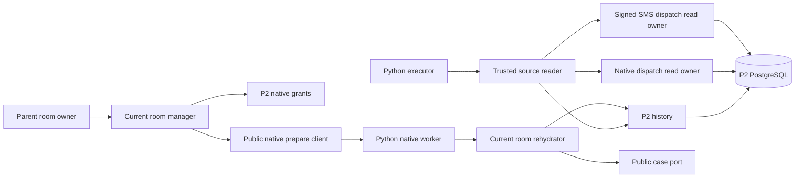
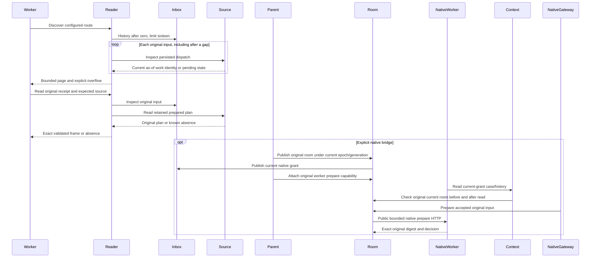
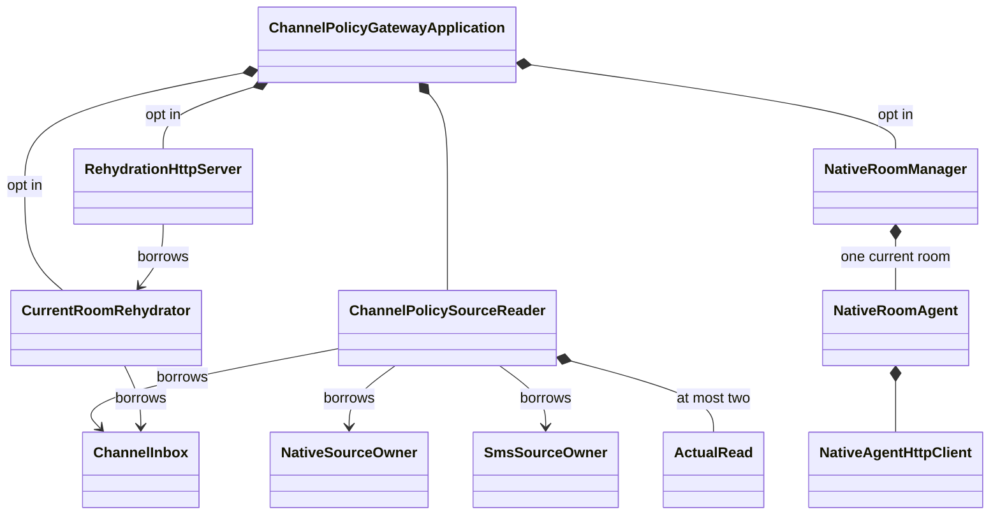

# Channel policy gateway design

Status: Active
Last reviewed: 14 November 2026

## Overview

Compose public P2 reads for one configured case/conversation. The source reader
and its loopback worker transport are implemented. The public gateway application
adds ordered owner construction and a P3-compatible result listener. The operation
bridge/runtime and scripted specialist host are implemented. Preliminary actual
SMS/result joins are observed. Opt-in current-room control, native worker attachment
and public context rehydration have component/interoperability checks; complete
joined database/native qualification remains under
the [active work item](../../docs/work-items/0045-joined-native-channel-policy.md).

## Objectives

| Kind | Objective | Evidence |
| --- | --- | --- |
| Business | Show durable channel progress while no room exists | Planned joined End/SMS/return demonstration |
| Technical | Discover actual work without another queue | Bounded public P2 history/dispatch reads |
| Technical | Preserve original source identity and bytes | Native/SMS frame and scope/digest negatives |

## Functional requirements

| Reference | Kind | Requirement | Status |
| --- | --- | --- | --- |
| P2-I22/P3-I19 | Technical | Scan persisted inputs, including later work past a pending gap | Implemented component; actual gate pending |
| Original prepared input | Technical | Read exact original frame without creating a plan | Implemented composition; P2 owns the store |
| Trusted source | Technical | Select owner only through stored provider/event identity | Implemented |
| Return-room result | Business | Expose only scoped current result to the current native grant | Internal P2 read implemented; joined P3 applicability filter and browser gate pending |
| Ordered application startup | Technical | Bind worker/result listeners before recovered input auto-dispatch | Implemented with actual listener-order tests over fake storage |
| Current worker | Technical | Attach one immutable prepare capability to the original published room; deny missing/changed/stale attachment | Component and actual cross-language HTTP checks pass |
| Native case context | Business and technical | Read current-grant history and case through the existing public facade | Component checks; actual joined SQL/media qualification pending |

## Non-functional requirements

| Concern | Bound | Verification | State |
| --- | --- | --- | --- |
| Retained inputs | Sixteen per profile; explicit overflow | Full page and corrupt cursor negatives | Component implemented |
| Reads | Two actual lifetimes, including abandoned waiters | Held dependency and close retry | Component implemented |
| Payload | Discovery 8192 bytes; original framed JSON 32768 bytes | Encoded UTF-8 cap checks | Component implemented |
| Timing | Read default 2000 ms; cleanup default 1000 ms, configurable 20–5000 ms | Waiter timeout without disowning actual I/O | Component implemented |
| HTTP ownership | Four full handlers, eight sockets; absolute header lifetime 1000 ms | Abandoned clients, partial headers and close retry | Component implemented |
| Privacy | Finite errors and aggregate numeric metrics | Dependency sentinel and accessor tests | Component implemented |
| Native prepare | One actual public client per room, four-second SDK request bound | Held call/close and old-A/new-B tests | Component implemented |
| Context serving | Two public SDK handlers/sixteen sockets, 4096-byte request and 65536-byte response | Actual public HTTP over controlled read ports | Component implemented |
| Storage | Six existing pools across all variants; no new durable queue | Default/opt-in ownership and cold-construction checks | Component implemented |

## Back-of-the-envelope calculations

Sixteen prepared payloads at 32768 bytes total 524288 payload bytes in P2. This
reader returns one frame at a time; two concurrent maximum frames are 65536
payload bytes before JSON copies, SQL buffers and runtime overhead. These are
configured upper bounds, not measured RSS, throughput or production capacity.

## High-level design

1. Trusted construction fixes scope, route and integration owners.
2. Stored provider/event identity selects a source; a caller label adds no authority.
3. The reader observes persisted facts. P1/P3 separately validate and issue work.
4. Room publication and worker attachment use fixed publisher authority and an
   observed epoch/generation. Browser input chooses no privileged client.
5. The optional context facade checks the same current room before and after
   public P2 reads, borrowing existing history/case owners.

## Sequence diagram

## Low-level design

## Components and related details

ChannelPolicyReadHttp exposes only two authenticated POST worker reads. Discovery
accepts exactly canonical {schemaVersion:1}; prepared accepts canonical schemaVersion,
receiptId and sourceBindingId. Canonical request bytes reject duplicate keys and
ignored fields. A known missing plan is HTTP 204 with no body; found frames retain
exact original bytes. Scope/provider credentials never come from the body. The
transport borrows its source reader and must drain before that reader closes.
Its listener, full handlers and actual socket-close observers settle separately.

ChannelPolicyGatewayApplication creates nine default public owners during explicit
start. Opt-in room management adds one; native context adds a reader and HTTP
owner, totaling twelve with the same six existing PostgreSQL pools.
It binds worker-read and result HTTP before native/SMS gateways can drive retained
inputs. Transport drains before readers, which drain before storage. Case, agent,
operation and carrier ports are borrowed and close outside the application.
Both gateways reach P1 through the same loopback case and origin bridges, so both
use the native 5,000 ms dispatch step deadline (`dispatchTimeoutMs`). With P2's
2,000 ms standalone default, a slow but committed SMS accept could otherwise
finish after the step deadline and leave the input uncertain.
Its nativeResult method is internal to a trusted room owner; there is no browser
route accepting a caller-selected native bearer.

The room manager owns one original publication, attachment and public native
prepare client. Exact replay cannot renew or replace its prepare capability.
Missing attachment for matching current-room input is unavailable; older/dormant
inputs retain their background semantics. Before/after current-room checks reject
late agent/context returns, and actual call/close ownership blocks B. Deeper P2
SQL remains application-owned after a room-facing waiter settles.

CurrentRoomRehydrator is a public ChannelRehydrator specialization using the same
native inbox, case port and SMS integration. Its public HTTP server retains the
SDK's two-handler/sixteen-socket limits, distinct from room controls. Parent and
worker lifecycle fencing still applies after a context read is returned.

The source-attested operation bridge derives each native/SMS sender from the
original persisted plan before constructing a public operation client. Its two
actual lifetimes include source reads, a possible origin call and late close.
The Python router independently attests the original plan. This repeated local
read costs I/O and permits clean restart without a sender cache or new ledger.
Failed startup clears its own listeners and permits explicit retry.

SourceReaderConfiguration copies trusted route/provider values and receives public
history/inspect/readPrepared interfaces. ChannelPolicySourceReader owns only its
actual read lifetimes, not pools/gateways. close stops admission and waits under
its cleanup budget; a failed observer leaves actual owners retained for retry.
The outer application drains this reader before closing shared P2 owners.

There is no storage change, migration, acceptance ACK, execution queue or persisted
cursor. Current dispatch state and historical input may be separate observations;
the executor revalidates the full original P1/P3 request before invoking work.

## Security and privacy

Account credentials remain private constructor configuration. Reads compare
stored tenant/account/case/conversation and exact provider identities. Prepared
frames retain original receipt/op/event/message/sender/body and digest. Public
adapter methods are snapshotted from data descriptors without invoking accessors.
Error translation likewise reads only known own data codes; malformed/getter
codes become finite unavailable. Tokens and
provider keys never appear in returned discovery or aggregate metrics. The frame
contains original input and belongs only on the authenticated worker boundary.

## Observability

metrics returns active/completed/failed read counts and closing state. Counters
describe process observations, never durable business totals. This component
configures no logger/exporter; HTTP/process diagnostics remain outer ownership.
Follow the [shared guide](../../docs/observability.md).

## Metrics

| Signal | Unit | Interpretation |
| --- | --- | --- |
| active | Read lifetimes | Includes actual I/O after waiter timeout |
| completed/failed | Count | Process-local settled observations |
| closing | Boolean | Admission stopped; does not establish full dependent closure |

## Exception handling

| Failure | Handling | Recovery |
| --- | --- | --- |
| Invalid/foreign request or source | Finite invalid_input/unauthorized | Reject before source read |
| Unknown input | not_found | No manufactured plan or hidden dispatch |
| Changed/corrupt bytes or joins | invalid_state | Preserve original facts; fail visibly |
| Two actual reads | capacity | Wait for an actual owner to settle |
| Dependency failure/timeout | unavailable without private text | Retain actual slot until settlement |
| Incomplete close | cleanup_incomplete | Retry observation; do not close borrowed owners early |

## Design considerations and trade-offs

A bounded full rescan costs reads but cannot skip unresolved gaps. Separate
integration-scoped owners prevent source impersonation. Original framed bytes
avoid a duplicate parsed wrapper; both canonical and encoded-frame caps apply.
Profile growth, fairness and arbitrary crash recovery retain their separate gates.
Room control tracks application-owned media resources; its closed observation does
not promise permanent RTC JWT revocation or global SQL cancellation. The parent
separately proves exact SFU-room absence as of its admin observation and disposes
old browser/worker activations. Native input and result authority remain gated by
P2's current grant independently of RTC transport.

## Validation and acceptance gates

Pure tests exercise both sources, useful progress across a gap, exact Unicode
bytes, forged scope/payload, overflow and held actual reads. Strict types and
formatting apply through the root workspace. Actual PG, HTTP/process, native
media, installed/container and provider evidence are separate gates in 0045.
Real loopback HTTP tests additionally establish held-handler admission, absolute
partial-header expiry, exact responses and actual server-socket drain.
