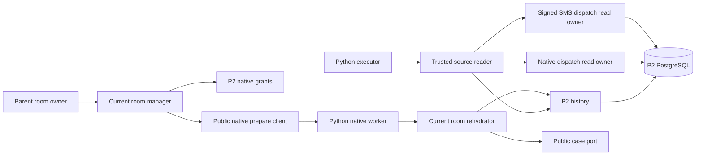
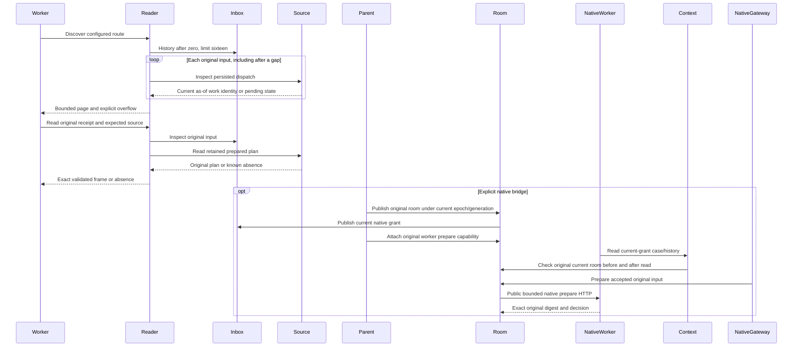
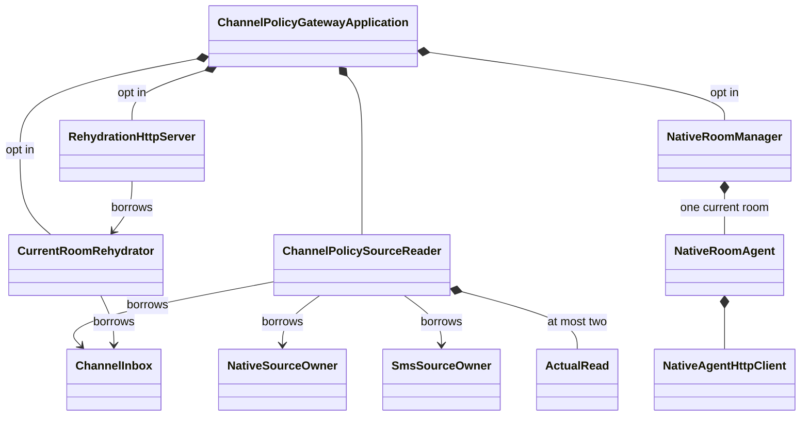

# Channel policy gateway design

| Field | Value |
| --- | --- |
| Status | Active |
| Purpose | Describe the design of the Node gateway of the joined showcase for engineers who change it |
| Audience | Engineers changing the gateway; coding agents |
| Scope | Public P2 reads, worker transport, room control, context and operation bridge; excludes the Python side |
| Owns | Gateway implementation boundaries and design decisions |
| Related | [README](README.md) · [Agent instructions](AGENTS.md) · [Joined application design](../channel_policy_demo/Design.md) · [Work item 0045](../../docs/work-items/0045-joined-native-channel-policy.md) |

## Overview

This document describes the design of the Node gateway of the joined showcase
for engineers who change it. The gateway composes public P2 (channel continuity)
reads for one configured case and conversation.

- The source reader and its loopback worker transport are implemented.
- The public gateway application adds ordered owner construction and a
  P3-compatible result listener.
- The operation bridge/runtime and the scripted specialist host are implemented.
  Preliminary actual SMS/result joins are observed.
- Opt-in current-room control, native worker attachment and public context
  rehydration have component and interoperability checks.

Complete joined database/native qualification remains under the
[active work item](../../docs/work-items/0045-joined-native-channel-policy.md).
The [joined application design](../channel_policy_demo/Design.md) covers the
Python side.

Terms used in this document:

| Term | Meaning |
| --- | --- |
| Parent | The Python room owner that publishes rooms and attaches workers |
| Room A and room B | An older room and a newer current room |
| As-of observation | An observation that is true only at the time it was read |
| RTC | Real-time communication |
| JWT | JSON Web Token |
| SFU | Selective forwarding unit |

## Objectives

| Kind | Objective | Evidence |
| --- | --- | --- |
| Business | Show durable channel progress while no room exists | Planned joined End/SMS/return demonstration |
| Technical | Discover actual work without another queue | Bounded public P2 history/dispatch reads |
| Technical | Preserve original source identity and bytes | Native/SMS frame and scope/digest negatives |

## Functional requirements

| ID or reference | Kind | Requirement | Status |
| --- | --- | --- | --- |
| P2-I22/P3-I19 | Technical | Scan persisted inputs, including later work past a pending gap | Implemented component; actual gate pending |
| Original prepared input | Technical | Read exact original frame without creating a plan | Implemented composition; P2 owns the store |
| Trusted source | Technical | Select owner only through stored provider/event identity | Implemented |
| Return-room result | Business | Expose only scoped current result to the current native grant | Internal P2 read implemented; joined P3 applicability filter and browser gate pending |
| Ordered application startup | Technical | Bind worker/result listeners before recovered input auto-dispatch | Implemented with actual listener-order tests over fake storage |
| Current worker | Technical | Attach one immutable prepare capability to the original published room; deny missing/changed/stale attachment | Component and actual cross-language HTTP checks pass |
| Native case context | Business and technical | Read current-grant history and case through the existing public facade | Component checks; actual joined SQL/media qualification pending |

## Non-functional requirements

| Concern | Bound or target | Verification | Status |
| --- | --- | --- | --- |
| Retained inputs | Sixteen per profile; explicit overflow | Full page and corrupt cursor negatives | Component implemented |
| Reads | Two actual lifetimes, including abandoned waiters | Held dependency and close retry | Component implemented |
| Payload | Discovery 8192 bytes; original framed JSON 32768 bytes | Encoded UTF-8 cap checks | Component implemented |
| Timing | Read default 2000 ms; cleanup default 1000 ms, configurable 20–5000 ms | Waiter timeout without disowning actual I/O | Component implemented |
| HTTP ownership | Four full handlers, eight sockets; absolute header lifetime 1000 ms | Abandoned clients, partial headers and close retry | Component implemented |
| Privacy | Finite errors and aggregate numeric metrics | Dependency sentinel and accessor tests | Component implemented |
| Native prepare | One actual public client per room, four-second SDK request bound | Held call/close and old-A/new-B tests | Component implemented |
| Context serving | Two public SDK handlers/sixteen sockets, 4096-byte request and 65536-byte response | Actual public HTTP over controlled read ports | Component implemented |
| Storage | Six existing pools across all variants; no new durable queue | Default/opt-in ownership and cold-construction checks | Component implemented |

## Back-of-the-envelope calculations

| Quantity | Inputs | Formula and result | Limits of inference |
| --- | --- | --- | --- |
| Retained prepared payloads in P2 | Sixteen payloads at 32768 bytes | 16 × 32768 = 524288 payload bytes | Stored in P2; this reader returns one frame at a time |
| Concurrent read payload | Two concurrent maximum frames | 2 × 32768 = 65536 payload bytes | Before JSON copies, SQL buffers and runtime overhead |

These are configured upper bounds, not measured resident set size (RSS),
throughput or production capacity.

## High-level design

1. Trusted construction fixes the scope, route and integration owners.
2. Stored provider/event identity selects a source. A caller label adds no
   authority.
3. The reader observes persisted facts. P1 and P3 separately validate and issue
   work.
4. Room publication and worker attachment use fixed publisher authority and an
   observed epoch/generation. Browser input chooses no privileged client.
5. The optional context facade checks the same current room before and after
   public P2 reads, borrowing the existing history and case owners.

## Sequence diagram

## Low-level design

The application owns the source reader and, when opted in, the room manager and
the context rehydrator with its HTTP server. Borrowed P2 owners close outside the
reader.

## Components and related details

Paths without a directory are in `services/channel-policy-gateway/src`.

| Component | Path | Responsibility | Status |
| --- | --- | --- | --- |
| Worker read HTTP | `read-http.ts` | Two authenticated `POST` worker reads over a borrowed source reader | Implemented |
| Gateway application | `application.ts` | Ordered construction, startup and drain of the public owners | Implemented |
| Result listener | `result-http.ts` | P3-compatible result listener | Implemented |
| Room manager | `native-room-manager.ts`, `native-room-agent.ts`, `native-room-http.ts` | One original publication, attachment and public native prepare client for the current room | Implemented |
| Current-room context | `native-room-agent.ts` | Public rehydration over existing storage with before/after current-room checks | Implemented |
| Operation bridge and runtime | `operation-bridge.ts`, `runtime.ts` | Source-attested public operation clients; the runtime owns the borrowed case and operation clients | Implemented |
| Scripted specialist host | `specialist-runtime.ts` | Public SDK fixed-policy handler with immutable evidence and a separate one-key role | Implemented |
| Source reader | `source-reader.ts` | Bounded reads of persisted inputs and original prepared frames; owns only its actual read lifetimes | Implemented |

### Worker read HTTP

ChannelPolicyReadHttp exposes only two authenticated `POST` worker reads:

| Read | Accepted request |
| --- | --- |
| Discovery | Exactly canonical `{schemaVersion:1}` |
| Prepared | Canonical `schemaVersion`, `receiptId` and `sourceBindingId` |

- Canonical request bytes reject duplicate keys and ignored fields.
- A known missing plan is HTTP 204 with no body. Found frames retain the exact
  original bytes.
- Scope and provider credentials never come from the body.
- The transport borrows its source reader and must drain before that reader
  closes. Its listener, full handlers and actual socket-close observers settle
  separately.

### Gateway application

ChannelPolicyGatewayApplication creates its public owners during explicit start:

| Configuration | Owners created at startup | PostgreSQL pools |
| --- | --- | --- |
| Default | Nine | Six |
| With opt-in room management (adds one owner) | Ten | Six |
| With native context (adds a reader and an HTTP owner) | Twelve | Six |

All variants use the same six existing PostgreSQL pools.

Startup and drain order:

1. It binds the worker-read and result HTTP listeners before the native and SMS
   gateways can drive retained inputs.
2. Close fences new application admission and drains the current room while its
   dispatch, source and result dependencies remain available.
3. It quiesces both gateway dispatchers, retaining actual calls until settlement.
4. It drains transport, then readers and retained native calls, then storage.
   Borrowed case and operation clients close only after this application closes.

Case, agent, operation and carrier ports are borrowed and close outside the
application. Its `nativeResult` method is internal to a trusted room owner.
There is no browser route accepting a caller-selected native bearer.

**Dispatch step deadline.** Both gateways reach P1 through the same loopback case
and origin bridges, so both use the native 5,000 ms dispatch step deadline
(`dispatchTimeoutMs`). With P2's 2,000 ms standalone default, a slow but
committed SMS accept could otherwise finish after the step deadline and leave the
input uncertain.

### Room manager

- The room manager owns one original publication, attachment and public native
  prepare client. Exact replay cannot renew or replace its prepare capability.
- Missing attachment for matching current-room input is unavailable. Older or
  dormant inputs retain their background semantics.
- Before/after current-room checks reject late agent and context returns, and
  actual call/close ownership blocks room B.
- End first fences new native HTTP accepts and awaits actual admitted accepts.
  It drains original input to known dispatch receipts while ordinary dispatch and
  the original grant remain available, then closes the agent and read/context
  owners before revoking the binding.
- An in-flight prepare may use the existing deterministic background path within
  the same claim only if its exact captured room is now closing, its caller has
  not aborted and its monotonic room lifetime has not expired. Active failures,
  replaced rooms and foreign bindings cannot use that exception. All later P2
  grant and operation checks still apply.
- Deeper P2 SQL remains application-owned after a room-facing waiter settles.

| Native drain bound | Value | Meaning |
| --- | --- | --- |
| Process-local bearer fences | 1,024 retained hashes | A fence is published before awaiting admitted accepts; it is not persistent grant revocation |
| Actual drain owners | Two | A timed-out observer does not free an actual owner |
| History read | Sixteen account-history rows total | Overflow fails closed before filtering original provider and binding |
| Retry admission | 20 seconds | No new drain step after the window; actual admitted work remains owned |

A drain requires the same bearer to have been fenced and ordinary dispatch to
remain live. An original known dispatch receipt completes that input; possible
external calls use lookup-only reconciliation. Blocked, exhausted, expired,
revoked or unresolved inputs can retain Closing. No retry changes an input,
operation or grant, and P2 acceptance is distinct from P1 work acceptance.

### Current-room context

CurrentRoomRehydrator is a public ChannelRehydrator specialization that uses the
same native inbox, case port and SMS integration. Its public HTTP server retains
the SDK's two-handler/sixteen-socket limits, distinct from the room controls.
Parent and worker lifecycle fencing still applies after a context read is
returned.

### Operation bridge

The source-attested operation bridge derives each native or SMS sender from the
original persisted plan before constructing a public operation client. Its two
actual lifetimes include source reads, a possible origin call and late close. The
Python router independently attests the original plan. This repeated local read
costs I/O, but it permits a clean restart without a sender cache or new ledger.
Failed startup clears its own listeners and permits an explicit retry.

**Per-call budget and claim lease.**

| Limit | Value | Applies to | Notes |
| --- | --- | --- | --- |
| Dispatch step deadline (`dispatchTimeoutMs`) | 5,000 ms | Both gateways | See [Gateway application](#gateway-application) |
| Bridge per-call budget (`timeoutMs: 5000` in `runtime.ts`) | 5,000 ms | Each operation bridge lookup or accept | Equals the step deadline |
| Client call budget (`callTimeoutMs`) | 5,000 ms | P2 `ExternalOperationClient` | The bridge passes its own budget |
| Bridge default | 1,500 ms | Operation bridge | Replaced by the runtime budget |
| Client default | 2,000 ms | P2 `ExternalOperationClient` | Replaced by the bridge budget |
| Claim lease, newly prepared joined profiles | 8,000 ms | Dispatch claims; persisted by `local-setup/scripts/channel_policy_setup.py` | Exceeds the step deadline |
| Claim lease, earlier profiles | 5,000 ms | Profiles prepared earlier | Kept |

Both layers receive the 5,000 ms runtime budget rather than their shorter
defaults. The 8,000 ms lease leaves time for a near-deadline receipt, subject to
the fresh database-time guard. Scheduling, SQL and network delay can still make
an acknowledgement unknown. The original operation and actual call remain owned
for reconciliation.

### Source reader

SourceReaderConfiguration copies trusted route and provider values and receives
the public `history`, `inspect` and `readPrepared` interfaces.
ChannelPolicySourceReader owns only its actual read lifetimes, not pools or
gateways.

- `close` stops admission and waits under its cleanup budget. A failed observer
  leaves actual owners retained for retry.
- The outer application drains this reader before closing shared P2 owners.

### Persistence

There is no storage change, migration, acceptance acknowledgement (ACK),
execution queue or persisted cursor. Current dispatch state and historical input
may be separate observations. The executor revalidates the full original P1/P3
request before invoking work.

## Security and privacy

| Boundary or threat | Control | Test or evidence |
| --- | --- | --- |
| Worker boundary and credentials | Account credentials remain private constructor configuration; the frame contains original input and belongs only on the authenticated worker boundary | Actual local HTTP tests cover credentials |
| Forged scope or source | Reads compare the stored tenant, account, case and conversation, and exact provider identities | Pure tests with forged scope/payload |
| Altered original input | Prepared frames retain the original receipt, operation, event, message, sender, body and digest | Exact Unicode byte tests; native/SMS frame and scope/digest negatives |
| Hostile adapter methods | Public adapter methods are snapshotted from data descriptors without invoking accessors | Dependency sentinel and accessor tests |
| Malformed error codes | Error translation reads only known own data codes; malformed or getter codes become a finite `unavailable` | Dependency sentinel and accessor tests |
| Secret leakage | Tokens and provider keys never appear in returned discovery or aggregate metrics | Dependency sentinel and accessor tests |

## Observability

| Signal | Producer | Fields or labels | Status |
| --- | --- | --- | --- |
| Active, completed and failed read counts; closing state | Source reader `metrics` | Aggregate numeric counts and a boolean | Implemented |
| Logs and exports | None; this component configures no logger or exporter | Not applicable | Not applicable |
| HTTP and process diagnostics | Outer owner | Not applicable | Not applicable |

Counters describe process observations, never durable business totals. HTTP and
process diagnostics remain outer ownership. Follow the
[shared guide](../../docs/observability.md).

## Metrics

| Metric | Unit | Labels and interpretation |
| --- | --- | --- |
| `active` | Read lifetimes | Includes actual I/O after waiter timeout |
| `completed`/`failed` | Count | Process-local settled observations |
| `closing` | Boolean | Admission stopped; does not establish full dependent closure |

## Exception handling

| Failure | Handling | Recovery |
| --- | --- | --- |
| Invalid/foreign request or source | Finite `invalid_input`/`unauthorized` | Reject before source read |
| Unknown input | `not_found` | No manufactured plan or hidden dispatch |
| Changed/corrupt bytes or joins | `invalid_state` | Preserve original facts; fail visibly |
| Two actual reads | `capacity` | Wait for an actual owner to settle |
| Dependency failure/timeout | `unavailable` without private text | Retain actual slot until settlement |
| Incomplete close | `cleanup_incomplete` | Retry observation; do not close borrowed owners early |

## Design considerations and trade-offs

| Decision | Reason | Cost or alternative | Revisit trigger |
| --- | --- | --- | --- |
| Full rescan | A bounded full rescan cannot skip unresolved gaps | It costs reads | Profile growth, fairness and arbitrary crash recovery retain their separate gates |
| Separate source owners | Separate integration-scoped owners prevent source impersonation | None recorded | None recorded |
| Original framed bytes | Returning the original framed bytes avoids a duplicate parsed wrapper | Both the canonical and the encoded-frame caps apply | None recorded |
| Room control scope | Room control tracks application-owned media resources; the Parent separately proves exact SFU room absence as of its admin observation and disposes old browser and worker activations | Its closed observation does not promise permanent RTC JWT revocation or global SQL cancellation | None recorded |
| Grant-gated authority | Native input and result authority remain gated by P2's current grant, independently of RTC transport | None recorded | None recorded |

## Validation and acceptance gates

| Gate | Assertion or lane | Evidence | Status |
| --- | --- | --- | --- |
| Pure tests | Both sources, useful progress across a gap, exact Unicode bytes, forged scope/payload, overflow and held actual reads | `make frontend-check` in [0048](../../docs/work-items/0048-code-audit-fixes-and-documentation-cleanup.md) | Passed |
| Real loopback HTTP tests | Additionally establish held-handler admission, absolute partial-header expiry, exact responses and actual server-socket drain | `make frontend-check` in [0048](../../docs/work-items/0048-code-audit-fixes-and-documentation-cleanup.md) | Passed |
| Strict types and formatting | Apply through the root workspace | `make frontend-check` in [0048](../../docs/work-items/0048-code-audit-fixes-and-documentation-cleanup.md) | Passed |
| Actual PostgreSQL, HTTP/process, native media, installed/container and provider evidence | Separate gates | [0045](../../docs/work-items/0045-joined-native-channel-policy.md) | Pending |
