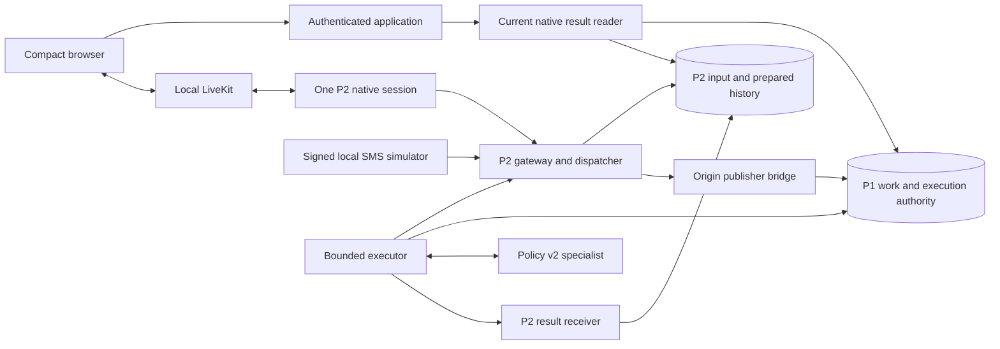
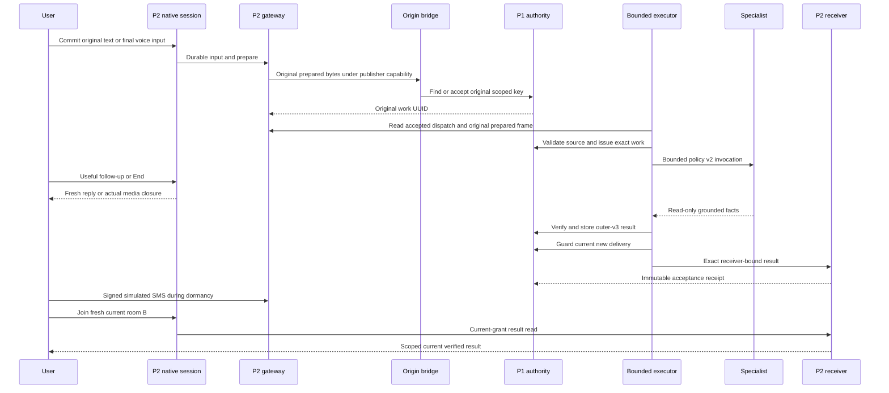
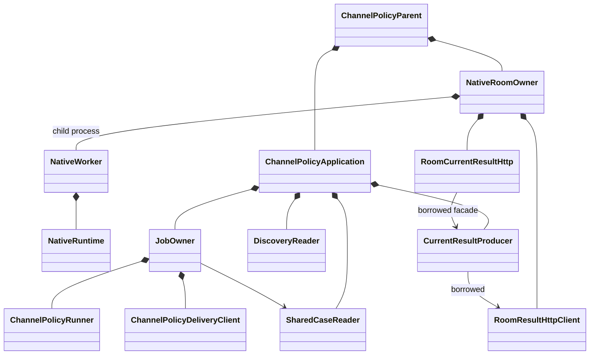

# Joined channel-policy application design

Status: Active
Last reviewed: 13 November 2026

## Overview

This root application composes existing public P1/P2/P3 boundaries. Phase 45A
qualified the origin bridge, bounded discovery/current-result codecs, executor
ports and installed application contracts. Phase 45B implements the public-client
composition and source/executor owner. Its actual joined runtime and the media
journey remain unqualified until their separate gates pass. The [work item](../../docs/work-items/0045-joined-native-channel-policy.md)
owns implementation sequencing and exact measured outcomes.

## Objectives

| Category | Objective | Evidence |
| --- | --- | --- |
| Business | Continue the same case across voice, text and signed simulated SMS | End/dormancy/return-room current result |
| Business | Explain background progress without clutter or invented transitions | Responsive conversation and compact observed result card |
| Technical | Preserve existing durable authority and original input identity | Independent P2/P1 origin/result/delivery joins |
| Technical | Keep native and background resources bounded and independently owned | Held I/O, shutdown, restart and installed-consumer gates |

## Functional requirements

| ID | Category | Requirement | Status |
| --- | --- | --- | --- |
| CP-01 | Technical | Promote origin wire/service/HTTP with one canonical module identity | Qualified at the 45A source and installed checkpoint; current composition needs fresh qualification |
| CP-02 | Technical | Read original prepared input without mutation or source reassociation | Public P2 addition and eight-assertion actual read gate passed |
| CP-03 | Technical | Discover actual work through bounded persisted P2 history/dispatch | Node read composition implemented; actual joined gate pending |
| CP-04 | Business | Keep conversation useful while independently issued work runs | Planned actual native/media gate |
| CP-05 | Business | Receive current scoped result after End and a fresh room | Planned actual native/signed-SMS gate |
| CP-06 | Technical | Reject stale new delivery and preserve historical accepted facts | Qualified backend prerequisite; joined repetition planned |
| CP-07 | Technical | Preserve accepted/completed identities through normal executor restart | Planned; arbitrary mid-issued recovery keeps its separate lease gate |
| CP-08 | Business and technical | Keep explicit typed case revision separate from exact mutation consent | Existing public authority, new UI/controller planned |

## Non-functional requirements

| Requirement | Bound or target | Verification | Status |
| --- | --- | --- | --- |
| Scope/window | One configured case/conversation, at most sixteen retained inputs | Owner settings plus overflow negative | Proposed finite demo profile |
| Actual jobs | At most two retained runner/job owners | Held factory/run/close and abandoned waiter tests | Core implemented; joined actual gate pending |
| Origin HTTP | Per publisher: four handlers/eight sockets; two listeners total eight/sixteen; request 32768 bytes, response 4096 bytes | Existing socket/source checks, fresh promotion regression | Qualified previous location |
| Discovery wire | Page at most sixteen, encoded response at most 8192 bytes | Strict byte/field/schema negatives | Implemented codec and Node reader; joined actual gate pending |
| Prepared frame | Original accept frame at most 32768 UTF-8 bytes; no duplicate body/wrapping | Large Unicode/escaping boundary | Implemented read composition; actual P2 prepared-read gate passed |
| Native prepare | Existing four-second deadline | Real SDK generation/playout ownership | Preserve existing contract |
| Specialist and runner | Existing five-second HTTP and ten-second runner ceiling | Short held-work schedules | Preserve existing contract |
| Client construction | Two retained actual startup owners shared by origin and jobs | Late thread return, cancellation, failed close and transfer tests | Component implemented |
| Private owner profile | At most 262144 bytes; regular private file and directory, no link aliases | Scope/evidence/credential/metadata race negatives | Component implemented |
| Diagnostics | Finite event/code labels; no body/key/identifier metric labels | Secret/exporter-failure tests | Mandatory |
| Shutdown | Actual owners settle before dependency removal; one fixed gate deadline | Held startup/I/O/close and process observations | Mandatory |

## Parent and operator boundaries

The Parent lifecycle components and operator API are implemented; the final
launcher is implemented as explicit local tooling; the actual joined room/media
gate remains pending. The Parent owns one
physical activation and one real worker child. The child owns the single SDK
session. A genuine SDK close event synchronously stops input/readiness; it does
not prove that RoomIO, HTTP, the SFU room or the process has drained.

The Parent library exposes start_sources before externally owned Node startup,
then start with the actual observed Node room cursor. Its operator-listener
readiness is separate from a connected SDK/native room. Shutdown drains operator
calls, then room and SMS independently, then the shared background application.
The local launcher is implemented; actual joined runtime qualification remains
pending.

The physical activation CAS is separate from the Node publication cursor. Exact
Start replay retains its original identities, tokens and 180-second expiry.
An uncertain create or close remains explicit and blocks the next room. The SDK
room delete accepts only a name; a preceding exact metadata/SID check and later
absence observation are as-of evidence, not an atomic expected-SID fence or
permanent revocation of an RTC token on a server with automatic room creation.

The separate operator capability survives End and authorizes only seven fixed
browser operations: status, start, end, current, case, progress and signed
simulated SMS. Parent shutdown drains operator HTTP before room/SMS/application
owners. The browser selects no principal, work, provider account or sender.
Operator requests allow 32768 input bytes and 16384 response bytes, four retained
actual calls, eight sockets, separate one-second header/body reads and at most a
fifteen-second command observer. Waiter timeout retains actual ownership.

Current responses project only state, eligibility, uncertainty, revision and
observation time from the existing verified producer. Both grant and current
responses recheck the original physical activation immediately before socket
write. Case observation has its own revision/time. Progress counts original P2
input sources and dispatch states; a known P1 reference does not mean completed
specialist work. These reads reuse existing application clients and job bounds.

Signed SMS uses explicitly public synthetic simulation material and a fixed
associated sender. Original command UUID, body and occurrence time determine
immutable provider bytes; a retry refreshes the MAC header only. A lost response
remains unknown, with no automatic resubmit or case revision. The demonstration
does not claim a real carrier integration.

## Back-of-the-envelope calculations

Sixteen original payloads at 32768 bytes are at most 524288 payload bytes, owned
by P2 rather than copied into an application queue. Two runner requests/results
at 16384+8192 bytes are 49152 wire bytes before Python, SQL, SDK, sockets and
protocol overhead. Neither calculation predicts RSS, throughput or production
tenant capacity. Runtime byte caps still apply after JSON escaping.

The application rescan is bounded by the sixteen-input profile. It detects a
larger window instead of silently treating the first page as complete. Dormant
work requires no media room/agent; a bounded executor remains independent of the
one current native session. Larger-scale fairness has its separate P3-I20 gate.

## High-level design

1. Trusted configuration fixes account/case/provider bindings; browser content
   selects no principal, grant or execution authority.
2. Durable P2 intake/prepare precedes original-origin P1 acceptance. A native
   generation or playback observation is separate from that receipt.
3. The executor discovers persisted receipts, validates their original source
   and runs only through existing P1 issuance and P3 factual verification.
4. End stops media. Background execution and stored results remain independent.
5. P1 guards new delivery, P2 retains the receiver receipt, and the current native
   grant gates disclosure. Receiver acceptance is not human acknowledgement.

## Sequence diagram

These are planned joined interactions. The native prepare/generation, durable
acceptance, execution, delivery and browser playback retain distinct evidence.
Short holds are released within existing limits; the long dormant journey does
not keep one specialist HTTP call open indefinitely.

## Low-level design

The source/executor application, captured current-result attachment and single-session
native worker are implemented components. The parent room/process composition and
browser journey remain planned integration. The parent owns the application and
room owner independently; End does not close the background application. Discovery and executor
ports introduce no persistent authority. Existing public NativeRuntime and P3 clients keep
their own actual work; a stopped coroutine is insufficient evidence of closure.

## Components and related details

| Component | Responsibility and boundary |
| --- | --- |
| Canonical wire/origin/HTTP | Promoted qualified composition with strict original bytes, configured publisher and retained actual I/O |
| Compatibility helpers | Explicit re-exports of the canonical types; no cloned classes or serving logic |
| Node source owners | Separate native/SMS integration-scoped dispatchers; readPrepared never creates a plan or reassociates source |
| Discovery reader | Closed scoped list/prepared-frame reads; incomplete/overflow state is explicit; no terminal ACK cursor |
| Job owner | Stable configured app-owner UUID and command per work, original allowlisted evidence, separate owned execution/specialist ports |
| Read-only inspection | One factory ticket reserved beside the two execution tickets, public runner/delivery clients; no run or delivery method exposed; one actual read per owner |
| Public client factories | Two retained startup owners, offloaded public P1 preflights, fresh per-job clients and explicit highest-owner transfer |
| Python application owner | Retained source startup, explicit Node readiness, one rescan loop (0.25 s while busy, backing off to 1 s idle), a one-slot background reader lane and ordered dependent drain |
| Private owner profile | Versioned immutable route, case/work mapping, fixed distinct ports, stable app owner and supported evidence; credentials excluded from Node configuration |
| Native room owner | Planned parent ownership of one worker child, current grant, callback/view readers and exact SFU room; unresolved close blocks the next room |
| Native worker | Implemented single genuine P2 Runtime/AgentSession, narrow intake/context/current-result clients and scripted or explicit provider_real models; prepare listener starts before browser/SDK waiting |
| Room control and attachment | Closed epoch/generation/open/binding commands; one native agent client per current Node room; exact replay cannot renew credentials |
| Parent current callback | Captured read facade and room predicate, checked before/after reading and immediately before successful socket write; native worker receives only its fresh callback capability |
| Current result producer | Original-source/evidence/execution/delivery/current-case joins and fresh applicability; concurrent readers share one published scan; application owns one captured attachment using the reserved inspection ticket and retries transient capacity twice |
| Owner bootstrap | Explicit schema/private configuration setup before serving; no DDL during runtime and normal stop preserves data |

The result producer reserves one scan before task creation, including eager task
execution, and close observes the same publication barrier. A concurrent read of
a published, unabandoned scan waits for that scan instead of failing; only the
last waiter's expiry or cancellation abandons it, and an abandoned scan still
refuses new readers until it settles. One inspection owner
remains retained until dependent reads and close settle. Newer pending work may
leave an older accepted current result visible. The newest recorded result is a
selection barrier: expired, stale or undelivered results cannot fall back to an
older card. Failed reads remain finite operational errors; empty states carry no
result bytes. The producer rechecks public P3/P1 observations after the native
read and checks the unchanged original deadline after cleanup before disclosure.

The native worker configuration is a closed schema: version 1 is scripted and
version 2 adds the explicit `provider_real` mode. Pure import, parse and encode
load no SDK, assets, environment or provider values. Explicit startup loads
models and constructs one public NativeRuntime; provider mode uses
`NativeTiming(reply="scheduled")` so durable dispatch never waits for long real
speech, plus fixed instructions that map result states to plain wording. Only
the worker's RTC token, native/prepare/current-result capabilities and, in
provider mode, the three provider keys cross that boundary.
Case, database, publisher, discovery and room-view credentials stay in the parent.
The context model adapter snapshots mutable public SDK records before awaiting a
read; RTC frames and opaque provider objects remain deliberately borrowed.

### Lifecycle, persistence and packaging

The executor keeps at most two factory/run/close lifetimes and one scan. A fresh
invalid returned runner is quarantined until successful close and exact zero
pending work; borrowed/shared objects are never closed as that job. A bounded
process-local round-robin priority lets later entries progress when earlier work
already has results. It is advisory only: every scan rereads the complete bounded
P2 page from zero, and restart resets priority without acknowledging a gap. Work
this process has not started runs at once; reruns of the same work wait 1 s,
doubling to 30 s. Pacing delays idempotent replays but never skips,
acknowledges or persists any work.

Bound actual jobs/readers/sockets before awaiting. Retain factories and close
observers through timeout. HTTP admission stops first, dependent owners drain,
then shared case readers close. Parent tooling reaps actual groups before DDL or
file removal. A shared stable owner UUID may own distinct work items; after normal
restart its work/command/owner tuple remains unchanged. Do not silently force a
new invocation after an unknown issued attempt.

A room attachment is retained while producer cleanup is incomplete. Its captured
facade checks the same owner before and after each read; old A cannot select B.
Successful detach removes closed bookkeeping, keeping repeated rooms bounded.
The application closes the producer before shared job/read/case dependencies.

Worker End closes the prepare host and native runtime concurrently. It waits for
actual SDK startup before closing wrapper/models and transport dependencies. An
in-flight RTC connect remains owned: the SDK's disconnect returns early before
connection, so actual connect must settle before the final disconnect. The current
callback host and application producer also drain as separate owners; neither
closes a borrowed global application. The Node context server retains its public
two-handler/sixteen-socket bounds; room controls use four/eight. A room drain does
not claim that deeper application-owned SQL has stopped.

P1 work v4 and P2 v8 remain unchanged. New typed read surfaces require no table
or profile version. Root runtime extras must declare P2/P3/native dependencies;
dev installation is insufficient. Promoted bridges in isolated consumers require
the actual built root app wheel, not a checkout path or copied unbound source.

## Security and privacy

Keep account/operator/native publisher/source reader/controller/operation/RTC
capabilities separate and server-bound. Original payload or correlation IDs
grant no authority. No source label or body-selected tenant can choose a port.
Keep keys out of source, URL/storage, metrics, captures and browser state.
Only the explicit native provider runtime receives provider keys. Offline checks
do not read those keys or call providers. Scripted, configured and actual model
evidence remain distinct. All data and carrier behavior here are synthetic.

## Observability

Use existing SDK session/usage signals and safe application boundary events.
Report scan/read/accept/issue/result/applicability/delivery/cleanup observations
with explicit source/as-of meaning. Unknown reads retain the last known fact;
exporter failure cannot block acceptance or allocate unbounded work. Follow the
[shared observability guide](../../docs/observability.md).

## Metrics

| Metric | Unit | Labels and boundary |
| --- | --- | --- |
| Accepted/discovered/issued/stored/delivered observations | Count | Finite operation/outcome only; not physical carrier delivery |
| Active actual jobs and reads | Gauge | Retained through waiter timeout and incomplete close |
| Scan/call duration | Seconds | Declared operation; no per-ID dimension |
| Unknown/stale/rejected/cleanup outcomes | Count | Finite safe reason; no input text or dependency message |

The executor emits finite scan/job/close observations and numeric lifetime/outcome
counters. The current-result producer exposes scan, current/no-delivery/not-applicable/failed counts and retained scan/inspection/close gauges. Node source/HTTP readers expose aggregate numeric observations. Joined
exporters and UI producers remain planned; this table does not establish them.

## Exception handling

| Boundary | Handling and recovery |
| --- | --- |
| Invalid/foreign source | Reject before P1 work or invocation; no truncation or coercion |
| Known input with no plan | Explicit absence; no agent/case/dispatch call to manufacture one |
| Failed read or unknown command | Preserve uncertainty and original identity; no hidden new key/submit |
| Stale new delivery | Deny before intent, keep historical result and permit useful current work |
| Deadline/abort/close | Retain actual work and capacity; retry public close after settlement |
| Export failure | Bounded observation only; preserve primary business result/error |

Translate private dependency failures once into finite safe codes. A failed case
revision acknowledgement has no invented command receipt. Use the [Python guide](../../docs/python-engineering.md)
for typed public interfaces, blocking-I/O isolation and cancellation ownership.

## Design considerations and trade-offs

Use bounded persisted P2 history instead of adding a generic P1 queue/discovery
ledger. The finite rescan costs reads but cannot skip an unresolved gap as an ACK.
Larger windows, fairness and arbitrary mid-issued crash recovery keep separate
gates. Native SDK session ownership is reused instead of combining competing
adapters. A separate optional app/page preserves the independently usable kits.
Structured factual policy remains distinct from provider model judgment. The
explicit provider_real profile has selected actual journey evidence in
[0046](../../docs/work-items/0046-joined-showcase-providers-and-demo.md); model
accuracy, latency distributions and provider cost remain unmeasured.

## Validation and acceptance gates

45A requires pure/negative/ownership/type checks plus actual origin and installed
root-app regression after promotion. 45B requires independent real PG/process
joins and useful progress. 45C requires actual SDK/browser voice/interruption/
return-route evidence and screenshot-based desktop/mobile review. 45D requires
installed/container reproduction, normal restart and full fast/docs handoff.
Missing, skipped and timed-out requirements do not pass. Provider-mode journeys
and the recorded demo video are recorded in 0046 as selected evidence; broader
P2/P3 release requirements remain separate obligations.
