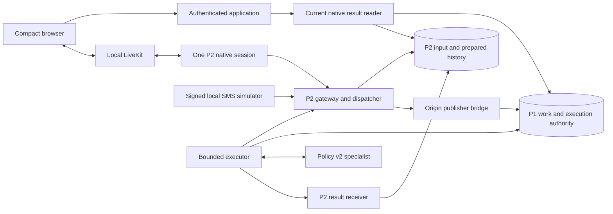
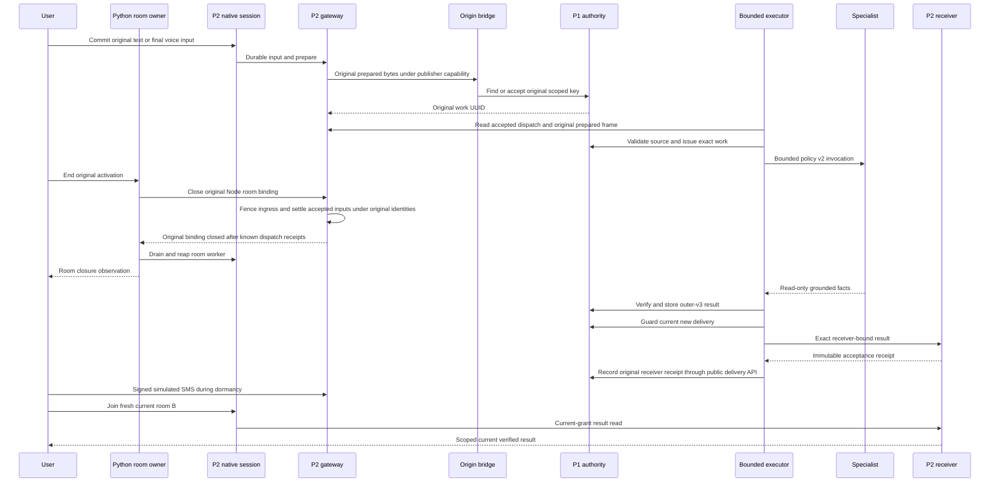
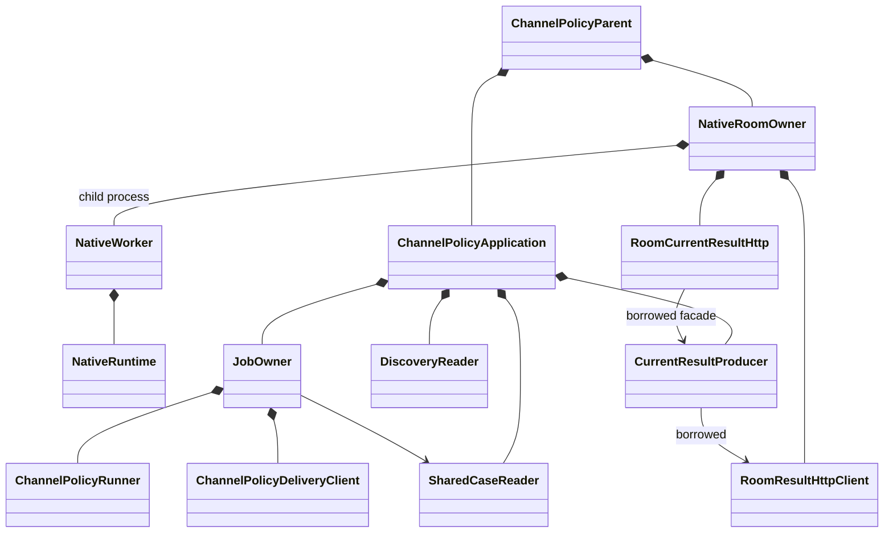

# Joined channel-policy application design

| Field | Value |
| --- | --- |
| Status | Active |
| Purpose | Describe the design of the joined channel-policy application for engineers who change it |
| Audience | Engineers changing the joined application; coding agents |
| Scope | Python composition of public P1, P2 and P3 boundaries; excludes the Node gateway design |
| Owns | Joined application implementation boundaries and design decisions |
| Related | [README](README.md) · [Agent instructions](AGENTS.md) · [Gateway design](../channel-policy-gateway/Design.md) · [Work item 0045](../../docs/work-items/0045-joined-native-channel-policy.md) |

## Overview

This document describes the design of the joined channel-policy application for
engineers who change it. The root application composes existing public P1 (agent
continuity), P2 (channel continuity) and P3 (delegation reliability) boundaries.
Phases 45A to 45D are the phases of the 0045 work item.

- Phase 45A qualified the origin bridge, the bounded discovery and current-result
  codecs, the executor ports and the installed application contracts.
- Phase 45B implements the public-client composition and the source/executor owner.

The application's actual joined runtime and the media journey remain unqualified
until their separate gates pass. The
[work item](../../docs/work-items/0045-joined-native-channel-policy.md) owns
implementation sequencing and exact measured outcomes. The
[gateway design](../channel-policy-gateway/Design.md) covers the Node side.

Terms used in this document:

| Term | Meaning |
| --- | --- |
| End | Closes the media room |
| Dormancy | The period when no room is open |
| Room A and room B | An older room and a newer current room |
| As-of observation | An observation that is true only at the time it was read |
| Parent | The room owner that controls one physical activation and its worker child |

## Objectives

| Kind | Objective | Evidence |
| --- | --- | --- |
| Business | Continue the same case across voice, text and signed simulated SMS | End/dormancy/return-room current result |
| Business | Explain background progress without clutter or invented transitions | Responsive conversation and compact observed result card |
| Technical | Preserve existing durable authority and original input identity | Independent P2/P1 origin/result/delivery joins |
| Technical | Keep native and background resources bounded and independently owned | Held I/O, shutdown, restart and installed-consumer gates |

## Functional requirements

| ID or reference | Kind | Requirement | Status |
| --- | --- | --- | --- |
| CP-01 | Technical | Promote origin wire/service/HTTP with one canonical module identity | Qualified at the 45A source and installed checkpoint; current composition needs fresh qualification |
| CP-02 | Technical | Read original prepared input without mutation or source reassociation | Public P2 addition and eight-assertion actual read gate passed |
| CP-03 | Technical | Discover actual work through bounded persisted P2 history/dispatch | Node read composition implemented; actual joined gate pending |
| CP-04 | Business | Keep conversation useful while independently issued work runs | Planned actual native/media gate |
| CP-05 | Business | Receive current scoped result after End and a fresh room | Planned actual native/signed-SMS gate |
| CP-06 | Technical | Reject stale new delivery and preserve historical accepted facts | Qualified backend prerequisite; joined repetition planned |
| CP-07 | Technical | Preserve accepted/completed identities through normal executor restart | Planned; arbitrary mid-issued recovery keeps its separate lease gate |
| CP-08 | Business and technical | Keep explicit typed case revision separate from exact mutation consent | Existing public authority, new UI/controller planned |

CP rows are local design references, not catalog acceptance IDs.

## Non-functional requirements

| Concern | Bound or target | Verification | Status |
| --- | --- | --- | --- |
| Scope/window | One configured case/conversation, at most sixteen retained inputs | Owner settings plus overflow negative | Proposed finite demo profile |
| Actual jobs | At most two retained runner/job owners | Held factory/run/close and abandoned waiter tests | Core implemented; joined actual gate pending |
| Origin HTTP | Per publisher: four handlers/eight sockets; two listeners total eight/sixteen; request 32768 bytes, response 4096 bytes | Existing socket/source checks, fresh promotion regression | Qualified previous location |
| Discovery wire | Page at most sixteen, encoded response at most 8192 bytes | Strict byte/field/schema negatives | Implemented codec and Node reader; joined actual gate pending |
| Prepared frame | Original accept frame at most 32768 UTF-8 bytes; no duplicate body/wrapping | Large Unicode/escaping boundary | Implemented read composition; actual P2 prepared-read gate passed |
| Native prepare | Existing four-second deadline | Real SDK generation/playout ownership | Preserve existing contract |
| Specialist and runner | Existing five-second HTTP and ten-second runner ceiling | Short held-work schedules | Preserve existing contract |
| Client construction | Two retained actual startup owners shared by origin and jobs | Late thread return, cancellation, failed close and transfer tests | Component implemented |
| Private owner profile | At most 262144 bytes; regular private file and directory, no link aliases | Scope/evidence/credential/metadata race negatives | Component implemented |
| Diagnostics | Finite event/code labels; no body/key/identifier metric labels | Secret/exporter-failure tests | Mandatory |
| Shutdown | Actual owners settle before dependency removal; one fixed gate deadline | Held startup/I/O/close and process observations | Mandatory |

## Back-of-the-envelope calculations

| Quantity | Inputs | Formula and result | Limits of inference |
| --- | --- | --- | --- |
| Retained original payloads | Sixteen payloads at 32768 bytes | 16 × 32768 = at most 524288 payload bytes | Owned by P2 rather than copied into an application queue |
| Runner wire bytes | Two runner requests/results at 16384 + 8192 bytes | 2 × (16384 + 8192) = 49152 wire bytes | Before Python, SQL, SDK, socket and protocol overhead |

Neither calculation predicts resident set size (RSS), throughput or production
tenant capacity. Runtime byte caps still apply after JSON escaping.

The application rescan is bounded by the sixteen-input profile. It detects a
larger window instead of silently treating the first page as complete. Dormant
work requires no media room or agent, and a bounded executor remains independent
of the one current native session. Larger-scale fairness has its separate P3-I20
gate.

## High-level design

1. Trusted configuration fixes account, case and provider bindings. Browser
   content selects no principal, grant or execution authority.
2. Durable P2 intake and prepare precede original-origin P1 acceptance. A native
   generation or playback observation is separate from that receipt.
3. The executor discovers persisted receipts, validates their original source
   and runs only through existing P1 issuance and P3 factual verification.
4. End stops media. Background execution and stored results remain independent.
5. P1 guards new delivery, P2 retains the receiver receipt, and the current
   native grant gates disclosure. Receiver acceptance is not human
   acknowledgement.

The local LiveKit server acts as the selective forwarding unit (SFU) that routes
media between the browser and the native session.

## Sequence diagram

These joined interactions run in the selected actual journeys recorded in
[0046](../../docs/work-items/0046-joined-showcase-providers-and-demo.md). Their
formal joined gates remain planned. The native prepare and generation, durable
acceptance, execution, delivery and browser playback retain distinct evidence.
Short holds are released within existing limits. The long dormant journey does
not keep one specialist HTTP call open indefinitely.

## Low-level design

- The source/executor application, the captured current-result attachment and
  the single-session native worker are implemented components.
- The Parent room/process composition is also implemented, and the launcher runs
  the browser journey. The actual joined room/media gate remains pending.
- The Parent owns the application and the room owner independently. End does not
  close the background application.
- Discovery and executor ports introduce no persistent authority.
- Existing public NativeRuntime and P3 clients keep their own actual work. A
  stopped coroutine is insufficient evidence of closure.

## Components and related details

Paths without a directory are in `services/channel_policy_demo`.

| Component | Path | Responsibility | Status |
| --- | --- | --- | --- |
| Canonical wire/origin/HTTP | `wire.py`, `origin.py`, `origin_http.py` | Promoted qualified composition with strict original bytes, configured publisher and retained actual I/O | Qualified at 45A |
| Compatibility helpers | `local-setup/scripts/` modules such as `p3_channel_origin.py` | Explicit re-exports of the canonical types; no cloned classes or serving logic | Implemented |
| Node source owners | `services/channel-policy-gateway/src/application.ts` | Separate native/SMS integration-scoped dispatchers; `readPrepared` never creates a plan or reassociates source | Implemented |
| Discovery reader | `discovery.py`, `worker_client.py` | Closed scoped list/prepared-frame reads; incomplete/overflow state is explicit; no terminal acknowledgement (ACK) cursor | Implemented |
| Job owner | `jobs.py` | Stable configured app-owner UUID and command per work, original allowlisted evidence, separate owned execution/specialist ports | Implemented |
| Read-only inspection | `jobs.py` | One factory ticket reserved beside the two execution tickets, public runner/delivery clients; no run or delivery method exposed; one actual read per owner | Implemented |
| Public client factories | `public_clients.py` | Two retained startup owners, offloaded public P1 preflights, fresh per-job clients and explicit highest-owner transfer | Implemented |
| Executor | `executor.py` | At most two factory/run/close lifetimes and one scan; advisory priority and rerun pacing | Implemented |
| Python application owner | `application.py` | Retained source startup, explicit Node readiness, one rescan loop (0.25 s while busy, backing off to 1 s idle), a one-slot background reader lane and ordered dependent drain | Implemented |
| Private owner profile | `owner_config.py` | Versioned immutable route, case/work mapping, fixed distinct ports, stable app owner and supported evidence; credentials excluded from Node configuration | Implemented |
| Parent | `parent.py` | Owns one physical activation, the room owner and the background application independently | Implemented |
| Operator API | `operator.py`, `operator_http.py`, `operator_sms.py` | Seven fixed browser operations under a separate operator capability that survives End | Implemented |
| Native room owner | `native_room.py` | Parent ownership of one worker child, current grant, callback/view readers and exact SFU room; unresolved close blocks the next room | Implemented |
| Native worker | `native_worker.py` | Single genuine P2 Runtime/AgentSession, narrow intake/context/current-result clients and scripted or explicit `provider_real` models; the prepare listener starts before browser/SDK waiting | Implemented |
| Room control and attachment | `room_control.py`, `room_control_client.py` | Closed epoch/generation/open/binding commands; one native agent client per current Node room; exact replay cannot renew credentials | Implemented |
| Parent current callback | `current_result_http.py` | Captured read facade and room predicate, checked before/after reading and immediately before successful socket write; the native worker receives only its fresh callback capability | Implemented |
| Current result producer | `current_result_producer.py` | Original-source/evidence/execution/delivery/current-case joins and fresh applicability; concurrent readers share one published scan; the application owns one captured attachment using the reserved inspection ticket and retries transient capacity twice | Implemented |
| Owner bootstrap | `local-setup/scripts/channel_policy_setup.py` | Explicit schema/private configuration setup before serving; no data definition language (DDL) during runtime, and normal stop preserves data | Implemented |

### Parent room ownership

The Parent lifecycle components and the operator API are implemented, and the
final launcher is implemented as explicit local tooling. The actual joined
room/media gate and the actual joined runtime qualification remain pending.

- The Parent owns one physical activation and one real worker child. The child
  owns the single SDK session.
- A genuine SDK close event synchronously stops input and readiness. It does not
  prove that RoomIO, HTTP, the SFU room or the process has drained.
- The Parent library exposes `start_sources` before externally owned Node
  startup, then `start` with the actual observed Node room cursor.
- Its operator-listener readiness is separate from a connected SDK/native room.

Parent `prepare_shutdown()` fences new admission, drains operator calls, then
drains room and SMS owners independently. It leaves the background application
and its origin listeners available. The launcher next observes both gateway
dispatchers quiesced, then calls Parent `close()` to drain the shared application.
Gateway control/read dependencies remain alive until that close succeeds.

Preparation and final close retain their actual tasks across timeout and
cancellation. A failed startup also preserves application origins until the
launcher can quiesce dispatch. Reobservation creates no new activation or
business request. The [lifecycle work item](../../docs/work-items/0050-lifecycle-drain-and-documentation-cleanup.md)
owns regression and actual-integration evidence.

Parent owns no external gateway. A library caller composing one must establish
the same dispatch barrier before final `close()`; that method alone is not
evidence of gateway quiescence.

**Activation identity.** The physical activation compare-and-set (CAS) is
separate from the Node publication cursor. Exact Start replay retains its
original identities, tokens and 180-second expiry. An uncertain create or close
remains explicit and blocks the next room.

**Room deletion.** The SDK room delete accepts only a name. A preceding exact
metadata/SID check and a later absence observation are as-of evidence. They are
not an atomic expected-SID fence, nor a permanent revocation of a real-time
communication (RTC) token on a server with automatic room creation. A SID is
LiveKit's server-assigned identifier.

### Operator API

The separate operator capability survives End and authorizes only seven fixed
browser operations: status, start, end, current, case, progress and signed
simulated SMS. The browser selects no principal, work, provider account or
sender. The [README](README.md#operator-routes) lists the routes.

| Limit | Value | Applies to | Notes |
| --- | --- | --- | --- |
| Input | 32768 bytes | Operator requests | None |
| Response | 16384 bytes | Operator responses | None |
| Retained actual calls | Four | Operator listener | A waiter timeout retains actual ownership |
| Sockets | Eight | Operator listener | None |
| Header and body reads | One second each | Operator listener | Separate limits |
| Command observer | At most fifteen seconds | Operator commands | None |

**Current, case and progress reads.**

- Current responses project only state, eligibility, uncertainty, revision and
  observation time from the existing verified producer.
- Both grant and current responses recheck the original physical activation
  immediately before socket write.
- A case observation has its own revision and time.
- Progress counts original P2 input sources and dispatch states. A known P1
  reference does not mean completed specialist work.
- These reads reuse existing application clients and job bounds.

**Signed simulated SMS.** Signed SMS uses explicitly public synthetic simulation
material and a fixed associated sender. The original command UUID, body and
occurrence time determine immutable provider bytes. A retry refreshes the message
authentication code (MAC) header only. A lost response remains unknown, with no
automatic resubmit or case revision. The demonstration does not claim a real
carrier integration.

### Current-result producer

- The result producer reserves one scan before task creation, including eager
  task execution. Close observes the same publication barrier.
- A concurrent read of a published, unabandoned scan waits for that scan instead
  of failing. Only the last waiter's expiry or cancellation abandons it. An
  abandoned scan still refuses new readers until it settles.
- One inspection owner remains retained until dependent reads and close settle.
- Newer pending work may leave an older accepted current result visible.
- The newest recorded result is a selection barrier: expired, stale or
  undelivered results cannot fall back to an older card.
- Failed reads remain finite operational errors. Empty states carry no result
  bytes.
- The producer rechecks public P3/P1 observations after the native read. It
  checks the unchanged original deadline after cleanup, before disclosure.

### Native worker configuration

The native worker configuration is a closed schema. Version 1 is scripted, and
version 2 adds the explicit `provider_real` mode.

- Pure import, parse and encode load no SDK, assets, environment or provider
  values.
- Explicit startup loads models and constructs one public NativeRuntime.
- The scripted recognizer allows two speech-to-text (STT) stream handles, one
  active and one closing. LiveKit Agents' `clear_user_turn` opens the
  replacement stream before it closes the old one. With one handle, the first
  scripted voice turn in each room produced an empty transcript.
- Provider mode uses `NativeTiming(reply="scheduled")`, so durable dispatch never
  waits for long real speech. It also uses fixed instructions that map result
  states to plain wording.
- Only the worker's RTC token, its native/prepare/current-result capabilities
  and, in provider mode, the three provider keys cross that boundary. Case,
  database, publisher, discovery and room-view credentials stay in the Parent.
- The context model adapter snapshots mutable public SDK records before awaiting
  a read. RTC frames and opaque provider objects remain deliberately borrowed.

### Executor scheduling and pacing

The executor keeps at most two factory/run/close lifetimes and one scan.

- A fresh invalid returned runner is quarantined until a successful close and
  exactly zero pending work. Borrowed or shared objects are never closed as that
  job.
- A bounded process-local round-robin priority lets later entries progress when
  earlier work already has results. It is advisory only: every scan rereads the
  complete bounded P2 page from zero, and restart resets priority without
  acknowledging a gap.
- Work this process has not started runs at once. Reruns of the same work wait
  1 s, doubling to 30 s.
- Pacing delays idempotent replays but never skips, acknowledges or persists any
  work.

### Origin call deadline

Both origin hosts, `ChannelOriginHttp` for native and signed-SMS input, use a 5 s
call timeout (`ORIGIN_CALL_TIMEOUT_S` in `application.py`). Both gateways allow
each origin dispatch step 5,000 ms, and a shorter wait would report a later
committed accept as `acknowledgement_unknown`. The class default stays 2 s.

### Resource ownership and shutdown order

Bound actual jobs, readers and sockets before awaiting. Retain factories and
close observers through timeout. Shutdown runs in this order:

1. HTTP admission stops.
2. Dependent owners drain.
3. Shared case readers close.

Parent tooling reaps actual process groups before DDL or file removal. A shared
stable owner UUID may own distinct work items. After a normal restart, its
work/command/owner tuple remains unchanged. Do not silently force a new
invocation after an unknown issued attempt.

The loopback JSON and worker clients treat a connection-lost `OSError` from
`wait_closed()` as observed closure, because the socket is already closed by
then. That releases the call slot. Any other close failure keeps the writer and
its slot owned.

### Room attachments

A room attachment is retained while producer cleanup is incomplete. Its captured
facade checks the same owner before and after each read, so old room A cannot
select room B. Successful detach removes closed bookkeeping, keeping repeated
rooms bounded. The application closes the producer before the shared job, read
and case dependencies.

### Worker End

- The Parent first asks Node to close the original room binding. Node fences
  native ingress, settles admitted accepts and drains their original dispatch
  receipts while the grant and origin dependencies remain available.
- A closing room uses the existing deterministic background preparation for
  accepted input. It does not create replacement input or wait for policy result
  completion. Unknown, exhausted or ineligible work leaves cleanup incomplete.
- Only after Node confirms that drain and revokes the binding does the Parent
  stop the worker and its callback/producer owners.
- Worker End closes the prepare host and the native runtime concurrently.
- It waits for actual SDK startup before closing the wrapper, models and
  transport dependencies.
- An in-flight RTC connect remains owned. The SDK's disconnect returns early
  before connection, so the actual connect must settle before the final
  disconnect.
- The current callback host and the application producer also drain as separate
  owners. Neither closes a borrowed global application.
- The Node context server retains its public two-handler/sixteen-socket bounds,
  while room controls use four handlers and eight sockets.
- A room drain does not claim that deeper application-owned SQL has stopped.

The default cleanup observers are 15 s for the worker process, 30 s for the room,
45 s for Parent preparation, 60 s for Parent close and 120 s for the launcher.
These observers do not extend business, provider or qualification deadlines.
Slow actual cleanup stays retained and is reobserved; timeout cannot authorize
dependent removal or a successful End receipt.

One retained End supervisor observes the original activation. It retries only
`cleanup_incomplete`, with delays from 20 ms to 250 ms, while new attempts fit
within its original configured room-cleanup budget (30 s by default). The window
limits new attempts; it never cancels an already owned attempt. Observer timeout
or cancellation leaves that actual task retained. A persistent failure remains
Closing and requires an explicit original-End retry after the window. Neither
automatic nor explicit observation creates another activation, repeats an
ambiguous SFU delete or changes business identities.

The P2 native drain requires the same bearer to have been fenced first. It reads
at most sixteen total account-history rows before filtering for the original
provider and binding. Overflow, blocked or exhausted input, an unresolved
receipt, or expired/revoked authority can leave the drain incomplete. Its
20-second retry-admission window does not extend a grant or cancel a previously
admitted call. P2 channel acceptance and P1 durable-work acceptance remain separate
facts; this ordering cannot guarantee that every accepted channel input becomes
P1 work.

### Storage versions and packaging

The typed read surfaces preserve P1 work v4 and the P2 v8 receipt contract without
adding tables. The separate owner-only P2 v9 upgrade adds operating indexes, as
recorded in [0047](../../docs/work-items/0047-open-findings-schema-upgrades-and-landing.md).
These work, inbox and application versions are independent. Root runtime extras must declare the P2, P3 and native
dependencies, because a dev installation is insufficient. Promoted bridges in
isolated consumers require the actual built root app wheel, not a checkout path
or copied unbound source.

## Security and privacy

| Boundary or threat | Control | Test or evidence |
| --- | --- | --- |
| Capability confusion | Account, operator, native publisher, source reader, controller, operation and RTC capabilities stay separate and server-bound | Operator wrong-key denial in the backend-only launcher check ([0045](../../docs/work-items/0045-joined-native-channel-policy.md)) |
| Authority from request data | Original payload or correlation IDs grant no authority; no source label or body-selected tenant can choose a port | 45A scope, identity and digest negatives ([0045](../../docs/work-items/0045-joined-native-channel-policy.md)) |
| Key leakage | Keys stay out of source, URLs, storage, metrics, captures and browser state | Secret and exporter-failure tests; the 45D storage, log and artifact assertion is pending |
| Provider key exposure | Only the explicit native provider runtime receives provider keys; offline checks neither read those keys nor call providers | Provider-mode unit tests ([0046](../../docs/work-items/0046-joined-showcase-providers-and-demo.md)) |
| Evidence relabelling | Scripted, configured and actual model evidence remain distinct | Grant, worker frame and agent attribute mode mismatch fails closed ([0046](../../docs/work-items/0046-joined-showcase-providers-and-demo.md)) |
| Real customer or carrier data | All data and carrier behavior here are synthetic | Public synthetic simulation material and a fixed associated sender ([Operator API](#operator-api)) |

## Observability

- Use existing SDK session and usage signals and safe application boundary events.
- Report scan, read, accept, issue, result, applicability, delivery and cleanup
  observations with an explicit source and as-of meaning.
- Unknown reads retain the last known fact.
- Exporter failure cannot block acceptance or allocate unbounded work.

| Signal | Producer | Fields or labels | Status |
| --- | --- | --- | --- |
| Scan, job and close observations; lifetime and outcome counters | Executor | Finite observations; numeric counters | Implemented |
| Scan, current, no-delivery, not-applicable and failed counts; retained scan, inspection and close gauges | Current-result producer | Numeric counts and gauges | Implemented |
| Aggregate numeric observations | Node source and HTTP readers | Numeric values only | Implemented |
| Joined exporters and UI producers | None yet | Not applicable | Planned |

Follow the [shared observability guide](../../docs/observability.md).

## Metrics

| Metric | Unit | Labels and interpretation |
| --- | --- | --- |
| Accepted/discovered/issued/stored/delivered observations | Count | Finite operation/outcome only; not physical carrier delivery |
| Active actual jobs and reads | Gauge | Retained through waiter timeout and incomplete close |
| Scan/call duration | Seconds | Declared operation; no per-ID dimension |
| Unknown/stale/rejected/cleanup outcomes | Count | Finite safe reason; no input text or dependency message |

The [Observability](#observability) table lists the implemented producers.
Joined exporters and UI producers remain planned. This table does not establish
them.

## Exception handling

| Failure | Handling | Recovery |
| --- | --- | --- |
| Invalid/foreign source | Reject before P1 work or invocation | No truncation or coercion |
| Known input with no plan | Explicit absence | No agent/case/dispatch call to manufacture one |
| Failed read or unknown command | Preserve uncertainty and original identity | No hidden new key/submit |
| Stale new delivery | Deny before intent | Keep historical result and permit useful current work |
| Deadline/abort/close | Retain actual work and capacity | Retry public close after settlement |
| Export failure | Bounded observation only | Preserve primary business result/error |

Translate private dependency failures once into finite safe codes. A failed case
revision acknowledgement has no invented command receipt. Use the
[Python guide](../../docs/python-engineering.md) for typed public interfaces,
blocking-I/O isolation and cancellation ownership.

## Design considerations and trade-offs

| Decision | Reason | Cost or alternative | Revisit trigger |
| --- | --- | --- | --- |
| Persisted history instead of a new queue | Use bounded persisted P2 history; the finite rescan cannot skip an unresolved gap as an ACK | The rescan costs reads; rejects a generic P1 queue or discovery ledger | Larger windows, fairness and arbitrary mid-issued crash recovery keep separate gates |
| One native session owner | Native SDK session ownership is reused | Rejects combining competing adapters | None recorded |
| Separate optional page | A separate optional app and page preserves the independently usable kits | None recorded | None recorded |
| Policy versus model judgment | Structured factual policy remains distinct from provider model judgment | None recorded | None recorded |
| Provider evidence | The explicit `provider_real` profile has selected actual journey evidence in [0046](../../docs/work-items/0046-joined-showcase-providers-and-demo.md) | Model accuracy, latency distributions and provider cost remain unmeasured | Broader provider-mode evidence in the [README next milestone](README.md#next-milestone) |

## Validation and acceptance gates

| Gate | Assertion or lane | Evidence | Status |
| --- | --- | --- | --- |
| 45A | Pure, negative, ownership and type checks, plus actual origin and installed root-app regression after promotion | [0045](../../docs/work-items/0045-joined-native-channel-policy.md) | Passed |
| 45B | Independent real PostgreSQL/process joins and useful progress | [0045](../../docs/work-items/0045-joined-native-channel-policy.md) | Pending |
| 45C | Actual SDK/browser voice, interruption and return-route evidence, plus screenshot-based desktop/mobile review | [0045](../../docs/work-items/0045-joined-native-channel-policy.md) | Pending |
| 45D | Installed/container reproduction, normal restart and full fast/docs handoff | [0045](../../docs/work-items/0045-joined-native-channel-policy.md) | Pending |
| Provider-mode journeys and demo video | Selected actual journeys and the recorded demo video | [0046](../../docs/work-items/0046-joined-showcase-providers-and-demo.md) | Selected evidence |

Missing, skipped and timed-out requirements do not pass. Provider-mode journeys
and the recorded demo video are recorded in 0046 as selected evidence. Broader
P2/P3 release requirements remain separate obligations.
