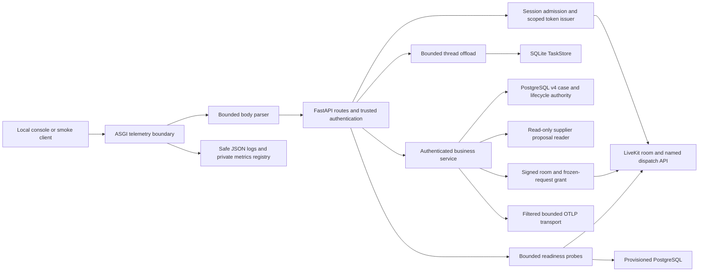
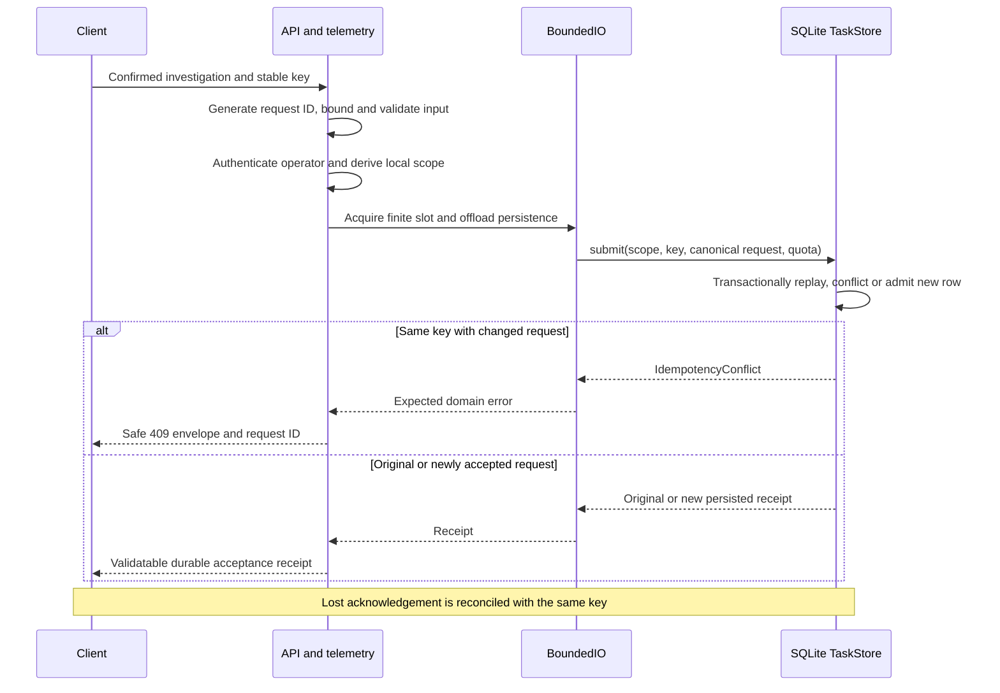
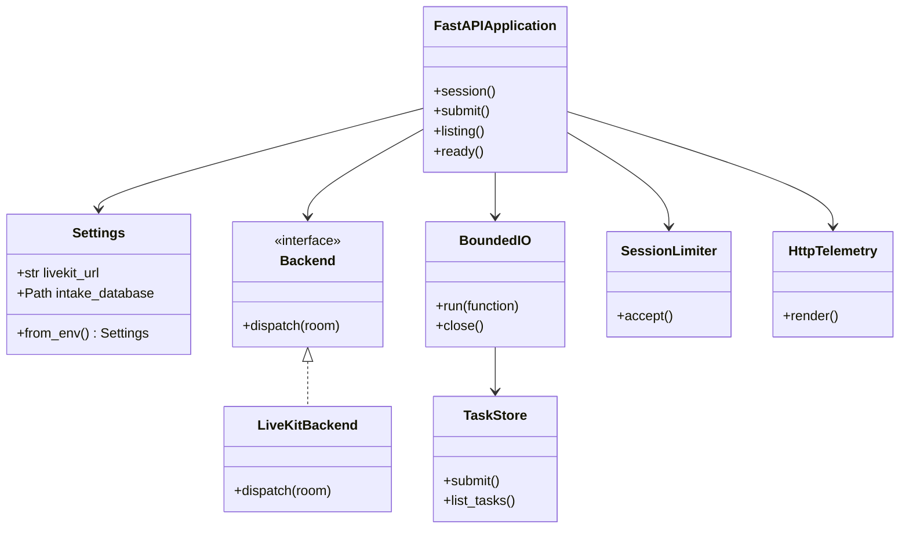

# Local control API design

Status: Active
Last reviewed: 10 November 2026

## Overview

The implemented FastAPI service is a local development control plane: issue
short-lived room-scoped LiveKit credentials, dispatch a named diagnostic agent,
and expose confirmed-investigation intake. SQLite TaskStore owns M1 records;
This HTTP service readiness-tests PostgreSQL and retains M1 SQLite intake.
An explicit business profile additionally composes authenticated PostgreSQL v4
managed acceptance, projection and exact quote/signal/cancel operations. It uses a
read-only supplier adapter for trusted proposals and a signed, expiring native
conversation binding; model tools cannot confirm a mutation.
Standalone P1 workers can now use PostgreSQL after explicit cutover; this service
does not automatically switch backend. A quiesced SQLite source returns the safe
source_quiesced error for new requests while original replay and reads remain. The local
operator bearer and fixed synthetic account are development mechanisms.

Read the [shared design](../../Design.md), [observability contract](../../docs/observability.md)
and [validation plan](../../docs/validation-plan.md). Only the registered P1-01 through P1-05 inquiry acceptance cases are implemented;
P1 local acceptance passed; planned P2/P3 product cases remain separate. A successful API/transport check does not establish a working
conversational agent, supplier mutation or durable workflow.

## Objectives

| Type | Objective | Success evidence |
| --- | --- | --- |
| Business | Make the local demonstration reproducible without model/carrier credentials | Authenticated session and M1 intake work through the composed lab |
| Business | Preserve the meaning of investigation consent | No endpoint changes a booking or interprets intake confirmation as mutation authority |
| Technical | Isolate credentials and trusted scope from callers | Scoped tokens, constant-time bearer comparison and fixed server-owned local scope |
| Technical | Keep persistence, dispatch and diagnostics bounded | Body, admission, I/O and dependency limits have meaningful boundary tests |
| Technical | Return inspectable failures without exposing submitted/provider data | Stable errors, internally generated request IDs and secret-safe telemetry |

## Functional requirements

| Type | Requirement | Current behavior and verification |
| --- | --- | --- |
| Business | Accept only explicitly confirmed investigation requests | Strict boolean confirmation, valid date and bounded identity; intake tests reject missing/false/extra authority fields |
| Business | Reconcile a repeated request without another logical acceptance | Same scoped key/payload returns original task; changed payload returns conflict; quota does not hide either outcome |
| Technical | Issue room/identity-scoped five-minute credentials | POST /api/session validates allowlisted room/participant names, optionally dispatches the named agent, then returns a 300-second token |
| Technical | Prevent routine duplicate diagnostic dispatch in this process | Serialize list/create; reuse pending/nonterminal matching dispatches; replace only defunct matching dispatches |
| Technical | Expose bounded persisted inspection | GET /api/investigations accepts limit 1–100, defaults to 50, and reports truncation; scope cannot be supplied by the caller |
| Technical | Separate liveness, readiness and authenticated operations | /healthz is process health; /readyz checks actual dependencies; session, intake/listing and metrics require bearer authentication |
| Technical | Admit managed business work atomically and project current state | Execution/case/control share one commit and original deadline; scoped GET is capped at 64 KiB and 50 recent observations |
| Business | Require separate exact mutation consent | Trusted quote proposal and explicit opaque canonical approval bind supplier identity/revision and case revision |
| Technical | Expose only safe public configuration | /api/config includes endpoints/capabilities and inference_enabled=false, never credentials |

## Non-functional requirements

| Concern | Bound or target | Verification | Status |
| --- | --- | --- | --- |
| Input accumulation | 16,384 bytes and five-second body deadline before JSON parsing | Chunked oversize, timeout and disconnect tests | Implemented per request |
| Blocking I/O | Four active offloaded operations; acquisition waits at most 50 ms | Saturation/cancellation test proves capacity stays held until the thread ends | Implemented |
| Session admission | Four active session requests; 12 accepted rate slots per process/window of 60 seconds | Rate/capacity tests; counters reset on process restart | Implemented local policy |
| Dependency bounds | Dispatch four seconds; readiness operations have explicit connect/operation deadlines | Failed/slow dependency fixtures and actual readiness smoke | Implemented; not an availability SLO |
| Persistence admission | New intake limited by an 8 MiB database-growth budget; replay/conflict/reads remain usable | Transactional admission and concurrent replay tests | Implemented M1 only |
| Shutdown | Wait at most ten seconds for pending offloaded I/O | Shutdown/cancellation fixtures; container grace period is a separate bound | Implemented deadline; threads cannot be force-cancelled |
| Deployment protection | Container Uvicorn command sets --limit-concurrency 32; ASGI body/operation limits protect separate resources | Inspect launch config and run ingress/saturation tests before nonlocal deployment | Launch bound configured; full deployment behavior not qualified |
| Performance | Declare hardware/workload and budgets before product measurements | Raw latency/error/resource samples under the shared validation plan | Planned; no production SLO claimed |

## Back-of-the-envelope calculations

These are configuration arithmetic and illustrative sizing, not throughput results.

| Input/assumption | Calculation | Interpretation |
| --- | --- | --- |
| Session rate is 12 per 60-second window | 12 / 60 = 0.2 accepted rate slots/s averaged over the window | A fixed-window local admission policy permits bursts; it is not a sustained throughput guarantee |
| Four I/O slots; assumed 100 ms occupancy | 4 / 0.1 s = 40 operations/s idealized ceiling | Excludes SQLite writer serialization, queueing, service overhead and cancellation-held work; measure actual service time |
| 8 MiB storage budget; assumed 1 KiB/record | 8 × 1024 KiB / 1 KiB = 8,192 record-equivalents | Pages, indices, existing rows and schema overhead reduce practical capacity; no guaranteed task count |
| Illustrative 16 simultaneous maximum request bodies | 16 × 16 KiB = 256 KiB payload alone | Body buffering precedes operation-specific admission; this is not a global memory cap |

The session limiter, storage admission and container memory boundary protect
different resources. The container launch additionally sets Uvicorn's
--limit-concurrency 32; a direct ASGI consumer does not inherit that launch option.
Do not derive one measured overall memory/concurrency claim from these values.

## High-level design

1. The outer telemetry boundary creates the diagnostic request ID before body or
   route errors can occur, observes the complete ASGI response and sanitizes
   unexpected ordinary exceptions.
2. Body and model validation constrain input; authenticated routes derive the
   fixed local account scope rather than trusting a body scope field.
3. Native asynchronous clients handle LiveKit/readiness I/O. SQLite work runs in
   bounded thread offload, outside the conversational event loop.
4. Only TaskStore commits investigation acceptance. Dispatch and token success
   are transport facts, not business progress.

## Sequence diagram

## Low-level design

FastAPIApplication represents the application constructed by create_app, not a
new handwritten framework class. Protocol injection supplies deterministic
backends/readiness probes to tests without calling remote services.

## Components and related details

### State ownership and layout

| Component | Source and responsibility |
| --- | --- |
| Application factory and routes | app.py owns lifespan, strict Pydantic request models, bearer dependency, limits and public endpoints |
| Configuration | settings.py uses a frozen slots dataclass, validates URLs/credential presence, and excludes secret fields from repr |
| Telemetry boundary | telemetry.py owns per-app registry, ASGI observation, safe error construction and JSON log records |
| Persistent intake | ../../projects/agent-continuity/python/src/continuity_lab owns TaskStore, canonical requests and scoped transactional idempotency; no workflow scheduler is added here |
| Tests | ../../tests/test_control_api.py exercises HTTP boundaries, dispatch, observability and cancellation; intake tests own persistence semantics |

### Interfaces and failure boundaries

Extra model fields are forbidden. Room/identity strings follow allowlists, and
confirmation is a strict boolean. Session dispatch completes before a credential
is returned; dispatch timeout is not proof that a remote request never occurred.
The backend reuses native dispatch state rather than assuming a client retry is
a new job. Listing fetches limit+1 rows to detect truncation.

BoundedIO shields already-started thread work from caller cancellation, retaining
the slot until completion. Cancelling an HTTP coroutine cannot undo persistence.
Lifespan closes pending local I/O, but Python cannot forcibly stop a running
thread; container/process lifecycle is a separate recovery boundary.

### Trusted native inference mode

Settings validates P1_CONVERSATION_INFERENCE as scripted (default), local_real or provider_real.
The authenticated business-session response derives mode from trusted configuration;
request bodies cannot override it. The same worker name, signed request/key, scope
and fresh-room invocation rules remain. A browser must additionally observe the
selected native participant reporting the same mode, exact ready attribute and
active SDK state. /api/config describes only the independent M1 transport profile;
its inference_enabled=false does not describe the optional business worker.
Actual local engines/model/media require the separate
[operations gate](../../docs/local-real-inference.md).

### Trusted provider composition

The shared/native path accepts exactly scripted (default), local_real and
provider_real. The diagrams retain the shared authority path; profile adapters use the same session and bound task rather than creating another
case authority. provider_real composes Deepgram nova-3 batch recognition after
manual flush, OpenAI gpt-5.4-mini streaming tool selection and ElevenLabs
eleven_v4_turbo chunked HTTP PCM speech. Only the native process receives provider
keys, and real output cannot bypass separate exact human consent.

The [provider operations guide](../../docs/provider-demo.md) owns strict key setup, explicit lifecycle,
fixed model/voice/transports, bounded execution and the fresh P1-20 selector.
Real profiles keep 12-second commit and 40-second incoming-transcription limits;
other RPCs remain 8 seconds and browser cleanup 5 seconds. No silent fallback,
provider resource-capacity result or blanket zero-retention claim is made.
The selected provider_real v2 gate passed both actual browser cases with cleanup. P1 V1 is qualified for the local POC using provider_real v2.
A passing provider scenario cannot qualify the separate local-engine declaration.

## Security and privacy

Use the generated local bearer only over the isolated loopback topology. Do not
present it as end-user authentication or multi-tenant production authorization.
The serving process receives the restricted PostgreSQL runtime credential, never
the bootstrap administrator password. No database credential reaches the browser.
Room grants expire after 300 seconds and authorize only their named room.

Raw request bodies, headers, query strings, tokens, room names, booking references
and provider exception messages are excluded from application telemetry. Unknown
validation field names are replaced with a safe placeholder. Any later external
deployment needs its own TLS, ingress admission and principal/scope design.

## Observability

Each response receives an internally generated X-Request-ID; incoming values do
not choose it. JSON completion/error logs contain UTC timestamp, fixed operation,
allowlisted method, status, duration and request ID, plus a fixed error code when
available. Unexpected exceptions are sanitized without serializing exception text.

Health/readiness/metrics successes are omitted from business request counts and
routine success logs; failures remain diagnosable. IDs correlate logs, never
metric dimensions. The explicit business profile exports filtered bounded traces; a reachable Jaeger UI
does not establish distributed tracing.

## Metrics

| Implemented metric | Unit/collection point | Bounded labels and interpretation |
| --- | --- | --- |
| livekit_control_http_requests_total | Completed ASGI requests | Fixed operation, method, status class; process-local and reset on restart |
| livekit_control_http_errors_total | Requests ending in 4xx/5xx observations | Same fixed vocabulary; includes local disconnect classification |
| livekit_control_http_request_duration_seconds | Complete request duration histogram | Fixed operation/method; monotonic clock, finite predefined buckets |
| livekit_control_http_requests_in_flight | Active request gauge | Fixed operation/method; decremented on success, error and cancellation |

GET /api/metrics requires bearer authentication and uses a private registry without
default process/GC collectors. Unknown paths/methods map to fixed buckets. Request,
tenant, case, room, workflow and effect IDs never create metric series.

## Exception handling

| Failure | Boundary behavior | Required assertion |
| --- | --- | --- |
| Invalid input/authentication | Safe 4xx code, detail and retry policy; at most 16 sanitized validation entries | Submitted values and unknown field names do not appear in response/logs |
| Changed same-key payload | idempotency_conflict, 409, no automatic new identity | Original accepted row is unchanged |
| Capacity/rate | Explicit 503/429 and allowlisted Retry-After where applicable | No false acceptance; existing replay/read remains usable at storage capacity |
| Dispatch/storage dependency | Stable dispatch_unavailable or storage_unavailable, no raw provider/database message | Safe error plus same-identity reconciliation if acceptance might have occurred |
| Unexpected ordinary exception | Sanitized internal_error before response; sanitized abort exception after response start | No private exception text; never attempt a second HTTP response |
| Cancellation/disconnect | Propagate CancelledError; log local 499 observation; retain already-started I/O slot | No invented 500, no swallowed fatal BaseException, no false rollback claim |

ApiError is the explicit application error type. Expected domain/adapter errors
are translated at the HTTP boundary. Error envelopes retain detail and add code,
retryable, retry_hint and request_id. Retry advice concerns this boundary; it
never authorizes repeating an uncertain supplier mutation.

## Design considerations and trade-offs

| Decision | Benefit | Cost or limit |
| --- | --- | --- |
| One local operator scope | Small reproducible development boundary | Not production identity or account isolation certification |
| SQLite M1 plus bounded threads | Preserve working intake while keeping blocking calls off async routes | Single local store; cancellation cannot stop an already-running thread |
| Native dispatch list/reuse | Avoid routine duplicate agent jobs on repeated local session requests | Process lock is not a distributed lock; one local API process is assumed |
| Separate dependency readiness | Fail startup/smoke visibly when services are unavailable | PostgreSQL readiness does not mean workflow tables exist |
| Safe finite telemetry | Useful evidence without payload leakage/cardinality growth | Detailed business traces must arrive with actual product producers |

## Validation and acceptance gates

1. Run the service unit command in [README.md](README.md), then repository fast
   checks. Normal, oversize/chunked, auth, conflict, dispatch replacement,
   saturation, cancellation and post-response-failure assertions must execute;
   skipped/zero-test runners cannot pass.
2. Check per-app metric isolation, actual inflight observations, finite labels,
   sanitized error/log content and internally generated request IDs.
3. Actual [local smoke](../../local-setup/README.md) must exercise readiness,
   token/dispatch, scoped intake and native text/audio separately from mock tests.
   Restart evidence must preserve the original M1 identity.
4. New product ports require their own charter assertions, migration, process,
   browser/media and live-mode evidence. Existing API diagnostics close none of
   product acceptance requirements by themselves.

### Business boundary qualification

The business service has its own four-slot bounded thread offload. Cancellation of
a waiting HTTP/media caller retains the slot until the real database operation
finishes. Reads and commands reauthenticate; route task IDs cannot redirect an
exact confirmation. New managed work commits execution, case owner and deadline
atomically. Unknown acknowledgement requires reconciliation with the original
key/payload. Quotes require an available matching inquiry and a current supplier
identity/revision; provider reads happen outside the protected database transaction.

Responses cap UTF-8 bytes at 65,536. BIGINT revisions are decimal strings, while
confirmation_payload remains original canonical JSON returned without JavaScript
numeric reconstruction. The server parses it strictly with duplicate/nonfinite
rejection. Session grants expire after 300 seconds and bind principal, room,
participant and the original inquiry request/key. A conflicting active room binding
returns session_in_use; reusing one room cannot silently switch cases.

HTTP and native tracing use the [shared bounded privacy contract](../../docs/observability.md).
The ordinary M1 SQLite path and named diagnostic agent retain their prior behavior.
Business profile operation is local synthetic evidence, not a production IAM or
remote TLS deployment certification.
