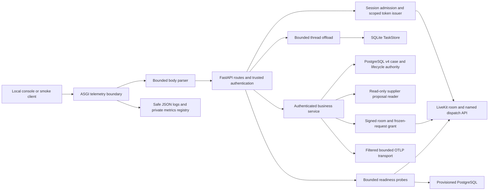
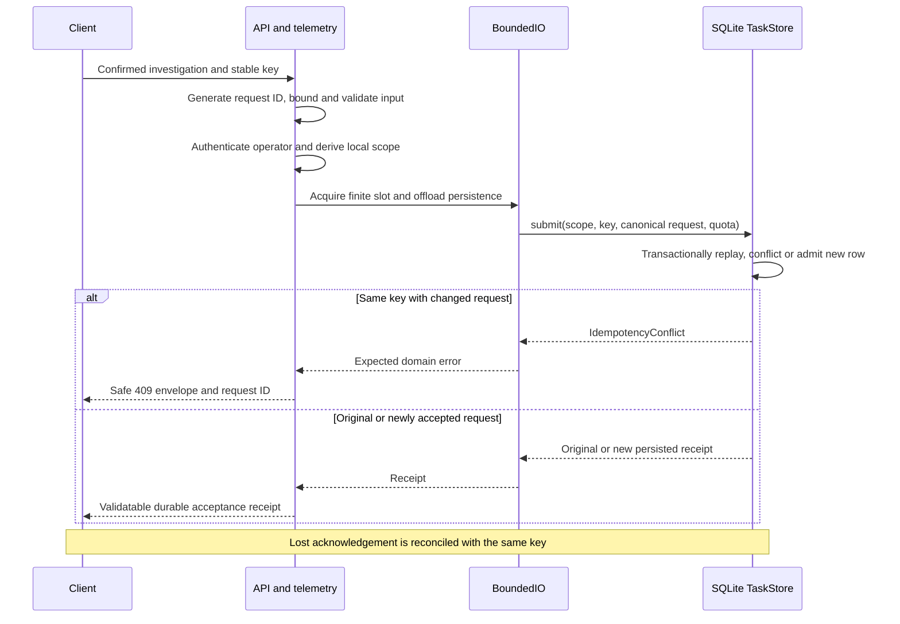
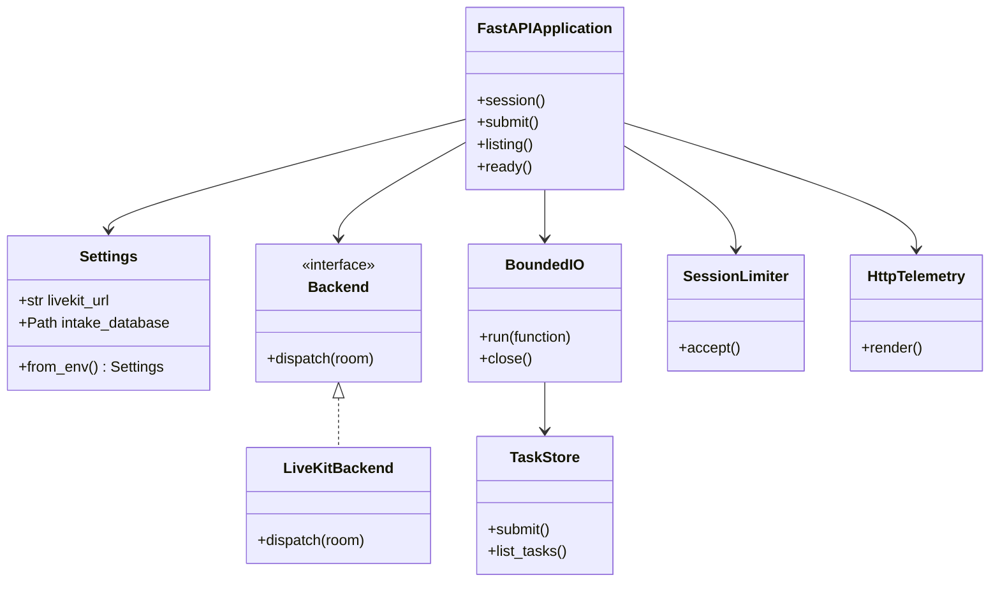

# Local control API design

| Field | Value |
| --- | --- |
| Status | Active |
| Purpose | Explain the control API's interfaces, limits, failure handling and design decisions |
| Audience | Engineers who change the control API or review its evidence; coding agents |
| Scope | Routes, admission, telemetry and the business-profile boundary; excludes durable workers and native media |
| Owns | Control API interfaces, resource limits, failure handling and design trade-offs |
| Related | [README](README.md) · [Shared design](../../Design.md) · [Observability](../../docs/observability.md) · [Validation plan](../../docs/validation-plan.md) · [Provider guide](../../docs/provider-demo.md) |

## Overview

This document describes the design of the local control API for engineers who
change it. The implemented FastAPI service is a local development control plane.
By default it does three things:

- issue short-lived room-scoped LiveKit credentials;
- dispatch a named diagnostic agent;
- expose confirmed-investigation intake.

**M1 intake.** M1 is the existing confirmed-investigation intake. The SQLite
TaskStore owns M1 records. This HTTP service readiness-tests PostgreSQL and
retains M1 SQLite intake. Standalone P1 (agent continuity) workers can use
PostgreSQL after explicit cutover, but this service does not automatically
switch backend. A quiesced SQLite source returns the safe `source_quiesced` error
for new requests, while original replay and reads remain available.

**Business profile.** An explicit business profile additionally composes
authenticated PostgreSQL v4 managed acceptance, projection and exact
quote/signal/cancel operations. It uses a read-only supplier adapter for trusted
proposals and a signed, expiring native conversation binding. Model tools cannot
confirm a mutation.

The local operator bearer and the fixed synthetic account are development
mechanisms.

Read the [shared design](../../Design.md), [observability contract](../../docs/observability.md)
and [validation plan](../../docs/validation-plan.md). All twenty P1 acceptance
rows, including the P1-01 through P1-05 inquiry cases, have registered runners,
and P1 local acceptance passed. Planned P2/P3 product cases remain separate. A
successful API/transport check does not establish a working conversational agent,
supplier mutation or durable workflow.

### Terms

| Term | Meaning |
| --- | --- |
| M1 | The existing confirmed-investigation intake |
| P1 | Agent continuity |
| P1 V1 | The fixed first-version P1 scope |
| POC | Proof of concept |
| ASGI | Asynchronous Server Gateway Interface |
| SLO | Service-level objective |
| OTLP | OpenTelemetry Protocol |
| PCM | Pulse-code modulation, that is, raw audio samples |
| RPC | Remote procedure call |
| GC | Garbage collector |
| IAM | Identity and access management |

## Objectives

| Kind | Objective | Success measure |
| --- | --- | --- |
| Business | Make the local demonstration reproducible without model/carrier credentials | Authenticated session and M1 intake work through the composed lab |
| Business | Preserve the meaning of investigation consent | No endpoint changes a booking or interprets intake confirmation as mutation authority |
| Technical | Isolate credentials and trusted scope from callers | Scoped tokens, constant-time bearer comparison and fixed server-owned local scope |
| Technical | Keep persistence, dispatch and diagnostics bounded | Body, admission, I/O and dependency limits have meaningful boundary tests |
| Technical | Return inspectable failures without exposing submitted/provider data | Stable errors, internally generated request IDs and secret-safe telemetry |

## Functional requirements

| Kind | Requirement | Current behavior and verification |
| --- | --- | --- |
| Business | Accept only explicitly confirmed investigation requests | Strict boolean confirmation, valid date and bounded identity; intake tests reject missing/false/extra authority fields |
| Business | Reconcile a repeated request without another logical acceptance | Same scoped key and payload returns the original task; a changed payload returns a conflict; quota does not hide either outcome |
| Technical | Issue room/identity-scoped five-minute credentials | `POST /api/session` validates allowlisted room/participant names, optionally dispatches the named agent, then returns a 300-second token |
| Technical | Prevent routine duplicate diagnostic dispatch in this process | Serialize list/create; reuse pending/nonterminal matching dispatches; replace only defunct matching dispatches |
| Technical | Expose bounded persisted inspection | `GET /api/investigations` accepts limit 1–100, defaults to 50, and reports truncation; the caller cannot supply scope |
| Technical | Separate liveness, readiness and authenticated operations | `/healthz` is process health; `/readyz` checks actual dependencies; session, intake/listing and metrics require bearer authentication |
| Technical | Admit managed business work atomically and project current state | Execution, case and control share one commit and the original deadline; the scoped `GET` is capped at 64 KiB and 50 recent observations |
| Business | Require separate exact mutation consent | Trusted quote proposal and explicit opaque canonical approval bind supplier identity/revision and case revision |
| Technical | Expose only safe public configuration | `/api/config` includes endpoints/capabilities and `inference_enabled=false`, never credentials |

## Non-functional requirements

| Concern | Bound or target | Verification | Status |
| --- | --- | --- | --- |
| Input accumulation | 16,384 bytes and five-second body deadline before JSON parsing | Chunked oversize, timeout and disconnect tests | Implemented per request |
| Blocking I/O | Four active offloaded operations; acquisition waits at most 50 ms | Saturation/cancellation test proves capacity stays held until the thread ends | Implemented |
| Session admission | Four active session requests; 12 accepted rate slots per process per 60-second window | Rate/capacity tests; counters reset on process restart | Implemented local policy |
| Dependency bounds | Dispatch four seconds; readiness operations have explicit connect/operation deadlines | Failed/slow dependency fixtures and actual readiness smoke | Implemented; not an availability SLO |
| Persistence admission | New intake limited by an 8 MiB database-growth budget; replay/conflict/reads remain usable | Transactional admission and concurrent replay tests | Implemented for M1 only |
| Shutdown | Wait at most ten seconds for pending offloaded I/O | Shutdown/cancellation fixtures; the container grace period is a separate bound | Implemented deadline; threads cannot be force-cancelled |
| Deployment protection | Container Uvicorn command sets `--limit-concurrency 32`; ASGI body/operation limits protect separate resources | Inspect launch config and run ingress/saturation tests before nonlocal deployment | Launch bound configured; full deployment behavior not qualified |
| Performance | Declare hardware/workload and budgets before product measurements | Raw latency/error/resource samples under the shared validation plan | Planned; no production SLO claimed |

## Back-of-the-envelope calculations

These are configuration arithmetic and illustrative sizing, not throughput results.

| Quantity | Inputs | Formula and result | Limits of inference |
| --- | --- | --- | --- |
| Session admission rate | Session rate is 12 per 60-second window | 12 / 60 = 0.2 accepted rate slots/s averaged over the window | A fixed-window local admission policy permits bursts; it is not a sustained throughput guarantee |
| Offloaded I/O ceiling | Four I/O slots; assumed 100 ms occupancy | 4 / 0.1 s = 40 operations/s idealized ceiling | Excludes SQLite writer serialization, queueing, service overhead and cancellation-held work; measure actual service time |
| Storage record-equivalents | 8 MiB storage budget; assumed 1 KiB/record | 8 × 1024 KiB / 1 KiB = 8,192 record-equivalents | Pages, indices, existing rows and schema overhead reduce practical capacity; no guaranteed task count |
| Buffered request bodies | Illustrative 16 simultaneous maximum request bodies | 16 × 16 KiB = 256 KiB payload alone | Body buffering precedes operation-specific admission; this is not a global memory cap |

The session limiter, storage admission and container memory boundary protect
different resources. The container launch additionally sets Uvicorn's
`--limit-concurrency 32`, but a direct ASGI consumer does not inherit that launch
option. Do not derive one measured overall memory or concurrency claim from these
values.

## High-level design

1. The outer telemetry boundary creates the diagnostic request ID before body or
   route errors can occur. It observes the complete ASGI response and sanitizes
   unexpected ordinary exceptions.
2. Body and model validation constrain input. Authenticated routes derive the
   fixed local account scope rather than trusting a body scope field.
3. Native asynchronous clients handle LiveKit and readiness I/O. SQLite work runs
   in bounded thread offload, outside the conversational event loop.
4. Only TaskStore commits investigation acceptance. Dispatch and token success
   are transport facts, not business progress.
5. In the explicit business profile, the business service uses the PostgreSQL v4
   case authority, the read-only supplier proposal reader and the signed grant,
   and exports filtered bounded OpenTelemetry Protocol (OTLP) traces. See
   [Business profile boundary](#business-profile-boundary).

## Sequence diagram

## Low-level design

FastAPIApplication represents the application constructed by `create_app`, not a
new handwritten framework class. Protocol injection supplies deterministic
backends and readiness probes to tests without calling remote services.

## Components and related details

### State ownership and layout

| Component | Path | Responsibility | Status |
| --- | --- | --- | --- |
| Application factory and routes | `services/control_api/app.py` | Owns lifespan, strict Pydantic request models, the bearer dependency, limits and public endpoints | Implemented |
| Configuration | `services/control_api/settings.py` | Frozen slots dataclass that validates URLs and credential presence and excludes secret fields from `repr` | Implemented |
| Telemetry boundary | `services/control_api/telemetry.py` | Owns the per-app registry, ASGI observation, safe error construction and JSON log records | Implemented |
| Persistent intake | `projects/agent-continuity/python/src/continuity_lab` | Owns TaskStore, canonical requests and scoped transactional idempotency; no workflow scheduler is added here | Implemented |
| Tests | `tests/test_control_api.py` | Exercises HTTP boundaries, dispatch, observability and cancellation; intake tests own persistence semantics | Implemented |

### Interfaces and failure boundaries

| Route | Profile | Authentication | Behavior |
| --- | --- | --- | --- |
| `GET /healthz` | Default | None | Process health |
| `GET /readyz` | Default | None | Checks actual dependencies |
| `GET /api/config` | Default | None | Safe public endpoints and capabilities, with `inference_enabled=false` |
| `POST /api/session` | Default | Bearer | Five-minute room/identity-scoped credentials and optional named-agent dispatch |
| `POST /api/investigations` | Default | Bearer | Confirmed M1 investigation intake |
| `GET /api/investigations` | Default | Bearer | Bounded persisted inspection |
| `GET /api/metrics` | Default | Bearer | Private metrics registry |
| `POST /api/business/investigations` | Business | Bearer | Atomic managed admission |
| `GET /api/business/cases/{task_id}` | Business | Bearer | Scoped current-case projection |
| `POST /api/business/cases/{task_id}/quote` | Business | Bearer | Trusted quote preparation |
| `POST /api/business/cases/{task_id}/signal` | Business | Bearer | Exact confirmation |
| `POST /api/business/cases/{task_id}/cancel` | Business | Bearer | Business cancellation |
| `POST /api/business/session` | Business | Bearer | Signed room/participant grant and room-scoped LiveKit token |

The [functional requirements](#functional-requirements) state each route's
limits and verification.

**Request validation.** Extra model fields are forbidden. Room and identity
strings follow allowlists, and confirmation is a strict boolean.

**Dispatch.** Session dispatch completes before a credential is returned. A
dispatch timeout is not proof that a remote request never occurred. The backend
reuses native dispatch state rather than assuming that a client retry is a new job.

**Listing.** Listing fetches limit+1 rows to detect truncation.

**Thread offload.** BoundedIO shields already-started thread work from caller
cancellation and retains the slot until completion. Cancelling an HTTP coroutine
cannot undo persistence. Lifespan closes pending local I/O, but Python cannot
forcibly stop a running thread. The container and process lifecycle is a
separate recovery boundary.

### Business profile boundary

- **Bounded offload.** The business service has its own four-slot bounded thread
  offload. Cancellation of a waiting HTTP or media caller retains the slot until
  the real database operation finishes.
- **Authentication.** Reads and commands reauthenticate. Route task IDs cannot
  redirect an exact confirmation.
- **Admission.** New managed work commits execution, case owner and deadline
  atomically. An unknown acknowledgement requires reconciliation with the
  original key and payload.
- **Quotes.** A quote requires an available matching inquiry and a current
  supplier identity and revision. Provider reads happen outside the protected
  database transaction.
- **Responses.** Responses cap UTF-8 bytes at 65,536. BIGINT revisions are
  decimal strings, while `confirmation_payload` remains the original canonical
  JSON, returned without JavaScript numeric reconstruction. The server parses it
  strictly, rejecting duplicate and nonfinite values.
- **Session grants.** Grants expire after 300 seconds and bind the principal,
  room, participant and the original inquiry request/key. A conflicting active
  room binding returns `session_in_use`, so reusing one room cannot silently
  switch cases.
- **Tracing.** HTTP and native tracing use the
  [shared bounded privacy contract](../../docs/observability.md).
- **Compatibility.** The ordinary M1 SQLite path and the named diagnostic agent
  retain their prior behavior.

### Trusted native inference mode

| Option | Default | Allowed values | Description |
| --- | --- | --- | --- |
| `P1_CONVERSATION_INFERENCE` | `scripted` | `scripted`, `local_real`, `provider_real` | Validated by Settings; the source of the minted business-session mode |

The authenticated business-session response derives the mode from this trusted
configuration, and request bodies cannot override it. The same worker name,
signed request/key, scope and fresh-room invocation rules remain in every mode.

A browser must additionally observe the selected native participant reporting
the same mode, the exact ready attribute and an active SDK state.

`/api/config` describes only the independent M1 transport profile. Its
`inference_enabled=false` does not describe the optional business worker. Actual
local engines, models and media require the separate
[operations gate](../../docs/local-real-inference.md).

### Trusted provider composition

The shared native path accepts exactly `scripted` (default), `local_real` and
`provider_real`. The diagrams keep the shared authority path: profile adapters
use the same session and bound task rather than creating another case authority.

`provider_real` composes three provider stages:

| Stage | Provider | Model | Behavior |
| --- | --- | --- | --- |
| Recognition | Deepgram | `nova-3` | Batch recognition after manual flush |
| Model | OpenAI | `gpt-5.4-mini` | Streaming tool selection |
| Speech | ElevenLabs | `eleven_v4_turbo` | Chunked HTTP PCM speech |

Only the native process receives provider keys, and real output cannot bypass
separate exact human consent.

The [provider operations guide](../../docs/provider-demo.md) owns strict key
setup, the explicit lifecycle, fixed model/voice/transports, bounded execution
and the fresh P1-20 selector. Real profiles keep these limits:

| Limit | Value | Applies to | Notes |
| --- | --- | --- | --- |
| Commit | 12 seconds | Both real profiles | Browser commit acknowledgement |
| Incoming transcription | 40 seconds | Both real profiles | Whole incoming transcription stream |
| Other remote procedure calls (RPCs) | 8 seconds | Both real profiles | Control RPCs other than commit |
| Browser cleanup | 5 seconds | Both real profiles | Browser capture, mute and disconnect acknowledgement |

No silent fallback, provider resource-capacity result or blanket zero-retention
claim is made. The selected `provider_real` v2 gate passed both actual browser
cases with cleanup. P1 V1, the fixed first-version P1 scope, is qualified for the
local POC (proof of concept) using `provider_real` v2. A passing provider
scenario cannot qualify the separate local-engine declaration.

## Security and privacy

| Boundary or threat | Control | Test or evidence |
| --- | --- | --- |
| Local operator bearer | Use the generated bearer only over the isolated loopback topology; do not present it as end-user authentication or multi-tenant production authorization | Constant-time bearer comparison; auth assertions in the unit and fast checks |
| Database credentials | The serving process receives the restricted PostgreSQL runtime credential, never the bootstrap administrator password; no database credential reaches the browser | `/api/config` never includes credentials; configuration excludes secret fields from `repr` |
| Room grants | Grants expire after 300 seconds and authorize only their named room | Service unit tests check the token expiry |
| Application telemetry | Raw request bodies, headers, query strings, tokens, room names, booking references and provider exception messages are excluded | Submitted values and unknown field names do not appear in responses or logs |
| Unknown validation field names | Replaced with a safe placeholder | The same response and log assertion |
| External deployment | Any later external deployment needs its own TLS, ingress admission and principal/scope design | Not qualified; business profile operation is local synthetic evidence |

## Observability

| Signal | Producer | Fields or labels | Status |
| --- | --- | --- | --- |
| `X-Request-ID` header | ASGI telemetry boundary | Internally generated for each response; incoming values do not choose it | Implemented |
| JSON completion and error logs | ASGI telemetry boundary | UTC timestamp, fixed operation, allowlisted method, status, duration and request ID, plus a fixed error code when available | Implemented |
| Unexpected exception records | ASGI telemetry boundary | Sanitized without serializing exception text | Implemented |
| HTTP metrics | Private per-app registry | Fixed bounded labels; see [Metrics](#metrics) | Implemented |
| Filtered bounded traces | Business service in the explicit business profile | OTLP spans under the [shared privacy contract](../../docs/observability.md) | Implemented |

- Health, readiness and metrics successes are omitted from business request
  counts and routine success logs. Their failures remain diagnosable.
- IDs correlate logs. They are never metric dimensions.
- A reachable Jaeger UI does not establish distributed tracing.

## Metrics

| Measurement | Type or unit | Collection point and labels | Interpretation and status |
| --- | --- | --- | --- |
| `livekit_control_http_requests_total` | Counter | Completed ASGI requests; fixed operation, method and status class | Implemented; process-local and reset on restart |
| `livekit_control_http_errors_total` | Counter | Requests ending in 4xx/5xx observations; same fixed vocabulary | Implemented; includes local disconnect classification |
| `livekit_control_http_request_duration_seconds` | Histogram, seconds | Complete request duration; fixed operation and method | Implemented; monotonic clock, finite predefined buckets |
| `livekit_control_http_requests_in_flight` | Gauge | Active requests; fixed operation and method | Implemented; decremented on success, error and cancellation |

`GET /api/metrics` requires bearer authentication. It uses a private registry
without the default process and garbage-collector (GC) collectors. Unknown paths
and methods map to fixed buckets. Request, tenant, case, room, workflow and
effect IDs never create metric series.

## Exception handling

| Failure | Handling | Required assertion |
| --- | --- | --- |
| Invalid input/authentication | Safe 4xx code, detail and retry policy; at most 16 sanitized validation entries | Submitted values and unknown field names do not appear in response/logs |
| Changed same-key payload | `idempotency_conflict`, 409, no automatic new identity | Original accepted row is unchanged |
| Capacity/rate | Explicit 503/429 and allowlisted `Retry-After` where applicable | No false acceptance; existing replay/read remains usable at storage capacity |
| Dispatch/storage dependency | Stable `dispatch_unavailable` or `storage_unavailable`, no raw provider/database message | Safe error plus same-identity reconciliation if acceptance might have occurred |
| Unexpected ordinary exception | Sanitized `internal_error` before the response starts; sanitized abort exception after it starts | No private exception text; never attempt a second HTTP response |
| Cancellation/disconnect | Propagate `CancelledError`; log a local 499 observation; retain an already-started I/O slot | No invented 500, no swallowed fatal BaseException, no false rollback claim |

`ApiError` is the explicit application error type. Expected domain and adapter
errors are translated at the HTTP boundary. Error envelopes retain `detail` and
add `code`, `retryable`, `retry_hint` and `request_id`. Retry advice concerns
this boundary only. It never authorizes repeating an uncertain supplier mutation.

An `ApiError` detail that is an object or list stays a JSON value. The readiness
failure therefore returns HTTP 503 with code `dependency_unavailable` and the
detail `{"status":"not_ready","dependencies":{...}}`. Other `ApiError` details
are rendered as text, and framework HTTP errors keep their fixed text.

### Error codes

| Code | HTTP status | Meaning |
| --- | --- | --- |
| `idempotency_conflict` | 409 | Same scoped key with a changed payload |
| `session_in_use` | 409 | A conflicting active room binding |
| `source_quiesced` | 503 | New request to a quiesced SQLite source |
| `dispatch_unavailable` | 503 | Dispatch dependency failure |
| `storage_unavailable` | 503 | Storage dependency failure |
| `dependency_unavailable` | 503 | Readiness failure |
| `internal_error` | 500 | Unexpected ordinary exception before the response starts |

This table lists the codes this document names.
`services/control_api/telemetry.py` holds the complete fixed vocabulary with
each code's retry flag and hint.

## Design considerations and trade-offs

| Decision | Reason | Cost or alternative | Revisit trigger |
| --- | --- | --- | --- |
| One local operator scope | Small reproducible development boundary | Not production identity or account isolation certification | Any later external deployment |
| SQLite M1 plus bounded threads | Preserve working intake while keeping blocking calls off async routes | Single local store; cancellation cannot stop an already-running thread | None recorded |
| Native dispatch list/reuse | Avoid routine duplicate agent jobs on repeated local session requests | A process lock is not a distributed lock; one local API process is assumed | More than one API process |
| Separate dependency readiness | Fail startup/smoke visibly when services are unavailable | PostgreSQL readiness does not mean workflow tables exist | None recorded |
| Safe finite telemetry | Useful evidence without payload leakage/cardinality growth | Detailed business traces must arrive with actual product producers | Actual product producers arrive |

## Validation and acceptance gates

| Gate | Assertion or lane | Evidence | Status |
| --- | --- | --- | --- |
| Unit and fast checks | Normal, oversize/chunked, auth, conflict, dispatch replacement, saturation, cancellation and post-response-failure assertions must execute | Service unit command in [README.md](README.md), then the repository fast checks; skipped or zero-test runners cannot pass | Required per change |
| Telemetry checks | Per-app metric isolation, actual in-flight observations, finite labels, sanitized error/log content and internally generated request IDs | The same unit and fast checks | Required per change |
| Actual local smoke | Readiness, token/dispatch, scoped intake and native text/audio, separately from mock tests; restart evidence must preserve the original M1 identity | [Local smoke](../../local-setup/README.md) | Required for affected changes |
| New product ports | Their own charter assertions, migration, process, browser/media and live-mode evidence | Existing API diagnostics close none of the product acceptance requirements by themselves | Required for each new port |
| Business boundary qualification | The rules in [Business profile boundary](#business-profile-boundary) | [Phase G work item](../../docs/work-items/0013-p1-phase-g-conversation-and-showcase.md) combined local gate; local synthetic evidence, not a production IAM or remote TLS deployment certification | Passed in Phase G |
