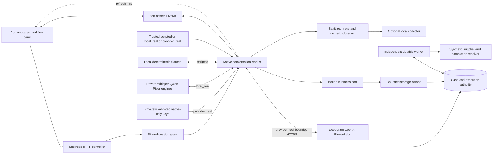
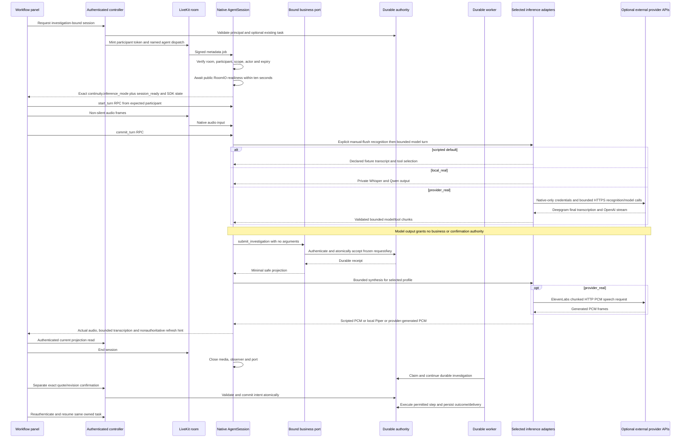
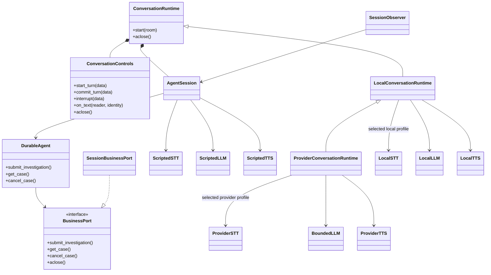

# Native conversation agent design

Status: Active
Last reviewed: 15 November 2026

## Overview

This document describes the design of the native conversation agent for
engineers who change it or review its evidence. The service is a native LiveKit
Agents consumer of P1 (agent continuity) durable work. A real AgentSession runs
Agent function tools against a trusted asynchronous business port.

- `scripted` is the default profile. It makes SDK, real-time communication (RTC)
  and lifecycle checks deterministic without downloads or providers.
- The explicit `local_real` implementation uses prepared Whisper, Qwen and Piper
  engines behind the same bounded ports. Actual engine, model and media
  qualification remains pending.
- The explicit `provider_real` profile uses Deepgram, OpenAI and ElevenLabs
  behind the same session and bound task. See
  [Trusted provider composition](#trusted-provider-composition).

Business authority remains in the authenticated service and PostgreSQL. A room is
not a workflow owner.

The profile contributes to P1-I22 through P1-I25 and P1-14/17/18/20. The
[P1 charter](../../docs/projects/agent-continuity-scope.md) owns acceptance
criteria. The [Phase G work item](../../docs/work-items/0013-p1-phase-g-conversation-and-showcase.md),
which covers the P1 conversation and showcase phase, owns phase evidence and
remaining release prerequisites.

## Objectives

| Kind | Objective | Observable result |
| --- | --- | --- |
| Business | Continue accepted investigation across session end | The durable task remains inspectable and independently executable |
| Business | Preserve explicit control of booking changes | Exact quote/revision approval comes only from the authenticated panel |
| Technical | Exercise the actual LiveKit SDK locally | Native audio/manual turns, tools, speech, interruption and report observations |
| Technical | Keep conversation responsive under slow storage/telemetry | Storage offload, finite work, owned cleanup and optional export |
| Technical | Keep portfolio claims reproducible | Synthetic fixtures and separate unit, SDK, database and browser evidence |

## Functional requirements

| Kind | Requirement | Implementation and acceptance surface |
| --- | --- | --- |
| Business | Accept only an already authorized investigation | Signed grant freezes request/principal/replay key; the submit tool has no arguments |
| Business | Inspect/cancel only the current owned task | Trusted SessionBusinessPort binds the task; no arbitrary model task identity |
| Business | Preserve exact confirmation authority | No model confirmation/signal tool; the authenticated controller validates the persisted quote/revision |
| Technical | Require verified controls | Caller-bound RPC accepts only `schema_version` 1 with no authority fields |
| Technical | Transport actual audio | Non-silent received PCM qualifies fixture STT; prerecorded speech traverses native TTS output |
| Technical | Provide honest visible progress | Native transcription/state plus a UUID refresh hint; the panel authenticates a fresh durable read |
| Technical | Close independently owned resources | Session, report/export observer and storage port each receive bounded cleanup |

RPC means remote procedure call. PCM is pulse-code modulation, that is, raw audio
samples. STT, LLM and TTS mean speech-to-text, large language model and
text-to-speech.

## Non-functional requirements

| Requirement | Configured bound or behavior | Units | Verification | Status |
| --- | --- | --- | --- | --- |
| Admission | One assigned/pending job; serialized assignment | jobs/worker | Admission concurrency tests | Implemented |
| Recognition ownership | At most two active/closing stream handles; one active and one waiting ASR operation | handles/operations | Actual SDK turn-reset, third-handle rejection and cancelled-close regressions | Implemented; real-provider gate separate |
| Session lifetime | 180 maximum | seconds | Worker configuration/lifecycle | Configured; runtime gate separate |
| Media readiness | Public RoomIO barrier, at most 10; caller controls rejected before completion | seconds | Gated output subscription, timeout and cancellation regressions | Implemented |
| Control ingress | 128 bytes; 64 commands; exact versioned object | UTF-8 bytes/session calls | Positive/negative RPC tests | Implemented |
| Text ingress | 4 KiB; two readers; 3-second read budget; 32 turns | bytes/tasks/seconds/turns | Overflow, foreign caller and closure tests | Implemented |
| Tool work | 32 tool calls; 8 KiB finite JSON receipts | calls/bytes | Bounds and sanitized failure tests | Implemented |
| Audio ingress | 16 kHz mono PCM16; 12 seconds/turn, 190 seconds/session; 32 qualified turns | Hz/seconds/turns | Provider/native AudioInput tests | Implemented |
| Speech fixture bank | Seven declared output phrases; each at most 12 seconds | clips/seconds | WAV format/size/symlink tests | Implemented |
| Storage responsiveness | Blocking operations off media loop; seven-second adapter timeout | seconds | Adapter/offload tests | Implemented |
| Cleanup | Session 5, observer 2, port 5; server end 18/drain 20/process shutdown 20 | seconds | Cleanup ordering/failure tests and runtime gate | Implemented budgets |
| Telemetry | Queue 128; wire request 64 KiB; HTTP I/O timeout 0.5 | spans/bytes/seconds | Real receiver, saturation/outage tests | Implemented |
| Startup diagnostics | Six finite phase codes in the existing five-field schema; no readiness inferred from construction | events | Privacy/lifecycle tests and actual runtime failure evidence | Implemented |
| Numeric observation retention | At most 32 local files, each at most 4 KiB | files/bytes | Observer tests | Implemented |
| Privacy | No transcript/grant/secrets/full reports in application logs or exported spans | content policy | Sentinel fixtures and decoded protobuf | Implemented; native paths reviewed separately |

ASR means automatic speech recognition.

## Back-of-the-envelope calculations

These are configured sizing estimates, not measured throughput or latency claims.

| Input and formula | Result | Exclusions |
| --- | --- | --- |
| 16,000 samples/s × 2 bytes/sample × 1 channel | 32,000 PCM bytes/s | RTP/Opus, encryption and RTC buffers |
| 32,000 bytes/s × 12 s | 384,000 PCM bytes/maximum turn | Native framing and temporary objects |
| Two text readers × 4,096 payload bytes | 8,192 admitted text bytes | Native RTC transport buffers and Python objects |
| 128 queued spans × 65,536 maximum wire bytes | 8 MiB conservative wire-size envelope | Python object overhead; normal sanitized spans are smaller |
| 32 observation files × 4,096 bytes | 128 KiB numeric payload ceiling | Filesystem metadata |
| 5 s + 2 s + 5 s cleanup budgets | 12 s sequential application cleanup envelope | External process termination and pathological filesystem behavior |

- The actual output WAV bank contains approximately 1.1 MB of PCM. Exact
  per-asset bytes, durations and hashes live in the [manifest](assets/manifest.json).
- One conversation process is the initial capacity. The SDK memory warning and
  limit settings are 192 MiB and 256 MiB.
- Actual resident set size (RSS), multi-worker scale and throughput need
  measured benchmarks before a capacity claim.

## High-level design

1. The HTTP controller authenticates the user and mints a short-lived signed
   room/participant binding from server authority.
2. LiveKit carries media, native transcription/state and bounded control
   messages. The worker verifies its grant before installing native tools.
3. The business port binds the original investigation and replay identity.
   Blocking storage calls execute through finite offload, and PostgreSQL commits
   durable work.
4. Durable workers execute independently of the conversation. Exact confirmation
   uses the separate HTTP controller and persisted case authority.
5. Refresh hints request an authenticated read. Optional traces and numeric
   observations describe execution without becoming business authority. Traces
   use the OpenTelemetry Protocol (OTLP).

## Sequence diagram

## Low-level design

LocalConversationRuntime extends ConversationRuntime, and
ProviderConversationRuntime extends LocalConversationRuntime. The labelled
associations show the adapters of each selected profile: the scripted STT, LLM
and TTS by default, the local adapters for `local_real`, and ProviderSTT,
BoundedLLM and ProviderTTS for `provider_real`.

## Components and related details

### Implementation and authority

| Component | Responsibility | Authority boundary |
| --- | --- | --- |
| `worker.py` | Native dispatch/admission, prewarm, room connection and cleanup | Verifies composition before media; owns one bounded session |
| `scripted.py` | SDK provider extensions and validated PCM bank | Fixed fixture mapping; no remote inference or new consent |
| `session.py` | Native Agent/AgentSession, tools and bounded RTC controls | Tools have no model scope/task/confirmation arguments |
| `composition.py` | Signed grant verification and asynchronous service binding | Server principal, frozen request/key and current owned task |
| `observations.py` | Numeric usage/report extraction and finite local files | No full report serialization; the exporter never owns business state |
| `telemetry.py` | Fixed JSON application/SDK log boundary | Exception bodies, metadata and transcript text excluded |
| `projects/agent-continuity/python/src/continuity_lab/tracing.py` | Private provider, sanitized copies and finite HTTP export | Explicit local endpoint, no environment auth/proxy hooks |

### Business port and tools

BusinessPort exposes async `submit_investigation`, `get_case`, `cancel_case` and
`aclose`. The three native tools additionally receive an SDK-injected
RunContext. It is hidden from model arguments and carries no model-selected
business scope.

- Each tool calls `ctx.update` with a fixed pending receipt and `silent=True`
  before awaiting its port operation. This releases the current speech turn
  while the SDK owns the ongoing tool and its deferred result.
- `ToolFlag.NONE` preserves the three-tool schema and avoids adding
  model-visible task cancellation or listing capabilities.
- A pending update is not acceptance. It cannot trigger an acceptance hint or a
  spoken receipt.

**Unknown submit acknowledgement.** The port marks a submit as issued before it
calls the service. A submit whose waiter timed out while the protected write may
still commit is therefore unknown, and so is a submit that local capacity
rejected before it started. After an unknown submit, `get_case` and `cancel_case`
first replay the frozen original submit with the same idempotency key, then read
or cancel the task that the replay identifies. If the replay cannot finish, the
tool raises its fixed `ToolError` and the reply says the operation could not be
completed, never that nothing was accepted.

### Caller binding and controls

A verified ConversationBinding fixes the expected `browser-` or `smoke-`
participant. Room metadata is a signed server grant, not participant-editable
identity. The browser sends only `schema_version` 1 to the three control RPCs:

| RPC | Replies |
| --- | --- |
| `business.start_turn` | `turn_started` |
| `business.commit_turn` | `turn_committed` or `no_audio` |
| `business.interrupt` | `speech_interrupted` |

### Session ingress

The runtime sets the public `session_host=False` option. This disables the SDK
RemoteSession transport and its `lk.agent.session` byte handler, which would
otherwise provide a separate input and interrupt path outside the owned
caller/readiness checks. Native tools and the owned bounded `lk.chat` and
three-RPC interface remain available. The native SDK regression includes a
default-host positive control and verifies that this profile never registers the
alternate byte ingress.

### Media readiness barrier

`AgentSession.start` can publish listening before its RoomIO setup is complete.
The runtime therefore:

1. awaits the public `session.room_io.wait_for_ready()` with a ten-second deadline;
2. disables input;
3. marks the owned controls ready;
4. publishes the exact `continuity.session_ready='true'` participant attribute
   before greeting.

The UI combines that attribute with the selected agent's active SDK state. The
barrier requires the expected participant and audio output subscription, not an
input microphone. RPC and text handlers reject premature requests before calling
`session.interrupt` or generating a reply.

In the frozen SDK, interrupting a first capture while its subscription wait is
pending can cancel a shared audio-output future. Later TTS generation then
produces no synchronized output. The readiness precondition avoids that path
through public APIs without patching SDK internals.

### Conversation streams and refresh hints

- The owned bounded stream handler reads native `lk.chat` input.
- Native `lk.transcription` output and `lk.agent.state` attributes describe the
  conversation.
- The `continuity.observed` data hint carries only `schema_version` and a
  canonical task UUID to the expected participant. The UI verifies a fresh
  authenticated projection before applying state.
- Reconnect binds the same durable request/key or an authorized existing task. A
  lost acknowledgement never generates a new business identity automatically.

### Startup failure and closure

A readiness timeout or cancellation never publishes a successful ready attribute
or queues startup speech. The worker retains ownership of SDK, observer and port
cleanup after failed startup. Controls close synchronously before reader and
session cleanup awaits, so an ended runtime cannot regain readiness.

### Scripted turn handling

The SDK prewarm loads finite spoken assets, and model preloading stays disabled.
Manual turn handling uses `vad=None`, that is, no voice activity detection (VAD)
model.

- Non-silent PCM qualifies the first fixed investigate transcript.
- Subsequent qualified turns produce status.
- Silent turns do not advance the script.
- The exact text allowlist additionally permits `cancel this investigation`.

Native speech interruption and session end never call `cancel_case`.

### Tool and storage lifetimes

SDK async tools remain bounded by the 32-call session budget and the port's
seven-second operation deadline. The bounded offload keeps its real thread and
slot until completion, even if a caller or speech turn stops waiting.

Session cleanup drains SDK-owned tasks independently from storage cleanup. A
timed-out cleanup remains visibly incomplete. The final validated receipt alone
enters the SDK deferred-result path. Speech interruption does not cancel a
business task.

### Persistence and retention

Accepted workflow state remains in PostgreSQL and external synthetic receipts.
This service adds no storage schema or business migration. Numeric observer
files are a disposable local diagnostic projection with finite retention. Normal
stack stop preserves durable volumes. Explicit reset follows the
[local setup guide](../../local-setup/README.md).

### Explicit local real-inference profile

`P1_CONVERSATION_INFERENCE` is validated as `scripted`, `local_real` or
`provider_real`. One configured process keeps the same `local-business-agent`
name. Native readiness publishes its mode with `continuity.session_ready` only
after actual RoomIO readiness. The API mint and the selected native participant
must agree before browser controls become usable.

Local speech providers own finite HTTP operations and fixed private endpoints:

| Local engine or call | Bound |
| --- | --- |
| Whisper recognition | Receives at most 12 s of mono 16 kHz PCM |
| Piper speech | Returns at most 20 s of mono 22050 Hz PCM |
| STT and TTS native calls | 10 s each, around 8 s of child work |
| LLM | 30 s, with 128 output tokens, 256 chunks, 4 KiB output and 64 KiB context |
| Operations per provider | One active and one waiting, which prevents unbounded pressure |

Models are explicitly prepared and mounted read-only. The runtime never downloads
models or uses a remote provider fallback.

The same three bound no-argument tools, exact separate controller consent, native
SessionHost exclusion, storage offload and independent cleanup remain. Fixed safe
error codes and finite usage/traces identify the actual configured mode without
retaining transcripts or prompts. The
[operations guide](../../docs/local-real-inference.md) owns model pins, licenses,
commands and remaining qualification. Default-scripted diagrams and Phase G
measurements do not establish real-model behavior.

### Trusted provider composition

The shared native path accepts exactly `scripted` (default), `local_real` and
`provider_real`. The diagrams keep the shared authority path: profile adapters
use the same session and bound task rather than creating another case authority.

| Stage | `provider_real` composition |
| --- | --- |
| Recognition | Deepgram `nova-3` batch recognition after manual flush |
| Model | OpenAI `gpt-5.4-mini` streaming tool selection |
| Speech | ElevenLabs `eleven_v4_turbo` chunked HTTP PCM speech |

Only the native process receives provider keys, and real output cannot bypass
separate exact human consent.

The [provider operations guide](../../docs/provider-demo.md) owns strict key
setup, the explicit lifecycle, fixed model/voice/transports, bounded execution
and the fresh P1-20 selector. Real profiles keep these limits:

| Real-profile limit | Value |
| --- | --- |
| Commit | 12 seconds |
| Incoming transcription | 40 seconds |
| Other RPCs | 8 seconds |
| Browser cleanup | 5 seconds |

No silent fallback, provider resource-capacity result or blanket zero-retention
claim is made. The selected `provider_real` v2 gate passed both actual browser
cases with cleanup. P1 V1, the fixed first-version P1 scope, is qualified for the
local POC (proof of concept) using `provider_real` v2. A passing provider
scenario cannot qualify the separate local-engine declaration.

### Provider recognition handles

The SDK clears a manual turn by replacing its recognition pipeline while the old
pipeline closes asynchronously. ProviderSTT owns at most two stream handles for
that transition and rejects a third.

- Each handle remains owned until a full SDK `aclose` succeeds. Natural run
  completion or a cancelled close does not release ownership.
- The shared HTTP pool still admits one active and one waiting ASR operation
  under the original deadline and audio/session caps.
- These handle and operation counts are different bounds.

Actual AgentSession reset/capture/commit and shutdown tests cover this lifecycle
without provider calls.

### Bounded LLM context markers

The SDK inserts a cache-boundary control marker before voice LLM generation. The
bounded adapter admits only its exact canonical type alongside plain text. Media,
arbitrary controls and subclasses remain rejected. The marker remains inside
serialized context limits and is handled by the pinned provider formatter.
Actual AgentSession reset/capture/commit tests verify this path against the old
pre-provider rejection, with a mocked wire, positive PCM/usage and owned cleanup.

### Prerecorded browser input

The prerecorded input track is prepared and published silently. After the native
`start_turn` response is strictly verified as `turn_started`, a new non-looping
source plays the unchanged WAV from sample zero. Closed, muted, replaced,
superseded or not-ready input cannot be restarted by a late reply. Physical
microphone capture is independent. Fixture alignment does not force a model tool
or establish ASR quality.

## Security and privacy

### Authority

- The server validates HMAC (hash-based message authentication code) grant
  signatures, the room and expected participant, the configured scope/actor and
  a finite expiry before constructing the port.
- Model and tool schemas cannot supply an actor, task, request key,
  confirmation or storage credential.
- Cancellation targets only the current owned task.
- Investigation consent and exact quote confirmation remain distinct, even when
  the agent speaks an apparent approval.

### Diagnostics and export

- Application and dedicated native SDK log formatting keeps only fixed finite
  metadata.
- Optional export strips raw attributes, events, links, status descriptions,
  resource labels and trace-state content into a new span while retaining
  ancestry. The original SDK span is unchanged.
- The local exporter does not honor OpenTelemetry (OTEL) header, credential
  provider or proxy environment hooks. It does not follow redirects, and it closes responses after
  status inspection without reading their body.
- Audio and transcript recording are disabled. Trace recording is enabled with
  SDK redaction. Review SDK recording behavior separately from the application's
  exported-field allowlist.

See the shared [observability policy](../../docs/observability.md).

## Observability

- Fixed JSON events distinguish admission rejection, session start/end, invalid
  input, hint failure, application failure and incomplete cleanup.
- Raw dependency errors never become application messages.
- Export uses one private provider and a bounded worker queue. Saturation drops
  diagnostic observations, and a collector outage cannot change an accepted
  business result.
- After native session closure, the observer extracts finite numeric usage and
  report fields, closes the exporter off the media loop and writes a small
  private local file. An SDK report failure remains a failure observation.
- Collector readiness alone is insufficient. The phase gate must inspect actual
  stored SDK and application spans.

## Metrics

| Producer | Observations | Interpretation |
| --- | --- | --- |
| Native session usage | Input/output tokens, STT/TTS audio seconds, TTS characters | Scripted fixture accounting stays separate from actual real-profile usage; counts alone establish no model quality or business outcome |
| Session report projection | Report event count, duration and observation flag | Numeric report evidence; no full history or room/participant IDs |
| Trace processor | Exported, dropped and failed counts | HTTP export observations; no guarantee of collector ingestion |
| Durable worker | Existing claims, steps, duration, active children and lease rejections | Process lifecycle; supplier outcome remains persisted authority |
| Scripted providers | Received/non-silent audio seconds, qualified turns and emitted frames | Native transport/progress assertions, separate from browser playback |

High-cardinality task and effect UUIDs are permitted only in sanitized traces,
not as metric labels. Model names and operation labels use fixed allowlists. See
the shared metrics policy for service-wide signals and operational follow-up.

## Exception handling

| Failure | Handling |
| --- | --- |
| Invalid grant or configuration | Fails before tools are installed |
| Invalid caller, oversized body or state conflict | Fixed RPC error |
| Ordinary adapter failure in a native tool | Fixed ToolError without exception text or chains; cancellation propagates |
| Optional refresh hint failure | Fails independently of accepted work |
| Resource that cannot finish cleanup | Reported as incomplete cleanup, preserving any existing application failure |
| Interruption or disconnect | Media lifecycle transition, not business cancellation |
| Unknown acknowledgement | Retains the original replay identity and requires an authoritative read or replay |

Worker cleanup attempts native session close, observer/report/export close and
business port close independently.

## Design considerations and trade-offs

| Choice | Benefit | Cost or remaining boundary |
| --- | --- | --- |
| Scripted local providers with real SDK execution | Repeatable RTC/tool/lifecycle verification without a paid dependency | No general STT, model quality or free-form agent claim |
| Manual push-to-talk and no VAD model | Explicit turns, no inference download and deterministic tests | Additional UI controls; real conversational turn detection is a later profile |
| Separate durable workers | Accepted work survives session lifetime | Requires prepared PostgreSQL authority and independent runtime operations |
| No-argument bound tools | Scope/request/replay authority cannot come from a model | A new business request needs a new authenticated server binding |
| Authenticated exact approval in panel | Preserves canonical quote/revision validation | Spoken confirmation alone cannot advance mutation |
| Safe copies and bounded optional OTLP | Privacy, finite retention and outage isolation | Deliberately reduced debugging detail; HTTP success needs collector inspection |
| One job per native worker | Simple admission/cleanup and reproducible local capacity | Scaling requires additional workers and measured resource qualification |

Pinned release APIs are qualified against installed livekit-agents 1.8.11.
Current official [session](https://docs.livekit.io/agents/logic/sessions/),
[turn handling](https://docs.livekit.io/agents/logic/turns/),
[async tools](https://docs.livekit.io/agents/logic/tools/async/) and
[observability](https://docs.livekit.io/testing/observability/data/) documentation
provides context. A dependency promotion must rerun the native provider and room
tests.

## Validation and acceptance gates

| Gate | Sufficient evidence | Limits and prerequisites |
| --- | --- | --- |
| Native SDK | Actual AgentSession tool runs, manual real AudioInput, silent negative, real TTS AudioEmitter, interruption/closure and spawn tests | Frozen agent/local extras; no external provider |
| Trusted adapter | Grant tamper/expiry/scope/caller rejection, current-task-only operations, safe errors and independent cleanup | Real PostgreSQL acceptance/replay is a separate lane |
| Telemetry | Decode real loopback OTLP protobuf; inspect safe fields, env-header exclusion, delayed response/outage, bounded queue and shutdown races | Local receiver binding required; no collector ingestion claim from HTTP alone |
| Browser | Real WebRTC input/output samples, native transcription, interruption, session end and authorized reconnect | Controlled browser/media fixture; human microphone and hearing remain separate |
| Durable continuity | Independent worker progress, scoped projection, exact approval, supplier/outcome/delivery evidence under held dependencies | Prepared v4 schema/runtime roles and synthetic supplier/receiver |
| Compatibility and full phase | Full fast/type/style/docs, original diagnostic/M1, PostgreSQL and previous recovery lanes | Missing, skipped or timed-out required scenarios remain non-passing |

M1 is the existing confirmed-investigation intake. Run the focused commands in
[AGENTS.md](AGENTS.md), then the authoritative phase and shared gates. Record exact observed results in the work item. A local
scripted pass does not complete all V1 product scenarios, supported-platform
qualification, benchmarking, isolated package release or real-model evaluation.

The LLM context-marker path has its own AgentSession regression. See
[Bounded LLM context markers](#bounded-llm-context-markers).
