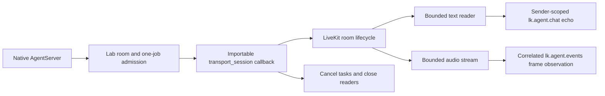
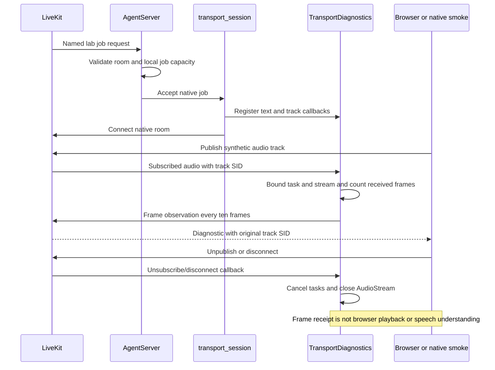

# Local transport diagnostic agent design

Status: Active
Last reviewed: 9 November 2026

## Overview

This implemented worker verifies actual self-hosted LiveKit text and audio
transport through the native Python Agents SDK. It echoes bounded text and reports
received audio-frame counts. It performs no STT, LLM, TTS, supplier execution,
channel recovery or specialist reasoning. No inference provider is required and
implicit local-model preloading is disabled.

The [shared design](../../Design.md), [transport fixture contract](../../contracts/README.md)
and [validation plan](../../docs/validation-plan.md) distinguish native transport,
browser playback and product evidence. Diagnostic success completes no product
acceptance requirement by itself.

## Objectives

| Type | Objective | Success evidence |
| --- | --- | --- |
| Business | Make local transport problems reproducible without model costs | Real SDK clients receive the expected sender-scoped echo and correlated frame observations |
| Business | Keep the demo honest about available capabilities | UI/docs identify deterministic diagnostics; no response is labelled model reasoning or speech playback |
| Technical | Reuse native room/job/track lifecycle | Importable AgentServer callbacks dispatch through the named SDK worker |
| Technical | Bound diagnostic resources and clean up on every exit | Per-job task/track caps, reader closure, duration bound and finite SDK shutdown settings |
| Technical | Preserve spawn/forkserver compatibility | A fresh interpreter can deserialize the actual registered callbacks |

## Functional requirements

| Type | Requirement | Current behavior and verification |
| --- | --- | --- |
| Business | Restrict work to synthetic lab rooms/participants | Room-name allowlist; text/audio sources must have browser- or smoke- identity prefixes; these prefixes are lab routing filters, not production authentication |
| Technical | Return native text to its sender | Read lk.chat up to 16 KiB UTF-8, return Echo text on lk.agent.chat with destination_identities; six prefix bytes give a separate 16,390-byte reply bound |
| Technical | Observe subscribed audio without retaining content | Bounded AudioStream counts frames; every ten frames emits type/audio-frame count/track SID on lk.agent.events |
| Technical | Stop readers when rejected, oversized or cancelled | Close text reader on every path; close audio stream in finally; cancel track task on unsubscribe |
| Technical | Admit one diagnostic room job locally | Native load/admission checks use MAX_JOBS=1; no idle model processes are created |
| Technical | End long-lived jobs and drain local tasks | Ten-minute room wait bound plus shutdown callback and final cleanup |

## Non-functional requirements

| Concern | Bound or target | Verification | Status |
| --- | --- | --- | --- |
| Text resources | 16,384 request bytes, 16,390 echo-reply bytes, ten-second read and five-second echo-send timeout | Shared producer/consumer fixture, exact UTF-8 byte edges, timeout/closure and destination tests | Implemented and covered by producer/consumer tests; actual maximum-size SDK traffic needs its own run |
| Per-job concurrency | Eight diagnostic tasks; at most four audio tracks | Capacity rejection and track removal tests | Implemented local cap |
| Audio buffering | 32 frames/stream, 16 kHz mono, requested 20 ms frames | Factory-argument/cleanup tests and actual synthetic track smoke | Implemented configuration; native overhead is separate |
| Job duration | Wait for disconnect for at most 600 seconds | Controlled timeout fixture and cleanup | Implemented |
| Worker resources | One active local job; memory warning 192 MiB, job limit 256 MiB; container limit 512 MiB | SDK configuration review plus actual runtime evidence | Configured; not proof of all memory peaks |
| Shutdown | SDK drain 20 s, process shutdown 8 s, session end 8 s | Unit cleanup plus actual stack shutdown/restart | Configured bounds; SDK and container clocks are separate |
| Observability | Finite JSON application events, fixed service/severity/code and at most two bounded count fields | Actual task/admission/session callback tests, secret sentinels, idempotence and logger-isolation tests | Implemented application logging; product metrics/traces planned |
| Media quality | Actual browser publication/playback and network-loss recovery need their own evidence | Browser/media lane, not native frame counts | Not established by this worker |

## Back-of-the-envelope calculations

The following uses configured frame parameters and labelled assumptions; it is
not a latency, memory benchmark or production capacity claim.

| Input/assumption | Calculation | Interpretation |
| --- | --- | --- |
| Requested frame duration 20 ms | 1 s / 0.020 s = 50 frames/s | Expected framing for a continuous fixture; actual reception must be measured |
| Diagnostic every ten received frames | 50 / 10 = 5 diagnostics/s/track | Four continuous tracks would emit about 20 diagnostic messages/s before loss/overhead |
| 16 kHz mono with assumed PCM16 storage | 16,000 × 0.020 × 2 = 640 bytes/frame | Arithmetic assumption for raw samples, not the complete SDK allocation |
| 32 buffered frames and four tracks | 32 × 640 × 4 = 81,920 bytes = 80 KiB | Raw-sample buffer estimate excludes Python, FFI, transport, decode and SDK process memory |
| Eight maximum-size text tasks, hypothetical all text | 8 × 16 KiB = 128 KiB accumulated text | Python strings/chunk lists/copies cost more; this is a payload bound, not RSS |
| Maximum request plus fixed ASCII Echo prefix | 16,384 + 6 = 16,390 reply bytes | Request and reply limits are separate; the browser chat consumer must accept the reply bound without enlarging diagnostic/API limits |

The worker container includes a parent/native runtime in addition to its job
process. Keep headroom between the 256 MiB job limit and 512 MiB container cap;
measure actual RSS before raising admission.

## High-level design

1. The thin module launcher passes an importable AgentServer to the native CLI;
   callbacks remain serializable in fresh worker processes.
2. The SDK owns job/room lifecycle. TransportDiagnostics owns only bounded local
   task and audio-reader state for that job.
3. Text and audio use native SDK streams. Audio diagnostics include track identity
   so a client can reject unrelated frame observations.
4. Unsubscribe, disconnect, duration expiry and shutdown converge on cleanup.
   There is no durable business scheduler or result store here.

## Sequence diagram

## Low-level design

```mermaid
classDiagram
    class AgentServer {
        +active_jobs
        +rtc_session()
    }
    class WorkerCallbacks {
        <<module>>
        +calculate_load(server)
        +accept_local_job(request)
        +transport_session(ctx)
    }
    class TransportDiagnostics {
        +on_text(reader, identity)
        +on_audio(track, track_sid)
        +remove_audio(track_sid)
        +close()
    }
    class BoundedTasks {
        +spawn(factory)
        +close()
    }
    class TextReader {
        +close()
    }
    class AudioStream {
        +aclose()
    }
    WorkerCallbacks --> AgentServer
    WorkerCallbacks --> TransportDiagnostics
    TransportDiagnostics *-- BoundedTasks
    TransportDiagnostics --> TextReader
    TransportDiagnostics --> AudioStream
```

WorkerCallbacks is a diagram grouping for module-level functions in worker.py,
not a new runtime class. Native reader/stream types belong to the SDK.

## Components and related details

### State ownership and layout

| Component | Owned state and source |
| --- | --- |
| __main__.py | Thin CLI launcher; imports the actual server and invokes the native command |
| worker.py | Native server, module-level load/admission/session callbacks, room duration and shutdown registration |
| transport.py | Per-job task set, per-track audio task map, bounded text read and frame observations |
| telemetry.py | Explicit dedicated application logger, fixed event/code vocabulary, numeric bounds and payload-free exception classification |
| ../../tests/test_rtc_agent.py and ../../tests/test_rtc_telemetry.py | Diagnostic fixtures, serialization, byte boundaries, capacity/cleanup, actual callback logging and original failure/cancellation propagation |

LiveKit owns room, participant, track and job truth. Local dictionaries are
ephemeral and cleared at job end. No task ID in this module is a workflow ID; a
room ending cannot cancel future accepted P1 business work.

### Interfaces and failure boundaries

Text readers close in finally; rejected text is closed before consumption when
the source or task cap fails. Audio receives no raw persistence path. Duplicate
track subscriptions and a fifth active track do not create another reader.
Unsubscribe cancels only the associated local task. BoundedTasks retrieves task
exceptions and logs distinct completion, failure and cancellation observations.
Logging does not consume the exception for an awaiter: the original failed task
still raises its original error. Connection setup now shares the session's final
cleanup boundary, so failed connect also closes local diagnostics.

Job admission, application task caps, native memory limits and Docker resource
caps protect different resources; no single check proves a distributed capacity
bound. This is a one-server lab, not multi-server media scale evidence.

## Security and privacy

Use local-setup managed credentials and allowlisted synthetic identities. Identity
prefixes reduce accidental lab traffic; they do not replace verified token grants
or production principal authorization. Echo is sent only to the original text
sender. Frame observations contain no audio sample data; clients validate the
SDK agent kind, schema and expected microphone track SID before presentation.

Do not log transcript chunks, room secrets, raw audio, token material or provider
messages. Treat inbound text as inert data, not instructions to invoke tools.
The worker has no booking-mutation, SMS or specialist capability.

## Observability

The dedicated services.rtc_agent.application logger is configured explicitly at
actual job-admission and session entry points. Importing the telemetry module
attaches no handlers. Repeated setup reuses its one application-owned handler;
it changes neither root logging nor native SDK logger configuration.

Application JSON records contain fixed service=rtc-agent, UTC timestamp, severity,
allowlisted event and code, with optional bounded integer active_tasks and
active_audio_tracks. No identity, room, track SID, input, credential, exception
text/representation or exception chain is serialized. Event/code pairs choose
the severity; callers cannot inject arbitrary labels or log context. Count fields
are independently validated as integers from 0 to 1,024, while real admission
remains eight tasks/four audio tracks. There is no persistent per-session context
to leak into the next record.

Normal completion/cancellation and session end are informational; expected input
or timeout task failures and rejections are warnings; transport/unexpected task
failures and ordinary session failures are errors. Pure unit consumers without
explicit worker startup do not fall back to root logging. Tests prove actual
entry points configure logging and actual task/session producers emit records.

Native SDK lifecycle logs and the health endpoint remain separate operational
signals. This application logger does not claim to sanitize or standardize every
SDK/infrastructure record. Product JSON event correlation, spans and export still
require their own real producers and verification.

Product adapters must later add producer-owned structured events, stable safe
error categories and bounded SDK-native session metrics under the
[observability contract](../../docs/observability.md). Do not infer tracing from
the optional Jaeger UI or present frame messages as conversation metrics.

## Metrics

| Signal | Unit/source | Meaning and limit |
| --- | --- | --- |
| audio.frames diagnostic | Cumulative received frames per track in the current job | Actual native reception observation, not a Prometheus counter or playback acknowledgement |
| Native load callback | min(active_jobs / 1, 1) | Local admission input; not durable business queue depth |
| Health endpoint | Native server HTTP readiness on container port 8081 | Worker process readiness, not successful ICE/media |
| Future conversation/transport error metrics | Fixed outcome/error-code dimensions with explicit units | Planned with real producers; no room/track/participant IDs as metric labels |

Track SID is a correlation field in the bounded diagnostic message; it must not
be promoted to a metric dimension. Compare actual expected frame observations
only within the same track/job, and measure elapsed durations monotonically.

## Exception handling

| Failure | Current handling | Required evidence |
| --- | --- | --- |
| Text oversize/timeout | Raise bounded input/timeout error, always close reader; task_failed with invalid_input/timeout code at warning severity | Reader closed, no echo and no private content logged |
| Text send/audio observation failure | Task completes as failure, logs fixed transport_error/unexpected_error, stream finally closes; no automatic logical replay | Capacity returns; original failed task still raises to its awaiter; no raw exception data in application logs |
| Track unsubscribe/shutdown | Cancel local task, log task_cancelled at info, and await gathered cleanup | Audio stream closes and task/track maps drain; cancellation is not an error |
| Task/track capacity or invalid source | Fixed stream_rejected event/code; close rejected text reader without queueing | No extra task/reader is allocated or source identity logged |
| Room duration expiry | Native ctx.shutdown with fixed safe reason; session_finished duration_limit observation | Deterministic timeout path and cleanup execute |
| Job rejection | Configure application logger, emit fixed invalid_room/job_capacity warning, reject without terminating the worker | Existing job remains healthy; rejection is not a business failure |
| Connection/session ordinary exception | Fixed session_failed code, then re-raise; final cleanup also runs if connect failed | Actual callback test preserves original exception identity with successful local cleanup |
| Cancellation/fatal BaseException | Cancellation has its own info end observation and propagates; fatal errors stay outside the ordinary exception catch | Actual callback tests prove cleanup and propagation, without secret exception rendering |

Cancellation is control flow and must propagate to cleanup. A diagnostic failure
does not authorize retrying supplier effects. Future product exception translation
belongs to the product adapter; it cannot relabel a failed diagnostic as a
completed live-model turn.

## Design considerations and trade-offs

| Decision | Benefit | Cost or limit |
| --- | --- | --- |
| Deterministic native streams | Isolate transport without paid/model dependencies | Does not test speech understanding, synthesis or agent quality |
| One job with no idle processes | Preserve local parent/native memory headroom | Deliberately low local concurrency; not production capacity |
| Module-level server callbacks | Spawn/forkserver-safe SDK lifecycle | Keep launcher thin; avoid relocating callbacks into __main__ |
| Fixed structured application vocabulary | Useful lifecycle/failure categories without payload/credential leakage | SDK logging stays separate; product correlation/export and detailed operational evidence remain later work |
| Frame diagnostic rather than audio echo | Establish actual inbound track receipt with little state | Cannot establish rendered audio, comprehension or delivery to a human |

## Validation and acceptance gates

1. Run the service command in [README.md](README.md), then full fast validation.
   Require normal echo, sender-only destination, multi-byte oversize, rejection,
   stream closure, cap enforcement, cancellation and fresh-interpreter callback
   serialization assertions.
   Logging tests additionally exercise real BoundedTasks failure/cancellation,
   actual admission/session callbacks, explicit setup, one-handler idempotence,
   logger/context isolation, finite schema/counts and secret-sentinel exceptions
   whose str/repr must never be read. Ordinary failures, cancellation and fatal
   BaseException paths must preserve propagation and cleanup.
2. Actual [local smoke](../../local-setup/README.md) must dispatch this worker,
   receive native text, publish a real synthetic track and match diagnostics to
   that track and SDK agent. The recorded native smoke also passed the exact
   16,384-byte UTF-8 request and 16,390-byte prefixed reply. Test children/resources
   must be cleaned up.
3. Browser microphone publication, denial/mute, cleanup, playback and network-loss
   recovery remain separate media gates. A native client/frame count cannot pass
   them. Actual browser input/playback evidence remains pending where unobserved.
4. Conversational AgentSession, product tools and model scenarios arrive through
   explicit implementation tasks. Missing, timed-out or skipped requirements
   remain non-passing, and deterministic diagnostics cannot pass a live lane.
